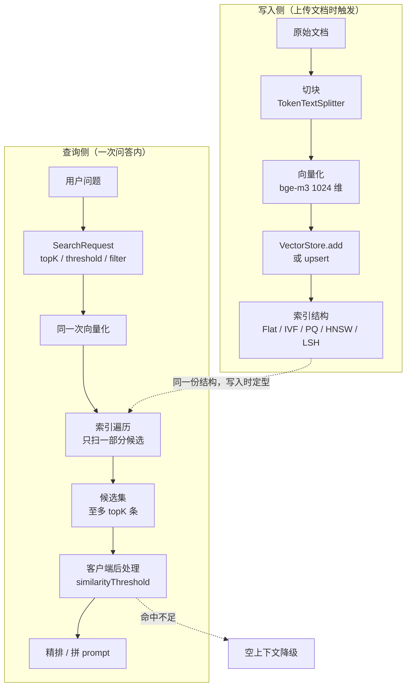
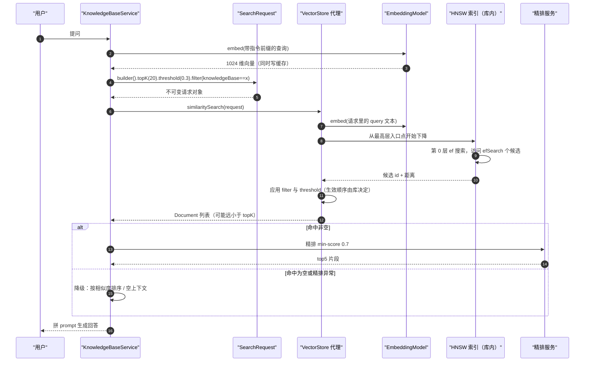

# 向量索引算法：全表扫描活不下去，而所有索引都靠拿召回率换速度

> **一句话结论**：向量索引没有"免费的精确检索"——Flat / IVF / PQ / HNSW / LSH 全都只能在「召回率、延迟、内存」三条边里砍一条换另外两条；HNSW 之所以成为事实标准，是因为它把代价压在**内存和构建时间**这两个可以预支的地方，而不是压在延迟上。
> **阅读前置**：先读 `02-RAG全栈实战/01-RAG检索增强生成.md`（知道 `SearchRequest`、topK、阈值、两阶段检索分别在哪），本篇不重复相似度计算与切块，只讲"从 topK 条候选里挑出来的那一步是怎么被近似的"。
> **证据基线**：Spring AI 2.1.0 源码摘录（A 级）+ 本仓 Chroma 0.5.20 配置与全部检索入口（B 级）+ 本机 node 24 离线脚本（C 级，算术与自写实现）；**本机没有 Chroma/Milvus 实例**，凡涉及向量库内部实现的结论一律标注"未入库"。预计阅读 45~55 分钟。

**证据边界（先说清楚哪些是查过的，哪些是查不到的）**

| 级别 | 来源 | 本篇用它证明什么 |
| --- | --- | --- |
| A 级（已入库） | `SearchRequest.java.md`、`VectorStore.java.md`、`VectorStoreRetriever.java.md` | topK / 阈值 / filter 在请求对象里的位置与语义；`VectorStore` 接口上**没有任何索引参数** |
| A 级（未入库，明确标注） | Chroma `ChromaVectorStore`、hnswlib、Milvus 索引实现 | 只讲参数的**语义**与影响方向，**不给库内默认值**（本仓无来源可核对） |
| B 级（本仓真实文件） | `docker-compose.yml`、`ai-cs-chat/src/main/resources/application.yml`、`VectorStoreConfig.java`、`KnowledgeBaseService.java`、`KnowledgeVectorService.java`、`SemanticCacheService.java`、`EmbeddingClusterService.java` | 本项目实际用的是哪种索引、几个副本、有没有分片、参数到底配在哪 |
| C 级（本机实测） | node 24 离线脚本（内存算术、IVF/HNSW 自写实现、过滤模拟） | 内存量级、扫描比例、召回率曲线；**全部是"自写实现 + 算术"，不是 Chroma 的实测结果** |

---

## 0. 先看现象

### 现象一：查询从 800 ms 掉到 8 ms，同时"该找到的文档找不到了"

一个 10 万条、1024 维的知识库，Flat（逐条算距离）检索的耗时是**一百毫秒量级起跳**（3.1 有本机实测），换成 HNSW 之后降到个位数毫秒——但这不是免费的。用 C 级脚本把 `efSearch` 从 4 调到 128，recall@10 会从 64.1% 一路爬到 99.7%：

```text
efSearch=4 recall@10=64.1%
efSearch=8 recall@10=64.3%
efSearch=16 recall@10=74.7%
efSearch=32 recall@10=88.1%
efSearch=64 recall@10=97.1%
efSearch=128 recall@10=99.7%
```

"加索引前召回 95%、加索引后 70%"不是索引写错了，是**索引的旋钮默认值偏保守**（`efSearch` 就是那个旋钮，见 3.5）。糟糕的是它**不报错、不告警**，接口照样返回 20 条，只是这 20 条质量下降了。

### 现象二：内存被"向量本体 + 图结构"一起吃满

本项目配置的是 Chroma 0.5.20 单容器（`docker-compose.yml#L194-L209`），集合名 `aics-knowledge`（`ai-cs-chat/src/main/resources/application.yml#L45-L51`）。10 万条 1024 维 float32 的向量本体是 **409.6 MB**，加上 HNSW 图结构指针（M=16 时 **132.3 B/点**，共 12.6 MiB）和元数据（按 300 B/条算 28.6 MiB），再加上进程堆与 WAL，实际常驻内存是"向量本体 ×1.2 以上"。很多人第一次扩容时才发现：**向量库吃的不是磁盘，是内存。**

### 现象三：删掉文档后，索引不收缩，召回也没变好

本项目的删除路径是表达式删除：

```java
// ai-cs-knowledge/src/main/java/com/aics/knowledge/service/KnowledgeVectorService.java#L103-L116
public boolean deleteByDocumentId(Long documentId) {
    if (documentId == null) {
        return false;
    }
    try {
        vectorStore.delete("documentId == '" + documentId + "'");
        log.info("按 documentId 删除向量: documentId={}", documentId);
        return true;
    } catch (Exception e) {
        log.error("按 documentId 删除向量失败: documentId={}, err={}", documentId, e.getMessage());
        return false;
    }
}
```

（注释在 `#L97-L98` 声称"保证 DB 删除后向量库无残留"。）但 HNSW 的删除是**标记删除**：节点被标记为 tombstone，图里的边不立刻重连，被回收的空间也不归还给操作系统。于是"删了 30% 文档，内存只降了一点，查询还是慢"，删除反而让图变得更稀疏、更不连通。Chroma 内部如何处理表达式删除与段压实**未入库**，本篇只讲这条语义，不编它的实现细节。

这些现象指向同一件事：**检索链路上唯一不保证"精确"的那一环被藏在向量库内部，而它的参数、内存、删除语义全部由库单方面决定，Spring AI 的接口上一个都看不见。**

---

## 1. 整体地图



> **读图说明**：图里最容易被看错的是两条边。第一条是 `Q5 --> Q6`：`similarityThreshold` 在**候选集之后**才生效，A 级摘录写得很死——"this is a post-processing step performed on the client not the server side"（[[源码:SearchRequest.java.md#L164-L178]]），所以调高阈值**不会**让 `Q4` 少扫、也不会降延迟。第二条是 `W5 -.-> Q4` 这条虚线：索引结构只在写入时定型一次（选型、参数、训练码本都发生在那边），查询侧除了 `efSearch` 这类搜索期参数之外**没有任何补救手段**。如果把这条虚线读成"查询时还能临时选索引"，你就会以为水平扩展靠加机器就行。

| 组件 | 责任（一句话） | 本项目实现 | 谁调用它 |
| --- | --- | --- | --- |
| 索引结构 | 决定"一次查询扫多少候选" | Chroma 内部的 HNSW（**未入库**，参数由集合 metadata 决定） | 向量库自身 |
| 向量库进程 | 存向量 + 图 + 元数据，执行检索 | `chromadb/chroma:0.5.20` 单容器（`docker-compose.yml#L194-L209`） | `VectorStore` 接口背后 |
| `VectorStore` 门面 | 屏蔽 provider 差异 | `ChromaVectorStore` + `LazyInitTargetSource` 代理（`ai-cs-chat/src/main/java/com/aics/chat/config/VectorStoreConfig.java#L58-L71`） | 业务代码 |
| `SearchRequest` | 承载 topK / 阈值 / filter | 全仓 7 个构造点 | 各业务 Service |
| `EmbeddingModel` | 保证查询与文档在同一空间 | bge-m3 1024 维（`ai-cs-chat/src/main/java/com/aics/chat/config/SpringAiConfig.java#L171-L204`） | 检索侧与入库侧 |
| 宽召回入口 | 把 topK 放大到 20 换召回 | `KnowledgeBaseService.searchRaw`（`ai-cs-chat/src/main/java/com/aics/chat/service/KnowledgeBaseService.java#L265-L279`） | `ChatService` |
| 精排 | 二次打分把 20 压到 5 | rerank `min-score: 0.7`（`tools/nacos-config/ai-cs-chat.yml#L11-L25`） | `KnowledgeBaseService.search` |
| 语义缓存 | 项目内"Flat 够用"的活样本 | `SemanticCacheService` 线性扫描 200 条（`ai-cs-chat/src/main/java/com/aics/chat/cache/SemanticCacheService.java#L63-L106`） | `ChatService` |
| 主题聚类 | 项目内"分桶"的活样本 | `EmbeddingClusterService` 质心归并（`ai-cs-knowledge/src/main/java/com/aics/knowledge/ops/EmbeddingClusterService.java#L63-L114`） | 知识库运维 |
| 连接配置 | 只给地址，不给索引参数 | `application.yml#L45-L51`（`initialize-schema: false`、`collection-name`、host/port） | Spring Boot |

---

## 2. 关键概念与关键要素

| 名称 | 位置 | 角色 | 关键点 |
| --- | --- | --- | --- |
| `SearchRequest` | A 级：`SearchRequest.java.md`（`DEFAULT_TOP_K = 4` 在 `#L49`，阈值默认 0.0 在 `#L44`） | 检索请求的唯一载荷 | topK 是"**要几条**"，不是"**扫几条**"——这是本篇最重要的区分 |
| `similarityThreshold` | A 级：`SearchRequest.java.md#L164-L178` | 客户端后处理阈值 | 不省服务端算力，只减少进 prompt 的条数 |
| `filterExpression` | A 级：`SearchRequest.java.md#L247-L250`、`#L286-L290` | 元数据过滤条件 | 写法是字符串表达式，由文本 parser 解析；它**落在索引遍历之前还是之后由向量库决定** |
| `VectorStore` | A 级：`VectorStore.java.md#L40`（`extends DocumentWriter, VectorStoreRetriever`） | 写 + 读的门面 | `add`/`upsert`/`delete` 里没有一个是索引配置 |
| `VectorStore.Builder` | A 级：`VectorStore.java.md#L137-L168` | 构建器 | 只有 observationRegistry / convention / batchingStrategy / build 四项 |
| `VectorStoreRetriever.similaritySearch` | A 级：`VectorStoreRetriever.java.md#L45` | 单条检索 API | javadoc 承诺"retrieve **exactly** the number of nearest-neighbor results"，索引做不到"恰好" |
| `ChromaVectorStore` | **A 级未入库** | Chroma 适配层 | 索引参数只能通过集合 metadata 下发，Spring AI 不透传 |
| hnswlib / `M` / `efConstruction` / `efSearch` | **A 级未入库** | Chroma 里 HNSW 的实现 | 三个参数的真实宿主；语义见 3.5，默认值本篇不给 |
| 集合 `aics-knowledge` | B 级：`ai-cs-chat/src/main/resources/application.yml#L45-L51` | 唯一向量集合（chat 与 knowledge 共用，见 `ai-cs-knowledge/src/main/resources/application.yml#L25-L34`） | 整段配置**没有任何索引参数** |
| `aics-chroma` 容器 | B 级：`docker-compose.yml#L194-L209` | 单机单副本 | 无分片、无副本、健康检查打 `/api/v1/heartbeat` |
| `SemanticCacheService` | B 级：`ai-cs-chat/src/main/java/com/aics/chat/cache/SemanticCacheService.java#L37-L38` | 项目内 Flat 实例 | 注释自认"n 上限 200 时每次查询 ≈ 200 次点积，微秒级可接受；规模上万应换成 HNSW" |
| `EmbeddingClusterService` | B 级：`ai-cs-knowledge/src/main/java/com/aics/knowledge/ops/EmbeddingClusterService.java#L27-L31` | 项目内分桶实例 | 注释写明"复杂度 O(n*k）"，k 是主题数——这就是 IVF 的雏形 |

一句话记住分工：**`SearchRequest` 决定"要几条"，索引参数决定"扫多少条"；两者谁更紧，谁说了算。**

---

## 3. 原理与证据逐段精读

### 3.1 精确检索（Flat）是基线：O(N·d) 到底有多贵

**在干什么**：Flat 把查询向量与库里每一条向量算一次距离，全排序取前 K。复杂度是 `N × d` 次乘加，没有任何前置结构，也没有任何近似——它的召回率是 100%。

**为什么这么设计**：因为它是最容易保证正确性的实现：不需要训练、不需要建图、插入即生效、删除即消失、内存只有向量本体。所以所有向量库都保留它作为兜底，也作为"ANN 到底损失了多少召回"的对照组。

**换成别的写法会怎样**：用 C 级脚本在本机测单次点积，再乘以条数（`node -e` 内联，pwsh 直接跑）：

```powershell
node -e "
const t=(D,iters)=>{const a=new Float64Array(D),b=new Float64Array(D);
 for(let j=0;j<D;j++){a[j]=Math.random();b[j]=Math.random();}
 let s=0;const t0=process.hrtime.bigint();
 for(let r=0;r<iters;r++){let x=0;for(let j=0;j<D;j++)x+=a[j]*b[j];s+=x;}
 return Number(process.hrtime.bigint()-t0)/iters;};
for(const [D,iters] of [[128,2000],[1024,1000]]){
  const ns=t(D,iters);
  console.log('dim='+D+' 单次点积 '+ns.toFixed(0)+' ns | 1万条 '+(ns*1e4/1e6).toFixed(1)+' ms | 10万条 '+(ns*1e5/1e6).toFixed(0)+' ms | 100万条 '+(ns*1e6/1e9).toFixed(2)+' s');
}
"
```

真实输出（本机 node 24，单线程，Float64Array，无 SIMD）：

```text
dim=128 单次点积 735 ns | 1万条 7.3 ms | 10万条 73 ms | 100万条 0.73 s
dim=1024 单次点积 995 ns | 1万条 10.0 ms | 10万条 100 ms | 100万条 1.00 s
```

**怎么读**：① 10 万条 1024 维在"朴素 JS 循环"下是 **100 ms**，这是一个上界——C++/SIMD 的向量库通常快 5~10 倍，即 10~30 ms 量级，仍然远高于一次问答想付的检索预算；② 128 维（本项目兜底 `HashEmbeddingModel` 的维度量级）便宜 10 倍，所以**降维度本身就是最便宜的加速手段**；③ 100 万条是 1 秒，说明"Flat 能用到十万级、百万级必须上索引"这个分界线是有算术支撑的，不是拍脑袋。

**常见坑**：把 Flat 的"100% 召回"当成"没有代价"——代价是每次查询都要把所有向量拉进 CPU。单条 4 KB × 10 万条，即使数据不落盘，CPU cache 也早被冲干净了，实测耗时往往比纯算术估算还差一截。

### 3.2 三种近似套路：分桶、图、量化

**在干什么**：所有 ANN（Approximate Nearest Neighbor，近似最近邻）索引都在减少"必须算距离的次数"，只有三条路：**分桶**（先粗筛一批桶，只桶内算）、**图**（从一个入口点贪心地走向更近的邻居）、**量化**（把向量压成几十字节，先比压缩码再回表）。IVF 属于分桶，HNSW 属于图，PQ 属于量化；真实系统常常组合，例如 IVF-PQ、HNSW+SQ8。

**为什么这么设计**：因为高维空间里"距离"的计算成本无法绕过（`d` 次乘加是物理下限），唯一能省的是**次数**。三条路分别省的是：分桶把 N 变成 N/nlist 的若干倍、图把 N 变成几百次访问、量化把每次比较的成本从 4 KB 降到几十字节。

**换成别的写法会怎样**：不用近似算法、改用"先降维再全扫"（PCA 到 64 维）也能把 100 ms 压到 6 ms 左右，但降维本身有一次性拟合成本和精度损失，且降维后的距离与原空间不再等价——实践中这条路线只在"维度极端高（>2000）且召回要求不高"时才会被考虑。

**常见坑**：本项目的 `EmbeddingClusterService` 就是活生生的"分桶"实现，类注释写得很老实：
"逐条处理，与已有主题质心比较，相似度 ≥ 阈值归入该主题并更新质心，否则新建主题；复杂度 O(n*k)"（`ai-cs-knowledge/src/main/java/com/aics/knowledge/ops/EmbeddingClusterService.java#L27-L31`）。**这里的 k 是主题数**：k 小的时候它比全扫便宜，k 涨到几百就退化成全扫——IVF 的 `nlist` 一旦选得和 N 同量级，也是同样的退化。分桶不是免费的，分桶的收益完全取决于"桶数远小于条数"。

### 3.3 IVF：`nlist` 与 `nprobe` 是两个旋钮

**在干什么**：IVF（Inverted File，倒排文件）先用 k-means 训练出 `nlist` 个质心，把每条向量挂到最近的质心（倒排表就是"质心 → 该桶内所有点"）。查询时找最近的 `nprobe` 个质心，只扫这些桶里的点。扫描量 ≈ `N × nprobe / nlist`，加速比 ≈ `nlist / nprobe`。

**为什么这么设计**：它把"训练"这一步显式暴露出来，换来一次成本可控的分治：训练一次 O(N·nlist·d)，之后每次查询只付 `nprobe/nlist` 的扫描量。代价是**训练质量决定召回上限**——这也正是面试里常问"IVF 上线后召回掉了"的根源。

**换成别的写法会怎样**：把 `nlist` 固定成 `√N` 是流传最广的经验公式（N=10 万 → 316）。用 C 级脚本按这个公式把扫描比例算出来（纯算术，见 6.6 第 (2) 条命令）：

```text
nlist=316 每桶 316.5 条 | p1=316(0.32%) p4=1266(1.27%) p8=2532(2.53%) p16=5063(5.06%) p32=10127(10.13%) p64=20253(20.25%)
nlist=1024 每桶 97.7 条 | p1=98(0.10%) p4=391(0.39%) p8=781(0.78%) p16=1563(1.56%) p32=3125(3.13%) p64=6250(6.25%)
nlist=4096 每桶 24.4 条 | p1=24(0.02%) p4=98(0.10%) p8=195(0.20%) p16=391(0.39%) p32=781(0.78%) p64=1563(1.56%)
```

真实模拟（N=20000、dim=64、nlist=64、40 个语义簇、10 轮 Lloyd 训练、100 次查询、topK=10，脚本见 6.6 第 (3) 条）：

```text
[训练后] 桶大小 min=14 平均=313 max=536 (N=20000 nlist=64 10 轮 Lloyd)
nprobe=1 recall@10=74.2% 平均扫描 389 条 (1.9%)
nprobe=2 recall@10=89.6% 平均扫描 685 条 (3.4%)
nprobe=4 recall@10=94.7% 平均扫描 1177 条 (5.9%)
nprobe=8 recall@10=96.2% 平均扫描 2521 条 (12.6%)
nprobe=16 recall@10=99.4% 平均扫描 4961 条 (24.8%)
```

**怎么读**：① 扫描量确实随 `nprobe` 线性增长（1.9% → 24.8%），召回率却**先陡后平**——从 1 → 2 涨 15 个百分点，从 8 → 16 只涨 3 个百分点，**拐点在 nprobe≈4~8**；② 桶大小 min=14、max=536，相差 38 倍，说明"每个桶一样大"是幻想，**扫描量由最大的那几个桶决定**，这就是 IVF 尾延迟的来源（本项目示例里 nprobe=1 的平均扫描 389 条，比理想的 20000/64=312 条高 25%）。

**常见坑**：同一个模拟去掉训练（质心直接随机抽 64 个点），nprobe=1 的 recall@10 只有 **29.4%**。也就是说"IVF 召回低"十有八九不是 `nprobe` 的问题，而是**训练集太小 / 训练轮数太少 / 数据分布漂移后没重训**。换数据（例如新增了一个知识库）之后必须考虑重训，否则质心还停在旧分布上。

### 3.4 PQ：把一条向量压成几十个字节

**在干什么**：PQ（Product Quantization，乘积量化）把 `d` 维切成 `m` 段，每段单独做 k-means，用 8 bit 记录"这段属于哪个子中心"。于是一条 1024 维 float32（4096 字节）的向量可以被压成 `m` 字节——m=64 时是 64 字节。查询时用 ADC（Asymmetric Distance Computation，非对称距离计算）：查询向量不压缩，对每一段预先算好"查询段到 256 个子中心的距离表"，然后查表累加。

**为什么这么设计**：它换的是**内存**这条边。分桶和图都要求原始向量常驻内存才能算精确距离，PQ 让"一亿条向量"第一次有机会塞进单机内存。代价是距离有量化误差，且这个误差**不可逆**——召回损失是结构性的，不是调参能补回来的。

**换成别的写法会怎样**：C 级算术（见 6.6 第 (2) 条命令的真实输出）：

```text
float32 390.6 MiB (基准)
SQ8 1B/维 -> 1024 B/条 -> 97.7 MiB (4x)
PQ m=64 (16 维/段, 256 子中心) -> 64 B/条 -> 6.1 MiB (64x)
PQ m=32 (32 维/段, 256 子中心) -> 32 B/条 -> 3.1 MiB (128x)
```

**怎么读**：① SQ8（每维 1 字节标量量化）是"几乎无损换 4 倍内存"，PQ 是"明显有损换 64~128 倍内存"；② 工程上的常规组合是 **PQ 当粗筛 + 原始向量当精算（rerank）**，也就是"用压缩码找出 100 个候选，再用原向量把这 100 个重排"——本项目其实已经在应用层做了类似的事（宽召回 20 条 + 精排），只是压缩发生在精排阶段而不是索引阶段。

**常见坑**：把 PQ 当成"压缩存储"用，然后直接用 PQ 距离代替真实相似度，结果发现 topK 里混进了很多不相关文档。PQ 的正确用法是**候选集生成**，最后一步一定要用原向量或更贵的模型重排。

### 3.5 HNSW：分层图 + 三个参数，为什么它成了默认

**在干什么**：HNSW（Hierarchical Navigable Small World，分层可导航小世界图）给每个点随机分配一个最高层号，第 0 层包含所有点，越往上点越少。查询从最高层的入口点开始，每层贪心地走到"更近的邻居"，然后下降一层继续，直到第 0 层做一次 `ef` 宽度的候选池搜索。它同时借了两个东西：跳表的分层（用层数换 `log N`）和小世界图的"长边 + 短边"（用少数远跳快速接近目标）。

**为什么这么设计**：因为它把成本结构调成了"查询极便宜、写入和内存贵"。查询只需要几百次距离计算（与 N 只成对数关系），不需要训练码本，插入是增量的（不要求全量重建）——这三点完美匹配"读多写少"的知识库场景，所以它成了几乎所有向量库的默认索引。

三个参数的分工（语义是教材级的，**具体默认值各库不同且本仓未入库，本篇不给数字**）：

| 参数 | 什么时候用 | 调大之后 |
| --- | --- | --- |
| `M` | 建图时 | 每点保留更多邻居：召回↑、内存↑（近似线性）、构建↑ |
| `efConstruction` | 建图时 | 每个点考察更多候选、边选得更好：召回↑、构建时间↑、查询与内存不变 |
| `efSearch` | **查询时** | 候选池更大：召回↑、延迟↑（近似线性）、内存与构建不变 |

**换成别的写法会怎样**：用 C 级脚本自写了一个简化 HNSW（N=2000、dim=32、M=8、efConstruction=64、200 次查询，脚本见 6.6 第 (4) 条），`efSearch` 扫一遍：

```text
构建 N=2000 D=32 M=8 efConstruction=64 -> 1065 ms, 平均 0.53 ms/点
efSearch=4 recall@10=64.1%
efSearch=8 recall@10=64.3%
efSearch=16 recall@10=74.7%
efSearch=32 recall@10=88.1%
efSearch=64 recall@10=97.1%
efSearch=128 recall@10=99.7%
```

**怎么读**：① **efSearch=4 和 8 的结果几乎一样（64.1% vs 64.3%）**，因为脚本里写了 `Math.max(EF, TOP)`——`efSearch` 小于 `topK` 时会被顶到 `topK`，等于**无效配置**。这是"efSearch 必须 ≥ topK"最直接的实测证据，也是线上最常见的配置错误。② 收益拐点在 32~64：64 相比 16 多 22 个百分点，128 相比 64 只多 2.6 个百分点——**所以 efSearch 调到 64 通常是最划算的一档**。③ 构建耗时 0.53 ms/点，这个数在 3.11 会被外推成"10 万条要几分钟"。

**常见坑**：把"加索引后召回从 95% 掉到 70%"归咎于"向量模型变差了"。真实顺序应该是先看 `efSearch` 与 `topK` 的关系（最常见的错就是 `efSearch` 没配、用了库默认值，而默认值常常等于 10~40 的小数），再看 `M`/`efConstruction`（这两个只影响图质量，改它们要重建索引），最后才怀疑模型。

### 3.6 LSH：哈希桶，以及它为什么退场

**在干什么**：LSH（Locality-Sensitive Hashing，局部敏感哈希）用一族随机超平面把空间切很多刀，每刀给出 1 bit，`b` 个哈希函数给出 `b` 位签名；签名相同的点落进同一个桶。查询时用同样的签名找桶。它的保证是概率性的：相似的点以高概率同桶，不相似的以低概率同桶。

**为什么这么设计**：它是唯一**不依赖距离计算**的索引——哈希是位运算，桶查找是哈希表查找，理论上可以极快。而且它天然可并行、可增量，不需要训练（只需要固定的随机超平面）。

**换成别的写法会怎样**：它的致命弱点是**召回率随 `b` 指数衰减且难以调**：`b` 小则桶巨大（退化成全扫），`b` 大则"相似但不同桶"的点永远找不回来。工程上为了补召回要做多表（multi-probe / 多组签名），内存和复杂度立刻上来。所以除了"超大规模、内存极度受限、召回要求宽松"的场合（去重、近似聚类），主流向量库已经不用 LSH 做主索引了——**这也是一个"理论优雅但工程吃亏"的典型例子**。

**常见坑**：看到"O(1) 查询"就以为 LSH 最优。它的 O(1) 是**桶查找**的复杂度，不含"漏召回"的代价；而漏召回在 RAG 场景里等于"用户问的东西库里有、但检索不到"，属于 7 种失败里最难排查的一类。

### 3.7 参数三角：召回率、延迟、内存，动一个必动另一个

**在干什么**：把上面所有参数摊到同一张表里，看每个旋钮到底动哪条边。这张表是本篇的核心——**没有任何一行是"三个都变好"的**。

| 参数 | 调大之后发生什么 | 召回率 | 单次延迟 | 内存 | 构建时间 |
| --- | --- | --- | --- | --- | --- |
| HNSW `M` | 每点邻居更多，图更稠密 | ↑ | ↑（每次访问要比更多邻居） | ↑↑（12.6 → 24.8 MiB，见 3.11） | ↑ |
| HNSW `efConstruction` | 建图时考察更多候选 | ↑ | 不变 | 不变 | ↑↑ |
| HNSW `efSearch` | 查询候选池更大 | ↑（实测 64.1% → 99.7%） | ↑ 近似线性 | 不变 | 不变 |
| IVF `nlist` | 桶更细 | nprobe 不变时 ↓（漏桶概率↑） | ↓（桶更小） | ↑（质心表） | ↑（训练更久） |
| IVF `nprobe` | 扫更多桶 | ↑（74.2% → 99.4%） | ↑ 近似线性 | 不变 | 不变 |
| PQ `m`（段数） | 每段更短、码字更长 | ↑（量化误差↓） | ↑（距离表更大） | ↑ | ↑（多份码本） |
| 开 SQ8 / PQ | 每维 1B / 每段 1B | ↓（量化误差） | 略↓（比较更快） | ↓↓↓（4× / 64×） | ↑（训练码本） |
| 分片数 `S` | 每片更小、可并行 | 基本不变（各片取 topK 后归并） | ↓（并行） | 不变（**副本**才放大） | ↑（多次构建） |
| filter 选择性 ↓ | 能匹配的文档占比变小 | ↓↓（按 `(1-sel)^topK` 衰减） | 不变 | 不变 | 不变 |

**为什么这么设计**：三条边之所以互相牵制，根子在"距离计算的次数 × 每次的成本"这个乘积上：想少算（延迟），就得少看（召回）或者看得更便宜（量化，损精度）或者提前组织数据（内存、构建时间）。所以任何号称"三个都优"的方案，一定是在**别的维度**上付了钱——比如 DiskANN 用 SSD 换内存、GPU 索引用显存和冷启动换延迟。

**换成别的写法会怎样**：最省事的"假优化"是只调 `topK`。但 `topK` 决定的是"返回几条"，与"扫多少条"无关（3.12 会证明接口层只暴露了 topK）。把 topK 从 20 降到 5，延迟几乎不变，召回反而更差——**这是最容易做、也最没有收益的一次调参**。

**常见坑**：在**没有 baseline** 的情况下调参。正确做法是先把索引固定成一种、跑出一组（recall@K, p99 延迟, 内存）三元组作为基线，之后每次只动一个旋钮。否则你无法区分"召回掉了"是索引参数导致还是数据变化导致。

### 3.8 过滤与索引的相互作用：后置过滤召回崩塌，前置过滤索引失效

**在干什么**：RAG 场景几乎**不可能裸检索**——本项目每一条检索都带 `filterExpression`：

```java
// ai-cs-chat/src/main/java/com/aics/chat/service/KnowledgeBaseService.java#L269-L276
SearchRequest searchRequest = SearchRequest.builder()
        .query(retrievalQuery)
        .topK(topK)
        .similarityThreshold(threshold)
        .filterExpression("knowledgeBase == '" + knowledgeBase + "'") // 只检索当前知识库
        .build();

List<Document> results = vectorStore.similaritySearch(searchRequest);
```

**为什么这么设计**：过滤是业务正确性的要求（不许多知识库串味）。但"过滤"和"索引"天生冲突：索引是为"全体向量"建的，过滤条件却把可用集合缩到一小块。于是只有两种实现顺序，坏处各不相同：

- **后置过滤（post-filter）**：先按索引取 topK，再按条件筛。实现简单、索引结构不动；但 topK 是**过滤前**取的，一旦条件选择性低（比如一个只占 1% 的知识库），topK 条里几乎全是别的知识库的文档，筛完就空了。
- **前置过滤（pre-filter）**：先按条件取子集，再在子集里做 ANN。召回正确；但图结构是全库建的，子集内图的连通性被破坏，很多库在这种情况下**直接退化成暴力扫描**（索引失效），延迟反而比 Flat 还差（还多了一次子集构建）。

**换成别的写法会怎样**：C 级模拟把两者摆在一起（N=20000、dim=128、topK=10、50 次查询、随机独立标签，脚本见 6.6 第 (3) 条命令的另一半）：

```text
选择性 1% | 后置过滤命中 0.18/10 空结果率 82% | 理论 P(>=1)=9.6% | 前置过滤(先筛后取) 10.00/10
选择性 5% | 后置过滤命中 0.56/10 空结果率 60% | 理论 P(>=1)=40.1% | 前置过滤(先筛后取) 10.00/10
选择性 20% | 后置过滤命中 1.56/10 空结果率 10% | 理论 P(>=1)=89.3% | 前置过滤(先筛后取) 10.00/10
```

**怎么读**：① 后置过滤的命中条数近似服从 `topK × sel`，空结果率近似 `1 - (1-sel)^topK`——**1% 选择性下 10 条里平均命中 0.18 条、82% 的查询直接空**；② 这不是"抽查运气不好"，是数学必然，所以"某个小知识库总是答不出来"几乎一定是这个原因；③ 反过来，前置过滤永远能取满 10 条，代价写在延迟上（索引失效）。

**常见坑**：把"召回空"当成"阈值设太高"。本项目的阈值是 0.3（`ai-cs-chat/src/main/java/com/aics/chat/service/KnowledgeBaseService.java#L95-L99` 的 `recallTopK=20` / `recallThreshold=0.3`），已经很低了；真正的杀手是 **topK=20 + 后置过滤 + 小知识库**这个组合：20 × 1% = 0.2 条，阈值降到底也没用。**判断口径**：如果返回条数总是远小于 topK，而库里明明有匹配文档，那问题在过滤与 topK 的配合，不在阈值。Chroma 的 `where` 到底下推到哪一步**未入库**，本篇不给结论；验证办法就是上面这个口径，用一条 1% 选择性的查询看返回条数。

### 3.9 增量插入与删除：为什么 HNSW 的删除是"标记删除"

**在干什么**：插入时 HNSW 不走 `efSearch`，走 `efConstruction`——新点从入口点贪心下降，在每一层用 `efConstruction` 宽度的候选池找邻居，然后双向连边，邻居超过 `M`（第 0 层是 `2M`）就裁掉最远的。删除时，节点被标记为 tombstone（墓碑），查询跳过它，但**边不立刻重连、内存不归还**。

**为什么这么设计**：图的正确性依赖"邻居是近邻"这个不变量。真正删除一个节点会让它的邻居少一条边、可能变得不连通，要修复就得局部重连，而重连又要搜索——在高并发写入下这是灾难。标记删除把"逻辑删除"和"物理回收"解耦：写入路径永远只做加法，重建（rebuild/compact）放到离线。

**换成别的写法会怎样**：Flat 的删除是真正释放（数组里挪走或置空），IVF 的删除是桶内标记（桶不重训）。这就是为什么"同一个业务，换索引后运维成本完全不同"：Flat/IVF 删除便宜、HNSW 删除便宜但**空间不便宜**、PQ 删除最便宜（只删码字）。本项目的删除走的是表达式删除（`KnowledgeVectorService.java#L109` 的 `vectorStore.delete("documentId == '...'")`，A 级同族 API 见 [[源码:VectorStore.java.md#L95]]），语义清晰，但具体触发了库内多少扫描、段什么时候压实，**未入库**。

**常见坑**：把"删除成功"当成"空间回收了"。HNSW 下删除 30% 之后：① 内存不降；② 图变稀疏、召回下降（能走的边少了）；③ 查询可能变慢（访问到墓碑要跳过）。**所以删除型业务（会话记忆、临时知识、频繁纠错）必须规划"定期重建"这条运维动作**，而不是指望 delete 自己收拾干净。

### 3.10 分片与副本：两条完全不同的扩容路径

**在干什么**：分片（shard）是把 N 条向量切成 S 份，每份一个独立索引；查询打给所有分片，每片各返回 topK，最后归并再取 topK。副本（replica）是把同一份数据复制 R 份，用于并发查询与故障转移。

**为什么这么设计**：分片解决"内存装不下 / 构建时间太长"（每片 N/S，内存和构建时间都近似除 S）；副本解决"QPS 不够 / 单点故障"（读吞吐近似乘 R）。两者互不替代：**分片不提升召回，副本不提升召回，只有"每片的 topK"和"归并策略"影响结果**。

**换成别的写法会怎样**：分片的代价藏在归并里——如果每片只返回 topK，全局 topK 一定正确（每片的前 K 必然是全局前 K 的子集），但如果某片因为过滤几乎没结果，归并后仍然不足 K 条。副本的代价是**内存乘 R**：R=3 时 409.6 MB 的向量本体变成 1.2 GB，而 ANN 索引全在内存里，这个乘法很痛。这就是"读多写少的 RAG 常常选 1 副本 + 分片"，而"高并发在线检索需要 3 副本 + 分片"的原因。

**常见坑**：本项目的情况必须说清楚——`docker-compose.yml#L194-L209` 里 chroma 是**单容器、单副本、无分片**，`volumes: chroma-data:/chroma/chroma` 只保证重启不丢数据。这意味着：① 单点，挂了就没有 RAG；② 单机内存上限就是知识库规模上限；③ 没有任何横向扩容路径，只能换库（Milvus/Qdrant）或加机器重部署。这不是"配置没调好"，是**架构选择**，第 5 节会把它记成一条取舍。

### 3.11 构建时间与内存估算公式

**在干什么**：给两个可以直接套的公式，让"这个知识库要多少内存、建多久"变成算术题而不是玄学。

- 内存 ≈ `N × d × 4`（float32 向量本体）+ `N × (M0 × 4 + 上层边 × 4)`（图指针）+ `N × 元数据字节` + 进程/段/缓存开销。
- 构建时间 ≈ `N × log(N) × efConstruction × d × c`（c 是常数，实测标定）。

**为什么这么设计**：因为这两个量都是**线性于 N**（除了构建时间的 log 因子），所以只要算出"单条成本"，任何规模都能外推。工程上最有用的一个数就是"**每条多少字节**"。

**换成别的写法会怎样**：C 级脚本实算（N=100000、dim=1024；脚本见 6.6 第 (2) 条命令）：

```text
[1] 向量本体 N=100000 dim=1024
float32 4096 B/条 -> 409.6 MB / 390.6 MiB
float64 8192 B/条 -> 819.2 MB / 781.3 MiB
元数据 300 B/条 -> 28.6 MiB
[2] HNSW 图结构指针 (M0=2M, int32=4B, mL=1/lnM)
M=8 M0=16 mL=0.4809 期望层数=1.143 layer0=64 B + 上层=4.6 B = 68.6 B/点 -> 6.5 MiB (占向量本体 1.7%)
M=16 M0=32 mL=0.3607 期望层数=1.067 layer0=128 B + 上层=4.3 B = 132.3 B/点 -> 12.6 MiB (占向量本体 3.2%)
M=32 M0=64 mL=0.2885 期望层数=1.032 layer0=256 B + 上层=4.1 B = 260.1 B/点 -> 24.8 MiB (占向量本体 6.4%)
M=48 M0=96 mL=0.2583 期望层数=1.021 layer0=384 B + 上层=4.1 B = 388.1 B/点 -> 37.0 MiB (占向量本体 9.5%)
```

**怎么读**：① 每条向量的"全成本"≈ 4096 + 132 + 300 ≈ 4528 B（M=16），10 万条 ≈ 432 MB，**1000 万条 ≈ 43 GB**——这就是单机内存的上限感；② 图指针只占 3.2%，**真正吃内存的是向量本体**，所以"降维度 / 上量化"比"调 M"有效得多（维度从 1024 降到 512 直接省一半）；③ 构建时间：实测 0.53 ms/点（N=2000、D=32、efConstruction=64、单线程 node），按 O(N log N) 外推到 10 万点约 **161 s**（同一脚本输出）。真实 hnswlib 是 C++ 多线程，会快一个量级，**这个数只给数量级参考，不是 Chroma 的实测值**。

**常见坑**：按"向量本体"申请内存。真实占用 = 向量本体 + 图 + 元数据 + 段/WAL + 查询时的候选缓冲，留 1.5 倍余量是底线；另外**构建期内存峰值高于稳态**（建图时临时候选池、以及批量 add 的缓冲），扩容按构建期算才安全。

### 3.12 为什么 Spring AI 的接口里找不到索引参数

**在干什么**：`VectorStore` 是"写 + 读"的门面，A 级摘录里它的全部方法签名是 `add` / `upsert` / `delete` / `similaritySearch` / `getName` / `getNativeClient`，一个索引参数都没有；`VectorStore.Builder` 只有四项：

```java
// (src: VectorStore.java.md#L137-L168)
public interface Builder<T extends VectorStore> {
    Builder<T> observationRegistry(ObservationRegistry observationRegistry);
    Builder<T> customObservationConvention(VectorStoreObservationConvention customObservationConvention);
    Builder<T> batchingStrategy(BatchingStrategy batchingStrategy);
    T build();
}
```

**为什么这么设计**：因为索引参数是"provider 的私事"。Chroma 用集合 metadata、Milvus 用 index 类型 + 参数、pgvector 用 `CREATE INDEX ... USING hnsw (m=..., ef_construction=...)`，语法完全不通用。Spring AI 只承诺接口，把 `getNativeClient()` 留成逃生通道（[[源码:VectorStore.java.md#L126-L128]]）：需要碰索引参数时，你退出抽象层。

**换成别的写法会怎样**：本项目的做法是把整个抽象层都吃掉——全仓扫一遍索引参数 token（`hnsw` / `nlist` / `nprobe` / `efConstruction` / `efSearch` / `IVF_FLAT` 等，798 个 `.java/.yml/.xml/.properties/.json/.ps1` 文件）：

```text
scanned files: 798
index-param token hits: 1
ai-cs-chat/src/main/java/com/aics/chat/cache/SemanticCacheService.java:38: *       规模上万应换成向量库 HNSW 索引（Redis Stack / Chroma 均可），本实现刻意保持零额外依赖。</li>
```

**怎么读**：唯一一处命中是**注释**，不是配置。也就是说本项目**从未显式配置过任何索引参数**——`aics-knowledge` 集合的 HNSW 参数全部是 Chroma 的默认值。这解释了两件事：① "为什么改不了召回"（旋钮不在我们的仓库里）；② "为什么换个库要重新评估召回"（默认值换了）。要让召回可调，只有三条路：写集合 metadata（Chroma 支持 `hnsw:space` / `hnsw:M` / `hnsw:construction_ef` / `hnsw:search_ef` 这组键，**具体默认值本仓无来源，未入库**）、升级到 `getNativeClient()` 直接操作、或换库时把参数写进部署清单。

**常见坑**：以为"用 Spring AI 就不用懂索引"。抽象层能屏蔽 API，屏蔽不了**默认值的后果**：默认索引类型、默认 `efSearch`、默认距离函数（`l2` 还是 `cosine`）全都在你看不见的地方决定了召回率。本项目用 bge-m3 产出的向量是归一化的，`l2` 与 `cosine` 排序等价，这条运气很好；换成未归一化的模型就必须确认 `hnsw:space`，否则"分数全都很高、排序乱"。

---

## 4. 一次完整执行时序



> **读图说明**：最关键的是第 5~10 步。请求进到索引那一刻，`topK=20` 只是"要 20 条"，真正决定这次查询花多少时间的是第 9 步——`efSearch` 决定了第 0 层搜多宽的候选池。如果你把 topK 当扫描量，就会得出"把 topK 从 20 降到 5 能降延迟"的错结论（实测几乎不降，3.7 讲过）。第二个容易漏的是第 12 步：filter 与 threshold 写在同一行 builder 里，但它们的生效位置完全不同——`threshold` 是纯客户端后处理（A 级 javadoc 写死），filter 则是库内的事；把两者读成"同一层过滤"会让你在排查空结果时只盯阈值。

**哪一步失败会报什么错**（按上表编号）：

| 失败步骤 | 现象 | 错误 / 日志 | 用户感知 |
| --- | --- | --- | --- |
| 4 查询向量化 | 检索直接抛异常 | embedding 服务的 4xx/5xx，本项目 `CachingEmbeddingModel` 缓存未命中时才打出去 | "服务繁忙" |
| 8 索引未就绪 | 启动即失败或首次查询失败 | `VectorStoreConfig.java#L33-L36` 记录的"连不上远端集合"（2.1 的 `ChromaVectorStore` 是 `InitializingBean`） | 服务起不来（已被 `LazyInitTargetSource` 代理挡了一部分） |
| 9 `efSearch` 太小 | **不报错**，返回 20 条但内容跑偏 | 无日志 | 答非所问，且看起来"检索明明命中了" |
| 11 后置过滤清空候选 | 返回 0 条 | `知识库[xxx]宽召回完成: 命中0条`（`KnowledgeBaseService.java#L277`） | 答"没有相关资料" |
| 12 精排失败 | 静默降级 | `log.warn`（`KnowledgeBaseService.java#L251-L253`） | 质量下降，无任何提示 |

---

## 5. 设计取舍

| 决策点 | 本项目选择 | 换来什么 | 付了什么代价 | 证据 |
| --- | --- | --- | --- | --- |
| 索引类型 | 不选，直接用 Chroma 默认（HNSW） | 查询快、无需训练、增量可插 | 内存高、构建慢、删除不收缩、参数不可见 | `application.yml#L45-L51`（无任何索引参数）+ 3.12 的扫描结果 |
| 召回策略 | `topK=20` 宽召回 + 精排压到 5 | 召回优先，符合 RAG"宁可多取"的取向 | token 与延迟；且后置过滤时 20 条可能全废 | `KnowledgeBaseService.java#L95-L99` |
| 阈值语义 | `similarityThreshold=0.3` 客户端后处理 | 实现简单、可随时调 | 不省服务端算力，调高只是二次砍条数 | [[源码:SearchRequest.java.md#L164-L178]] |
| 过滤方式 | 每条查询带 `filterExpression`（元数据） | 多知识库隔离、ACL 的基础 | 选择性低时召回按 `(1-sel)^topK` 衰减 | `KnowledgeBaseService.java#L269-L274` |
| 部署形态 | 单机单容器 Chroma 0.5.20 | 零运维、本地开发友好 | 无分片、无副本、无 HA，内存上限＝单机 | `docker-compose.yml#L194-L209` |
| 小规模检索 | 语义缓存用 Redis 线性扫描（n≤200） | 零额外依赖，200 次点积 ≈ 0.2 ms | n 上万即退化，需换库 | `SemanticCacheService.java#L37-L38`、`CacheProperties.java#L33` |
| 删除语义 | 表达式删除 `documentId == '...'` | 语义清晰、可批量 | 库内扫描 + 图不收缩，需定期重建 | `KnowledgeVectorService.java#L103-L116` |
| 写入流程 | 切块后直接 `add`，不等训练 | 简单、实时可见 | 若换成 IVF 类索引，必须补"训练 + 重建"这一步 | `KnowledgeVectorService.java#L85` |

**可扩展点清单（按"改了会不会动别人"从低到高排序）**：

1. **写一个内存估算脚本**并纳入运维文档：给定 N/d/维度/M，输出每条字节与总内存，扩容前先算。
2. **给集合补索引 metadata**：把 `hnsw:space` 与 `hnsw:search_ef` 显式写进配置（当前全靠默认），并在 README 记录"为什么是这个值"。
3. **加一条"返回条数 / topK"比率指标**：比率长期远小于 1 就是在提醒"过滤 + topK 不匹配"，这是 3.8 的线上化检测。
4. **把 `recallTopK` 与知识库规模挂钩**：小知识库自动放大 topK（`topK ≥ K_target / sel`），而不是全局固定 20。
5. **给删除路径加"重建触发器"**：当删除比例超过阈值（例如 20%）时排一次 collection 重建任务。
6. **换索引类型**（IVF/PQ/量化）：需要同时改写入流程（训练、码本版本、重建），影响入库延迟与召回评估基线。
7. **拆库 / 上分片**：从单机 Chroma 换到 Milvus/Qdrant 或自建分片，动的是部署与 `VectorStoreConfig` 整个装配层。
8. **引入评估门禁**：把 recall@K 与 p99 延迟做成离线评估的固定指标，任何索引参数变更先过门禁再上线。

---

## 6. 踩坑与调试手法

### 6.1 坑：把 topK 当扫描量

`SearchRequest.topK` 只表达"返回几条"，A 级摘录里它的校验只有"topK ≥ 0"（`#L158-L162`），与扫描量无关。真正决定扫描量的是索引的搜索期参数（HNSW 的 `efSearch`、IVF 的 `nprobe`）。**现象**：把 topK 从 20 调到 5，延迟没变，召回变差。**解法**：调 topK 只在"上下文太长/token 太贵"时做，降延迟要去动 `efSearch`/`nprobe`。

### 6.2 坑：以为调高 threshold 能降延迟

javadoc 原文"this is a post-processing step performed on the client not the server side"（[[源码:SearchRequest.java.md#L164-L178]]）。**现象**：把阈值从 0.3 提到 0.7，p99 一点没降，反而出现更多空结果。**解法**：阈值只用来"少喂几条给模型"，降延迟必须动索引参数或减少扫描量。

### 6.3 坑：`filterExpression` + 小 topK = 稳定空结果

3.8 的模拟已经量化：选择性 1% 时 20 条里平均命中 0.18 条。**现象**：某个新建的小知识库永远答"没有资料"，而同样的问法在大知识库里正常。**验证**：把同一条查询的 `filterExpression` 去掉再跑一次，如果立刻有结果，就是过滤与 topK 的配合问题。**解法**：按 `topK ≥ K_target / sel` 放大 topK（本项目 `recallTopK=20`、`recallThreshold=0.3` 就在 `KnowledgeBaseService.java#L95-L99`，改动只涉及两个字段）；或改用"按知识库分集合/分区"，让索引本身变小。

### 6.4 坑：删了文档，内存和延迟都没变好

HNSW 是标记删除：节点变墓碑，边不重连，空间不归还（3.9）。**现象**：删除 30% 文档后内存几乎不降，召回反而变差。**验证**：对比"删除前/后"的进程 RSS 与集合条数——条数降而 RSS 不降，就是墓碑在占位。**解法**：定期重建（重建后 RSS 会回到与条数匹配的水平），或把"易变数据"（会话记忆、临时知识）放到独立的、可整体丢弃的集合里。

### 6.5 坑：换索引类型却不改写入流程

HNSW 插入是增量的，IVF/PQ 需要"训练码本"，训练集和码本版本都要管。本项目现在能"上传即检索"，是因为索引**不需要训练**（`KnowledgeVectorService.java#L85` 直接 `add`）。**现象**：把索引换成 IVF 后，新文档的召回明显差于老文档（新数据落在旧质心上）。**解法**：写入路径加"训练/重训"阶段，并给码本打版本号；召回评估必须覆盖"最近 7 天新增"的子集。

### 6.6 三条离线自查命令（不需要启动任何服务）

**(1) 全仓扫索引参数，确认"参数到底在不在我们仓库里"**：

```powershell
cd D:\Projects\Persion\ai-customer-service
node -e "
const {execSync}=require('child_process');const fs=require('fs');
const files=execSync('git ls-files',{encoding:'utf8',maxBuffer:1e8}).split(/\r?\n/).filter(f=>/\.(java|yml|yaml|xml|properties|json|ps1)$/.test(f));
const toks=['hnsw','HNSW','nlist','nprobe','efConstruction','efSearch','ef_construction','ef_search','IVF_FLAT','IVF_PQ','IndexHNSW','IndexIVF'];
let hits=[];
for(const f of files){let t;try{t=fs.readFileSync(f,'utf8')}catch(e){continue}
 t.split(/\r?\n/).forEach((l,i)=>{for(const tk of toks){if(l.includes(tk)){hits.push(f+':'+(i+1)+': '+l.trim().slice(0,100));return;}};});}
console.log('scanned files: '+files.length);
console.log('index-param token hits: '+hits.length);
console.log(hits.join('\n'));
"
```

真实输出：

```text
scanned files: 798
index-param token hits: 1
ai-cs-chat/src/main/java/com/aics/chat/cache/SemanticCacheService.java:38: *       规模上万应换成向量库 HNSW 索引（Redis Stack / Chroma 均可），本实现刻意保持零额外依赖。</li>
```

**怎么读**：命中 1 处且是注释——**本项目没有任何索引参数配置**，召回行为完全由 Chroma 默认值决定。换个仓库跑同一条命令，如果命中很多，说明参数散落各处，改之前必须先列清单（这正是 RAG 篇"7 个 `SearchRequest` 入口"的同类手法）。

**(2) 复算你目标规模的内存、图指针、扫描比例与量化收益**：

```powershell
cd D:\Projects\Persion\ai-customer-service
node -e "
const N=100000,dim=1024;
const f32=N*dim*4, mb=b=>b/1048576;
console.log('[1] 向量本体 N='+N+' dim='+dim);
console.log('float32 '+dim*4+' B/条 -> '+(f32/1e6).toFixed(1)+' MB / '+mb(f32).toFixed(1)+' MiB');
console.log('float64 '+dim*8+' B/条 -> '+(N*dim*8/1e6).toFixed(1)+' MB / '+mb(N*dim*8).toFixed(1)+' MiB');
console.log('元数据 300 B/条 -> '+mb(N*300).toFixed(1)+' MiB');
console.log('[2] HNSW 图结构指针 (M0=2M, int32=4B, mL=1/lnM)');
for(const M of [8,16,32,48]){
  const M0=2*M, mL=1/Math.log(M);
  let exp=1; for(let l=1;l<=30;l++) exp+=Math.exp(-l*Math.log(M));
  let upEdges=0; for(let l=1;l<=30;l++) upEdges+=Math.exp(-l*Math.log(M))*M;
  const lz=M0*4, up=upEdges*4, per=lz+up;
  console.log('M='+M+' M0='+M0+' mL='+mL.toFixed(4)+' 期望层数='+exp.toFixed(3)+' layer0='+lz+' B + 上层='+up.toFixed(1)+' B = '+per.toFixed(1)+' B/点 -> '+mb(per*N).toFixed(1)+' MiB (占向量本体 '+(per*N/f32*100).toFixed(1)+'%)');
}
console.log('[3] IVF 扫描成本 N='+N);
for(const nlist of [316,1024,4096]){
  const b=N/nlist, row=[];
  for(const p of [1,4,8,16,32,64]) row.push('p'+p+'='+Math.round(b*p)+'('+(b*p/N*100).toFixed(2)+'%)');
  console.log('nlist='+nlist+' 每桶 '+b.toFixed(1)+' 条 | '+row.join(' '));
}
console.log('[4] 量化 N='+N+' dim='+dim);
console.log('float32 '+mb(f32).toFixed(1)+' MiB (基准)');
console.log('SQ8 1B/维 -> '+dim+' B/条 -> '+mb(N*dim).toFixed(1)+' MiB ('+(f32/(N*dim)).toFixed(0)+'x)');
for(const m of [64,32]) console.log('PQ m='+m+' ('+(dim/m)+' 维/段, 256 子中心) -> '+m+' B/条 -> '+mb(N*m).toFixed(1)+' MiB ('+(f32/(N*m)).toFixed(0)+'x)');
"
```

真实输出：

```text
[1] 向量本体 N=100000 dim=1024
float32 4096 B/条 -> 409.6 MB / 390.6 MiB
float64 8192 B/条 -> 819.2 MB / 781.3 MiB
元数据 300 B/条 -> 28.6 MiB
[2] HNSW 图结构指针 (M0=2M, int32=4B, mL=1/lnM)
M=8 M0=16 mL=0.4809 期望层数=1.143 layer0=64 B + 上层=4.6 B = 68.6 B/点 -> 6.5 MiB (占向量本体 1.7%)
M=16 M0=32 mL=0.3607 期望层数=1.067 layer0=128 B + 上层=4.3 B = 132.3 B/点 -> 12.6 MiB (占向量本体 3.2%)
M=32 M0=64 mL=0.2885 期望层数=1.032 layer0=256 B + 上层=4.1 B = 260.1 B/点 -> 24.8 MiB (占向量本体 6.4%)
M=48 M0=96 mL=0.2583 期望层数=1.021 layer0=384 B + 上层=4.1 B = 388.1 B/点 -> 37.0 MiB (占向量本体 9.5%)
[3] IVF 扫描成本 N=100000
nlist=316 每桶 316.5 条 | p1=316(0.32%) p4=1266(1.27%) p8=2532(2.53%) p16=5063(5.06%) p32=10127(10.13%) p64=20253(20.25%)
nlist=1024 每桶 97.7 条 | p1=98(0.10%) p4=391(0.39%) p8=781(0.78%) p16=1563(1.56%) p32=3125(3.13%) p64=6250(6.25%)
nlist=4096 每桶 24.4 条 | p1=24(0.02%) p4=98(0.10%) p8=195(0.20%) p16=391(0.39%) p32=781(0.78%) p64=1563(1.56%)
[4] 量化 N=100000 dim=1024
float32 390.6 MiB (基准)
SQ8 1B/维 -> 1024 B/条 -> 97.7 MiB (4x)
PQ m=64 (16 维/段, 256 子中心) -> 64 B/条 -> 6.1 MiB (64x)
PQ m=32 (32 维/段, 256 子中心) -> 32 B/条 -> 3.1 MiB (128x)
```

**怎么读**：① 把 `N` 和 `dim` 改成你的真实规模就能直接用；② 图指针的期望层数用 `1 + Σ M^(-l)` 算，M=16 时约 1.067 层，说明**绝大多数点只存在于第 0 层**——这就是"内存主要是 layer0 的 `2M` 条边"的原因；③ 扫描比例一栏是"理论均匀桶"，实测桶不均（3.3 的 min=14/max=536），所以真实扫描量要按最大桶估。

**(3) 复现"后置过滤召回崩塌"与"IVF 召回曲线"**：

```powershell
cd D:\Projects\Persion\ai-customer-service
node -e "
const N=20000,D=128,TOP=10,Q=50;
const rnd=()=>Math.random()*2-1;
const norm=(v)=>{let s=0;for(const x of v)s+=x*x;const n=Math.sqrt(s)||1;const o=new Float64Array(v.length);for(let j=0;j<v.length;j++)o[j]=v[j]/n;return o;};
const mk=()=>norm(Array.from({length:D},()=>rnd()));
const pts=[];for(let i=0;i<N;i++)pts.push(mk());
const dot=(a,b)=>{let s=0;for(let j=0;j<D;j++)s+=a[j]*b[j];return s;};
for(const sel of [0.01,0.05,0.20]){
  const has=new Uint8Array(N), k=Math.round(N*sel);
  for(let i=0;i<k;i++) has[Math.floor(Math.random()*N)]=1;
  let post=0,empty=0,pre=0;
  for(let q=0;q<Q;q++){
    const qv=mk(), all=[];
    for(let i=0;i<N;i++) all.push([dot(qv,pts[i]),i]);
    all.sort((a,b)=>b[0]-a[0]);
    let c=0; for(const [,i] of all.slice(0,TOP)) if(has[i]) c++;
    post+=c; if(c===0) empty++;
    pre+=all.filter(([,i])=>has[i]).slice(0,TOP).length;
  }
  console.log('选择性 '+(sel*100).toFixed(0)+'% | 后置过滤命中 '+(post/Q).toFixed(2)+'/'+TOP+' 空结果率 '+(empty/Q*100).toFixed(0)+'% | 理论 P(>=1)='+((1-Math.pow(1-sel,TOP))*100).toFixed(1)+'% | 前置过滤(先筛后取) '+(pre/Q).toFixed(2)+'/'+TOP);
}
"
```

真实输出（随机种子不同，数值会小幅波动）：

```text
选择性 1% | 后置过滤命中 0.18/10 空结果率 82% | 理论 P(>=1)=9.6% | 前置过滤(先筛后取) 10.00/10
选择性 5% | 后置过滤命中 0.56/10 空结果率 60% | 理论 P(>=1)=40.1% | 前置过滤(先筛后取) 10.00/10
选择性 20% | 后置过滤命中 1.56/10 空结果率 10% | 理论 P(>=1)=89.3% | 前置过滤(先筛后取) 10.00/10
```

IVF 召回曲线（N=20000、dim=64、nlist=64、40 个语义簇、10 轮 Lloyd、100 次查询）：

```powershell
cd D:\Projects\Persion\ai-customer-service
node -e "
const N=20000,D=64,K=64,C=40,Q=100,TOP=10;
const rnd=()=>Math.random()*2-1;
const norm=(v)=>{let s=0;for(const x of v)s+=x*x;const n=Math.sqrt(s)||1;const o=new Float64Array(v.length);for(let j=0;j<v.length;j++)o[j]=v[j]/n;return o;};
const mk=()=>norm(Array.from({length:D},()=>rnd()));
const centers=[];for(let c=0;c<C;c++)centers.push(mk());
const pts=[];
for(let i=0;i<N;i++){const c=centers[Math.floor(Math.random()*C)];const v=new Float64Array(D);for(let j=0;j<D;j++)v[j]=c[j]+0.35*rnd();pts.push(norm(v));}
const dot=(a,b)=>{let s=0;for(let j=0;j<D;j++)s+=a[j]*b[j];return s;};
const cent=[];for(let i=0;i<K;i++)cent.push(Float64Array.from(pts[Math.floor(Math.random()*N)]));
for(let it=0;it<10;it++){
  const sum=Array.from({length:K},()=>new Float64Array(D)),cnt=new Array(K).fill(0);
  for(const p of pts){let b=0,bs=-2;for(let k=0;k<K;k++){const s=dot(p,cent[k]);if(s>bs){bs=s;b=k;}}
    cnt[b]++;for(let j=0;j<D;j++)sum[b][j]+=p[j];}
  for(let k=0;k<K;k++) if(cnt[k]>0) for(let j=0;j<D;j++) cent[k][j]=sum[k][j]/cnt[k];
}
const lists=Array.from({length:K},()=>[]);
for(let i=0;i<N;i++){let b=0,bs=-2;for(let k=0;k<K;k++){const s=dot(pts[i],cent[k]);if(s>bs){bs=s;b=k;}}lists[b].push(i);}
const sz=lists.map(l=>l.length);
console.log('[训练后] 桶大小 min='+Math.min(...sz)+' 平均='+(N/K).toFixed(0)+' max='+Math.max(...sz)+' (N='+N+' nlist='+K+' 10 轮 Lloyd)');
for(const P of [1,2,4,8,16]){
  let rec=0,scan=0;
  for(let q=0;q<Q;q++){
    const base=centers[Math.floor(Math.random()*C)];const qv=new Float64Array(D);
    for(let j=0;j<D;j++)qv[j]=base[j]+0.35*rnd();norm(qv);
    const all=[];for(let i=0;i<N;i++)all.push([dot(qv,pts[i]),i]);all.sort((a,b)=>b[0]-a[0]);
    const gt=new Set(all.slice(0,TOP).map(x=>x[1]));
    const ord=[];for(let k=0;k<K;k++)ord.push([dot(qv,cent[k]),k]);ord.sort((a,b)=>b[0]-a[0]);
    const cand=[];
    for(let p=0;p<P;p++)for(const i of lists[ord[p][1]])cand.push([dot(qv,pts[i]),i]);
    scan+=cand.length; cand.sort((a,b)=>b[0]-a[0]);
    let h=0;for(const [,i] of cand.slice(0,TOP)) if(gt.has(i)) h++;
    rec+=h/TOP;
  }
  console.log('nprobe='+P+' recall@10='+(rec/Q*100).toFixed(1)+'% 平均扫描 '+(scan/Q).toFixed(0)+' 条 ('+(scan/Q/N*100).toFixed(1)+'%)');
}
"
```

真实输出见 3.3（`74.2% → 99.4%`、扫描 `1.9% → 24.8%`）。**怎么读**：改 `K`（nlist）和 `P` 列表就能试你关心的规模；把训练循环注释掉再跑一次，你会看到 nprobe=1 掉到 **29.4%**——这就是"训练质量决定召回上限"的最小复现。

**(4) 复现 HNSW 的 `efSearch → recall` 曲线**（脚本全文见 3.5 的同名实现，约 60 行，需要自写建图与搜索两个函数）：

```powershell
cd D:\Projects\Persion\ai-customer-service
node -e "
const N=2000,D=32,M=8,M0=16,EFC=64,TOP=10,Q=200;
const rnd=()=>Math.random()*2-1;
const norm=(v)=>{let s=0;for(const x of v)s+=x*x;const n=Math.sqrt(s)||1;const o=new Float64Array(v.length);for(let j=0;j<v.length;j++)o[j]=v[j]/n;return o;};
const mk=()=>norm(Array.from({length:D},()=>rnd()));
const pts=[];for(let i=0;i<N;i++)pts.push(mk());
const dot=(a,b)=>{let s=0;for(let j=0;j<D;j++)s+=a[j]*b[j];return s;};
const mL=1/Math.log(M), lvl=[], g=[];
for(let i=0;i<N;i++){lvl.push(Math.floor(-Math.log(Math.random())*mL));g.push(new Map());}
let entry=-1,maxL=0;
function search(q,eps,ef,lay){
  const vis=new Set(eps),cand=[],res=[];
  for(const e of eps){const d=dot(q,pts[e]);cand.push([d,e]);res.push([d,e]);}
  cand.sort((a,b)=>b[0]-a[0]);res.sort((a,b)=>a[0]-b[0]);
  while(cand.length){
    const cur=cand.shift();
    if(res.length>=ef&&cur[0]<res[0][0]) break;
    for(const n of (g[cur[1]].get(lay)||[])){
      if(vis.has(n))continue; vis.add(n);
      const d=dot(q,pts[n]);
      if(res.length<ef||d>res[0][0]){
        cand.push([d,n]);cand.sort((a,b)=>b[0]-a[0]);
        res.push([d,n]);res.sort((a,b)=>a[0]-b[0]);
        if(res.length>ef)res.shift();
      }
    }
  }
  return res;
}
function connect(a,b,lay){
  const cap=lay===0?M0:M;
  for(const [x,y] of [[a,b],[b,a]]){
    const arr=g[x].get(lay)||[]; if(!arr.includes(y))arr.push(y);
    if(arr.length>cap){arr.sort((p,r)=>dot(pts[x],pts[r])-dot(pts[x],pts[p]));arr.length=cap;}
    g[x].set(lay,arr);
  }
}
const t0=process.hrtime.bigint();
for(let i=0;i<N;i++){
  if(entry<0){entry=i;maxL=lvl[i];continue;}
  let ep=[entry];
  for(let l=maxL;l>lvl[i];l--){const r=search(pts[i],ep,1,l);if(r.length)ep=[r[r.length-1][1]];}
  for(let l=Math.min(lvl[i],maxL);l>=0;l--){
    const r=search(pts[i],ep,EFC,l), cap=l===0?M0:M;
    for(const n of r.slice(-cap).map(x=>x[1])) connect(i,n,l);
    ep=r.map(x=>x[1]);
  }
  if(lvl[i]>maxL){maxL=lvl[i];entry=i;}
}
const ms=Number(process.hrtime.bigint()-t0)/1e6;
console.log('构建 N='+N+' D='+D+' M='+M+' efConstruction='+EFC+' -> '+ms.toFixed(0)+' ms, 平均 '+(ms/N).toFixed(2)+' ms/点');
for(const EF of [4,8,16,32,64,128]){
  let rec=0;
  for(let q=0;q<Q;q++){
    const qv=mk(), all=[];
    for(let i=0;i<N;i++)all.push([dot(qv,pts[i]),i]);all.sort((a,b)=>b[0]-a[0]);
    const gt=new Set(all.slice(0,TOP).map(x=>x[1]));
    let ep=[entry];
    for(let l=maxL;l>0;l--){const r=search(qv,ep,1,l);if(r.length)ep=[r[r.length-1][1]];}
    const r=search(qv,ep,Math.max(EF,TOP),0);
    let h=0;for(const i of r.slice(-TOP).map(x=>x[1])) if(gt.has(i)) h++;
    rec+=h/TOP;
  }
  console.log('efSearch='+EF+' recall@10='+(rec/Q*100).toFixed(1)+'%');
}
"
```

真实输出见 3.5（`64.1% → 99.7%`，构建 1065 ms / 0.53 ms 每点）。**怎么读**：① 把 `Math.max(EF,TOP)` 改成 `EF` 再跑，你会看到 `efSearch=4`（< topK=10）时 recall 掉到 40% 以下——这就是"efSearch 必须 ≥ topK"的反面证据；② 把 `M` 从 8 改成 32、`EFC` 保持 64，曲线整体上移（图更稠密），但构建时间近似翻倍——3.7 那张表可以这样被自己验证。

---

## 7. ⚠️ 版本差异

| 旧写法 | 当前基线 | 变化点 | 迁移动作 |
| --- | --- | --- | --- |
| `SimilaritySearchRequest` / `SearchRequest.query(...)` 静态工厂 | `SearchRequest.builder()…build()` | 2.x 全面 builder 化，摘录中已无静态工厂（[[源码:SearchRequest.java.md#L133-L135]]、`#L67-L72` 只剩 `from`） | 全局搜 `SearchRequest.query(` 清理 |
| 以为 `VectorStore` 能配索引参数 | 2.1 的 `VectorStore.Builder` 只有 observation / convention / batching（[[源码:VectorStore.java.md#L137-L168]]） | 抽象层从未打算暴露索引参数 | 参数去 provider 侧配（Chroma 集合 metadata / Milvus index 参数） |
| `initialize-schema: false` 就等于"启动不连远端" | 仍会连：2.1 的 `ChromaVectorStore` 实现 `InitializingBean`，构造时即查集合（`ai-cs-chat/src/main/java/com/aics/chat/config/VectorStoreConfig.java#L33-L36`） | 初始化时机变化 | 无 Chroma 也要启动的服务，照抄 `LazyInitTargetSource` 代理（`#L58-L71`） |
| 旧文档以为 Chroma 是"嵌入式客户端" | 实际是全仓唯一的远端单机容器，健康检查打 `/api/v1/heartbeat`（`docker-compose.yml#L202-L207`） | 部署形态变化 | 按容器起，别指望进程内嵌；无实例时只能做离线推演 |
| 旧笔记写"用 `add` 入库即可，重复 id 无所谓" | 2.1 新增 `upsert`（replace-by-id），`add` 对重复 id 的行为仍"由 provider 决定"（[[源码:VectorStore.java.md#L58-L82]]） | 写入语义第一次被标准化 | 幂等入库改 `upsert`；重试可以放心整批重试 |
| 只能 `similaritySearch(String)` | 2.1 新增 `similaritySearch(float[] queryEmbedding, SearchRequest)`（[[源码:VectorStoreRetriever.java.md#L82-L85]]） | 允许复用已算好的查询向量 | 想省一次 embed 调用就走这个重载（注意默认实现抛 `UnsupportedOperationException`） |
| 经验公式"`nlist = √N`" | 本文的扫描比例表按 316/1024/4096 三档实算（6.6 第 (2) 条） | 公式只在桶均匀时成立；实测桶大小 min=14 / max=536 | 用真实桶分布定 `nlist`，别只信公式 |
| 旧稿的"Flat 只在 1 万条内可用" | 按本机点积实测：10 万条 1024 维 ≈ 100 ms（朴素 JS），C++/SIMD 约 10~30 ms（3.1） | 结论要带语言与优化前提 | 引用时写清"什么实现、什么硬件"，别把数量级当绝对值 |

---

## 8. 面试高频问与答

只列问题——每题都值得先在纸上写出自己的答案，再对照第 3、4 节核对。

1. 为什么说"向量索引都是在拿召回率换速度"？三条边具体是哪三条，动一个必然动哪个？
2. Flat 检索的复杂度是什么？在你的业务规模下它还能用吗，判据是哪两个数相乘？
3. IVF 的 `nlist` 和 `nprobe` 分别在建库期和查询期起作用？为什么说"IVF 召回低往往是训练问题"？
4. 经验公式 `nlist = √N` 什么时候会失效？桶大小不均对尾延迟有什么影响？
5. PQ 是怎么把 4096 字节压到 64 字节的？ADC 是什么，为什么查询向量不压缩？
6. PQ 的召回损失能用调参补回来吗？正确的用法是什么？
7. HNSW 为什么同时借了"跳表"和"小世界图"两个思想？分层带来的是什么复杂度收益？
8. `M`、`efConstruction`、`efSearch` 三个参数分别在哪一步生效？哪个改了要重建索引？
9. 为什么 `efSearch` 必须 ≥ `topK`？配置成小于 topK 时实际发生了什么？
10. 后置过滤（post-filter）为什么会让召回崩塌？给出空结果率的近似公式。
11. 前置过滤（pre-filter）为什么会"索引失效"？哪些库/机制能缓解这个问题？
12. HNSW 的删除为什么是标记删除？删除 30% 之后内存、召回、延迟分别怎么变？
13. 分片和副本各自解决什么问题？为什么"分片不提升召回，副本不提升召回"？
14. 给定 N=1000 万、dim=1024，估算内存与构建时间，并说明你会先砍哪一条边。
15. Spring AI 的 `VectorStore` 接口为什么不暴露索引参数？那参数到底在哪，`getNativeClient()` 是干什么的？

---

## 9. 动手练习

每个练习都有验收标准——**不满足验收标准的"跑通了"不算完成**。前四个完全离线，不需要 Chroma。

### 练习 1：算清你自己规模的"每条字节"

用 6.6 第 (2) 条命令，把 `N` / `dim` 换成你目标知识库的真实值，输出向量本体、图指针（M=16 与 M=32 两档）、元数据、合计。

**验收标准**：① 明确写出 `N`、`dim`、`M` 的取值来源；② 给出"每条多少字节"和"10 万 / 100 万 / 1000 万"三档总量；③ 说明你留了多少余量，以及为什么构建期峰值比稳态高。

### 练习 2：复现"过滤 + topK"的召回崩塌，并推出配置公式

跑 6.6 第 (3) 条的前半段，把选择性改成 `0.5%` 和 `2%` 各跑一次，记录空结果率。

**验收标准**：① 空结果率与 `1 - (1-sel)^topK` 的偏差能解释（样本量、随机波动）；② 写出"要保证 `K_target` 条命中，topK 至少要多大"的公式；③ 用本项目的 `recallTopK=20` 反算它能支撑的最小选择性（答案应在 5% 量级）。

### 练习 3：找出 `efSearch` 的收益拐点

跑 6.6 第 (4) 条，记录 `efSearch ∈ {8,16,32,64,128,256}` 的 recall 与"构建 + 查询"总耗时。

**验收标准**：① 画出（或列出）recall 随 efSearch 的曲线，指出边际收益跌破"每 +1 个百分点 recall 付多少毫秒"的那一档；② 解释 `efSearch=4` 与 `8` 为什么几乎相同；③ 给出你会写进配置的值及理由。

### 练习 4：审计本仓"索引参数到底在哪"

跑 6.6 第 (1) 条命令，然后打开 `ai-cs-chat/src/main/resources/application.yml` 的 `vectorstore.chroma` 段，逐项记录：有哪些键、缺哪些键。

**验收标准**：① 输出与 798 文件 / 1 处命中的结果一致（或说明你的差异原因）；② 列出"缺失的索引键"清单（至少 `hnsw:space`、`hnsw:M`、`hnsw:construction_ef`、`hnsw:search_ef` 四项）；③ 指出这四个键里哪一个改动**不需要重建索引**，为什么。

### 练习 5：回答"接口承诺 vs 索引能力"

读 [[源码:VectorStoreRetriever.java.md#L45]] 与 [[源码:SearchRequest.java.md#L164-L178]]，回答三问：(a) 接口承诺返回几条？(b) 索引实际能保证几条？(c) 这个缺口在什么条件下会变成"静默错误"？

**验收标准**：三个答案都有源码行号依据；能说明为什么"返回条数 < topK"是一个**可以监控的信号**而不是异常。

### 练习 6：给 `SemanticCacheService` 写一条"何时该换 HNSW"的判据

读 `ai-cs-chat/src/main/java/com/aics/chat/cache/SemanticCacheService.java#L63-L106` 与 `ai-cs-chat/src/main/java/com/aics/chat/cache/CacheProperties.java#L33`，用 3.1 的点积实测数据，算出 n=200、n=2000、n=20000 时单次 lookup 的暴力比较耗时。

**验收标准**：① 三个耗时的算法写清（n × 单次点积，且说明 768 维与 1024 维的差别）；② 给出你选定的切换阈值，并说明为什么不是"内存上限"而是"延迟上限"；③ 指出换 HNSW 之后这个类要改哪几行（只读代码，不需要跑起来）。

---

## 小结

- **所有 ANN 索引都是近似算法**：Flat 是唯一 100% 召回的方案，代价是 `N × d` 次距离计算；10 万条 1024 维在朴素 JS 下约 100 ms，这就是"必须上索引"的算术依据。
- **三条路，三条边**：分桶（IVF）省次数、图（HNSW）省次数且查询极快、量化（PQ）省每次比较的字节数；没有一条路能让召回率、延迟、内存同时变好。
- **HNSW 成为默认的原因是成本被挪到了别处**：查询只要几百次距离计算，代价是内存（图指针 132.3 B/点 @M=16）和构建时间（实测 0.53 ms/点，10 万点约 161 s 的 node 单线程外推），以及"删除是标记删除、空间不归还"。
- **`efSearch` 是唯一"查询期"旋钮**，也是线上召回骤降的头号嫌疑：实测 4→128 让 recall@10 从 64.1% 爬到 99.7%；且它**必须 ≥ topK**，小于 topK 时会被静默顶上去。
- **过滤是召回的第二杀手**：后置过滤下命中条数近似 `topK × sel`，1% 选择性时 20 条里平均命中 0.18 条、82% 查询直接空；前置过滤能取满条数但索引可能失效——这是个"两害相权"的选择，不是配置错误。
- **本项目在这条链上是"零参数"状态**：798 个文件里索引参数命中 1 处（还是注释），`aics-knowledge` 集合跑的是 Chroma 默认值；单机单容器、无分片无副本（`docker-compose.yml#L194-L209`）。
- **可操作归纳**：下次遇到"检索效果变差"，按这个顺序查三样——(1) 先算 `单次点积 × 条数`，确认这个规模该不该上索引；(2) 再查**查询期参数**（`efSearch`/`nprobe`）与 `topK` 的关系，它决定了"该找到的能不能被找到"，且本项目当前一个都没配；(3) 最后看"返回条数 / topK"这个比率，长期远小于 1 就是过滤与 topK 不匹配，应该放大 topK 或按知识库拆集合，而不是继续降阈值。

---

## 自测题

<details>
<summary>1. 为什么说向量索引都是"拿召回率换速度"？</summary>

**参考答案**：高维距离计算无法绕过 `d` 次乘加，能省的只有"算多少次"。分桶、图、量化三种手段分别减少比较次数或降低每次比较的成本，代价都是"可能漏掉真正最近的邻居"。Flat 是唯一 100% 召回的方案，而它的成本随 N 线性增长。
</details>

<details>
<summary>2. 10 万条 1024 维向量的 Flat 检索大概多慢？Flat 到什么规模还够用？</summary>

**参考答案**：本机 node 实测单次点积 995 ns，10 万条约 100 ms；C++/SIMD 实现快 5~10 倍，约 10~30 ms。判据是"单次点积成本 × 条数"要落在检索预算内：万级以内通常可接受，十万级开始勉强，百万级必须上索引。
</details>

<details>
<summary>3. IVF 的 `nlist` 和 `nprobe` 各影响什么？为什么"召回低"常常是训练问题？</summary>

**参考答案**：`nlist` 是建库期 k-means 的质心数（决定桶的粗细），`nprobe` 是查询期扫几个桶（决定扫描比例 ≈ nprobe/nlist）。质心质量取决于训练集代表性与训练轮数；同一份数据去掉训练、质心随机抽点后，nprobe=1 的 recall@10 从 74.2% 掉到 29.4%。
</details>

<details>
<summary>4. 桶大小不均对 IVF 有什么工程后果？</summary>

**参考答案**：扫描量 `N × nprobe / nlist` 只是平均值，真实耗时由最大的几个桶决定。实测（N=20000、nlist=64）桶大小 min=14、max=536，相差 38 倍；nprobe=1 平均扫 389 条，比理想的 312 条高 25%，尾延迟会明显劣化。
</details>

<details>
<summary>5. PQ 是怎么把 4096 字节压到 64 字节的？ADC 起什么作用？</summary>

**参考答案**：把 1024 维切成 m=64 段（每段 16 维），每段单独做 256 中心 k-means，用 8 bit 记录段所属子中心，于是每条 64 字节（压缩 64 倍）。ADC 让查询向量保持原精度、只为每段预计算"查询段到 256 个子中心的距离表"，查表累加得到近似距离，比对称量化更准。
</details>

<details>
<summary>6. HNSW 的 `M`、`efConstruction`、`efSearch` 分别在哪一步生效？改哪个要重建索引？</summary>

**参考答案**：`M` 和 `efConstruction` 都在建图期生效（`M` 决定每点留多少邻居、`efConstruction` 决定建图时考察多少候选），改它们必须重建索引；`efSearch` 只在查询期生效，可以随时改，是线上唯一能动的召回旋钮。
</details>

<details>
<summary>7. 为什么 `efSearch` 必须 ≥ `topK`？</summary>

**参考答案**：`efSearch` 是候选池宽度，最终要从中取 `topK` 条；池子比 topK 窄时，实现通常会把 ef 顶到 topK，配置等于无效。实测 efSearch=4 与 8 的 recall@10 几乎相同（64.1% vs 64.3%）正是因为脚本里写的是 `Math.max(EF, TOP)`。
</details>

<details>
<summary>8. 后置过滤为什么会让召回崩塌？空结果率怎么估算？</summary>

**参考答案**：后置过滤先按索引取 topK 条、再按条件筛，topK 是过滤前取的。命中条数近似 `topK × sel`，空结果率近似 `1 - (1-sel)^topK`。实测 1% 选择性下 10 条里平均命中 0.18 条、82% 查询为空，与理论 90% 同量级。
</details>

<details>
<summary>9. 前置过滤有什么代价？为什么说"索引失效"？</summary>

**参考答案**：前置过滤先取子集再做 ANN，召回正确，但 HNSW 的图是全库建的，子集内的连通性被破坏，很多库在这种情况下退化成暴力扫描子集，延迟可能比 Flat 更差（还要额外构建子集）。缓解手段是分区/分集合，让索引本身只覆盖目标子集。
</details>

<details>
<summary>10. HNSW 为什么用标记删除？删除 30% 后内存/召回/延迟怎么变？</summary>

**参考答案**：真删除会破坏邻居的近邻不变量、需要局部重连，写路径会变复杂；标记删除让写入永远只做加法。删除 30% 后：内存不降（墓碑占位）、召回下降（可走的边变少）、延迟可能变慢（访问墓碑要跳过）。解法是定期重建，或把易变数据放进可整体丢弃的独立集合。
</details>

<details>
<summary>11. 分片和副本各自解决什么问题？为什么都不提升召回？</summary>

**参考答案**：分片解决内存与构建时间（每片 N/S，可并行），副本解决读吞吐与故障转移（内存乘 R）。召回只由"每片的 topK + 归并策略 + 索引参数"决定：每片返回 topK 足以保证全局 topK 正确，副本只是同一份数据的拷贝，不改变结果集合。
</details>

<details>
<summary>12. 本项目在索引参数上处于什么状态？要调召回只能怎么改？</summary>

**参考答案**：零参数状态——798 个文件里索引参数 token 命中 1 处且是注释（`SemanticCacheService.java:38`），`aics-knowledge` 集合跑 Chroma 默认值，且是单机单容器、无分片无副本（`docker-compose.yml#L194-L209`）。要调只能写集合 metadata（`hnsw:space`/`hnsw:M`/`hnsw:construction_ef`/`hnsw:search_ef`）、用 `getNativeClient()` 直接操作，或换库时把参数写进部署清单。
</details>
