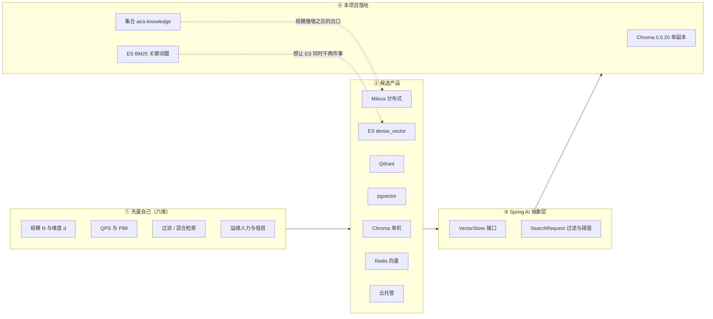
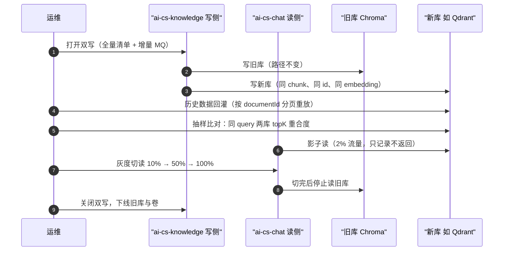

# 向量库选型与容量规划：不是比 benchmark，是比你的运维能力能不能养活它

> **一句话结论**：向量库选型里唯一不能外包的问题不是"哪个快"，而是"它半夜挂了谁起来修"——本项目选 Chroma 0.5.20 单副本，不是因为它比 Milvus 好，而是它是这个团队当前**真能养活**的最大那一档；容量规划的价值则在于把"还能撑多久"从感觉变成一串能算的乘除法。
> **阅读前置**：读过 [01-向量与相似度](./01-向量与相似度-把文字变成坐标.md) 和 [02-索引算法](./02-索引算法-向量检索怎么从全表扫描里活下来.md)（知道 HNSW / PQ / SQ8 是在"内存、召回、延迟"三条边里换），并了解本项目 RAG 的写入侧（`ai-cs-knowledge`）与检索侧（`ai-cs-chat` / `ai-cs-search`）。
> **证据基线**：A 级 = `24-源码分析/assets/source` 已入库的 Spring AI 2.1.0 摘录；B 级 = 本仓 `deploy/`、三个服务的 `application.yml`、各服务 `VectorStoreConfig` / `KnowledgeVectorService` / `KnowledgeBaseService` 的真实文件与行号；C 级 = 本机离线 pwsh 静态统计与 node 算术（**没有启动任何服务、没有连 Chroma / ES / Redis、没有跑 mvn**）。预计阅读 50~60 分钟。

## 证据边界（先分清哪些是"读过"，哪些只是"算过"）

| 级别 | 来源 | 覆盖什么 | 本篇怎么用 |
|---|---|---|---|
| A 级（已入库摘录） | `24-源码分析/assets/source/VectorStore.java.md`、`VectorStoreRetriever.java.md`、`SearchRequest.java.md`、`AbstractVectorStoreBuilder.java.md` | Spring AI 2.1.0 向量库抽象：方法面、后过滤语义、过滤 DSL 的可移植性 | 论证"换库成本为什么可控"，以及哪些能力抽象层**盖不住** |
| B 级（本仓真实文件） | `deploy/k8s/chroma.yaml`、`docker-compose.yml`、`ai-cs-chat` / `ai-cs-knowledge` / `ai-cs-search` / `ai-cs-product` 的 `application.yml` 与 Java 配置类 | 本项目的真实选择：Chroma 0.5.20、单副本、1Gi 内存上限、三服务共用一个集合 | 每个选型维度都落到"这个仓库里是哪一行" |
| C 级（本机离线） | pwsh 静态统计 + node 算术，命令与真实输出都贴在文中 | 各方案在本仓的落地痕迹；容量表；1Gi 内存上限能装多少条 | 容量规划的数字来源与"撞墙点" |
| 未入库 | Milvus / Qdrant / pgvector / ES `dense_vector` / Redis 的内核实现 | 本仓 `assets/source` **只**有 Spring AI 抽象层摘录，这些产品本身没有任何源码摘录 | 只讲公开形态与工程后果，按官方文档口径，不编内部机制 |

---

## 0. 先看现象

### 现象一：选了 Milvus，团队里没人会运维 etcd + MinIO

上线时 `docker ps` 从 1 个容器变成 8 个：`milvus-standalone`、`etcd`、`minio`、`pulsar`（或 kafka）+ 各自的 exporter。三个月内出过的两次事故长这样：

```text
# 事故一：etcd 磁盘写满（默认 2GiB 配额），整个集群进入只读
[milvus] context deadline exceeded: failed to load collection
# 事故二：MinIO 单盘满，段文件写不进去，但插入接口仍返回成功
[milvus] write node failed: no space left on device
```

一出现这个现象就说明：**你买的是"千亿级能力"，付的是"分布式中间件运维"**——Milvus 的元数据在 etcd、段文件在对象存储、消息在 MQ，任何一个挂了都不是"重启一下"能好的。而本仓对此的证据是反向的：`deploy/` 下**没有任何 Milvus 清单**，全仓 `milvus|Milvus` 只命中 2 行、2 个文件，且两行都是 javadoc 注释（C 级统计见 §6.7 第 (1) 条）。

### 现象二：Chroma 单机到 200 万条，查询从 20ms 掉到 800ms

同一个集合，10 万条时检索"感觉不到"，到 200 万条时用户开始说"AI 卡了"。查下去发现容器内存被打满，OOM 之后跟着重启：

```text
$ kubectl top pod chroma-0
NAME       CPU(cores)   MEMORY(bytes)
chroma-0   12m          1021Mi          # limits: memory 1Gi
```

一出现这个现象就说明：**瓶颈不在"检索算法"，在"这个容器被允许用多少内存"**——`deploy/k8s/chroma.yaml#L66-L68` 把 `limits.memory` 定成了 `1Gi`，而 1024 维 float32 一条向量本体就是 4 KB，加上索引图结构与元数据（§3.3 的 ×1.4）约 5.7 KB/条。1Gi 里能装多少条是可以用除法算出来的，算完你就知道 200 万条这个数字**根本进不来内存**（§3.4 的倒推表）。

### 现象三：一条 SQL 能解决的场景，上了独立向量库

商品检索有 12 个筛选条件（品类、价格区间、库存、上架时间……），数据 3 万条，全在 MySQL。有人提议"上 Chroma 做语义搜索"，于是多了一个容器、一套备份、一个单点，换来的能力是——**这 3 万条数据本来就可以用 `WHERE` 精确过滤 + 一个小模型复排**。

本仓里这两种选择恰好都真实存在：`ai-cs-chat` 用持久化的 Chroma（`VectorStoreConfig.java#L58-L60`），而 `ai-cs-product` 用的是内存版 `SimpleVectorStore`（`ai-cs-product/src/main/java/com/aics/product/config/VectorStoreConfig.java#L17-L20`），注释里还写着"生产环境替换为 ElasticsearchVectorStore / RedisVectorStore 等实现即可"（`#L10-L12`）。

一出现这个现象就说明：**向量库不是"有了 RAG 就该有"的组件，它是一个要单独备份、单独扩容、单独监控的有状态服务**——每上一个，你的运维面积就多一块。

这些现象指向同一件事：**向量库选型的真实约束是"运维能力 × 数据规模"这两个变量的乘积，而 benchmark 只告诉你别人机器上的第三个变量。**

---

## 1. 整体地图



| 组件 / 环节 | 责任 | 参与方 | 本项目实现与证据 |
|---|---|---|---|
| 需求六维 | 把"要什么"变成 6 个数字：N、d、QPS、P99、过滤选择性、增长率 | 研发 + 运维 + 业务 | 本篇 §2 给出每维的量法；本项目 N≈10 万 chunk、d=1024 |
| 候选产品池 | 在"嵌入式 / 专用库 / 已有 DB 长出向量能力"三族里选 | 架构 | 三族全仓落地情况见 §6.7（Chroma 103 行 / 26 文件，其余仅 javadoc） |
| 抽象层 | 让业务代码不感知具体产品 | Spring AI `VectorStore` | A 级 [[源码:VectorStore.java.md#L40]]：接口继承 `DocumentWriter` + `VectorStoreRetriever` |
| 向量库本体 | 存向量、建索引、执行 ANN 检索与过滤 | 运维（有状态服务） | `deploy/k8s/chroma.yaml`（StatefulSet，`replicas: 1`，`#L33`） |
| 混合检索 | 关键词路 + 向量路融合 | `ai-cs-search` | `HybridSearchServiceImpl.java#L52` ES BM25 Top-20 + `#L71` RRF 融合 |

> **读图说明**：三条实线是**现在真实存在**的数据流（需求→候选→抽象→落地）。最容易被看错的是 `P2 -. 规模撞墙之后的出口 .-> C2` 这条虚线——它表示"以后可能迁往 Milvus"，**不是**当前调用关系；读成实线的后果是误以为项目已经在跑 Milvus，进而把 etcd/MinIO 的运维成本算进现状。第二条容易看错的虚线是 `P3 -. 想让 ES 同时干两件事 .-> C5`：本仓 ES 8.12 只承担 BM25 关键词腿（`ai-cs-search/src/main/java/com/aics/search/config/ElasticsearchConfig.java#L21` 明写"关键词路（BM25/multiMatch）+ Chroma 向量路"），**没有** `dense_vector` 字段——这是下一个可选动作，不是已完成的事实。

---

## 2. 关键概念与关键要素

| 名称 | 位置 | 角色 | 关键点 |
|---|---|---|---|
| `VectorStore` 接口 | A 级 [[源码:VectorStore.java.md#L40]] | 换库的唯一缝 | 业务只依赖 `add` / `upsert` / `delete`×3 / `similaritySearch` / `getName` / `getNativeClient` |
| `upsert` | A 级 [[源码:VectorStore.java.md#L58-L82]] | 幂等写入 | `@since 2.1.0`；"replace-by-id"，稳定 id 的重灌可以安全重跑；默认实现直接抛 `UnsupportedOperationException`（`#L81`） |
| `add` | A 级 [[源码:VectorStore.java.md#L46-L51]] | 普通写入 | javadoc 原话："Throws an exception if the underlying provider checks for duplicate IDs."——**重复 id 的行为由产品自己决定**，这是迁移时最容易炸的一处 |
| `similaritySearch(SearchRequest)` | A 级 [[源码:VectorStoreRetriever.java.md#L45]] | 检索入口 | 不显式给 topK 就是 `DEFAULT_TOP_K = 4`（[[源码:SearchRequest.java.md#L49]]） |
| `similarityThreshold` | A 级 [[源码:SearchRequest.java.md#L164-L171]] | 相关度门槛 | javadoc 原文："this is a post-processing step performed on the client not the server side"——**它不省服务端的算力**，只减少返回条数 |
| `filterExpression` | A 级 [[源码:SearchRequest.java.md#L218]] | 元数据过滤 | javadoc 称 `Filter.Expression` "portable across all vector stores"；但**能不能高效下推**取决于产品，抽象层不管 |
| 文本过滤 DSL | A 级 [[源码:SearchRequest.java.md#L277-L290]] | 便宜好写的过滤 | 内部由 `FilterExpressionTextParser` 解析，且注释警告该 parser "caches what it parses without bound" |
| `collection`（集合） | `ai-cs-chat/src/main/resources/application.yml#L49` | 隔离的最小单位 | 本项目三服务共用 `aics-knowledge` 一个集合 |
| `initialize-schema` | chat `#L48` = `false`、knowledge `#L30` = `false`、search `#L42` = `true` | 谁负责建集合 | **只有一处 true**，见 §6.1：这个开关不一致会变成"换库当天谁先启动"的问题 |
| 副本与分片 | 概念（本仓未使用） | 容量乘数与可用性来源 | 容量公式里 `×(1+副本数)`；本项目 `replicas: 1`（`chroma.yaml#L33`） |
| 内存水位 | `chroma.yaml#L66-L68` | 真实上限 | `limits.memory: 1Gi`——比任何 benchmark 都更能决定"能装多少条" |
| `getNativeClient()` | A 级 [[源码:VectorStore.java.md#L126-L128]] | 逃生舱 | 默认返回 `Optional.empty()`；实现类可给出底层原生客户端，用于做抽象层没封装的运维动作（建索引、改参数） |
| `batchingStrategy` | A 级 [[源码:VectorStore.java.md#L160]]、[[源码:AbstractVectorStoreBuilder.java.md#L44]] | 批量写入的隐式行为 | builder 默认 `new TokenCountBatchingStrategy()`——**分批大小不是你决定的**，这会影响单次写入的峰值内存 |
| `RRF_K = 60` | `ai-cs-search/src/main/java/com/aics/search/hybrid/HybridSearchServiceImpl.java#L44` | 混合检索的融合常数 | 越大，排名靠后的结果权重差异越小；这是"两套系统缝在一起"的成本项 |
| 多租户隔离 | 三选一（§3.8） | 数据边界 | 集合隔离 / 元数据隔离 / 实例隔离，成本与爆炸半径依次上升 |
| 迁移双写 | 换库方案（§3.9、§4） | 可用性保障 | 换库≠重跑 Embedding，前提是 `(chunk_id, text_hash, embedding_model)` 都在 |

一句话分工：**抽象层负责"写代码时换得动"，容量公式负责"什么时候必须换"，运维能力负责"换得起还是换不起"。**
---

## 3. 原理与证据逐段精读

### 3.1 选型六维：把"哪个快"换成六个必须先有的数字

**在干什么**：把"我想用 X 库"这个偏好，翻译成 6 个能填数字的格子。填不满的格子，就是将来会翻车的地方。

| 维度 | 怎么量（可执行） | 本项目取值 | 不量会怎样 |
|---|---|---|---|
| ① 部署形态 | 数一下"为了跑它要多几个有状态进程"：Chroma=1、Qdrant=1、pgvector=0（寄生在 PG 里）、ES=1、Milvus=3~4 | 1 个容器（`docker-compose.yml#L194-L209`） | 现象一：etcd 的磁盘配额成了你的告警来源 |
| ② 规模上限 | `N × d × 4B × 1.4`，再除以单节点可用内存（§3.3、§3.4） | 10 万 chunk 量级（同模块既有文档口径，**本仓无实测生产数据**） | 半夜被 OOM 叫醒，才发现上限是 1Gi（`chroma.yaml#L66-L68`） |
| ③ 混合检索能力 | 它能不能自己同时做 BM25 + 向量 + 融合？还是必须两套系统 | **不能**：ES 做关键词腿（`HybridSearchServiceImpl.java#L52`），Chroma 做向量腿，应用层 RRF 融合（`#L71`） | 以为"上了向量库就自动有混合检索"，结果精确型号查不到 |
| ④ 元数据过滤 | 过滤是下推到索引（pre-filter）还是拿回来再筛（post-filter），以及**过滤字段的基数** | 单集合 + `knowledgeBase == 'xxx'` 表达式，5 处调用点（§6.7 第 (2) 条） | 过滤选择性一高，召回率腰斩而你不知道为什么 |
| ⑤ 生态与 SDK | Spring AI 是否有官方 starter；客户端版本与产品版本是否锁得死 | `spring-ai-starter-vector-store-chroma` + 镜像 `0.5.20` 固定（`chroma.yaml#L44` 注释"固定版本号，避免 latest 导致行为漂移"） | 升级踩空：客户端 0.6.x 打 0.5.20 服务端 |
| ⑥ 运维复杂度 | 组件数 × 升级步骤 × 备份方式 × 谁值班 | 单副本 + `local-path` 卷 + 无备份（`chroma.yaml#L74`、`#L77`） | 现象一、以及"数据只有一份"的隐性风险 |

**为什么这么设计**：因为 benchmark 的三个输入（数据分布、维度、召回目标）在你这里几乎一定不同。别人 1536 维、单精度、10 亿条、只做离线批处理的成绩，和你 1024 维、10 万条、要 P99 300ms 的在线场景之间，**没有可迁移性**。六个维度里只有 ①②是数字，③④是能力，⑤⑥是成本——而 ⑤⑥往往是最后决定成败的那两条。

**换成别的写法会怎样**：常见的替代写法是"先按 GitHub star 数排个序，再问一句团队有没有人用过"。它的问题不是不准，是**漏掉了"养不养得起"这一维**：Chroma 的 star 不比 Milvus 少，但两者对运维的要求差了一个数量级。反过来，只用"团队熟不熟"也很危险——团队熟的是 MySQL，而 pgvector 在 1000 万条、1536 维时需要的不是"熟 MySQL"，是"会调 HNSW 的 `m` / `ef_construction` / `maintenance_work_mem`"。

**常见坑**：把 ⑥ 写成"低/中/高"三个字。它必须落到具体的、能被追问的东西上：**故障时第一个看哪个面板？升级要不要停机？备份是快照还是导出？谁在凌晨接电话？**这四问任何一个答不出来，这一维就是没量。

### 3.2 主流方案对照：每一档的"适用"与"不适用"都是规模区间，不是形容词

先给出这张表的**口径**：下表的规模区间是用 §3.3 的容量公式＋§3.4 的内存倒推＋02 篇的实测（1024 维朴素点积 995 ns/次、10 万条 100 ms、100 万条 1.00 s）推出来的**工程经验区间**，不是任何产品的硬上限；各产品内部实现细节本仓**未入库**，故一律按公开文档口径描述。

| 方案 | 部署形态 | 适用区间（能舒服地用到） | 不适用区间（会开始难受） | 混合检索 / 过滤 | 运维复杂度 | 本仓状态 |
|---|---|---|---|---|---|---|
| **Chroma** | 单进程 + 本地持久化，1 个容器 | ≤ 50 万条且单机内存装得下（1024 维约 2.9 GB 常驻）；QPS 个位数到几十 | > 100 万条；需要多副本写 / 水平扩容 / 强过滤下推 | 无内建 BM25；元数据过滤支持但下推效率取决于实现 | **低**：无外部依赖，但备份=拷卷、扩容=停机换机型 | **已落地**：`chromadb/chroma:0.5.20`，单副本 |
| **Milvus** | 分布式：etcd（元数据）+ 对象存储（段文件）+ 可选 MQ | ≥ 1000 万条，或需要多副本/多副本写/GPU 索引 | < 100 万条（纯亏运维）；团队没有分布式协调组件经验 | 支持多向量字段与稀疏向量，过滤能力强 | **高**：3~4 个有状态组件，升级有版本矩阵 | **未落地**：仅 javadoc 提及（`SpringAiConfig.java#L38`） |
| **Qdrant** | 单二进制（Rust），可单节点也可 Raft 集群 | 100 万 ~ 亿级；需要原生 filtered search | 团队不接受"又一个有状态服务"；PB 级 | 过滤器表达式强，payload 索引好 | 中：单节点简单，集群要懂 Raft | 未落地（`VectorStoreConfig.java#L40` 一句话） |
| **pgvector** | PG 扩展，0 个新组件 | ≤ 1000 万条**且已有 PG**；过滤条件本来就是 SQL | > 1000 万条高维 + 高写入；PG 内存吃紧 | 过滤=SQL，事务一致，可与业务表 JOIN | **低**（复用现有 PG 运维） | 未落地（2 行 javadoc） |
| **ES `dense_vector`** | 已在栈内（8.12），加字段即可 | 100 万级且**本来就需要全文检索** | 只想做向量、或维度 1536 以上且内存紧张（向量吃堆外/段内存） | 天然混合：BM25 + kNN 一个系统内 | 中：ES 已在运维范围内 | **部分**：ES 只做 BM25 关键词腿，**无 `dense_vector`**（`ElasticsearchConfig.java#L21`） |
| **Redis 向量** | RediSearch 模块，已在栈内（7.x） | ≤ 100 万条、极致低延迟、可接受全内存成本 | 想长期存海量向量（内存单价最贵）；需要复杂过滤 | 过滤有，融合要自己做 | 低（复用 Redis 运维），但**持久化语义弱** | 未落地（1 行 javadoc） |
| **云托管**（Pinecone / Zilliz Cloud / 云厂商向量检索） | 无（SaaS） | 1 万 ~ 亿级，且愿意按量付费 | 数据不能出内网 / 合规受限；长期大流量成本高于自建 | 通常都支持混合检索 | **最低**（但受制于 SLA 与厂商节奏） | 未落地 |

**为什么这么设计**：这三族（嵌入式/专用库/已有 DB 长出来）的分界线其实是**"谁承担有状态服务的运维"**。嵌入式（FAISS / LanceDB / 进程内 `SimpleVectorStore`）把状态放在你的应用进程里，随应用一起重启；专用库把它变成独立服务，于是有了备份、扩容、监控、单点；已有 DB 长出向量能力，等于"把新能力挂到你已经会运维的那个东西上"。

**换成别的写法会怎样**：如果按"能力排序"选（Milvus > Qdrant > Chroma），10 万条的项目会得到一个需要 3 个中间件的架构，而检索质量的提升约等于 0——因为 10 万条这个规模，Chroma 的 HNSW 和 Milvus 的 HNSW 在同一台机器上的召回率没有实质差别，差别全在**运维面积**上。

**常见坑**：把"适用区间"当成"性能排行榜"来读。区间上限其实是**内存上限**换算来的（§3.4 会看到本项目 1024 维在 1Gi 里只能装十几万条），换一台 16 GB 的机器，Chroma 的区间上限就直接抬到百万级——**同一款产品在不同机器上的"适用区间"相差一个数量级**，这就是为什么表格里必须写清机器口径。

### 3.3 容量公式：一条向量的成本是 4 KB，不是"一点点"

**在干什么**：把"我要存 N 条向量"换算成**磁盘、内存、副本、水位**四个数。公式链只有乘法和除法：

```text
M_raw   = N × d × 4 B                    # float32 向量本体（d 维 × 4 字节）
M_index = M_raw × (1.2 ~ 1.5)            # HNSW 图结构 / 段开销（M=16 时约 132 B/点）
M_meta  = N × 平均元数据字节（按 300 B）  # knowledgeBase/documentId/title 等
M_orig  = N × 平均原文长度×1（可选）      # 向量库通常也存原文，别漏
M_单副本 = M_raw + M_index_增量 + M_meta + M_orig
M_总     = M_单副本 × (1 + 副本数)
M_采购   = M_总 ÷ 0.7                     # 留 30% 水位给合并/重建/峰值
```

C 级：用 node 把 3 个规模 × 3 个维度算一遍（口径：GB = 1e9 字节；索引开销 ×1.4；元数据 300 B/条；"双副本"= ×2；"÷0.7"= 水位后的采购量）：

```text
N       d      向量本体   ×1.4     元数据   单副本   双副本    ÷0.7
10万    768    0.3 GB    0.4 GB   0.0 GB   0.5 GB   0.9 GB   1.3 GB
10万    1024   0.4 GB    0.6 GB   0.0 GB   0.6 GB   1.2 GB   1.7 GB
10万    1536   0.6 GB    0.9 GB   0.0 GB   0.9 GB   1.8 GB   2.5 GB
100万   768    3.1 GB    4.3 GB   0.3 GB   4.6 GB   9.2 GB   13.1 GB
100万   1024   4.1 GB    5.7 GB   0.3 GB   6.0 GB   12.1 GB  17.2 GB
100万   1536   6.1 GB    8.6 GB   0.3 GB   8.9 GB   17.8 GB  25.4 GB
1000万  768    30.7 GB   43.0 GB  3.0 GB   46.0 GB  92.0 GB  131.5 GB
1000万  1024   41.0 GB   57.3 GB  3.0 GB   60.3 GB  120.7 GB 172.4 GB
1000万  1536   61.4 GB   86.0 GB  3.0 GB   89.0 GB  178.0 GB 254.3 GB
```

**怎么读**：① 第一列到第二列只是"乘 1.4"，但换成"3 副本 + 水位"就变成 ×6 ——**副本与水位是容量里最贵的两乘**，而它们和算法毫无关系；② 1000 万条 1024 维在双副本 + 70% 水位下需要 **172 GB**，这已经不是一个容器的事，是"要不要专职运维"的事；③ 维度从 1024 降到 768 省 25%（Matryoshka 截断同理），而 SQ8 量化能省 75%——**降维/量化永远比换库便宜**。

**常见坑**：只算向量本体，忘了**原文**。本项目 `KnowledgeVectorService.vectorize()` 把切好的 chunk 直接 `vectorStore.add(chunks)`（`ai-cs-knowledge/src/main/java/com/aics/knowledge/service/KnowledgeVectorService.java#L85`），chunk 的 `content` 是跟着向量一起存进 Chroma 的；1000 万条 × 平均 1 KB 原文 = 10 GB，**和向量本体同量级**，漏算就等于磁盘规划错一半。

### 3.4 内存而不是磁盘：把 1Gi 的上限倒推成"能装几条"

**在干什么**：用真实配置里的 `limits.memory` 反算"这个容器最多能装多少条向量"。这比任何容量规划文档都硬：它是集群**真的会执行**的数字。

B 级证据（`deploy/k8s/chroma.yaml#L63-L68`）：`requests` 是 100m CPU / 256Mi 内存，`limits` 是 500m CPU / **1Gi 内存**。

C 级：倒推表（口径：上限 1024 MiB，假设进程常驻 200 MiB，可用 824 MiB；每条按 `d×4×1.4` 字节：

```text
容器内存上限 1Gi = 1024 MiB; 假设常驻 200 MiB -> 可用 824 MiB
| d    | 单条向量 B | +40% 索引 B | 100% 可用可装条数 | 70% 可装 | 50% 可装 |
| 768  | 3072       | 4301        | 200,899          | 140,629  | 100,449  |
| 1024 | 4096       | 5734        | 150,674          | 105,472  | 75,337   |
| 1536 | 6144       | 8602        | 100,449          | 70,314   | 50,224   |
```

**怎么读**：① 1024 维下，1Gi 容器在"留一半余量"的现实假设里只能装 **7.5 万条**——也就是说本项目"十万级 chunk"这个量级，**已经贴着天花板**；② 一旦超过，向量库不会优雅降级：它开始把段换出、查询走冷读，现象二里 20ms → 800ms 就是这么来的；③ 这张表也解释了为什么"Chroma 单机到 200 万条变慢"是**必然**而不是运气——200 万条 1024 维需要约 11.5 GB，是允许上限的 11 倍。

**换成别的写法会怎样**：有人会写"Chroma 建议不超过百万条"这种话。它的问题是不可执行：**同一台 1Gi 的 Chroma 只能装 7.5 万条，而 32 GB 的 Chroma 能装 200 多万条**。所以正确的写法永远是"在这个资源配置下能装多少条"，而不是"这款产品能装多少条"。

**常见坑**：只调 `limits.memory` 不调 `requests`，也不看节点剩余内存。K8s 里 `limits` 是"超过就 OOMKill"，`requests` 是"调度依据"；把 limits 从 1Gi 提到 8Gi 而不动 requests，Pod 会被调度到一台以为它只要 256Mi 的节点上，**然后在第一次大查询时把节点打爆**。而本项目用的是 `local-path` 卷（`chroma.yaml#L74`），Pod 一旦被赶到别的节点，数据就找不到了。

### 3.5 QPS 与延迟怎么估：先算"同时有几个人在等"

**在干什么**：把"我们大概有多少用户"换算成"峰值 QPS"和"必须扛住的并发数"，再判断这个数字落在候选产品的舒适区还是边缘区。

C 级：一个口径完全公开的算例（DAU 5000、人均 8 轮对话、峰值系数 10 倍、一天 86400 秒）：

```text
口径: DAU=5000 人均对话轮次=8 峰值系数=10x 一天=86400s
日均请求 = 40,000 次; 平均 QPS = 0.46; 峰值 QPS = 4.63
P99=50ms  -> 峰值并发在等(Little's law) = 0.23 个请求; 线程池 >= 1
P99=100ms -> 峰值并发在等(Little's law) = 0.46 个请求; 线程池 >= 1
P99=300ms -> 峰值并发在等(Little's law) = 1.39 个请求; 线程池 >= 2
P99=800ms -> 峰值并发在等(Little's law) = 3.70 个请求; 线程池 >= 4
efSearch=32  -> 纯距离计算 0.032 ms/次查询 (dim=1024, 995ns/次点积)
efSearch=64  -> 纯距离计算 0.064 ms/次查询
efSearch=128 -> 纯距离计算 0.127 ms/次查询
efSearch=256 -> 纯距离计算 0.255 ms/次查询
```

**怎么读**：① 检索侧的**计算成本其实很小**（`efSearch=128` 时 0.127 ms），真正吃掉 P99 的是排队、网络、过滤扫描、以及"内存装不下导致的磁盘读"；② Little's law（`并发 = QPS × 延迟`）告诉你：峰值 4.63 QPS、P99 300ms 时，同时"在等"的请求只有 **1.4 个**——这说明**对话式场景的瓶颈几乎从不是向量库的 QPS**，而是生成侧的 LLM 延迟；③ 一旦某天 P99 从 300ms 变成 800ms，并发需求就涨到 3.7，这时才需要担心连接池。

**为什么这么设计**：因为把 QPS 当第一约束是**离线检索场景的惯性**（搜索框、推荐召回），而 RAG 的检索是**嵌在一次生成请求里**的：LLM 自身动辄 1~3 秒，检索那 20~100 ms 的差异在用户体感里被淹没。所以对 RAG 项目，"选型的 QPS 上限"通常**排不到前三**，而"过滤能不能下推、内存够不够、坏了怎么修"排得到。

**常见坑**：拿单次检索的 benchmark 延迟当 P99。`deploy/k8s/chroma.yaml#L50-L61` 的两条探针（readiness 10s 周期、liveness 15s 周期）说明这个 Pod 允许**十几秒级别**的抖动窗口；在这样一个单副本、无副本切换的部署里，任何"P99 20ms"的宣传数字都不成立——一次 Pod 重启就是几十秒不可用。

### 3.6 成本核算：自建便宜在账单上，贵在工资单上

**在干什么**：把"自建还是托管"从感觉变成一张可以加到年度预算里的表。

| 成本项 | 自建（本仓形态：K8s 单副本 + local-path） | 云托管 | 怎么估 |
|---|---|---|---|
| 计算 | 节点 CPU/内存（`requests` 100m/256Mi、`limits` 500m/1Gi） | 按规格或按量 | 用 §3.3/§3.4 的采购量 |
| 存储 | `10Gi` PVC（`chroma.yaml#L77`） | 按 GB·月 | 容量表第 5 列 |
| 人力 | **值班 + 升级 + 备份演练**（无备份时还要算"数据丢了重灌"的时间） | 厂商承担 | 0.1~0.5 FTE × 月成本 |
| 可用性 | 你自己负责：`replicas: 1`（`#L33`）+ `local-path`（`#L74`）= **数据只有一份** | SLA 写进合同 | 单点到多副本的改造量 |
| 迁移成本 | 每次换库 = 抽象层 + 数据回灌（§3.9） | 换厂商同样要迁 | 双写 + 影子读的工程量 |

**为什么这么设计**：因为向量库的"自建成本"里，**有状态服务的责任**占大头。Chroma 单副本的真实账单是"服务器 1 台 + 出事时那半天的人"，而 Milvus 的真实账单是"3 台 + etcd 的磁盘配额告警 + 对象存储的容量规划 + 版本矩阵"。

**换成别的写法会怎样**：只比"托管单价 vs 服务器单价"会得出"自建永远便宜 3~5 倍"的结论——这个结论在**没有运维人力**的团队里是**假的**，因为省钱的前提是"有人愿意在凌晨两点登录机器"。反过来，在已有成熟 K8s 平台 + 值班体系的团队里，托管就未必划算。**拐点不是数据量，是"有没有一个能被叫起来的人"。**

**常见坑**：把"云托管"当成"零运维"。托管消掉的是**安装升级与备份**，消不掉**模型维度变更、id 策略、过滤表达式、迁移**这四件事——它们全在应用侧，正是 §3.9 要处理的部分。

### 3.7 过滤与混合检索：抽象层给你可移植的写法，但不给你可移植的性能

**在干什么**：说明"过滤"在向量检索里为什么是选型的核心维度，以及抽象层把哪部分封装掉了、把哪部分留给了你。

**在干什么（拆开看）**：一次带过滤的向量检索，产品内部只有两种做法——pre-filter（先在索引上选出满足条件的候选子集，再在其中做 ANN）和 post-filter（先 ANN 取 topK，再把不满足条件的丢掉）。差别在于**过滤的选择性**：过滤后剩 1% 时，post-filter 必须把 topK 放大到 100 倍才凑够结果，而 pre-filter 直接在图里走子集。

A 级证据：Spring AI 的 `similarityThreshold` 属于**客户端后处理**：

```java
(src: SearchRequest.java.md#L164-L171)
	 * <p>
	 * Note that this is a post-processing step performed on the client not the server side.
	 * </p>
```

而过滤表达式是可移植的（javadoc："The `Filter.Expression` is portable across all vector stores."，[[源码:SearchRequest.java.md#L218]]），文本 DSL 版也是同一份解析器（[[源码:SearchRequest.java.md#L286-L290]]）。

**为什么这么设计**：抽象层要保证"换库时业务代码不改"，所以它只能承诺**语法可移植**，不可能承诺**执行计划可移植**——pre-filter 与 post-filter 的差别在物理执行层，接口上根本没有对应参数暴露。这也正是 `VectorStoreConfig.java#L38-L45` 那句注释成立的前提：换库要改的是 starter、yml 和"极少数泄漏的过滤串"。

**换成别的写法会怎样**：如果不用 `filterExpression`，而是"检索完在 Java 里 `stream().filter()`"，那么在 10 万条以上、过滤后剩 1% 的场景里，你会发现 topK 要开到几百才够，而每次检索的响应时间随之线性上涨（§3.5 的 0.127ms × 放大倍数以外的部分，主要是返回体序列化与内存拷贝）。本项目选择了服务端过滤表达式：`KnowledgeBaseService.java#L269-L274` 把 `knowledgeBase == 'xxx'` 直接放进 `SearchRequest`。

**常见坑**：过滤表达式里塞进业务逻辑，形成**字符串拼接**。本仓 `filterExpression(` 一共 5 处调用点（§6.7 第 (2) 条），其中 `KnowledgeBaseService.java#L273` 与 `KnowledgeVectorService.java#L109` 都是**拼字符串**——换库时这 5 处必须逐个核对语法（`==` / `EQ` / 引号规则各家不同），而抽象层不会替你在编译期发现。

### 3.8 多租户隔离的三种做法：爆炸半径差一个数量级

**在干什么**：决定"租户 A 的数据"和"租户 B 的数据"之间用什么隔开。

| 做法 | 怎么实现 | 隔离强度 | 成本 | 什么时候必须用 |
|---|---|---|---|---|
| **元数据隔离**（单集合 + 过滤） | 每条向量打 `tenant_id`，检索带 `filterExpression("tenant_id == 'x'")` | 逻辑隔离，**靠代码不出错** | 最低：一套集合、一份索引 | 租户多（成百上千）、数据量小、公司内部信任度高 |
| **集合隔离**（每租户一个 collection） | 每租户建独立集合 | 物理隔离，删租户=删集合 | 中：集合数多则元数据与文件句柄压力上升；换库要重建全部集合 | 租户几十个、要"删号即清空" |
| **实例隔离**（每租户独立库/命名空间） | 独立 Chroma/PG schema/独立集群 | 最强：故障与性能都隔离 | 最高：运维面积 × 租户数 | 有合规硬要求（金融/医疗）、单租户数据量大 |

**为什么这么设计**：因为"隔离"从来不是二元选择，而是**你在哪个粒度上买了保险**。元数据隔离的保险是"过滤条件永远写对"，实例隔离的保险是"物理上根本连不到别人的数据"——后者贵，但它把"一次拼错 SQL 导致全量泄漏"这类事故的可能性直接归零。

**换成别的写法会怎样**：本项目现在的形态是**单集合 + 元数据隔离**：三个服务共用一个 `aics-knowledge`（`ai-cs-chat/src/main/resources/application.yml#L49`、`ai-cs-knowledge/src/main/resources/application.yml#L25-L31`、`ai-cs-search/src/main/resources/application.yml#L43`），过滤靠 `knowledgeBase == 'xxx'`（`KnowledgeBaseService.java#L273`）。这个选择在"知识库数量小于 10、数据总量十万级"时是正确的；但它意味着**一条漏写过滤的检索会跨库召回**——所以在切换成"多租户 SaaS"之前，必须先加一层"过滤条件不可省略"的构造器约束（本项目目前没有，属**未落地**）。

**常见坑**：把 `knowledgeBase`（业务分组）当成 `tenant`（租户）来用，然后在做数据删除时按 `documentId` 删（`KnowledgeVectorService.java#L109`）——租户维度的"删干净"从来没有被验证过。另外，A 级注释提醒文本过滤解析器"caches what it parses without bound"（[[源码:SearchRequest.java.md#L241-L242]]），**动态拼接高基数过滤串**会让这个缓存无界增长，租户越多越危险。

### 3.9 迁移：换库 ≠ 重跑 Embedding，四步保证"可用"

**在干什么**：把"换一个向量库"拆成一条不中断服务的四阶段流水线：**双写 → 回灌 → 影子读 → 灰度切读**（完整时序画在 §4）。前提条件是**先把不可再生数据存好**：`chunk_id`、`doc_id`、`text_hash`、`embedding_model`、`model_version`——本项目的 `KnowledgeVectorService` 已打 `knowledgeBase`/`documentId`/`title`（`ai-cs-knowledge/src/main/java/com/aics/knowledge/service/KnowledgeVectorService.java#L79-L83`），但**没有** `text_hash` 与 `model_version`，属**未落地**。

**为什么这么设计**：因为换库是**数据平面迁移**，不是代码发布：代码能在 30 秒内回滚，数据不能。可用性只能靠"新旧并存 + 随时可切回"买到，四个阶段分别对应四个可观测判据——条数（写全了没）、重合度（向量空间一致不）、影子延迟（性能达标没）、灰度错误率（真实流量下对不对）。

**换成别的写法会怎样**：走"停服一晚，导出再导入"的写法，在十万条小库上是可行的（回灌几分钟）；但一旦到千万级，回灌是小时级，而**回滚意味着再来一遍**——这时的停机预算就不够了。反过来，一开始就做成"双写"对一个只有 10 万条的库又过度设计：**四阶段的繁简应该按回灌耗时决定**（回灌 < 10 分钟就允许停机迁）。

**常见坑**：以为"换库要重新调 Embedding API"——**不需要**，向量本身与库无关；需要重跑的是**库内索引**。真正会逼你重跑 Embedding 的是换模型（维度变化），那是另一件事（见同目录 04-生产运维篇的"更新与换模型"）。

### 3.10 什么时候不上向量库：三个"不需要"的判据

**在干什么**：给"加一个向量库"设一道反向门槛。

| 判据 | 具体形态 | 本仓例子 | 替代做法 |
|---|---|---|---|
| **数据量小** | < 1 万条，且过滤条件能砍到几百条 | `ai-cs-product` 用内存版 `SimpleVectorStore`（`ai-cs-product/src/main/java/com/aics/product/config/VectorStoreConfig.java#L17-L20`） | 进程内向量 + 暴力点积（02 篇实测 10 万条 100ms，1 万条约 10ms） |
| **可离线 / 非实时** | 天级批量任务，不需要在线检索 | 报表、去重、聚类 | 离线跑 flat 索引，落 Parquet |
| **已有 PG** | 业务数据就在 PG，向量只是加一列 | 本仓未用（PG 只在文档里出现） | pgvector，省掉一个有状态服务 |
| **已有 ES** | 本来就要全文检索，向量只是补充 | 本仓 ES 已在跑 BM25（`HybridSearchServiceImpl.java#L52`） | ES `dense_vector` + kNN，一个系统两种检索 |

**为什么这么设计**：因为新增一个有状态服务的**隐性成本**是"备份 + 扩容 + 监控 + 值班 + 版本升级"五件套，每件都要有人负责。判据的本质是：**如果现有组件的短板（不是它的强项）够用，就不要新增组件。**

**换成别的写法会怎样**：如果按"反正以后要扩"提前上分布式向量库，你会在数据只有 3 万条时就背上 §0 现象一那套运维负担；而等到真的需要时，由于中间件版本、数据模型都变了，迁移成本反而更高（§3.9 那四步一步都省不掉）。

**常见坑**：把"不上向量库"理解成"不做语义检索"。内存版 `SimpleVectorStore` 也有完整的 `VectorStore` 接口（`ai-cs-product/src/main/java/com/aics/product/config/VectorStoreConfig.java#L17-L20` 返回 `SimpleVectorStore.builder(embeddingModel).build()`），也就是说**从内存版换到 Chroma 只需换一个 `@Bean`**——这正是 A 级抽象带来的好处：不上库 ≠ 不用抽象。
### 3.11 先把容量压下去，再谈换库：五种手段的账单

**在干什么**：在"加机器 / 换分布式库"之前，先把 §3.3 公式里的乘数一个个调小。压缩比是纯算术，口径写明：N=1000 万、d=1024、float32、GB=1e9、只算向量本体（索引与水位另计）：

```text
口径: N=10,000,000 d=1024 float32, GB=1e9; 索引/水位不计(只看压缩比)
原始 float32                            40.96 GB  N x d x 4B
SQ8 标量量化(1B/维)                        10.24 GB  ÷4
Matryoshka 1024->512                  20.48 GB  ÷2
IVF-PQ m=64 (64B/条)                    0.64 GB  ÷64
PQ m=64 + 原始向量留 5% 做精排                 2.69 GB  压缩 + 小rerank池
```

| 手段 | 省多少 | 代价 | 什么时候用 | 本项目适用性 |
|---|---|---|---|---|
| SQ8 标量量化 | ÷4 | 距离有量化误差，召回略降 | 几乎所有场景的第一步 | 取决于 Chroma 版本支持（本仓未配置，**未落地**） |
| Matryoshka 截断（1024→512） | ÷2 | 需要模型支持；**等于换向量，必须全量重算** | 模型原生支持时 | `bge-m3` 是否支持截断**未入库**，需查官方文档 |
| IVF-PQ（m=64） | ÷64 | 召回损失不可逆 | 亿级、内存极度受限 | 本项目 10 万级完全不需要 |
| 冷热分层（老数据落盘/落对象存储） | 视比例 | 冷数据查询慢，要两套路径 | 历史数据占大头、近期才热 | 知识库有"旧文档"特征，可用 |
| 放宽 P99 + 多分片并行 | 0（换延迟） | 尾延迟变差 | 离线批处理 | 对话式场景不适用（用户能感知） |

**怎么读**：① 40.96 GB → 0.64 GB 是 **64 倍**，这个杠杆比"换一个更省内存的向量库"大得多，而且不改架构；② 但 PQ 的召回损失不可逆（02 篇已论证），所以顺序永远是**先量化（SQ8）→ 再降维 → 最后才 PQ**；③ Matryoshka 那一行有个隐藏的成本转移：它改变了向量本身，于是 §3.9 的 `embedding_model` / `model_version` 必须记全，否则下次迁移你分不清哪批向量是 1024 维、哪批是 512 维。

**常见坑**：量化之后不重跑召回评估。压缩比是确定的，"召回掉了多少"却必须用同一批 query 重测——否则你会把"量化导致的召回下降"误判成"过滤条件写错了"，在 §6 的排查顺序上多绕两天。

### 3.12 一页纸评审：六维打分长什么样

**在干什么**：把 §3.1 的六个维度变成一张能在评审会上贴出来的打分表。权重不是普适的，按"这个项目最怕什么"调：

| 维度 | 权重 | 本项目现状 | 关键证据 | 扣分原因 |
|---|---|---|---|---|
| 部署形态 | 20% | 5/5 | 单容器、零外部依赖（`docker-compose.yml#L194-L209`） | — |
| 规模上限 | 25% | 3/5 | 1Gi 上限 ≈ 7.5~15 万条（§3.4） | 十万级已贴边，扩到百万级必须换配置或换库 |
| 混合检索 | 15% | 3/5 | ES BM25 + RRF 融合（`HybridSearchServiceImpl.java#L52`、`#L71`） | 两套系统，需自己同步与融合；ES 向量字段未启用 |
| 元数据过滤 | 15% | 4/5 | 5 处 `filterExpression(`，单集合 + `knowledgeBase` 过滤 | 过滤串散落、靠字符串拼接，无构造器约束 |
| 生态与 SDK | 10% | 4/5 | `VectorStore` 抽象 + 固定镜像 tag（`chroma.yaml#L44`） | 实现类能力差异靠运行期 `UnsupportedOperationException` 暴露 |
| 运维复杂度 | 15% | 4/5 | 单副本 + `local-path` + 无备份（`chroma.yaml#L33`、`#L74`） | 备份缺失是硬扣分；单点不可用 |
| **加权** | 100% | **3.7 / 5** | — | 结论：**当前规模合格，百万级不合格** |

**为什么这么设计**：因为选型结论必须是**有条件成立**的句子。"我们选 Chroma"这句话没有信息量；"我们在 N=10 万、d=1024、单副本、1Gi 的约束下选 Chroma，并在 N 超过 15 万或内存超过 1Gi 时重评"才是可执行的决策记录。

**换成别的写法会怎样**：写成"综合评估后选择 Chroma，因为它轻量、易用、社区活跃"，三个月后没人能判断"什么时候该换"。而按这张表，触发条件是**明写在扣分原因里的两个数字**。

**常见坑**：把权重写成一次性常量。业务从"内部知识库"变成"对外 SaaS"时，元数据过滤与规模上限的权重会一起上调，原本 3.7 分的方案可能直接不合格——**权重应该跟着业务阶段改，而不是跟着产品改**。

### 3.13 什么时候该重算这张表：三个触发器

**在干什么**：容量规划不是算一次就完了，它有三个可观测的触发器，任何一个命中就重算：

| 触发器 | 观测手段 | 为什么必须重算 | 本项目当前状态 |
|---|---|---|---|
| **条数翻倍** | 集合点数（Chroma 的 `/api/v1/collections/{name}` 或 `count`）与文档入库量 | §3.3 的乘积是线性的，翻倍即翻倍；但**内存上限不随数据增长** | 无监控（`chroma.yaml#L50-L61` 只有心跳探针，**未落地**） |
| **维度变化** | `EmbeddingModel.dimensions()`（`HashEmbeddingModel.java#L73-L74` 就实现了它）与配置里的 `aics.embedding.model`（`SpringAiConfig.java#L108`） | 换模型 = 全量重算向量 + 向量空间不可混用 | 已有两个维度（1024 / 768）并在同一套代码里切换，**风险已存在** |
| **延迟变差** | 检索链路 P99；本项目可观测的最近似信号是 `KnowledgeBaseService.java#L277` 的"命中 N 条"日志 | 延迟变差是内存/磁盘换页的第一症状，比 OOM 早出现 | 无 P99 指标（**未落地**） |

**为什么这么设计**：因为容量问题从来不是"突然发生"，而是"先变慢、再报错、最后丢数据"三段式。三个触发器分别对应三段里的前两段，目的是**在 OOM 之前**获得信号——一旦到了 OOMKill（§0 现象二），你面对的已经是可用性事故而不是容量问题。

**换成别的写法会怎样**：靠"感觉慢了就扩容"，通常会在扩容时发现两件事同时成立：数据已经涨到必须换架构，而换架构要先补 `text_hash`/`model_version`（§3.9 的前提）——**两个问题叠在一起，工期就是乘积。**

**常见坑**：把 Kubernetes 的 `restartCount` 当健康指标。OOMKill 会体现在重启次数上，但**内存逼近上限的那几周它一直是 0**；真正早的信号是查询 P99 与容器内存水位曲线（本项目两者都没有采集，属**未落地**）。

---

## 4. 一次完整执行时序：把 Chroma 换成另一个库（四阶段）



> **读图说明**：最关键的两条是"写旧库"与"写新库"这对**并行箭头**——它们必须携带同一份 chunk、同一个 id、同一个 embedding，否则第 5 步的重合度比较毫无意义（你比的是两个不同的向量空间）。最容易被跳过的是第 6 步**影子读**：它是唯一在真实 query 分布下验证新库的环节，跳过就等于直接拿 10% 的用户当测试环境。最容易忘记收尾的是第 9 步：旧库会"偷偷活半年"，卷、备份任务、告警规则一直挂着，没人记得它能删。

| 失败点 | 触发条件 | 表现 | 用户看到什么 / 怎么兜底 |
|---|---|---|---|
| 双写不一致 | 新库写入超时、配额满 | 新库条数少于旧库（`count` 对不上） | 用户无感；第 5 步判据不达标即中止，旧库照常服务 |
| 回灌重复膨胀 | 旧库有历史重复 id，新库用 `add` | 条数翻倍，或直接抛"duplicate id" | A 级 [[源码:VectorStore.java.md#L46-L51]] 已警告"重复 id 的行为由产品决定"；回灌必须用 `upsert`（`#L58-L82`） |
| 重合度低 | 两边 embedding 模型/版本不一致 | 同 query 的 topK 差很多 | 说明向量空间被换了；换库前必须锁 `embedding_model`（见 `SpringAiConfig.java#L108` 的 `aics.embedding.model`） |
| 影子读拖慢主链路 | 影子读走了同步调用 | 主链路 P99 上涨 | 影子读必须异步 + 采样 + 丢弃结果 |
| 切读后命中 0 条 | 新库过滤语法不同（`==` vs `EQ` vs 引号规则） | 空上下文，模型开始"自由发挥" | 保留配置开关，秒级切回旧库；切换前先跑 §6.7 第 (2) 条的调用点清单 |
| 新库内存不足 | 维度/条数与 §3.4 倒推不符 | 查询从毫秒变秒级 | 切流前用采购量（§3.3 最后一列）核对容器 `limits` |

---

## 5. 设计取舍

| 决策点 | 本项目选择 | 换来什么 | 付了什么代价 | 证据 | 落地状态 |
|---|---|---|---|---|---|
| 部署形态 | Chroma 单容器（`chromadb/chroma:0.5.20`） | 0 个外部依赖，一条 `docker-compose up` 就能跑 | 无法水平扩展；扩容=停机换机型 | `docker-compose.yml#L194-L209` | **已落地** |
| 副本数 | `replicas: 1` | 数据一致性简单，没有副本同步问题 | **数据只有一份**：节点挂了就不可用 | `deploy/k8s/chroma.yaml#L33`（注释"单副本：学习环境，数据一致性简单"） | **已落地**（并已知风险） |
| 持久化 | `local-path` + `10Gi` PVC | 零配置、本地盘快 | Pod 漂移即丢数据；无快照备份 | `chroma.yaml#L74`、`#L77` | **已落地**（备份**未落地**） |
| 内存上限 | `limits.memory: 1Gi` | 防止单容器吃爆节点 | 1024 维只能装 ~7.5~15 万条（§3.4） | `chroma.yaml#L66-L68` | **已落地**（容量天花板已量化） |
| 集合划分 | 三服务共用一个 `aics-knowledge` | 写入与检索天然同空间，无需跨集合拼接 | 单点争用；删改要三服务协调 | chat `#L49` / knowledge `#L25-L31` / search `#L43` | **已落地** |
| 谁建集合 | 只有 `ai-cs-search` 的 `initialize-schema: true` | 只有一个"建表人"，避免并发建集合冲突 | 谁先启动变得重要（§6.1） | chat `#L48` = false、knowledge `#L30` = false、search `#L42` = true | **已落地**（未文档化风险） |
| 混合检索 | ES BM25 关键词腿 + Chroma 向量腿，应用层 RRF | 两套系统各干擅长的事，融合与量纲无关 | 多一次网络往返；两套数据要同步 | `HybridSearchServiceImpl.java#L52`、`#L71`（`RRF_K = 60`，`#L44`） | **已落地**（开关默认关闭，见 RAG 篇） |
| 是否用 ES 做向量 | 不用，ES 只做 BM25 | 避免 ES 堆内存被向量吃光 | 少一次"一个系统两种检索"的机会 | `ElasticsearchConfig.java#L21` | **未落地**（可选演进） |
| Embedding 维度 | `BAAI/bge-m3` 1024 维（`@Primary`），本地兜底 768 维 | 中文效果好、免费额度足；测试环境不依赖外网 | 1024 维比 768 维多 33% 存储 | `SpringAiConfig.java#L172`、`#L108`；`HashEmbeddingModel.java#L31` | **已落地** |
| 写入语义 | `vectorStore.add(chunks)` | 简单直接 | 重灌不幂等，可能重复膨胀 | `KnowledgeVectorService.java#L85` | **已落地**（`upsert` 未落地） |
| 换库准备度 | 业务只依赖 `VectorStore` 接口 + 懒加载代理隔离初始化顺序 | 换库 ≈ 换 starter + 改 yml | 过滤串、id 策略、迁移数据仍要人工处理 | `ai-cs-chat/src/main/java/com/aics/chat/config/VectorStoreConfig.java#L38-L45`、`#L58-L71` | **已落地**（抽象层）/ **未落地**（迁移工具） |

**可扩展点清单**（按改动成本从低到高，都指向本仓真实文件）：

1. **把 `limits.memory` 与实际条数对齐**：按 §3.4 的倒推表，把 `chroma.yaml#L66-L68` 的 1Gi 提到能覆盖目标条数的值（如 10 万条 1024 维 → 至少 2Gi），并按比例抬 `requests`（`#L63-L65`）。
2. **补一个卷快照/`pg_dump` 式导出**：`local-path` 卷（`#L74`）本身不支持快照，需要容器内 `sqlite` 导出或换成支持快照的 StorageClass。
3. **写入改成 `upsert`**：把 `KnowledgeVectorService.java#L85` 的 `add` 换成 `upsert`，重灌即可幂等（A 级 [[源码:VectorStore.java.md#L58-L82]]）。
4. **给过滤条件加构造器约束**：把 5 处 `filterExpression(` 收敛到一个 `KnowledgeFilter.of(knowledgeBase)` 工厂（`KnowledgeBaseService.java#L273`、`KnowledgeVectorService.java#L109` 等），换库时只改一处。
5. **补 `text_hash` + `model_version` 元数据**：为 §4 的重合度比对与"换模型"提供依据（`KnowledgeVectorService.java#L79-L83` 现有 3 个字段）。
6. **接上可观测性**：`VectorStore` builder 已支持 `observationRegistry` / `customObservationConvention`（A 级 [[源码:VectorStore.java.md#L145-L153]]），本仓 `VectorStoreConfig.java#L81-L89` 也传了参数，但**指标导出未落地**。
7. **迁移到 Qdrant/pgvector 的开关化适配**：新增一个 `@ConditionalOnProperty` 的 `VectorStore` 实现（`ai-cs-chat/src/main/java/com/aics/chat/config/VectorStoreConfig.java#L38-L45` 描述的三步就够）。

---

## 6. 踩坑与调试手法

### 6.1 三个服务的 `initialize-schema` 不一致，谁先启动变成隐藏依赖

`ai-cs-chat` 是 `false`（`application.yml#L48`）、`ai-cs-knowledge` 是 `false`（`#L30`）、`ai-cs-search` 是 `true`（`#L42`）。看起来这只是"谁建集合"的分工，但结合 A 级源码里的懒加载原因（`ai-cs-chat/src/main/java/com/aics/chat/config/VectorStoreConfig.java#L33-L36` 注释：2.1 的 `ChromaVectorStore` 实现 `InitializingBean`，即使 `initialize-schema=false` 创建时仍会查远端集合），**后果**是：全新环境里若 search 没先启动，另外两个服务启动时对端集合不存在，会一路抛到启动失败。

### 6.2 用 `add` 做"重灌"，条数越灌越多

A 级 javadoc 明写 `add` 对重复 id 的行为"is left to the underlying provider"（[[源码:VectorStore.java.md#L46-L51]]），而 `upsert` 才是 replace-by-id（`#L58-L82`）。本仓 `KnowledgeVectorService.java#L85` 用的是 `add`，于是"重新向量化同一个文档"在部分产品上会变成追加。排查口径见 §6.7 第 (2) 条：`vectorStore.delete(` 只有 3 处，且只有 `ProductVectorService.java#L70` 是按 id 删——**知识库侧没有"按 id 覆盖"的保障**。

### 6.3 把"产品推荐条数"当容量上限

"Chroma 支持百万级"这句话漏了机器口径。§3.4 的倒推表说明同样是 Chroma，1Gi 只能装 7.5~15 万条，32 GB 能装 200 多万条。**任何容量结论必须带三个数：N、d、可用内存。**

### 6.4 单副本 + `local-path`：数据只有一份，而且跟着 Pod 走

`chroma.yaml#L33`（`replicas: 1`）+ `#L74`（`local-path`）+ `#L77`（10Gi）+ 无备份任务 = 任何节点故障都可能导致数据不可恢复。这一条在本仓 04-生产运维篇与 04-中间件/20-PostgreSQL与pgvector.md 里都被点过（后者 §6.8 的结论是"单副本 + local-path + 单容器 = 数据只有一份"），这里不重复展开，只提醒它**属于选型代价而不是部署细节**。

### 6.5 过滤表达式泄漏成业务逻辑

5 处调用点全是字符串拼接（§6.7 第 (2) 条），换库时要逐个核对语法；同时 A 级注释警告文本 DSL 解析器"caches what it parses without bound"（[[源码:SearchRequest.java.md#L241-L242]]），**高基数过滤串**（比如把租户名拼进去）会让缓存无界增长。

### 6.6 拿别人 benchmark 的维度/召回当自己的输入

benchmark 常给 1536 维、10 亿条、recall@10=0.95 的数字，而你的输入是 1024 维、10 万条、要靠 `topK=20 + 精排 0.7`（本项目 `KnowledgeBaseService.java#L269-L274` 的宽召回 + 精排链路）补质量。**输入不同，结论不可迁移**，这也是 §2 六维存在的理由。

### 6.7 三个可操作的自查手法

**(1) 数"这个选型到底落地了几行"**——不要数文档，数代码。口径：`*.java|*.yml|*.yaml`，限定 `src\main` 与 `deploy` 目录（共 565 个文件），统计关键字命中的**行数 / 文件数**：

```powershell
$files = Get-ChildItem -Recurse -Include *.java,*.yml,*.yaml -File |
  Where-Object { $_.FullName -match '\\(src\\main|deploy)\\' }
$files.Count
foreach ($t in 'chroma','pgvector|PGVector','milvus|Milvus','qdrant|Qdrant',
               'weaviate','pinecone|zilliz','RedisVectorStore|redis-vector',
               'ElasticsearchVectorStore') {
  $hits = $files | Select-String -Pattern $t
  "$t -> $($hits.Count) 行 / $(($hits | Select-Object -ExpandProperty Path -Unique).Count) 文件"
}
```

```text
565
chroma -> 103 行 / 26 文件
pgvector|PGVector -> 2 行 / 2 文件
milvus|Milvus -> 2 行 / 2 文件
qdrant|Qdrant -> 1 行 / 1 文件
weaviate -> 0 行 / 0 文件
pinecone|zilliz -> 0 行 / 0 文件
RedisVectorStore|redis-vector -> 1 行 / 1 文件
ElasticsearchVectorStore -> 1 行 / 1 文件
```

**怎么读**：① "落地"与"提及"差两个数量级——Chroma 103 行分布到 26 个文件（配置、Config、Service 都在用），其余六个关键字**全部只出现在 javadoc 的一句话里**（`chat/SpringAiConfig.java#L38`、`chat/VectorStoreConfig.java#L40`、`product/VectorStoreConfig.java#L12`）；② 因此任何"我们支持多向量库"的说法，实际含义是"接口层支持，运维层只有 Chroma 一套"；③ 这也是给"换库成本可控"打的折扣：成本可控的是**代码**，不是**数据迁移与运维**。

**(2) 数"换库时要改几处"**——过滤与删除是唯一泄漏到业务的两种能力：

```powershell
Get-ChildItem -Recurse -Include *.java -File |
  Where-Object { $_.FullName -match '\\src\\main\\' } |
  Select-String -Pattern 'filterExpression\(|vectorStore\.delete\(' |
  ForEach-Object { "$($_.Filename)#$($_.LineNumber)" }
```

```text
HybridRetriever.java#292
KnowledgeBaseService.java#273
KnowledgeGapDetector.java#74
KnowledgeVectorService.java#109
ProductVectorService.java#70
HybridSearchServiceImpl.java#128
SearchServiceImpl.java#57
SearchServiceImpl.java#129
```

**怎么读**：① 8 行里 5 行是过滤调用点（`filterExpression(`：`HybridRetriever`、`KnowledgeBaseService`、`KnowledgeGapDetector`、`HybridSearchServiceImpl`、`SearchServiceImpl`），3 行是删除调用点（`vectorStore.delete(`：`KnowledgeVectorService#109`、`ProductVectorService#70`、`SearchServiceImpl#129`），合计 **8 处**就是换库的真实改动面（而不是 `VectorStoreConfig.java#L38-L45` 说的"只改 yml"）；② 只有 `ProductVectorService#70` 是按 id 删，另外两处都是按过滤表达式删——换库时这两种语义都要逐个验证；③ 这个数字可以直接当"迁移工作量"的估算基数。

**(3) 用内存上限倒推"还能撑多久"**——把 §3.4 的脚本改成你现在的 `limits` 与维度：

```javascript
const MiB = 1024 * 1024, limit = 1024 * MiB, resident = 200 * MiB;
const avail = limit - resident;
for (const d of [768, 1024, 1536]) {
  const per = d * 4 * 1.4;
  const n = (r) => Math.floor((avail * r) / per).toLocaleString("en-US");
  console.log(`d=${d} 单条 ${d * 4}B (+40% ${Math.round(per)}B) -> 100%/70%/50% 可用: ${n(1)} / ${n(0.7)} / ${n(0.5)} 条`);
}
```

```text
d=768 单条 3072B (+40% 4301B) -> 100%/70%/50% 可用: 200,899 / 140,629 / 100,449 条
d=1024 单条 4096B (+40% 5734B) -> 100%/70%/50% 可用: 150,674 / 105,472 / 75,337 条
d=1536 单条 6144B (+40% 8602B) -> 100%/70%/50% 可用: 100,449 / 70,314 / 50,224 条
```

**怎么读**：① 本项目 1024 维、1Gi 上限，按"留一半余量"只够 7.5 万条——**这就是"当前选择在什么规模下撞墙"的准确答案**；② 结论不是"要换库"，而是"先把 `limits` 抬到位"，因为 §3.3 的采购量在 10 万条量级只有 0.6~1.7 GB，"换库"在这里是过度反应；③ 只有当这一列算出来超过单机物理内存（比如千万级 172 GB）时，才进入"必须换架构"的区间。

---

## 7. ⚠️ 版本差异

| 旧写法 | 当前基线 | 变化点 | 迁移动作 |
|---|---|---|---|
| 重灌/导入用 `vectorStore.add(...)` | 2.1.0 提供 `upsert(List<EmbeddedDocument>)`（`@since 2.1.0`） | `add` 对重复 id 的行为由产品决定；`upsert` 明确 replace-by-id，稳定 id 可安全重跑 | 幂等重灌链路改 `upsert`；先确认实现类支持，否则会抛 `UnsupportedOperationException`（A 级 [[源码:VectorStore.java.md#L81]]） |
| 想复用已算好的 query 向量只能自己绕过接口 | 2.1.0 新增 `similaritySearch(float[], SearchRequest)` 默认方法 | 默认实现抛 UOE，需实现类 opt-in；javadoc 强调 query 向量必须与库内向量同模型同配置 | 使用前先验证实现支持；否则退回"文本进、内部再 embed" |
| 旧教程写"Chroma 用 `latest` 镜像即可" | 本项目固定 `chromadb/chroma:0.5.20` | 版本漂移会导致行为变化（`chroma.yaml#L44` 注释原话："固定版本号，避免 latest 导致行为漂移"） | 生产固定 tag；升级前先读 changelog 并对齐客户端版本 |
| `initialize-schema: false` 就不会访问远端 | 2.1 的 `ChromaVectorStore` 实现 `InitializingBean`，创建时仍会查远端集合 | 因此本项目用 `LazyInitTargetSource` 代理（`ai-cs-chat/src/main/java/com/aics/chat/config/VectorStoreConfig.java#L33-L36`、`#L61-L71`） | 多服务多实例部署时，统一用懒加载代理或统一由单一服务建集合 |
| `spring-ai-advisors-vector-store`（1.0 前的 artifact 名） | `spring-ai-vector-store-advisor` | 坐标改名，旧坐标拉不到 | 参照同模块 `02-RAG全栈实战/01-RAG检索增强生成.md` §7 的迁移项逐个改 pom |
| 以为 `similarityThreshold` 能省服务端算力 | 它是**客户端**后处理（A 级 [[源码:SearchRequest.java.md#L164-L171]]） | 服务端仍按 `topK` 取满，只是返回时被截断 | 想真的省算力，要么降 `topK`，要么把条件写进过滤表达式 |
| ES 向量检索用 `script_score` + `cosineSimilarity` | ES 8.x 的 kNN（`knn` 顶层参数 + `dense_vector` 字段） | 新写法可用 HNSW 索引而不是逐条脚本打分（**未入库，依据 ES 官方文档**） | 若要让 ES 吞掉向量腿，先加 `dense_vector` 字段并重建索引 |
| Milvus 单机一条命令起（旧教程印象） | Milvus 2.x 的 standalone 仍依赖 etcd + 对象存储（**未入库，依据官方文档**） | "单机"≠"单组件" | 上 Milvus 前把 §0 现象一的三个组件纳入运维范围与容量规划 |
| 认为换库要重跑 Embedding | 换库只重跑**库内索引**；只有换模型/换维度才需要重算向量 | A 级 [[源码:VectorStoreRetriever.java.md#L61-L66]]：query 向量必须与库内向量同模型同设置 | 迁移清单里加一项"锁 `embedding_model` + `model_version`" |

---

## 8. 面试高频问与答

1. 向量数据库选型你会问业务方哪几个问题？为什么不是先问 QPS？
2. 10 万条、1024 维的向量占多少内存？加上 HNSW 图与元数据呢？再乘两副本呢？
3. 为什么"向量库吃的是内存不是磁盘"？磁盘放不下的那天会发生什么？
4. Chroma 单机、Milvus 分布式、pgvector 三者的适用边界分别在哪，用什么数字划？
5. 什么是 pre-filter 与 post-filter？过滤选择性 1% 时会发生什么？
6. Spring AI 的 `VectorStore` 抽象让换库成本可控到什么程度？哪些成本它盖不住？
7. `similarityThreshold` 是服务端过滤还是客户端过滤？这个差别有什么工程后果？
8. 单集合 + 元数据过滤 vs 每租户一个集合 vs 每租户一个实例，怎么选？
9. 换向量库怎么保证不停机？四个阶段的判据分别是什么？
10. 什么场景下你会明确说"不要上向量库"？
11. 自建向量库与云托管的总成本怎么算？拐点由什么决定？
12. `add` 和 `upsert` 的区别为什么在迁移时特别致命？
13. 如果把 1024 维压到 512 维，容量省一半，隐藏成本是什么？
14. 你怎么在 OOM 发生**之前**发现向量库撑不住了？

---

## 9. 动手练习

1. **给你的项目算一次容量**：按 §3.3 的公式与口径，用你自己的 N、d、副本数、水位算出采购量，写出四个中间值。
   验收标准：四个中间值都有单位与口径说明；结论里写清"如果用 1Gi 容器，最多装多少条"。
2. **倒推你集群的内存上限**：找到向量库 Pod 的 `limits.memory`，跑 §6.7 第 (3) 条的脚本，算出 768/1024/1536 三档的可装条数。
   验收标准：输出三档数字，并指出"按你现在的维度还能撑几倍"。
3. **数一遍你项目的"选型落地痕迹"**：跑 §6.7 第 (1) 条的关键字统计。
   验收标准：给出每个候选产品的"行数/文件数"，并指出哪些只是注释里的一句话。
4. **画一次换库时序**：拿 §4 的模板，把你们真实的写入路径（MQ 消费者？定时任务？）填进去，标出每一步的失败判据。
   验收标准：至少 3 个失败点写了"用户看到什么"，且有一个是"过滤语法差异"。
5. **做一次"不上向量库"的反向评估**：挑一个已在用向量库的场景，论证它能不能被 `SimpleVectorStore`（进程内）或 pgvector 替代。
   验收标准：给出数据量、过滤条件数、延迟要求三个数字，并明确"能/不能替代"及理由。
6. **把 `add` 改成 `upsert` 的可行性验证**：查清你用的 `VectorStore` 实现是否支持 `upsert`，不支持时的兜底方案是什么。
   验收标准：写出结论 + 依据（实现的 javadoc 或源码），并给出重灌两次 id 不膨胀的验证方法。

---

## 小结

- 选型的第一性问题不是"哪个快"，而是"它坏了那一夜谁起来修"；六维里 ③④ 是能力、⑤⑥ 是成本，而 ⑤⑥ 常常决定成败。
- 容量是一条乘法链：`N × d × 4B` → ×1.2~1.5（索引） → +元数据与原文 → ×(1+副本) → ÷0.7（水位）；最贵的两乘是**副本**与**水位**，它们和算法无关。
- 真正决定"能装多少条"的往往是 `limits.memory`：本项目 1Gi + 1024 维 ≈ 7.5~15 万条，十万级已经贴边——这就是"当前选择在什么规模下撞墙"的准确答案。
- 抽象层（`VectorStore`）保证的是**代码可换**，不是**数据与运维可换**：本仓 8 处过滤/删除调用点、缺 `text_hash`/`model_version`、没有迁移工具，都属于"换得动代码、换不动现场"。
- 多租户隔离的三种做法成本差一个数量级；本项目"单集合 + `knowledgeBase` 过滤"在租户数 <10、总量十万级时成立，扩到 SaaS 之前必须把过滤条件收进构造器。
- 判断"不上向量库"只需要三个判据：数据量小、可离线、已有 PG/ES——本仓 `ai-cs-product` 用内存版 `SimpleVectorStore` 就是正例。
- 可操作归纳：**给任何向量库选型/容量结论配三个数字（N、d、可用内存）+ 一条命令**——先跑 §6.7 第 (1)(2)(3) 条，把"我们支持多向量库"挤成"落地了几行、换库要改几处、还剩多少条"，再谈要不要换。

---

## 自测题

**1. 为什么说"向量库选型不是比 benchmark"？**

<details><summary>参考答案</summary>
benchmark 的三个关键输入（数据分布、维度、召回目标）在你的场景里几乎一定不同，结论不可迁移。真正约束你的是"运维能力 × 数据规模"这两个变量：同一款产品在不同内存配置下能装的条数相差一个数量级（§3.4）。
</details>

**2. 一条 1024 维 float32 向量占多少字节？10 万条呢？**

<details><summary>参考答案</summary>
单条 `1024 × 4 = 4096 B`；10 万条向量本体 409.6 MB（约 0.4 GB）。这只算本体，还要乘索引开销 1.2~1.5、加上元数据与原文，才接近实际常驻。
</details>

**3. 容量公式里哪两项最"贵"？为什么？**

<details><summary>参考答案</summary>
副本数与水位。它们直接乘在总量上（×2 副本、÷0.7 水位 ≈ ×2.86），而且与索引算法无关——换成更好的算法一分钱都省不到。
</details>

**4. 本项目 1Gi 内存上限下，1024 维大概能装多少条？这个数字来自哪里？**

<details><summary>参考答案</summary>
按"常驻 200 MiB、每条 5734 B"倒推：100% 可用约 15 万条，留一半余量约 7.5 万条。来源是 `deploy/k8s/chroma.yaml#L66-L68` 的真实 `limits.memory` 加上 §3.4 的算术，不是产品文档。
</details>

**5. `add` 与 `upsert` 的本质区别，为什么迁移时特别重要？**

<details><summary>参考答案</summary>
`add` 对重复 id 的行为"交由底层实现决定"，`upsert` 明确 replace-by-id（`@since 2.1.0`）。迁移回灌往往要用稳定 id 重跑，用 `add` 可能变成追加导致条数膨胀，用 `upsert` 才幂等。
</details>

**6. `similarityThreshold` 是服务端还是客户端过滤？后果是什么？**

<details><summary>参考答案</summary>
客户端后处理（A 级 [[源码:SearchRequest.java.md#L164-L171]]）。服务端仍按 `topK` 取满，只是返回时截断，所以它不能降低服务端算力消耗；想省算力要降 `topK` 或把条件写进过滤表达式。
</details>

**7. 过滤选择性只有 1% 时，post-filter 会怎样？**

<details><summary>参考答案</summary>
必须把 `topK` 成倍放大才可能凑够结果，延迟与返回体随放大倍数上升；此时 pre-filter（过滤下推到索引）优势极大。抽象层只承诺语法可移植，不承诺执行计划可移植。
</details>

**8. Chroma、Milvus、pgvector 的适用边界怎么用数字划？**

<details><summary>参考答案</summary>
按"单机内存能否装下 + 是否需要多副本/水平扩展"：Chroma 到 50 万条、单机装得下为止；Milvus 从千万级、要多副本才划算；pgvector 适合已有 PG 且 ≤1000 万条高维数据、过滤本来就能用 SQL 表达。
</details>

**9. 多租户隔离的三种做法怎么选？**

<details><summary>参考答案</summary>
租户多、数据小、内部信任高 → 元数据隔离；要"删号即清空"、租户几十个 → 集合隔离；有合规硬要求或单租户数据量大 → 实例隔离。成本与爆炸半径依次上升。
</details>

**10. 换库四阶段分别验证什么？**

<details><summary>参考答案</summary>
双写验证"写全了"（条数一致）、回灌验证"历史也进来了"、影子读验证"真实 query 下性能与结果达标"、灰度切读验证"线上错误率不变"。缺任何一个，回滚都只能靠猜。
</details>

**11. 什么情况下你会明确说"不要上向量库"？**

<details><summary>参考答案</summary>
数据量小（<1 万条、过滤能砍到几百条）、任务可离线、已有 PG 或 ES 能顺带做向量。判据是"现有组件的短板够用就不要新增有状态服务"，因为新增成本是备份/扩容/监控/值班/升级五件套。
</details>

**12. 自建与云托管的成本拐点由什么决定？**

<details><summary>参考答案</summary>
不是数据量，而是"有没有一个能被半夜叫起来的人"。托管消掉安装升级与备份，消不掉维度变更、id 策略、过滤表达式、迁移这四件应用侧的事。
</details>

**13. 1024 维压到 512 维省一半容量，隐藏成本是什么？**

<details><summary>参考答案</summary>
向量本身变了：必须全量重算 Embedding，且新旧向量不能混用，于是 `embedding_model`/`model_version` 必须逐条记录，否则下次迁移分不清哪批是哪个维度（§3.11、§3.9）。
</details>

**14. 你会在 OOM 之前用什么信号发现向量库撑不住了？**

<details><summary>参考答案</summary>
三个触发器：集合点数增长曲线、维度是否变化、检索 P99 是否变差。P99 变差比 `restartCount` 早得多——本项目只有心跳探针（`chroma.yaml#L50-L61`），两项指标都未采集，属未落地。
</details>


