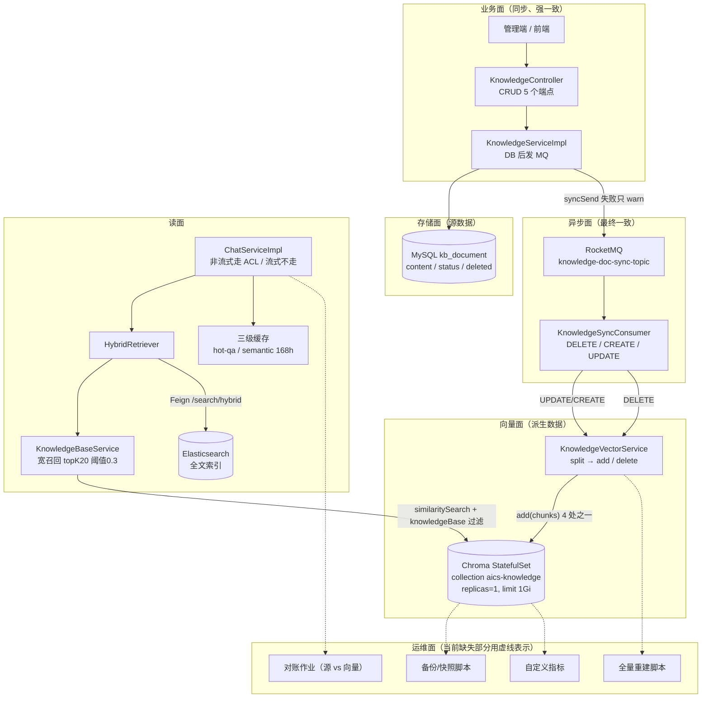
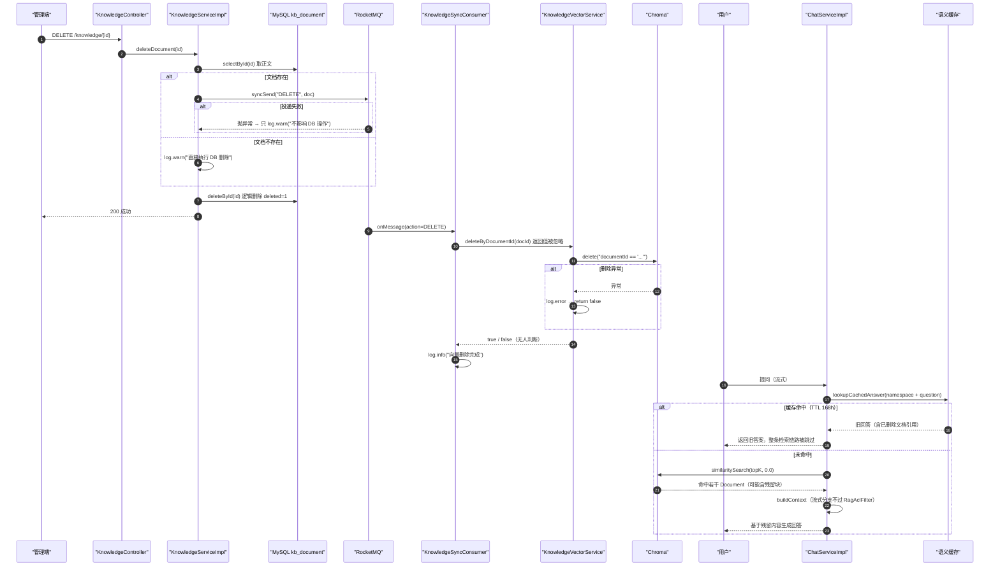

# 向量库生产运维：上线后真正要守的不是"搜得准"，而是"数据还对得上"

> **一句话结论**：向量库里的每一行都是业务数据的**派生数据**（由源数据经固定流程算出来的冗余副本，可丢、可重算，但绝不能和源数据不一致），所以运维重心必须从"调相似度"移到四件事——**对账、备份或重建、无停机重建、容量与水位**；本项目在 Chroma 上已经有了一条能跑通的同步链路，但**没有备份、没有重建脚本、没有对账作业、没有一条自定义指标**，四件事全部靠人。

> **阅读前置**：读过同目录 [01-向量与相似度-把文字变成坐标.md](01-向量与相似度-把文字变成坐标.md)、[02-索引算法-向量检索怎么从全表扫描里活下来.md](02-索引算法-向量检索怎么从全表扫描里活下来.md)、[03-选型与容量规划.md](03-选型与容量规划.md)，知道"分块 → Embedding → 近邻检索"是什么；读过 [08-知识库增量同步实战-RocketMQ驱动向量化.md](../02-RAG全栈实战/08-知识库增量同步实战-RocketMQ驱动向量化.md)，知道本项目写路径是 `DB + RocketMQ + Chroma` 三段式。

> **证据基线**：A 级 = `learning-docs/24-源码分析/assets/source/` 已入库的 Spring AI 2.1.0 摘录（`VectorStore.java.md`、`Document.java.md`、`SearchRequest.java.md`、`TokenTextSplitter.java.md`、`EmbeddingModel.java.md`）；B 级 = 本仓库 `ai-cs-knowledge`、`ai-cs-chat`、`ai-cs-search`、`ai-cs-product` 源码与 `deploy/` 配置（行号均为本次逐行核对）；C 级 = 7 条离线静态统计命令的真实输出（不启动服务、不连中间件、不联网）。预计阅读 28 分钟。

| 级别 | 来源 | 覆盖的文件/类 | 能证明什么 | 不能证明什么 |
| --- | --- | --- | --- | --- |
| A | `assets/source/*.java.md` | `VectorStore`、`Document`、`SearchRequest`、`TokenTextSplitter`、`EmbeddingModel` | Spring AI 2.1.0 的接口语义：`add` 与 `upsert` 的区别、块 id 怎么生成、阈值在哪一层生效 | Chroma 服务端内部行为（HNSW、墓碑、过滤器类型比较）**未入库**，本文涉及处一律标注"依据官方文档" |
| B | 本仓库真实文件 | `KnowledgeController`/`KnowledgeServiceImpl`/`KnowledgeSyncProducer`/`KnowledgeSyncConsumer`/`KnowledgeVectorService`、`ChatServiceImpl`、`RagAclFilter`、`deploy/k8s/chroma.yaml`、`deploy/observability/prometheus.yml`、`deploy/mysql/all-init.sql` | 本项目运维现状：谁写、谁删、删不掉会怎样、有没有备份/重建/指标 | 线上真实 QPS、真实向量条数、真实重建耗时（本项目未采集） |
| C | pwsh 静态统计（7 条） | 目录清单、`vectorStore.add/delete/upsert` 计数、`setStatus` 计数、自定义指标计数 | "没有备份脚本""add 4 处 / delete 3 处 / upsert 0 处""kb_document.status 只写过一次 0" | 不验证运行时行为（本机无 Chroma，端口 8000 未监听） |

---

## 0. 先看现象

**现象一：数据库里删了文档，客服回答还在引用它。**
日志里能看到这两行（模板来自源码，`{}` 是真实占位符，值是示意值）：

```text
消费知识文档同步消息: action=DELETE, documentId=1900000000000000001
向量删除完成: documentId=1900000000000000001
```

模板出处：`ai-cs-knowledge/src/main/java/com/aics/knowledge/mq/KnowledgeSyncConsumer.java#L55` 与 `#L59`。看起来干净，但这条链路上有**三个互相独立的断点**：投递失败只打 `log.warn`（`KnowledgeSyncProducer.java#L56-L60`，注释原话"不影响 DB 操作"）、消费端**忽略删除返回值**（`KnowledgeSyncConsumer.java#L57-L59`，`deleteByDocumentId` 返回 `boolean` 却没人接）、以及语义缓存 168 小时不过期（`ai-cs-chat/src/main/resources/application.yml#L183-L188`）。任一处踩中，DB 已经删了，检索侧照样能命中。

**现象二：换 embedding 模型重建，检索服务停了 4 小时。**
原因是"集合名 + 模型"这对参数在**进程启动时**就被固化了：`collection-name: aics-knowledge` 写死在两个服务的配置里（`ai-cs-chat/src/main/resources/application.yml#L49`、`ai-cs-knowledge/src/main/resources/application.yml#L31`），而 `VectorStore` Bean 是启动期按属性建好的懒代理（`ai-cs-chat/src/main/java/com/aics/chat/config/VectorStoreConfig.java#L58-L71`、`#L81-L89`）。换模型 = 改配置 + 重启 chat 与 knowledge 两个进程；而仓库里**没有任何重建脚本**（见 6.9 的 C1 输出），重建只能手工循环调 `PUT /knowledge/{id}`，边跑边没人知道进度——因为 `kb_document` 表里连"分块数"这个字段都没有（`deploy/mysql/all-init.sql#L245-L265`）。

**现象三：向量条数比业务数据多 30%，找不到原因。**
四条叠加：写入口有两个（`KnowledgeBaseService` 与 `KnowledgeVectorService`）、两者都用 `add` 而不是 `upsert`（全仓库 `upsert` 0 处，见 C4）、块 id 由 `RandomIdGenerator` 每次重新生成（A 级 [[源码:Document.java.md#L527-L531]] 里"无 id 则由 `RandomIdGenerator` 生成"）、以及 UPDATE 分支**根本没有先删旧块**（`KnowledgeSyncConsumer.java#L60-L71`），尽管类注释 `#L21-L29` 承诺了"重复消费 UPDATE 会先删除旧分块再写入新分块"。

这些现象指向同一件事：**向量库不是"写进去就完事"的数据库，而是一份需要持续对账的派生数据；只要"谁负责删、谁负责重建、怎么证明对得上"这三件事没有代码承载，三种症状就必然同时出现。**

---

## 1. 整体地图



| 组件 | 责任 | 本项目实现（含证据） | 参与方 |
| --- | --- | --- | --- |
| 源数据表 | 保存文档正文与生命周期 | `kb_document`，`deploy/mysql/all-init.sql#L245-L265`（`content LONGTEXT` #L248、`status` 0/1/2 #L254、`deleted` #L258） | knowledge 服务、管理端 |
| 变更投递 | 把 DB 变更变成事件 | `KnowledgeSyncProducer.java#L54` 同步发送 `topic:action`；失败只 warn #L56-L60 | knowledge 服务、RocketMQ |
| 变更消费 | 事件 → 向量写入/删除 | `KnowledgeSyncConsumer.java#L34-L38` 监听 topic；DELETE #L57-L59、其它 #L60-L71、异常吞掉 #L73-L77 | RocketMQ、knowledge 服务 |
| 向量写入 | 切块 + 向量化 + 入库 | `KnowledgeVectorService.java#L77`（切块）、`#L85`（`add`）、失败 `return 0` #L88-L91 | Chroma、硅基流动 bge-m3 |
| 向量删除 | 按 `documentId` 元数据删 | `KnowledgeVectorService.java#L109` 过滤表达式、失败 `return false` #L112-L115 | Chroma |
| 检索 | 向量宽召回 + 可选 Rerank | `KnowledgeBaseService.java#L228-L260`、`#L265-L279` | Chroma、bge-reranker |
| 权限 | 知识库/文档级 ACL 后过滤 | `RagAclFilter.java#L39-L69`，白名单缺省即放行 #L71-L81 | chat 服务 |
| 缓存 | 命中即跳过检索与 LLM | 三级缓存配置 `ai-cs-chat/src/main/resources/application.yml#L170-L193` | Redis |
| 向量存储部署 | 单机持久化 | `deploy/k8s/chroma.yaml`：`replicas: 1` #L33、`image: chromadb/chroma:0.5.20` #L44、`limits 1Gi` #L62-L68、`local-path 10Gi` #L69-L76 | Kubernetes |
| 运维脚本 | 只有"活着没"探活 | `deploy/scripts/check-local.ps1#L506-L528` 探 `/api/v1/heartbeat` | 运维 |

> **读图说明**：最关键的一条箭头是 `KnowledgeServiceImpl → RocketMQ` 上标注的"syncSend 失败只 warn"——它决定了写路径**没有事务边界**：DB 提交成功、消息没发出去时，向量库永久落后，而主流程一切正常。很多人会误以为"发了 MQ 就等于最终一致"，从这个假设出发会得出"只要消费者不报错就没问题"的错误结论，从而不去做对账作业。第二关键的是 `ChatServiceImpl → 缓存` 这条向下的边：它绕过了 `HybridRetriever` 和 `KnowledgeBaseService`，意味着**向量删对了也无法阻止旧答案被返回**，把"删除失效"全部归因于向量库是典型的误判方向。

---

## 2. 关键概念与关键要素

| 名称 | 位置 | 角色 | 关键点 |
| --- | --- | --- | --- |
| 派生数据 | 概念层 | 定位本文一切取舍的前提 | 向量 = f(正文, 模型, 切块参数)；f 不变就能重算，f 一变旧向量全部作废 |
| `kb_document` | `deploy/mysql/all-init.sql#L245-L265` | 唯一可信源 | 没有"分块数/向量数/模型版本"字段 → 天然无法对账，需先补表 |
| `status` 字段 | 同上 `#L254`（0 待处理 / 1 已索引 / 2 失败） | 本该是"索引是否完成"的唯一信号 | 全仓库只写过一次 `0`（C5），从不置 1/2 → 字段存在但语义空转 |
| `aics-knowledge` 集合 | `ai-cs-chat/src/main/resources/application.yml#L49`、`ai-cs-knowledge/src/main/resources/application.yml#L31` | 所有知识向量的唯一容器 | 集合名硬编码，换模型/换集合必须重启进程 |
| `documentId` 元数据 | `KnowledgeVectorService.java#L81` 存 `doc.getId()`；`KnowledgeBaseService.java#L171` 存 `chunk.getId()` | 删除与溯源的定位键 | **同名字段两套语义**：一处是文档 id，一处是分块随机 id |
| `knowledgeBase` 元数据 | `KnowledgeVectorService.java#L80` 写死常量 `"knowledge"`；`KnowledgeBaseService.java#L170` 写方法入参 | 检索过滤键 | 两个入口写进同一集合，过滤值可能不同 → 检索漏召回 |
| 块 id 生成器 | A 级 [[源码:Document.java.md#L415-L425]] | 决定"重复写入是否覆盖" | 默认 `RandomIdGenerator`，无 id 必生成新随机值 → `add` 天然产生重复 |
| `VectorStore.add` / `upsert` | A 级 [[源码:VectorStore.java.md#L46-L51]] / [[源码:VectorStore.java.md#L58-L82]] | 写入语义 | `add` 遇重复 id 行为"留给 provider"；`upsert` 是 2.1.0 新增的 replace-by-id |
| `RagAclFilter` | `ai-cs-chat/src/main/java/com/aics/chat/security/RagAclFilter.java#L39-L69` | 多租户/权限闸门 | 检索之后过滤；白名单为空即放行；流式分支根本不调用 |
| 语义缓存 | `ai-cs-chat/src/main/java/com/aics/chat/service/impl/ChatServiceImpl.java#L184-L189` + 配置 `#L183-L188` | 一致性"第二层脏" | TTL 168h，删除文档后旧答案最长还能再被返回一周 |
| Chroma 部署单元 | `deploy/k8s/chroma.yaml#L27-L76` | 容量与可用性上限 | 单副本、`1Gi` 内存硬顶、`local-path` 存储无快照能力 |
| 探活脚本 | `deploy/scripts/check-local.ps1#L506-L528` | 现有运维唯一手段 | 只判断 HTTP 心跳，不判断"条数对不对" |

---

## 3. 原理与证据逐段精读

### 3.1 为什么说向量是派生数据：这一个判断决定了后面全部取舍

**在干什么**：把"向量库"归类。`KnowledgeVectorService` 的输入只有三样东西——文档正文（`doc.getContent()`）、切块器参数（无参 `TokenTextSplitter`）、Embedding 模型（`aics.embedding.model`，默认 `BAAI/bge-m3`，`ai-cs-knowledge/src/main/java/com/aics/knowledge/config/KnowledgeAiConfig.java#L44-L45`）。输出就是集合里的行。

`ai-cs-knowledge/src/main/java/com/aics/knowledge/service/KnowledgeVectorService.java#L77-L86`（结构示意，省略日志与判空）

```java
List<Document> chunks = new TokenTextSplitter().split(new Document(doc.getContent()));
chunks.forEach(chunk -> {
    Map<String, Object> metadata = chunk.getMetadata();
    metadata.put("knowledgeBase", KNOWLEDGE_BASE);
    metadata.put("documentId", doc.getId());
    metadata.put("title", doc.getTitle());
});
vectorStore.add(chunks);
```

**为什么这么设计**：因为 f 是纯函数式的，所以"删库重建"在理论上永远可行——这正是本项目类注释敢写"天然可重试"（`KnowledgeVectorService.java#L38-L44`）、生产者注释敢写"可通过全量重建补偿"（`KnowledgeSyncProducer.java#L39`）的底气。承认这一点，运维才不需要给向量做 WAL、不需要保证两次写原子性。

**换写法会怎样**：如果把向量当主数据（例如把用户手工标注的"相似商品权重"只存在向量元数据里），那向量就变成不可再生数据，备份等级要抬到与 MySQL 同级，且必须做双写事务——代价是整条链路复杂度翻倍。本项目 `ProductVectorService` 的元数据只有 `productId`/`name`，仍属可再生。

**常见坑**：把"可再生"当成"可以不管"。可再生只意味着**最坏情况能重算**，不意味着**随时能重算**：重算要花 Embedding 的钱和时间，而且期间检索质量下降。C1 的结论是仓库里没有重建脚本，所以"能重算"目前是纸面能力。

### 3.2 写路径的两段式：DB 先行、事件后发，中间没有事务

**在干什么**：`KnowledgeServiceImpl` 先落库、再发事件，两步都在同一个方法里但没有事务包裹消息。

`ai-cs-knowledge/src/main/java/com/aics/knowledge/service/impl/KnowledgeServiceImpl.java#L134-L147`（结构示意）

```java
public boolean deleteDocument(Long id) {
    KnowledgeDocument document = knowledgeMapper.selectById(id);
    if (document != null) {
        knowledgeSyncProducer.send("DELETE", document);
    } else {
        log.warn("知识文档不存在，直接执行 DB 删除: id={}", id);
    }
    return knowledgeMapper.deleteById(id) > 0;
}
```

`ai-cs-knowledge/src/main/java/com/aics/knowledge/mq/KnowledgeSyncProducer.java#L52-L60`（结构示意）

```java
try {
    rocketMQTemplate.syncSend(TOPIC + ":" + action, message);
    log.info("投递知识文档同步消息: action={}, documentId={}, title={}", action, message.getId(), message.getTitle());
} catch (Exception e) {
    log.warn("知识文档同步消息投递失败（不影响 DB 操作）: action={}, documentId={}, err={}", action, message.getId(), e.getMessage());
}
```

**为什么这么设计**：让删除接口不被向量库可用性绑架。Chroma 挂了不该导致知识库不能维护，这是可用性优先的取舍，注释也明说了。

**换写法会怎样**：换成事务消息（RocketMQ 半消息 + 本地事务回查）能把"发不出消息"的概率压到极低，代价是要实现 `TransactionListener` 并保证回查幂等；换成 outbox 表则要多一张表和一次扫表任务。两者都比"warn 一下算了"贵，且都需要幂等消费作为前提——而本项目消费端**吞异常**（`KnowledgeSyncConsumer.java#L73-L77`），重试机制形同不存在。

**常见坑**：注释声称"不抛异常（RocketMQ 默认重试 16 次后进入死信队列）"，实际“吞掉异常”恰好使重试永远不会发生，死信队列也就永远收不到东西。这类"注释与代码语义相反"的地方，是排查一致性问题的第一嫌疑点。

### 3.3 删除为什么可能删不掉：三个断点与一个类型陷阱

**在干什么**：`deleteByDocumentId` 用元数据过滤表达式删除。

`ai-cs-knowledge/src/main/java/com/aics/knowledge/service/KnowledgeVectorService.java#L103-L115`（结构示意）

```java
public boolean deleteByDocumentId(Long documentId) {
    if (documentId == null) {
        return false;
    }
    try {
        vectorStore.delete("documentId == '" + documentId + "'");
        log.info("按 documentId 删除向量: documentId={}", documentId);
        return true;
    } catch (Exception e) {
        log.error("按 documentId 删除向量失败: documentId={}, err={}", documentId, e.getMessage());
        return false;
    }
}
```

**为什么这么设计**：Chroma 只能按元数据删，没有"按业务主键"的概念，所以只能把 Long 主键塞进元数据再反查。写法上复用了 Spring AI 的过滤表达式文本 DSL（A 级 [[源码:SearchRequest.java.md#L190-L239]] 里有 DSL 示例 `country == 'UK' && isActive == true`，解析器是 `FilterExpressionTextParser`）。

**换写法会怎样**：写 `documentId == 1900000000000000001`（不带引号）会走**数值比较**分支；带引号 `'1900…'` 则是**字符串比较**。而写入侧 `metadata.put("documentId", doc.getId())` 存的是 `Long`。两者是否等价，取决于 Chroma 服务端的 where 类型匹配规则——**该部分未入库，依据官方文档/本项目文档无法确证**，因此这是一个必须实测的口径风险，而不是可以假定正确的细节。更稳的写法是：写入时显式存字符串（`String.valueOf(doc.getId())`）并在删除时用同样的字符串，让元数据类型在写入侧就固定下来。

**常见坑**：
① 上面这种"类型口径不一致"在数据量小于 1 万时往往恰好能匹配上，等规模变了才暴露，属于典型"几个月后才炸"的问题；
② 消费者把返回值扔了（`KnowledgeSyncConsumer.java#L57-L59`），所以 `return false` 与 `return true` 在日志上完全一样；
③ 即使删除彻底成功，读路径的缓存仍会返回旧答案（见 6.6）。

### 3.4 更新为什么会产生重复 chunk：`add` + 随机 id + 分支缺一步

**在干什么**：UPDATE 事件走的是和 CREATE 完全相同的分支——重新切块、重新 `add`，**没有先删旧块**。

`ai-cs-knowledge/src/main/java/com/aics/knowledge/mq/KnowledgeSyncConsumer.java#L60-L71`（结构示意）

```java
KnowledgeDocument doc = new KnowledgeDocument();
doc.setId(message.getDocumentId());
doc.setTitle(message.getTitle());
doc.setContent(message.getContent());
int chunks = knowledgeVectorService.vectorize(doc);
if (chunks > 0) {
    log.info("向量化完成: action={}, documentId={}, chunks={}", action, message.getDocumentId(), chunks);
} else {
    log.warn("向量化无内容/失败: action={}, documentId={}", action, message.getDocumentId());
}
```

**为什么这么设计**：从代码看不是"设计"，而是漏了——类注释 `#L21-L29` 写的是"基于 documentId 元数据做 delete + add，重复消费 UPDATE 会先删除旧分块再写入新分块"，代码里只有 DELETE 分支调用了删除。真正的设计意图在 Spring AI 侧：`add` 的语义是不保证唯一性。

A 级证据把这件事说得很直白：

```java
// (src: VectorStore.java.md#L46-L51)
/**
 * Add a list of documents to the vector store.
 * ...
 * @throws RuntimeException if the underlying provider checks for duplicate IDs and detects
 */
void add(List<Document> documents);
```

```java
// (src: VectorStore.java.md#L58-L82)
/**
 * Upsert a list of documents into the vector store. ...
 * an ingestion job that uses stable ids is safe to re-run — the same input yields the
 * same rows with no duplicates ... this is in contrast to add(List), whose behavior for a
 * repeated id is left to the underlying provider ...
 * @since 2.1.0
 */
void upsert(List<EmbeddedDocument> documents);
```

而块 id 从哪来？没有显式 id 时由生成器补齐：

```java
// (src: Document.java.md#L520-L531)
Document build() {
    Assert.notNull(this.text, "Text must not be null");
    Assert.notNull(this.metadata, "Metadata must not be null");
    if (!StringUtils.hasText(this.id)) {
        this.id = this.idGenerator.generateId(text, this.metadata);
    }
    ...
}
```

**换写法会怎样**：给每个块显式指定稳定 id（例如 `docId + "#" + chunkIndex`）并改用 `upsert`，重复消费就变成"覆盖"而不是"追加"，这正是 `upsert` javadoc 承诺的"同一输入重跑得到同样行"。代价是：修改切块策略（块大小 800→500）后块序号含义变了，旧块不会被新块覆盖，仍需先按 `documentId` 清一次。

**常见坑**：`ProductVectorService` 是项目里唯一写对的地方——`ai-cs-product/src/main/java/com/aics/product/service/impl/ProductVectorService.java#L58-L62` 用商品 id 当 Document id，注释 #L57 直接写"同 ID 重复索引会覆盖，天然幂等"。同一仓库两种写法的对照，比任何最佳实践清单都好用：**幂等不来自 `VectorStore`，来自你有没有一个稳定的业务主键**。

### 3.5 元数据是运维的地基：三个字段决定了你能做什么

**在干什么**：检查写入的元数据是否够支撑"删除、对账、灰度"三件事。

现状是四个元数据字段：`knowledgeBase`、`documentId`、`title`（`KnowledgeVectorService.java#L80-L82`），加一个可选的 `page_number`（`HybridRetriever.java#L196-L198`）。缺的三样：**块序号**（无法定位"第几块"）、**模型标识**（无法判断这行向量属于哪个模型空间）、**内容指纹**（无法判断源文档改没改）。

**为什么这么设计**：为了引用溯源（`buildCitations`、`【资料N】` 拼接）只需要这三个字段，写的时候没有为运维留位置。

**换写法会怎样**：补 `model`、`chunk_index`、`content_hash` 三个字段后，能直接做三件事：①按 `model` 统计"集合里混了几个模型空间"；②按 `content_hash` 做增量重建（只重算变化的块）；③按 `chunk_index` 做断点续传。代价是每条向量多几十字节元数据、切块器要暴露块序号（`TokenTextSplitter` 不提供，需要自己包一层）。

**常见坑**：元数据字段一旦写入就不能改"历史行"——只能重建。所以**元数据设计要一次性做对**，这比选哪个向量库更影响后面两年的运维成本。

### 3.6 换 embedding 模型必须全量重建，以及"不停服"到底怎么做

**在干什么**：换模型时，同一段文本会得到完全不同维度的向量（本项目 bge-m3 1024 维，兜底 `HashEmbeddingModel` 768 维，`ai-cs-common/src/main/java/com/aics/common/ai/embedding/HashEmbeddingModel.java#L31`）。新旧向量混在一个集合里，余弦相似度算的是两个不同空间的夹角——**结果全是噪声，而且不报错**。

**为什么这么设计**：向量空间由模型唯一决定，集合只是容器。Chroma 的集合在建时确定维度，理论上写入不同维度会失败，但"同维度不同模型"（例如换一个也是 1024 维的模型）会静默通过——这才是最危险的情形。

**换写法会怎样**：不停服重建必须做到"两套向量空间并存 + 读侧可切换"。最小可行方案（本项目未实现，属于待落地项）：

1. 集合名参数化：把 `collection-name: aics-knowledge` 改成 `aics-knowledge-${aics.embedding.model-slug}`，让集合按模型隔离；
2. 双写：新增 `RebuildService`，从 `kb_document` 分页读（`deleted = 0`），用**新模型**写入新集合，同时旧链路继续服务；
3. 双读对比：灰度期读侧对新旧集合各取 Top-K，用同一批 golden 集（`ai-cs-chat/src/main/resources/eval/` 目录下的 `golden-set.json` 已有 20 条）比较 Recall@K；
4. 切换：把读侧集合名指向新集合，旧集合保留一个回滚窗口再删。

代价：重建期间 Embedding 调用量翻倍、存储翻倍、需要额外的双读流量开关。收益：重建从"停服 4 小时"变成"零停机 + 可回滚"。

**常见坑**：想用 `EmbeddingModel.dimensions()` 做启动期校验——A 级 [[源码:EmbeddingModel.java.md#L131-L140]] 明确写了"默认会真调远端 endpoint 拿维度"，在启动路径上调它等于给启动加了一次网络依赖，必须在健康检查里异步做、失败只告警不阻断。

### 3.7 容量与扩容：单机 Chroma 的天花板在哪一行

**在干什么**：看清当前部署单元的上限。

`deploy/k8s/chroma.yaml` 的四行关键配置：

| 配置 | 位置 | 含义 |
| --- | --- | --- |
| `replicas: 1` | `deploy/k8s/chroma.yaml#L33` | 无副本、无分片、无只读副本；Pod 挂掉即检索不可用 |
| `limits: memory 1Gi` | `deploy/k8s/chroma.yaml#L62-L68` | 向量索引要常驻内存，1Gi 是硬顶，超了 OOMKilled |
| `storageClassName: local-path` + `10Gi` | `deploy/k8s/chroma.yaml#L69-L76` | 无 CSI 快照能力，快照必须自己做；卷 10Gi 是持久化上限 |
| `accessModes: RWO` | `deploy/k8s/chroma.yaml#L73-L74` | 不能多 Pod 共享写，扩容必须先解决存储 |

**为什么这么设计**：注释写得很诚实——"单副本：学习环境，数据一致性简单"。单副本省掉了分布式一致性，是学习项目的合理选择。

**换写法会怎样**：真扩容有三条路，成本依次上升：①换掉 Chroma 上用支持分片/副本的方案（Milvus、Qdrant 集群、ES dense_vector）——代码只依赖 `VectorStore` 接口，`ai-cs-chat/src/main/java/com/aics/chat/config/VectorStoreConfig.java#L38-L45` 已经把步骤写清楚了；②保留 Chroma 但按知识库拆集合、分机器部署，读侧路由；③业务侧做分片键（例如按租户），应用层聚合结果。第二条路最容易先落地。

**常见坑**：拿"条数"估算内存。1024 维 float32 单条向量本体 = 1024 × 4 = 4096 字节，`10Gi` 卷理论上界约 `10 GiB ÷ 4096 B ≈ 2.6×10⁶` 条——但这是**不含 HNSW 图、元数据、正文、倒排的纯向量上界**，实际可容纳量远低于此，且真实内存占用还要算上索引结构。本项目未做容量实测，任何"能存多少条"的答案都必须附上这个算式。

### 3.8 多租户与权限：后过滤的代价，以及默认放行

**在干什么**：检索先拿到结果，再按 ACL 过滤。

`ai-cs-chat/src/main/java/com/aics/chat/security/RagAclFilter.java#L71-L81`（结构示意）

```java
private boolean canAccessKnowledgeBase(String knowledgeBase, Long userId) {
    List<String> allowed = properties.getRagAclKnowledgeBases() == null
            ? null : properties.getRagAclKnowledgeBases().get(knowledgeBase);
    return allowed == null || allowed.isEmpty() || allowed.contains(...);
}
```

**为什么这么设计**：向量库不认识"角色"，把 ACL 放在应用侧可以避免每次检索都拼复杂的 `where`。缺省放行是为了本地开发不配置也能跑通。

**换写法会怎样**：换成前置过滤（把租户/角色条件拼进 `filterExpression`）能保证"返回的 K 条都是可见的"，代价是每加一种权限都要改检索语句，且 ACL 变更要同步到向量元数据——运维面立刻变重。工程上的折中是：**用元数据做粗粒度分区（租户/知识库），用后过滤做细粒度文档级 ACL**，本项目顺序反了（连知识库级都靠后过滤，且 `KnowledgeBaseService` 已经用 `knowledgeBase == '...'` 做了过滤，两套机制并存）。

**常见坑**：① 白名单为空即放行，而仓库里没有任何 `aics.security.rag-acl-*` 配置（`SecurityProperties.java#L55`、`#L58` 默认空 Map）→ 默认状态下 ACL 等于没开；② 流式对话分支检索后直接 `buildContext`，**完全不调用 `ragAclFilter`**（`ChatServiceImpl.java#L586-L594`，全文仅 `#L142` 声明与 `#L439` 一处调用）→ 同一份数据，非流式受控、流式不受控。这类"两条代码路径权限不一致"比 ACL 逻辑写错更常见。

---

## 4. 一次完整执行时序

场景：管理员删除一篇已被频繁引用的文档，随后用户立刻提问。



> **读图说明**：注意第 6 步和第 7 步之间的顺序——**先发消息、后删 DB**，而且消息投递失败不影响第 8 步。看图时最容易读错的是 `V-->>C: true / false（无人判断）`：很多人以为这行是"删除成功确认"，实际上它是一个被丢弃的返回值，所以**日志里"向量删除完成"不能作为删除成功的证据**。第二个易错点是 `alt 缓存命中` 那个分支：它排在检索之前，意味着只要缓存命中，前面关于向量是否删干净的所有努力都白做。

| 失败步骤 | 现象 | 错误/日志（真实模板） | 用户感知 |
| --- | --- | --- | --- |
| 4 消息投递失败 | DB 已删，向量永久残留 | `知识文档同步消息投递失败（不影响 DB 操作）`，`KnowledgeSyncProducer.java#L56-L60` | 删了还能被引用，且无法自愈 |
| 5 DB 删除失败 | 消息已发但 DB 还在 | 接口返回失败，向量已删 → **反向不一致**（回答不到但文档在） | 回答里查不到本该有的资料 |
| 9 消费异常 | 该条消息被吞，不重试 | `知识文档同步消息消费失败`，`KnowledgeSyncConsumer.java#L73-L77` | 同上，且 RocketMQ 不会重投 |
| 11 delete 过滤未匹配 | 无异常、无日志差异 | `按 documentId 删除向量: documentId=…`，`KnowledgeVectorService.java#L110`（成功也打这句） | 残留块继续被召回 |
| 12 删除异常 | 返回 false 被忽略 | `按 documentId 删除向量失败`，`#L112-L115` | 同上 |
| 16 缓存命中 | 检索链路根本没跑 | 无检索日志（`宽召回完成` 不出现），`KnowledgeBaseService.java#L277` | 旧答案继续被引用，最长 168h |
| 19 向量库不可达 | 懒代理首次解析目标失败 | `VectorStoreConfig.java#L58-L71` 的代理在首次调用时才连远端 | 首个 RAG 请求 500，而非启动失败 |

---

## 5. 设计取舍

| 决策点 | 本项目选择 | 换来什么 | 付了什么代价 | 证据 |
| --- | --- | --- | --- | --- |
| 同步写向量 vs 事件异步写 | 异步（MQ） | 删除接口不被 Chroma 可用性绑架 | 无事务边界，投递失败即永久不一致 | `KnowledgeServiceImpl.java#L139-L140`、`KnowledgeSyncProducer.java#L56-L60` |
| `add` vs `upsert` | 全部 `add`（4 处，`upsert` 0 处） | 兼容任意 provider 的最低公共语义 | 重复 id 行为不定，重跑即重复 | A 级 [[源码:VectorStore.java.md#L46-L51]]、C4 输出 |
| 块 id 随机 vs 稳定 | 随机（未显式给 id） | 调用方零负担 | 无法幂等，无法按块定位 | A 级 [[源码:Document.java.md#L527-L531]] |
| 单机 Chroma vs 集群 | 单副本 StatefulSet | 部署简单、无分布式一致性问题 | 无 HA、无分片、1Gi 内存顶死 | `deploy/k8s/chroma.yaml#L33`、`#L62-L68` |
| ACL 后过滤 vs 前置过滤 | 后过滤且默认放行 | 与向量库解耦，本地零配置可跑 | 返回条数不足 + 默认等于没开 + 流式漏过滤 | `RagAclFilter.java#L71-L81`、`ChatServiceImpl.java#L586-L594` |
| 三级缓存 vs 强一致 | hot-qa 24h + semantic 168h | 大量省掉检索与 LLM 调用 | 删除不穿透缓存，最长 7 天脏回答 | `ai-cs-chat/src/main/resources/application.yml#L170-L193` |
| 向量备份 vs 只备份源数据 | 都没有（无任何备份脚本） | 仓库干净 | RPO = 全量重建耗时；当前等于"丢了就没了" | C1 输出（匹配 1 个文件且是部署清单本身） |
| `documentId` 存 `doc.getId()` vs `chunk.getId()` | 两个入口各写一种 | 各自省一次参数传递 | 同名字段两套语义，溯源与删除口径冲突 | `KnowledgeVectorService.java#L81` vs `KnowledgeBaseService.java#L171` |

**可扩展点清单**（按"改了会不会动别人"从低到高排序）

1. **补巡检脚本**（只读，不动任何服务）：在 `deploy/scripts/` 加一个 `check-vector.ps1`，查 Chroma 集合条数 + `kb_document` 计数做差。风险最低，建议第一步就做。
2. **补自定义指标**（只加代码，不动数据）：给 `KnowledgeVectorService.vectorize`/`deleteByDocumentId` 加 `Counter`/`Timer`（当前全仓库 0 处，见 C6）。
3. **补重建端点与脚本**（新增接口，不改老接口）：`POST /knowledge/ops/rebuild`，分页读 `deleted=0` 重新向量化。
4. **把 `status` 用起来**（改现有语义）：写成功置 1、失败置 2，`idx_status` 索引已存在（`deploy/mysql/all-init.sql#L261`），代价是所有读 `status` 的地方要重新审一遍。
5. **切 `upsert` + 稳定块 id**（改写入语义）：动 `KnowledgeVectorService`、`KnowledgeBaseService`、`SearchServiceImpl` 三处写入口，必须先做 3、4 两步安全网。
6. **集合名参数化 + 双写双读**（动部署与配置）：换模型不停服的唯一正道，但要同时改两个服务的 yml 与灰度开关，属于跨服务变更。

---

## 6. 踩坑与调试手法

### 6.1 坑：消息投递失败只 warn，DB 照删

现象：知识库里已经没有这篇文档，客服却能一字不差地引用它的内容。根因：`KnowledgeServiceImpl.deleteDocument` 先 `send("DELETE")` 再 `deleteById`，而 `send` 内部把异常吞成 `log.warn`（`KnowledgeSyncProducer.java#L56-L60`）。DB 是权威，删了就查不到原文，但向量仍能召回，模型照旧生成答案。
**调试手法**：先确认是"向量残留"还是"缓存脏"——查 `kb_document` 是否存在该 id（不存在说明业务侧确实删了），再看 chat 日志里有没有 `宽召回完成: 命中N条`（`KnowledgeBaseService.java#L277`）。**有召回日志 = 向量残留；无召回日志 = 缓存命中**。这一步二分能省掉一半排查时间。

### 6.2 坑：`boolean` 返回值没人接，日志说"删除完成"

现象：`向量删除完成` 出现在日志里，但集合里还有数据。根因：`KnowledgeSyncConsumer.java#L57-L59` 直接丢弃 `deleteByDocumentId` 的返回值，然后无条件打成功日志；而 `deleteByDocumentId` 在异常时 `return false`（`#L112-L115`）、在 id 为 null 时也 `return false`（`#L104-L106`）。
**调试手法**：判断"删除成功"的唯一可靠证据是删除后再查一次条数，而不是日志文案。把"打印成功"改成"用返回值决定打印哪一句"，是这类问题最小的修复。

### 6.3 坑：数字主键被拼成字符串字面量去比较

现象：删除调用没报错，条数却不变。根因：写入侧 `metadata.put("documentId", doc.getId())` 是 `Long`（`KnowledgeVectorService.java#L81`），删除侧 `"documentId == '" + documentId + "'"` 生产的是字符串字面量（`#L109`）。Chroma 的 where 过滤器对"元数据是数字、条件写成字符串"如何处理，属于服务端行为，**未入库，依据官方文档/本项目文档不能断言**——所以这是一个必须用实测钉死的口径。
**调试手法**：最小验证是"写一条、删一条、数条数"，把结果记进 runbook；同时把写入侧改成 `String.valueOf(doc.getId())` 消除歧义，让口径在代码里唯一。

### 6.4 坑：UPDATE 不删旧块 + 随机块 id = 条数越跑越多

现象：向量条数比业务文档条数多 30%，且重跑一次同步脚本又多一截。根因有三层：消费端 UPDATE 分支只 `add`（`KnowledgeSyncConsumer.java#L60-L71`）、块 id 每次随机（A 级 [[源码:Document.java.md#L527-L531]]）、全仓库 `upsert` 0 处（C4）。类注释 `#L21-L29` 描述的"先删后写"只在 DELETE 分支存在。
**调试手法**：见 6.9 的 C4 命令，统计 `add`/`delete`/`upsert` 的**处数比**——本项目 4:3:0，意味着"写入口比删入口多一个"，且一条 `add` 可以批量插入 N 个块，而删除必须按条件匹配。这个比例本身就是一致性风险的量化指标。

### 6.5 坑：`status` 字段永远为 0，无法判断"索引好了没"

现象：想查"哪些文档还没向量化"，发现查不出来。根因：全仓库 `setStatus` 只有 4 处调用，knowledge 模块里唯一针对文档的是 `document.setStatus(0)`（`KnowledgeServiceImpl.java#L54`），另三处是 FAQ / 问题聚类报表；从不置 1 或 2。DDL 里 `status` 的注释（`deploy/mysql/all-init.sql#L254`）描述了一套完整状态机，但没有任何代码去推进它。
**调试手法**：C5 命令统计 `setStatus(` 的出现处并逐条看是不是文档表；同时统计 `chunks` 变量出现位置——本项目 8 处全在日志语句里（消费者 `#L66-L68`、向量服务 `#L77`/`#L79`/`#L85`/`#L86`/`#L87`），说明**分块数从未落库**，对账只能靠日志翻。

### 6.6 坑：语义缓存 168h，让"已删除"继续被引用；流式分支还绕过 ACL

现象：清理干净了向量，用户提问仍得到旧答案。根因：`ChatServiceImpl.lookupCachedAnswer`（`#L184-L189`）在检索之前执行，热门问答缓存 24h、语义缓存 168h（`ai-cs-chat/src/main/resources/application.yml#L183-L193`）；缓存命名空间只按 `knowledgeBase + userId` 隔离（`#L169-L178`），不带任何"知识版本号"，所以文档更新/删除无法让缓存失效。
**调试手法**：复现时先关缓存（`aics.cache.semantic.enabled=false` 或换一个新问法绕过语义相似度 0.92），再看回答是否变化——变了就是缓存问题，没变才是向量问题。另外核查流式路径：`ChatServiceImpl.java#L586-L594` 检索后直接 `buildContext`，`ragAclFilter` 全文只有 `#L439` 一处调用，非流式受控、流式不受控。

### 6.7 慢查询排查手法：把一次检索拆成四段计时

慢查询在向量库里的表现和关系库完全不同：不是"某个 SQL 慢"，而是"某一层在退化"。离线也能先把四段拆清楚：

| 段 | 观测点 | 典型症状 | 本项目现状 |
| --- | --- | --- | --- |
| 1 查询向量化 | Embedding 远端调用（`EmbeddingModel` 层有 `CachingEmbeddingModel` 缓存，`SpringAiConfig.java#L203`） | 缓存命中率低时 P99 抖动；上游限流直接超时 | 缓存 TTL 168h、L1 4096 条（`application.yml#L178-L182`） |
| 2 向量近邻检索 | `vectorStore.similaritySearch`（`KnowledgeBaseService.java#L276`） | 条数增长后延迟线性上升；1Gi 内存触发换页 | 无埋点（C6 为 0） |
| 3 结果后处理 | Rerank 远端（`#L236-L254`）、ACL 过滤（`RagAclFilter.java#L39-L69`） | 过滤后条数骤减但延迟不变 | Rerank 失败静默降级 |
| 4 生成 | `resilience4j.timelimiter.chatService 30s`（`application.yml#L74-L79`） | 超时抛 `CHAT_AI_SERVICE_UNAVAILABLE` | 有超时兜底，无检索段超时 |

排查顺序：先看超时是否落在整条链路的 30s 限额上（`#L74-L79`），再分别量"加一句话前缀的 query 向量化耗时"和"同 query 重复检索耗时"——如果第二次明显变快，问题在向量化/缓存；如果两次一样慢，问题在近邻检索或索引退化。

### 6.8 日常巡检清单（建议每天/每周各一遍，全部为只读操作）

| 频次 | 检查项 | 判据 | 当前是否可自动执行 |
| --- | --- | --- | --- |
| 每日 | Chroma 存活 | `/api/v1/heartbeat` 200（`check-local.ps1#L506-L528`） | 是（已有脚本） |
| 每日 | 向量条数 vs 文档条数 | 差值/文档数 < 5% | 否，无脚本（C1） |
| 每日 | 删除残留 | 随机抽 3 个 `deleted=1` 的 id，按 `documentId` 计数应为 0 | 否，无端点 |
| 每日 | 检索 P99 | 有基线后偏离 2 倍告警 | 否，无指标（C6） |
| 每周 | 召回抽样 | golden 集 20 条 Recall@K 不低于基线 5 个点 | 部分（`RetrievalMetrics` 已实现，门禁未配阈值） |
| 每周 | 内存水位 | Pod 内存 / 1Gi limit < 75% | 需外部采集（`deploy/k8s/chroma.yaml#L62-L68`） |
| 每周 | 索引/卷大小 | 卷使用率 < 70%（10Gi） | 需外部采集（`#L69-L76`） |
| 每周 | 模型一致性 | 集合内只有一种模型空间 | 否，元数据无 `model` 字段 |
| 每月 | 重建演练 | 用 staging 集合完整重建一次并记录耗时/费用 | 否，无重建脚本 |
| 每次发布 | 灰度双读 | 新旧集合在同一 golden 集上对比后切换 | 否，无实现 |

### 6.9 真调试手法合集（离线可复现，全部 30 秒内跑完）

**C1 —— 清点 deploy 下是否存在向量库备份/重建脚本**

```powershell
Get-ChildItem deploy -Recurse -File |
  Where-Object { $_.Name -match '(?i)backup|dump|snapshot|restore|rebuild|reindex|vector|chroma' } |
  ForEach-Object { $_.FullName.Replace("$PWD\", "") }
```

```text
匹配文件数: 1
  deploy\k8s\chroma.yaml
```

怎么读：统计口径是"文件名含 backup/dump/snapshot/restore/rebuild/reindex/vector/chroma 的任意文件"。结果是 **1 个，而且是 Chroma 的部署清单本身**——它叫 `chroma.yaml` 才被匹配到，里面没有任何备份逻辑。结论：**本项目当前没有向量库备份方案，也没有重建方案**。对照物是 `deploy/scripts/sync-kb-to-es.py`：它从知识服务分页拉 `kb_document` 写入 ES，`_id` 用文档 id 所以重复执行覆盖不重复（脚本注释 `#L6-L7`），并支持 `--recreate` 重建索引——同一份业务数据，**ES 有重建脚本、向量库一个都没有**。

**C4 —— 统计写/删/改三类向量操作的分布（一致性风险的量化口径）**

```powershell
$src = Get-ChildItem -Recurse -Include *.java | Where-Object { $_.FullName -match '\\src\\main\\' }
foreach ($op in 'add','delete','upsert') {
  $hits = @($src | Select-String -Pattern ("vectorStore\." + $op + "\(") |
          Where-Object { $_.Line.TrimStart() -notmatch '^[*//]' })
  "{0}: {1} 处" -f $op, $hits.Count
}
```

```text
add: 4 处
delete: 3 处
upsert: 0 处
```

怎么读：口径是"`src/main` 下所有 `.java` 里 `vectorStore.add(`/`.delete(`/`.upsert(` 的调用语句，排除 javadoc 与行注释"。四处 `add` 分别在 `KnowledgeBaseService.java:178`、`KnowledgeVectorService.java:85`、`ProductVectorService.java:62`、`SearchServiceImpl.java:112`；三处 `delete` 在 `KnowledgeVectorService.java:109`、`ProductVectorService.java:70`、`SearchServiceImpl.java:129`；`upsert` 一处都没有。**"能写的地方比能删的地方多一个"，而且每一处 `add` 都能一次写入成百上千个块**——这就是"条数只涨不跌"的结构性原因。

**C6 —— 确认有没有自定义向量指标**

```powershell
Get-ChildItem -Recurse -Include *.java |
  Where-Object { $_.FullName -match '\\src\\main\\' } |
  Select-String -Pattern 'MeterRegistry|Gauge\.builder|Counter\.builder|Timer\.builder' |
  Measure-Object | Select-Object -ExpandProperty Count
```

```text
0
```

怎么读：0 说明全仓库没有任何自定义 Micrometer 指标。结合 `deploy/observability/prometheus.yml#L9` 的 `metrics_path: '/actuator/prometheus'` 可以得出两点：①即使抓取通了，也只有 JVM/HTTP 默认指标，**没有"检索条数""索引大小""召回率"这类业务指标**；②仓库内 0 处 `management.endpoints.web.exposure.include` 配置（本次 grep 无命中），而 Spring Boot 默认只暴露 `health`，所以 `/actuator/prometheus` 大概率返回 404（依据 Spring Boot 默认暴露行为；若 Nacos 共享配置里另有覆盖则不成立）。**"有 Prometheus 就等于有监控"是这类项目最常见的错觉。**

**如何验证"删了业务数据后向量是否残留"（判据，按可执行性排序）**

1. **静态判据**（离线、零依赖）：C4 的 `add:delete` 比例 + `KnowledgeSyncConsumer.java#L57-L59` 是否存在"忽略返回值" → 比例失衡或存在忽略，就应当假定残留可能发生。
2. **数据面判据**（需 Chroma 可达）：对同一 `documentId` 先查 `kb_document`（应查不到，因为逻辑删除 `deleted=1`），再用该 `documentId` 去集合里做一次按元数据过滤的检索或计数——**期望 0 条**。这是唯一能证明"删干净了"的证据。
3. **行为面判据**（需服务可达）：用原本能命中该文档的问题提问，先关语义缓存绕过缓存干扰，看是否还有 `宽召回完成: 命中N条` 日志（`KnowledgeBaseService.java#L277`）。有日志 = 向量残留；无日志 = 缓存脏，据此分流。

---

## 7. ⚠️ 版本差异

| 旧写法 | 当前基线 | 变化点 | 迁移动作 |
| --- | --- | --- | --- |
| `vectorStore.add(list)` 当作"写入或更新" | 2.1.0 起有 `upsert`（A 级 [[源码:VectorStore.java.md#L58-L82]]） | `add` 的重复 id 行为留给 provider，`upsert` 是显式 replace-by-id，且"整批失败可安全重试" | 有稳定业务主键的写入口优先改 `upsert`；块类数据先补稳定块 id（`docId#index`） |
| 以为 `initialize-schema: false` 就不会碰远端 | `ChromaVectorStore` 实现 `InitializingBean`，构造即查集合（`VectorStoreConfig.java#L33-L36`） | 2.1 的行为变化导致"服务启动失败"变成"首次请求失败" | 保留 `LazyInitTargetSource` 代理（`#L58-L71`），勿删 |
| 以为 `similarityThreshold` 在服务端过滤 | 它是客户端后处理（A 级 [[源码:SearchRequest.java.md#L180-L188]]，`similarityThresholdAll()` = 0.0） | 0.0 = 全接受，不等于"没有阈值"这个语义 | 想省带宽必须在 `filterExpression` 或 topK 上做，不能靠阈值 |
| `new TokenTextSplitter()` 无条件使用 | 无参构造器标记 `@Deprecated(since="2.0.0-M3", forRemoval=true)`（A 级 [[源码:TokenTextSplitter.java.md#L80-L88]]） | 2.1.0 上仍在，但随时可能移除；默认参数 800/0/350/5/10000（`#L41-L55`） | 改 `TokenTextSplitter.builder()...build()`，同时把块参数显式化（否则改版后默认值变了会静默影响重建结果） |
| 用 `EmbeddingModel.dimensions()` 做启动校验 | 默认实现会真调远端（A 级 [[源码:EmbeddingModel.java.md#L131-L140]]） | 启动路径上多一次网络依赖 | 移到健康检查里异步校验，失败只告警 |
| 旧稿用 Milvus/ES 的"墓碑 + compact"描述删除语义 | 本项目是 Chroma 0.5.20（`deploy/k8s/chroma.yaml#L44`） | Chroma 的物理回收与 `where` 类型比较规则**未入库**，依据官方文档 | 旧稿"墓碑率 >25% 告警"这类阈值不能直接搬到 Chroma，必须自测后再写进 runbook |
| 旧稿用 Python/伪代码示例 | 本项目是 Java 17 + Spring AI 2.1.0 | 写路径是 MQ 驱动、双服务共用集合 | 所有示例改成本仓库真实类与行号 |

---

## 8. 面试高频问与答

1. 向量库运维和普通数据库运维的核心差异是什么？为什么说向量是"派生数据"？
2. 业务库删了文档，向量却没删，你会按什么顺序定位？三个可能层分别怎么验证？
3. `VectorStore.add` 和 `upsert` 的区别是什么？重跑一次导入任务，用哪个安全？
4. 为什么"给每个块生成稳定 id"比"换个支持 upsert 的向量库"更根本？
5. 换 embedding 模型为什么必须全量重建？同维度换模型为什么更危险？
6. 怎么做到换模型不停服？双写双读方案里最容易被忽略的一步是什么？
7. 向量条数比业务数据多 30%，你会用哪几个静态统计先缩小范围？
8. 向量库要不要备份？快照和重建各自的 RPO/RTO 怎么估？
9. 重建 500 万块大概要多久、花多少钱？瓶颈通常在哪一层？
10. Chroma 单机 `1Gi` 内存 + `local-path` 10Gi 卷，容量上限怎么估？扩容有哪几条路？
11. 检索 P99 突然翻倍，你会把一次检索拆成哪几段分别计时？
12. 多租户隔离有哪几种粒度？后过滤 ACL 的两个典型陷阱是什么？
13. 灰度发布新索引时，怎么证明"新的不差于旧的"？golden 集怎么用？
14. 向量库该看哪些指标？为什么"Prometheus 接上了"不等于"有监控"？
15. 删除一条文档后，最长的"脏窗口"由哪些因素决定？怎么把它压到分钟级？

---

## 9. 动手练习

### 练习 1：给本项目做一次"一致性体检"

用 C1/C4/C5/C6 四条命令核对四件事：有没有备份/重建脚本、写删比例、`status` 是否被推进、有没有自定义指标。把结论写成一页 runbook。

**验收标准**：① 四条命令都写出完整口径（统计范围 + 模式 + 排除规则）；② 每个结论都附真实输出片段，不复制本文的数字；③ 明确写出"本项目当前无备份/重建方案"这句话，并列出你能想到的最小方案。

### 练习 2：写一个只读对账脚本 `deploy/scripts/` 下新增 `check-vector.ps1`

输入 Chroma 地址与知识库容器；输出三行：集合条数、`kb_document` 中 `deleted=0` 的条数、两者比值。不写任何数据。

**验收标准**：① 脚本对 Chroma 不可达的情况有明确提示，不抛裸异常；② 差值阈值可配置（默认 5%），超过则退出码非 0；③ 脚本自己不做删除/写入，用 grep 证明没有 PUT/DELETE 请求。

### 练习 3：把"删除"修成可验证的

修改消费端，让 `deleteByDocumentId` 的返回值决定日志与告警：失败时打 `log.error` 并抛出让 RocketMQ 重试（而不是吞掉）。再给删除路径加一个"删完复查"（按 `documentId` 计数）。

**验收标准**：① 失败路径不再打印"删除完成"；② 异常不再被吞，重试次数与死信行为有注释说明且有对应配置；③ 复查逻辑在文档不存在时返回 0 条，并有单测覆盖。

### 练习 4：设计"不停服换模型"的完整方案

假设要把 bge-m3（1024 维）换成另一个同维度模型。写出集合命名、双写、双读对比、切换、回滚五步，标明每一步由哪个类/配置承载。

**验收标准**：① 集合名参数化后，两个服务读取同一个配置项（不能各写各的）；② 双读对比用的是 `ai-cs-chat/src/main/resources/eval/` 下 `golden-set.json` 的 20 条，不是随手编的 query；③ 明确写出"旧集合保留多久"和触发删除的条件。

### 练习 5：复现"条数只涨不跌"

在测试环境对同一篇文档连续投递三次 UPDATE 事件（不删旧块），记录向量条数变化；再改成显式稳定 id + `upsert` 重做一遍，对比两次结果。

**验收标准**：① 两次实验的条数变化都有截图或日志；② 能解释"为什么 `add` 三次是三倍，而 `upsert` 三次是一条";③ 结论里写清"块序号变了怎么办"这个副作用。

### 练习 6：写一份 10 行的日常巡检清单并落地

从 6.8 的表格里挑 5 项，写成可直接跑的脚本或命令，标注哪些现在能自动、哪些需要补端点。

**验收标准**：① 每一项都有判据（阈值或期望值），不写"检查是否正常"；② 至少 2 项标为"当前不可自动执行"并说明缺什么；③ 清单里不含任何写操作。

---

## 小结

- **向量是派生数据**：向量 = f(正文, 模型, 切块参数)。这决定了它可以丢、可以重算，但绝不能和源数据不一致；运维的全部工作量都在"如何证明一致"上。
- 本项目写路径是"DB 先行 + MQ 后发"，**中间没有事务边界**，投递失败只 `log.warn`（`KnowledgeSyncProducer.java#L56-L60`），这是永久性不一致的第一来源。
- 删除有三个断点：消息没发出去、`boolean` 返回值被丢弃（`KnowledgeSyncConsumer.java#L57-L59`）、语义缓存 168h 不失效（`application.yml#L183-L188`）。排查必须先二分"向量残留"还是"缓存脏"。
- 重复 chunk 的根因是组合拳：`add` 而非 `upsert`（C4：4/3/**0**）+ 随机块 id（A 级 [[源码:Document.java.md#L527-L531]]）+ UPDATE 分支缺 delete 一步；`ProductVectorService` 用业务主键当 Document id，是仓库里唯一幂等的写法。
- 元数据是运维地基，本项目缺 `model`、`chunk_index`、`content_hash` 三个字段；`status` 字段有状态机但没有代码推进，`chunks` 只进日志不落库（C5）——所以现在**连对账的原料都不齐**。
- 部署面是单机 Chroma：`replicas: 1`、`limits 1Gi`、`local-path 10Gi`（`deploy/k8s/chroma.yaml#L33`、`#L62-L76`），既无 HA 也无快照能力；换模型必须重启两个服务，因为集合名在启动期固化。
- 监控只到"心跳探活"：`check-local.ps1#L506-L528` 探 `/api/v1/heartbeat`，Prometheus 配了 `/actuator/prometheus`（`deploy/observability/prometheus.yml#L9`）但仓库内 0 处 endpoint 暴露配置、0 个自定义指标（C6）。
- **可操作归纳**：先做两件不改业务代码的事——① 写出 `check-vector.ps1` 做条数对账并在 CI/巡检里跑起来；② 给 `vectorize`/`deleteByDocumentId` 加 2 个 `Counter`（失败数、删除数）与 1 个 `Timer`（检索耗时）。这两件做完，本文提到的每种症状才第一次变成"可观测"，之后再谈重建脚本、集合参数化、双写双读，顺序反了会白干。

---

## 自测题

<details><summary>1. 为什么说向量库的行是"派生数据"，这个判断带来什么运维后果？</summary>

**参考答案**：因为每一行都由正文 + 切块参数 + Embedding 模型确定性算出来，源数据在 `kb_document` 里，向量只是副本。后果有三：可以不做双写事务、可以用"重建"代替"备份"、换模型时旧数据整体作废必须重算。反过来说，一旦你把不可再生的信息（人工标注权重、用户反馈）只存在向量元数据里，这个判断立刻失效。

</details>

<details><summary>2. 业务库删了文档但回答还在引用它，三个可能层是什么？</summary>

**参考答案**：① 事件层——`KnowledgeSyncProducer` 投递失败只 warn，DB 照删，向量永久残留；② 存储层——`deleteByDocumentId` 的返回值被忽略，或过滤表达式 `documentId == '...'` 与写入的 `Long` 类型口径不一致导致没匹配上；③ 缓存层——语义缓存 TTL 168h，命中即跳过整条检索链路。定位顺序建议先看有没有 `宽召回完成` 日志来二分"向量残留 / 缓存脏"。

</details>

<details><summary>3. `add` 与 `upsert` 的语义差别是什么？为什么本项目两处导入都用 `add` 是隐患？</summary>

**参考答案**：`add` 对重复 id 的行为"留给底层 provider"，可能覆盖也可能抛异常；`upsert` 是 2.1.0 新增的显式 replace-by-id，且整批失败后可以安全重试。本项目用 `add` + 随机块 id，重复导入或重复消费就是纯追加，条数只涨不跌。C4 显示 `add` 4 处、`delete` 3 处、`upsert` 0 处。

</details>

<details><summary>4. 为什么块 id 是随机生成的？怎么才能让它稳定？</summary>

**参考答案**：`Document` 在 `build()` 时若没有显式 id，就用 `IdGenerator`（默认 `RandomIdGenerator`）按文本与元数据生成，所以每次 `split`/`apply` 出来的块 id 都不同。要让 id 稳定，必须自己指定，例如 `docId + "#" + chunkIndex`，并把这个 id 用于 `upsert`。副作用是：改切块参数后块序号含义变化，旧块不会被覆盖，仍需按 `documentId` 清理一次。

</details>

<details><summary>5. 换 embedding 模型为什么不能只换配置重启？</summary>

**参考答案**：不同模型给出的是不同向量空间的坐标，"同维度换模型"最危险——维度校验能通过，但余弦相似度算的是两个不相干空间的夹角，结果是纯噪声且不报错。正确做法是按模型隔离集合（集合名带模型标识），新集合全量重建后再切换读侧。本项目集合名 `aics-knowledge` 硬编码在两个服务的 yml 里，所以目前只能停机重建。

</details>

<details><summary>6. 不停服重建的最小可行方案包含哪五步？</summary>

**参考答案**：① 集合名参数化为 `aics-knowledge-{model-slug}`；② 新增重建服务从 `kb_document`（`deleted=0`）分页读、用新模型写新集合；③ 双读对比，用现成的 20 条 golden 集算 Recall@K；④ 切换读侧集合名；⑤ 旧集合保留一个回滚窗口再删除。最容易漏的是第 3 步——没有对比就没有"新的不差于旧的"的证据，回滚也就无从判断。

</details>

<details><summary>7. 向量条数比业务文档多 30%，你会用哪几个静态统计先缩范围？</summary>

**参考答案**：先做 C4（`add`/`delete`/`upsert` 的处数与所在文件），确认"能写的地方比能删的地方多"；再看消费端 UPDATE 分支是否有 delete（本项目没有）；再看块 id 是否随机（决定重复写是否覆盖）；最后看 `chunks` 是否落库（本项目只进日志），确认能不能按文档统计分块数。四个统计都能离线做完，不需要连 Chroma。

</details>

<details><summary>8. 向量库到底要不要备份？快照与重建怎么选？</summary>

**参考答案**：先看 RPO/RTO。只备份源数据 + 重建，RPO ≈ 0（源数据不丢）、RTO = 全量重建耗时（分钟到小时级，取决于 Embedding 配额）；做快照，RTO 可到分钟级，但要求存储支持快照（本项目 `local-path` 不支持，`deploy/k8s/chroma.yaml#L69-L76`）。折中做法是"源数据 + 切块/模型版本元数据必须备份，向量本体可选"。本项目当前两者都没有（C1）。

</details>

<details><summary>9. 重建成本怎么估？瓶颈在哪一层？</summary>

**参考答案**：成本 = 总 token 数 × 单价，时间 = 总 token ÷ 吞吐。总 token ≈ 中文字符数（粗略），所以先统计 `kb_document` 的字符总量再乘分块重复（overlap 为 0 时接近 1 倍，本项目 `TokenTextSplitter` 默认 overlap 0）。瓶颈通常不是向量库写入，而是 Embedding 服务的 RPM/TPM 配额——并发开到配额上限就会开始 429。

</details>

<details><summary>10. Chroma 单机 1Gi 内存 + 10Gi 卷，容量上限怎么估？</summary>

**参考答案**：只能给上界并写清算式。1024 维 float32 单条向量 = 4096 字节，10GiB ÷ 4096B ≈ 2.6×10⁶ 条，这是**不含 HNSW 图、元数据、正文的纯向量上界**。真实可用远低于此，而 `limits: memory 1Gi` 才是先撞到的墙（向量索引要常驻内存），所以内存水位比卷容量更该盯。扩容三条路：换支持分片/副本的向量库、按知识库拆集合分机部署、业务层分片。

</details>

<details><summary>11. 检索 P99 翻倍，你把一次检索拆成哪四段计时？</summary>

**参考答案**：① 查询向量化（远端 Embedding，本项目有 L1/L2 缓存）；② 向量近邻检索（`similaritySearch`）；③ 后处理（Rerank 远端 + ACL 过滤）；④ LLM 生成（受 `timelimiter 30s` 限制）。判断技巧：同一 query 连查两次，第二次明显更快说明问题在第 1 段或缓存；两次一样慢说明在第 2 段或索引退化。

</details>

<details><summary>12. 多租户隔离的粒度有哪些？后过滤 ACL 的两个典型陷阱？</summary>

**参考答案**：粒度从粗到细是"库/集合级 → 分区级 → 元数据过滤级"。后过滤的两个陷阱：① 白名单缺省即放行——本项目 `allowed == null || isEmpty` 直接返回 true，而仓库里没有任何 `rag-acl-*` 配置，等于默认不设防；② 过滤后条数不足（取 Top-K 再过滤，可见文档少时可能只剩 1~2 条），所以细粒度 ACL 最好配合放大 topK 或前置过滤。

</details>

<details><summary>13. 灰度新索引时怎么证明"新的不差于旧的"？</summary>

**参考答案**：用带标注的固定 query 集（本项目 `ai-cs-chat/src/main/resources/eval/` 下 `golden-set.json` 有 20 条），对新旧集合分别算 Recall@K、HitRate、MRR（`RetrievalMetrics.compute` 已实现），并要求新集合各项不低于基线 5 个点；同时对比 P99 与空结果率。注意门禁当前字段为 `Long` 且无配置值 = null = 不判定，所以"有指标"不等于"有门禁"。

</details>

<details><summary>14. 为什么"Prometheus 接上了"不等于"有监控"？</summary>

**参考答案**：`deploy/observability/prometheus.yml#L9` 抓的是 `/actuator/prometheus`，但仓库内 0 处 `management.endpoints.web.exposure.include` 配置（Boot 默认只暴露 `health`，可能 404），而且全仓库 0 个自定义指标（C6）——即使抓取成功，也只有 JVM/HTTP 指标，看不到"集合条数、召回率、索引大小"。向量库运维需要的五个指标（条数、P99、召回抽样、索引/卷大小、内存水位）目前一个都没有自动采集。

</details>

<details><summary>15. 删除一条文档后，"脏窗口"最长由什么决定？怎么压到分钟级？</summary>

**参考答案**：脏窗口 = max(事件投递延迟 + 消费重试, 缓存 TTL)。本项目消费端吞异常**不会重试**，所以事件侧只有一次机会；缓存侧语义缓存 168h、热门问答 24h，是脏窗口的主要贡献者。压到分钟级的做法：① 消费端不吞异常让 RocketMQ 重试；② 缓存 key 带知识版本号，文档变更时递增版本使旧缓存自然失效；③ 删除后立刻做一次"按 documentId 计数为 0"的复查。

</details>
