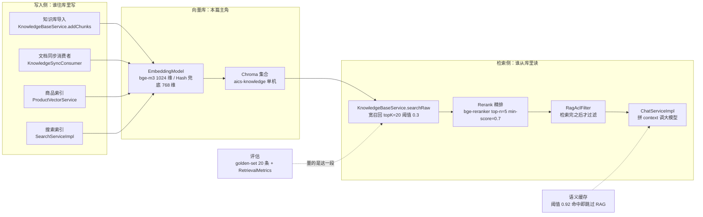
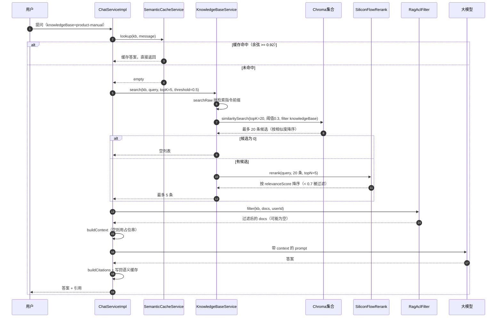

# 向量数据库面试专练与追问链：从"背过 HNSW"到"讲清自己项目的选择"

> 一句话结论：向量库的面试题不是考公式，而是考「你为什么这么选 + 出了问题你怎么知道」，所以每条追问链的终点都必须落成"本项目的一个真实数字 + 一个真实调用点 + 一种可复现的验证手段"。
> 阅读前置：读过同目录 [01-向量与相似度-把文字变成坐标.md](01-向量与相似度-把文字变成坐标.md) 与 [02-索引算法-向量检索怎么从全表扫描里活下来.md](02-索引算法-向量检索怎么从全表扫描里活下来.md)，知道余弦相似度、HNSW/IVF 的大致形状即可，不要求背公式。
> 证据基线：Spring AI 2.1.0 官方源码摘录（A 级，6 篇，见下表）+ 本仓库 `ai-cs-chat` / `ai-cs-knowledge` / `ai-cs-product` / `ai-cs-search` 真实代码（B 级）+ 4 段本机可复算输出（C 级；本机无 Chroma / ES / Redis / Nacos，故 C 级只做静态统计与算术，不做端到端实测）。预计阅读 45~60 分钟。

| 类别 | 本仓状态 | 本篇怎么处理 |
| --- | --- | --- |
| A 级：Spring AI 源码摘录 | `VectorStore` / `SearchRequest` / `Document` / `EmbeddingModel` / `TokenTextSplitter` / `FilterExpressionBuilder` 六篇已入库 | 直接给锚点行号；`ChromaVectorStore`、HNSW/IVF/PQ 的任何实现类、`QuestionAnswerAdvisor` **未入库**，涉及它们的结论一律写明"未入库，依据官方文档/本项目文档"，或降级成 B/C 级 |
| B 级：本项目代码 | 检索链路、写入链路、删除链路、评估脚本都在仓库里 | 每个结论都挂"文件 + 行号"，引用前逐行 read 核对过 |
| C 级：可复现实测 | 无 Chroma 可连、禁止起服务与构建 | 只做静态统计（grep 计数、JSON 解析）与算术（内存、候选集、token），命令与真实输出都贴出 |
| 明确未落地 | 索引参数（`efSearch`/`space`）未配置、评估门禁阈值 `null`、消费失败无补偿、无蓝绿重建 | 全部标「未落地」并给出"要落地得改哪一行" |

---

## 0. 先看现象

### 现象一：HNSW 的原理能背，但"你项目为什么用 Chroma"答不出来

这是最常见的开局面。很多人能一口气说完"分层可导航小世界图、M=16、efConstruction=200"，可面试官接着问"那你项目里 Chroma 是怎么建的集合、参数配了吗"，就哑了。本项目里这个答案其实只有十几行代码：

```yaml
# ai-cs-chat/src/main/resources/application.yml#L45-L52
spring:
  ai:
    vectorstore:
      chroma:
        initialize-schema: false
        collection-name: aics-knowledge
        client:
          host: http://${aics.mysql.host:localhost}
          port: ${CHROMA_PORT:8000}
```

真正能加分的是它的下一句：因为 Spring AI 2.1.0 的 `ChromaVectorStore` 实现了 `InitializingBean`，即使 `initialize-schema: false`，**创建这个 Bean 时仍会去远端问一次集合存不存在**，所以本项目用懒代理把它包起来，让"本地没有 Chroma"时服务还能启动：

```java
// ai-cs-chat/src/main/java/com/aics/chat/config/VectorStoreConfig.java#L58-L71
@Bean
@Primary
public VectorStore vectorStore(@Lazy ChromaVectorStore chromaVectorStore) {
    ProxyFactory proxyFactory = new ProxyFactory();
    proxyFactory.setInterfaces(VectorStore.class);
    proxyFactory.setTargetSource(new LazyInitTargetSource() {
        @Override
        public Object getTarget() {
            return chromaVectorStore;
        }
    });
    return (VectorStore) proxyFactory.getProxy();
}
```

说不清这两点的候选人，等于没打开过自己项目的配置——而面试官问"为什么用 Chroma"，本质是在探测这个。

### 现象二：一被追问"召回率怎么测"就卡住

第二类卡点更隐蔽：候选人知道 Recall@k 的定义，但说不出自己项目用什么算、分母是什么、算出来能信到什么程度。仓库里其实有完整闭环：

- 评估集：目录 `ai-cs-chat/src/main/resources/eval/` 下的 `golden-set.json`，20 条用例；
- 指标实现：`ai-cs-chat/src/main/java/com/aics/chat/rag/eval/RetrievalMetrics.java#L68-L70`；
- 门禁配置：`ai-cs-chat/src/main/java/com/aics/chat/rag/eval/EvalGateConfig.java#L34-L43`，但两个阈值都是 `null`（等于"只观测不判定"，CI 未真接）。

卡住的真正原因通常不是不会定义，而是没意识到**自家评估集的分辨率问题**：20 条用例每条只标了 1 个期望文档，于是 Recall@5 只能取 0 或 1，20 条加起来就是 5% 一档的粗粒度仪表盘（这个数字第 3.4 节用脚本复算过）。

### 现象三：说不出"删除之后为什么还能搜到"

第三类问题往往被当成玄学："我明明删了，怎么还能检索到旧内容？"本项目里这条链是明确可读的：删除走 MQ 异步，消费端只做过滤删除，而且异常被吞掉：

```java
// ai-cs-knowledge/src/main/java/com/aics/knowledge/mq/KnowledgeSyncConsumer.java#L56-L72
try {
    if ("DELETE".equals(action)) {
        knowledgeVectorService.deleteByDocumentId(message.getDocumentId());
        log.info("向量删除完成: documentId={}", message.getDocumentId());
    } else {
        // CREATE / UPDATE：构造文档对象后直接向量化入库
        KnowledgeDocument doc = new KnowledgeDocument();
        ...
        int chunks = knowledgeVectorService.vectorize(doc);
        ...
    }
} catch (Exception e) {
    log.error("知识文档同步消息消费失败: action={}, documentId={}, err={}", ...);
    // 不抛异常（RocketMQ 默认重试 16 次后进入死信队列），避免阻塞后续消息消费
}
```

能把这四行讲清楚——异步窗口 + 失败不重试 + 删的是"按条件匹配到的向量"——才算答上了"删除怎么保证一致"。

**这些现象指向同一件事：面试官考的不是向量库知识本身，而是你对这套系统"选型依据、观测能力、一致性边界"的掌握程度；背原理只能拿到开口分，能不能过关取决于你能不能立刻掏出本项目的数字和行号。**

---

## 1. 整体地图



> **读图说明**：一定要先看清 `R1 -> R2 -> R3` 这条主线——它是"宽召回 → 精排 → 权限过滤"的三段式，任何一段的顺序错位都会改变结论：如果以为 R3（权限过滤）发生在 R1 之前，你就会给出"topK=5 足够"的错误判断，而实际上 ACL 是在 5 条里往外剔，剔完可能剩 0 条。第二个容易看错的箭头是 `S -.-> R4` 的虚线：语义缓存命中时整条 RAG 链路都不执行，所以"检索质量差"的排查必须先确认没有命中缓存，否则你调半天参数，线上走的一直是缓存。

| 组件 | 责任 | 谁调用它 |
| --- | --- | --- |
| `VectorStore`（接口，A 级） | 向量库的统一门面：`add` / `upsert` / `delete` / `similaritySearch` | 四个写入点、检索点全部只依赖这个接口 |
| `EmbeddingModel`（接口，A 级） | 文本 → `float[]`，维度由它决定 | `ChromaVectorStore` 内部、语义缓存 |
| Chroma（外部进程） | 真正存向量与 metadata、算相似度、执行过滤 | 通过 `spring.ai.vectorstore.chroma` 配置的 HTTP 客户端 |
| `KnowledgeBaseService` | 切块、写 metadata、两阶段检索（宽召回 + 精排） | `ChatServiceImpl`、`KnowledgeBaseController` |
| `SiliconFlowRerankService` | 交叉编码器精排，按 `min-score` 过滤 | `KnowledgeBaseService.search` |
| `RagAclFilter` | 检索结果的知识库级 + 文档级权限过滤 | `ChatServiceImpl` |
| `RetrievalMetrics` / `golden-set.json` | 召回率口径与评估集 | `RagEvalServiceImpl`（离线跑） |

一句话记住分工：**写侧只管"把 chunk 塞进 Chroma 并带上可过滤的 metadata"，读侧只管"先宽后精再过滤"，评估侧只管"拿 ID 集合算比例"——三者靠 metadata 键名和 id 策略耦合，耦合点就是面试官最爱追问的地方。**

---

## 2. 关键概念与关键要素

| 名称 | 位置 | 角色 | 关键点 |
| --- | --- | --- | --- |
| `VectorStore` | A：`VectorStore.java.md#L40-L51` | 向量库门面接口 | `add` 对重复 id 的行为"交给具体实现"（文档原话），`upsert` 才是 replace-by-id |
| `SearchRequest` | A：`SearchRequest.java.md#L44-L49`、`#L160-L178` | 一次检索的参数包 | 默认 `topK=4`、默认阈值 `0.0`（全收）；阈值是**客户端后处理**，不是服务端过滤 |
| `Document` | A：`Document.java.md#L237-L247` | 向量库的写入单元 | `id` 不传就走 `RandomIdGenerator`——这一条直接决定幂等怎么做 |
| `EmbeddingModel.dimensions()` | A：`EmbeddingModel.java.md#L131-L139` | 维度查询 | 默认实现会**真调一次远端** `embed("Test String")`，所以生产要覆写 |
| `TokenTextSplitter` | A：`TokenTextSplitter.java.md#L41-L55` | 切块器 | 默认 `chunkSize=800`、`chunkOverlap=0`、按 `. ? ! \n` 切 |
| `FilterExpressionBuilder` | A：`FilterExpressionBuilder.java.md#L58-L96` | metadata 过滤 DSL | `eq` / `in` / `gt` / `gte`；字符串表达式另有 `FilterExpressionTextParser` 负责解析 |
| `ChromaVectorStore` | **未入库**（Spring AI 2.1.0 有该类，本仓 assets 未收录） | 具体实现 | 本篇只依据本项目代码与官方文档描述其行为，不外推内部实现细节 |
| `KnowledgeBaseService` | B：`ai-cs-chat/src/main/java/com/aics/chat/service/KnowledgeBaseService.java#L228-L279` | 两阶段检索的编排者 | 宽召回 `recallTopK=20`/`recallThreshold=0.3`；`search(kb, q, topK, threshold)` 的 `threshold` 入参**从未被使用** |
| `RagAclFilter` | B：`ai-cs-chat/src/main/java/com/aics/chat/security/RagAclFilter.java#L39-L69` | 权限过滤 | 发生在 `buildContext` 之前、检索之后——典型 post-filter |
| `RetrievalMetrics` | B：`ai-cs-chat/src/main/java/com/aics/chat/rag/eval/RetrievalMetrics.java#L46-L70` | 召回指标口径 | `recall@k = 命中数 / 期望数`，`hitRate` 只判有没有命中，`mrr` 看首个命中的排名 |
| `SemanticCacheService` | B：`ai-cs-chat/src/main/java/com/aics/chat/cache/SemanticCacheService.java#L76-L100` | 语义缓存 | 每次 lookup 线性扫最多 200 条算余弦，`>= 0.92` 即命中 |

---

## 3. 原理与证据逐段精读：五条追问链

面试中的追问不是随机发散，而是沿五条固定链往下钻。下面每条链给"追问 → 参考答案 → 证据"，再用四层拆解收口，最后给通过线。

### 3.1 基础层追问链：什么是向量 → 为什么能表达语义 → 维度怎么定 → 距离怎么选 → 归一化为什么必要

**这条链在考什么**：你是在"用 API"还是在"理解表示"。答不上来的人通常会在第三问（维度）露馅。

**追问 1：什么是向量？为什么它能表达语义？**
向量是把一段文本映射到 N 维空间里的一个点，语义相近的文本落在相近的位置。关键不是"点"而是"谁决定位置"——是 embedding 模型在训练中把"常用于同样上下文"的文本拉近。所以"能不能表达语义"取决于模型，不取决于向量库。本项目的兜底实现把这个边界写得很直白：它是哈希映射，天然没有语义泛化能力（`ai-cs-common/src/main/java/com/aics/common/ai/embedding/HashEmbeddingModel.java#L15-L27` 的类注释写明"零依赖兜底、无语义泛化、生产必须换 bge-m3"）。这句话在面试里比背"向量是语义表示"值钱得多，因为它证明你知道失效边界。

**追问 2：维度怎么定？**
由模型定，不由你定。线上是 bge-m3 的 1024 维（`ai-cs-chat/src/main/java/com/aics/chat/config/SpringAiConfig.java#L172-L203` 构建的 `OpenAiEmbeddingModel`），兜底是 768 维（`HashEmbeddingModel.java#L31` 的 `DIMENSIONS = 768`）。维度是两个后果的来源：一是内存（第 3.2 节的算例），二是**换模型必须全量重建**（768 与 1024 的向量放进同一集合等于垃圾）。补充一个常被忽略的细节：`dimensions()` 默认实现会真发一次请求去问维度（`[[源码:EmbeddingModel.java.md#L131-L139]]`），所以生产代码应覆写它，否则每次问维度都是一次额外的远端调用。

**追问 3：距离度量怎么选？**
三种：余弦（看夹角，只看方向）、内积（看方向 + 长度）、欧氏（看绝对距离）。文本检索默认余弦，因为文本长度差异不该影响相似度。归一化之后，余弦和内积的排序完全等价——这就是第 4 问的引子。

**追问 5：向量库会不会替我算语义？它跟 embedding 模型谁负责什么？**
不负责。向量库只做三件事：存数、算距离、按 metadata 过滤。语义全在 embedding 模型里。这个分工的实践含义是：**换库不会改善语义，换模型才会**。本项目把 Embedding 模型做成手工 Bean（`ai-cs-chat/src/main/java/com/aics/chat/config/SpringAiConfig.java#L172-L203`）并显式关掉自动装配（`spring.ai.model.embedding: none`），就是为了让"用哪个模型"这件事在代码里一眼可见，而不是藏在 starter 的默认值里。

**追问 4：归一化为什么必要？**
两个理由：① 让"余弦 = 点积"，服务端可以只做点积，省一次开方；② 让阈值有可比性。本项目的兜底模型自己就做了 L2 归一化（`ai-cs-common/src/main/java/com/aics/common/ai/embedding/HashEmbeddingModel.java#L40` 的注释"固定维度向量（L2 归一化后做余弦相似度）"）。反过来，如果模型不归一化而代码按余弦阈值卡，阈值就失去物理意义。

**四层拆解**

- **在干什么**：把"文本相似"翻译成"空间距离"，再把"距离"翻译成"阈值可卡的分数"。
- **为什么这么设计**：向量库只认识数字，不认识"相关"；把语义判断下沉到模型、把距离判断下沉到度量函数，才能让检索变成纯数学。
- **换成别的写法会怎样**：换成 BM25 关键词检索，同一句话换个说法就召回不到（"退款"与"退货"分属两个词）；换成 LLM 直接读全库，成本和延迟立刻不可行。所以向量检索不是"更好"，是"在成本约束下唯一能扩的办法"。
- **常见坑**：以为"向量表达语义"是普适真理——哈希兜底模型（768 维）就没有语义能力；把不同模型产出的向量混在同一个集合里；不归一化却按余弦阈值卡。

**答到什么程度算通过**：能说出"维度由模型定、本项目 1024 vs 768 两套、换模型要全量重建"，并且能解释"归一化 → 余弦退化成点积 → 阈值才可比"，就算过。只背"余弦相似度衡量夹角"不及格。

### 3.2 索引层追问链：为什么需要索引 → HNSW 与 IVF 差异 → efSearch 调大调小 → 召回率怎么测 → 过滤与索引的冲突

**这条链在考什么**：你对"用精度换速度"的量化感觉，以及是否知道过滤是检索系统里最容易出事的地方。

**追问 1：为什么需要索引？**
因为暴力检索的代价是"每次查询算一遍全库距离"。用本项目的维度算：100 万条 × 1024 维，一次查询就是 100 万次距离计算（`float` 乘加 1024 次）。下面是本机真实输出（口径：`float` 4 字节、HNSW 每节点 2M 条有向边、M=16、每条边 4 字节 int、2 副本、0.7 磁盘水位）：

```text
dim  chunks | 裸向量 | HNSW链接(M=16) | 小计 | x2副本 | /0.7水位
768  100000  | 293.0 MiB | 12.2 MiB | 305.2 MiB | 610.4 MiB | 871.9 MiB
768  1000000 | 2929.7 MiB | 122.1 MiB | 3051.8 MiB | 6103.5 MiB | 8719.3 MiB
1024  100000  | 390.6 MiB | 12.2 MiB | 402.8 MiB | 805.7 MiB | 1150.9 MiB
1024  1000000 | 3906.3 MiB | 122.1 MiB | 4028.3 MiB | 8056.6 MiB | 11509.5 MiB
```

> 怎么读：先看第一列和第五列的比值——**索引链接只占裸向量的 3%~4%**，所以"建索引很占内存"这句话在小规模下是错的；真正吃内存的是维度乘条数。再看 `1024 × 100 万` 的最后一格：11.2 GiB。这就是"单机 Chroma 撑到百万级就要开始算盘子"的数字起点。

**追问 2：HNSW 和 IVF 的差异是什么？**
HNSW（分层可导航小世界图）把向量组织成多层图，查询从顶层往下走，每层只跟邻居比；IVF（倒排文件）先做 k-means 聚类分成 `nlist` 个桶，查询只扫最近的 `nprobe` 个桶（里面多条向量，通常还配 PQ 量化压缩）。差异体现在三处，面试要按这三处答：

| 维度 | HNSW | IVF |
| --- | --- | --- |
| 查询方式 | 图遍历，逐层下降 | 先找桶（聚类中心），再桶内扫描 |
| 增量写入 | 直接插，图会自己接边（只影响局部质量） | 插入容易，但**分布漂移后必须重训聚类** |
| 删除 | 图结构难删，通常逻辑删 + 定期重建 | 桶内标记删除，重建桶即可 |
| 参数 | `M`（每个节点邻居数）、`efConstruction`（建图时的候选宽度）、`efSearch`（查询时的候选宽度） | `nlist`（桶数）、`nprobe`（扫几个桶） |
| 典型毛病 | 内存大、参数敏感 | 召回对分布变化敏感、桶边界附近的近邻容易丢 |

顺手把 `M` 讲透，因为它是唯一同时影响内存和召回的结构参数：`M` 是每个节点保留的邻居数，图的总边数约 `N × 2M`，所以内存随 `M` 线性增长（第 1 问的容量表里就是按 `M=16` 算的 122.1 MiB）；而邻居越多，图的连通性越好，贪心下降越不容易掉进"局部最近的坑"，召回随之变好。面试里的正确表述是：**`M` 是"建图期"的精度预算（改它要重建索引），`efSearch` 是"查询期"的精度预算（改它随时生效）**——很多人把这两个混为一谈，一被追问"改 M 要不要重建"就露馅。


**追问 3：efSearch 调大调小，代价是多少？**
`efSearch` 是查询时的候选队列宽度，调大就是"多看几个候选"。本机算了一版量级对比（口径：N=100 万、M=16、层数 ≈ log₁₆ 100 万 ≈ 4.98、距离计算次数 ≈ efSearch × M × 层数；IVF 侧 nlist=1024、桶内平均 977 条）：

```text
HNSW ef=16 层数~4.98 距离计算~1276
HNSW ef=64 层数~4.98 距离计算~5102
HNSW ef=200 层数~4.98 距离计算~15945
IVF nlist=1024 nprobe=1 扫描向量~977
IVF nlist=1024 nprobe=10 扫描向量~9766
IVF nlist=1024 nprobe=64 扫描向量~62500
暴力全扫 距离计算=1000000
```

> 怎么读：`efSearch` 从 16 到 200 是 12.5 倍代价换来召回率的提升，但仍然只有暴力全扫的 1.6%。所以"调大 efSearch"永远是**第二选择**——先问"召回差是因为候选不够，还是因为向量本身就不相似"。这句反问是这道题的分水岭。

**追问 4：召回率怎么测？**
三步：定评估集、定口径、跑离线。本项目的口径在 `ai-cs-chat/src/main/java/com/aics/chat/rag/eval/RetrievalMetrics.java#L68-L70`：

```java
// ai-cs-chat/src/main/java/com/aics/chat/rag/eval/RetrievalMetrics.java#L66-L71
double recallAtK = (double) hitCount / expectedIds.size();
double hitRate = hitCount > 0 ? 1.0 : 0.0;
double mrr = firstHitRank > 0 ? 1.0 / firstHitRank : 0.0;
```

分母是"期望文档集合的大小"，分子是"返回的 top-k 里命中期望文档的个数"。要注意两件事：① `Recall@k` 的分母与 `topK` 无关，`topK` 只影响分子能取到多少；② 想验证实现对不对，仓库里已有单测给出现成算例（`ai-cs-chat/src/test/java/com/aics/chat/rag/eval/RetrievalMetricsTest.java#L15-L31`）：检索 5 条、期望 3 条、命中 2 条 → recall = 2/3，首个命中在第 2 位 → MRR = 1/2。这两个分数是可复算的锚点，比背定义有用。

**追问 5：过滤和索引冲突在哪？**
冲突的本质是"过滤条件的分布"与"索引的扫描顺序"打架。三种做法各有代价：

- pre-filter（先按 metadata 缩范围再检索）：结果准确，但如果过滤后只剩几十条，ANN 索引等于白建；
- post-filter（先检索再过滤）：索引效率最高，但 `topK` 会被过滤吃掉——本项目就是这个形态，`ChatServiceImpl` 先按 `topK=5` 拿回结果，再用 `RagAclFilter` 剔掉无权限的（`ai-cs-chat/src/main/java/com/aics/chat/service/impl/ChatServiceImpl.java#L437-L439`）。删完可能是 0 条，于是走"未检索到相关资料"的分支（同文件 `#L445`）。
- 索引内过滤（把过滤条件下推进 ANN 遍历）：Chroma 的 `where` 属于这一类，它需要"过滤字段有索引"，且过滤选择性高时仍然会退化。`SearchRequest.filterExpression` 就是入口：字符串表达式会被 `FilterExpressionTextParser` 解析（`[[源码:SearchRequest.java.md#L221-L243]]`），也提供了类型安全的 DSL（`[[源码:FilterExpressionBuilder.java.md#L58-L96]]`）。

顺带一个必须自己发现的事实：本项目的**默认 Advisor 检索没有过滤条件**——`ai-cs-chat/src/main/java/com/aics/chat/config/SpringAiConfig.java#L266-L274` 只设了 `similarityThreshold(0.3d)` 和 `topK(5)`，没有 `filterExpression`，而它被挂成所有 ChatClient 的默认 Advisor（同文件 `#L285-L289`）。业务检索路径（`KnowledgeBaseService#L273`）有 `knowledgeBase == '...'` 过滤，Advisor 路径没有——两条路并存，面试官若追问"你怎么保证不跨库检索"，正确答案是"主链路有过滤、Advisor 链路目前没有，这是已知缺陷"。

**追问 6：都说量化能省内存，到底省多少、代价是什么？**
PQ（Product Quantization，乘积量化）把一条向量切成 m 个子空间，每个子空间只存"最近的聚类中心编号"（码字），1 字节一个；SQ8 则是每维压成 1 字节。本机按 1024 维算的真实输出：

```text
原始 float32 单条 = 4096 B
SQ8 单条 = 1024 B, 压缩比 4.0x
SQ4 单条 = 512 B, 压缩比 8.0x
PQ m=64 子空间 x 1B 码字, 单条 = 64 B, 压缩比 64.0x
100万条: 原始 3906.3 MiB -> PQ 61.0 MiB, 省 3845.2 MiB
```

> 怎么读：SQ8 稳定 4 倍且几乎不掉召回，是性价比最高的一档；PQ 64 倍能把 100 万条从 3.8 GiB 压到 61 MiB，但距离计算变成"查表累加"，召回通常掉几个点，而且码字表要额外常驻内存。本项目没有配任何量化参数（`application.yml#L45-L52` 里只有集合名和连接信息），也就是说当前是按 float32 全量驻留，存储布局的细节**未入库，依据官方文档**，本篇不做进一步断言。

**四层拆解**

- **在干什么**：把 O(N) 的暴力检索压成 O(log N) 级别的图/桶遍历，并把"元数据筛选"塞进这个流程。
- **为什么这么设计**：向量检索必须在毫秒级返回，而精度损失可以被 Rerank 与阈值兜住；反过来，如果追求绝对精确，就没有"上亿条还能实时"这回事。
- **换成别的写法会怎样**：只用暴力检索（`topK` 小的时候其实更快更准，本项目 20 条黄金集规模下暴力就是最优）；或全用 pre-filter，遇到"过滤后剩 30 条"的场景索引反而成负担。
- **常见坑**：以为 `similarityThreshold` 是服务端过滤（它是客户端后处理，见 `[[源码:SearchRequest.java.md#L160-L178]]`）；以为调大 `efSearch` 能救"向量本身不相似"的召回；把 ACL 过滤放在检索之后却仍按小 `topK` 取结果。

**答到什么程度算通过**：能给出 HNSW/IVF 的**三个差异维度**（查询方式、增量写入/重训、删除），能说出 `efSearch` 的量级代价（12.5 倍换来 1.6% 于暴力的成本），能说出 `Recall@k` 的分母口径，并能指出"过滤发生在检索前还是检索后"决定了 `topK` 该设多大。

### 3.3 工程层追问链：数据怎么进 → 幂等怎么做 → 删除怎么保证一致 → 重建怎么做 → 扩容怎么做 → 备份怎么做

**这条链在考什么**：你是不是只写过"导入成功"的 demo。这六个问题里，能完整答出三个就算不错。

**追问 1：数据怎么进？**
切块 → 补 metadata → `add`。本项目的写入点在 `ai-cs-chat/src/main/java/com/aics/chat/service/KnowledgeBaseService.java#L159-L181`：`new TokenTextSplitter().apply(documents)` 切块，metadata 塞 `knowledgeBase` / `documentId`（取 `chunk.getId()`）/ `title`，然后 `vectorStore.add(chunks)`。切块参数用的是默认值：`chunkSize=800`、`chunkOverlap=0`、按 `. ? ! \n` 断句（`[[源码:TokenTextSplitter.java.md#L41-L55]]`）。`overlap=0` 意味着跨句/跨段的语义会被硬切断，这是"召回差"的第一嫌疑人（见第 3.4 节）。

**追问 2：幂等怎么做？**
先讲清"不幂等"的机制，再讲修法。机制在 A 级源码里：`Document` 的 id 不传就由 `RandomIdGenerator` 生成（`[[源码:Document.java.md#L237-L247]]`），而 `add` 对重复 id 的行为"交给具体实现"（`[[源码:VectorStore.java.md#L46-L51]]`）。于是同一篇文档导入两次，chunk id 全不一样，结果是**重复分块**而不是覆盖。

正确姿势是两条：稳定 id + `upsert`。`upsert` 的语义在源码注释里写得很清楚——replace-by-id，稳定 id 的重跑安全，并且"失败后整批重试"也是安全的（`[[源码:VectorStore.java.md#L58-L82]]`）。

而本项目当前的实际状况是：**5 处 `add`、0 处 `upsert`**（本机统计，口径：`ai-cs-*\src\main` 下所有 `*.java` 里 `vectorStore.add(` 与 `.upsert(` 的出现次数）：

```text
add 调用: 5 处
  ai-cs-chat\src\main\java\com\aics\chat\service\KnowledgeBaseService.java:75
  ai-cs-chat\src\main\java\com\aics\chat\service\KnowledgeBaseService.java:178
  ai-cs-knowledge\src\main\java\com\aics\knowledge\service\KnowledgeVectorService.java:85
  ai-cs-product\src\main\java\com\aics\product\service\impl\ProductVectorService.java:62
  ai-cs-search\src\main\java\com\aics\search\service\impl\SearchServiceImpl.java:112
upsert 调用: 0 处
delete 调用: 3 处
  ai-cs-knowledge\src\main\java\com\aics\knowledge\service\KnowledgeVectorService.java:109
  ai-cs-product\src\main\java\com\aics\product\service\impl\ProductVectorService.java:70
  ai-cs-search\src\main\java\com\aics\search\service\impl\SearchServiceImpl.java:129
```

> 怎么读：`upsert: 0` 这一行是本章最有价值的自我批评——全仓没有一处用 replace-by-id 语义。但也不能一刀切说"全都不幂等"：`ProductVectorService` 的 id 是稳定的商品 ID（`ai-cs-product/src/main/java/com/aics/product/service/impl/ProductVectorService.java#L57-L62`，注释"同 ID 重复索引会覆盖，天然幂等"），且删除按 id 删（同文件 `#L69-L71`），这一处是自洽的；而知识库侧 `documentId` 取的是 chunk 的随机 id（`KnowledgeBaseService.java#L168-L175`），重复导入必然翻倍。

**追问 3：删除怎么保证一致？**
本项目是"DB 逻辑删 + MQ 异步删向量"的组合：`ai-cs-knowledge/src/main/java/com/aics/knowledge/service/impl/KnowledgeServiceImpl.java#L135-L147` 先 `selectById`、发 `DELETE` 消息、再 `knowledgeMapper.deleteById(id)`（`@TableLogic` 逻辑删除）；消费者收到 DELETE 后走 `deleteByDocumentId`，最终落到 `vectorStore.delete("documentId == '" + documentId + "'")`（`ai-cs-knowledge/src/main/java/com/aics/knowledge/service/KnowledgeVectorService.java#L103-L116`）。

这条链有三个必须主动承认的问题：
1. **窗口期**：消息是异步的，DB 已逻辑删除而向量仍在，这段时间检索能召回"已删除"的文档；
2. **失败无补偿**：消费端 `catch` 只打日志不抛（`KnowledgeSyncConsumer.java#L73-L77`），于是"RocketMQ 默认重试 16 次"这句注释不会生效——不抛异常就没有重试，死信队列也用不上；
3. **删除条件与写入字段的类型**：写入时 `documentId` 放的是 `Long`（`KnowledgeVectorService.java#L80-L82`），删除时拼成带引号的字符串（同文件 `#L109`）。数值与字符串在 Chroma 的 `where` 里是否等价，**本机无 Chroma，未验证**，这一条只能作为风险项提出，不能当成结论。

**追问 4：重建怎么做？**
触发条件是"embedding 模型变了"：维度从 1024 变 768（或反之）之后，旧向量全部失效，必须全量重建。本项目的障碍在配置里——集合名是硬编码的 `aics-knowledge`（`ai-cs-chat/src/main/resources/application.yml#L49`），没有版本后缀，所以做不了"新旧集合并行、切流量、再删旧集合"的蓝绿重建，只能停写重建（**未落地**）。要落地的最小改动：集合名改成 `aics-knowledge-v2`，用配置切换，切完再删旧集合。

**追问 5：扩容怎么做？**
先算，再谈。第 3.2 节的表已经给出答案：1024 维 × 100 万条 ≈ 3.9 GiB 裸向量，加索引、副本、水位后 ≈ 11.2 GiB。单机 Chroma 的扩容路径只有"垂直加内存"，水平扩容必须换库（Milvus / pgvector 分片 / ES 分片）。另一个被忽略的扩容维度是**多租户**：本项目靠 `knowledgeBase` metadata 过滤做隔离，租户数一多就退化成 post-filter 问题（每个租户的数据混在一个集合里）。

**追问 6：备份怎么做？**
两类资产要分开看：向量库本身和原始文档。因为向量可以从原文重建（成本是 embedding 调用费），所以更实用的策略是"备份原文 + 能一键重建"，而不是备份向量文件。本项目的重建能力目前是"能重建但无编排"：`KnowledgeVectorService.vectorize` 是单文档方法，没有批量重放脚本（**未落地**）。

**追问 7：怎么证明"写进去的字段"和"过滤用的字段"是对齐的？**
这是最容易出事、也最容易验证的一环。用一条命令把"写 metadata 的地方"和"用过滤表达式的地方"并排列出来（口径：`ai-cs-*\src\main` 下所有 `*.java`，匹配 `getMetadata().put("` 与 `filterExpression("`）：

```text
ai-cs-chat\...\rag\retrieve\HybridRetriever.java:292: .filterExpression("knowledgeBase == '" + knowledgeBase + "'")
ai-cs-chat\...\service\KnowledgeBaseService.java:273: .filterExpression("knowledgeBase == '" + knowledgeBase + "'")
ai-cs-knowledge\...\ops\KnowledgeGapDetector.java:74: .filterExpression("knowledgeBase == '" + kb + "'")
ai-cs-knowledge\...\service\KnowledgeVectorService.java:80: chunk.getMetadata().put("knowledgeBase", KNOWLEDGE_BASE);
ai-cs-knowledge\...\service\KnowledgeVectorService.java:81: chunk.getMetadata().put("documentId", doc.getId());
ai-cs-knowledge\...\service\KnowledgeVectorService.java:82: chunk.getMetadata().put("title", doc.getTitle());
ai-cs-search\...\hybrid\HybridSearchServiceImpl.java:128: .filterExpression("knowledgeBase == '" + knowledgeBase + "'")
ai-cs-search\...\service\impl\SearchServiceImpl.java:57: .filterExpression("knowledgeBase == '" + index + "'")
ai-cs-search\...\service\impl\SearchServiceImpl.java:103: doc.getMetadata().put("knowledgeBase", index);
```

> 怎么读：过滤表达式**只用到 `knowledgeBase` 一个键**，写入侧也只有它被一致地写；`documentId` 只在删除时被用（`KnowledgeVectorService.java#L109` 的 `vectorStore.delete("documentId == '...'")`），检索侧从不按它过滤——所以"按文档删除"和"按库检索"用的是两套键，任何一侧改名都会静默失效（不是编译错误）。另外注意口径：用 `Map` 一次性传 metadata 的 `KnowledgeBaseService.addChunks`（`#L168-L175`）不会出现在这份 grep 里，统计时要记得把这类写法补上。

**追问 8：向量库和 MySQL 之间，你会选强一致还是最终一致？**
选最终一致，并且要能说清为什么这不是偷懒。向量是派生数据：它的唯一来源是 MySQL 里的原文 + 当前的 embedding 模型，所以"不一致"永远可以通过重放修好，而强一致要付的代价是"向量库故障时写入被阻塞"或"引入分布式事务"。本项目就是最终一致：先发消息、再逻辑删除（`KnowledgeServiceImpl.java#L135-L147`），消费端异步删向量。要把窗口压到最小，靠的是三件事而不是强一致——消费端幂等（可安全重放）、失败可见（这次没做到，异常被吞了）、定期对账（这次也没做到）。**一句话答案：一致性级别是选出来的，不是默认继承的；我选最终一致，代价是我必须提供幂等 + 可见的失败 + 对账手段，后两条是要补的。**

**四层拆解**

- **在干什么**：把"写一次"变成"可重复写、可删除、可重建、可扩、可恢复"。
- **为什么这么设计**：向量库是派生数据（derived data），原始数据在 MySQL；派生的东西就该允许重建，因此一致性问题应优先用"重放"解决，而不是追求分布式事务。
- **换成别的写法会怎样**：写侧改成双写（DB 事务里同步调 Chroma）会引入"向量库挂了业务就写不进去"的耦合；改成 CDC（监听 binlog）能免掉应用层幂等，但运维面更大。
- **常见坑**：把注释当事实（`KnowledgeSyncConsumer` 的类注释声称"先删旧分块再写新分块"，代码里并没有删——`KnowledgeSyncConsumer.java#L25-L26` 对比 `#L60-L72`）；`catch` 吞异常却以为有重试；删向量时忽略返回值，`boolean` 返回 `false` 也没人看。

**答到什么程度算通过**：能说出"id 稳定 + upsert 才幂等"这一条因果，能画出删除的异步窗口并指出失败无补偿，能说出"换模型=全量重建，本项目缺蓝绿"。三条中答满两条即通过；能主动指出"'注释说幂等、代码不幂等'这种文档与代码不一致"，加分。

### 3.4 效果层追问链：召回差怎么定位 → 是切块问题还是模型问题 → 如何做 A/B → 评估集怎么建

**这条链在考什么**：你有没有"从现象回到变量"的排查纪律。这是最能区分"做过"和"看过"的一链。

**追问 1：线上说召回差，你怎么定位？**
按"越便宜越先做"的顺序：① 先确认是不是命中了语义缓存（`SemanticCacheService` 阈值 0.92，命中就绕过整条 RAG，`ai-cs-chat/src/main/java/com/aics/chat/cache/SemanticCacheService.java#L88-L100`）；② 看两阶段日志：`知识库[{}]Rerank精排完成: 召回{}条 -> 返回{}条`（`KnowledgeBaseService.java#L248`）——如果"召回 0 条"，问题在第一阶段；"召回 20 条返回 0 条"说明全被 `min-score=0.7` 卡掉；③ 看最终命中：`RAG对话完成: sessionId={}, 检索命中{}条, 引用{}条`（`ChatServiceImpl.java#L468`）；④ 最后才动参数。第 6 节给了可复制的 grep 手法。

**追问 2：那是切块问题还是模型问题？**
用"同一条 query、同一份文档"做对照实验：把某条 query 的 top-20 结果人工看一遍，如果正确段落根本不在这 20 条里，先怀疑切块（`chunkOverlap=0` 会把答案切成两半，跨段语义丢失）；如果正确段落排在 15~20 位，说明召回有、排序差，问题在模型或度量；如果正确段落压根没进过库（比如 PDF 解析丢了表格），那是数据入口问题。这条"三段定位法"比任何参数调优都值钱。

另外注意查询侧也做了模型适配：`searchRaw` 在 query 前面加了 bge 系列的检索指令前缀 `"为这个句子生成表示以用于检索相关文章："`（`ai-cs-chat/src/main/java/com/aics/chat/service/KnowledgeBaseService.java#L265-L279`）。这类前缀只在"训练时用过前缀"的模型上有效——换成不带前缀训练的模型，加了反而掉分。

**追问 3：怎么做 A/B？**
最小可用 A/B 不是流量分桶，而是**离线 A/B**：固定评估集，跑两套参数，比 Recall@5 / MRR / P95。本项目已有开关可承载这类实验：`aics.rag.hybrid-enabled`（默认 `false`，`ai-cs-chat/src/main/java/com/aics/chat/rag/retrieve/RagRetrieveProperties.java#L13-L23`）、`rrf-k=60`（同文件 `#L23`）。线上流量分桶**未落地**——没有按百分比分流的组件。

**追问 4：评估集怎么建？**
本项目的评估集是目录 `ai-cs-chat/src/main/resources/eval/` 下的 `golden-set.json`，结构是 `question` + `knowledgeBase` + `expectedDocumentIds` + `referenceAnswer` + `expectedKeywords`。本机解析的真实分布（口径：`JSON.parse` 后统计每条用例 `expectedDocumentIds` 的长度）：

```text
用例数 20
expectedDocumentIds 长度分布 {"1":20}
平均期望文档数 1.00
知识库取值 ["product-manual"]
```

> 怎么读：`{"1":20}` 说明 20 条用例每条只标 1 个期望文档——那么 `Recall@5` 只能取 0 或 1，20 条汇总后的分辨率是 5%（1/20）。这种粒度只能发现"崩了"，发现不了"从 0.7 掉到 0.6"。要提升分辨率有两条路：每例标 2~3 个期望文档（单测里就是这么算的：期望 3 条、命中 2 条得 2/3，`RetrievalMetricsTest.java#L15-L23`），或者把用例数拉到 100 以上。第三个发现是 `knowledgeBase` 全为 `product-manual`——而写入侧硬编码的是 `"knowledge"`（`ai-cs-knowledge/src/main/java/com/aics/knowledge/service/KnowledgeVectorService.java#L52`），写读两侧的库标识不一致，评估集和线上数据可能根本不在同一个库里。

顺带把四个指标的口径区分清楚，这是"召回率怎么测"之后的常见追加提问：`Recall@k` 看"期望文档被捞回了多少"（分母是期望数），`Precision@k` 看"返回的 k 条里有多少是对的"（分母是 k，本项目没有实现），`HitRate` 只判"有没有命中至少一条"（`RetrievalMetrics.java#L69` 就是 `hitCount > 0 ? 1.0 : 0.0`，所以在单期望文档的评估集上它与 Recall@1 完全等价），`MRR` 只看"第一条命中的名次倒数"（`#L70`）。四个指标里只有 Recall 和 MRR 能反映"排序变好"，HitRate 在本项目的评估集上几乎是冗余的——这个观察本身就是一句加分的回答。

把上面几段整理成一张"看到什么现象、先查哪里"的表，面试时直接照着说就是一条完整的排查纪律：| 现象 | 第一嫌疑人 | 首查位置 | 判据 |
| --- | --- | --- | --- |
| 某个问题答非所问，但其他问题正常 | 命中了语义缓存 | `SemanticCacheService.java#L88-L100` 的命中日志 | 日志里有 `语义缓存命中: score=...`，且 score 接近 0.92 下限 |
| 所有问题都答"没有相关资料" | 库标识不匹配 / 阈值过高 | `召回 0 条` + golden-set 的 kb 取值 | 两阶段日志只有第一阶段、没有"精排完成" |
| 召回 20 条但返回 0 条 | `min-score=0.7` 过严或 rerank 异常 | `KnowledgeBaseService.java#L248` 与 `#L251-L253` | 出现 `Rerank调用异常，降级为相似度排序` |
| 正确段落完全不在候选里 | 切块切断（`chunkOverlap=0`）或解析丢内容 | `TokenTextSplitter` 默认参数、`addFile` 分支 | 搜原文关键词也搜不到 |
| 正确段落在 15~20 位 | 排序/度量问题，不是召回问题 | `Rerank精排完成: 召回20条 -> 返回5条` | 精排输入里确实有它 |
| 回答里出现别人的知识库内容 | 走了没有 filterExpression 的 Advisor 路径 | `SpringAiConfig.java#L266-L274` | 该 Bean 是否被挂成默认 Advisor |

**四层拆解**

- **在干什么**：把"效果不好"这种主观描述，拆成"入口 / 切块 / 召回 / 排序 / 生成"五段可分别验证的假设。
- **为什么这么设计**：RAG 的误差会沿链路累积，只有先定位到段，调参才有意义；否则所有调整都是一次性赌博。
- **换成别的写法会怎样**：直接换更大的 embedding 模型，可能掩盖切块问题但成本翻倍；直接加 `topK`，会让 prompt 变长、延迟变高，且不解决"答案被切断了"。
- **常见坑**：用线上真实问题当评估集却不留 reference answer（无法算生成侧指标）；评估集与线上库标识不一致；只看平均 Recall 不看 MRR（排序质量全被平均掉）；改了 `recallTopK` 却忘了 `topK=5` 会把结果再砍一刀。

**答到什么程度算通过**：能给出"缓存 → 两阶段日志 → 实际命中"的三步定位顺序，能区分"没召回"（切块/入口问题）与"召回但排后面"（模型/度量问题），能说出自家评估集的**分辨率和库标识两个坑**。只答"调大 topK 试试"不及格。

### 3.5 选型层追问链：为什么用 Chroma → 什么规模会换 → 换的成本

**这条链在考什么**：你有没有"选型是一次权衡，不是一次喜欢"，以及你能不能量化替换成本。

**追问 1：为什么用 Chroma？**
四个理由，按面试说服力排序：① 单进程内嵌 + HTTP 客户端，零运维，`docker run` 就有，适合"先把 RAG 跑通"；② Spring AI 有官方 starter，五个配置项就能接上（`application.yml#L45-L52`）；③ 业务代码只依赖 `VectorStore` 接口，换库的改动面被限制在配置层（`VectorStoreConfig.java#L38-L45` 的注释正是这个意思）；④ 它支持 metadata `where` 过滤，够用。反面也要说：单机无副本、无水平扩容、并发与大规模过滤弱。

**追问 2：什么规模会换？**
给出三条量化红线，而不是"数据多了就换"：
- 内存红线：1024 维 × 100 万条 → 含副本与水位 ≈ 11.2 GiB（第 3.2 节算例），单机内存吃不消时换；
- 过滤红线：pre-filter 后候选集长期小于 `topK` 的 3 倍（说明该换支持索引内过滤的库，如 pgvector 的 HNSW + B-tree、Milvus 的标量索引）；
- 运维红线：需要多副本/在线扩容/多租户硬隔离时换。

**追问 3：换的成本是多少？**
结构化地答"三件不用改、三件必须改"：

| 层面 | 换库时是否要改 | 原因 |
| --- | --- | --- |
| 业务检索代码 | 基本不用 | 只依赖 `VectorStore` / `SearchRequest` |
| 配置 | 要改 | starter、host/port、集合名、`initialize-schema` |
| 过滤表达式 | 必须核对 | 字符串 DSL 由各实现自行翻译，`==`、`in`、类型转换的语义可能有差异 |
| id 与删除语义 | 必须核对 | 本项目知识库侧用随机 chunk id + 过滤删除，换库后过滤字段类型可能不匹配 |
| 距离度量与维度 | 必须核对 | 新集合的 `space`（cosine/l2/ip）与现有向量必须一致，否则阈值全部失效 |
| 集合初始化 | 要改 | `initialize-schema: false` + 懒代理（`VectorStoreConfig.java#L58-L71`）是 Chroma 特有的绕坑写法，换库可能不再需要 |

这里的杀手级细节是：**接口抽象降低了代码改动，但改动面转移到了"数据契约"上**——metadata 键名、id 策略、过滤表达式语法、距离度量，这些都不在 `VectorStore` 接口里。谁能说出这一点，谁就答到了选型题的上限。

**追问 4：如果让你重来一次，你会先做哪件事？**
先做评估集，而不是先选库。理由是：没有评估集，"换库/换模型/调参数"都无法判断是变好还是变坏，所有决策都会退化成偏好。第二件是把 id 策略定下来（稳定 id + `upsert`），因为它决定了后面所有重放、补偿、重建能不能安全地重跑。第三件才是选库——而当前 20 条用例、单机 Chroma 的规模下，连"上向量库"都不是必须的，暴力检索就够。

**四层拆解**

- **在干什么**：在"运维成本、能力上限、迁移成本"三角里选一个当前阶段的点。
- **为什么这么设计**：向量库是派生数据的存储，选错了可以重建，所以早期应该选"最快能验证 RAG 效果"的那个——这正是 Chroma 的定位。
- **换成别的写法会怎样**：一开始上 Milvus 集群，能省掉后期迁移但要提前付运维和调参成本；用 MySQL 存向量自己算，能力上限最低，但对 20 条黄金集这种规模其实够用。
- **常见坑**：拿"我们数据量会很大"当理由却给不出数字；说不出换库要改什么；把"用了 Chroma"当成技术债而不是阶段选择。

**答到什么程度算通过**：能给出三个量化红线中的至少两个数字，能列出"必须核对的数据契约"中的两项（过滤语法 / 距离度量最好），并能承认当前规模下手写暴力检索也够用——这说明你懂"选型要与规模匹配"。

---

## 4. 一次完整执行时序

下面是一次带 RAG 的对话从入口到落库的完整路径，参与者都是本项目真实类名。



> **读图说明**：两个 `alt` 块是这张图的核心。第一个 `alt`（缓存命中）意味着"后面所有步骤都不执行"——所以排查检索质量前必须先确认这里没命中。第二个 `alt`（候选为 0）会直接跳过 Rerank，此时日志里只有"召回 0 条"、没有"精排完成"，这正是快速判断"卡在第一阶段还是第二阶段"的依据。最容易看错的是第 8 步到第 9 步：`search()` 的入参写的是 `threshold=0.5`，但方法体里从未使用它，真正生效的是 `recall-threshold=0.3`——如果按图上文字理解，你会以为线上阈值是 0.5。

| 失败点 | 触发条件 | 现象/日志 | 用户看到 |
| --- | --- | --- | --- |
| 语义缓存异常 | Redis 不可用 | `SemanticCacheService` 内 catch 后返回 empty（`SemanticCacheService.java#L102-L105`），链路继续 | 无感知，只是变慢 |
| 集合不存在 | Chroma 未启动 / 集合名不匹配 | 懒代理首次真正调用时抛连接异常 | 对话报错或降级到无语料回答 |
| `filterExpression` 不匹配 | 写入的 `knowledgeBase` 与查询值不同（`knowledge` vs `product-manual`） | `召回 0 条`，`检索命中0条, 引用0条` | 回答用占位串"（未检索到相关资料）" |
| 阈值过高 | `recall-threshold` 被调大到 0.6+ | `召回 0 条` | 同上，模型开始"不知道" |
| Rerank 超时/失败 | 外部服务 5s 超时（`min-score` 那套配置的 `timeout-ms: 5000`） | `知识库[..]Rerank调用异常，降级为相似度排序`（`KnowledgeBaseService.java#L251-L253`） | 答案质量下降但不出错 |
| 全部低于 `min-score` | `min-score=0.7` 太严 | `召回 20 条 -> 返回 0 条` | 占位串 + 无法回答 |
| ACL 过滤后为空 | 用户角色无权 | 审计记录 `RAG_ACL_DENIED`（`RagAclFilter.java#L49-L66`） | 无引用回答 |
| 大模型超时 | 30s 超时 | 熔断/降级日志 | 提示稍后再试 |

---

## 5. 设计取舍

| 决策点 | 备选方案 | 优点 | 代价 | 本项目怎么选 |
| --- | --- | --- | --- | --- |
| 向量库 | Chroma / pgvector / Milvus / ES | Chroma 零运维；Milvus 能扩；pgvector 与业务库同源 | Chroma 单机、无副本；Milvus 运维重 | Chroma，`collection-name: aics-knowledge` 单机一套 |
| 写入语义 | `add` / `upsert` / 先删后加 | `add` 最简单；`upsert` 幂等 | `add` 重复导入翻倍；`upsert` 需稳定 id | 全仓 `add`（`upsert` 0 处），只有商品侧靠稳定 id 自洽 |
| 检索阶段 | 一阶段（直接 topK） / 两阶段（宽召回 + Rerank） | 两阶段召回优先，质量交给精排 | 多一次外部调用（5s 超时）+ 精排费用 | 两阶段：20 → 5，`min-score=0.7` |
| 过滤位置 | pre-filter（检索前） / post-filter（检索后） / 索引内 where | post-filter 实现最简单 | `topK` 被吃、可能剩 0 条 | kb 用索引内 `where`（`KnowledgeBaseService.java#L273`），ACL 用 post-filter（`ChatServiceImpl.java#L439`），Advisor 路径无过滤 |
| 缓存策略 | 不做 / 精确缓存 / 语义缓存 | 语义缓存能省一次完整 RAG | 0.92 以下相似问题会被判不同，反之会答非所问 | 三层：热门问答（精确）→ 语义缓存 0.92 → RAG（`application.yml#L170-L193`） |
| 向量化时机 | 同步 / MQ 异步 | 异步解耦、导入接口快 | 最终一致窗口 + 失败无补偿 | MQ 异步（`KnowledgeSyncConsumer`），失败只打日志 |
| 集合命名 | 固定名 / 带版本后缀（蓝绿） | 版本后缀可热切换模型 | 需要双份存储与切换逻辑 | 固定名，换模型只能停机重建（未落地） |

**可扩展点清单（按改动成本从低到高）**

1. 把散落的阈值集中到 `RagRetrieveProperties`（现在 `0.3` / `0.5`(死参数) / `0.0` / `0.3d` / `0.7` / `0.92` 六套值分布在五个文件里）。
2. 删掉 `KnowledgeBaseService.search` 里从未使用的 `threshold` 入参，或让它真正生效——这是全仓最容易误导人的一个签名。
3. 知识库侧写入改稳定 id + `upsert`（`documentId + chunk 序号`），顺手把 `delete` 改成按 id 列表删。
4. 消费失败落一张补偿表（现在 `catch` 后直接 return，等于放弃重试）。
5. 评估集每例补到 2~3 个期望文档，把 Recall@5 的分辨率从 5% 拉到可用。
6. 集合名加版本后缀 + 双集合切换脚本，支持换模型蓝绿重建。
7. 显式配置 `space`（cosine）与 `efSearch`，别再依赖 Chroma 默认值。
8. 换库演练：拿 pgvector 跑一遍同一份 golden-set，验证"接口不改、契约要改"的结论。

**如果真要换库，按文件列的改造清单**（这也是"换的成本"这道题的落地答案）

| 文件 | 改什么 | 风险 |
| --- | --- | --- |
| `ai-cs-chat/src/main/resources/application.yml#L45-L52` | `spring.ai.vectorstore.*` 换成新库前缀，集合名沿用 | 配置前缀写错会静默退化成默认实现 |
| `ai-cs-chat/src/main/java/com/aics/chat/config/VectorStoreConfig.java#L58-L90` | 懒代理与 `ChromaVectorStore.builder(...)` 整段重写 | 新库若也是 `InitializingBean`，同样要懒代理 |
| `ai-cs-chat/src/main/java/com/aics/chat/config/SpringAiConfig.java#L266-L274` | Advisor 的 `SearchRequest` 补 `filterExpression` | 不补则跨库检索 |
| `ai-cs-knowledge/src/main/java/com/aics/knowledge/service/KnowledgeVectorService.java#L103-L116` | `delete("documentId == '...'")` 的表达式与类型 | Long 拼成字符串在部分实现里不匹配 |
| `ai-cs-search/src/main/java/com/aics/search/service/impl/SearchServiceImpl.java#L102-L112` | 随机 id 的 `new Document(...)` | 换库后重复写入行为可能变化 |
| 所有 `SearchRequest.builder()` 构造点（全仓 7 处） | 核对 `topK` 与阈值语义 | 默认 `topK=4` 的坑会跟着走 |

---

## 6. 踩坑与调试手法

| # | 坑（现象） | 根因 | 验证手段 |
| --- | --- | --- | --- |
| 1 | 以为调了阈值，线上毫无变化 | `search(kb, q, topK, threshold)` 的 `threshold` 入参从未使用，实际生效的是字段 `recallThreshold` | 用下面手法 A 一条命令列出所有阈值字面量，再读方法体 |
| 2 | 重复导入后库里有双份分块 | `Document` 默认走 `RandomIdGenerator`，`add` 不保证覆盖 | `grep upsert` 结果为 0（已实测） |
| 3 | 注释说"先删旧再写新"，实际没删 | `KnowledgeSyncConsumer` 类注释（`#L25-L26`）与 `onMessage` 实现（`#L60-L72`）不一致 | 直接读 `onMessage` 的 else 分支 |
| 4 | 消费失败永远不会重试 | `catch` 打日志后不抛，RocketMQ 收不到失败信号 | 手法 C：看 catch 里有没有 `throw` |
| 5 | 检索一直是 0 条 | 写侧 `knowledgeBase="knowledge"`，读侧传 `"product-manual"` | 手法 B：统计 golden-set 的 kb 取值 |
| 6 | 本地没装 Chroma，服务起不来 | `ChromaVectorStore` 是 `InitializingBean`，构造期会问远端集合 | 看是否有 `LazyInitTargetSource` 代理包装 |
| 7 | 答案质量突然掉档但没有任何报错 | Rerank 异常被降级成"按相似度排序"，只有一条 warn 日志 | grep `降级为相似度排序` |
| 8 | 删掉的知识还能被搜到 | MQ 异步窗口 + 删除失败无补偿 | 对比 DB `deleted=1` 的记录与库内 `documentId` |
| 9 | 单次向量检索很快，对话 P95 却很高 | 语义缓存每次 lookup 都要遍历全部条目算余弦（上限 `max-entries: 200`），一段对话里多次触发 | 看命中日志与耗时；200 条 × 1024 维 ≈ 20.5 万次乘加本身不贵，真正可疑的是 Redis 往返次数 |

第 9 条展开一句：缓存的成本不只在"算"，更在"取"。本项目每次语义查询都把候选条目逐条取回再算余弦（`SemanticCacheService.java#L76-L87`），所以"缓存条数上限"同时是"每次查询的往返次数上限"——这就是它把 `max-entries` 压到 200 的原因，类注释也写明"规模上万应换成向量库 HNSW 索引"（同文件 `#L35-L38`）。**这条在面试里的价值是说清"缓存也是检索，也有召回与成本"**，而不是把缓存当成免费的加速器。

**手法 A：一条命令盘清所有阈值（可操作自查）**

```powershell
Get-ChildItem -Recurse -Include *.java,*.yml -Path ai-cs-chat\src\main,ai-cs-knowledge\src\main |
  Select-String -Pattern 'similarityThreshold\(|recall-threshold|min-score|getThreshold\(\)' |
  ForEach-Object { "$($_.Path.Replace('D:\Projects\Persion\ai-customer-service\','')):$($_.LineNumber): $($_.Line.Trim())" }
```

真实输出（节选，完整 10 行）：

```text
ai-cs-chat\src\main\java\com\aics\chat\config\SpringAiConfig.java:270: .similarityThreshold(0.3d)
ai-cs-chat\src\main\java\com\aics\chat\service\KnowledgeBaseService.java:272: .similarityThreshold(threshold)
ai-cs-chat\src\main\java\com\aics\chat\cache\SemanticCacheService.java:88: if (best == null || bestScore < properties.getSemantic().getThreshold()) {
ai-cs-chat\src\main\java\com\aics\chat\rag\rerank\RerankProperties.java:15: * aics.rerank.min-score=0.7
ai-cs-chat\src\main\java\com\aics\chat\agent\tool\KnowledgeRuleProvider.java:40: properties.getRuleTopK(), properties.getRuleSimilarityThreshold());
ai-cs-knowledge\src\main\java\com\aics\knowledge\ops\EmbeddingClusterService.java:87: if (bestIndex >= 0 && bestSimilarity >= properties.getSimilarityThreshold()) {
```

> 怎么读：这六行里只有 `KnowledgeBaseService:272` 是主检索链路的阈值入参，而它的实参来自 `recallThreshold` 字段；`SpringAiConfig:270` 是另一条 Advisor 路径（无过滤）；`RerankProperties:15` 的 0.7 是交叉编码器分数，和余弦不在一个尺度；`SemanticCacheService:88` 的 0.92 又是缓存尺度；`KnowledgeRuleProvider` 走 `AgentProperties`（`ai-cs-chat/src/main/java/com/aics/chat/agent/AgentProperties.java#L45-L48`：`ruleTopK=3`、`ruleSimilarityThreshold=0.7`）。**同一份代码里 0.3 / 0.7 / 0.92 三种数字，语义完全不同，互相不可换算**——这就是面试里"你们的阈值是多少"这类问题的正确答法：先说尺度，再说数值。

**手法 B：核对写读两侧的库标识（可操作自查）**

```powershell
$evalDir = Get-ChildItem ai-cs-chat\src\main\resources\eval -Filter *.json | Select-Object -First 1
node -e "const fs=require('fs');const g=JSON.parse(fs.readFileSync(process.argv[1],'utf8'));const dist={};let tot=0;g.forEach(c=>{const n=c.expectedDocumentIds.length;dist[n]=(dist[n]||0)+1;tot+=n});console.log('用例数',g.length);console.log('expectedDocumentIds 长度分布',JSON.stringify(dist));console.log('平均期望文档数',(tot/g.length).toFixed(2));console.log('知识库取值',JSON.stringify([...new Set(g.map(c=>c.knowledgeBase))]))" $($evalDir.FullName)
```

真实输出：

```text
用例数 20
expectedDocumentIds 长度分布 {"1":20}
平均期望文档数 1.00
知识库取值 ["product-manual"]
```

> 怎么读：最后一行是重点。评估集只用 `product-manual`，而写入侧 `KnowledgeVectorService.KNOWLEDGE_BASE = "knowledge"`——如果线上写入用的是 knowledge 服务站，评估集就该跟着改；如果两边并存，就说明确实存在两套库标识，按 kb 过滤的检索必然有一侧永远查不到。

**手法 C：判断重试到底有没有发生**

```powershell
Get-Content ai-cs-knowledge\src\main\java\com\aics\knowledge\mq\KnowledgeSyncConsumer.java |
  Select-String -Pattern 'catch|log.error|throw' -Context 0,2
```

真实输出（末尾三行）：

```text
log.error("知识文档同步消息消费失败: action={}, documentId={}, err={}",
        action, message.getDocumentId(), e.getMessage());
// 不抛异常（RocketMQ 默认重试 16 次后进入死信队列），避免阻塞后续消息消费
```

> 怎么读：`catch` 块里没有 `throw`，所以"重试 16 次"这句注释是错的——消息被当成消费成功。判断一个 MQ 消费者到底会不会重试，只需看 catch 里有没有把异常抛出去。

**手法 D：不用启动任何服务，直接核对框架默认值（可操作自查）**

很多面试口误来自"以为默认值是合理的"。A 级摘录里每行左侧就是原始行号，一条命令就能把默认值钉死：

```powershell
Select-String -Path ..\..\24-源码分析\assets\source\SearchRequest.java.md -Pattern 'DEFAULT_TOP_K|SIMILARITY_THRESHOLD_ACCEPT_ALL'
```

真实输出：

```text
59: 44 | 	public static final double SIMILARITY_THRESHOLD_ACCEPT_ALL = 0.0;
64: 49 | 	public static final int DEFAULT_TOP_K = 4;
71: 56 | 	private int topK = DEFAULT_TOP_K;
73: 58 | 	private double similarityThreshold = SIMILARITY_THRESHOLD_ACCEPT_ALL;
```

> 怎么读：冒号前是摘录文件里的行号，`44 |` / `49 |` 才是源码原始行号（引用锚点用后者）。四行连起来读出的结论是——**不显式设置就等于 `topK=4`、阈值 `0.0`（全收）**，所以"我什么都没配"实际上是一种配置，而且往往不是想要的那个。

---

## 7. ⚠️ 版本差异

| # | 旧写法 | 当前基线 | 变化点 | 迁移动作 |
| --- | --- | --- | --- | --- |
| 1 | 写入只讲 `add`，"重复 id 会怎样"含糊带过 | `add` 对重复 id 的行为由实现决定；`upsert` 是 replace-by-id，稳定 id 重跑安全，失败可整批重试 | `upsert` 是 2.1.0 新增能力（源码注释 `@since 2.1.0`，`[[源码:VectorStore.java.md#L58-L82]]`） | 导入类任务改用 `upsert`；`VectorStore` 实现不支持时（默认抛 `UnsupportedOperationException`）退回"先 delete 同条件再 add" |
| 2 | 以为 `similarityThreshold` 是服务端过滤 | 它是**客户端后处理**：服务端先把候选取回来，再在客户端按阈值裁掉 | 语义一直如此，但文档长期写错（`[[源码:SearchRequest.java.md#L160-L178]]` 的 javadoc 原文 "post-processing step performed on the client not the server"） | 面试与文档口径全部改成"客户端后处理"；关心"取回多少条再裁"的顺序，而不是"服务端筛了多少" |
| 3 | 不写 `topK`，以为有合理默认 | 默认 `topK=4`，默认阈值 `0.0`（等于全收） | `DEFAULT_TOP_K = 4`（`[[源码:SearchRequest.java.md#L44-L49]]`） | 所有 `SearchRequest.builder()` 显式写 `topK` 与阈值；本仓已有 7 处构造点，逐一核对 |
| 4 | 直接把 `ChromaVectorStore` 注册成普通 Bean | 2.1 的 `ChromaVectorStore` 实现 `InitializingBean`，即使 `initialize-schema: false`，构造时仍会访问远端集合 | 生命周期行为变化，导致"没装 Chroma 就起不来"（`ai-cs-chat/src/main/java/com/aics/chat/config/VectorStoreConfig.java#L33-L36` 注释记录了这个坑） | 用 `ProxyFactory` + `LazyInitTargetSource` 做懒代理（同文件 `#L58-L71`）；升级 Spring AI 时先回归"无 Chroma 启动" |
| 5 | 靠 provider 的 `enabled` 开关关掉自动装配的 embedding | 用 `spring.ai.model.embedding: none` 显式声明"本应用不提供 embedding 模型 Bean"，并在 `autoconfigure.exclude` 里排除 `OpenAiEmbeddingAutoConfiguration` | 模型选择从"各 provider 开关"收敛到 `spring.ai.model.*`（本项目写法见 `ai-cs-chat/src/main/resources/application.yml#L12-L15`、`#L36-L38`；更早版本的开关名以官方文档为准，未入库） | 升级后确认没有重复的 `EmbeddingModel` Bean；本项目 embedding 由 `SpringAiConfig` 手工构建 |
| 6 | 假设 `Document` 有内容去重 | `id` 不传即 `RandomIdGenerator` 生成，同一段文本两次入库得到两个 id | `[[源码:Document.java.md#L237-L247]]` 明确 id 来源 | 写入时显式 `Document.builder().id(稳定键)`；把"内容 hash 当 id"作为去重手段 |

---

## 8. 面试高频问与答（只列问题）

**基础层**

1. 向量是什么？为什么它能表达语义，而关键词不能？
2. 你们项目的向量是多少维？这个数字是谁决定的？
3. 换 embedding 模型为什么必须重建整个库？
4. 余弦、内积、欧氏距离，文本检索为什么默认余弦？
5. 归一化之后余弦和内积还一样吗？为什么这很重要？

**索引层**

6. 为什么向量检索需要 ANN 索引？暴力检索到底慢在哪一步？
7. HNSW 和 IVF 的结构差别是什么？各自的参数有哪些？
8. `efSearch` 调大 4 倍，代价和收益大概是多少？
9. 删除在 HNSW 里怎么实现？为什么很多库选择"逻辑删 + 重建"？
10. 你们的召回率怎么测？分母是什么？
11. 过滤条件和索引为什么会冲突？pre-filter 和 post-filter 各有什么代价？

**工程层**

12. 一份文档从上传到能被检索到，中间经过哪些步骤？
13. 同一份文档重复导入会不会产生重复数据？你怎么保证幂等？
14. 删除文档后向量库里是怎么清的？如果消息丢了怎么办？
15. 换模型重建时，怎么保证线上不中断？
16. 千万级数据怎么扩容？你会换库吗，换成什么？
17. 向量库要不要备份？备份什么？

**效果层**

18. 线上反馈"召回不准"，你的排查顺序是什么？
19. 怎么判断是切块问题还是 embedding 模型问题？
20. 你们怎么做 A/B？离线评估和线上分流分别怎么搞？
21. 评估集怎么建？多少条够？每条标几个答案？

**选型层**

22. 为什么用 Chroma？什么情况下你会换掉它？
23. 换库要改哪些地方？接口抽象能帮你省多少？
24. 如果让你重新设计这套 RAG 的向量层，你会改哪三件事？
25. 向量库和 MySQL 之间，你选强一致还是最终一致？为什么？
26. `M` 和 `efSearch` 各影响什么？改哪个需要重建索引？
27. 两个字符串完全不同的句子，向量会完全一样吗？什么情况下会？
28. 给你一周，把召回率从 0.6 提到 0.8，你的计划是什么？

---

## 9. 动手练习

**练习 1：把知识库导入改成幂等写入**
把 `KnowledgeBaseService.addChunks`（`ai-cs-chat/src/main/java/com/aics/chat/service/KnowledgeBaseService.java#L159-L181`）改为稳定 id + `upsert`：id 用 `documentId + "#" + 序号`。
验收标准：`grep upsert` 从 0 处变为 ≥1 处；写一个 mock `VectorStore` 的单测，断言重复调用两次后 `upsert` 被调用 2 次且 id 集合完全相同；不改动任何其他模块的文件。

**练习 2：修掉那个"假参数"**
`KnowledgeBaseService.search(kb, query, topK, threshold)` 的 `threshold` 从未使用。二选一：让它真正生效（与 `recallThreshold` 合并取较小值），或在方法签名上标注 `@Deprecated` 并在 Javadoc 里写明"该参数无效，阈值请配 `aics.rag.recall-threshold`"。
验收标准：手法 A 的输出里，该文件不再出现"传了但没用"的参数；`KnowledgeBaseServiceTest` 全绿；在文档里补一句"旧文档曾以为传入阈值生效，现在实际以配置为准"。

**练习 3：把评估集分辨率拉起来**
给 `golden-set.json` 的每条用例补到 2~3 个 `expectedDocumentIds`（可用同一段落的相邻分块）。
验收标准：手法 B 输出的长度分布不再是 `{"1":20}`；用 `RetrievalMetrics.compute` 跑一遍后，至少出现一个非 0/1 的 Recall 值（例如 2/3）；给出改动前后的对比数字。

**练习 4：复算容量与候选集**
用本文的 C 级口径重算三种规模（10 万 / 100 万 / 1000 万条 × 1024 维），以及 `efSearch` 取 32/128/512 时的距离计算量。
验收标准：表格与本文第 3.2 节的口径一致（误差 ≤1 MiB）；能说出"哪一档开始必须换库"，并给出内存阈值数字。

**练习 5：给 Chroma 集合补上没配的参数**
显式配置 `space: cosine` 与 `efSearch`（参考 Spring AI 的 Chroma 配置项），并写清生效判据。
验收标准：`application.yml` 中出现新增键；文档里明确写"本机无 Chroma，生效性未验证"，并给出验证方法（建一个小集合、插两条已知向量、比对返回分数）。

**练习 6：画一张自家阈值清单**
把仓库里所有阈值（0.3 / 0.5 / 0.0 / 0.7 / 0.92 …）逐条列出，标注所在文件行号、语义（余弦 / 交叉编码器 / 缓存相似度）、是否生效。
验收标准：≥5 条，每条都有文件行号；至少标出 1 条"传了但不生效"的；能解释为什么 0.7 和 0.3 不能互相换算。

**练习 7：删除一致性演练（设计题，可只交设计）**
设计一个补偿任务：扫描 MySQL 中 `deleted=1` 的文档 ID，比对向量库中仍存在的 `documentId`，差集重新投递 DELETE 消息。
验收标准：给出扫描 SQL、调用点、失败重试策略；明确标注"未落地"或"已落地"，并说明如何验证（造一条 `deleted=1` 的数据，预期日志出现补偿删除）。

**练习 8：用源码锚点校准你的"默认值直觉"**
从 A 级摘录里核对三个默认值：`SearchRequest` 的 `topK` 与阈值、`TokenTextSplitter` 的 `chunkSize`/`chunkOverlap`、`Document` 的 id 生成策略，并对照本项目实际传参。
验收标准：写出"源码默认值 / 本项目取值 / 差异后果"三列表；至少指出一处本项目没显式传参、因而吃了默认值的地方；引用的每个行号都能用 `Select-String` 在 `24-源码分析/assets/source/` 里复现。

---

## 小结

- 向量库面试的胜负手不是背原理，而是"选型依据 + 观测手段 + 一致性边界"三件套，缺一件就会被追问穿。
- 基础层必须能说出维度的来源（模型决定）与归一化的因果（余弦退化成点积，阈值才可比），并能举出本项目 1024/768 两套维度。
- 索引层的关键数字是"索引链接只占裸向量的 3%~4%，真正吃内存的是维度 × 条数"，以及 `efSearch` 从 16 到 200 是 12.5 倍代价只相当于暴力检索的 1.6%。
- 工程层最容易被问穿的是幂等：`Document` 默认随机 id（A 级证据）+ 全仓 0 处 `upsert`（本机实测）＝ 重复导入翻倍，这条因果链要能一口气讲完。
- 删除的一致性靠"异步窗口 + 失败无补偿"两句话讲清，并主动指出"注释声称先删后加、代码里并没有删"的文档与实现不一致。
- 效果层的排查顺序是"缓存 → 两阶段日志 → 实际命中"，评估集必须知道自家分辨率（20 条 × 单期望 = 5% 一档）和库标识不一致两个坑。
- 选型层要能给出三条量化红线，并说出"换库时接口不用改，但 metadata 契约、过滤语法、距离度量必须核对"。
- 可操作归纳：**读任何向量库项目的检索代码，先 grep 四件事——`upsert` 有没有、阈值有几个不同数值、`filterExpression` 在哪条路径缺失、`catch` 之后有没有 `throw`。** 这四个答案能覆盖 80% 的追问。

---

## 自测题

**Q1. 为什么说 `similarityThreshold` 不是"服务端过滤"？**
<details>
<summary>参考答案</summary>
`SearchRequest.Builder.similarityThreshold` 的 javadoc 明确写它是客户端后处理：服务端先按 `topK` 返回候选，客户端再按阈值裁掉。所以讨论阈值时必须同时看 `topK`，否则会出现"阈值很高但 topK 很小、结果被裁空"的组合。证据：`SearchRequest.java.md#L160-L178`。
</details>

**Q2. 本项目里"重复导入同一篇文档会产生重复分块"的根因是什么？**
<details>
<summary>参考答案</summary>
`Document` 不显式给 id 时由 `RandomIdGenerator` 生成随机 id（`Document.java.md#L237-L247`），而写入用的是 `add`（`add` 对重复 id 的行为交给实现），于是每次切块都得到新 id，旧分块不会被覆盖。修法是稳定 id + `upsert`（replace-by-id）。
</details>

**Q3. 全仓有几处用了 `upsert`？这说明什么？**
<details>
<summary>参考答案</summary>
0 处（本机对 `ai-cs-*\src\main` 下 `*.java` 统计 `vectorStore.add(` 得 5 处、`.upsert(` 得 0 处）。说明全仓没有启用 replace-by-id 语义；唯一"事实上幂等"的是 `ProductVectorService`，因为它用稳定商品 ID 当文档 id 并按 id 删除。
</details>

**Q4. 两阶段检索里 `recall-top-k=20` 与 `topK=5` 各管什么？**
<details>
<summary>参考答案</summary>
`recallTopK=20` 是第一阶段的宽召回条数（`KnowledgeBaseService.java#L94-L95`），`topK=5` 是精排后返回条数（`#L239` 的 `rerank(query, recallDocs, topK)`）。按 chunkSize=800 估算，20 条 ≈ 16000 token（占 32768 窗口的 48.8%），压到 5 条后 ≈ 4000 token（12.2%），这就是两阶段省下的 prompt 成本。
</details>

**Q5. `efSearch` 调大 4 倍能救回"召回差"吗？**
<details>
<summary>参考答案</summary>
只有在"正确答案已经在候选里但没被取到"时才有用。本机估算 `ef=16` 约 1276 次距离计算、`ef=64` 约 5102 次，仍远低于暴力检索的 100 万次，因此代价可接受；但如果正确分块压根没入库（切块/解析问题）或因 metadata 过滤被排除了，调 `efSearch` 完全无效。正确顺序是先定位段，再调参数。
</details>

**Q6. 为什么评估集的分辨率只有 5%？**
<details>
<summary>参考答案</summary>
`golden-set.json` 共 20 条用例，每条只标 1 个 `expectedDocumentIds`（本机解析结果 `{"1":20}`），于是 Recall@5 只能取 0 或 1，20 条平均后的最小变化量是 1/20 = 5%。要提升分辨率需每例标 2~3 个期望文档（`RetrievalMetricsTest` 里就是期望 3 条、命中 2 条得 2/3）。
</details>

**Q7. 删除一条知识文档后，为什么可能仍然检索得到？**
<details>
<summary>参考答案</summary>
删除是"DB 逻辑删 + MQ 异步删向量"：`KnowledgeServiceImpl.deleteDocument` 先发 DELETE 消息再 `deleteById`（`#L135-L147`），消费者异步执行 `deleteByDocumentId`（`KnowledgeSyncConsumer.java#L57-L58`），窗口期内向量仍在；且消费端 `catch` 不抛异常（`#L73-L77`），失败没有重试也没有补偿，残留会长期存在。
</details>

**Q8. 为什么说"换库时代码不用改"只对了一半？**
<details>
<summary>参考答案</summary>
业务代码只依赖 `VectorStore` 接口，所以检索调用基本不用改；但改动面转移到了数据契约：metadata 键名与类型、`filterExpression` 的字符串语法、删除语义（按 id 还是按条件）、距离度量 `space` 与维度必须重新核对。`VectorStoreConfig.java#L58-L71` 的懒代理也是 Chroma 特有的绕坑写法。
</details>

**Q9. `0.3` 和 `0.7` 这两个阈值能互相换算吗？**
<details>
<summary>参考答案</summary>
不能。0.3 是第一阶段的余弦相似度阈值（`application.yml` 之外的 `aics.rag.recall-threshold`），0.7 是 bge-reranker 的交叉编码器 `relevanceScore` 阈值（`RerankProperties.java#L37`、`SiliconFlowRerankService.java#L194-L196`）。两者来自不同模型、不同打分尺度，只有各自的单调性，没有可比数值。
</details>

**Q10. 1024 维 × 100 万条，含 2 副本和 0.7 水位大概要多少内存？**
<details>
<summary>参考答案</summary>
裸向量 ≈ 3.81 GiB（100 万 × 1024 × 4 字节），HNSW 链接（M=16，每节点 2M×4 字节）≈ 122.1 MiB，小计 ≈ 3933.0 MiB，×2 副本 ≈ 8056.6 MiB，÷0.7 ≈ 11509.5 MiB（≈11.2 GiB）。这也是"什么时候必须换库"的第一个量化红线。
</details>

**Q11. 默认 Advisor 的检索有什么隐患？**
<details>
<summary>参考答案</summary>
`SpringAiConfig.ragAdvisor` 只设了 `similarityThreshold(0.3d)` 和 `topK(5)`，没有 `filterExpression`（`#L266-L274`），却被注册成所有 ChatClient 的默认 Advisor（`#L285-L289`）。这意味着凡走 ChatClient 的调用都会在整集合范围检索，没有 `knowledgeBase` 隔离，与主链路（`KnowledgeBaseService.java#L273` 带过滤）行为不一致。
</details>

**Q12. 如果面试官问"你们项目为什么用 Chroma"，你的三段式回答是什么？**
<details>
<summary>参考答案</summary>
第一段现状：单机 Chroma、集合名 `aics-knowledge`、`initialize-schema: false`、通过懒代理避免启动期连远端（`VectorStoreConfig.java#L58-L71`）。第二段理由：零运维 + 官方 starter + 业务只依赖 `VectorStore` 接口，适合先把 RAG 跑通。第三段边界与退出条件：单机无副本、百万级 1024 维要 ≈11.2 GiB 内存、过滤选择性高时 post-filter 会吃掉 topK，触及红线就换 pgvector/Milvus，并说明换库要核对过滤语法与距离度量。
</details>

**Q13. 语义缓存的 0.92 和召回的 0.3 都算余弦，为什么不能说"缓存比召回更严"？**
<details>
<summary>参考答案</summary>
两者比较的对象不同：0.92 比较的是"用户问题 vs 缓存里的历史问题"（问题级相似），0.3 比较的是"用户问题 vs 文档分块"（问题—答案级相似）。问题与问题之间的余弦天然偏高（换个说法常在 0.9 以上），问题与分块之间天然偏低，所以两个数字的"松紧"不可直接比较。证据：`SemanticCacheService.java#L88` 与 `application.yml#L186` 的 `threshold: 0.92`、`KnowledgeBaseService.java#L98-L99` 的 `recall-threshold: 0.3`。
</details>
