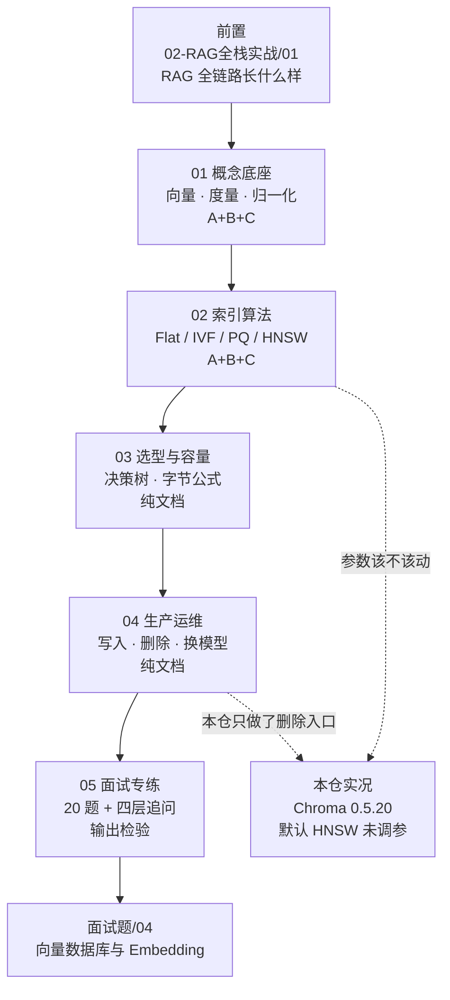
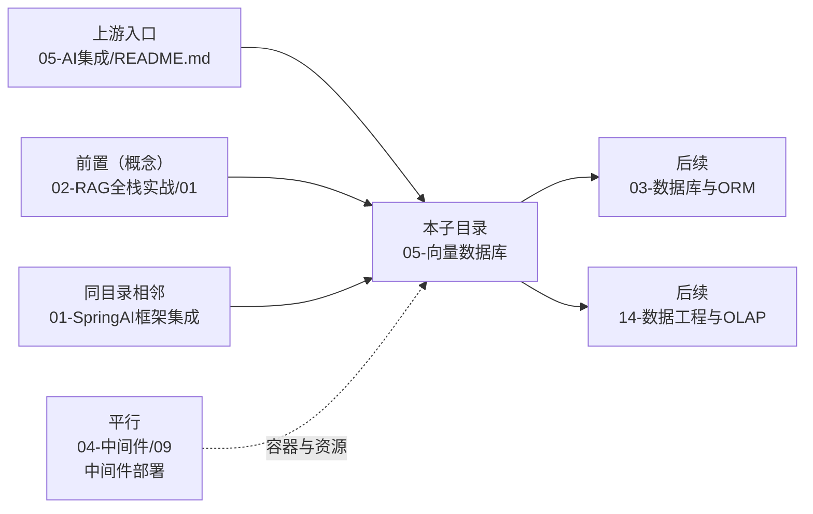

# 向量数据库：坐标怎么算、怎么找、怎么不被规模拖垮

> **一句话结论**：向量库这一层只有三件事真正会出事——**文本被映到什么坐标上**（Embedding）、**这些坐标用什么结构被找到**（索引）、**规模与模型变更时怎么不被拖垮**（容量与运维）；本仓 Chroma 全程跑默认 HNSW、索引参数一次没调过，所以这 5 篇的真实用途是：给"要调参 / 要换库 / 要换模型"的那一天提前备好判断依据。
> **阅读前置**：会写 Spring Boot（知道 Bean 生命周期与 `@Primary`）、数学只需到"余弦相似度"、不必先读完 RAG 全链路（但先读 [RAG 检索增强生成](../02-RAG全栈实战/01-RAG检索增强生成.md) 会更顺）。
> **证据基线**：A 级 = Spring AI 2.1.0 已入库摘录（`VectorStore`/`SearchRequest`/`EmbeddingModel`）；B 级 = 本仓真实文件（Chroma 编排、三服务向量配置、Embedding Bean、检索参数）；C 级 = 274 个源文件的静态统计（口径见 §7）。预计阅读：本页 15 分钟，5 篇正文 5~6 小时。

---

## 1. 这个子目录解决什么问题

RAG（Retrieval-Augmented Generation，先检索资料再让模型照着答）里，"答不准"最终有 80% 要回到这一层：模型再好，喂进去的片段是错的，答案就是错的。这一层不涉及 prompt、不涉及业务语义，只回答三个工程问题：**向量怎么来、怎么存、怎么查快且查得准**。

本子目录要解决的是下面三类"卡住"的现场，每一类都不是靠调 `topK` 能救回来的：

| 现场症状 | 通常是哪一层坏了 | 归到哪篇 |
|---|---|---|
| 换个说法就搜不到，关键词对上就行 | 坐标层：Embedding 把语义扔了，或用了不该比的度量/未归一化 | [01 向量与相似度](01-向量与相似度-把文字变成坐标.md) |
| 数据量到几十万，检索从 8ms 涨到 800ms；或加了索引后召回掉了 | 结构层：Flat 全表扫描顶不住，或 HNSW/IVF 参数把召回换掉了 | [02 索引算法](02-索引算法-向量检索怎么从全表扫描里活下来.md) |
| 老板问"为什么用 Chroma、能存多少、什么时候该换" | 选型层：没有数字就选型，等于没选型 | [03 选型与容量规划](03-选型与容量规划.md) |
| 删了文档还能搜到；换了 Embedding 模型后全库召回崩 | 运维层：墓碑（tombstone，只打删除标记不立即释放）+ 新旧向量混库 | [04 生产运维](04-生产运维-向量库跑起来之后才会遇到的事.md) |
| 面试被追问 M 和 ef 怎么定、pre-filter 为什么会让索引失效 | 表达层：原理懂但说不成链 | [05 面试专练与追问链](05-面试专练与追问链.md) |

### 读者画像与建议入口

| 你是谁 | 你真正缺的 | 从哪进 | 别做什么 |
|---|---|---|---|
| 会写 CRUD 和 Feign、没碰过向量的 Java 后端 | 不知道 `float[]` 里到底装了什么、为什么"相似"可以算 | [01](01-向量与相似度-把文字变成坐标.md) 全篇 | 别一上来背 HNSW 参数，会背成玄学 |
| 正在自己项目里接知识库、本地只有几十条数据 | 没有"我的规模该用什么索引"的判断力 | [02](02-索引算法-向量检索怎么从全表扫描里活下来.md) 的 3.1/3.5/3.7 | 别在没有数据量之前就上 IVF/PQ |
| 要做技术选型或背容量指标的人 | 缺公式与决策树，缺"换库成本"这一项 | [03](03-选型与容量规划.md) → [04](04-生产运维-向量库跑起来之后才会遇到的事.md) | 别只看 benchmark 的 QPS 数字 |
| 两周内要面 AI 应用岗 | 缺一条能把"原理 → 我们项目怎么做 → 代价"串起来的模板 | [05](05-面试专练与追问链.md) 的答题模板 → [面试题 04](../面试题/04-向量数据库与Embedding.md) | 别把"我们用了 Chroma"当成答案 |

### 读完你能验证的行为（做不到就说明没读透）

1. 随手给两段文本，你能量出它们 Embedding 后的余弦相似度，并解释为什么先做 L2 归一化后"余弦"与"点积"等价。
2. 给定"50 万条 × 1024 维"，你能算出原始向量占多少字节、HNSW 图额外占多少、然后给出"该不该上量化"的一句话结论。
3. 给你一份 `initialize-schema: false` 却仍然启动就报 Chroma 连接失败的日志，你能指出是哪个类在初始化期探测远端，以及本仓用什么手法绕开（见 §7）。
4. 你能说清 `recall-top-k = 20` 与 `top-n = 5` 分别在链路哪一步砍候选，以及"把相似度阈值调高"为什么不会降延迟。
5. 你能判断"换了 Embedding 模型"属于哪类变更：**必须全量重算**，还是可以增量补。

---

## 2. 目录地图：5 篇怎么排



> **读图说明**：主干是 5 个实线箭头，代表**概念依赖**而非编号顺序——`01 → 02` 是硬依赖（不知道"距离"是什么就没法理解"用召回率换延迟"），`02 → 03` 是软依赖（03 的容量公式里要用 02 的图/码本开销），`03 → 04` 是软依赖（04 讲的墓碑与 compact 属于"选完库之后才会遇到"）。两条虚线是关键：它们把**原理篇**接到**本仓实况**上，而本仓的实况是"只用了默认参数"——所以读 02 时不要产生"我们项目调过 ef"的错觉；`P4 -.-> PROJ` 的虚线更细，因为本仓只有删除入口（`KnowledgeVectorService` 的表达式删除）真正落地，换模型与 compact 都**没跑过**。

### 推荐顺序与理由

| 顺序 | 读什么 | 为什么是这个顺序 | 可跳读的条件 |
|---|---|---|---|
| 1 | [01](01-向量与相似度-把文字变成坐标.md) 全篇 | 后面所有篇都在用"相似度分数"这个词，01 是唯一给出公式与手算的地方 | 已能手算余弦、知道 `score` 与 `distance` 方向相反 |
| 2 | [02](02-索引算法-向量检索怎么从全表扫描里活下来.md) 的 3.1 → 3.5 → 3.7 → 3.8 | 先算清"暴力扫描到底多慢"，再谈换什么结构；3.7 参数三角是面试必考 | 数据量 < 10 万且延迟可接受，可只看 3.8（过滤与索引） |
| 3 | [03](03-选型与容量规划.md) 的决策树 + 容量公式 | 有了 01/02 的词汇，选型表才读得懂 | 已锁定 Chroma 且不打算换库，可跳过"何时换库" |
| 4 | [04](04-生产运维-向量库跑起来之后才会遇到的事.md) | 只有在你真的要上线/要改数据时才用得上，但它决定你踩坑时能不能自救 | 项目未上线，可只看"删除真相"一节 |
| 5 | [05](05-面试专练与追问链.md) | 检验器：能把 1~4 压成四层答题结构，说明真读懂了 | 不面试可跳过，改用本文 §6 检查点自测 |

**与父模块的排序冲突要明确**：在 [05-AI集成总览](../README.md) 的目录地图里"05-向量数据库"编号在最后，但读的顺序应在 RAG 之前或至少并行——因为 RAG 里 80% 的"答不准"最后都要回到索引与过滤上。

---

## 3. 每篇一句话摘要

| 篇 | 解决什么问题（一句话） | 本项目现状 | 证据类型 |
|---|---|---|---|
| [01 向量与相似度](01-向量与相似度-把文字变成坐标.md) | 文本怎么变成 1024 个浮点数、三种度量公式的真实差别、为什么必须归一化、为什么分数不可跨模型比较 | 已落地：`bge-m3` 生成 1024 维向量，另有 768 维兜底哈希模型（维度不一致风险） | A+B+C |
| [02 索引算法](02-索引算法-向量检索怎么从全表扫描里活下来.md) | Flat 什么时候真的够用；IVF/PQ/HNSW 各自换走了什么；为什么 Spring AI 接口里没有索引参数 | 底座：Chroma 用默认 HNSW，**本仓从未设置过任何索引参数** | A+B+C |
| [03 选型与容量规划](03-选型与容量规划.md) | pre-filter 与 post-filter 的深坑、选型决策树、容量估算公式 | 底座：选型结论是 Chroma（单机、易起、够用），但**决策过程未在本仓留档** | 纯文档（无项目证据） |
| [04 生产运维](04-生产运维-向量库跑起来之后才会遇到的事.md) | 写入、删除（墓碑 + compact）、换模型重算这三件事怎么不炸 | 部分：删除有真实入口，**换模型与 compact 未在本仓验证过** | 纯文档（删除除外，见 §7） |
| [05 面试专练与追问链](05-面试专练与追问链.md) | 把 01~04 压成"结论 → 原理 → 我们项目怎么做 → 代价"四层答题模板 | 输出检验：不引入新事实 | 纯文档 |

> 读法提醒：01、02 两篇已按本仓库新范式写足 A/B/C 三级证据；03/04/05 仍是纯原理体例，**它们给的是判断框架，不是本项目的实测数据**。这个差别在 §9 反复出现，别混。

---

## 4. 两条学习路线

| 路线 | 适合谁 | 顺序 | 耗时 | 产出物 |
|---|---|---|---|---|
| A 面试速通 | 两周内要面 AI 应用岗 | 01 的 3.3/3.4/3.6 → 02 的 3.5/3.7/3.8 → 05 全篇 → [面试题 04](../面试题/04-向量数据库与Embedding.md) | 2.5~3.5 小时 | 一页手写：余弦公式 + 归一化理由 + HNSW 三参数权衡 + 一句"我们项目用默认参数、原因是没到需要调的量级" |
| B 生产落地 | 要在自己项目里接知识库、要拍选型 | 01 → 02 → [RAG 全链路](../02-RAG全栈实战/01-RAG检索增强生成.md) → [向量检索实战](../02-RAG全栈实战/03-RAG向量检索实战.md) → 03 → 04 | 6~8 小时（不含写代码） | 一张"我的数据量 → 索引类型 → 参数 → 内存/PVC 估算"的表格，加上一份删除与换模型的 SOP 草稿 |

### 路线 A 细化（只读加粗的小节，其余跳过）

| 步骤 | 花的时间 | 只读这些 | 读完能答的那道题 |
|---|---|---|---|
| 1 | 40 min | 01 的 3.3（三种度量）、3.4（归一化）、3.6（`score = 1 - distance`） | "余弦相似度和欧氏距离什么关系？" |
| 2 | 60 min | 02 的 3.1（Flat 的 O(N·d)）、3.5（HNSW 的 M/efConstruction/efSearch）、3.7（参数三角） | "调大 efSearch 有什么代价？" |
| 3 | 30 min | 02 的 3.8（post-filter 崩塌、pre-filter 索引失效） | "带过滤条件的向量检索为什么会慢？" |
| 4 | 60 min | 05 的四层答题模板 + 高频题 | "讲讲你项目里的向量库" |

### 路线 B 细化（每步都给验收）

1. 01 全篇 + 手算一遍余弦（验收：你的手算结果与 01 的算例一致）。
2. 02 的 3.1~3.11 + 跑一次 02 给的离线估算（验收：你能算出自己数据量的构建时间与内存量级）。
3. 接 RAG 全链路前先读 §7 的"真实清单"，把你环境的集合名/维度/参数对齐（验收：`collection-name` 与你自己的 Chroma 里 `collections` 输出一致）。
4. 03 的容量公式套到你的数字上（验收：给出 PVC 与内存建议值，并写明假设）。
5. 04 的删除与换模型两节写成 SOP（验收：能写出"换模型时要先建新集合再切流"的回滚步骤）。

---

## 5. 依赖关系



> **读图说明**：`UP --> ME` 是导航边，说明本页不是知识的起点——它上面的 [05-AI集成总览](../README.md) 才有全模块地图与"哪篇已落地"的判断。`PRE --> ME` 是概念边：RAG 全链路给的是"向量库在链路里的位置"，本子目录给的是"那一格内部怎么运作"，缺前者你会不知道 topK 在砍什么。`ME --> NEXT1/NEXT2` 是能力复用边：向量库本质是一个"带索引的存储 + 容量规划问题"，索引结构与 B+ 树/倒排的取舍、以及数据分层与批处理调度，分别在数据库与数据工程两处继续展开。虚线那条提醒你：Chroma 的部署形态（容器、PVC、副本数）属于中间件部署范畴，本子目录只讲"部署成什么样会影响向量库行为"。

| 关系 | 真实链接 | 具体依赖什么 | 不读会怎样 |
|---|---|---|---|
| 上游入口 | [05-AI集成总览](../README.md) | 全模块阅读顺序、每篇的落地状态 | 会重复读、或把"原理篇"当成本项目实测 |
| 前置（概念） | [RAG 检索增强生成](../02-RAG全栈实战/01-RAG检索增强生成.md) | 加载 → 分块 → 向量化 → 存储 → 检索 → 重排的位置关系 | 不知道 topK/阈值在链路哪一步生效 |
| 前置（框架） | [Spring AI 入门](../01-SpringAI框架集成/01-SpringAI入门.md) | `EmbeddingModel` / `VectorStore` 的 Bean 装配方式 | 看不懂 §7 里的 `@Primary` 与延迟代理 |
| 平行（部署） | [AI 与治理中间件部署](../../04-中间件/09-AI与治理中间件部署.md) | Chroma 容器、PVC、健康检查 | 不知道向量库是"有状态服务"，误以为能随便重启 |
| 后续 | [03-数据库与ORM](../../03-数据库与ORM/README.md) | 索引结构取舍、容量与分区思维 | 只能背 HNSW，说不出"为什么不用 B+ 树" |
| 后续 | [14-数据工程与OLAP](../../14-数据工程与OLAP/README.md) | 全量重算、增量同步、批处理调度 | 换模型时不会设计重算任务 |

---

## 6. 检查点清单

分三段打勾。第一段是"能说出"（口径），第二段是"能算出"（数量级），第三段是"能诊断"（现场）。**全部打勾 ≠ 掌握**，但任何一项打不上勾都说明对应那篇没读透。

### 阶段 1：能说出（读完 01、02 就应达成）

- [ ] 能说出 Embedding 的接口承诺只有一句："文本进，`float[]` 出"，它**不承诺**语义一定对、也不承诺不同模型间可比。
- [ ] 能说出余弦、内积、欧氏三种度量的关系，并解释 L2 归一化后余弦与内积等价。
- [ ] 能说出本项目 `score` 与 `distance` 的方向相反（`score = 1 - distance`），所以"分数越高越像"。
- [ ] 能说出 Flat、IVF、PQ、HNSW 四者各自拿什么换什么（时间 / 内存 / 召回）。
- [ ] 能说出 HNSW 三个参数的名字与作用：`M`（每层连接数）、`efConstruction`（建图搜索宽度）、`efSearch`（查询搜索宽度）。
- [ ] 能说出为什么 Spring AI 的 `VectorStore` 接口里没有索引参数，只能通过 `getNativeClient()` 逃生。

### 阶段 2：能算出（读完 02、03 就应达成）

- [ ] 能算出原始向量字节数：`N × d × 4`；bge-m3（1024 维）下每条 4 KiB，10 万条 ≈ 390 MiB。
- [ ] 能估算 HNSW 图开销：`N × M × 2 × 4` 字节；`M=16` 时每条 ≈ 128 B，与原始向量同量级，不能忽略。
- [ ] 能算出 Flat 一次查询的比较次数 ≈ `N`，并据此判断"多少条以内暴力扫描够用"。
- [ ] 能用本仓的 `1Gi` 内存上限与 `10Gi` PVC 倒推"大致能装多少条"，并写出假设（见 §7 的估算，标注了未实测）。
- [ ] 能算出候选量变化：`recall-top-k = 20` 捞 20 条 → 重排 `top-n = 5` 留 5 条，砍掉 75%。

### 阶段 3：能诊断（要读 04 与 §7）

- [ ] 服务启动卡住或报 Chroma 连接失败 → 能指出是 `InitializingBean` 在创建实例时探测远端集合，而不是业务代码在查。
- [ ] 召回整体变差、分数分布整体下移 → 能判断是不是换了 Embedding 模型或维度不匹配（新旧向量混库）。
- [ ] 文档删除后仍能搜到 → 能判断是墓碑未压实，并知道该看哪几个指标。
- [ ] 把相似度阈值从 0.3 提到 0.7，p99 没降 → 能解释阈值是**客户端后处理**，不省服务端扫描。
- [ ] 带过滤条件后延迟暴涨 → 能区分 post-filter（先检索后过滤，候选被砍空）与 pre-filter（先过滤再检索，索引可能失效）。

---

## 7. 本项目向量库真实清单

下面的数值全部来自本仓文件，路径 + 行号已逐个核对；标"估算"的是按公式手算，**未实测**。

| 组件 | 版本 | 部署形态 | 集合名 | 当前参数 | 已知缺口 |
|---|---|---|---|---|---|
| Chroma | `0.5.20`（`docker-compose.yml#L195`、`deploy/k8s/chroma.yaml#L44`） | Compose 单容器 `aics-chroma`，`8000:8000`，命名卷 `chroma-data`；K8s 侧 StatefulSet `replicas: 1` | `aics-knowledge` | 默认 HNSW，**未设置任何索引参数**；`initialize-schema`：chat `false` / knowledge `false` / search `true` | 无鉴权（编排里无任何 auth 环境变量）、单副本无高可用、内存上限 `1Gi`、PVC `10Gi` |
| Spring AI | `2.1.0`（`pom.xml#L42`） | 三个服务都引入 `spring-ai-starter-vector-store-chroma`（chat/knowledge `pom.xml#L71`、search `pom.xml#L40`） | — | `ChromaVectorStore.builder(...)` 显式指定集合与 `initializeSchema` | `upsert()` 默认实现直接抛 `UnsupportedOperationException`（[[源码:VectorStore.java.md#L80-L82]]），增量写入只能靠 `add` 的 id 语义 |
| Embedding（主） | `BAAI/bge-m3`，1024 维，走 OpenAI 兼容端点 `https://api.siliconflow.cn`（`tools/nacos-config/aics-shared.yml#L21-L24`） | 三个服务各有一个 `@Primary EmbeddingModel` Bean | — | 无批量/重试参数，无超时与降级开关 | 三服务各自建 Bean，配置漂移无人校验 |
| Embedding（兜底） | 特征哈希实现，`DIMENSIONS = 768`（`ai-cs-common/src/main/java/com/aics/common/ai/embedding/HashEmbeddingModel.java#L31`） | `@ConditionalOnProperty(aics.ai.embedding.provider, havingValue="local", matchIfMissing=true)` | — | 该属性**从未在任何 yml 里设置**，靠 `@Primary` 压住 768 维 Bean | 兜底与主模型维度不同，一旦 `@Primary` 失效就是 768/1024 混写 |
| 检索参数 | — | `tools/nacos-config/ai-cs-chat.yml` | — | `recall-top-k: 20`、`recall-threshold: 0.3`（`#L21-L25`）；重排 `top-n: 5`、`min-score: 0.7`（`#L11-L19`） | 纯向量路径阈值被硬编码成 `0.0`（`HybridRetriever.java#L155`），配置里的 0.3 不生效 |
| 语义缓存（自建向量检索） | 本仓 Java 实现，无外部库 | 进程内 L1 + Redis L2 | 非 Chroma，走 Redis | `threshold: 0.92`、`max-entries: 200`（`ai-cs-chat/src/main/resources/application.yml#L170-L193`） | 线性扫描 `O(n)`，200 条上限是硬编码的经验值，从未按命中率调过 |
| 删除 | — | 服务内表达式删除 | `aics-knowledge` | `vectorStore.delete("documentId == '" + id + "'")`（`KnowledgeVectorService.java#L109`） | 走的是 `delete(String)` → 转 `Filter.Expression`（[[源码:VectorStore.java.md#L105-L110]]），**未验证过** Chroma 侧墓碑压实行为 |

### C 级静态统计：本仓到底有没有调过向量库参数

用静态扫描回答"有没有"这类问题，比读代码更不容易漏。口径：遍历 `ai-cs-chat/src/main`、`ai-cs-knowledge/src/main`、`ai-cs-search/src/main`、`tools/nacos-config` 下全部 `.java` / `.yml`（排除 `target`），对关键字做不区分大小写的逐行匹配。

```powershell
$root='D:\Projects\Persion\ai-customer-service'
$files = @("$root\ai-cs-chat\src\main","$root\ai-cs-knowledge\src\main","$root\ai-cs-search\src\main","$root\tools\nacos-config") |
  ForEach-Object { Get-ChildItem -Recurse -File -Path $_ } |
  Where-Object { $_.Extension -in '.java','.yml','.yaml' }
"files=$($files.Count)"
foreach($p in 'collection-name','initialize-schema','hnsw','aics.ai.embedding.provider','top-k','similarity-threshold','recall-threshold'){
  $m = $files | Select-String -Pattern $p -CaseSensitive:$false
  "$p=$($m.Count)"
}
```

真实输出（2026-11 本机实跑，单文件统计耗时可忽略）：

```text
files=274
collection-name=3
initialize-schema=4
hnsw=1
aics.ai.embedding.provider=2
top-k=18
similarity-threshold=0
recall-threshold=3
```

**怎么读这组数**：

- `collection-name=3` 且三处值都是 `aics-knowledge` → 三个服务共用一个集合，这是"写读分离但同库"的设计前提；任何一侧配错就是静默查空。
- `initialize-schema=4` → 3 处配置（chat `false`、knowledge `false`、search `true`）+ 1 处 Javadoc 说明。**同一集合三方配置不一致**，是 §9 里"运维能力缺失"的一条。
- `hnsw=1` 且唯一命中是注释（`SemanticCacheService.java#L38` 自述"规模上万应换 HNSW"）→ **全仓零索引参数调优**，这就是 §2 那条虚线要说明的事。
- `aics.ai.embedding.provider=2` 且都在注释里 → 该开关从未被显式打开或关闭，`matchIfMissing = true` 让它恒定走兜底模型路径，实际由 `@Primary` 决定用谁。
- `similarity-threshold=0` → 本仓没有这个名字的配置项，"相似度阈值"是散落在各处的 `threshold`（共 60 处命中，含缓存 0.92、意图 0.6 等），名字不统一是排查成本。

### 为什么必须用延迟代理：一个真实的启动期陷阱

`ai-cs-chat` 的 `VectorStoreConfig` 在 Javadoc 里把原因写得很直白：Spring AI 2.1 的 `ChromaVectorStore` 实现 `InitializingBean`，**即使 `initialize-schema=false`**，创建实例时依然会去访问远端集合（`ai-cs-chat/src/main/java/com/aics/chat/config/VectorStoreConfig.java#L33-L36`）。于是本仓用 `ProxyFactory` + `LazyInitTargetSource` 把 Bean 变成延迟代理（同文件 `#L58-L71`），真正的 `ChromaVectorStore.builder(...)` 放在代理背后（`#L73-L90`）。

这条设计带来的可观察后果：**启动不再依赖 Chroma 存活，但第一次检索仍然依赖**。所以要区分两种故障："启动起不来" 与 "启动起来了但一问就 500"，前者已经修掉，后者依然是 Chroma 可达性问题。

### 容量估算（手算，未实测）

按 §6 阶段 2 的公式，用本仓真实参数倒推：

| 项 | 公式 | 代入本仓参数 | 结论 |
|---|---|---|---|
| 单条向量 | `d × 4` | 1024 × 4 = 4096 B | 每条 4 KiB |
| HNSW 图 | `M × 2 × 4` | 默认 `M=16` → 128 B/条 | 图开销约原始向量 3% |
| 单条总计（含文本/元数据预留 ~1 KiB） | 4096 + 128 + 1024 | ≈ 5.1 KiB | 取 5 KiB/条做粗估 |
| `1Gi` 内存上限 | `1 GiB ÷ 5 KiB` | ≈ 20 万条理论上限 | 实际含 Python 进程与碎片，**保守按 10~15 万条** |
| `10Gi` PVC | `10 GiB ÷ 5 KiB` | ≈ 200 万条 | 磁盘不是瓶颈，内存才是 |

所以本仓当前的瓶颈在 `limits.memory: 1Gi`（`deploy/k8s/chroma.yaml#L62-L68`），不在磁盘。这个结论**没有实测支撑**，只用于说明"该看哪个数"。

---

## 8. 常见问题直达表

按"你看到的现象"查，不按知识点查。

| 症状 | 去哪篇 | 为什么先去那篇（不是别处） |
|---|---|---|
| 换个问法就搜不到，原句能搜到 | [01](01-向量与相似度-把文字变成坐标.md) 的 3.2 / 3.12 | 先排除"Embedding 本来就不保证语义"与"相似≠相关"，再改代码 |
| 相似度分数看着都很高（0.8 以上）却答非所问 | [01](01-向量与相似度-把文字变成坐标.md) 的 3.8 | 分数不可跨模型比较，也可能是向量被过度归一化后的假高分 |
| 检索延迟随数据量线性涨 | [02](02-索引算法-向量检索怎么从全表扫描里活下来.md) 的 3.1 | 线性涨 = 还在全表扫描，先确认索引有没有真的建起来 |
| 加了索引，召回明显掉了 | [02](02-索引算法-向量检索怎么从全表扫描里活下来.md) 的 3.5 / 3.7 | 你付的是"召回换延迟"，问题在 `efSearch` 或 `M` |
| 带过滤条件（如按 `knowledgeBase`）后特别慢 | [02](02-索引算法-向量检索怎么从全表扫描里活下来.md) 的 3.8 | post-filter / pre-filter 两条路都会出问题，且症状不同 |
| 启动卡住、报 Chroma 连接失败 | 本页 §7 + [向量检索实战](../02-RAG全栈实战/03-RAG向量检索实战.md) | 是 `InitializingBean` 探测集合，本仓已用延迟代理绕开 |
| 不知道该选 Chroma 还是 Milvus/pgvector | [03](03-选型与容量规划.md) | 选型要先有三个数字：条数、维度、可接受 p99 |
| "我们这点数据要不要上向量库" | [03](03-选型与容量规划.md) 的容量公式 | 10 万条以内 Flat 往往够用，先算再说 |
| 删了文档还能搜到旧内容 | [04](04-生产运维-向量库跑起来之后才会遇到的事.md) | 墓碑与 compact 语义，本仓只有删除入口、未验证压实 |
| 换了 Embedding 模型后召回整体崩 | [04](04-生产运维-向量库跑起来之后才会遇到的事.md) | 换模型必须全量重算，新旧向量不可混在同一集合比较 |
| 知识更新了，向量没更新 | [知识库增量同步](../02-RAG全栈实战/08-知识库增量同步实战-RocketMQ驱动向量化.md) | 这是消息链路问题，不是向量库问题 |
| 关键词精确命中被语义召回挤掉 | [混合检索实战](../02-RAG全栈实战/05-混合检索实战-ES-BM25与向量RRF融合.md) | 需要另一路召回 + 融合，换索引救不了 |
| 面试被追问 HNSW 参数与召回率 | [05](05-面试专练与追问链.md) + [面试题 04](../面试题/04-向量数据库与Embedding.md) | 要在暴力基线之上说清"用召回率换延迟" |

---

## 9. 诚实清单

这一节存在的意义：本子目录 5 篇里有 3 篇是纯原理，**不要把它们的结论当成本项目的实测结果**。

### 9.1 只有原理与选型内容、未落地到本项目

| 内容 | 出处 | 状态 | 落地需要做什么 |
|---|---|---|---|
| IVF / PQ / LSH 的具体参数与效果 | [02](02-索引算法-向量检索怎么从全表扫描里活下来.md) | 未落地：Chroma 只跑默认 HNSW，本仓从未构建过 IVF/PQ 索引 | 在本机起一个 Milvus 或 faiss 对照，同一份数据测召回率与延迟 |
| 选型决策树的三类产品形态对比 | [03](03-选型与容量规划.md) | 未落地：选 Chroma 的过程没有留档 | 补一份 ADR（架构决策记录），写明当时的数据量与放弃其它方案的理由 |
| pre-filter / post-filter 的实际行为差异 | [02](02-索引算法-向量检索怎么从全表扫描里活下来.md) 3.8、[03](03-选型与容量规划.md) | 未实测：本仓检索确实带 `knowledgeBase` 过滤，但从未测过过滤选择性对延迟的影响 | 构造"过滤命中 1%"与"过滤命中 50%"两个场景对比 p99 |
| 墓碑与 compact 的触发时机 | [04](04-生产运维-向量库跑起来之后才会遇到的事.md) | 未验证：只有删除入口，无压实观测 | 删 1000 条后观察 Chroma 段数与检索延迟 |

### 9.2 参数从未调优

| 参数 | 当前值 | 来源 | 为什么说"从未调优" |
|---|---|---|---|
| HNSW `M` / `efConstruction` / `efSearch` | 全部默认 | Chroma 内置默认 | 静态扫描 `hnsw` 仅 1 处命中且是注释（§7） |
| `recall-top-k` | 20 | `tools/nacos-config/ai-cs-chat.yml#L21-L25` | 无对应调参记录，纯经验值 |
| `recall-threshold` | 0.3 | 同上 | 而且纯向量路径把阈值硬编码成 `0.0`（`HybridRetriever.java#L155`），配置等于没生效 |
| 重排 `min-score` | 0.7 | 同上 `#L11-L19` | 未按 `bge-reranker-v2-m3` 的分数分布校准过 |
| 语义缓存 `threshold` | 0.92 | `ai-cs-chat/src/main/resources/application.yml#L170-L193` | 未统计过命中率与误命中率 |
| 语义缓存 `max-entries` | 200 | 同上 | `SemanticCacheService.java#L37-L38` 自述上限，规模上万要换 HNSW |

### 9.3 运维能力缺失

| 缺什么 | 现状证据 | 风险 |
|---|---|---|
| 认证与鉴权 | 编排里无任何 auth 环境变量（`docker-compose.yml#L194-L209`、`deploy/k8s/chroma.yaml`） | 8000 端口暴露即裸奔 |
| 高可用 | K8s `replicas: 1` | 单点，重启期间检索全失败 |
| 备份与恢复 | 只有 PVC + 命名卷，无备份 CronJob | 卷损坏 = 知识库向量全丢，只能全量重算 |
| 容量监控 | 无向量条数/内存水位指标 | 只会在 OOM 时发现 |
| 索引重建/Dry-run 流程 | 换模型流程未在本仓验证过（母模块也标"未验证"） | 换模型时容易新旧混库 |
| 三方配置一致性 | `initialize-schema` chat/knowledge `false` vs search `true` | 语义不一致，排障时容易误判 |
| 客户端地址一致性 | chat/knowledge 用 `http://${aics.mysql.host:localhost}`，search 用 `http://${aics.mysql.host:123.60.31.79}`（`ai-cs-search/src/main/resources/application.yml#L45`） | 借用了 `aics.mysql.host` 这个不相干变量，且 search 内置了硬编码 IP 默认值 |
| Embedding 兜底一致性 | 768 维兜底 Bean 与 1024 维主 Bean 并存 | `@Primary` 一旦失效就是维度混写，检索直接不可用 |

---

**读完之后下一步**：带着 §6 阶段 2 的公式去 [03-选型与容量规划](03-选型与容量规划.md) 把你的真实数字算一遍；带着 §7 的真实清单去 [04-生产运维](04-生产运维-向量库跑起来之后才会遇到的事.md) 写出删除与换模型的 SOP。原理不是终点，能算出自己系统的那几个数才是。
