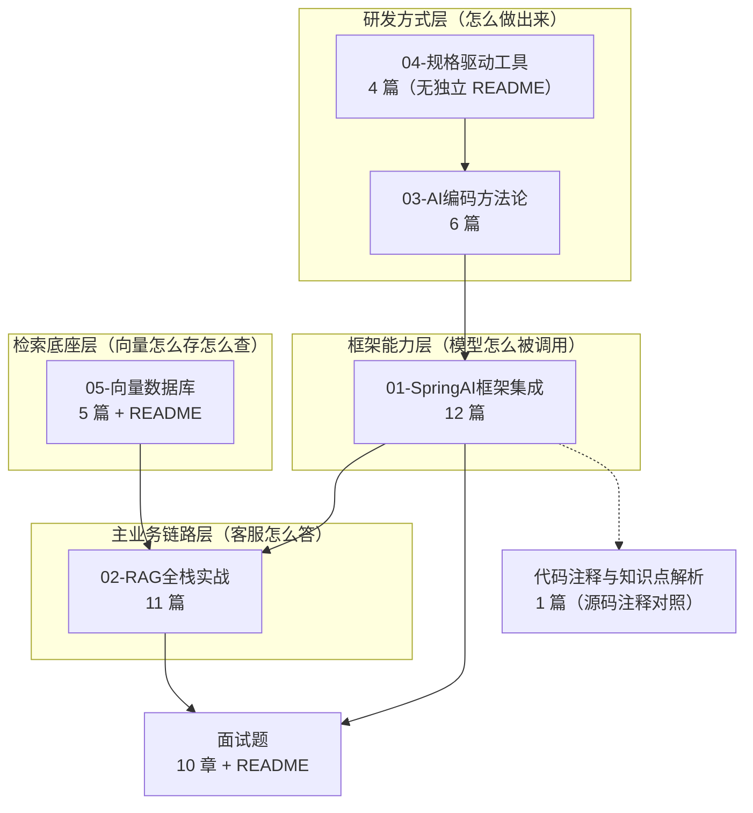

# 05 AI 集成（Spring AI 2.1 · RAG · Agent · 向量检索）

> **一句话结论**：本模块只回答一个问题——把"调用一次大模型"变成"线上能答客诉的客服系统"，中间还差哪些零件；49 篇正文按「框架能力 → 主业务链路 → 检索底座 → 研发方式 → 输出检验」五层组织，每篇都标了本项目**是否真的有代码**。
> **阅读前置**：Java 17 + Spring Boot（Bean 生命周期、`@Conditional`、AOP）+ 会用 Maven；不需要机器学习背景，AI 术语在本页第一次出现处就解释（例如 Embedding）。
> **证据基线**：`spring-ai@2.1.0` / Spring Boot 4.2.0 / JDK 17 / Chroma 0.5.20；本仓 `ai-cs-chat`、`ai-cs-knowledge`、`ai-cs-search` 源码；预计阅读 **20 分钟**（本页是入口，不是正文）。
> **本页只做三件事**：告诉你从哪篇开始、告诉你哪些结论已经有代码兜底、告诉你哪些还只是设计（第 9 节单独列）。

## 0. 先说清楚证据边界

本模块是全库最大的一块（正文篇数与行数为实测，见下方命令），也是**最容易写成"看起来很美"**的一块：AI 领域概念多、参考实现多、真正落地的少。所以每篇都强制标注"本项目是否已落地"。

| 证据类别 | 本仓状态 | 本页怎么用 |
| --- | --- | --- |
| A 级：Spring AI 框架源码摘录 | 已入库 `24-源码分析/assets/source/`，共 908 份，其中含 `org.springframework.ai` 的 146 份 | 讲框架行为时给 `[[源码:Xxx.java.md#L起-L止]]`，如 `[[源码:DefaultChatClient.java.md#L94-L123]]` |
| B 级：本项目真实代码 | `ai-cs-chat` / `ai-cs-knowledge` / `ai-cs-search` / `ai-cs-message` 已可用 `read` 核对行号 | 讲"我们怎么接的"时给 `路径#L起-L止` |
| C 级：可复现实测 | 只做**静态**核对：文件统计、grep 命中数、`node tools/check-doc.mjs`；不起服务、不连中间件、不调模型 API | 讲"有没有落地"时给命令 + 真实输出 |
| 无 | 本机无 docker / redis / mysql / chroma，无法跑端到端联调 | 涉及运行时的结论一律写"未实测，依据官方文档 + 本项目代码" |

```text
# C 级：本机工具链探测（一条命令，30 秒内）
$ node -v
v24.16.0
$ foreach($c in @('docker','redis-cli','mysql','chroma')){ "$c=" + [bool](Get-Command $c -ErrorAction SilentlyContinue) }
docker=False
redis-cli=False
mysql=False
chroma=False
```

```text
# C 级：本模块体量实测（cd learning-docs\05-AI集成 后执行）
$ $f = Get-ChildItem -Recurse -Filter *.md -File
$ "md 文件数 = $($f.Count)"
md 文件数 = 52
$ "README 数 = $(($f | Where-Object Name -eq 'README.md').Count)"
README 数 = 3
$ "正文篇数 = $(($f | Where-Object Name -ne 'README.md').Count)"
正文篇数 = 49
$ "正文总行数 = $((($f | Where-Object Name -ne 'README.md') | ForEach-Object { (Get-Content $_.FullName).Count } | Measure-Object -Sum).Sum)"
正文总行数 = 14412
```

**怎么读这两个输出**：`docker=False` 等四行说明后面所有"跑起来看看"的话都不是本机实测；`正文篇数 = 49` / `正文总行数 = 14412` 是本模块的规模账——49 篇里 48 篇在 6 个子目录，1 篇在根目录（`代码注释与知识点解析.md`），另有 3 个 README（本页 + 向量库 + 面试题）。

### 0.2 本页哪些结论允许你直接反驳

本页所有"已落地 / 未落地"的判断都不是听来的，而是用三种可重跑的方式得到的，你可以原地推翻它们：

| 判断类型 | 我用什么方法得出 | 你复核的命令 |
| --- | --- | --- |
| 某能力"有代码" | 读具体类与行号（第 4 节每行的证据列） | `read` 那个 `路径#L起-L止`，或 `Select-String -Path <文件> -Pattern '<关键字>'` |
| 某能力"没有代码" | 全仓 `java/yml` 关键字命中数 = 0 | `Get-ChildItem -Recurse -Include *.java,*.yml -File \| Where-Object { $_.FullName -notmatch '\\learning-docs\\\|\\target\\' } \| Select-String -Pattern '<关键字>' -List` |
| 某配置"没设" | 资源目录内配置项命中数 = 0 | 同上，把路径收窄到 `ai-cs-chat/src/main/resources` |
| 某数字（篇数、行数） | `Get-ChildItem` + `Measure-Object -Sum` | 见上方 `正文总行数` 那段命令 |

**注意一个容易误判的点**：`grep` 命中 0 只证明"这个名词没出现在代码里"，不证明"这件事没被等价实现"。所以第 9 节每一条都写了"核对方式"而不是只写结论——例如 MCP 未落地是靠 `Mcp*` 与 `spring-ai-mcp` 两个关键字一起搜的，而不是靠感觉。

### 0.3 本页直接引用的 B 级锚点（都已 `read` 核对行号）

| 结论 | 代码锚点 |
| --- | --- |
| ChatClient 默认挂 `QuestionAnswerAdvisor`、system prompt 由注册表渲染 | `ai-cs-chat/src/main/java/com/aics/chat/config/SpringAiConfig.java#L266-L289` |
| 向量库 Bean 用 `ProxyFactory` + `LazyInitTargetSource` 延迟创建 | `ai-cs-chat/src/main/java/com/aics/chat/config/VectorStoreConfig.java#L58-L71` |
| 提示词注册表校验与渲染、缺变量抛异常 | `ai-cs-chat/src/main/java/com/aics/chat/prompt/PromptRegistry.java#L59-L75`、`#L134-L147` |
| 三种灰度策略的版本选择 | `ai-cs-chat/src/main/java/com/aics/chat/prompt/PromptRouter.java#L42-L64` |
| 配额检查是事后统计 + fail-open | `ai-cs-chat/src/main/java/com/aics/chat/observability/QuotaService.java#L38-L81` |
| Agent 三入口（对话 / 确认 / 轨迹）与普通对话兜底 | `ai-cs-chat/src/main/java/com/aics/chat/agent/AgentController.java#L44-L75` |

## 1. 定位：这个模块解决什么能力缺口

### 1.1 缺口不是"不会调模型"，而是"调完之后没人管"

项目 8 个后端模块里，真正的 AI 能力只落在三条链路上，而每条链路的失败方式都不一样：

| 链路 | 服务 | 一旦做错的典型后果 |
| --- | --- | --- |
| 生成链路（模型调用） | `ai-cs-chat` | 答案看着流畅但没依据（幻觉）、成本失控、被提示词注入绕过 |
| 检索链路（知识进/知识出） | `ai-cs-knowledge` + Chroma | 上传了 PDF 却搜不到、知识更新了还在答旧内容、召回一堆不相关片段 |
| 融合链路（多路召回 + 重排） | `ai-cs-search` + `ai-cs-chat` | 关键词命中的精确型号被向量召回挤掉，或反之 |

本模块就是把这 3 条链路拆成 49 篇可验证的零件。**判断一篇是否讲透的标准只有一个**：读完能不能指出"这个行为在哪个类、哪一行、哪个配置项里"。

四条最真实的能力缺口，以及本仓对应证据（都能被第 0.2 节的方法复核）：

| 缺口 | 代码里看得见的现状 | 讲这件事的篇 |
| --- | --- | --- |
| 模型调用入口分散在两处 | 一处是 `SpringAiConfig` 里自定义的 ChatClient（system prompt 由 `PromptRegistry` 渲染、默认挂 `QuestionAnswerAdvisor`），另一处是 `ModelRouter` 的模型选择 | [01-01](01-SpringAI框架集成/01-SpringAI入门.md)、[07](01-SpringAI框架集成/07-AI集成.md) |
| 知识变化后向量不同步 | `ai-cs-knowledge` 用 RocketMQ 生产/消费消息驱动向量化，幂等键在消费端 | [02-08](02-RAG全栈实战/08-知识库增量同步实战-RocketMQ驱动向量化.md) |
| 检索只有单路召回不够用 | `rag/retrieve/HybridRetriever` + `ai-cs-search` 的 `RrfMerger` 做 BM25 与向量融合，`rag/rerank/SiliconFlowRerankService` 做精排 | [02-04](02-RAG全栈实战/04-RAG进阶实战-Rerank重排序.md)、[02-05](02-RAG全栈实战/05-混合检索实战-ES-BM25与向量RRF融合.md) |
| 成本与安全没有"硬"闸口 | 配额 fail-open、无 `max-tokens` 上限、Guardrails 只有若干审查器 | [01-05](01-SpringAI框架集成/05-LLM可观测性评估与成本治理实现文档.md)、[01-06](01-SpringAI框架集成/06-AI安全网关与Guardrails实现文档.md)、第 9 节 |

### 1.2 三类读者画像（决定你从第 5 节的哪条路线进）

| 画像 | 你的现状 | 你的真实诉求 | 建议入口 |
| --- | --- | --- | --- |
| Java 后端转 AI 工程 | 会写 CRUD 和 Feign，没写过 prompt / 向量检索 | 把 Spring 那套（Bean、Advisor 链、拦截器思想）映射到 AI 上 | 第 5 节路线 B（从零做 RAG） |
| AI 应用岗面试者 | 能背概念，讲不清"你们项目里到底怎么实现的" | 要能答出 Advisor 顺序、Rerank 必要性、RRF 公式 | 第 5 节路线 A（面试速通） |
| 线上排障者 | 收到"答非所问""引用是编的""账单涨了 3 倍" | 30 分钟内定位是检索阶段还是生成阶段 | 第 8 节症状直达表 |

### 1.3 读完本模块能验证的行为（可判定的验收项）

1. 能在不启动服务的前提下，从 `SpringAiConfig` 读出本项目的 ChatClient 到底挂了哪些 Advisor、哪些工具、哪个 system prompt。
2. 能对一个"答非所问"的线上问题，说清该先看检索命中的 `score`（保真度）还是先看 prompt 与 topK（生成质量），并指出对应类。
3. 能解释为什么 `VectorStoreConfig` 要用 `ProxyFactory` 包一层延迟代理，而不是直接 `@Bean ChromaVectorStore`。
4. 能说清 `golden-set.json` 里 20 条用例怎么跑、跑了之后 gate 判定什么（以及它现在**没有**进 CI）。
5. 能指出本项目 MCP 客户端/服务端**一行代码都没有**，并说出接进来要改哪几个文件。

### 1.4 为什么这个模块最大，以及为什么值得先读入口

三个原因，都不是"AI 概念多"这么泛：

1. **它横跨三个服务的代码**。其余模块大多落在一个服务里，AI 能力却分散在 `ai-cs-chat`（生成/编排）、`ai-cs-knowledge`（入库/同步）、`ai-cs-search`（关键词与融合检索）——少了任何一段，RAG 都跑不通，所以篇目天然多。
2. **它的失败是"静默"的**。CRUD 出错有异常栈；RAG 出错常常是"解析出空文本 → 零命中 → 模型自己编"，全链路 200 OK。这就是为什么第 8 节要按症状索引，而不是按类名索引。
3. **它的知识半衰期最短**。Spring AI 从 1.x 到 2.1 换掉了记忆抽象（`ChatMemory` → session 体系）、把工具调用做成模型无关、MCP 协议也在演进，所以本模块每篇都标版本，冲突时以 `24-源码分析/assets/source/` 里入库的那份源码为准。

**先读入口的价值**：入口页给的是"哪篇可信、哪篇只是设计"的判断力；没有这个判断力，读到 01-11（MCP）时很容易以为项目已经接了 MCP。

## 2. 模块地图：六个子目录的分层关系



> **读图说明**：两条线决定阅读顺序。第一条竖线 `D4 → D3 → D1 → D2` 是**生产顺序**——先定规矩（规格/方法论），再定框架用法，再搭业务链路；第二条竖线 `D5 → D2` 是**依赖顺序**——RAG 里 80% 的"答不准"问题最后要回到向量库的索引与过滤上，所以向量库虽然编号在最后，实读顺序要在 RAG 之前或至少并行。`ROOT` 用虚线是因为它是"对照表"而非独立知识块：想直接对代码的人从它进，想按主题学的从 `D1` 进。

### 2.1 推荐顺序与理由

| 顺序 | 读什么 | 为什么是这个顺序 |
| --- | --- | --- |
| 1 | `01-SpringAI框架集成/01` → `07` | 先把 ChatClient / Advisor / Embedding 这三个词落到本项目代码上，后面所有篇都在复用这套术语 |
| 2 | `05-向量数据库/01` → `02` | Embedding（把文本映射成高维向量的函数，输出是一个 float 数组，语义相近的文本向量距离更近）与索引（HNSW 这类近似最近邻结构）若讲不清，后面的 RAG 篇就只能背结论 |
| 3 | `02-RAG全栈实战/01` → `08` | 主线：加载 → 分块 → 向量化 → 存储 → 检索 → 重排 → 融合 → 引用 → 增量同步 |
| 4 | `01-SpringAI框架集成/04`、`02`、`06` | 有了 RAG 主线再看 Agent 编排、工程化与安全，才知道这些是在"包"什么 |
| 5 | `04-规格驱动工具` → `03-AI编码方法论` | 这两块是"怎么把 AI 写进研发流程"，与运行时无关，放最后不打断主线 |
| 6 | `面试题` | 输出检验：能答出来才算真懂，答不出来的回去补对应篇 |

### 2.2 五层各自回答什么问题（避免读串）

| 层 | 只回答这一个问题 | 不负责 | 读错层会怎样 |
| --- | --- | --- | --- |
| 研发方式层（03 / 04） | "这个需求该用什么流程做出来" | 不教你任何框架 API | 把方法论当能力清单，误以为项目"已经有 Agent" |
| 框架能力层（01） | "模型调用这件事在我们这里怎么写" | 不解释框架内部实现（那是 [24-源码分析](../24-源码分析/06-SpringAI/README.md)） | 只会在业务篇里看到结果，遇到异常无从下手 |
| 主业务链路层（02） | "一条回答从请求到流式回包经过哪些步骤" | 不深入讲索引算法与数学 | 调参时不知道该改 topK 还是改索引参数 |
| 检索底座层（05） | "向量怎么存、怎么查、怎么算相似" | 不涉及业务语义与 prompt | 只会调 topK，答不准时无手段可用 |
| 输出检验层（面试题） | "你能不能在 2 分钟内讲明白" | 不替代动手 | 背答案过不了追问 |

## 3. 子目录能力表

| 目录 | 篇数 | 解决什么 | 前置 | 产出物 |
| --- | --- | --- | --- | --- |
| [01-SpringAI框架集成](01-SpringAI框架集成) | 12 | 模型怎么接、Advisor 怎么排、工具怎么挂、Agent 怎么编排、安全与可观测怎么包 | 02-Spring微服务（Bean 生命周期）+ 本页第 2 节 | 一份能读懂 `SpringAiConfig` 的能力；6 条生产关注点的取舍清单 |
| [02-RAG全栈实战](02-RAG全栈实战) | 11 | 一条完整的知识入库与检索回答链路，含 Rerank、混合检索、引用溯源、增量同步 | 05-向量数据库 + 01-SpringAI框架集成/01 | 可复述的 RAG 全链路 + 每个环节的"该看哪个类" |
| [03-AI编码方法论](03-AI编码方法论) | 6 | AI 参与编码的 6 种模式（Vibe / Plan-First / Agentic / BDD / 对话迭代 / 全景对比） | 无（研发方式，与框架无关） | 选型依据：什么任务用哪种模式，边界在哪 |
| [04-规格驱动工具](04-规格驱动工具) | 4 | OpenSpec / Spec-Kit / Superpowers 三套规格驱动工具的真实使用记录 | 03-AI编码方法论/02 | 一份可照抄的 SDD 命令链与产物结构（`specs/` 下的真实目录） |
| [05-向量数据库](05-向量数据库) | 5 + [README](05-向量数据库/README.md) | 向量与相似度、索引算法（HNSW/IVF/PQ）、选型与容量、生产运维（删除/换模型） | 无（数学只到余弦相似度） | 选型决策树 + 容量估算公式 + 运维事故清单 |
| [面试题](面试题) | 10 + [README](面试题/README.md) | 把前面五块压成问答：AI 基础、Spring AI、RAG、向量、Agent、Prompt、安全、架构、工程化、综合场景 | 建议至少读完 01 + 02 | 一套可自测的题库 + 岗位侧重建议 |

### 3.1 术语速查（后面 49 篇通用，首次出现处都会再解释一次）

| 术语 | 一句话解释 | 在本项目的落点 |
| --- | --- | --- |
| LLM（大语言模型） | 按上文预测下一个 token 的模型，本身不查资料、不记事 | `ai-cs-chat` 通过 Spring AI 调用 |
| token | 模型计费与长度的最小单位，中文约 1 字 ≈ 1~2 token | 成本估算的唯一可算量 |
| Embedding（把文本映射成高维向量的函数，输出是一个 float 数组，语义相近的文本向量距离更近） | 把"文本"变成"坐标"，让"相似"可以算 | `ai-cs-chat` 用 `bge-m3` 生成，另有缓存装饰器 |
| VectorStore（向量库抽象） | 存向量并提供相似度检索的组件，Spring AI 用统一接口屏蔽厂商差异 | 本项目实现是 Chroma，装配处有延迟代理 |
| 分块（Chunking） | 长文档必须切成小段才能向量化，切法直接决定召回质量 | 见 [02-01](02-RAG全栈实战/01-RAG检索增强生成.md) |
| RAG（Retrieval-Augmented Generation，先检索资料再让模型照着答） | 让模型"看着资料回答"，把幻觉换成引用 | 主链路见 [02-02](02-RAG全栈实战/02-RAG检索增强开发.md) |
| Rerank（重排序） | 用更强的模型对候选片段重新打分，通常"召回宽、精排窄" | `SiliconFlowRerankService` |
| BM25 | 关键词检索的经典打分（词频 + 逆文档频率 + 长度归一） | `ai-cs-search`（Elasticsearch 8.12） |
| RRF（Reciprocal Rank Fusion，倒数排名融合） | 不看分数只看名次，按 `1/(k+rank)` 相加，避免两路分数量纲不同 | `RrfMerger` |
| Advisor（拦截器式横切组件） | 在模型调用前后插入逻辑，类似 AOP 拦截器链 | `QuestionAnswerAdvisor` 挂在默认链上 |
| Tool Call / Function Calling（工具调用） | 模型不改代码，只输出"我要调用哪个函数、参数是什么"，由框架执行后回填结果再请求 | `OrderQueryService`、`Nl2SqlQueryService` |
| Agent（智能体） | 把"多轮 + 工具 + 状态机 + 人工确认"组织起来的编排体 | `AgentController` → `AfterSaleAgentService` |
| MCP（Model Context Protocol，把外部工具按统一协议接给模型的开放协议） | 工具的"USB-C 接口"，接一次到处可用 | ⚠️ 本项目未落地 |
| Guardrails（护栏杆） | 输入/输出两侧的审查与拦截规则集合 | `security/` 部分实现 |
| 幻觉（Hallucination） | 模型编出看起来合理但没依据的内容 | 用引用溯源 + eval 压制 |

## 4. 每篇一句话摘要（49 篇全列）

> 列含义：**落地面**——已落地（有本仓代码/资源可对照）/ 部分落地（有骨架但缺关键能力）/ ⚠️ 未落地（纯设计）/ 方法论（不产生运行时行为）。**证据**——A 源码摘录 / B 本仓代码 / C 静态实测 / 文档。

### 4.1 01-SpringAI框架集成（12 篇）

| 篇 | 解决什么问题 | 落地面 | 证据 |
| --- | --- | --- | --- |
| [01-SpringAI入门](01-SpringAI框架集成/01-SpringAI入门.md) | Spring AI 是什么、本项目依赖怎么引、第一句 `ChatClient` 怎么写 | 已落地：`SpringAiConfig` 装配 ChatClient / Advisor / 工具回调 | B+A |
| [02-LLM工程化实践](01-SpringAI框架集成/02-LLM工程化实践.md) | 生产环境四件事：成本、稳定性、安全、可观测 | 部分：稳定性有 resilience4j 与 `ResilientAiService`；**无单请求输出上限** | B |
| [03-多模态图生文](01-SpringAI框架集成/03-多模态图生文实战-VLM视觉理解.md) | DeepSeek 看不了图时，用"先看图转文字、再文本模型作答"的两段式绕开 | 已落地：`VisionChatService` | B |
| [04-Agent编排与人工转接](01-SpringAI框架集成/04-智能客服Agent编排与人工转接实现文档.md) | 售后意图状态机 + 写操作人工确认 + 转人工工单 | 已落地：`AgentController` 的 `/chat/agent`、`/confirm`、`/runs/{runId}` | B |
| [05-可观测性评估与成本治理](01-SpringAI框架集成/05-LLM可观测性评估与成本治理实现文档.md) | 调用要能算钱、能追链路、能被门禁卡 | 部分：配额是**事后窗口统计 + fail-open**，不是预扣硬限 | B |
| [06-AI安全网关与Guardrails](01-SpringAI框架集成/06-AI安全网关与Guardrails实现文档.md) | 输入审查、工具鉴权、SQL 守卫、审计留痕 | 部分：`security/` 有审查器与 `SqlGuard`、`ToolAuthorizationService`，无独立网关进程 | B |
| [07-AI集成](01-SpringAI框架集成/07-AI集成.md) | 一页看完架构、版本、模型路由、RAG、Embedding | 已落地：总览篇，与代码同步 | A+B |
| [08-AI功能与技术缺口分析](01-SpringAI框架集成/08-AI功能与技术缺口分析.md) | 现有能力盘点 + 还缺什么 + 售后 Agent 推演 | 已落地：本篇即缺口台账（第 9 节是它的摘要） | B |
| [09-ai-cs-chat接口测试报告](01-SpringAI框架集成/09-ai-cs-chat接口测试报告.md) | 6 个端点 17/17 通过的真实记录（含修复过程） | 已落地：报告在库，复现需起服务 | C（历史） |
| [10-提示词版本管理与灰度](01-SpringAI框架集成/10-提示词版本管理与灰度发布实战.md) | 提示词也要发版：注册表、三种灰度、热切换 | 已落地：`PromptRegistry` + `PromptRouter` + `PromptController` | B |
| [11-MCP协议实战](01-SpringAI框架集成/11-MCP协议实战-模型上下文协议.md) | MCP（Model Context Protocol，把外部工具按统一协议接给模型的开放协议）客户端与服务端怎么写 | ⚠️ 未落地：全仓 `java/yml` 中 `Mcp*` 命中 0 | C+官方文档 |
| [12-SpringAI 2.0升级评估](01-SpringAI框架集成/12-SpringAI-2.0升级评估与迁移指南.md) | Boot 4 / Framework 7 带来的破坏性改动与命中清单 | 已落地：仓库已在 2.1.0 基线编译 | B+文档 |

### 4.2 02-RAG全栈实战（11 篇）

| 篇 | 解决什么问题 | 落地面 | 证据 |
| --- | --- | --- | --- |
| [01-RAG检索增强生成](02-RAG全栈实战/01-RAG检索增强生成.md) | RAG（先检索资料再让模型照着答）到底哪一步最容易错：分块与向量化 | 已落地：加载/分块链路有真实实现 | B |
| [02-RAG检索增强开发](02-RAG全栈实战/02-RAG检索增强开发.md) | 关键类清单、对外接口、Nacos 配置项全景 | 已落地：`ai-cs-chat.yml` 配置项可对照 | B |
| [03-RAG向量检索实战](02-RAG全栈实战/03-RAG向量检索实战.md) | Embedding + VectorStore + Advisor 三者怎么拼起来 | 已落地：`VectorStoreConfig` 的延迟代理 + `QuestionAnswerAdvisor` | B |
| [04-RAG进阶实战-Rerank](02-RAG全栈实战/04-RAG进阶实战-Rerank重排序.md) | 召回 Top-20 再精排 Top-5，为什么这一步不能省 | 已落地：`SiliconFlowRerankService` | B |
| [05-混合检索实战](02-RAG全栈实战/05-混合检索实战-ES-BM25与向量RRF融合.md) | 关键词精确命中与语义召回怎么融合（BM25 + RRF 倒数排名融合） | 已落地：`ai-cs-search` 的 `RrfMerger` + chat 侧 `HybridRetriever` | B |
| [06-引用溯源实战](02-RAG全栈实战/06-引用溯源实战-带出处回答.md) | 回答要带出处：DTO 设计、`buildCitations`、SSE `done` 事件 | 已落地：`CitationItemDTO` 一类贯穿前后端 | B |
| [07-文档格式扩展实战](02-RAG全栈实战/07-文档格式扩展实战-Tika多格式解析.md) | 上传 PDF/Word/PPT 怎么解析成纯文本 | 已落地：`DocumentLoader` 做格式路由（Apache Tika） | B |
| [08-知识库增量同步实战](02-RAG全栈实战/08-知识库增量同步实战-RocketMQ驱动向量化.md) | 知识更新后旧向量怎么办：消息驱动 + 幂等 | 已落地：`KnowledgeSyncProducer` / `KnowledgeSyncConsumer` | B |
| [09-knowledge & search 接口测试报告](02-RAG全栈实战/09-ai-cs-knowledge-search接口测试报告.md) | 23/23 通过的历史记录与新基础设施 | 已落地：报告在库 | C（历史） |
| [10-RAG全栈实战-知识点汇总](02-RAG全栈实战/10-RAG全栈实战-知识点汇总.md) | 三服务读写分离、入库链路、VectorStore 抽象的合并复述 | 已落地：汇总篇，排障首选 Ctrl+F | B |
| [11-知识库新范式](02-RAG全栈实战/11-知识库新范式-LLM-Wiki与Agentic检索.md) | LLM Wiki / GraphRAG / Agentic 检索三种新形态的差别与代价 | 部分：GraphRAG 有 `GraphRagService` 与内存/Neo4j 双实现；LLM Wiki 与 Agentic 检索仍是规划 | B+文档 |

### 4.3 03-AI编码方法论（6 篇，均为方法论，不改运行时行为）

| 篇 | 解决什么问题 | 落地面 | 证据 |
| --- | --- | --- | --- |
| [01-VibeCoding](03-AI编码方法论/01-VibeCoding氛围编程.md) | 氛围编程适合什么任务、什么时候必须收手 | 方法论 | 文档 |
| [02-PlanFirst](03-AI编码方法论/02-PlanFirst计划驱动开发.md) | 为什么先写计划再让 AI 动手，计划里必须有什么 | 方法论（与 `specs/` 计划产物互相印证） | 文档 |
| [03-AgenticCoding](03-AI编码方法论/03-AgenticCoding自主编码.md) | 自主编码的自治边界与人工闸口 | 方法论 | 文档 |
| [04-BDD行为驱动开发](03-AI编码方法论/04-BDD行为驱动开发.md) | 用 Gherkin 场景把"行为"写成 AI 与人都能读的规格 | 方法论（06 篇里有真实 Gherkin 节选） | 文档 |
| [05-ConversationalIterative](03-AI编码方法论/05-ConversationalIterative对话迭代.md) | 小步对话迭代的收敛技巧 | 方法论 | 文档 |
| [06-AI开发模式全景对比](03-AI编码方法论/06-AI开发模式全景对比.md) | 六种模式的多维对比与组合策略 | 方法论 | 文档 |

### 4.4 04-规格驱动工具（4 篇，本子目录暂无独立 README，导航即下表）

| 篇 | 解决什么问题 | 落地面 | 证据 |
| --- | --- | --- | --- |
| [01-OpenSpec实战-会话历史持久化](04-规格驱动工具/01-OpenSpec实战-会话历史持久化.md) | 一次真实需求（Redis 热缓存 + message 表落库）走完 OpenSpec 全流程 | 已落地：对应会话历史代码在 `ai-cs-chat` | B+文档 |
| [02-Superpowers（SpecKit）实战](04-规格驱动工具/02-Superpowers（SpecKit）实战：LLM调用工程化.md) | 用 SDD 流程做"LLM 调用工程化"这个需求的完整记录 | 已落地：产出即 `ResilientAiService` 一类 | B+文档 |
| [03-三工具深度对比](04-规格驱动工具/03-SpecKit-OpenSpec-Superpowers-对比与实战指南.md) | Spec-Kit / OpenSpec / Superpowers 该怎么选 | 方法论 | 文档 |
| [04-SpecKit实战-RAG进阶六件套](04-规格驱动工具/04-SpecKit实战-RAG进阶六件套.md) | 一个 feature 里塞进 6 个 RAG 进阶能力的规格与任务拆解 | 已落地：对应 `specs/003-rag-advanced-features` 与 `rag/rerank`、`rag/retrieve` | B |

### 4.5 05-向量数据库（5 篇 + [子目录 README](05-向量数据库/README.md)）

| 篇 | 解决什么问题 | 落地面 | 证据 |
| --- | --- | --- | --- |
| [01-向量与相似度](05-向量数据库/01-向量与相似度-把文字变成坐标.md) | 文字怎么变成 1024 维坐标，三种相似度公式的真实差别 | 底座（本项目用 Chroma 0.5.20 存向量） | 文档+B |
| [02-索引算法](05-向量数据库/02-索引算法-向量检索怎么从全表扫描里活下来.md) | 暴力检索什么时候真的够用，HNSW/IVF/PQ 各自换走了什么 | 底座（Chroma 默认 HNSW，参数未在本仓调优） | 文档 |
| [03-选型与容量规划](05-向量数据库/03-选型与容量规划.md) | pre-filter 与 post-filter 的深坑、选型决策树、容量估算 | 底座 | 文档 |
| [04-生产运维](05-向量数据库/04-生产运维-向量库跑起来之后才会遇到的事.md) | 写入、删除（tombstone/compact）、换模型重算这三件事怎么不炸 | 部分：删除与换模型流程**未在本仓验证过** | 文档 |
| [05-面试专练与追问链](05-向量数据库/05-面试专练与追问链.md) | 向量库相关的 20 道高频题与四层追问 | 输出检验 | 文档 |

### 4.6 面试题（10 章 + [子目录 README](面试题/README.md)）

| 篇 | 解决什么问题 | 落地面 | 证据 |
| --- | --- | --- | --- |
| [01-AI基础与大模型原理](面试题/01-AI基础与大模型原理.md) | 训练/微调/推理、token 与上下文窗口的边界 | 输出检验 | 文档 |
| [02-Spring-AI框架](面试题/02-Spring-AI框架.md) | ChatClient、Advisor、Memory、工具调用四大块怎么答 | 输出检验（答案以本仓代码为锚） | A+B |
| [03-RAG检索增强生成](面试题/03-RAG检索增强生成.md) | RAG 全链路与高级技术（重排、混合、多跳） | 输出检验 | 文档 |
| [04-向量数据库与Embedding](面试题/04-向量数据库与Embedding.md) | 向量库选型、索引参数、Embedding 选型与更新 | 输出检验 | 文档 |
| [05-AI-Agent与工具调用](面试题/05-AI-Agent与工具调用.md) | Function Calling 回路、Multi-Agent、MCP | 输出检验 | 文档 |
| [06-Prompt-Engineering](面试题/06-Prompt-Engineering.md) | 提示词结构、约束、抗注入 | 输出检验 | 文档 |
| [07-AI安全与Guardrails](面试题/07-AI安全与Guardrails.md) | 输入/输出审查、越权工具调用、合规审计 | 输出检验 | 文档 |
| [08-AI应用架构与系统设计](面试题/08-AI应用架构与系统设计.md) | AI 微服务拆分、网关路由、成本控制架构 | 输出检验 | 文档 |
| [09-AI工程化与性能优化](面试题/09-AI工程化与性能优化.md) | 首 token 延迟、流式、缓存、压测与 CI | 输出检验 | 文档 |
| [10-综合实战与高频场景题](面试题/10-综合实战与高频场景题.md) | 智能客服整套设计与开放性问题 | 输出检验 | 文档 |

### 4.7 根目录 1 篇

| 篇 | 解决什么问题 | 落地面 | 证据 |
| --- | --- | --- | --- |
| [代码注释与知识点解析](代码注释与知识点解析.md) | 把 `SpringAiConfig`、`VectorStoreConfig`、RAG 全链路、多模型路由四段真实代码逐段注释讲解 | 已落地：与当前源码一一对应 | B |

### 4.8 这张表的统计口径（自己数一遍）

按上面七张表自行统计（不引用外部数据）：

| 分类 | 篇数 | 说明 |
| --- | --- | --- |
| 已落地（有本仓代码或资源可对照） | 22 | 01 区 8 篇、02 区 10 篇、04 区 3 篇、根目录 1 篇 |
| 部分落地（有骨架缺关键能力） | 5 | [01-02](01-SpringAI框架集成/02-LLM工程化实践.md)、[01-05](01-SpringAI框架集成/05-LLM可观测性评估与成本治理实现文档.md)、[01-06](01-SpringAI框架集成/06-AI安全网关与Guardrails实现文档.md)、[02-11](02-RAG全栈实战/11-知识库新范式-LLM-Wiki与Agentic检索.md)、[05-04](05-向量数据库/04-生产运维-向量库跑起来之后才会遇到的事.md) |
| ⚠️ 未落地（纯设计） | 1 | [01-11 MCP](01-SpringAI框架集成/11-MCP协议实战-模型上下文协议.md) |
| 方法论（不改运行时行为） | 7 | 03 区 6 篇 + [04-03 工具对比](04-规格驱动工具/03-SpecKit-OpenSpec-Superpowers-对比与实战指南.md) |
| 底座与输出检验（理论/题库） | 14 | 05 区 4 篇 + 面试题 10 篇 |
| 合计 | 49 | 与第 0 节 `正文篇数 = 49` 对齐 |

**这张表的用处**：向别人介绍本模块时，说"49 篇里有 22 篇能指到代码"比说"我们 AI 做得很全"更有信息量；反过来，如果对方问"那 5 篇部分落地到底缺什么"，答案在第 9 节。

## 5. 三条学习路线（自选一条，别三条一起走）

| 路线 | 适合谁 | 顺序 | 耗时（估算口径见下） | 产出物 |
| --- | --- | --- | --- | --- |
| A 面试速通 | 两周内要面试 AI 应用岗 | [05-向量数据库/05](05-向量数据库/05-面试专练与追问链.md) → [面试题/README](面试题/README.md) → 面试题 02、03、05 → [01-SpringAI入门](01-SpringAI框架集成/01-SpringAI入门.md) | 6~8 小时 | 一张自己手画的链路图（prompt → Advisor → tool call → 二次请求 → RAG 注入）+ 20 题口头答案 |
| B 从零做 RAG | 要在自己项目里接知识库 | [05-01](05-向量数据库/01-向量与相似度-把文字变成坐标.md) → [05-02](05-向量数据库/02-索引算法-向量检索怎么从全表扫描里活下来.md) → [02-01](02-RAG全栈实战/01-RAG检索增强生成.md) → [02-03](02-RAG全栈实战/03-RAG向量检索实战.md) → [02-04](02-RAG全栈实战/04-RAG进阶实战-Rerank重排序.md) → [02-05](02-RAG全栈实战/05-混合检索实战-ES-BM25与向量RRF融合.md) → [02-06](02-RAG全栈实战/06-引用溯源实战-带出处回答.md) → [02-07](02-RAG全栈实战/07-文档格式扩展实战-Tika多格式解析.md) → [02-08](02-RAG全栈实战/08-知识库增量同步实战-RocketMQ驱动向量化.md) | 15~20 小时 | 一套能跑的最小 RAG：解析 → 分块 → 向量化 → 检索 → 重排 → 带引用回答 |
| C 线上排障 | 正在处理"答不准/答不出/账单涨" | [02-10 知识点汇总](02-RAG全栈实战/10-RAG全栈实战-知识点汇总.md)（Ctrl+F 定位）→ 第 8 节症状表 → 对应篇的"踩坑"小节 | 单次 1~2 小时 | 一份定位结论：问题在检索阶段（score/topK/分块）还是生成阶段（prompt/模型/成本） |

**耗时口径**：按"每篇 30~45 分钟（含读代码）+ 练习 1 小时"估算，不含搭环境；环境搭建（Chroma + MySQL + Nacos）不在这三条路线内，见 `07-运维部署`。

### 5.1 路线 A：面试速通（每一步的验证动作）

1. 读 [05-向量数据库/05](05-向量数据库/05-面试专练与追问链.md) 的"四层答题模板"：结论 → 原理 → 我们项目怎么做 → 代价/替代方案。**验证**：用这个模板复述"为什么需要 Rerank"。
2. 读 [面试题/README](面试题/README.md) 的重要性标注，只挑 ⭐ 三星题，跳过四星以下。**验证**：能在 10 分钟内圈出 20 道题。
3. 读 [面试题 02](面试题/02-Spring-AI框架.md)，把 ChatClient / Advisor / Memory（2.1 起是 Session）/ 工具调用四块各记一句"我们项目里的落点"。**验证**：每块都能指到一个类名。
4. 读 [01-SpringAI入门](01-SpringAI框架集成/01-SpringAI入门.md) 对照真实装配，纠正第 3 步记错的类名。**验证**：说出 `similarityThreshold` 与 `topK` 的实际值。
5. 手画一张完整链路图（prompt 组装 → Advisor 链 → 工具调用二次请求 → 检索注入 → 流式回包）。**验证**：不看资料画完并讲 3 分钟。

### 5.2 路线 B：从零做 RAG（每一步的产出物）

1. [05-01](05-向量数据库/01-向量与相似度-把文字变成坐标.md)：能写出余弦相似度公式并解释为什么要归一化 → 产出：一张手算示例。
2. [05-02](05-向量数据库/02-索引算法-向量检索怎么从全表扫描里活下来.md)：说清暴力检索在什么规模下够用 → 产出：你的数据量对应哪种索引的一句结论。
3. [02-01](02-RAG全栈实战/01-RAG检索增强生成.md) + [02-07](02-RAG全栈实战/07-文档格式扩展实战-Tika多格式解析.md)：解析 + 分块 → 产出：可读的 `DocumentLoader` 格式路由理解 + 你的分块参数选择。
4. [02-03](02-RAG全栈实战/03-RAG向量检索实战.md)：Embedding + VectorStore + Advisor 串起来 → 产出：一条能召回、能回答的最小链路（本机无 chroma，需自备环境）。
5. [02-04](02-RAG全栈实战/04-RAG进阶实战-Rerank重排序.md) + [02-05](02-RAG全栈实战/05-混合检索实战-ES-BM25与向量RRF融合.md)：加精排与混合召回 → 产出：召回宽/精排窄的参数表。
6. [02-06](02-RAG全栈实战/06-引用溯源实战-带出处回答.md)：让回答带出处 → 产出：能点开原文的引用卡片。
7. [02-08](02-RAG全栈实战/08-知识库增量同步实战-RocketMQ驱动向量化.md)：知识更新后自动同步 → 产出：幂等键设计与"旧向量清理"策略。

### 5.3 路线 C：线上排障（按顺序切三段）

1. **先判定阶段**：拿一条出问题的问句，看检索命中片段的分数与内容——命中就对但答错，是生成阶段（prompt/模型）；命中就错，是检索阶段（分块/topK/过滤）。
2. **再看配置**：`similarityThreshold` 太高会"什么都不召回"，`topK` 太大会"用噪声淹没正确答案"；两者都在 `SpringAiConfig` 的 `SearchRequest` 里。
3. **最后看数据**：知识库里"解析出空文本"的文档会静默成功、永远零命中，这是最容易被忽略的一类故障（[02-07](02-RAG全栈实战/07-文档格式扩展实战-Tika多格式解析.md)）。

## 6. 依赖关系：前后该读什么，以及与 24-源码分析的分工

### 6.1 前置与后续

| 方向 | 模块 | 为什么需要它 |
| --- | --- | --- |
| 前置 | [01-Java基础](../01-Java基础) | `@Tool` 靠注解与反射扫描；`ProxyFactory` 延迟代理要懂动态代理 |
| 前置 | [02-Spring微服务](../02-Spring微服务) | Bean 生命周期与 `@Conditional` 决定 Adviasor/VectorStore 什么时候真的被创建 |
| 前置 | [04-中间件](../04-中间件) | Embedding 缓存走 Redis、增量同步走 RocketMQ，两块的坑在这里讲透（推荐先读 [01-Redis缓存实战](../04-中间件/01-Redis缓存实战.md)） |
| 后续 | [22-Python速成](../22-Python速成) | `ai-cs-py-chat`（FastAPI）承担模型侧实验与推荐，Java 侧通过 HTTP 调它 |
| 后续 | [23-电商业务开发](../23-电商业务开发) | 工具调用与 NL2SQL 的对象就是订单/商品表，不懂业务表就写不出可用工具 |

### 6.2 与 24-源码分析/06-SpringAI 的分工（重要）

**一句话分工**：本模块讲"**我们怎么用、为什么这么设计**"，[24-源码分析/06-SpringAI](../24-源码分析/06-SpringAI/README.md) 讲"**框架内部怎么跑**"。同一件事两边都有，但证据类型不同：这边引用本仓代码，那边引用框架源码摘录。

| 问题 | 本模块（怎么用 / 为什么这么设计） | 24-源码分析/06-SpringAI（框架源码怎么跑） |
| --- | --- | --- |
| 一次 `chatClient.prompt().call()` 到底发生了什么 | [01-SpringAI入门](01-SpringAI框架集成/01-SpringAI入门.md)：我们的 ChatClient 挂了什么 | [01-chatclient-链式api源码](../24-源码分析/06-SpringAI/01-ChatClient与模型抽象/01-chatclient-链式api源码.md) |
| Advisor 链顺序、记忆放哪一层 | [10-提示词版本管理与灰度](01-SpringAI框架集成/10-提示词版本管理与灰度发布实战.md)：`PromptRegistry` 渲染 + `QuestionAnswerAdvisor` | [02-advisor-链与对话记忆](../24-源码分析/06-SpringAI/01-ChatClient与模型抽象/02-advisor-链与对话记忆.md) |
| 工具调用为什么是"两轮请求" | [04-Agent编排与人工转接](01-SpringAI框架集成/04-智能客服Agent编排与人工转接实现文档.md)：`MethodToolCallbackProvider` 挂哪些对象 | [01-toolcalling-工具调用循环源码](../24-源码分析/06-SpringAI/02-工具调用与RAG/01-toolcalling-工具调用循环源码.md) |
| RAG 的检索结果怎么进 prompt | [02-03 向量检索实战](02-RAG全栈实战/03-RAG向量检索实战.md)：`similarityThreshold(0.3)`、`topK(5)` 怎么定 | [02-rag-questionanswer-与-检索增强](../24-源码分析/06-SpringAI/02-工具调用与RAG/02-rag-questionanswer-与-检索增强.md) |
| MCP 是什么、怎么接 | [11-MCP协议实战](01-SpringAI框架集成/11-MCP协议实战-模型上下文协议.md)（⚠️ 本项目未落地） | [01-mcp-协议与客户端源码](../24-源码分析/06-SpringAI/03-MCP与Agent/01-mcp-协议与客户端源码.md) |
| Agent 多轮与 human-in-the-loop | [04-Agent编排](01-SpringAI框架集成/04-智能客服Agent编排与人工转接实现文档.md)：我们的状态机与确认凭证 | [02-agent-多轮自治与-human-in-the-loop](../24-源码分析/06-SpringAI/03-MCP与Agent/02-agent-多轮自治与-human-in-the-loop.md) |

**为什么要拆成两层**：框架源码能告诉你 `SessionMemoryAdvisor.before()` 相对 `adviseCall` 的执行位置（`[[源码:SessionMemoryAdvisor.java.md#L178-L224]]`），但它不会告诉你"我们的会话历史为什么最终落在 MySQL 而不是只走内存"。反过来，只读本模块也说不清 `ChatMemory` 在 2.1 为什么被新的会话抽象取代（框架侧的接口是 `[[源码:SessionService.java.md#L41-L41]]`，装配入口是 `[[源码:SessionAdvisors.java.md#L57-L75]]` 里的工厂方法）——这类"为什么换"的问题必须两边一起看。

### 6.3 跨服务契约（读 02 篇之前必须先有的地图）

RAG 不是单服务能力，三个服务各管一段，读任何一篇时都要知道自己在哪一段：

| 服务 | 负责哪一段 | 对外契约（调用方向） | 关键类 |
| --- | --- | --- | --- |
| `ai-cs-knowledge` | 文档 CRUD、解析、分块、向量化写入 | 被前端/网关调用；通过 RocketMQ 广播知识变更 | `KnowledgeVectorService`、`KnowledgeSyncProducer` |
| `ai-cs-chat` | 检索 + 拼 prompt + 调模型 + 流式回包 + 引用 | 被网关调用；通过 Feign 查用量/配额、写追踪 | `SpringAiConfig`、`ResilientAiService`、`QuotaService` |
| `ai-cs-search` | ES 全文检索与混合检索融合 | 被 `ai-cs-chat` 的混合检索调用 | `HybridSearchServiceImpl`、`RrfMerger` |

**读图方式**：把这三行想成"写 / 读 / 融合"三条车道——`ai-cs-knowledge` 只写向量，`ai-cs-chat` 只读向量并负责生成，`ai-cs-search` 提供另一路（关键词）召回。任何"搜不到"故障先定位是在哪条车道断的，再翻对应篇。

## 7. 检查点清单（分阶段，能画出来才算过）

### 阶段一：能说出（术语与判断）

- [ ] 能不用看稿说出 Advisor 与 Filter/Interceptor 的共同点与差别（横切、双向 `before`/`after`、顺序由 `getOrder` 决定）。
- [ ] 能说出 RAG 里最容易出错的三个环节，并各给一个本项目的对应类。
- [ ] 能说清 Rerank 与向量召回的差别：前者是"精排少量候选"，后者是"从全库捞候选"。
- [ ] 能说清为什么配额检查是 fail-open，以及它在什么场景下会直接放行超额请求。
- [ ] 能说出 MCP 与直接 Function Calling 的取舍（标准化 vs 零协议成本）。

### 阶段二：能画出（结构）

- [ ] 能画出"一次"带 RAG 的回答"的时序：请求 → Advisor 链 → 检索 → 拼 prompt → 模型 → 流式回包 → 引用事件。
- [ ] 能画出知识入库链路：上传 → 解析（Tika）→ 分块 → 向量化（bge-m3）→ 写 Chroma → 发消息。
- [ ] 能画出三个服务的读写分离：`ai-cs-knowledge` 写、`ai-cs-chat` 读、`ai-cs-search` 混合检索。
- [ ] 能画出提示词渲染链路：scenario + userId + 变量 → 版本选择 → 渲染 → system message。

### 阶段三：能复现（动手验证）

- [ ] 能从 `SpringAiConfig` 读出 `similarityThreshold` 与 `topK` 的实际值，并解释调大/调小的后果。
- [ ] 能用一条 `grep` 证明本项目 MCP 未落地（命令与预期输出：命中文件数 = 0）。
- [ ] 能跑 `node tools/check-doc.mjs 05-AI集成` 并读懂它报的 error/warning 各属于哪类规则。
- [ ] 能说出 `golden-set.json` 有几条用例，并解释 gate 的 `p95LatencyMs`/`avgTokensPerRequest` 为空时为什么不判定。
- [ ] 能在不启动服务的情况下，指出"上传 PDF 但搜不到"最可能坏在哪个类。

## 8. 常见问题直达表（按症状找篇）

| 症状（你看到的） | 先去这篇 | 关键判断点 |
| --- | --- | --- |
| 启动时卡住或报 Chroma 连接失败 | [02-03 向量检索实战](02-RAG全栈实战/03-RAG向量检索实战.md) | `ChromaVectorStore` 实现 `InitializingBean`，`initialize-schema=false` 仍会查远端集合，故本仓用延迟代理 |
| 回答"我不知道"或答非所问 | [02-01](02-RAG全栈实战/01-RAG检索增强生成.md) + [02-04](02-RAG全栈实战/04-RAG进阶实战-Rerank重排序.md) | 先看命中片段的 `score` 与 `similarityThreshold`，再看分块粒度 |
| 回答里出现的引用是编的 / 点不开 | [02-06 引用溯源](02-RAG全栈实战/06-引用溯源实战-带出处回答.md) | 引用只能来自检索结果，不能来自模型自述 |
| PDF/Word 上传成功但检索不到 | [02-07 Tika 解析](02-RAG全栈实战/07-文档格式扩展实战-Tika多格式解析.md) | 解析出空文本 → 后续全链路静默成功但零命中 |
| 知识更新了，回答还是旧内容 | [02-08 增量同步](02-RAG全栈实战/08-知识库增量同步实战-RocketMQ驱动向量化.md) | 先查消息是否发出，再查消费幂等键是否把新版本当重复丢掉 |
| 改一句提示词要重启服务 | [01-10 提示词版本管理](01-SpringAI框架集成/10-提示词版本管理与灰度发布实战.md) | `PromptRegistry` 支持热切换与回滚，不走重启 |
| 账单突然翻倍 / 单次回答特别长 | [01-02 LLM工程化](01-SpringAI框架集成/02-LLM工程化实践.md) + [01-05 成本治理](01-SpringAI框架集成/05-LLM可观测性评估与成本治理实现文档.md) | 本项目**没有**单请求 `max-tokens` 上限，高消耗只能靠配额窗口拦 |
| 模型乱调工具 / 越权查别人的订单 | [01-06 安全与 Guardrails](01-SpringAI框架集成/06-AI安全网关与Guardrails实现文档.md) | 看 `ToolAuthorizationService` 是否有入参级鉴权 |
| 想接外部工具（GitHub、数据库） | [01-11 MCP 协议](01-SpringAI框架集成/11-MCP协议实战-模型上下文协议.md) | 先确认未落地，再按篇里的步骤补依赖与配置 |
| 面试被追问 HNSW 参数与召回率 | [05-02 索引算法](05-向量数据库/02-索引算法-向量检索怎么从全表扫描里活下来.md) + [面试题 04](面试题/04-向量数据库与Embedding.md) | 能在暴力检索基线、M 与 ef 的权衡上说清"用召回率换延迟" |
| 流式回答中途掐断 / 前端收不到 `done` | [02-06 引用溯源](02-RAG全栈实战/06-引用溯源实战-带出处回答.md) | 引用是通过 SSE 的 `done` 事件下发的，事件丢了就没有出处卡片 |
| 换掉 Embedding 模型后召回整体变差 | [05-04 生产运维](05-向量数据库/04-生产运维-向量库跑起来之后才会遇到的事.md) | 换模型必须**全量重算**，新旧向量不可混在同一集合里比较 |
| 启动慢、循环依赖或 Bean 提前初始化 | [02-03 向量检索实战](02-RAG全栈实战/03-RAG向量检索实战.md) | 向量库 Bean 的初始化时机是本项目特意用代理延后的 |

## 9. 诚实清单：哪些已落地，哪些还只是设计

本项目的 AI 能力**不是"全都做完了"**。下表是逐条核对过代码后的状态；宁可标得难看，也不要让读者按"已完成"去排期。

| 项目 | 现状 | 核对方式（可复现） | 要补什么 |
| --- | --- | --- | --- |
| MCP（客户端与服务端） | ⚠️ **未落地，一行代码都没有** | 全仓 `java/yml` 搜 `ModelContextProtocol\|spring-ai-mcp\|McpClient\|McpServer` → 命中文件数 = 0 | 加依赖、写 client/server 装配、把工具源从本地 `@Tool` 扩到远端；验收=能列出远端工具并被模型调用一次 |
| 单请求输出上限（max-tokens） | ⚠️ 未配置 | 搜 `ai-cs-chat/src/main/resources` 下 `*.yml` 的 `max-tokens\|maxTokens` → 命中文件数 = 0 | 在 `spring.ai` 或模型路由层设上限 + 超限截断策略 |
| 成本**硬限**（预扣预算） | 部分：只有事后窗口统计，且 fail-open | `QuotaService` 走 `ModelUsageFeignClient` 查用量，异常时放行 | 预扣额度或令牌桶，并决定"超限时降级到小模型"还是"拒绝" |
| Guardrails 全量 | 部分：正则审查、工具鉴权、SQL 守卫、审计；**无完整输出审查与越权沙箱** | `security/` 包内审查器与 `SqlGuard` 逐个读 | 输出侧审查（引用的一致性、敏感数据外泄）+ 工具调用沙箱 |
| eval 基线 | 部分：`golden-set.json` **20 条**，gate 阈值默认空（不判定），未见 CI 卡点 | 读 `GoldenCaseLoader`、`EvalGateConfig` 与 gate 配置项 | 扩到 100+ 条、把 gate 接进 CI、阈值定死并允许失败 |
| 提示词灰度 | 已落地，但**灰度对象是版本权重，不是流量回放** | `PromptRouter` 三种策略（`weights`/`userId-mod`/`pinned`） | 需要 A/B 效果对比时补"按指标自动回滚"（当前是人工 `setActiveVersion`） |
| GraphRAG | 部分：有 `GraphRagService` 与内存/Neo4j 双实现 | `rag/graph/` 目录 | 抽取质量评估、图规模上限、查询超时 |
| LLM Wiki / Agentic 检索 | ⚠️ 纯规划（第 11 篇是设计文档） | 篇内无对应代码路径 | 设计评审后再排期 |
| 向量库运维（删除/换模型） | 部分：代码有入口，**未在本机验证过**（本机无 chroma） | 第 4.5 节两篇均标"未验证" | 真实环境跑一次删除 + 换模型全量重算 |

**怎么用这张表**：写简历/汇报时，第 1~3 行的"⚠️/部分"必须说成"已设计、部分实现"；做技术选型时，把它当 backlog 而不是缺陷清单——每一项后面都写了验收标准。

---

**下一步**：想按主题学 → 第 2 节的六步顺序；想马上动手 → 第 5 节路线 B；想确认某个结论真假 → 直接 `read` 对应的 `路径#L起-L止`，本模块所有判断都允许你这样反驳。
