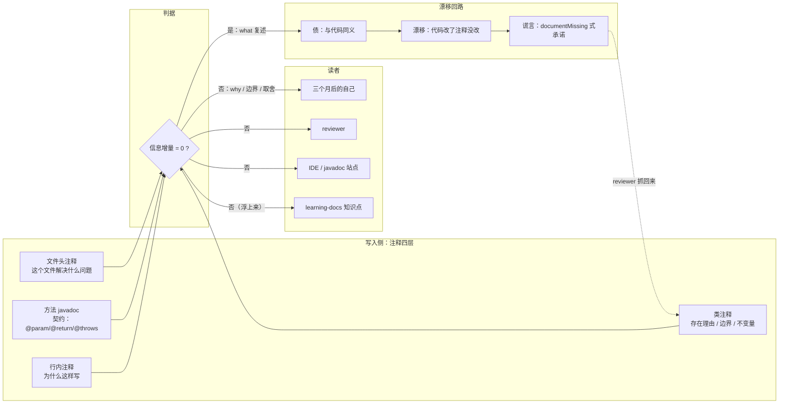
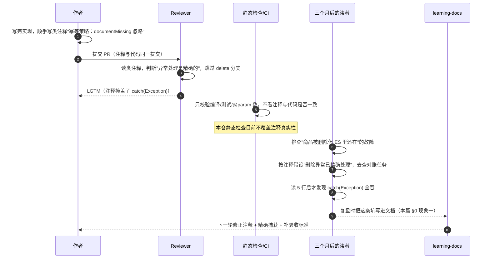

# 代码注释与知识点解析：把"三个月后的自己"当成第一读者

> **一句话结论**：注释的价值不来自覆盖了多少行，而来自它写下了代码本身表达不了的四类证据——为什么这么设计、边界在哪、放弃了什么、哪个坑踩过；只复述代码的注释是负债，因为它会随代码漂移，并把读者带向错误结论。
> **阅读前置**：会读 Java 与 javadoc（`/** ... */` 块）；知道本项目 12 个模块的分工（见 [README](README.md)）；建议先读 [Spring AI 2.1.0 RAG 精读](../24-源码分析/06-SpringAI/02-工具调用与RAG/02-rag-questionanswer-与-检索增强.md)，那里练过"读源码、写锚点"的同一套动作。
> **证据基线**：Spring AI 2.1.0 源码摘录 908 份（`24-源码分析/assets/source/`，A 级锚点行号＝摘录内原始行号）＋ 本项目 main 源码 521 个文件 / 35553 行的实测统计（C 级，命令与真实输出随文给出）；git 基线 `f46af4a`（2026-11-26）。本机无 docker/redis/mysql/chroma，本篇全部实测都是静态读取，不启动任何服务、不联网。预计阅读 45~60 分钟。

---

## 0. 先看现象

结论先行：注释腐烂不是"文笔不好"，而是结构性的——**代码是可执行的、注释是不可执行的**，所以代码改错会红，注释改错永远没人拦。下面四个现象全部来自本仓真实代码，可以逐条复现。

### 现象一：注释承诺"只忽略一种异常"，代码实际吞掉了全部异常

`ai-cs-search/src/main/java/com/aics/search/cdc/ProductCdcConsumer.java#L14-L19`

```java
/**
 * MySQL product 表 CDC → Elasticsearch 商品目录索引。
 *
 * <p>幂等策略：ES document id 固定为 product.id，同一条 INSERT/UPDATE 重放均是覆盖 upsert；
 * DELETE 反复执行时 documentMissing 忽略。Canal 事件的最终一致性由定时对账兜底。</p>
 */
```

这段类注释信息密度很高，结构也是对的（先职责、再幂等策略、再兜底手段）。问题是它说了一句可被证伪的话：**"documentMissing 忽略"**。看同一文件 L50-L58 的实现：

`ai-cs-search/src/main/java/com/aics/search/cdc/ProductCdcConsumer.java#L50-L58`

```java
        try {
            if ("DELETE".equalsIgnoreCase(type) || "1".equals(String.valueOf(row.get("deleted")))) {
                try {
                    elasticsearchClient.delete(d -> d.index(INDEX).id(docId));
                } catch (Exception ignored) {
                    // 重复 delete/doc 不存在保持幂等
                }
                return;
            }
```

`catch (Exception ignored)` 捕获的是 `Exception`——鉴权失败、连接超时、索引名写错、集群只读，全部落进这个"保持幂等"的分支被静默丢弃。而注释承诺的范围只有"文档不存在"。

先证明 `documentMissing` 在代码里根本不存在（只在注释里出现一次）：

**C 级实测**（本机 pwsh 7，静态扫描 main 源码 521 个文件）：

```powershell
$fs=(Get-ChildItem -Recurse -File -Include *.java | Where-Object {
       $_.FullName -notmatch '\\target\\' -and $_.FullName -match '\\src\\main\\' }).FullName
$dm = Select-String -Path $fs -Pattern 'documentMissing' -CaseSensitive
"命中行数: $($dm.Count)"
$dm | ForEach-Object { "$($_.Path.Replace($PWD.Path+'\',''))#L$($_.LineNumber): $($_.Line.Trim())" }
```

```text
命中行数: 1
ai-cs-search\src\main\java\com\aics\search\cdc\ProductCdcConsumer.java#L18: * DELETE 反复执行时 documentMissing 忽略。Canal 事件的最终一致性由定时对账兜底。</p>
```

怎么读这份输出：命中 1 次，位置在 `#L18`，也就是注释本身。**代码里 0 处**——所谓"documentMissing 忽略"没有任何实现支撑，它是一个只存在于注释里的承诺。这类注释比没有注释更危险：读者会据此认为"删除路径的异常处理是精确的"，从而不去看那 5 行 `catch`。

### 现象二：方法注释只写了 5 个参数里的 2 个

`ai-cs-chat/src/main/java/com/aics/chat/service/impl/ChatServiceImpl.java#L405-L412`

```java
    /**
     * RAG 对话（支持 Hybrid / 查询改写增强）。
     *
     * @param hybrid  是否启用 ES+向量混合检索（默认 false 保持纯向量）
     * @param rewrite 是否启用查询改写/HyDE（默认 false）
     */
    public Result<ChatRagResponseDTO> chatWithRag(String sessionId, String message, String knowledgeBase,
                                                  boolean hybrid, boolean rewrite) {
```

javadoc 只有两个 `@param`，方法签名有五个参数，且没有 `@return`。IDE 里鼠标悬停只看得到这两个参数说明，调用方很容易写出 `chatWithRag(msg, kb)` 这种顺序错位的调用，然后靠编译错误或线上日志来发现。

用脚本把这类问题批量捞出来（手法细节在 §6）：main 源码里可解析且 javadoc 含 `@param` 的方法 105 个，报疑似漏参数 25 处，其中真实的一条就是上面这个 `chatWithRag`（另有多条是泛型 `Map<String, X>` 被逗号切分造成的误判——这一点本身也是结论，见 §6）。

### 现象三：类注释是类名的中文复述

`ai-cs-common/src/main/java/com/aics/common/exception/GlobalExceptionHandler.java#L24-L34`

```java
/**
 * 全局异常处理器
 */
@RestControllerAdvice
public class GlobalExceptionHandler {
...
    /**
     * 业务异常
     */
```

`/** 全局异常处理器 */` 对"全局异常处理器"这个类名没有增加一个比特的信息；`/** 业务异常 */` 同理。这个类真正需要注释的地方是：**十几个 `@ExceptionHandler` 之间的匹配优先级**（Spring 选最具体的异常类型）、**为什么每种异常配不同的 `@ResponseStatus`**、**兜底 `Exception` 与各专项处理器的边界**。这些一个都没写。

同文件里并非没有好注释——L81-L83 写的是：

```java
    /**
     * 路径或查询参数类型错误（例如 Long ID 收到 abc）：客户端输入错误。
     */
```

这条有价值，因为它写的是**边界和判据**（例如 "Long ID 收到 abc" 明确了触发条件），而不只是"方法名翻译"。同一个文件里三种注释质量并存，说明问题不是"作者不会写"，而是"没有判据决定写什么"。

再补一个更锋利的数据：模型路由是本项目 AI 链路的核心包，而它有 15 个文件、只有 1 个含 javadoc：

```powershell
$mr = Get-ChildItem ai-cs-chat\src\main\java\com\aics\chat\modelrouter -File -Filter *.java
"$($mr.Count) 个文件，含 /** 的: $(($mr | Where-Object { Select-String -Path $_.FullName -Pattern '/\*\*' -Quiet }).Count)"
```

```text
15 个文件，含 /** 的: 1
```

但请注意——`ai-cs-chat/src/main/java/com/aics/chat/modelrouter/ModelRouter.java` 虽然 0 个 javadoc，行内注释质量却很高（L29、L37 两处"设计要点"直接写清了路由为什么不用 LLM 判断、为什么先过滤后取链）。所以"javadoc 覆盖率"这个指标单独看会得出错误结论，这一点在 §6 会正面讨论。

### 现象四：并发工具类不写不变量，读者只能靠猜

本仓用了并发原语的 main 文件有 21 个，其中文本里出现过"并发/线程安全/不变量/原子"的只有 10 个：

```powershell
$conc = $fs | Where-Object { Select-String -Path $_ -Pattern 'ReentrantLock|synchronized|AtomicInteger|AtomicLong|ConcurrentHashMap|volatile' -CaseSensitive -Quiet }
"使用了并发原语的 main 文件: $($conc.Count)"
$hit = $conc | Where-Object { Select-String -Path $_ -Pattern '并发|线程安全|不变量|可见性|原子' -Quiet }
"其中文本提到 并发/线程安全/不变量/原子: $($hit.Count)"
```

```text
使用了并发原语的 main 文件: 21
其中文本提到 并发/线程安全/不变量/原子: 10
```

反面看这组数字：11 个文件用了 `ConcurrentHashMap`/`AtomicInteger` 却一个字都没说不变量与竞态假设。正面再看一眼 `ai-cs-gateway/src/main/java/com/aics/gateway/loadbalancer/InstanceInFlightRegistry.java#L43`——它把不变量压缩成一行：

```java
    /** 请求结束时 -1（不低于 0，防御 doFinally 重复触发） */
```

这一行同时说了"做什么"和"为什么这么防御"。有这一行，reviewer 就不会问"为什么要 `Math.max(0, ...)`"；没有这一行，下一个人可能把它"优化"成 `decrementAndGet()`，然后计数器在客户端断连时越减越负。

**这些现象指向同一件事**：注释失效不是写作水平问题，而是缺少一套判据（写什么/写在哪一层）+ 一条反馈回路（怎么发现它已经错了）。判据决定上限，回路决定下限；下面第 1 节给判据，第 4 节给回路。

---

## 1. 整体地图

注释体系可以拆成"四层写入"、"一个判据"、"四类读者"、"一条漂移回路"。先看全景，再看每层该写什么。



组件与责任的对照：

| 层次 | 典型落点 | 该写什么 | 不该写什么 | 主要读者 | 失效后果 |
|---|---|---|---|---|---|
| 文件头 | 文件第 1~15 行 | 这个文件负责什么、与哪些文件成对出现、阅读顺序建议 | 作者、日期、修改记录（git 已有） | 新人、模块外人 | 无法建立模块心智模型 |
| 类注释 | 类型声明之上 | 存在理由、上下游、刻意不做什么、关键不变量、`@since` | 类名的中文翻译 | reviewer、调用方 | 读者必须读完整实现才能改一行 |
| 方法 javadoc | 方法签名之上 | 契约：参数含义与取值、返回值语义、异常触发条件、副作用与幂等性 | 实现步骤的复述 | IDE 悬停者、接口实现者 | 调用方误用（参数错位、空值、重试误判） |
| 行内注释 | 语句之上 | 为什么这样写、这里必须成立的前提、放弃的替代方案 | `i++ // i 加 1` 式翻译 | 修改这一行的人 | 有人"优化"掉一段有原因的代码 |

> **读图说明**：
> 1. 全图只有一个判据节点 `Q{信息增量 = 0 ?}`，四层注释全部汇入它——**注释该不该写，与它写在哪一层无关，只与它是否带来了代码之外的增量信息有关**。看错这条箭头的人会去追求"每一层都要写"，结果是注释密度 26.1% 但 `@throws` 全仓只有 4 处（真实统计见 §3.2）。
> 2. 底部 `L1 → L2 → L3` 是漂移回路：同义反复的注释不只是"没用"，它会**先漂移、再变成谎言**（`documentMissing` 就是这条路径的终点），而唯一的阻断点是那条虚线——reviewer/静态检查把谎言抓回类注释。看错这条虚线的人会以为"写了注释就安全了"，但本仓实测证明：注释与它描述的代码可以来自同一次提交（§6 手法四），也就是说错误是**写下时就存在**的，不会自动被后续 review 发现。

---

## 2. 关键概念与关键类

先把术语钉死，后面所有讨论都用这套词。

| 名称 | 位置（证据） | 角色 | 关键方法 / 判据 |
|---|---|---|---|
| javadoc | `24-源码分析/assets/source/SessionService.java.md#L30-L40` | 可被 `javadoc` 工具抽取成 HTML、可被 IDE 悬停显示的注释，是**唯一有工具链的注释** | 一行摘要 + 空行 + 细节 + 标签块 |
| 结构化标签 | 同上 `#L129-L142` | `@param`/`@return`/`@throws`/`@since`/`@see`/`@author`/`@deprecated`，把"契约"变成可校验字段 | `@param name 说明`（名字必须与签名一致） |
| 行内链接 | `Document.java.md#L41-L43` | `{@link #getText()}`、`{@code ...}` 让注释与被引用的真实符号绑死，重构时 IDE 会一起改 | `{@link 类型#成员}` |
| 信息增量（判据） | 本篇定义，用 §0 四例校准 | 注释相对代码新增的、不能从代码直接读出的信息 | 替换法：把注释翻译回代码，若与原代码同义则增量为 0 |
| 注释漂移（drift） | `ChatServiceImpl.java#L405-L410`（写下即错）、`ProductCdcConsumer.java#L17-L18`（承诺越界） | 注释与实现已经不一致，且没有任何机制会报错 | 用 `git blame` 比对注释行与代码行的提交（§6 手法四） |
| 不变量 | `InstanceInFlightRegistry.java#L43` | 在方法/类的整个生命周期内必须始终为真的断言 | "计数不低于 0，因为 `doFinally` 可能重复触发" |
| 哨兵值 | `ToolCallLimits.java.md#L39-L42`（`NO_LIMIT = -1`） | 用一个保留值表达"无限制/未设置"，语义必须写进注释否则必被误用 | 注释写"Sentinel value meaning that no limit is enforced" |
| fail-open / fail-closed | `DecisionDocumentFilter.java.md#L209` | 依赖失效时"放行"还是"拦截"的策略选择，两者都必须留痕 | 注释必须写"为什么选它 + 为什么不能静默" |
| CAS / 版本前置条件 | `SessionService.java.md#L119-L143` | compare-and-set：只有日志版本没变才写入；注释要写清"检查顺序" | `expectedVersion` + 返回 `false` 的含义 |
| TODO / FIXME / XXX | 本仓 3 处 TODO，详见 §3.7 | 已知未完成事项的标记；无 owner 无期限就等于没有 | 建议格式 `TODO(owner, yyyy-mm, issue)` |
| ADR | 本仓未见 ADR 目录（未落地） | Architecture Decision Record：一次架构决策的独立记录 | 注释里应留指向 ADR 的指针，而不是把决策全文塞进注释 |
| 证据锚点 | `learning-docs/_templates/写作规范.md` | 把注释/源码位置写成 `文件#L起-L止`，让任何结论可被点击验证 | 行号必须真实、范围必须覆盖结论 |

关键"类"（本篇真正的主角是这几段注释本身，而不是业务类）：

| 名称 | 位置 | 角色 | 关键点 |
|---|---|---|---|
| `SessionService` 接口注释 | `SessionService.java.md#L30-L40` | 类级注释的黄金样板：一句话说清职责范围 + `{@link}` 指向实现 + `@since 2.1.0` | 摘要行写到 6 行就停，细节留给方法 |
| `SessionService#appendEvents` | `SessionService.java.md#L119-L143` | 方法 javadoc 的黄金样板：契约 + 读写协议 + 异常 + **检查顺序** | `@throws` 里明说"系统消息检查先于版本检查" |
| `DecisionDocumentFilter` 行内注释 | `DecisionDocumentFilter.java.md#L171`、`#L200`、`#L209` | 行内注释的黄金样板：三条都是"为什么"，没有一条是"是什么" | 其中一条写"手抄 metadata 的原因"（`mutate()` 共享原 Map） |
| `ToolCallLimits` | `ToolCallLimits.java.md#L30-L42` | 包私有类 + 哨兵常量，注释把魔法值语义钉死 | `@since 2.0.1` 标出引入版本 |
| `GlobalExceptionHandler` | `ai-cs-common/src/main/java/com/aics/common/exception/GlobalExceptionHandler.java#L24-L148` | 反例集合：10 处"名词复述"与 2 处好注释并存 | 对比 L81-L83 与 L32-L34 的差别 |
| `ProductCdcConsumer` | `ai-cs-search/src/main/java/com/aics/search/cdc/ProductCdcConsumer.java#L14-L64` | 反例：注释承诺 ≠ 实现；但同文件 L61-L64 是正面样板 | "抛出使 RocketMQ 重试"解释了为什么必须抛 |
| `InstanceInFlightRegistry` | `ai-cs-gateway/src/main/java/com/aics/gateway/loadbalancer/InstanceInFlightRegistry.java#L9-L55` | 并发工具类注释的样板：不变量 + 覆盖路径 + 单机局限 | `decrement` 的"不低于 0" |

---

## 3. 原理与证据逐段精读

下面八段，每段都用同一套四层结构：**在干什么 → 为什么这么设计 → 换写法会怎样 → 常见坑**。前三层给判据，第四层给本仓真实反例。

### 3.1 文件头 / 类注释：写"这个类存在的理由与它放弃了什么"

**在干什么**：类注释回答四个问题——这个类型为什么存在（职责）、它在链路里的位置（上下游）、它刻意不做什么（边界）、它的不变量是什么（约束）。Spring AI 2.1.0 把这件事做得极其克制：

```java
/**
 * The sessions of an application and their conversations: creating and finding sessions,
 * appending, reading and searching their events, compacting them. {@link #appendEvent}
 * appends one event. {@link #appendEvents(String, List, long)} appends a batch only if
 * the log has not changed since the caller read its version. Compaction writes this way,
 * and so can any other code that builds events from the log.
 * {@link DefaultSessionService} implements it on a {@link SessionRepository}.
 *
 * @author Christian Tzolov
 * @since 2.1.0
 */
```

(src: SessionService.java.md#L30-L40)

六行摘要里出现了四次 `{@link}`：`#appendEvent`、`#appendEvents`、`DefaultSessionService`、`SessionRepository`。这不是装饰——**它把"这个接口、它的实现、它的存储抽象"三者的关系写进了可跳转的链接**，读者点两下就建立了模块心智模型，不用 grep。

**为什么这么设计**：类型名 + 包名已经表达了"它是什么"（`org.springframework.ai.session.SessionService` 一眼就懂），注释再复述一遍等于零信息。真正会丢失、且代码无法表达的是三件事：①**范围边界**（这个接口管会话与事件，不管上下文压缩策略本身）；②**实现关系**（谁实现哪个抽象）；③**版本坐标**（`@since 2.1.0` 告诉你"这段 API 在 1.x 里不存在"）。

**如果改成别的会怎样**：若写成 `/** 会话服务 */`，读者必须在 IDE 里按 F4 看实现、按 Ctrl+H 看层级，才能重建同样的信息，成本从 5 秒变成 5 分钟——而且看完之后他不会把这 5 分钟还给你。

**常见坑**：把类注释写成变更日志（"2026-08-07 张三添加 xxx"）。git 已经记录了作者、时间、原因，写进注释等于把一份只增不减、永不合并的历史塞进每个人的编辑视野。本仓出现了相反版本的问题：`ai-cs-chat/src/main/java/com/aics/chat/config/CorsConfig.java#L14` 把一条决策藏进了一行注释——

```java
// @Configuration  // CORS 统一由网关处理，避免重复响应头导致浏览器 Network Error（2026-08-07）
```

这条信息（为什么禁用、事故日期）**质量很高，但它放错了地方**：任何一次清理"注释掉的代码"的提交都会把它删掉，而它本该是一条 ADR 或 `docs/` 里的故障记录。判据是：**注释承载的决策越贵，越该出去独立成文，注释里只留一行指针**。本仓目前没有 ADR 目录，这一条属于明确未落地项（改进清单见 §5）。

### 3.2 方法签名 javadoc：写契约，不写实现步骤

**在干什么**：方法 javadoc 是**调用方与实现之间的合同**：参数含义与取值域、返回值语义、异常触发条件、副作用、是否幂等。Spring AI 的 `appendEvents` 是这个层次的样板：

```java
	/**
	 * Appends one or more events in order, atomically, only if the log's version still
	 * equals {@code expectedVersion}. Otherwise nothing is written and {@code false} is
	 * returned: another writer appended in between. On success the version advances once,
	 * whatever the number of events. This is the compare-and-set of the log, as
	 * {@link SessionRepository#appendEvents} defines it.
	 * <p>
	 * Read {@link #getEventVersion}, then read what the new events depend on, then call
	 * this method. On {@code false}, read again and rebuild the events. Compaction writes
	 * its boundary and summaries this way.
	 * @param sessionId the session whose log is appended to; every event must belong to
	 * it
	 * @param events the events to append, oldest first; at least one, with ids that are
	 * new to the log
	 * @param expectedVersion the version read before the events were prepared
	 * @return {@code true} when the events were appended, {@code false} when the log
	 * moved on and nothing was written
	 * @throws IllegalArgumentException if the session does not exist, the batch is empty,
	 * an event belongs to another session, an id is already in the log or appears twice,
	 * or an event holds a system message that {@link #appendEvent} would reject. The
	 * system message check runs before the version check. The other checks may run only
	 * when the version matches, so a stale version can return {@code false} for a batch
	 * that would otherwise throw.
	 */
	boolean appendEvents(String sessionId, List<SessionEvent> events, long expectedVersion);
```

(src: SessionService.java.md#L119-L143)

注意最后那句 `@throws` 的后半段：**"系统消息检查先于版本检查；其余检查只在版本匹配时才跑，所以一个过期版本可以让本该抛异常的批次安静返回 false"**。这是纯粹的程序员陷阱，代码读一百遍也可能漏掉，写在这里一次就永久有效。

**为什么这么设计**：契约必须在**签名处**说清，因为调用方看的就是签名处（IDE 悬停、javadoc 页面）。而"检查顺序"这种实现细节之所以要进 javadoc，是因为它**可观测**——它决定了调用方能观察到什么异常、什么返回值。判据：**凡是调用方能观测到的实现特征，都是契约，不是细节**。

**如果改成别的会怎样**：只写 `@param hybrid 是否启用混合检索` 这类"参数名翻译"，遇到空值、边界、顺序问题就会失传。本仓 `ChatServiceImpl#L405-L410` 更进一步——它只写了 5 个参数里的 2 个，等于对外宣布"这个方法的参数就是 hybrid 和 rewrite"，比不写更糟。

本仓结构化标签的真实分布（main 源码 521 个文件，区分大小写）：

```text
@param       498
@return      194
@throws      4
@since       0
@see         5
@deprecated  0
{@link       327
@author      0
```

怎么读：`@param` 498 对 `@return` 194，比例失衡说明不少方法只写了入参不写返回；`@throws` 只有 4 处，而 main 里 `throw new` 与 `catch` 大量存在——**异常路径基本没有契约描述**（这正是 §3.6 的主题）；`@since` 为 0 意味着没有任何注释记录"这个 API 从哪个版本开始存在"，跨版本升级（比如 1.x→2.1.0 的 Session 体系）时无法从代码侧判断可用性。

**常见坑**：把 `@param` 写成"新增参数 abc"（相对某次提交而言）。这种以"变更"为参照的写法三个月后必然失效——读者不知道基线是哪个版本。写法要以"当前状态"为参照：`@param abc 作用 + 取值 + 默认值`。

### 3.3 行内注释：只解释"为什么"，而且只解释当下这一行

**在干什么**：行内注释服务于"即将修改这一行的人"，它要回答的是**代码为什么长这样**：为什么必须手抄一份 Map、为什么在这里放行、为什么这个分支不能抛。

Spring AI 的 `DecisionDocumentFilter` 连写三条，条条是"为什么"：

```java
			// The injection answer is checked on its own, because it alone decides
			// whether the passage may be read at all. A refusal of another question must
			// not hide a clear injection answer, and under failClosed it must not drop a
			// passage the injection answer has cleared.
			String notScreened = outcome.unanswered(CONTAINS_PROMPT_INJECTION);
```

(src: DecisionDocumentFilter.java.md#L171-L175)

```java
				// The map is copied by hand: Document.mutate() shares the original
				// metadata map, so metadata(key, value) would write into the caller's
				// document.
				Map<String, Object> metadata = new LinkedHashMap<>(document.getMetadata());
				metadata.put(CLASSIFICATION_METADATA_KEY, classification.name());
				kept.add(document.mutate().metadata(metadata).build());
```

(src: DecisionDocumentFilter.java.md#L200-L205)

第二段尤其值得抄：`new LinkedHashMap<>(document.getMetadata())` 这一行在不知道背景时看起来"多此一举"（为什么不直接 `mutate().metadata(key, value)`？），下一个人很可能把它简化掉，然后就产生了"过滤器的副作用悄悄改了调用方文档"这种极难定位的 bug。这条注释把**后果**写出来了，而不是把**动作**翻译一遍（"复制 metadata"是动作，没有增量；"因为 mutate 共享原 Map，直接写会污染调用方文档"才有增量）。

本仓同类的正面样例在订单链路：

`ai-cs-order/src/main/java/com/aics/order/service/impl/OrderCreateTxService.java#L87-L92`

```java
        // 2. 实时扣减库存（以商品服务 DB 为权威源，原子扣减）
        // 学习要点（Seata AT）：全局事务的提交分两阶段，分支事务在本地提交后
        // 由 TC 异步驱动回滚；MQ 不是 Seata 资源，全局回滚时下方延迟消息已发出——
        // 但消费侧 cancelExpiredOrder 查不到订单会直接返回，天然幂等安全。
```

这条注释写的是"**分布式事务与消息的边界**"：MQ 不参与 Seata 回滚，所以只能靠消费侧幂等兜住。这是整段代码里最贵的一条知识，代码本身完全表达不出来。

**为什么这么设计**：方法注释解释"整体契约"，行内注释解释"局部反直觉"。局部注释的判据是**删除测试**：把这一行删掉，下一个修改者会不会做出错误的"优化"？会 → 必须写；不会 → 别写。

**如果改成别的会怎样**：写成 `// 复制 metadata` 就完全没有价值；写成 `i++ // i 加 1` 则是负价值——它训练读者跳过注释。本仓还有一类更隐蔽的低价值注释：以动词开头、把下一行代码翻译一遍。

```powershell
$m = Select-String -Path $fs -Pattern '^\s*//\s*(获取|设置|调用|查询|遍历|返回|判断|创建|更新|删除|保存|执行|构建|初始化|校验|加载|发送)'
"命中: $($m.Count) 行"
$m | Get-Random -Count 3 | ForEach-Object { "$($_.Path.Replace($PWD.Path+'\',''))#L$($_.LineNumber): $($_.Line.Trim())" }
```

```text
命中: 44 行
ai-cs-gateway\src\main\java\com\aics\gateway\filter\AuthFilter.java#L123: // 获取 Token
ai-cs-user\src\main\java\com\aics\user\service\impl\UserServiceImpl.java#L79: // 查询用户
ai-cs-chat\src\main\java\com\aics\chat\service\impl\VisionModelClient.java#L164: // 返回 Future 供 @TimeLimiter 通过 Future.get(timeout) 实现 5s 超时控制
```

怎么读这 44 行：**形状一样，价值天差地别**。前两条是零增量（"获取 Token"= `getToken()` 的翻译），第三条同样以"返回"开头，却解释了"为什么这里要返回 Future"（配合 `@TimeLimiter` 的 `Future.get(timeout)` 才能做 5s 超时）——这是一个**被框架约束出来的写法**，不写注释下一个人会想把它改成同步调用。结论：**不要用模式匹配判好坏**（这也是 §6 那个静态检查脚本的局限）。

**常见坑**：注释描述"当前实现选择的参数值"。比如注释说"重试 3 次"，代码里是 `retry(3)` 常量——一旦调整常量，注释就成谎言。更好的写法是注释写"为什么重试有限次（流式响应不可重试，重试会重复输出）"，而把具体数字留给常量名。

### 3.4 常量的注释：把魔法值的语义钉死

**在干什么**：常量注释只干一件事——**解释这个值为什么是这个值，以及它的语义边界**。Spring AI 有两处教科书式写法：

```java
	/**
	 * Similarity threshold that accepts all search scores. A threshold value of 0.0 means
	 * any similarity is accepted or disable the similarity threshold filtering. A
	 * threshold value of 1.0 means an exact match is required.
	 */
	public static final double SIMILARITY_THRESHOLD_ACCEPT_ALL = 0.0;
```

(src: SearchRequest.java.md#L39-L44)

```java
	/**
	 * Sentinel value meaning that no limit is enforced.
	 */
	static final int NO_LIMIT = -1;
```

(src: ToolCallLimits.java.md#L39-L42)

`NO_LIMIT = -1` 单独看是个灾难（`-1` 到底是"不限制"还是"非法值"？），加上那一行注释就变成了协议。**哨兵值（sentinel value，用一个保留的特殊值表达"没有设置/不限制"）必须注释，否则必被当成正常数值参与运算。**

**为什么这么设计**：常量的名字能表达"是什么"（`SIMILARITY_THRESHOLD_ACCEPT_ALL` 已经很强了），但表达不了**极端端的语义**：0.0 是"接受所有"，那 1.0 呢？注释把两端都说了，还顺手说明"设为 0.0 等价于关闭阈值过滤"。

**如果改成别的会怎样**：不写，就会有人把阈值配成 `0.0` 以为"最严格"，结果检索全量放行——这是 RAG 里最常见的线上事故之一（本仓阈值在 `ai-cs-chat/src/main/java/com/aics/chat/cache/CacheProperties.java#L30-L33`，语义缓存的 0.92 与检索阈值是两回事，混用会答非所问）。

**常见坑**：注释里的数字与配置类默认值不一致。这一项可以自动核对（§6 手法三）：

```text
注释  L26: *       最高分 ≥ 阈值（默认 0.92）即视为"相似问题"，直接返回缓存回答；</li>
注释  L27: *   <li><b>淘汰</b>：条目数超过上限（默认 200/知识库）时，按最近命中时间淘汰最旧条目；
配置  L31: private double threshold = 0.92;
配置  L33: private int maxEntries = 200;
配置  L43: private int promoteThreshold = 3;
注释  L23: *   <li><b>热度提升</b>：频次达到阈值（默认 3 次）时，把当前回答写入 Hash
```

这四条对得上（0.92 / 200 / 3），说明 `HotQaCacheService` 与 `SemanticCacheService` 的类注释是**当前真实的**。这类"注释里写默认值"的写法是有代价的（每个默认值多一处需要同步的地方），但比"读者不知道默认值"要好；折中做法是注释写"默认值见 `CacheProperties.Semantic#threshold`"，把数字收敛到一处。

### 3.5 并发代码：必须写不变量与锁顺序

**在干什么**：并发代码的注释只有两个主题——**不变量**（任何时候都必须成立的条件）和**锁顺序**（多把锁的获取顺序，防死锁）。

本仓的最佳样本是 `InstanceInFlightRegistry`（最少连接负载均衡的计数依赖）：

```java
/**
 * 实例在途请求计数器（最少连接负载均衡的依赖）。
 *
 * <p>记录每个下游实例当前正在处理的请求数：请求进入时 +1、响应结束（含异常/取消）时 -1。
 * 由 {@link InstanceInFlightFilter} 在负载均衡决策之后维护，
 * {@link LeastConnectionsLoadBalancer} 决策时读取最小值。</p>
 *
 * <h3>学习点：为什么最少连接需要全局计数器</h3>
 * <ul>
 *   <li>轮询只看"历史分发次数"，不看实例的真实负载——慢实例会积压在途请求；
 *       最少连接看"当前正在处理的请求数"，天然把新请求导向更空闲的实例。</li>
 *   <li>计数必须覆盖请求完整生命周期：用 {@code chain.filter(...).doFinally(...)}
 *       挂在响应终结信号上，正常完成/异常/客户端断开三条路径都会 -1，不泄漏计数。</li>
 *   <li>该实现为单实例内存版：网关多副本部署时各副本只见自己的在途数，
 *       属"每副本最少连接"，仍是负载感知的近似；跨副本精确统计需引入共享存储（如 Redis），
 *       但引入的读写延迟往往得不偿失。</li>
 * </ul>
 */
```

`ai-cs-gateway/src/main/java/com/aics/gateway/loadbalancer/InstanceInFlightRegistry.java#L9-L26`

这段注释覆盖了并发类的三件要紧事：①**不变量**（三条终结路径都必须 -1）；②**前提**（计数在决策之后维护，读的是"最小值"）；③**局限与取舍**（单机内存版，跨副本精确统计的代价高于收益）。第三点尤其重要——它**阻止了下一个人去做一件看起来正确但得不偿失的优化**（用 Redis 换精确计数）。

再往下看方法级，一行注释就解释了防御性代码的存在理由：

`ai-cs-gateway/src/main/java/com/aics/gateway/loadbalancer/InstanceInFlightRegistry.java#L43-L49`

```java
    /** 请求结束时 -1（不低于 0，防御 doFinally 重复触发） */
    public void decrement(String key) {
        AtomicInteger counter = counters.get(key);
        if (counter != null) {
            counter.updateAndGet(current -> Math.max(0, current - 1));
        }
    }
```

**为什么这么设计**：并发代码的正确性依赖"读者知道全局约束"——而这恰恰是代码里最不显眼的部分（`Math.max(0, ...)` 看起来是冗余保护，`doFinally` 可能重复触发这条知识不在这一行上）。不写，下一个人删掉 `Math.max` 就引入一个"计数器越减越负 → 负载均衡永远选错实例"的线上问题，而且几乎无法从症状反推原因。

**如果改成别的会怎样**：写成"计数器减一"就是零增量；写成"防止并发问题"是假解释（哪一类并发问题？）。判据：**好的并发注释能被翻译成一条可断言的测试**——"计数永不为负"完全可以写成断言，本仓正是这么想的，所以这条注释是可信的。

锁顺序方面，本仓的真实取舍写在订单链路的类注释里：

`ai-cs-order/src/main/java/com/aics/order/service/impl/OrderCreateTxService.java#L34-L45`

```java
/**
 * 下单事务边界（独立 Bean）。
 *
 * <p><b>为什么单独拆一个类</b>：{@code @Transactional} 与 {@code @GlobalTransactional}
 * 都依赖 Spring 代理，只有「外部调用方 → 代理 → 目标方法」这条路径才会开启事务。
 * 若放在 {@link OrderServiceImpl} 里由 {@code createOrder} 直接 {@code this.doCreateOrder(...)} 调用，
 * 会绕过代理导致事务注解失效（该问题由 {@code OrderCreateTxWiringTest} 复现并回归，
 * 详见 docs/28 故障案例 C1）。</p>
 *
 * <p>拆成独立 Bean 后，{@link OrderServiceImpl#createOrder} 注入本类并调用，
 * 代理生效，事务边界才成立；分布式锁仍然留在事务外层，避免锁持有时间等于事务时间。</p>
 */
```

最后一句"分布式锁留在事务外层，避免锁持有时间等于事务时间"就是一条**顺序性不变量**：锁必须在事务之外（先加锁→再开事务→提交→解锁），否则锁的持有时长会被事务的提交/回滚放大，吞吐直接崩。这条注释还做了三件加分的事：引用了能复现问题的测试类、引用了故障案例文档编号、明确点名了被禁止的写法（`this.doCreateOrder(...)`）。**注释里能点名的证据都真实存在**（`OrderCreateTxWiringTest` 与 `docs/28-故障案例库.md` 均已在仓内核对），这类注释才叫"可查证"。

**常见坑**：并发类注释只写"线程安全"三个字。它不是结论而是断言，必须紧跟"为什么安全"（用不可变对象？用 `ConcurrentHashMap` 的原子复合操作？用外部串行化？）。本仓 21 个使用并发原语的文件里只有 10 个出现相关关键词（§0 现象四），剩下的都需要补。

### 3.6 异常路径注释：为什么吞、为什么抛、为什么在这里转

**在干什么**：异常路径注释回答三个问题——这个 `catch` 为什么能吞（谁兜底）、这个 `throw` 为什么必须抛（谁重试）、这个异常为什么在这层转成业务错误码。

同一个文件里，正反两个例子挨在一起：

`ai-cs-search/src/main/java/com/aics/search/cdc/ProductCdcConsumer.java#L50-L64`

```java
            if ("DELETE".equalsIgnoreCase(type) || "1".equals(String.valueOf(row.get("deleted")))) {
                try {
                    elasticsearchClient.delete(d -> d.index(INDEX).id(docId));
                } catch (Exception ignored) {
                    // 重复 delete/doc 不存在保持幂等
                }
                return;
            }
            elasticsearchClient.index(i -> i.index(INDEX).id(docId).document(row));
            log.debug("CDC 商品索引 upsert: id={}", docId);
        } catch (Exception e) {
            // 抛出使 RocketMQ 重试；ES 暂时不可用不允许静默丢消息
            throw new IllegalStateException("CDC 商品索引同步失败: id=" + docId, e);
        }
```

L61-L63 是**教科书级好注释**：它说清了"为什么必须抛"（RocketMQ 靠异常触发重试，静默丢消息是不可接受的），一句话同时给出机制与代价。L54-L56 是**教科书级坏注释**：它声称只吞"重复删除"，实际吞掉 `Exception` 全集。

**为什么这么设计**：`catch` 是代码里信息最容易被"省掉"的地方——写 `catch (Exception ignored)` 的人心里其实有明确理由（"删除不存在的文档会报错，报错说明已经删了"），但理由没有落到代码上，下一个维护者只看到"这里什么都吞"。规范只有一条：**每一个 `catch` 必须能回答"我吞的是哪一类失败，为什么它可以被吞，最坏后果是什么"**。

**如果改成别的会怎样**：把 `catch (Exception ignored)` 改成"精确捕获"会怎样？以 Elasticsearch Java Client 为例，删除不存在的文档不一定抛异常（取决于版本与 `refresh` 语义），真正需要静默的是"目标已不存在"这一类**可判定**的结果。可行写法是：先在注释里写清"只忽略 404/`document_missing`"，代码里判 `e.getMessage()` 或状态码，其它异常照抛——这样就与注释承诺对齐了。这正是本仓待修项，验收标准见 §9 练习三。

**常见坑**：在 `catch` 里写日志但不写"为什么可以继续"（读者无法判断这是容错还是遗漏）；或者把 fail-open/fail-closed 的选择埋在代码里不留痕。Spring AI 的写法值得抄：

```java
			// Failing open must not be silent. With a bad API key or an outage every
			// passage lands here, and without the warning the injection screen would
			// look as if it had run.
			logger.warn("Could not screen {} of {} documents, {}: {}", unscreened, documents.size(),
					this.failClosed ? "withholding them" : "passing them through unscreened", firstUnscreenedReason);
```

(src: DecisionDocumentFilter.java.md#L209-L213)

它解释了"为什么降级必须打日志"——**否则截屏（注入检测）看起来像是执行过了**。这是可观测性层面的理由，不是"打个日志方便排查"这种空话。本仓的对应正面样例是 `ai-cs-chat/src/main/java/com/aics/chat/cache/HotQaCacheService.java#L76` 的 `// 缓存层任何故障都不阻断业务，退化为正常 RAG 流程`——一句话把 fail-open 策略钉死。

### 3.7 TODO / FIXME / XXX：标记不是文档，必须带清除机制

**在干什么**：TODO 标记"已知未完成"，FIXME 标记"已知有错但不修"，XXX 标记"这里可疑"。三者的共同点是**它们都是债，不是成就**。

本仓的真实分布（区分大小写，含测试代码）：TODO **3** 处、FIXME **0** 处、HACK **0** 处、XXX **1** 处（且那一处是测试数据 `dto.setActionType("XXX")`，不是标记）。三条 TODO 全部集中在支付渠道桩：

```text
ai-cs-pay\src\main\java\com\aics\pay\channel\MockPayChannel.java#L65: // TODO: 真实渠道在这里验签（微信 v3 验签+解密 / 支付宝 RSA2 验签 / 银联证书验签）
ai-cs-pay\src\main\java\com\aics\pay\channel\UnionpayChannel.java#L190: // TODO: 银联退款必须携带原消费交易 queryId（origQryId）。
ai-cs-pay\src\main\java\com\aics\pay\channel\UnionpayChannel.java#L207: /** 原交易 queryId（TODO：接入时从订单表 pay_transaction_id 读取，当前以订单号占位） */
```

这三条内容都不错（说清了缺什么、为什么需要），但**都没有 owner、没有期限、没有 issue 号**。结果就是：它们会永远留在代码里，而"支付渠道未真正对接"这个事实只会被读代码的人随机发现。

**为什么这么设计**：TODO 的作用不是"提醒自己"，而是"**在代码里建立一条可被机器扫描的未完成契约**"。因此它必须包含可执行的三元组：谁负责、什么时候必须处理、跟踪在哪里（`TODO(yexw, 2026-12, PAY-142)`）。没有这三项，它连"提醒"都做不到——因为没人会定期读全仓 TODO。

**反例的另一面**：连 Spring 自己也会留这种欠账，说明这不是项目水平问题而是行业常态：

```java
 * TODO: Document the lifecycle.
```

(src: AbstractAutoServiceRegistration.java.md#L42)

```java
		// This blows up if an aliased property is overspecified
		// FIXME annotation.getAliasedString("name", FeignClient.class, null);
```

(src: FeignClientsRegistrar.java.md#L320-L321)

第二条是**好 FIXME 的样板**：上一行写了"为什么会炸"（别名属性被重复指定），下一行标出"被注释掉的危险调用"。它同时具备问题描述与位置，唯一的欠缺同样是没有跟踪号。

**如果改成别的会怎样**：完全禁止 TODO 会让人把"未完成"藏进注释的散文里（更不可扫描）；只允许裸 TODO 会积累成噪声。折中方案（推荐落地）：①格式强制 `TODO(owner, 期限, 单号): 缺什么 + 验收条件`；②CI 里跑一条"过期 TODO 扫描"（期限早于当天的 TODO 让构建失败）；③每个季度把 TODO 清单拉进 issue 系统，代码里只保留 issue 号。

**常见坑**：用 TODO 表达"我知道但我不打算修"（那是 FIXME 或 ADR）；在 TODO 里写"以后优化性能"这种不可验收的话。判据：**每一条 TODO 都应该能直接变成一条 issue 的标题与验收标准**。

### 3.8 注释 → 知识点：让一次解释被复用 N 次

**在干什么**：把注释里反复要解释的东西"浮"到文档层，代码里只留指针。这是一条**分层复用**的设计：行内注释解决"读这一行时的困惑"，类注释解决"改这个类时的困惑"，learning-docs 解决"面试/新人培训/复盘时的困惑"。

本仓已经发生过一次完整的上浮：`ai-cs-gateway/src/main/java/com/aics/gateway/loadbalancer/InstanceInFlightRegistry.java#L16-L25` 里那段 `<h3>学习点：为什么最少连接需要全局计数器</h3>` 本质是**教学材料**（轮询 vs 最少连接的对比、三条终结路径、单机近似与 Redis 代价）。它现在住在代码里，好处是"改代码的人一定看得见"，坏处是"不读这个文件的人永远看不到"。

**为什么这么设计**：代码注释的读者是"正在改这段代码的人"，学习文档的读者是"正在建立知识体系的人"，两者不重叠。所以正确做法不是二选一，而是**让注释成为文档的源素材**：

| 注释里出现的内容 | 上浮到哪 | 代码里留什么 |
|---|---|---|
| 类注释里的"为什么这样设计 + 放弃的方案" | 本篇 / [LLM 工程化实践](01-SpringAI框架集成/02-LLM工程化实践.md) | 三行摘要 + 文档链接 |
| 行内注释里的"框架陷阱、参数语义" | [Spring AI 精读](../24-源码分析/06-SpringAI/02-工具调用与RAG/01-toolcalling-工具调用循环源码.md) | 保留原注释（它服务于改这行的人） |
| 异常路径的 fail-open 决策 | [AI 安全网关与 Guardrails](01-SpringAI框架集成/06-AI安全网关与Guardrails实现文档.md) | 一行"为什么" |
| 可观测性/成本口径 | [LLM 可观测性评估与成本治理](01-SpringAI框架集成/05-LLM可观测性评估与成本治理实现文档.md) | 口径指向文档的注释 |
| 版本迁移差异 | [Spring AI 2.0 升级评估与迁移指南](01-SpringAI框架集成/12-SpringAI-2.0升级评估与迁移指南.md) | `@since` + 迁移备注 |

**复杂算法的"论文式注释"**：本仓目前**没有**严格意义上的论文式注释（未落地），这是缺口。可抄的模板是四段式——①**问题**（这个算法要解决什么，输入输出是什么）；②**公式/判据**（距离函数、阈值、复杂度）；③**不变量**（循环内什么恒成立、退出条件为什么正确）；④**取舍**（为什么不用标准库/更强的索引）。Spring AI 的 `SearchRequest` 常量注释已经是这套结构的雏形（给了 0.0/1.0 两端语义与复杂度无关的判据）；RAG 相似度计算的公式与不变量应写在 `ai-cs-chat` 检索链路的类注释里，现状是写在 [RAG 全栈实战知识点汇总](02-RAG全栈实战/10-RAG全栈实战-知识点汇总.md) 中，代码侧只有零散行内注释。

**如果改成别的会怎样**：把知识全塞进代码注释 → 面试/复盘时没人会去 grep 源码；把知识全放文档 → 改代码的人不看文档，注释和实现继续分叉。两处都放、且代码侧只留摘要与指针，是唯一可维护的形态。

**常见坑**：文档与代码各说一套。本仓确实存在这类旧口径：旧版本文档曾把 `QuestionAnswerAdvisor` 当作默认 RAG advisor（见 [RAG 精读](../24-源码分析/06-SpringAI/02-工具调用与RAG/02-rag-questionanswer-与-检索增强.md) 与 [12-SpringAI-2.0升级评估](01-SpringAI框架集成/12-SpringAI-2.0升级评估与迁移指南.md) 的交叉核对），而 2.1.0 基线下的实际情况与旧写法不一致——这类问题**只有在文档里保留证据锚点才能被查出来**，所以引用要带 `文件#L起-L止`，而不是"据说"。

---

## 4. 一次完整执行时序：一条注释从写下到被证伪

把"注释生命周期"当一次执行来追踪：作者写下 → reviewer 校验 → 静态检查兜底 → 三个月后读者消费 → 谎言暴露 → 回灌。下面这条时序图画的是**失败的路径**（这是常态），并标出每一步是否有人拦。



> **读图说明**：
> 1. 关键箭头是第 2~5 步：**reviewer 被注释"说服"而不是被代码说服**（`R->>R` 那一句"跳过 delete 分支"）。这是注释谎言最贵的代价——它不只误导读者，还主动**抑制 review**，让一次本可拦截的问题直接合入。
> 2. 第二条关键箭头是第 6 步 `S->>S`：静态检查能查"代码块语言标注""@param 个数""路径是否存在"，但**查不出"注释说的话是否为真"**，因为真实性是语义问题。看错这条箭头的人会以为"加了 CI 就不会有假注释"，实际上 CI 只能降低**形状类**缺陷。

哪一步失败会报什么错（把这条链路的失败模式列清，方便定位自己卡在哪一步）：

| 步骤 | 失败表现 | 具体报错 / 现象 | 拦截手段 |
|---|---|---|---|
| 3 提交 | 注释与代码同一提交，无人对比 | 无任何报错（最危险） | review 时强制"注释是否描述了本次改动" |
| 4 review | 按注释建立错误心智模型 | 无报错，缺陷合入 | 要求"注释里的每个断言都要能指向代码行" |
| 5 静态检查 | `@param` 缺参数 | 只能靠自研脚本（本仓 105 检出 25 处疑似，§6 手法一） | pre-commit 跑脚本 |
| 6 注释内部数字与配置不符 | 无明显报错 | 值不一致（如注释写 0.9，配置写 0.92） | §6 手法三的对照脚本 |
| 8 读者排查 | 从错误假设出发，浪费排查时间 | 日志里只有 `log.debug`，看不到失败原因 | 补 fail-open 告警注释与日志（Spring AI `#L209` 写法） |
| 10 回灌文档 | 文档写"已实现"，代码其实没做 | 读者照着文档改代码，改不动 | 文档必须标"已落地/未落地"（见 §5 清单） |

举一个本仓真实失败样本的完整坐标：`ai-cs-search/src/main/java/com/aics/search/cdc/ProductCdcConsumer.java#L17-L18`（注释）与 `#L54-L56`（实现）。这两处**来自同一次提交**（§6 手法四用 `git blame` 证明过），所以它不属于"改代码忘改注释"，而是**写下时就错**——这也解释了为什么"事后 review"救不了它：作者与 reviewer 共享了同一个错误假设。

---

## 5. 设计取舍

注释体系本身就是一组取舍。下表每一行都是一个必须选边的问题，以及本仓的现状（现状栏都是实测，不是估计）。

| 取舍点 | 选 A 的代价 | 选 B 的代价 | 本仓现状与建议 |
|---|---|---|---|
| 中文注释 vs 英文注释 | 与开源生态/跨团队协作不友好 | 中文团队读得慢、术语易走样 | 注释行中 63.9% 含中日韩字符；建议：内部实现注释中文，对外 API/接口 javadoc 英文并统一术语表 |
| 全面 javadoc vs 少而准 | 产量高但漂移面大、`@param` 易漏 | 覆盖不全，新人靠读代码 | 类级 javadoc 覆盖 84.4%（469/556），但 `@throws` 只有 4 处、`@since` 0 处——数量够了、契约不足；建议优先补异常与版本 |
| 注释密度门禁 vs 失信率门禁 | 密度易测但奖励灌水（26.1% 已高） | 失信率难自动化（语义问题） | 建议：密度只做下限（如单文件 <10% 告警），另加"注释提到的标识符必须存在"这类可自动化的真实性检查 |
| 设计决策放注释 vs 放 ADR/commit | 就地可见，改代码时一定看到 | 被清理注释代码时误删 | `CorsConfig.java#L14` 的 2026-08-07 事故记录藏在注释里；本仓无 ADR 目录（未落地）；建议建 `docs/adr/`，注释只留指针 |
| 注释掉的代码保留 vs 删除 | 便于"临时开关" | 形成僵尸代码与假配置 | `CorsConfig` 整类被注释掉 `@Configuration`；建议改 `@ConditionalOnProperty(prefix="aics.cors", name="enabled")` |
| 允许 TODO vs 全面禁止 | 禁止会让人把债藏进散文 | 裸 TODO 变噪声 | 全仓 3 条 TODO、0 条带 owner/期限；建议强制 `TODO(owner, 期限, 单号)` + 过期扫描 |
| 行内注释 vs 方法注释 | 行内更贴近现场 | 分散、易重复 | `ModelRouter.java` 0 个 javadoc 但行内"设计要点"质量很高；建议保留行内 why，另补三行类注释 |
| 注释里写默认值 vs 只写字段名 | 读者不必跳转 | 每个数字多一处同步点 | 缓存体系选了"写默认值"（0.92/200/3 与 `CacheProperties` 一致）；建议改为"默认值见 `CacheProperties#threshold`" |

可扩展点清单（都可以在不改业务代码的前提下落地）：

1. **CI 接入 javadoc doclint**：`javadoc -Xdoclint:all,-missing` 让 `@param` 名字与签名不一致直接失败（比自研正则可靠）。
2. **`@param` × 签名比对脚本进 pre-commit**：本篇 §6 手法一的脚本可直接用，把误报规则（泛型逗号）修掉后当门禁。
3. **注释真实性三类检查**：①注释里出现的标识符（如 `documentMissing`）必须能在代码中命中；②注释里的数字默认值必须与配置类一致；③`catch` 块必须有"为什么可以吞"的注释或显式异常类型。
4. **`@since` 强制**：本项目所有 public API 补 `@since`，基线版本写 `2.1.0`（Spring AI 侧的范例见 `ToolCallLimits.java.md#L35`、`SessionService.java.md#L39`）。
5. **建立 `docs/adr/`**：把 `CorsConfig` 那类事故决策迁出注释，注释里只留一行指针（形如 `// 背景见 adr 0007-cors-single-source`）。
6. **注释 → 文档抽取**：用 javadoc 生成的 HTML 里筛 `<h3>学习点` 段落，作为 learning-docs 的选题来源（本仓已有 3 个类用 `<h3>学习点` 结构：`InstanceInFlightRegistry`、`HotQaCacheService`、`SemanticCacheService`）。
7. **review checklist 固化**：把 §6 的 7 条踩坑变成 PR 模板里的勾选项（写"是否新增/改动了注释？改动的注释与新行为一致吗？"）。

---

## 6. 踩坑与调试手法

先说结论：注释类问题的坑分两类——**形状类**（覆盖率、缺标签、格式）能自动化，**语义类**（说的话是否为真）只能靠"让注释可被证伪"，也就是给它配一条会自动失败的东西（测试、断言、脚本、review 勾选项）。

### 7 个高频坑（全部有本仓真实坐标）

| 现象 | 原因 | 解法 |
|---|---|---|
| 方法 javadoc 只覆盖部分参数 | 只写"本次新增的参数"，以变更为参照而非以当前状态为参照 | `ai-cs-chat/src/main/java/com/aics/chat/service/impl/ChatServiceImpl.java#L405-L410`：5 参只写 2 参、无 `@return`；补齐全部参数与返回值 |
| `catch` 注释声称精确、实际全吞 | 作者心里有理由但没写下来，宽捕获最省事 | `ai-cs-search/src/main/java/com/aics/search/cdc/ProductCdcConsumer.java#L54-L56`：改用精确判定 + 注释写清"只忽略目标不存在" |
| 类注释只复述类名 | 没有判据，把"填满 javadoc"当成目标 | `ai-cs-common/src/main/java/com/aics/common/exception/GlobalExceptionHandler.java#L24-L26`、`#L32-L34`：改为写"优先级/400 与 500 的边界"，同文件 `#L81-L83` 是正面样板 |
| 注释掉的配置留在代码里 | 怕删了以后要用，把版本控制当开关 | `ai-cs-chat/src/main/java/com/aics/chat/config/CorsConfig.java#L14`：恢复代码，用 `@ConditionalOnProperty` 控制启用 |
| 并发工具类不写不变量 | 不变量被认为是"常识" | 21 个用并发原语的文件里 11 个无相关说明；对照 `InstanceInFlightRegistry.java#L43` 补"不低于 0"这类断言 |
| 注释里出现代码中不存在的 API/概念 | 写时凭印象 | `ProductCdcConsumer.java#L18` 的 `documentMissing` 全仓只在注释里出现 1 次（§0 现象一实测） |
| TODO 无 owner/期限/单号 | 当成备忘录而非契约 | `ai-cs-pay/src/main/java/com/aics/pay/channel/UnionpayChannel.java#L190`、`#L207`、`ai-cs-pay/src/main/java/com/aics/pay/channel/MockPayChannel.java#L65`：全部补 `TODO(owner, 期限, 单号)` |

### 调试手法一：把"注释与签名不一致"变成可执行检查

思路：用正则抓 `/** ... */` + 紧随其后的方法签名，比对 `@param` 名字集合与真实参数名集合。错误输出就是待修清单。

```powershell
$re = [regex]'(?s)/\*\*(?<doc>.*?)\*/\s*(?<mods>(?:@\w+(?:\([^)]*\))?\s*)*)(?:public|protected|private)?\s*(?:static\s+)?(?:final\s+)?(?:[\w<>\[\], .?]+)\s+(?<name>\w+)\s*\((?<params>[^)]*)\)'
foreach ($f in $fs) {
  $t = Get-Content $f -Raw -Encoding utf8
  foreach ($m in $re.Matches($t)) {
    $doc = $m.Groups['doc'].Value
    if ($doc -notmatch '@param') { continue }
    $names = [regex]::Matches($doc, '@param\s+(\w+)') | ForEach-Object { $_.Groups[1].Value }
    $raw = $m.Groups['params'].Value.Trim(); if (-not $raw) { continue }
    $pn = ($raw -split ',' | ForEach-Object { ($_ -replace 'final\s+','' -replace '@\w+\s*','').Trim() } | Where-Object { $_ }) |
          ForEach-Object { ($_ -split '\s+')[-1] }
    if ($pn.Count -lt 2) { continue }
    $missing = $pn | Where-Object { $names -notcontains $_ }
    if ($missing.Count) { "$($f.Replace($PWD.Path+'\','')) :: $($m.Groups['name'].Value)(共 $($pn.Count) 参) 缺 @param: $($missing -join ',')" }
  }
}
```

真实输出（节选 3 条 + 计数）：

```text
可解析且 javadoc 含 @param 的方法: 105
疑似漏参数: 25
ai-cs-chat\src\main\java\com\aics\chat\agent\model\AgentIntent.java :: AgentIntent(共 4 参) 缺 @param: Map<String
ai-cs-chat\src\main\java\com\aics\chat\cache\HotQaCacheService.java :: record(共 3 参) 缺 @param: knowledgeBase,question
ai-cs-chat\src\main\java\com\aics\chat\service\impl\ChatServiceImpl.java :: chatWithRag(共 5 参) 缺 @param: sessionId,message,knowledgeBase
```

怎么读：25 条里有一部分是误报——`缺 @param: Map<String` 是泛型 `Map<String, Object>` 被按逗号切开造成的，`AgentIntent` 其实写了参数（只是被切碎）。**真正可用的部分是"名字全是普通标识符"的那几条**：`HotQaCacheService.record`、`ChatServiceImpl.chatWithRag`、`TraceSpans.observe`、`PromptRegistry.render`。这条经验本身很重要：**静态检查的价值不在于"零误报"，而在于"把 105 个方法压缩成 25 行待看清单"**，人工筛 25 行只要两分钟，扫 105 个方法要半天。

### 调试手法二：注释里提到的标识符，必须在代码里真的存在

思路：把注释里的"技术名词/方法名/错误码"当断言，整仓 grep，只命中注释自身就是假引用。上面 §0 现象一已给出完整命令与输出（`documentMissing` 命中 1 次且位置在 `#L18` 注释内）。同一手法可以推广：`@see`/`{@link}` 指向的类型是否存在、注释里提到的配置键（如 `aics.rag.*`）是否在 `application.yml` 里有定义。

### 调试手法三：注释里的数值 vs 配置类默认值

思路：注释经常承诺"默认 0.92""上限 200""重试 3 次"，这些都能与 `@ConfigurationProperties` 类的字段默认值对账。

```powershell
Select-String -Path ai-cs-chat\src\main\java\com\aics\chat\cache\SemanticCacheService.java -Pattern '默认 0\.92|默认 200'
Select-String -Path ai-cs-chat\src\main\java\com\aics\chat\cache\CacheProperties.java -Pattern 'threshold = |maxEntries = |promoteThreshold = '
```

```text
注释  L26: *       最高分 ≥ 阈值（默认 0.92）即视为"相似问题"，直接返回缓存回答；</li>
注释  L27: *   <li><b>淘汰</b>：条目数超过上限（默认 200/知识库）时，按最近命中时间淘汰最旧条目；
配置  L31: private double threshold = 0.92;
配置  L33: private int maxEntries = 200;
配置  L43: private int promoteThreshold = 3;
```

怎么读：数值一致 → 这条注释"当前为真"。这不是一次性检查，而应该固化成脚本：每次改 `CacheProperties` 默认值就跑一遍，注释没跟着改就报警。**这是把"语义类缺陷"转成"形状类缺陷"的标准做法**。

### 调试手法四：用 `git blame` 分清"写下就错"还是"改后漂移"

思路：注释行与它描述的代码行如果属于**同一次提交**，那错误是"写下时就错"（review 时要靠语义判断）；如果**分属不同提交**，那属于漂移（review 时要问"这次改动为什么没动注释"）。

```powershell
git blame -L 14,19 --date=short -- ai-cs-search/src/main/java/com/aics/search/cdc/ProductCdcConsumer.java
git blame -L 50,58 --date=short -- ai-cs-search/src/main/java/com/aics/search/cdc/ProductCdcConsumer.java
```

```text
c7534728 (16680 2026-08-31 17)  * <p>幂等策略：ES document id 固定为 product.id，同一条 INSERT/UPDATE 重放均是覆盖 upsert；
c7534728 (16680 2026-08-31 18)  * DELETE 反复执行时 documentMissing 忽略。Canal 事件的最终一致性由定时对账兜底。</p>
c7534728 (16680 2026-08-31 50)         try {
c7534728 (16680 2026-08-31 54)                 } catch (Exception ignored) {
```

怎么读：注释（L17-L18）与实现（L50-L58）都是 `c7534728`，同一次提交 → **写下时就错**。所以"要求作者改代码后同步改注释"这条纪律在这里无效，必须换成"注释里的每个断言都要能在代码里指到具体行"（手法二）。

### 调试手法五：让注释"会失败"——把注释里的协议写成测试

思路：注释里写"必须由外部 Bean 调用才能开启事务"，就把这句话变成一条会红的测试。本仓已经做到了：`OrderCreateTxService` 的类注释点名了 `OrderCreateTxWiringTest`，而该测试类确实存在（1 个文件，已核对）。这条链条的完整形态是：**类注释声明约束 → 测试固化约束 → 注释里写出测试名**。三者缺一，约束就会在某个重构里悄悄消失。

### 调试手法六：review 时用"替换法"筛债务

把注释遮住只看代码：能得出同样结论 → 这条注释是债（删或改写为 why）；不能 → 是资产。review 里 30 秒能筛完一个文件的局部注释。

---

## 7. ⚠️ 版本差异

本篇讲的是"注释方法论"，它本身不随框架版本变；但**注释里必须写清的版本边界**在变，而且本仓的注释现状与 Spring AI 2.1.0 的基线有明显落差。下表每一行都给了迁移动作。

| 旧写法（本仓现状） | 当前基线（Spring AI 2.1.0 / 本项目 2.1.0 基线） | 变化点 | 迁移动作 |
|---|---|---|---|
| 类注释一行名词：`/** 全局异常处理器 */` | 类 javadoc 写职责范围 + 关系 + `@since`（`SessionService.java.md#L30-L40`） | 2.x 起 Spring AI 的公共 API 一律带 `@since`（摘录中 `@since` 出现 1444 次） | 给本项目 public API 补"职责 + 边界 + `@since 2.1.0`" |
| 方法 javadoc 只写"新增参数"（`ChatServiceImpl.java#L405-L410`） | 契约式 javadoc：全参数 + 返回值 + 异常 + **检查顺序**（`SessionService.java.md#L129-L142`） | 2.1.0 的 Session/事件 API 把"并发安全""CAS 语义"直接写进 javadoc | 重写 `chatWithRag` 等 25 处待查清单里的 javadoc |
| 本仓 `@throws` 仅 4 处、`@since` 0 处 | 异常触发条件与引入版本是契约的一部分 | 2.1.0 引入 `SessionService`/Session Memory（`@since 2.1.0`），1.x 无此能力 | 补 `@throws`；对 2.1.0 新增能力统一标 `@since 2.1.0` |
| 注释掉的 `@Configuration`（`CorsConfig.java#L14`） | 条件装配：`@ConditionalOnProperty` + 保留可执行代码 | 配置化装配是 4.x 的主流写法，注释掉注解会让"环境差异"变成"人工开关" | 恢复注解，加 `aics.cors.enabled=false` 默认关闭 |
| 裸 TODO（全仓 3 条，0 条带 owner） | 可扫描的未完成契约：`TODO(owner, 期限, 单号)` | 连 Spring 自己都留 `TODO: Document the lifecycle`（`AbstractAutoServiceRegistration.java.md#L42`），说明"标记不等于完成" | 三条 pay 债务补 owner/期限，并把 issue 号写进注释 |
| 旧文档口径：`QuestionAnswerAdvisor` 是默认 RAG advisor、advisor 坐标 `spring-ai-vector-store-advisor` | 2.1.0 主推 `RetrievalAugmentationAdvisor`（见 [RAG 精读](../24-源码分析/06-SpringAI/02-工具调用与RAG/02-rag-questionanswer-与-检索增强.md)） | 2.x 把 RAG 增强拆成 Query 转换 / 检索 / 合并 / 增强四段可插拔组件 | **旧口径未入库核实**：`QuestionAnswerAdvisor` 在 2.1.0 的确切状态未在摘录中核实，引用时必须标"未核实"，不得当作事实 |
| 注释与文档各写一套 | 文档结论必须带证据锚点（本次写作规范的锚点形态：源码文件名 `.java.md` + `#L起-L止`） | learning-docs 已统一为"锚点可校验"模式（`tools/check-doc.mjs` 会校验锚点文件存在） | 文档引用源码一律带行号；注释里引用文档一律带相对路径 |

关于"本篇结论是否随版本变化"：**四层注释 + "why 优先"的判据在 Spring AI 1.0.0 到 2.1.0 之间没有变化**。判断依据是两代摘录的 javadoc 结构完全一致——`ToolCallback.java.md#L27-L30` 标 `@since 1.0.0` 的风格与 `SessionService.java.md#L38-L39` 标 `@since 2.1.0` 的风格相同（一行摘要 + `@author` + `@since` + 方法级 `@param/@return/@throws`）。真正变化的是**内容侧重**：1.x 的注释更偏"接口是什么"，2.x 开始大量写"并发语义、CAS、失败策略"，这与 2.x 引入 Session 持久化、Tool 调用限流（`ToolCallLimits.java.md#L30-L36`，`@since 2.0.1`）直接相关。

---

## 8. 面试高频问与答

以下只列问题（答案在文末自测题与相关章节里），按"概念 → 判据 → 工程化 → 反例"排列：

1. 注释写"是什么"和写"为什么"，长期维护成本差在哪？举一个你见过的、注释把人带偏的例子。
2. javadoc 的 `@param`/`@return`/`@throws`/`@since`/`@see` 各自承担什么契约信息？为什么 `@throws` 最容易被漏掉却最值钱？
3. `{@link}` 与 `{@code}` 的区别是什么？为什么注释里引用类型要用 `{@link}` 而不是纯文本？
4. 什么样的注释算"资产"，什么样的算"负债"？你用什么可操作的方法在 review 里区分？
5. 并发工具的类注释必须写哪些内容？"线程安全"四个字为什么不够？
6. 为什么 `catch (Exception ignored)` 里的注释几乎总是谎言？正确的写法是什么？
7. 注释漂移（代码改了注释没改）你怎么系统性发现？静态检查能覆盖到哪一层、覆盖不到哪一层？
8. TODO/FIXME/XXX 三者的语义差别？一条合格的 TODO 必须包含什么？没有 owner 的 TODO 有什么害处？
9. 设计决策应该记在注释、commit message、还是 ADR？三者的分工边界怎么划？
10. 注释掉的代码/@Configuration 为什么危险？替代方案是什么？
11. 中文注释有什么规范问题（标点、术语、人称）？为什么工程注释要避免第一人称口水话？
12. 复杂算法的"论文式注释"包含哪几段？为什么"不变量"是其中的核心？
13. 如果让你给团队设计一套注释质量门禁，你会选哪三个可自动化指标？为什么不是"注释覆盖率"？
14. 注释与文档如何联动，避免"代码一套、文档一套"？你会怎么设计知识点的上浮路径？

---

## 9. 动手练习

每条都给可验收的判据；验收标准必须能被别人复现（命令或清单），否则不算完成。

### 练习一：给 `chatWithRag` 重写一份契约式 javadoc

改 `ai-cs-chat/src/main/java/com/aics/chat/service/impl/ChatServiceImpl.java#L405-L412` 与接口 `ai-cs-chat/src/main/java/com/aics/chat/service/ChatService.java`，补全 5 个 `@param`、`@return`，并写清"`hybrid`/`rewrite` 任一为 true 但增强失败时的降级行为"。
**验收标准**：①`@param` 数量 = 参数数量（脚本 0 命中）；②`@return` 说明了命中缓存与未命中的差别；③写清了降级行为，且能与代码里的降级分支一一对应。

### 练习二：修掉 `ProductCdcConsumer` 的注释谎言

把 `ai-cs-search/src/main/java/com/aics/search/cdc/ProductCdcConsumer.java#L14-L19` 的类注释改成与实现一致的描述，并把 L50-L58 的 `catch (Exception ignored)` 改为"只忽略目标不存在"，其余照抛。
**验收标准**：①`documentMissing` 这个词要么在代码里真实出现，要么从注释里删掉；②断网/错误索引名下消费消息会抛出并能被 RocketMQ 重试（用单元测试 mock `ElasticsearchClient` 抛异常验证）；③类注释的每条策略都能在同文件找到实现行。

### 练习三：把 `GlobalExceptionHandler` 的注释从"名词"改成"判据"

针对 `ai-cs-common/src/main/java/com/aics/common/exception/GlobalExceptionHandler.java` 的 10 处 `/** 名词 */`，只保留"400 与 500 边界""多个处理器同时可匹配时的优先级""为什么兜底 `Exception` 放最后"三类信息，删掉与类名/方法名重复的部分。
**验收标准**：①每一处注释都能回答"为什么用它而不是别的处理器"；②新增一个 `@ExceptionHandler` 时，读者仅凭注释就能判断插入位置；③不得引入与实现不一致的断言（逐条指到代码行）。

### 练习四：给一个并发类补不变量

从 §0 现象四的 11 个"用了并发原语但没写并发说明"的文件里挑一个（推荐 `ai-cs-chat/src/main/java/com/aics/chat/modelrouter/ModelHealthRegistry.java`），在类注释里写清：状态变量有哪些、哪些操作是原子的、哪些竞态是**允许的近似**、边界（单机/多副本）。
**验收标准**：①写出的每条不变量都能翻译成一条断言或一条测试；②明确说明"允许的不一致窗口"；③不写"线程安全"这类空洞断言（review 由他人按"能否证伪"打分）。

### 练习五：把 TODO 变成可扫描契约

改造 `ai-cs-pay` 的 3 条 TODO，统一为 `TODO(owner, 2026-12, PAY-xxx): 缺什么 + 验收条件`。
**验收标准**：①3 条全部带 owner/期限/单号；②每条都写了验收条件（不是"以后接入"）；③写一条 pwsh 单行扫描，能列出全仓不带 owner 的 TODO 并返回非零退出码。

### 练习六：给一段知识写"论文式注释"

挑 RAG 检索链路的相似度/阈值判定（或 RRF 融合权重，见 [混合检索实战](02-RAG全栈实战/05-混合检索实战-ES-BM25与向量RRF融合.md)），在类注释里写出四段：问题、公式、不变量、取舍。
**验收标准**：①公式与代码实现逐项对应（变量名可指到行）；②不变量可被测试验证；③取舍段说明了"为什么不用现成索引/库"；④注释长度控制在 15 行内，细节外链文档。

### 练习七：设计一条 review 勾选项

把 §6 的六种手法压缩成 PR 模板里的 3 个勾选项。
**验收标准**：①每项都能在 30 秒内回答（是/否）；②至少一项覆盖"注释里的断言是否指向真实代码行"；③不含"注释是否充分"这类无法判定的模糊表述。

---

## 小结

- 注释的价值判据只有一条：**它是否写下了代码无法表达的信息**（why / 边界 / 取舍 / 不变量）。把注释翻译回代码，若与代码同义，就是债。
- 四层各司其职：文件头说"这个文件解决什么"，类注释说"为什么存在 + 放弃什么"，方法 javadoc 说"契约"，行内注释说"这一行为什么必须这样"。
- 类注释的黄金样板是 Spring AI 的 `SessionService`（`SessionService.java.md#L30-L40`）：六行摘要 + 四个 `{@link}` + `@since`；方法 javadoc 的样板是 `appendEvents`（`#L119-L143`）：契约里连"检查顺序"都写了。
- 本仓的注释是"密度高、契约薄"：类级 javadoc 覆盖 84.4%、注释行占 26.1%，但 `@throws` 只有 4 处、`@since` 0 处、`@return` 只有 194 处。
- 注释谎言分两种：**写下就错**（`documentMissing`，blame 证明同一次提交）与**改后漂移**；前者只能靠"断言可指到代码行"防，后者要靠"改代码必须动注释"的 review 勾选项防。
- 语义类缺陷可以降级成形状类缺陷：注释里的标识符、默认值、参数名都能被脚本核对（本文给了 3 个可直接跑的检查）。
- 债要能扫描：TODO 必须带 owner/期限/单号，FIXME 必须带"为什么会炸"，注释掉的配置必须改成条件装配。
- **下一步（可操作）**：先跑 §6 手法一与手法二的两个命令，把 `ChatServiceImpl.chatWithRag`、`HotQaCacheService.record`、`ProductCdcConsumer` 三处修掉，再把这两个命令加进 pre-commit——三处修完，"注释说的对不对"这件事就从"靠自觉"变成了"会红"。

---

## 自测题

**1. 一个注释写"遍历订单列表，计算总价"，另一条写"必须用 BigDecimal 累加，因为此前用 double 在 10 万级订单上出现 0.01 元级误差导致对账失败"。哪条是资产？为什么？**

<details><summary>参考答案</summary>

第二条。第一条是代码的翻译（`for` 循环 + `add`），信息增量为零；第二条写下了代码表达不了的历史事实（为什么选 BigDecimal）与失败代价（对账失败），能阻止下一个人把它"优化"回 double。判据是"把注释翻译回代码是否同义"。

</details>

**2. `@param` 写了 2 个但方法有 5 个参数，为什么这比"完全不写 javadoc"更糟？**

<details><summary>参考答案</summary>

因为不写时读者知道自己要看签名，写了会让人相信"参数就这些"。本仓 `ChatServiceImpl#L405-L410` 就是这种情况，IDE 悬停只显示两个参数，容易导致调用顺序错位。这是"部分真相"比"没有信息"更危险的一般规律。

</details>

**3. 为什么 `@throws` 里值得写"检查顺序"这种实现细节？**

<details><summary>参考答案</summary>

因为检查顺序是调用方可观测的：它决定了同一个调用在什么情况下抛异常、什么情况下安静返回 `false`。Spring AI 的 `appendEvents` 就写了"系统消息检查先于版本检查，其余检查只在版本匹配时执行，所以过期版本可能返回 false 而不抛异常"。凡调用方能观测到的实现特征都属于契约。

</details>

**4. `catch (Exception ignored)` 上方写"重复删除保持幂等"，怎么判断这条注释有没有问题？**

<details><summary>参考答案</summary>

看捕获范围与注释承诺是否一致：`Exception` 会一并吞掉鉴权失败、网络超时、索引不存在等问题，与"只忽略重复删除"不符。验证方法是核查注释里提到的判定标识（本仓 `documentMissing`）在代码中是否存在——实测全仓只在注释里出现 1 次。

</details>

**5. 并发工具类的类注释至少要写哪三件事？**

<details><summary>参考答案</summary>

①不变量（任何时刻都必须成立的条件，例如"计数永不为负"）；②维护路径与前提（谁在什么时机 +1/-1，正常/异常/取消三条路径是否都覆盖）；③局限与取舍（单机内存版 vs 跨副本精确统计的代价）。`InstanceInFlightRegistry` 三者齐全。

</details>

**6. 怎么用 `git blame` 区分"写下就错"与"改后漂移"？各自的对策是什么？**

<details><summary>参考答案</summary>

对注释行与它描述的代码行分别 blame：同一提交 ⇒ 写下就错，对策是 review 时要求"注释里每个断言都能指到具体代码行"；不同提交 ⇒ 漂移，对策是"改代码必须同步改注释"并纳入 review 勾选项。本仓 `ProductCdcConsumer` 的注释与 `catch` 同为 `c7534728`，属于前者。

</details>

**7. 静态检查（CI）能覆盖注释质量的哪一层？覆盖不到哪一层？**

<details><summary>参考答案</summary>

能覆盖形状类：缺语言标注、`@param` 名字与签名不一致、锚点文件不存在、注释里的默认值与配置类不一致、注释提到的标识符在代码中不存在。覆盖不到语义类：注释描述的因果关系是否真的成立、取舍理由是否还成立。后者只能靠"让断言可失败"（测试/断言）与 review。

</details>

**8. 为什么 `SIMILARITY_THRESHOLD_ACCEPT_ALL = 0.0` 这种常量必须写注释？**

<details><summary>参考答案</summary>

因为极端值的语义不可能从名字之外推断：0.0 表示"接受所有相似度/关闭阈值过滤"，1.0 表示"必须精确匹配"。不写注释，配置者很可能以为 0.0 是最严格设置，导致检索全量放行。哨兵值同理（`NO_LIMIT = -1`）。

</details>

**9. 一条合格的 TODO 必须包含什么？为什么"裸 TODO"几乎等于没写？**

<details><summary>参考答案</summary>

必须包含：负责人、处理期限、跟踪单号、缺什么、验收条件。裸 TODO 没有触发机制，没人会定期读全仓 TODO，于是它既不会进 issue 系统也不会被排期。本仓 3 条 TODO 全部无 owner/期限（且 `FIXME=0` 不等于没有债）。

</details>

**10. 设计决策应该写在注释、commit message 还是 ADR 里？**

<details><summary>参考答案</summary>

按寿命与影响面分层：一行级别的"为什么这样写"留行内注释；一次提交的动机与影响写 commit message；跨文件、需要长期引用、涉及取舍与备选方案的决策写 ADR，注释里只留指针。本仓 `CorsConfig` 把事故决策藏在注释里，一旦清理注释代码就丢，属于放错位置。

</details>

**11. 复杂算法的"论文式注释"四段是什么？为什么"不变量"是核心？**

<details><summary>参考答案</summary>

问题（输入输出与要解决的困难）、公式/判据（距离函数、阈值、复杂度）、不变量（循环内恒成立的条件与退出理由）、取舍（为何不用现成库/更强索引）。不变量是核心，因为它是唯一能被测试固化、并据此判断"这次优化是否破坏了正确性"的部分。

</details>

**12. 中文注释有哪些具体规范问题？为什么工程注释要避免第一人称口水话？**

<details><summary>参考答案</summary>

问题包括：中英文标点混用（"默认 false," 与 "默认 false，" 并存）、术语不统一（"熔断/断路/降级"混用）、口语化第一人称（"我这里先判断一下"）。第一人称口水话不含可复用的事实，几个月后读者关心的不是"你当时怎么想"，而是"这个条件为什么必须成立"。

</details>

**13. 怎么把"注释里的知识点"上浮到 learning-docs，而不产生两套互相矛盾的说明？**

<details><summary>参考答案</summary>

代码侧只留三行摘要 + 文档相对路径指针，长解释（设计对比、取舍、公式）只存在于文档；文档里的每条结论必须带 `文件#L起-L止` 锚点，可被检索工具校验（本仓 `tools/check-doc.mjs` 会校验锚点文件是否存在）。版本升级时先改文档锚点对应的事实，再回填注释，避免两边各说一套。

</details>

**14. 如果只允许你在团队里推一条注释纪律，你会选哪条？为什么？**

<details><summary>参考答案</summary>

选"注释里的每个断言都必须能指到具体代码行（或被测试/脚本验证）"。因为它同时解决写下就错与漂移两类问题，且可执行、可 review、可自动化；相比之下"必须写注释""注释覆盖率不低于 30%"这类要求只能提升产量，不能提升真实性。

</details>
