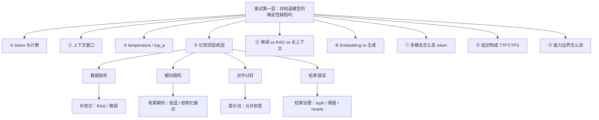
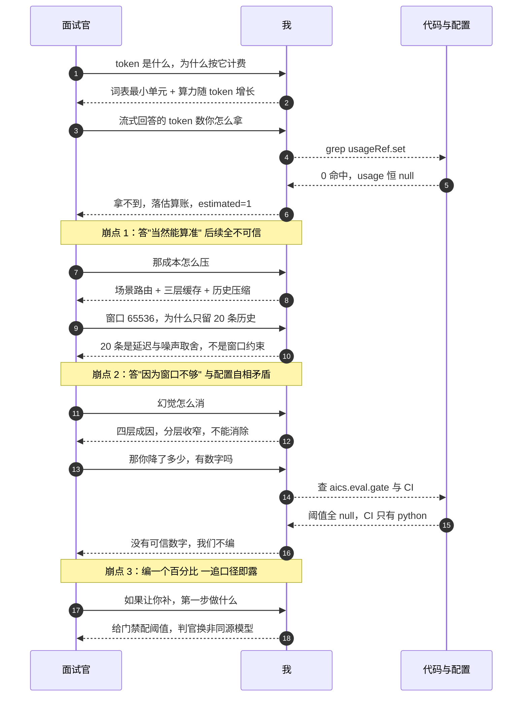

# 大模型基础原理·面试精讲：第一层不是 Transformer 有几个头，而是你知不知道自己用的模型有哪些确定性缺陷

> **一句话结论**：大模型面试的第一层筛选不是"你背了多少结构名词"，而是"你能不能说清自己这套系统里，模型的确定性缺陷在哪一层、你们用什么手段把它关进笼子"；token、窗口、采样参数、幻觉、微调/RAG 取舍、embedding、多模态、延迟、评测，这九个方向本质都是同一件事的九个切面——**给不确定性定价并兜底**。
>
> **阅读前置**：读过 [01-SpringAI入门](../01-SpringAI框架集成/01-SpringAI入门.md)（知道 `ChatClient` / `ChatModel` / `VectorStore` 各自是什么），并且能看懂 `application.yml` 里的缩进层级；本机 `java`（JDK 17）、`node`、`mvn` 的 m2 仓库存在即可跑本篇的验证命令，**不需要启动服务、不需要联网**。
>
> **证据基线**：Spring AI 2.1.0 / Boot 4.2.0 / Spring Framework 7.1.0 / JDK 17 ｜ A 级 = `24-源码分析/assets/source` 已入库摘录（905 份）；B 级 = 本仓库真实文件 + 行号；C 级 = 本机命令的真实输出 ｜ 预计阅读 35~45 分钟。

---

## 证据边界表（先摊牌，再答题）

面试题这类文档最容易滑向"听起来很专业的编造"。所以先明确本篇每条结论能挂在什么上：

| 类别 | 本仓状态 | 本篇怎么处理 |
|------|----------|--------------|
| Spring AI 框架机制（`Usage`、`ChatOptions`、`MessageWindowChatMemory`、`TokenTextSplitter`、`EmbeddingModel`、`UsageAccumulator`） | A 级已入库 | 直接挂 `[[源码:文件.java.md#行号]]`，可点开核对 |
| 本项目 chat 服务的配置与代码（采样参数、模型清单、历史裁剪、记账表、评测） | B 级真实文件 | 每条都写 `路径#行号`，写前已 `read` 核对 |
| 能本机复现的（单价复算、哈希向量余弦、`javap` 看真实签名） | C 级实测 | 命令 + 真实输出 + "怎么读这个输出" |
| DeepSeek / 硅基流动 / Chroma 的**内部实现**（分词词表细节、图像 patch 折算公式、prefill/decode 调度） | **未入库** | 一律标注"未入库，依据官方文档"，**不报具体数字** |
| 真实 token 数、TTFT、TPS、显存占用 | **未实测**（本篇禁止联网、禁止起服务） | 只讲"怎么算、怎么读、去哪查"，不给绝对值 |
| 旧稿里的性能数字（如某模型全量微调显存、某 MoE 模型"总参/激活参"） | **未核实** | 明确弃用，改用"按你的硬件与量化方式实测"的答法 |

> 读法：本文所有"我们项目"的句子，如果后面没有 `路径#行号`，就当作**没落地**处理——这本身就是面试里最值钱的一种诚实。

---

## 0. 先看现象

面试现场真实卡壳，通常不是"不会"，而是"会的那一层和问的那一层错位"。下面三幕都不是编的套路题，而是这套技术栈上最容易踩的原话。

**场景一：能背"按 token 计费"，但被追问一句就断电。**

> 面试官：为什么大模型按 token 计费？
> 你：因为模型是按 token 处理的。
> 面试官：那你们流式回答的时候，token 数怎么拿到的？钱记得准吗？
> 你：（沉默）……应该能拿到吧。

断点在于：`token` 是"分词器词表里的最小单元"这件事只是起点；真正被考的是"**你知道不知道自己在哪种调用模式下拿不到 usage**"。本项目流式链路里 `ResilientAiService` 声明了 `AtomicReference<Usage> usageRef`（`ai-cs-chat/src/main/java/com/aics/chat/service/impl/ResilientAiService.java#L277`），但对全文件 grep `usageRef.set` 命中 **0 次**——它从头到尾没被赋过值，于是流式场景 `usage` 恒为 `null`，只能落一条"估算"账。这正是 `model_usage` 表里 `estimated` 列存在的理由（`deploy/mysql/llm-observability-init.sql#L29-L49`）。

**场景二：能背"窗口 128K，都能装下"，但解释不了自己项目为什么只留 20 条历史。**

> 面试官：你们上下文窗口多大？
> 你：deepseek-chat 是 128K，很够用。
> 面试官：那你们为什么代码里把历史裁到 20 条？

断点在于把"能力上限"当成了"策略"。本项目的窗口是**配置里写死的** 65536（`tools/nacos-config/ai-cs-chat.yml#L52-L62`），裁剪是 `MAX_HISTORY_SIZE = 20` + `KEEP_RECENT_SIZE = 10` 的压缩策略（`ai-cs-chat/src/main/java/com/aics/chat/service/impl/ChatServiceImpl.java#L149-L153`）。20 条**不是窗口约束**，而是延迟、成本、上下文噪声三者的取舍——说不清这个区别，就等于承认自己只会背参数。

**场景三：能背"temperature 越低越稳定"，但答不出"你们为什么用 0.7 而不是 0"。**

> 面试官：temperature 设多少？
> 你：越低越好，0 最稳定。
> 面试官：那你们线上为什么是 0.7？

本项目三个地方都把温度钉在 0.7：`application.yml` 的 `${OPENAI_TEMPERATURE:0.7}`（`ai-cs-chat/src/main/resources/application.yml#L40-L44`）、Nacos 的 `chat.temperature: 0.7`（`tools/nacos-config/ai-cs-chat.yml#L6-L9`）、路由层的 `private Double temperature = 0.7`（`ai-cs-chat/src/main/java/com/aics/chat/modelrouter/ModelRouterProperties.java#L25-L29`）。而且全仓 yml/properties 里 `top-p` / `topP` / `top_k` / `seed` 的命中**只有** `recall-top-k: 20`（检索召回数，不是采样参数）——也就是说**采样旋钮只开了 temperature 一个**。这背后有取舍，答不出取舍就是背题。

> **这些现象指向同一件事**：面试官不是在检查你记没记住名词，而是在检查你**有没有把模型的确定性缺陷映射到自己系统的具体配置和具体代码行上**。凡是能落到"我们哪一行、为什么这么写、代价是什么"的答案，都自带说服力；凡是只能落到"业界一般……"的答案，一追就碎。

---

## 1. 整体地图

先看这张考点分布图。九个方向不是并列的知识点，它们分两层：**上面一层是"模型固有的不确定性来源"，下面一层是"你用什么手段收窄它"**。



> **读图说明**：图里有两条"主干箭头"要看清。第一条是 `ROOT → T4`：**幻觉是这张图的枢纽**，因为它同时被 `T2`（窗口不够→漏证据）、`T3`（采样随机）、`T5`（知识从哪来）、`T6/T7`（检索与多模态输入质量）影响，所以面试里幻觉题几乎必然串起别的方向。第二条是 `H4 → F4`：**检索错误必须用检索治理解决，不能用"降低温度"解决**——这是最常被答错的一条边。看错这条边（把 `H2 → F2` 的手段套到 `H4` 上），会得出"温度调 0 就能消除 RAG 幻觉"的错误结论，而这个结论一验证就破。

这张图里的每一层，在面试里会被追问到不同深度。用下表先给自己定位：

| 考点 | 背结论（能说定义） | 讲机制（能说为什么） | 会定位（能说自己项目哪一行） | 能改造（能说换方案/代价） |
|------|--------------------|----------------------|------------------------------|---------------------------|
| ① token 与计费 | "按 token 计费" | 分词器词表 + 输入输出成本曲线不同 | `model_usage` 表、`ModelUsageRecorder` 两级单价 | 流式下只能估算 → 标 `estimated` |
| ② 上下文窗口 | "128K / 65536" | 装得下 ≠ 用得好（成本/延迟/中间位置） | `MAX_HISTORY_SIZE=20` + `buildContext` 无预算 | 调小窗口换延迟，或加预算裁剪 |
| ③ temperature / top_p | "越低越确定" | softmax 温度缩放 / 核采样截断 | 只配了 0.7，无 topP/topK/seed | 加 `seed` 需换供应商支持 |
| ④ 幻觉四层 | "模型会胡编" | 数据缺失/解码随机/对齐讨好/检索错误 | RAG 提示词拒答条款 + 检索阈值 | 接在线判官、开门禁阈值 |
| ⑤ 微调 vs RAG | "RAG 查资料，微调改行为" | 成本/时效/可控性三维 | 只有 RAG，无任何微调代码 | 微调需数据管线，本项目未落地 |
| ⑥ Embedding vs 生成 | "一个是向量一个是生成" | 编码器 vs 自回归解码器 | 768 哈希兜底 / 1024 bge-m3 `@Primary` | 换模型必须全量重灌向量 |
| ⑦ 多模态 token 化 | "图片也能进模型" | patch → 投影 → 与文本拼序列 | `VisionModelClient` 独立模型 + 5MB 限制 | 控图尺寸/张数以控费 |
| ⑧ 延迟构成 | "首 token + 生成" | prefill（compute-bound）/ decode（memory-bound） | `firstTokenMs` 只进 span，不入表 | 落库需加列 + 改上报 |
| ⑨ 能力边界怎么测 | "跑评测集" | 检索层/生成层/端到端三层指标 | 20 条 golden + 门禁阈值全 null | 阈值一配就成回归门禁 |

**这张表怎么用**：面试前半段考你"讲机制"，中段一定切到"会定位"，收尾常常是"能改造"。如果被问到"你们的 XX 是怎么做的"，你只能停在第二列，那基本就到点了。

---

## 2. 关键概念与关键类 / 关键参数

| 名称 | 所在位置 | 一句话准确定义 | 本项目取值 |
|------|----------|----------------|------------|
| Token | `[[源码:Usage.java.md#L37-L46]]` 里的 prompt/completion 计数单位 | 分词器（tokenizer）词表里的最小可编码单元；不是字，也不是词，切法完全由词表决定 | 无配置项，只在记账表体现：`model_usage.input_tokens` / `output_tokens` |
| 词表 / 编码类型 | `TokenTextSplitter` 默认 `EncodingType.CL100K_BASE`（`[[源码:TokenTextSplitter.java.md#L41-L55]]`） | 决定一段文本被切成多少个 token 的那张映射表；框架切块用的就是 tiktoken 的 cl100k 系列 | 切块默认 `chunkSize=800`、`overlap=0`（同上行号） |
| 上下文窗口 contextWindow | `ModelDefinition.java` 的 `contextWindow` 字段 | 单次请求里 prompt + completion 的 token 上限，按"每次请求"重置，不跨请求累积 | deepseek-chat 65536；qwen3-32b / qwen3-8b 32768（`tools/nacos-config/ai-cs-chat.yml#L52-L84`） |
| max-tokens | `[[源码:ChatOptions.java.md#L35-L77]]` 的 `maxTokens` | 限制**输出**（completion）长度的上限，和上下文窗口不是一个东西 | 2048（`tools/nacos-config/ai-cs-chat.yml#L6-L9`、`ModelRouterProperties.java#L28`） |
| temperature | `[[源码:DefaultChatOptions.java.md#L29-L43]]` 字段之一 | 对 logits 做温度缩放后再 softmax：T→0 趋近贪心（argmax），T 越大分布越平 | 0.7（`application.yml#L40-L44`、`tools/nacos-config/ai-cs-chat.yml#L6-L9`、`ModelRouterProperties.java#L25-L29`） |
| top_p | 同上（`ChatOptions` 可移植参数之一） | 核采样：按概率从高到低累加到 p 为止，只在候选子集里采样 | **未配置**（全仓 grep 无 `top_p`/`topP` 采样配置），走供应商默认 |
| top_k | 同上 | 只在前 k 个候选 token 里采样 | **未配置**；yml 里唯一的 `top-k` 是检索的 `recall-top-k: 20` |
| seed | **不在** `ChatOptions` 的 8 个可移植参数里（`[[源码:ChatOptions.java.md#L35-L77]]`） | 部分供应商支持的"可复现随机种子"；框架层未抽象 | **未配置** → 本项目没有"严格可复现"的开关 |
| Usage（用量三件套） | `[[源码:Usage.java.md#L37-L62]]` | promptTokens / completionTokens / totalTokens；`getTotalTokens()` 是**默认实现**，两个值都可能为 null | 非流式取 `response.getMetadata().getUsage()`（`ResilientAiService.java#L206-L207`） |
| cache read / write input tokens | `[[源码:Usage.java.md#L78-L91]]`，`@since 2.0.0` | 命中供应商提示词缓存（重复前缀）的那部分输入 token，单独计更低的价 | **未读取**（代码里没有这两个方法调用）→ 本项目没算过缓存折扣 |
| estimated（估算标记） | `deploy/mysql/llm-observability-init.sql#L29-L49` | 记账表里标记"这次金额是估算值"，因为流式等场景拿不到精确 usage | 由 `ModelUsageRecorder.java#L91-L100` 在 token 为 null 时置 1 |
| EmbeddingModel | `[[源码:EmbeddingModel.java.md#L39-L60]]` | 文本 → 定长 `float[]` 的编码器接口；没有解码步骤，不能生成文字 | 双实现：`ai-cs-common` 的 768 维哈希兜底 + `SpringAiConfig` 里 1024 维 bge-m3 `@Primary` |
| 向量维度 | `HashEmbeddingModel.java#L31` / `SpringAiConfig.java#L70-L79` | 向量的坐标系长度；不同模型的维度不同，**不同模型产出的向量不可混算** | 768（本地哈希）／1024（`BAAI/bge-m3`） |
| 两阶段检索 | `KnowledgeBaseService.java#L228-L257` | 先大范围粗召回（ANN），再用 rerank 模型精排取前 N | 粗召回 topK=20 + 阈值 0.3 → rerank top-n=5、min-score 0.7（`tools/nacos-config/ai-cs-chat.yml#L12-L25`） |
| 幻觉 | 无单一类；表现为回答无据/与资料矛盾 | 模型在"没有可靠依据"时仍输出高置信文本的统称，成因不止一个 | 靠 RAG 提示词拒答 + 检索阈值 + 采样温度，未做在线评测门禁 |
| 历史窗口裁剪 | `ChatServiceImpl.java#L149-L153`、`#L278-L317` | 多轮对话里把旧消息丢掉或压缩成摘要，控制 prompt token 数 | `MAX_HISTORY_SIZE=20` 触发压缩，保留最近 `KEEP_RECENT_SIZE=10` 条 + 一段摘要 |
| 首 token 延迟 TTFT | `ResilientAiService.java#L277-L288`、`#L313-L316` | 从发请求到收到第 1 个 token 的时间，主要由网络 + 排队 + prefill 决定 | 记进 `AtomicLong firstTokenMs`，只作为 Observation span 属性，**没有落库列** |
| 生成速度 TPS | 无本项目实现 | 之后的 token 平均间隔的倒数；decode 阶段逐 token 生成，受显存带宽限制 | 未采集 |
| 熔断 / 超时 | `ai-cs-chat/src/main/resources/application.yml#L74-L159` | 对不确定的外部依赖做时间与失败率兜底 | `chatService` 30s、`sseChatService` 60s、`visionService` 5s；熔断窗口 10 次、失败率 50%、打开 30s |
| MessageWindowChatMemory | `[[源码:MessageWindowChatMemory.java.md#L29-L50]]` | 框架自带的"按消息条数裁剪历史"记忆实现 | **本项目没用它**（自研 `compressHistory`），且该类在 2.1.0 已标 `@Deprecated`（见第 7 节） |

---

## 3. 逐题精讲

每题固定四段：**问题** → **30 秒答案骨架**（能直接照着说）→ **深挖追问**（追问什么、怎么答）→ **常见错误答案**（写出错的说法并指出错在哪）。关键结论后面跟证据锚点。

### 3.1 token 是什么，计费为什么按 token

**问题**：什么是 token？为什么大模型按 token 计费？输入和输出为什么不是一个价？

**30 秒答案骨架**（照这个顺序说，约 40 秒）：

1. token 是**分词器词表里的最小单元**，不是字也不是词——同一段中文在不同词表下切出的数量不同，所以"多少 token"永远要问"哪个模型的哪个词表"。
2. 计费按 token，是因为算力、显存、时间都随 token 数**近似线性**增长：输入部分要把整段 prompt 前向算一遍（prefill），输出部分要逐 token 自回归生成（decode）。
3. 输入和输出单价不同，是因为生成阶段的**单位成本更高**：每吐一个 token 都要把模型权重读一遍、并维护 KV Cache，属于显存带宽受限；输入可以并行、可以复用缓存前缀。
4. 工程上唯一靠谱的做法是把每次调用的 token **记账**，并明确标注"这个数字是精确的还是估算的"。

> 证据锚点：用量三件套的定义与默认实现见 `[[源码:Usage.java.md#L37-L62]]`；Spring AI 判分块时用的词表常量是 `EncodingType.CL100K_BASE`（`[[源码:TokenTextSplitter.java.md#L41-L55]]`）；本项目的两级单价与估算标记见 `tools/nacos-config/ai-cs-chat.yml#L118-L128`、`ai-cs-chat/src/main/java/com/aics/chat/observability/ModelUsageRecorder.java#L127-L137`、`deploy/mysql/llm-observability-init.sql#L29-L49`。

**深挖追问**

- **问：你们怎么知道一次调用花了多少 token？**
  答：非流式走 `response.getMetadata().getUsage()`（`ResilientAiService.java#L206-L207`）拿到精确值；流式拿不到——本项目的 `usageRef` 声明了但从未赋值（grep `usageRef.set` 命中 0），所以流式一律按估算落账，`estimated` 置 1。这不是懒，这是**诚实标注不确定性**。
- **问：为什么用 `Integer` 而不是 `int`？**
  答：`Usage` 的 `getPromptTokens()` 返回 `Integer`，可能是 `null`——`ChatResponseMetadata` 里 usage 字段默认是 `new EmptyUsage()`（`[[源码:ChatResponseMetadata.java.md#L51]]`），所以取 usage 不会 NPE，但里面的数是空的。`getTotalTokens()` 的默认实现就是"null 当 0 相加"（`[[源码:Usage.java.md#L56-L62]]`）。
- **问：提示词缓存省的是什么钱？**
  答：省的是重复前缀的输入 token。2.0 起 `Usage` 多了 `getCacheReadInputTokens()` / `getCacheWriteInputTokens()`（`[[源码:Usage.java.md#L78-L91]]`），语义是"供应商已经处理并存下的那部分前缀 token，重复前缀能降本降延迟"。**本项目没接这两个方法**，所以"缓存命中率"目前答不出来。
- **问：一千万 token 大概多少钱？**
  答：按本项目配置的单价，deepseek-chat 输入 2.0、输出 8.0（每百万 token），所以"全是输入"约 20 元、"全是输出"约 80 元——但**别只报这一个数**，要把输入输出比例说清，因为比例才是费用的主要变量。

**常见错误答案**

| 错误说法 | 错在哪 |
|----------|--------|
| "一个汉字就是一个 token" | 中文常见被切成 1 个以上 token，具体取决于词表；说死会立刻被追问打断。正确说法是"取决于分词器，我只按实测/按供应商口径" |
| "按字数计费，跟 token 没关系" | 计费单位是 token，字数只是估算手段；且中英文混排时字数与实际 token 比例差别很大 |
| "输入输出一个价" | 生成阶段是逐 token、显存带宽受限，供应商普遍分开定价；本项目配置里就是两列（`tools/nacos-config/ai-cs-chat.yml#L118-L128`） |
| "我们记录得很准，全部是精确值" | 流式场景本项目就是拿不到 usage，`model_usage.estimated` 列专门为它存在；一口咬定"都准"会在追问里崩 |

---

### 3.2 上下文窗口与"都能装下"的错觉

**问题**：上下文窗口是什么？窗口很大是不是就"什么都能塞进去"？

**30 秒答案骨架**：

1. 窗口是**单次请求**里 prompt + completion 的 token 上限，请求结束就重置，它不会"记住"上一次塞进去的东西。
2. 装得下 ≠ 用得好：输入越长，**成本线性上升、首 token 延迟线性上升**，而且长上下文里"中间位置"的信息更容易被忽略。
3. 所以窗口是**能力上限**，不是**策略**。真正的策略是：该检索就检索（RAG），该压缩就压缩（摘要），该截断就截断（只留最近 N 轮）。
4. 我们项目的窗口是配置里写死的 65536，但历史只留 20 条——因为 20 条是延迟和噪声的取舍，不是窗口塞不下。

> 证据锚点：窗口与输出上限分别配置，见 `tools/nacos-config/ai-cs-chat.yml#L52-L84`（`context-window` 65536/32768）与 `#L6-L9`（`max-tokens: 2048`）；历史压缩策略见 `ai-cs-chat/src/main/java/com/aics/chat/service/impl/ChatServiceImpl.java#L149-L153` 与 `#L278-L317`；检索上下文注入见 `ai-cs-chat/src/main/java/com/aics/chat/service/KnowledgeBaseService.java#L287-L293`。

**深挖追问**

- **问：20 条历史是多少 token？为什么 20 这个数？**
  答：本项目没有做 token 计量式的裁剪，是按**条数**裁的。按"每条消息约 120 token"这个假设做量级估算（C 级复算，见第 9 节练习 3）：20 条 + 当前问题 ≈ 2520 token，离 65536 差一个数量级。所以 20 不是为了塞进窗口，而是为了控"上下文噪声"和"每轮都要多付的输入 token"。**这个数字是经验值，没有做 A/B 调参**——这点要老实说。
- **问：压缩具体怎么压？压缩失败怎么办？**
  答：`compressHistory` 把 `size - KEEP_RECENT_SIZE` 之前的旧消息拼成文本，走 `SUMMARY` 场景（用便宜模型）生成摘要，再把"摘要（作为 SystemMessage）+ 最近 10 条"拼回历史（`ChatServiceImpl.java#L278-L317`）；`catch` 里**回退成直接截断到最近若干条**，不因为摘要失败而让整个对话挂掉（同文件 `#L312-L316`）。
- **问：上下文注入有没有 token 预算？**
  答：**没有**。`buildContext(List<Document>)` 只做"`【资料N】` + 文本"的拼接（`KnowledgeBaseService.java#L287-L293`），没有按 token 或字数裁剪。目前靠"rerank 只取前 5 条 + `min-score` 0.7"从上游控量，属于**间接控量**，不是显式预算。这是一个真实的待改进点，面试里说出来比装作有更可信。
- **问：窗口这么大，为什么还要 RAG？**
  答：三件事窗口解决不了：①知识**更新**（窗口里的东西是这次请求塞的，谁来保证是最新的？）②**全库规模**（知识库远大于 65536 token）③**可审计**（RAG 能给出引用了哪几段，长上下文给不出可核对的出处清单）。

**常见错误答案**

| 错误说法 | 错在哪 |
|----------|--------|
| "窗口 128K 就能塞 10 万字" | token ≠ 字；中文与代码的折算比不同，且不说"哪个词表"就没有意义 |
| "把历史裁到 20 条是因为窗口小" | 与配置矛盾：本项目窗口 65536，20 条消息远没到上限。裁的是延迟与噪声 |
| "窗口大就没有幻觉" | 恰恰相反：塞进不相关内容会**增加**幻觉（噪声证据），这也是为什么要有 `min-score` 和 top-n |
| 把"上下文窗口"和"max-tokens"混为一谈 | `maxTokens` 只限输出长度（`[[源码:ChatOptions.java.md#L35-L77]]`），本项目是 2048，和 65536 没关系 |

---

### 3.3 temperature / top_p / top_k 与"确定性"

**问题**：temperature 是什么？它和 top_p、top_k 什么关系？设成 0 就完全确定了吗？

**30 秒答案骨架**：

1. temperature 是在 softmax 之前对 logits 做除法缩放：`p_i = exp(z_i / T) / Σ exp(z_j / T)`。T 越小分布越尖（趋近 argmax），T 越大分布越平。
2. top_p（核采样）是按概率降序累加到 p 为止，只在这个子集里采样；top_k 是直接取前 k 个。三者的**作用点相同**：都在"选下一个 token"这一步。
3. 所以它们只能**降低**随机性，不能给出工程意义上的严格确定性——批次合并、数值精度、供应商实现差异都可能带来变化。
4. 想要"稳定"要靠组合拳：低温度 + 结构化输出（JSON schema）+ 检索给证据 + 缓存 + 回归评测，而不是只把温度调 0。

> 证据锚点：框架层的可移植采样参数一共 8 个（`model` / `frequencyPenalty` / `maxTokens` / `presencePenalty` / `stopSequences` / `temperature` / `topK` / `topP`），**没有 seed**，见 `[[源码:ChatOptions.java.md#L35-L77]]`；字段定义见 `[[源码:DefaultChatOptions.java.md#L29-L43]]`。本项目实际只配置了 temperature=0.7（`application.yml#L40-L44`、`tools/nacos-config/ai-cs-chat.yml#L6-L9`、`ModelRouterProperties.java#L25-L29`），grep 全仓无 `top_p`/`topP`/`seed` 采样配置。

**深挖追问**

- **问：为什么你们线上是 0.7 而不是 0？**
  答：客服场景要"人味"和措辞多样性，温度过低会让回答模板化、复读同一句话；同时温度不是幻觉主因（主因在 3.4 的四层里），把温度调到 0 换不来事实正确性，却换来了体验下降。**但**：凡是要"机械稳定"的调用（意图识别、改写、摘要），本项目走的是**另一个更便宜的模型**（`summary`/`intent`/`rewrite`/`chart` 走 qwen3-8b，`tools/nacos-config/ai-cs-chat.yml#L85-L113`），用"换模型 + 短输出"来控制方差，而不是死磕温度。
- **问：top_p 和 temperature 要一起调吗？**
  答：一般只调一个。两者都改分布形状，同时调等于把"温度影响"和"截断影响"混在一起，出了问题无法归因——这也正是本项目只开 temperature 的原因之一：**可归因**比"参数齐全"重要。（供应商推荐区间属官方文档，未入库，不报数。）
- **问：你们能保证同一个问题问两次给一样的答案吗？**
  答：不能，而且不该假装能。框架层没有 seed 抽象（`ChatOptions` 8 个参数里没有），本项目也没配；真要"看起来一样"，靠的是缓存：语义缓存阈值 0.92、最大 200 条、TTL 168 小时（`application.yml#L177-L193`），命中缓存时连模型都不调用。
- **问：那 temperature 到底影响什么？**
  答：影响"从同一组候选里挑哪个"的分布形状，因此影响**措辞和细节选择**的稳定性，间接影响"同一事实被表述得是否前后一致"；它不影响模型有没有这个知识。

**常见错误答案**

| 错误说法 | 错在哪 |
|----------|--------|
| "temperature=0 就一定输出完全一致" | 框架层无 seed 保证；批次、数值精度、供应商实现都可能造成差异。正确说法是"降低随机性，不保证逐字节相同" |
| "top_p=0.9 表示只取前 90% 数量的 token" | 是按**累积概率**截断，不是按个数 |
| "top_k 越高越准确" | 它只扩大候选集，不改变分布的"正确性"；而且很多 OpenAI 兼容接口并不支持 top_k，设了可能被忽略 |
| "把温度调 0 就不会幻觉" | 温度只作用于解码随机这一层；数据缺失、对齐讨好、检索错误三层完全不受影响 |
| "我们所有采样参数都精细调过" | 本项目只配了 temperature，其他走默认。**说"没调"比编一套调参故事安全得多**，还能顺势展示你知道哪些旋钮本该存在 |

---

### 3.4 幻觉的成因分层与各自对策

**问题**：大模型为什么会幻觉？你们怎么解决？

**30 秒答案骨架**（这一题必须分层，否则一定被判"背结论"）：

1. 幻觉不是单一原因，我一般分四层：**①数据/知识缺失**（模型根本没见过）→ ②**解码随机**（候选里挑偏了）→ ③**对齐讨好**（RLHF 让它倾向给一个"看起来有用"的答案，而不是说"不知道"）→ ④**检索错误**（RAG 拿错了资料或拿了过期资料）。
2. 四层对应四类手段：补知识（RAG / 微调）、收紧解码（低温、结构化输出、受限候选）、**在提示词里显式允许拒答**、检索治理（topK、阈值、rerank、数据更新）。
3. 幻觉不能被"消除"，只能被**分层收窄 + 可度量**。所以最后一层一定是评测：离线看检索指标，线上抽样做判官打分。
4. 我们项目的现实是：前三层有落地（提示词拒答 + 检索双阶段阈值 + 温度），第四层只做了半个（在线判官默认关闭、评测门禁阈值全 null）。

> 证据锚点（这题的证据最能分高下）：RAG 场景提示词里写死了拒答条款——"如果资料中没有相关信息，请如实告知……不要编造内容"（`ai-cs-chat/src/main/resources/application-prompt.yml#L63`）；空检索时注入的占位文本是"（未检索到相关资料）"（`ai-cs-chat/src/main/java/com/aics/chat/service/impl/ChatServiceImpl.java#L444-L445`）；基础提示词还写了"不要编造数字"和"绝对不要透露底层模型名称"（同文件 `#L24`）。检索侧：粗召回 topK=20、阈值 0.3，rerank top-n=5、min-score 0.7（`tools/nacos-config/ai-cs-chat.yml#L12-L25`）。

**深挖追问**

- **问：你说不能消除，那你们到底降了多少？有数字吗？**
  答：**没有可信数字，我不编**。现在能拿出的只有检索层的离线指标（`RetrievalMetrics` 算 Recall@k / HitRate / MRR，`ai-cs-chat/src/main/java/com/aics/chat/rag/eval/RetrievalMetrics.java#L46-L72`，样本是 20 条 golden 集），线上判官默认关闭（`OnlineEvalProperties.java#L22-L32`：`enabled=false`、`sampleRate=0.01`、`judgeModel=""`），评测门禁的阈值全为空（`EvalGateConfig.java#L34-L43`）。**"没有数字"本身就是这条链路最该补的洞**，说出来是加分项。
- **问：为什么门禁阈值是空的？空着不会误判吗？**
  答：这是有意设计：`p95LatencyMs` 和 `avgTokensPerRequest` 都声明成 `Long` 而不是 `long`（`EvalGateConfig.java#L40-L43`），因为 `long` 的默认 0 会被误判成"上限 0ms"。没配置时只记录不判定——**空 = 不拦，而不是空 = 全拦**。这是很典型的"默认值语义"坑。
- **问：检索拿错资料怎么发现？**
  答：三层看：①阈值挡低分（0.3 粗筛 + rerank 0.7 精筛）②降级逻辑：rerank 挂了就按向量分数 `subList` 兜底（`KnowledgeBaseService.java#L228-L257`）③空结果就走占位文本让模型说"没有资料"，而不是让它自由发挥。
- **问：如果让你加一层，你加什么？**
  答：先给已有门禁配阈值（让 CI/回归能拦），再把判官采样打开、把 `judgeModel` 配成与被测模型**不同源**的模型——现在 judge 场景默认也走 deepseek-chat（`tools/nacos-config/ai-cs-chat.yml#L85-L113`），同源自评有偏置。这两个都是低成本、可验证的动作。

**常见错误答案**

| 错误说法 | 错在哪 |
|----------|--------|
| "接了 RAG 就没有幻觉了" | RAG 只解决"知识缺失"这一层，甚至会引入"检索错误"这一层。它的副作用是"更自信地引用了错的资料" |
| "温度调 0 就没幻觉" | 只作用于解码随机；提示词拒答和对齐讨好层完全无关 |
| "微调可以把业务知识灌进去，幻觉就没了" | 微调改的是**行为/格式/风格**，把知识烧进权重反而让知识更难更新（见 3.5） |
| "我们有 95% 的准确率"（无实测） | 本项目没有全量准确率基线；编一个百分比是面试里最致命的失分点，因为一追问口径就露 |

---

### 3.5 微调 vs RAG vs 长上下文：成本、时效、可控性

**问题**：什么情况下用微调，什么情况下用 RAG，什么情况下直接塞长上下文？

**30 秒答案骨架**：

1. 一句话判据：**知识会变 → RAG；行为和格式要固定 → 微调（多数场景先用提示词就够）；一次性的长文档理解 → 长上下文。**
2. 成本维度：微调是"训练成本 + 每次换知识都要重训 + 一套新模型的运维"；RAG 是"入库向量化成本 + 每次请求多一跳检索延迟"；长上下文是"每次请求都为全量输入 token 付费"。
3. 时效维度：RAG 改一条知识是分钟级；微调是小时到天级；长上下文只在"这次请求"内有效。
4. 可控性维度：RAG 有**出处**（引用了哪几段），可以配合权限过滤，出错能定位到片；微调只有黑盒权重，改不了单条知识；长上下文有原文但没法做 ACL。
5. 我们项目的选择是 **RAG 为主 + 长上下文受控使用 + 不做微调**，原因是知识型客服问答的答案随时在变，且目前没有支撑微调的数据管线。

> 证据锚点：RAG 两阶段检索与上下文注入见 `KnowledgeBaseService.java#L228-L257`、`#L287-L293`；窗口上限 65536（`tools/nacos-config/ai-cs-chat.yml#L52-L62`）；成本敏感的证据是三层缓存（`application.yml#L177-L193`：向量缓存 L1 4096 条 / TTL 168h，语义缓存阈值 0.92 / 200 条 / 168h，热问题提升阈值 3 / TTL 24h）；微调**未落地**：在 `ai-cs-chat`、`tools`、`pom.xml` 里 grep `finetun|fine-tun|LoRA` 命中 0。

**深挖追问**

- **问：为什么不微调？是没有必要还是不会？**
  答：两个原因都要说。①**业务原因**：客服知识每天在变，微调把知识固化进权重后，改一条政策就要重训一次，运维成本远高于"改一条文档 + 重新向量化"。②**工程原因**：微调需要成规模的高质量标注样本，本项目 golden 集只有 20 条（C 级统计），连评测都不够，更谈不上训练数据。**"没落地"要明说**，然后补上"如果要做，我会先补数据管线"。
- **问：三者成本能算给我看吗？**
  答：能算，但要摆假设。按本项目单价（deepseek-chat 输入 2.0 / 输出 8.0 元每百万 token），假设一次调用 1500 输入 + 400 输出 → 一次约 0.0062 元，一天 1000 次约 6.2 元；同样的量切到 qwen3-8b（0.2 / 0.6）只要约 0.54 元/天（C 级复算，命令见第 9 节练习 3）。**这个对比就是"为什么摘要/意图走 8B"的全部理由。**
- **问：长上下文不是能替代 RAG 吗？**
  答：三个硬伤：①知识库总量远超任何窗口；②每轮都付全量输入的 token 钱（成本随会话长度线性涨）；③**不可审计**——RAG 能说出"依据是第几段资料"，长上下文给不出可核对的引用清单。所以本项目把"塞多少资料"压到 rerank 后的 5 条。
- **问：RAG 的代价是什么？**
  答：多一跳检索延迟（向量检索 + rerank，rerank 超时设了 5000ms，`tools/nacos-config/ai-cs-chat.yml#L12-L19`）、多一层失败点（Chroma 不可用就退化成无资料回答）、以及"检索错"这一新幻觉来源。所以它是**用延迟和复杂度换时效与可控性**。

**常见错误答案**

| 错误说法 | 错在哪 |
|----------|--------|
| "微调能让模型更懂我的业务知识" | 混淆了"知识"和"行为"。知识要能改、要能引用，用 RAG；微调擅长格式、风格、指令遵循 |
| "长上下文已经能替代 RAG 了" | 忽略成本线性、全库规模、可审计性三点；一追"你的知识库多大"就崩 |
| "RAG 就是向量数据库 + 拼接提示词" | 漏了召回质量（阈值/topK）、重排、上下文预算、引用与拒答策略——本项目这四个点上有一半是空的（`buildContext` 无预算） |
| 直接背出"LoRA 只需 16GB 显存、全量微调 7B 要 60GB"这类数字 | 这些数字高度依赖精度、优化器、批次、序列长度，**本篇不引用旧稿数字**。正确姿势："取决于量化与配置，要实测" |

---

### 3.6 embedding 模型和生成模型的区别

**问题**：embedding 模型和生成模型（LLM）有什么区别？为什么换 embedding 模型要重灌向量库？

**30 秒答案骨架**：

1. 两者是**不同目标训练的两个模型**：embedding 是编码器，输入文本、输出**定长浮点向量**，没有解码步骤，永远不会"生成文字"；生成模型是自回归解码器，逐 token 采样输出文本。
2. 用量结构也不同：embedding 按输入 token 计一次费，没有输出 token；生成模型输入输出都要钱。
3. 向量的可比性依赖**同一个模型、同一个维度**：不同模型的语义空间不同，1024 维和 768 维之间连点积都算不了，所以换 embedding 模型必须**全量重灌**向量库。
4. 我们项目的做法是：默认本地 768 维哈希向量做零依赖兜底，生产用 `BAAI/bge-m3`（1024 维）并标了 `@Primary`，知识库侧用同一模型保证向量空间一致。

> 证据锚点：`[[源码:EmbeddingModel.java.md#L39-L60]]`——接口是 `EmbeddingModel extends Model<EmbeddingRequest, EmbeddingResponse>`，核心方法是 `float[] embed(String text)`，返回数组而不是文本。本项目双实现：`ai-cs-common/src/main/java/com/aics/common/ai/embedding/HashEmbeddingModel.java#L29-L31`（`implements EmbeddingModel`、`DIMENSIONS = 768`）、`ai-cs-chat/src/main/java/com/aics/chat/config/SpringAiConfig.java#L108`（`aics.embedding.model:BAAI/bge-m3`）与 `#L172`（`@Primary`，注释写明"向量库/检索统一用 bge-m3，保证向量空间一致"）。

**深挖追问**

- **问：哈希向量和真模型的差别在哪？**
  答：哈希向量做的是**特征哈希**（词袋式），它只保留"字面重叠"，没有语义泛化。`HashEmbeddingModel` 的实现是：小写化后取英文单词（长度 ≥2）+ 中文**二元字符组**，每个特征用两个哈希（`String.hashCode` 与 FNV-1a）投到 768 维桶里累加，最后 L2 归一化（`HashEmbeddingModel.java#L43-L48`、`#L77-L96`）。
- **问：你能证明它没有语义能力吗？**
  答：能，本机一行 node 就复现（第 9 节练习 2 给了完整脚本）。用同样算法算余弦：`cos("我要退款","我要退款")=1.0000`，但 `cos("我要退款","我想退货")=0.0000`——**同义句相似度为 0**，而 `cos("我要退款","今天天气怎么样")=0.1091`，比同义句还高。它衡量的是字面重合，不是语义。
- **问：那为什么还留着它？**
  答：它是**兜底**，不是主方案。`EmbeddingAutoConfig` 用 `@ConditionalOnProperty(name="aics.ai.embedding.provider", havingValue="local", matchIfMissing=true)` + `@ConditionalOnMissingBean(EmbeddingModel.class)`（`ai-cs-common/src/main/java/com/aics/common/ai/embedding/EmbeddingAutoConfig.java#L15-L22`）——没有 API Key 的开发环境也能把 RAG 链路跑通，一旦有了 bge-m3 的 Bean 它就自动让位。
- **问：换模型要做什么？**
  答：①重灌全部文档向量（维度/语义空间都变了）②确认检索侧的阈值要重调——`0.3` 和 `0.7` 是针对当前模型分布的，换模型后分布会整体平移。这一点很多项目会忘。

**常见错误答案**

| 错误说法 | 错在哪 |
|----------|--------|
| "embedding 模型也能做文本补全/摘要" | 它没有解码器，输出是向量。混为一谈等于不知道两类模型的训练目标 |
| "维度越大一定越好" | 维度影响表达力和成本，也影响"能不能和已有库对齐"；本项目从 768 换到 1024 的前提是重灌 |
| "换个更好的 embedding 模型，直接换 Bean 就行" | 不重灌 = 库里旧向量、新查询新向量，余弦相似度毫无意义（本项目 `SpringAiConfig.java#L172` 注释强调的正是"向量空间一致"） |
| "本地哈希挺好用，线上也能用" | 上面可复现的 0.0000 余弦就是反例；哈希模型在 `HashEmbeddingModel.java` 的注释里也写明"没有语义泛化能力，生产必须切换" |

---

### 3.7 多模态输入怎么变成 token

**问题**：图片是怎么被模型"看懂"的？图片也按 token 计费吗？

**30 秒答案骨架**：

1. 图片不走文本词表。视觉编码器先把图片按**分辨率/patch 网格**切块，每块编码成一个向量，再经**投影层**映射成与文本 embedding 同维的向量序列。
2. 这些视觉向量和文本 token 的向量**拼在同一条序列**里进 Transformer，所以模型对"图 + 文"是一次前向——这也是为什么指令里能说"根据这张图里的金额"。
3. 因此图片是按"**视觉 token 数**"参与计算与计费的：图越大、切得越细，token 越多、越贵；具体折算公式各厂商不同（**未入库，依据官方文档，本篇不给公式**）。
4. 工程上要控两件事：图片尺寸/张数（控费控延迟）和"视觉模型与文本模型分离"（能力、计费、超时都不同）。

> 证据锚点：本项目把图片走 Spring AI 的 `Media` 抽象，由框架翻译成 OpenAI 兼容的 `content` 数组（`{"type":"text"} / {"type":"image_url","image_url":{"url":...}}`），见 `ai-cs-chat/src/main/java/com/aics/chat/service/impl/VisionModelClient.java#L57-L72`；图片上限 5MB、允许 jpg/jpeg/png/webp/gif，见 `ai-cs-chat/src/main/java/com/aics/chat/controller/ChatController.java#L61-L64`；视觉模型单独配置为 `Qwen/Qwen3-VL-32B-Instruct`（`tools/nacos-config/ai-cs-chat.yml#L39-L45`），视觉调用超时 5s（`application.yml#L74-L87` 的 `visionService`）。

**深挖追问**

- **问：为什么视觉模型要单独一个客户端，不复用文本模型？**
  答：两个原因。①**能力**：文本主模型（deepseek-chat）不提供视觉输入，图片必须交给 VL 模型。②**装配冲突**：`VisionModelClient` 的注释写明"两个 `OpenAiChatModel` 类型相同，`@Primary` 会冲突，故视觉模型手动构造、不注册 Bean"（`VisionModelClient.java#L74-L81`），实际是懒加载手工 `new`（同文件 `#L114-L129`）。这是一个纯粹的 Spring 装配约束，不是"设计洁癖"。
- **问：图片会不会先 OCR 成文字再进模型？**
  答：那是另一条流水线（先 OCR，再当纯文本处理）。VL 模型的主路径是视觉 token 直接进序列，OCR 只在前置处理里可选。本项目没有 OCR 环节，是把图片交给 VL 模型。
- **问：一张图大概多少 token？**
  答：**不给数字**。折算依赖模型的分辨率策略（固定切块/动态切块）、是否缩放、图片比例。正确答法："取决于该 VL 模型的分块规则，只能按官方文档或实测 token 计数来估，我这边没有实测数据。"
- **问：图片大了会怎样？**
  答：三个后果：①视觉 token 变多 → 输入成本变高 ②prefill 变长 → 首 token 变慢 ③更容易撞超时。本项目把入口卡在 5MB（`ChatController.java#L64`）、超时给到 5s（`application.yml#L74-L87`），两者是配套的。

**常见错误答案**

| 错误说法 | 错在哪 |
|----------|--------|
| "图片会被转成文字描述再喂给模型" | 那是 caption 方案，不是 VL 主路径；且 caption 会丢细节 |
| "图片不占 token、不额外计费" | 视觉 token 一样进序列、一样算钱，往往还很贵 |
| "同一个 `ChatClient` 就能处理图和文，不用区分模型" | 本项目必须区分：文本模型没有视觉能力，且两个同类型 Bean 会冲突 |
| "多模态就是把图片 base64 塞进 prompt 字符串" | 传输层确实可能是 base64/URL，但结构上是独立的 `image_url` 内容块，不是普通文本 |

---

### 3.8 推理延迟构成：首 token 与后续 token 完全是两回事

**问题**：为什么流式回答"首字很慢，后面很快"？延迟都花在哪了？

**30 秒答案骨架**：

1. 整段延迟分两段：**TTFT（首 token 延迟）** = 网络往返 + 排队 + **prefill**（把整段 prompt 前向算一遍）+ 采样出第 1 个 token；之后是 **decode**，逐 token 生成。
2. Prefill 是**算力受限**（compute-bound）：整段输入可以并行算，所以"输入长 → 首 token 慢"；Decode 是**显存带宽受限**（memory-bound）：每生成一个 token 都要重新读一遍权重和 KV Cache，所以"输出长 → 总时长长、但首字快"。
3. 因此优化手段完全不同：**压首字** → 减 prompt token（历史裁剪/上下文预算）、路由到快模型、别让 rerank 拖太久；**压总时长** → 减输出 token（`max-tokens`）、用流式改善感知。
4. 流式**不降低总耗时**，它降低的是"感知等待"；而且流式不能重试/不能降级，因为 token 已经发出去了。

> 证据锚点：本项目在流式链路里用 `AtomicLong firstTokenMs` 记录 TTFT（`ai-cs-chat/src/main/java/com/aics/chat/service/impl/ResilientAiService.java#L277-L288`），并把它写进 Observation span 的高基数属性（同文件 `#L313-L316`）；但 `model_usage` 表**没有首 token 延迟列**（`deploy/mysql/llm-observability-init.sql#L29-L49`），所以它只进了链路追踪，没进可聚合的报表。超时分层：`chatService` 30s、`sseChatService` 60s、`visionService` 5s（`application.yml#L74-L87`）。

**深挖追问**

- **问：为什么同步对话 30s、流式 60s？**
  答：因为同步接口要"一次性拿到完整回答"才能返回，超时覆盖的是**总生成时长**；流式只要"不断有 token 出来"就算成功，超时覆盖的是**整条 SSE 连接的存活时间**（本项目还叠了 `SSE_EMITTER_TIMEOUT = 5 * 60 * 1000`，`ChatServiceImpl.java#L155-L156`）。两个数字对应两种不同的失败模式，不是为了"流式多给点余量"。
- **问：为什么流式不做重试、不做 fallback？**
  答：代码里写得很清楚（`ResilientAiService.java#L246-L250`）：Flux 一旦开始发射 token，**无法重放**——重试会重复输出、fallback 会把"前半段 A 模型 + 后半段 B 模型"拼给用户。这是"能力边界"最典型的例子：不是不想兜底，是兜底会破坏语义。
- **问：你怎么定位"首字慢"是检索慢还是模型慢？**
  答：看 span。检索（向量查询 + rerank）有自己的耗时（rerank 超时 5000ms），模型侧有 `firstTokenMs`。两者在同一 trace 下对比就知道瓶颈在哪。**但注意**：本项目把 `firstTokenMs` 放在 span 高基数属性里，没落表，所以只能"按 trace 看"，不能"按天聚合"——这是要补的。
- **问：KV Cache 跟延迟什么关系？**
  答：decode 每一步都要读历史 K/V，KV Cache 就是把这部分显存化避免重算。它对"后续 token"的速度影响最大，也是显存占用的主要来源之一；框架层不暴露这些参数（本项目没做过任何 KV Cache 调优，如实说）。

**常见错误答案**

| 错误说法 | 错在哪 |
|----------|--------|
| "首 token 慢是因为模型参数多" | 参数多影响每一步的速度，但**首 token 慢主要是 prefill 长（输入 token 多）+ 排队**；一追"那你输入多少 token"就露 |
| "用了流式，总耗时变短了" | 流式改善的是感知等待，总生成时间不变（甚至因分块协议略增） |
| "流式也能像同步一样重试" | 已发射的 token 不可撤回，重试=重复输出；这是本项目明确写下的设计约束 |
| "延迟高就加超时时间" | 加超时只是把失败变成慢成功；要分清是 prefill（减输入）、decode（减输出）还是检索（减 topK/rerank） |

---

### 3.9 模型能力边界怎么测

**问题**：你怎么知道这套模型 + 检索的组合"够用"？怎么度量它的能力边界？

**30 秒答案骨架**：

1. 分三层测，不要笼统说"准确率"：
   - **检索层**（可离线、可全自动）：Recall@k、HitRate、MRR —— 有 golden 集就能算。
   - **生成层**（半自动）：LLM-as-Judge 打分、拒答率、格式合法率、引用正确率。
   - **端到端**（业务）：P95 延迟、单请求平均 token、单次成本、转人工率。
2. 三层的判据都要"**固定样本 + 固定阈值 + 可重复**"，否则只是看报表，不是测试。
3. 本项目现状：检索层有实现有样本（20 条 golden），生成层有代码但默认关闭，端到端有表和字段但门禁阈值全 null。
4. 所以老实答案是："我们做到了能测，还没做到能拦。"

> 证据锚点：`RetrievalMetrics.compute()` 按 `k = min(topK, size)` 计算命中，再算 `recallAtK = hitCount / expectedIds.size()`、`hitRate`、`mrr = 1 / firstHitRank`（`ai-cs-chat/src/main/java/com/aics/chat/rag/eval/RetrievalMetrics.java#L46-L72`）；门禁配置 `aics.eval.gate` 的 `p95LatencyMs` / `avgTokensPerRequest` 都是 `Long` 且注释说明"用 Long 而非 long，避免 0 被误判成上限 0ms"（`ai-cs-chat/src/main/java/com/aics/chat/rag/eval/EvalGateConfig.java#L34-L43`）；在线评测 `enabled=false`、`sampleRate=0.01`（`ai-cs-chat/src/main/java/com/aics/chat/observability/OnlineEvalProperties.java#L22-L32`）；判分结果落 `online_eval_record`（`llm_score` 1~5、`judge_status` SUCCESS/FAILED/SKIPPED，`deploy/mysql/llm-observability-init.sql#L67-L81`）。

**深挖追问**

- **问：20 条样本够吗？**
  答：**不够做统计结论，只够做冒烟和回归提示**。20 条能发现"某次改动把召回打崩了"，但算不出置信区间，也覆盖不了长尾问题。要老实说这句，然后补"扩样本是下一步"。
- **问：门禁阈值为什么全 null？这不等于没门禁吗？**
  答：是的，现在等于没门禁。同时全仓 yml/properties 里 grep 不到 `aics.eval.gate`、`p95-latency-ms`、`avg-tokens-per-request`、`sample-rate` 任何一项，CI 也只有 python 那条 workflow（`.github/workflows` 下只有 `python-learning-validate.yml`）——**Java 侧没有评测门禁**。这是"能改造"层的答案：加一条带阈值的回归任务就是最小的改进。
- **问：LLM-as-Judge 怎么保证判分可信？**
  答：三个手段：①判官模型与被测模型**不同源**（否则自评偏置）②双评/多评取一致③人工抽检校准。本项目当前 `judge` 场景默认走 deepseek-chat（`tools/nacos-config/ai-cs-chat.yml#L85-L113`），与主链路同源，属于已知缺陷。
- **问：除了准确率，还该测什么？**
  答：**该测"该拒答的时候拒没拒"**。客服场景里"自信地编"比"说没有资料"危害大得多，所以拒答率、误拒率要和准确率一起看——这也是唯一能对应 3.4 里"对齐讨好"那一层的手段。

**常见错误答案**

| 错误说法 | 错在哪 |
|----------|--------|
| "我们人工看了几条，效果不错" | 没有固定样本、没有判据、没有回归，等于没测 |
| "直接用 benchmark 分数选模型" | 公开榜单和你的业务分布无关；本篇明确不引用任何榜单数字 |
| "有 CI 就自动有评测" | 本项目 CI 只跑 python 文档校验，Java/RAG 侧没有门禁 |
| "门禁阈值空着是因为默认 0 最安全" | 语义反了：`Long` 的空值是 `null`（不判定），`long` 的 0 才是"上限 0ms"。这个坑 `EvalGateConfig` 的注释专门写了 |

---

### 3.10 模型怎么选：一个可落地的多模型路由

**问题**：你们用哪个模型？为什么是它？如果它挂了怎么办？

**30 秒答案骨架**：

1. 本项目不是"选一个模型"，而是**按场景选模型**：能力、窗口、单价、超时四个维度写在配置里，路由层按场景链**确定性**执行（不引入 LLM 做判断，保证零成本、可复现）。
2. 主力 `deepseek-chat`：窗口 65536、支持 tool-calling、单价 2.0/8.0（每百万 token）、超时 30s，负责 `chat`/`rag`/`agent`/`nl2sql`/`judge`。
3. 便宜档 `qwen3-8b`：窗口 32768、无 tool-calling 能力、单价 0.2/0.6、超时 15s，负责 `summary`/`intent`/`rewrite`/`chart`——因为这些任务短、结构化、对成本敏感。
4. 中间档 `qwen3-32b` 主要作为 fallback（单价 1.0/2.0），配额超限时整体降到 `cheap` 档。
5. 所以"模型挂了怎么办"的答案是：**fallback 链 + 熔断 + 配额降级**三层，且 fallback 换了模型就必须换单价记账（tokenizer 变了，token 数也不同）。

> 证据锚点：三模型与场景路由的完整配置见 `tools/nacos-config/ai-cs-chat.yml#L52-L84`（模型定义）与 `#L85-L113`（场景），配额降级 `#L114-L116`（`over-limit-fallback-tier: cheap`），单价 `#L118-L128`；路由的"确定性"设计在 `ai-cs-chat/src/main/java/com/aics/chat/modelrouter/ModelRouter.java#L29`，过滤顺序（已注册 + 未熔断 + 能力满足，再取链上第一个可用）在 `#L37`；配置参数在 `ModelRouterProperties.java#L25-L29`，并有 `validate()` 校验重名、空字段、未知 fallback（同文件 `#L34-L65`）。

**深挖追问**

- **问：为什么路由不用一个小模型来判断"该走哪个模型"？**
  答：因为那是拿一个 LLM 调用来省另一个 LLM 的钱——**成本没省，还多了延迟和不确定性**。路由必须是零成本、可解释、可复现的确定性函数（`ModelRouter.java#L29` 的注释就是这句话）。这是我认为最值得讲的设计取舍。
- **问：fallback 有什么坑？**
  答：①**token 记账要换价**：不同模型单价不同，本项目 `record` 的 `pricingKey` 默认取模型名，就是为了按实际调用的模型计价（`ModelUsageRecorder.java#L56-L60`）。②**tokenizer 不同 → token 数不同** → 同一个 prompt 在两个模型上换算出不同费用，"预算"不能按一个模型的 token 数硬算。③**能力不同**：`qwen3-8b` 的 `capabilities` 是空数组，需要 tool-calling 的场景降级到它会直接不可用——所以降级链是有方向的，不是随便挑一个。
- **问：配额降级是怎么触发的？**
  答：`ModelRouter` 读 `quota.over-limit-fallback-tier`（配置为 `cheap`，`tools/nacos-config/ai-cs-chat.yml#L114-L116`；读取在 `ModelRouter.java#L67`），超限时把目标档位降到 `cheap`，于是落到 `qwen3-8b`。**注意**：这意味着超限后质量会下降，属于有意的成本熔断。
- **问：为什么 summary 用 8B 而不是主力模型？**
  答：摘要任务"输入长、输出短、格式固定、容许损失"，用 8B 在成本上便宜约 11 倍（0.2/0.6 vs 2.0/8.0 每百万 token），质量损失可接受。用第 9 节练习 3 的复算能看到这个倍数。

**常见错误答案**

| 错误说法 | 错在哪 |
|----------|--------|
| "当然用最强的模型，效果好" | 忽略成本与延迟；本项目把一半场景放在 8B 档，就是成本驱动的 |
| "所有模型都能 tool-calling" | `capabilities` 是显式配置的，本项目 `qwen3-8b` 为空 → 降级到它会丢能力 |
| "fallback 换个模型，账不用改" | 单价与 tokenizer 都变了，不改记账就会算错钱 |
| "配了 fallback 就万事大吉" | 还有流式不能 fallback（3.8）、熔断打开期间不重试（窗口 10 次、失败率 50%、打开 30s，`application.yml#L114-L159`）等边界 |

---

### 3.11 前置题：Transformer / 自注意力该背到什么程度

**问题**：面试官让你讲讲 Transformer 和自注意力，讲多深？

**30 秒答案骨架**：

1. 一句话结构：Transformer 是"多头自注意力 + 前馈网络 + 残差 + LayerNorm"堆叠的架构；自注意力让每个位置直接和序列里任意位置交互，所以**能并行训练**、并且**路径长度不随距离增长**（这一点取代了 RNN 的逐步递归）。
2. 但**不要停在结构图上**：面试官问 Transformer，八成是在给"缺陷题"铺路。你要主动把结构特征连到工程后果：
   - 注意力是"对所有位置两两打分" → **输入越长，计算与显存增长很快** → 这就是长上下文贵的原因。
   - 生成是**自回归**（一次一个 token） → 这就是 TTFT 与 TPS 分离、decode 阶段 memory-bound 的原因。
3. 所以我的答法是"一句话结构 + 两条工程后果 + 立刻切到自己项目里对应的配置"（窗口 65536、`max-tokens` 2048、流式超时 60s）。

此节**不挂 A 级源码**：`assets/source` 是 Spring / Spring AI 的源码摘录，不含 Transformer 实现，本篇不编造论文行号与公式出处；此处提到的结构描述属教科书共识，若要引原文请单独核对。

**深挖追问**

- **问：为什么要多头？**
  答：单一注意力只能学一种"相关性视角"，多头让不同子空间学不同类型的关系（语法/指代/位置等），最后拼接降维。**但要收住**：如果面试官问"你们项目用几头"，正解是"我们用 API 模型，头数不暴露、也不需要调"。
- **问：你是不是背了很多没用的？**
  答：主动承认边界："结构我讲得清，但我不会假装调过模型内部——我们用的是 API，我的工作重点在 prompt、检索、采样参数和成本延迟。"这句话比继续硬背加分。
- **问：Decoder-only 和 Encoder-Decoder 区别？**
  答：Decoder-only 只有因果自注意力，擅长生成（当前主流对话模型）；Encoder-Decoder 有编码器读全文再解码输出，擅长翻译类 seq2seq。embedding 模型通常是编码器路线（对应 3.6）。

**常见错误答案**

| 错误说法 | 错在哪 |
|----------|--------|
| 只背"QKV 三个矩阵、softmax、多头"，一句不连工程 | 面试官会立刻判定"背书型选手"，然后开始追问缺陷题，你已失去主动权 |
| "自注意力复杂度是 O(n²)" 就完了 | 这只说明你背了结论；要说"所以长上下文要付平方级的算力与显存，我们靠 RAG 和裁剪回避" |
| 编造论文里的具体数值/图表结论 | 面经式数字最容易被追问出处 |

---

## 4. 一次完整追问链时序

真实的面试是一棵追问树。下面这条链是本主题最典型的走法：从"token 是什么"一路挖到"你怎么证明变好了"。**注意三处崩点标注**——它们不是知识点缺口，而是"过度自信"造成的信用崩塌。



> **读图说明**：整张图的关键不是那 7 个问题，而是三个 `Note over`（崩点）。看错第一段 `Y-->>E → E-->>Y` 这个"去查证据再回话"的往返，你就会误以为面试考的是"你要知道答案"——真实考法是"**你要知道去哪确认**"。而最右一段 `Y-->>I: 没有可信数字，我们不编` 是全链的胜负手：它把"我不知道"转成了"我知道我的系统缺什么"，这正是第 5 节要讲的收尾技巧。

崩点汇总成表，方便对照练习：

| 崩点 | 触发话术 | 为什么会崩 | 正确接法 |
|------|----------|------------|----------|
| ① 过度承诺可得性 | "token 数当然拿得到" | 流式 usage 确实拿不到，一追实现就矛盾 | "非流式能拿精确值，流式只能估算，所以表里有 `estimated` 列" |
| ② 用能力上限解释策略 | "历史裁到 20 条是因为窗口小" | 窗口配置是 65536，说法与配置直接冲突 | "20 条是延迟/噪声取舍，不是窗口约束" |
| ③ 编造效果数字 | "幻觉率下降了 40%" | 没有基线、没有门禁，数字无处可核 | "没有可信数字，我知道这是我们缺的" |
| ④ 把对策张冠李戴 | "把温度调到 0 就不会检索错" | 检索错误属于 H4 层，温度只作用于 H2 层 | "检索错要用检索治理，温度管不到" |
| ⑤ 术语堆砌无落点 | "用了 MoE / GQA / PagedAttention 优化延迟" | 本项目用 API，这些是自建推理才有的旋钮 | "我们没有自建推理，延迟优化在 prompt 与路由层面" |

---

## 5. 答题策略取舍

同一个知识点，不同答法给出的信号完全不同。下表是这张卷子上最常见的五类问题：

| 问题类型 | 好的答法 | 差的答法 | 为什么 |
|----------|----------|----------|--------|
| 开放对比题（微调 vs RAG vs 长上下文） | 先给一句判据，再按成本/时效/可控性三维展开，最后落到"我们选了哪个、为什么" | 罗列三个名词的定义，不给判据 | 对比题考的是**决策能力**；没有判据就无法决策，也没法解释历史选择 |
| 参数细节题（temperature / top_p） | 说清作用点（选下一个 token）+ 公式含义 + **本项目实际取值与未配置项** | 背一堆推荐区间（"代码 0~0.2、对话 0.7~0.9"） | 推荐区间随处可查，不构成区分度；"我们只配了 temperature，topP/seed 没配"才是真信息 |
| 项目落地题（"你们怎么做的"） | 一条路径 + 一个行号 + 一个参数值 + 一个已知缺陷 | "我们做得比较完善" / 只讲架构图 | 有行号的答案无法伪造，也自然引出"为什么"和"代价" |
| 压力追问（"为什么不是另一种方案"） | 承认另一种方案的优点，给出**我们的约束条件**（数据量、成本、时效、可审计） | 硬说另一种方案不好 | 技术方案没有绝对优劣，只有约束匹配；贬低替代方案=暴露思维单一 |
| 数字题（延迟/token/成本） | 给公式 + 给假设 + 给可复算的例子（本项目单价×假设量），并声明"这不是实测" | 直接报一个记忆中的绝对值 | 绝对值随模型/硬件/精度变化，报出来就是负债；能复算的估算才是资产 |

**会就说会、不会怎么优雅收尾**

三句话模板，按顺序用：

1. **划边界**："这块我没有亲自做过/没实测过。"（一句话止损，别铺垫）
2. **给已知的相邻事实**："但我知道它在这套栈里对应哪个抽象——比如用量就落在 `Usage` 的三个方法上，缓存那部分 2.0 起才有 `getCacheReadInputTokens`。"（展示结构感，不假装细节）
3. **给一个可执行的验证路径**："要确认的话我会用 `javap` 看真实签名，或者直接看 `model_usage` 表里有没有这一列。"（把"不会"转成"方法可靠"）

反例：含糊其辞（"应该吧/我记得是"）→ 面试官会继续挖直到你崩；或者硬编（"我们用了 PagedAttention 把 TTFT 降到 200ms"）→ 一旦被问"哪个类、哪个配置"就彻底失信。

---

## 6. 踩坑：背过了还是答错

以下七条都是"知识点会、但答出来是错的"，每条给"错误认知 → 正确认知 → 怎么验证"。

**坑 1：把"按 token 计费"答成"按字数计费"，或断言"一个汉字一个 token"。**
- 错误认知：中文按字数算，1 字 = 1 token。
- 正确认知：切分由**词表**决定；框架切块默认用 `EncodingType.CL100K_BASE`（`[[源码:TokenTextSplitter.java.md#L41-L55]]`），但具体一段中文切几个 token，本篇**未实测**，只能按供应商口径或实测计数。
- 怎么验证：`grep -n "EncodingType" learning-docs/24-源码分析/assets/source/TokenTextSplitter.java.md` 确认默认编码；真要数字就跑一次带 usage 的调用看 `getPromptTokens()`。

**坑 2：以为"窗口大 → 什么都能塞"。**
- 错误认知：窗口 65536 就能把整个知识库塞进去。
- 正确认知：窗口是**单次请求上限**，成本与首 token 延迟随输入线性上升；本项目 `buildContext` **完全没有 token 预算**（`KnowledgeBaseService.java#L287-L293`），靠 rerank 只取 5 条间接控量。
- 怎么验证：读 `buildContext` 的 4 行实现（只拼 `【资料N】`），再用第 9 节练习 3 的脚本按"每条资料 N token"算总输入，看有没有逼近 65536。

**坑 3：以为"temperature=0 就严格可复现"。**
- 错误认知：温度 0 = 确定性输出。
- 正确认知：框架层 8 个可移植参数里**没有 seed**（`[[源码:ChatOptions.java.md#L35-L77]]`），本项目也没配任何 seed；温度 0 只是让小概率候选被压到最低，不保证逐字节一致。
- 怎么验证：`grep -rniE "top[-_]?p|top[-_]?k|seed" ai-cs-chat/src/main/resources tools/nacos-config` 看采样参数到底配了几个（本项目只有 `recall-top-k`，属检索）。

**坑 4：以为"流式也能拿到精确 usage"。**
- 错误认知：流式最后会有一个汇总 usage。
- 正确认知：本项目 `usageRef` 声明但从不赋值（grep `usageRef.set` 命中 0），流式 `usage` 恒 `null`，落账时 `estimated=1`（`ModelUsageRecorder.java#L91-L100`）。
- 怎么验证：`Select-String -Path ai-cs-chat\src\main\java\com\aics\chat\service\impl\ResilientAiService.java -Pattern "usageRef"` 看它只在 `#L277`（声明）和 `#L303`（读取）出现，没有 `set`。

**坑 5：以为"接了 RAG 就没有幻觉"。**
- 错误认知：RAG 是幻觉解药。
- 正确认知：RAG 只补"知识缺失"这一层，还会引入"检索错误"这一层；必须配拒答条款（`application-prompt.yml#L63`）、阈值（0.3 / 0.7）与空结果占位（`ChatServiceImpl.java#L444-L445`）。
- 怎么验证：把 `min-score` 临时当"无关资料"想象一下——检索会返回低分片段，模型照样会"根据资料"编出连贯答案。这也是为什么必须有 `min-score`。

**坑 6：把注释/文档里的旧模型名当配置事实。**
- 错误认知：视觉模型是 `Qwen2.5-VL-72B`（`VisionModelClient.java#L48-L54` 的注释这么写）。
- 正确认知：当前生效的是 Nacos 配置的 `Qwen/Qwen3-VL-32B-Instruct`（`tools/nacos-config/ai-cs-chat.yml#L39-L45`）。**注释会过期，配置才生效**。
- 怎么验证：`Select-String -Path tools\nacos-config\ai-cs-chat.yml -Pattern "vision" -Context 0,6` 看实际 model 字段；面试里也建议这样回答——"以配置为准，类注释里的型号已经过期"。

**坑 7：用记忆里的性能数字当事实（旧稿遗留）。**
- 错误认知：7B 全量微调要 ~60GB 显存、LoRA 只要 ~16GB；某 MoE 模型总参 46.7B、激活 12.9B。
- 正确认知：这些数字强依赖精度（fp16/bf16/int4）、优化器状态、批次、序列长度，**本篇不作为事实引用**（旧稿数字未核实）。
- 怎么验证：真要答，就说"取决于量化与配置，我一般按 `参数量 × 每参字节数 + 优化器状态 + 激活` 现场估算，或直接看厂商的显存建议表"。

---

## 7. ⚠️ 版本差异

**为什么去年的标准答案今年是错的**：Spring AI 从 1.1.x 到 2.1.0 动了两处"面试高频引用点"——记忆窗口类被弃用、用量模型新增了缓存 token；同时依赖坐标改过名。下面每行都能用 `javap` 或源码摘录当场核对。

| 旧答案怎么讲 | 当前基线怎么讲 | 变化点 | 面试官会怎么挖 |
|--------------|----------------|--------|----------------|
| "多轮对话用 `MessageWindowChatMemory`，默认保留 20 条" | 该类在 2.1.0 **已 `@Deprecated`**（forRemoval，指向 `spring-ai-session` 的 session memory；按轮窗口用 `EventFilter.lastN`，压缩（compaction）替代淘汰） | 记忆从一个"窗口容器"变成"会话服务 + 事件过滤 + 压缩"三件事 | "你项目还在用它吗？"——本项目**没用**，是自研 `compressHistory`；答"用了"反而与代码不符 |
| "`Usage` 就三个数：prompt / completion / total" | 2.0 起多了 `getCacheReadInputTokens()` / `getCacheWriteInputTokens()`，用于提示词缓存计价 | 供应商侧"重复前缀缓存"成为一等公民 | "提示词缓存命中率怎么算、省不省钱？"——本项目**没接**这两个方法，要如实说 |
| "工具调用只算一次 token" | 2.0 起 `UsageAccumulator` 专门**跨轮累加**（tool-calling 循环、结构化输出重试），否则只会拿到最后一轮的用量 | 多轮递归 advisor 的计费口径变了 | "多轮 tool calling 你怎么记账？"——本项目 `record` 取的是最后一次响应（`ResilientAiService.java#L303`），**未累加**，是已知漏计 |
| "RAG 相关依赖叫 `spring-ai-advisors-vector-store`" | m2 实测：1.1.4 有 `spring-ai-advisors-vector-store`，2.1.0 有 `spring-ai-vector-store-advisor` | 依赖坐标/模块拆分调整 | "你的 pom 里是哪个坐标？"——答具体坐标比答类名安全；类名是否同步重命名**未入库，不硬答** |
| "采样三件套 temperature + top_p + top_k 一起调" | 框架只提供 8 个可移植参数且**没有 seed**；本项目只配 temperature=0.7 | 从"参数越多越好"转向"可归因优先" | "你 top_p 设多少？"——本项目**没设**，直接说没设并解释为什么（见 3.3） |
| 背"7B 全量 60GB / LoRA 16GB / Mixtral 46.7B 激活 12.9B" | 改为"按精度与配置现场估算，或查厂商建议" | 这些数字对量化/批次极敏感，跨版本复用即错 | "这个数哪来的、什么精度？"——旧稿数字答不上出处 |

> 版本差异题的通用答法：**"我按当前基线的实物核对过"** + 一条命令/一个行号。比如"`MessageWindowChatMemory` 在 2.1.0 的字节码里带 `Deprecated` 标记，1.1.4 里没有"——这句话比背十页迁移文档都有说服力（命令见第 9 节练习 4）。

---

## 8. 高频问与答

只列问题（答案见第 3 节对应小节与第 12 节自测题）。★ 表示追问概率最高。

1. ★ token 是什么？为什么计费按 token 而不是按字？
2. 输入 token 和输出 token 为什么不是一个价？
3. ★ 你们流式回答的时候，token 数怎么拿到的？账记得准吗？
4. 提示词缓存（prompt caching）省的是什么钱？命中率怎么算？
5. ★ 你们上下文窗口多大？为什么历史只留 20 条？
6. 上下文塞得下就等于用得好吗？长上下文有什么代价？
7. 你们历史压缩失败会怎样？
8. temperature 是什么？设成 0 是不是就完全确定了？
9. ★ 你们线上 temperature 是多少？为什么不用 0？
10. top_p 和 top_k 与 temperature 有什么区别？你们设了吗？
11. ★ 大模型为什么会产生幻觉？你们怎么解决？
12. 幻觉能彻底消除吗？你们降了多少，有数字吗？
13. 微调、RAG、长上下文怎么选？你们为什么不做微调？
14. ★ embedding 模型和生成模型有什么区别？换 embedding 模型要注意什么？
15. 你们项目有两个 embedding 实现，为什么？哈希那套能用吗？
16. 图片是怎么变成 token 的？图片也计费吗？为什么视觉模型要单独一套？
17. ★ 为什么首 token 慢、后面快？你们怎么优化？
18. 流式为什么不做重试和 fallback？
19. ★ 你们怎么衡量模型能力够不够？有评测门禁吗？
20. 多模型路由会不会让结果不稳定？fallback 有什么坑？

---

## 9. 动手练习

每条都有明确的通过标准。全部**不需要联网、不需要起服务**。

**练习 1（限时口述，5 分钟准备）**：用 60 秒回答"你们怎么控制大模型成本"。
- 必须覆盖四层：模型选型（场景路由）→ 采样/输出长度（`max-tokens` 2048）→ 输入长度（历史压缩）→ 缓存（三层缓存）。
- 通过标准：60 秒内说出**至少 3 个本项目参数值**（如 0.7 / 2048 / 20 / 0.92 / 168h）；说不出具体值即不通过（说明还在背概念）。

**练习 2（最小验证代码，2 分钟）**：复现"哈希 embedding 没有语义泛化"，用 node 跑下面脚本。

```javascript
// 复刻 HashEmbeddingModel 的算法（英文词 + 中文二元组 -> 双哈希投桶 -> L2 归一化）
const DIM = 768;
const javaHash = (s) => { let h = 0; for (const ch of s) h = (Math.imul(31, h) + ch.codePointAt(0)) | 0; return h; };
const fnv1a = (s) => { let h = 0xcbf29ce484222325n; const P = 0x100000001b3n, M = (1n << 64n) - 1n;
  for (let i = 0; i < s.length; i++) { h = (h ^ BigInt(s.charCodeAt(i))) & M; h = (h * P) & M; } return h; };
const floorModBig = (x, n) => { const bn = BigInt(n); let r = x % bn; if (r < 0n) r += bn; return Number(r); };
const floorMod = (x, n) => { let r = x % n; if (r < 0) r += n; return r; };
const tokens = (t) => { if (!t) return []; const out = []; const norm = t.toLowerCase().trim();
  for (const w of norm.split(/[^a-z0-9]+/)) if (w.length >= 2) out.push('w:' + w);
  const cn = [...norm.replace(/[^\u4e00-\u9fa5]/g, '')];
  for (let i = 0; i < cn.length - 1; i++) out.push('c:' + cn[i] + cn[i + 1]); return out; };
const embed = (t) => { const v = new Array(DIM).fill(0);
  for (const tk of tokens(t)) { v[floorMod(javaHash(tk), DIM)] += 1; v[floorModBig(fnv1a(tk), DIM)] += 1; }
  const n = Math.sqrt(v.reduce((s, x) => s + x * x, 0)); return n === 0 ? v : v.map((x) => x / n); };
const cos = (a, b) => { let s = 0; for (let i = 0; i < DIM; i++) s += a[i] * b[i]; return s; };
for (const [a, b] of [['我要退款', '我要退款'], ['我要退款', '我想退货'], ['我要退款', '今天天气怎么样']])
  console.log(`cos("${a}","${b}") = ${cos(embed(a), embed(b)).toFixed(4)}`);
```

- 本机真实输出：`1.0000` / `0.0000` / `0.1091`。
- 通过标准：能解释"为什么同义句是 0.0000，而无关句反而 0.1091"（答：特征哈希只看字面重叠，中文二元组没有共同字符即无交集；无关句共享"我要"这类二元组所以非零），并说出"所以生产必须切 bge-m3"。

**练习 3（可复现计算，1 分钟）**：按本项目单价复算日均成本与历史 token 量级。

```javascript
// 单价取自 tools/nacos-config/ai-cs-chat.yml#L118-L128（元/百万 token）
const pricing = { 'deepseek-chat': [2.0, 8.0], 'qwen3-32b': [1.0, 2.0], 'qwen3-8b': [0.2, 0.6] };
const [inTok, outTok] = [1500, 400];
for (const [m, [pi, po]] of Object.entries(pricing)) {
  const perCall = (inTok / 1e6) * pi + (outTok / 1e6) * po;
  console.log(`${m}: 单次 ${perCall.toFixed(6)} 元, 1000 次/天 ${(perCall * 1000).toFixed(3)} 元`);
}
const perMsg = 120;
console.log(`20 条历史+问题 ≈ ${20 * perMsg + perMsg} token; 压缩后 ≈ ${300 + 11 * perMsg} token`);
```

- 通过标准：能说出"为什么 summary/意图走 8B"（差价约 11 倍：0.006200 / 0.000540），并说明 2520 token 相对 65536 窗口只占约 4%——所以 20 条不是窗口约束。

**练习 4（读真实字节码，2 分钟）**：确认"1.1.4 没有缓存 token 方法、2.1.0 有"，以及 `MessageWindowChatMemory` 已弃用。

```bash
M2=~/.m2/repository/org/springframework/ai
javap -cp "$M2/spring-ai-model/2.1.0/spring-ai-model-2.1.0.jar" org.springframework.ai.chat.metadata.Usage
javap -cp "$M2/spring-ai-model/1.1.4/spring-ai-model-1.1.4.jar" org.springframework.ai.chat.metadata.Usage
javap -v -cp "$M2/spring-ai-model/2.1.0/spring-ai-model-2.1.0.jar" org.springframework.ai.chat.memory.MessageWindowChatMemory | grep -i deprecat
```

- 通过标准：能指出 2.1.0 多出 `getCacheReadInputTokens()` / `getCacheWriteInputTokens()`（返回 `java.lang.Long`、都是 `default` 方法），并解释"default = 老 provider 不实现也不报错，返回 null"。

**练习 5（读源码再讲，10 分钟）**：打开 `ai-cs-chat/src/main/java/com/aics/chat/service/impl/ResilientAiService.java`，只看 `invokeStream` 与 `doFinally` 两段，用 90 秒讲清"流式链路的用量、首 token、熔断三者分别落在哪"。
- 通过标准：能说出 ①`usageRef` 从不 `set` → usage 恒 null ②`firstTokenMs` 只进 span 属性，`model_usage` 表无此列 ③熔断在 `doFinally` 里按成功/失败上报，且流式**不重试**（`Flux` 已发射）。三点全中为通过。

**练习 6（白板画图，5 分钟）**：画出"一次 RAG 请求的 token 流向"，从用户提问到最终回答，标出三个可能"涨 token"的位置和两个失败点。
- 参考答案：提问 →（改写/意图，可选）→ embedding 查询 → 向量检索 topK=20 + 阈值 0.3 → rerank top-n=5 / min-score 0.7 → `buildContext` 拼接（**涨点 ①，且无预算**）→ 历史 20 条/压缩（**涨点 ②**）→ 输出 `max-tokens` 2048（**涨点 ③**）；失败点：Chroma 不可达（退化为无资料）、rerank 超时 5000ms（降级按向量分 `subList`）。
- 通过标准：三个涨点都能对上真实配置值；两个失败点都说得出降级动作（而不是"报错"）。

---

## 小结

- 本主题的答题主轴是**缺陷清单**，不是结构名词：token → 窗口 → 采样 → 幻觉 → 知识来源 → 输入形态 → 延迟 → 评测，八个方向都能归到"不确定性从哪里来、你用什么收窄"。
- **能用行号回答的，一定不要用形容词回答**：`temperature` 0.7（三处配置）、`MAX_HISTORY_SIZE=20`、`max-tokens` 2048、窗口 65536/32768、单价 2.0/8.0 与 0.2/0.6、缓存 0.92/200/168h——这些数字是本篇的"身份证"。
- **幻觉四层不可混用**：数据缺失要补知识、解码随机要收紧采样、对齐讨好要允许拒答、检索错误要治理检索。把温度当万能药是最常见的失分点。
- **"装得下"≠"用得好"**：窗口是能力上限，裁剪/压缩/检索才是策略；本项目 `buildContext` 没有 token 预算，是明确的待补项。
- **成本要可复算**：给公式和假设（单价 × token 量），不要给记忆中的绝对值；本项目最省钱的杠杆是"场景路由到 8B"和"三层缓存"。
- **没有评测就没有"更好"**：本项目能测（20 条 golden + `RetrievalMetrics`）但没拦（`aics.eval.gate` 阈值全 null、CI 只有 python 一条）——这句话本身就是高质量答案。
- **不知道就说不知道，然后给出验证路径**：`grep` 一个命中数、`javap` 一个签名、`read` 一个行号——这是把"不会"变成"可信"的唯一办法。
- **这一类问题的最短答题模板**：`一句话结论（是什么 + 作用点）→ 一句机制（为什么这样）→ 一条本项目证据（路径 + 参数值）→ 一条已知边界或代价（我们没做到什么）`。四句话，每句都带可核对物，就够拿下面试的"讲机制 + 会定位"两层。

---

## 自测题

<details>
<summary>参考答案 1：token 是什么？为什么按 token 计费？</summary>

token 是分词器（tokenizer）词表里的最小编码单元，切法由词表决定，不是字也不是词。计费按 token 是因为算力/显存/时间随 token 数近似线性增长，且输入（prefill，可并行）与输出（decode，逐 token）成本曲线不同，所以供应商分开定价。Spring AI 侧的用量口径见 `Usage` 接口的 `getPromptTokens()` / `getCompletionTokens()`（`[[源码:Usage.java.md#L37-L46]]`），本项目单价写在 `tools/nacos-config/ai-cs-chat.yml#L118-L128`。
</details>

<details>
<summary>参考答案 2：流式回答的 token 数拿不到，你为什么这么确定？</summary>

因为在 `ai-cs-chat/src/main/java/com/aics/chat/service/impl/ResilientAiService.java` 里，`AtomicReference<Usage> usageRef` 只在 `#L277` 声明、`#L303` 读取，全文件 grep `usageRef.set` 命中 0 次，说明它从未被赋值；流式分支因此 `usage == null`，记账时 `ModelUsageRecorder.java#L100` 把 `estimated` 置 1。这不是缺陷隐瞒，而是 `model_usage` 表 `estimated` 列（`deploy/mysql/llm-observability-init.sql#L29-L49`）明确为流式场景准备的。
</details>

<details>
<summary>参考答案 3：上下文窗口 65536，为什么历史只留 20 条？</summary>

因为 20 条是**延迟、成本、上下文噪声**三者的取舍，不是窗口约束：按每条消息约 120 token 估算，20 条 + 当前问题约 2520 token，只占 65536 的约 4%。裁剪逻辑在 `ChatServiceImpl.java#L149-L153`（`MAX_HISTORY_SIZE=20`、`KEEP_RECENT_SIZE=10`），超过即触发 `compressHistory`（`#L278-L317`），摘要失败还会回退成直接截断（`#L312-L316`）。
</details>

<details>
<summary>参考答案 4：你们的 temperature 设多少？为什么不是 0？top_p 呢？</summary>

0.7，三处一致：`ai-cs-chat/src/main/resources/application.yml#L40-L44`、`tools/nacos-config/ai-cs-chat.yml#L6-L9`、`ModelRouterProperties.java#L25-L29`。不用 0 是因为客服需要措辞自然、避免模板化复读，且温度只影响解码随机这一层，压不住知识缺失/检索错误层的幻觉。top_p / top_k / seed **都没有配置**（全仓只有检索用的 `recall-top-k`），走供应商默认；框架层也没有 seed 抽象（`[[源码:ChatOptions.java.md#L35-L77]]` 只有 8 个可移植参数）。
</details>

<details>
<summary>参考答案 5：temperature=0 为什么不等于输出完全一致？</summary>

温度只是在 softmax 前对 logits 做缩放，让分布更尖，并不锁定随机源；框架层没有 seed 参数（`ChatOptions` 8 个可移植参数里没有），本项目的配置里也没有；此外批次合并、数值精度、供应商实现差异都会造成变化。要"看起来一致"，本项目实际靠语义缓存（阈值 0.92、200 条、TTL 168h，`application.yml#L177-L193`）而不是靠温度。
</details>

<details>
<summary>参考答案 6：幻觉分几层？各用什么手段？</summary>

四层：①数据/知识缺失 → 补知识（RAG / 微调）②解码随机 → 收紧采样（低温、结构化输出）③对齐讨好 → 提示词显式允许拒答（本项目 `application-prompt.yml#L63` 的"没有相关信息请如实告知，不要编造内容"）④检索错误 → 检索治理（粗召回 topK=20 / 阈值 0.3 + rerank top-n=5 / min-score 0.7，`tools/nacos-config/ai-cs-chat.yml#L12-L25`）。关键点是四层手段不可互换，温度管不到检索错误。
</details>

<details>
<summary>参考答案 7：你们幻觉降了多少？有数字吗？</summary>

没有可信数字，也不编。现状是：检索层有实现和样本（`RetrievalMetrics.java#L46-L72` 算 Recall@k / HitRate / MRR，样本为 20 条 golden），线上判官默认关闭（`OnlineEvalProperties.java#L22-L32`：`enabled=false`、`sampleRate=0.01`、`judgeModel=""`），门禁阈值全空（`EvalGateConfig.java#L34-L43`）。改进的第一步是配阈值并让判官模型与被测模型不同源。
</details>

<details>
<summary>参考答案 8：微调 vs RAG vs 长上下文，你们为什么选 RAG？</summary>

判据是"知识会变 → RAG；行为要固定 → 微调；一次性长文档 → 长上下文"。本项目知识型客服的答案随时在变，微调把知识固化进权重后改一条政策就要重训；且没有微调数据管线（`finetun|LoRA` 在 `ai-cs-chat`、`tools`、`pom.xml` grep 命中 0），golden 集只有 20 条。RAG 还能给出处、能配合权限过滤。长上下文受 65536 限制且每轮付全量输入 token，只作为受控补充（rerank 后仅 5 条资料）。
</details>

<details>
<summary>参考答案 9：embedding 和生成模型的区别，换模型要注意什么？</summary>

embedding 是编码器：输入文本输出定长 `float[]`，没有解码步骤（`[[源码:EmbeddingModel.java.md#L39-L60]]` 的核心方法是 `float[] embed(String text)`），按输入 token 计一次费；生成模型是自回归解码器，逐 token 采样输出。换 embedding 模型必须**全量重灌向量库**并重调检索阈值，因为语义空间和维度都变了。本项目双实现：768 维本地哈希兜底（`HashEmbeddingModel.java#L31`，`EmbeddingAutoConfig.java#L15-L22` 条件装配）+ 1024 维 `BAAI/bge-m3` `@Primary`（`SpringAiConfig.java#L108`、`#L172`）。
</details>

<details>
<summary>参考答案 10：图片是怎么进模型的？为什么视觉模型单独一套？</summary>

图片先按分辨率/patch 网格切块、编码成向量，再经投影层映射到与文本同维的空间，和文本 token 拼成一条序列进 Transformer，所以按"视觉 token"计费（具体折算公式未入库，依官方文档）。本项目用 Spring AI 的 `Media` 抽象，框架翻成 `image_url` 内容块（`VisionModelClient.java#L57-L72`）；单独一套的原因是文本主模型不支持视觉，且两个 `OpenAiChatModel` 类型相同、`@Primary` 会冲突，故手工构造不注册 Bean（`#L74-L81`、`#L114-L129`），入口限 5MB（`ChatController.java#L61-L64`）、超时 5s。
</details>

<details>
<summary>参考答案 11：为什么首 token 慢、后面快？怎么优化？</summary>

TTFT 由网络 + 排队 + **prefill**（整段 prompt 前向，compute-bound）+ 首 token 采样构成；之后是 **decode**，逐 token 生成、每步读权重与 KV Cache（memory-bound），所以首字之后单个 token 更快但总时长仍随输出长度增长。优化首字：减 prompt token（历史压缩、上下文预算）、路由到更快/更便宜的模型；优化总时长：减 `max-tokens`（本项目 2048）、用流式改善感知。本项目把 TTFT 记在 `firstTokenMs` 并写进 span（`ResilientAiService.java#L277-L288`、`#L313-L316`），但没落库列。
</details>

<details>
<summary>参考答案 12：模型能力边界怎么测？你们有门禁吗？</summary>

分三层：检索层（Recall@k / HitRate / MRR，`RetrievalMetrics.java#L46-L72`）、生成层（LLM-as-Judge 打分 1~5、拒答率、格式合法率，落 `online_eval_record` 表 `deploy/mysql/llm-observability-init.sql#L67-L81`）、端到端（P95 延迟、平均 token、转人工率）。判据要"固定样本 + 固定阈值 + 可重复"。本项目**没有 CI 门禁**：`aics.eval.gate` 阈值全 null（`EvalGateConfig.java#L34-L43`）、`.github/workflows` 只有 `python-learning-validate.yml` 一条，所以现状是"能测不能拦"。
</details>

<details>
<summary>参考答案 13：你们用哪个模型？挂了怎么办？</summary>

不是选一个，而是按场景路由：`deepseek-chat`（65536 窗口、tool-calling、2.0/8.0、30s）负责 chat/rag/agent/nl2sql/judge；`qwen3-8b`（32768、无 tool-calling、0.2/0.6、15s）负责 summary/intent/rewrite/chart；`qwen3-32b` 主要做 fallback。配置见 `tools/nacos-config/ai-cs-chat.yml#L52-L113`。挂了靠三层：fallback 链（按已注册 + 未熔断 + 能力满足过滤，`ModelRouter.java#L37`）、熔断（窗口 10 次 / 失败率 50% / 打开 30s，`application.yml#L114-L159`）、配额降级到 `cheap` 档（`#L114-L116`）。注意 fallback 会换 tokenizer 与单价，记账要按实际模型（`ModelUsageRecorder.java#L56-L60`）。
</details>

<details>
<summary>参考答案 14：你们的多模型路由为什么不用小模型来判断走哪个模型？</summary>

因为那等于用一次 LLM 调用去省另一次 LLM 调用的钱——成本没省，还多了延迟与不确定性。路由必须是**零成本、可解释、可复现**的确定性函数：按场景链的 primary/fallbacks 顺序执行，先过滤"已注册 + 未熔断 + 能力满足"，再取链上第一个可用（`ModelRouter.java#L29`、`#L37`）。配置侧还有 `validate()` 在启动期校验重名、空字段、未知 fallback（`ModelRouterProperties.java#L34-L65`），把错误挡在启动阶段。
</details>
