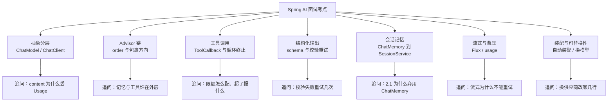
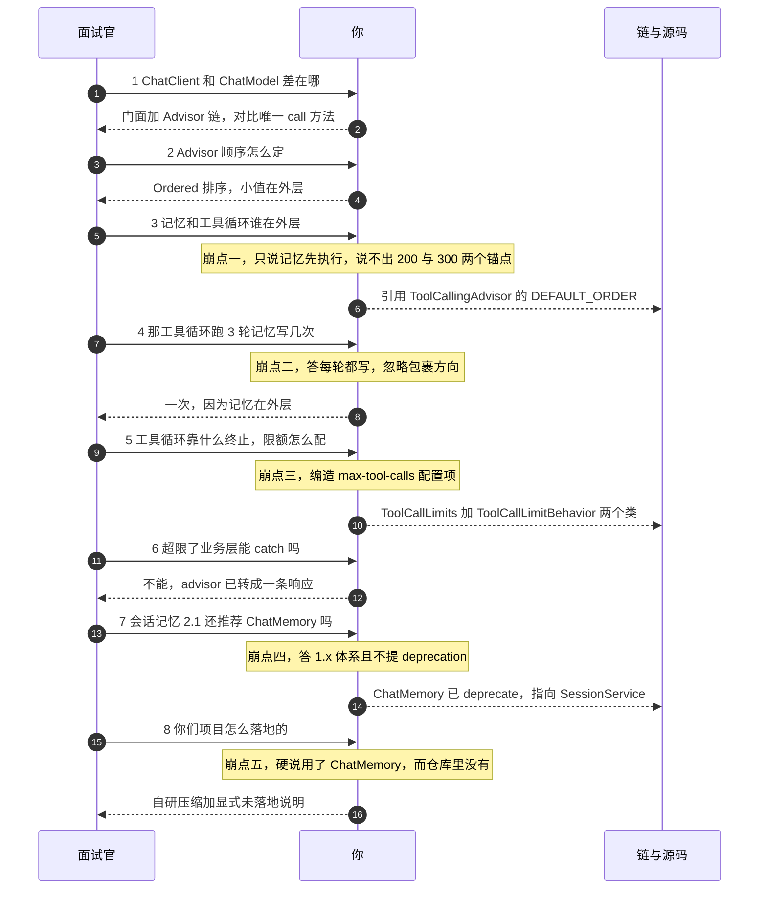

# 第2章：Spring AI 框架面试题

> **一句话结论**：Spring AI 的面试题一半考「抽象设计」——为什么 ChatModel 之上还要有 ChatClient + Advisor 两层；一半考「你用错过哪个 API」——而 2.1 把工具循环从 ChatModel 内部搬到 Advisor 层，让「你答的是哪个版本」本身变成考点。
> **阅读前置**：先读 [01-SpringAI入门.md](../01-SpringAI框架集成/01-SpringAI入门.md)（ChatModel/ChatClient 的最小可用认知）与 [10-RAG全栈实战-知识点汇总.md](../02-RAG全栈实战/10-RAG全栈实战-知识点汇总.md)（同体裁的"症状→根因→定位手法→修法"写法）；知道 Prompt、Message、ChatResponse、Usage 分别是什么。
> **证据基线**：Spring AI 2.1.0 / Spring Boot 4.2.0 / Spring Framework 7.1.0 / JDK 17。A 级锚点全部指向 `24-源码分析/assets/source/` 已入库摘录（908 份，其中含 `org.springframework.ai` 的 146 份）；B 级为本仓 `ai-cs-chat` 真实文件行号；C 级为 m2 里 1.1.4 与 2.1.0 两个版本 jar 的 `jar tf` / `javap` 实测输出。预计阅读 45 分钟。

---

## 0. 先看现象

**现象一：能背「Advisor 是拦截器」，追问一句「谁在外层」就哑火。**
候选人流利地说「Advisor 是 Spring AI 的拦截器，能做记忆、RAG、日志」。面试官接着问：「你现在既挂了记忆又挂了工具调用，模型连着调了 3 轮工具，记忆写了几次？」——答「每轮工具都写一次」的和答「工具跑完才写一次」的，都是只背了结论。真正的答案藏在两个硬编码常量里：记忆 advisor 的约定值是 `Ordered.HIGHEST_PRECEDENCE + 200`，工具循环是 `HIGHEST_PRECEDENCE + 300`，排序是**小值在外层**，所以记忆包住工具循环，一次调用只写一次记忆。说不出这两个数字和包裹方向，就等于没读过链。

**现象二：答的全是 1.x 的知识，而基线已经是 2.1.0。**
张口就是 `ChatMemory` + `MessageChatMemoryAdvisor` + `ChatMemory.DEFAULT_CONVERSATION_ID`。面试官只问一句「2.1 里 `ChatMemory` 还推荐用吗？」就断了。可核对的事实是：`ChatMemory` 接口在 2.1.0 上标了 `@Deprecated(since="2.1.0", forRemoval=true)`，官方 javadoc 直接指向 `spring-ai-session` 的 `SessionService`；`DEFAULT_CONVERSATION_ID` 这个常量在 2.1.0 的 jar 里已经不存在了（`javap` 实测，见第 7 节）。

**现象三：能说出「用 `.entity()` 做结构化输出」，一问失败怎么办就只剩「调 temperature」。**
`BeanOutputConverter` 会把目标类型生成 JSON Schema 拼进提示——这一步多数人能答；但模型返回了非法 JSON 之后框架做了什么、重试几次、能不能流式，答不出来。2.1 的答案是一个独立 advisor：`StructuredOutputValidationAdvisor`，校验失败时把 `"Output JSON validation failed because of: ..."` 追加到 user message 重新调用，默认最多重复 3 次，且明确不支持流式。

三个现象的共同结构，值得单独拆开看：

| 现象 | 表面上缺的 | 实际缺的 | 补法 |
|------|-----------|----------|------|
| 一 | 说不出「谁在外层」 | 缺默认值知识（`+200`/`+300`）与排序方向 | 背两个锚点 + 记住「小值在外层」 |
| 二 | 说得出 API 但版本过期 | 缺「哪个版本增删了什么」的时间轴 | 用 m2 双版本 jar 现场对比，不靠记忆 |
| 三 | 只会结论不会失败分支 | 缺「出错时框架做了什么」的路径 | 读懂 `adviseCall` 的循环与 break 分支 |

**这些现象指向同一件事**：Spring AI 的考点从来不是 API 清单，而是一条链——请求从 `ChatClient` 出发，穿过按 `order` 排好的 Advisor 链，落到 `ChatModel`，再被 `ToolCallingAdvisor` 的循环反复折返；每一个「为什么」都能定位到这条链上的某一环、某个默认值、某个失败分支。

---

## 1. 整体地图



> **读图说明**：左列 7 个节点是「能力面」，右边挂的 7 个节点是每个能力面上真正会被追问的那一句。面试的分水岭不在左列——背结论就能覆盖；分水岭在右列——必须知道实现里的默认值（`+200`/`+300`）、顺序语义（小值在外层）、失败分支（超限转成一条响应而不是抛异常）。建议读图顺序：先 A→B 建立「为什么要多加一层」，再 C→D（这两个都要落到 Advisor 或转换器上），最后 E→F→G（版本差异与工程化落地，也是最容易被旧答案带偏的三块）。

| 考点 | 背结论（能过初面） | 讲机制（能过分水岭） | 会定位（能过二面） | 能改造（能过终面） |
|------|------------|------------|------------|------------|
| ChatModel vs ChatClient | ChatModel 是底层接口，ChatClient 是门面 | ChatClient 组装 Advisor 链，并自动注册 ToolCallingAdvisor | 能给出现有代码里哪些调用绕过了链（本项目摘要走 ChatModel） | 能判断哪些场景该绕过链、绕过会丢什么 |
| Advisor 顺序 | 按 order 排序 | 小值在外层，`before→next→after` 洋葱模型 | 能用 `+200`/`+300` 解释记忆与工具循环的包裹关系 | 能自写 advisor 并正确选 order、避免双份历史 |
| 工具调用 | `@Tool` + `defaultToolCallbacks` | ToolCallingAdvisor 的 `do-while` 循环、`copy(this)` 跳过自身 | 能定位「工具没被调用」是没实现 `ToolCallingChatOptions` 还是没挂回调 | 能配限额、`returnDirect`、`requiresConfirmation` |
| 结构化输出 | `.entity(Xxx.class)` | BeanOutputConverter 生成 schema；校验重试在 advisor 层 | 能判断失败是schema 漂移还是截断 | 能换成 `StructuredOutputValidationAdvisor` 并处理流式禁区 |
| 会话记忆 | ChatMemory 存历史 | 窗口截断要 snap 到 USER 消息；2.1 换 CAS 事件日志 | 能解释并发丢消息的根因 | 能迁移到 SessionService / compaction |
| 流式 | 返回 Flux | `publishOn(boundedElastic)`、背压靠下游 request(n) | 能定位 usage 为什么恒 null | 能用 `UsageAccumulator` 或多轮累加补齐 |
| 可替换性 | 换配置即可 | 能力子集决定可替换性 | 能定位异步客户端没共享凭据导致的流式 401 | 能按 capability 建模路由并原子重建 |

把这张地图再压缩成「面试轮次 → 该讲哪一层」，复习时按轮次安排时间：

| 轮次 | 面试官想要的 | 对应章节 | 时间分配建议 |
|------|--------------|----------|--------------|
| 一面（基础筛） | 概念不混、能说清 ChatModel/ChatClient 分工 | 0、1、3.1 | 全部复习时间的 20% |
| 二面（深度） | order 语义、工具循环、失败分支 | 3.2~3.6 | 40% |
| 三面（版本与工程） | 版本差异、可替换性、你们怎么落地 | 3.7~3.11、7 | 30% |
| 交叉面（软实力） | 不会怎么说、怎么验证 | 4、5、6 | 10% |

---

## 2. 关键概念与关键类/关键参数

| 名称 | 所在位置 | 一句话准确定义 | 本项目取值/现状 |
|------|----------|----------------|-----------------|
| `ChatModel` | `spring-ai-model`，`org.springframework.ai.chat.model` | 模型侧唯一抽象：抽象方法只有 `ChatResponse call(Prompt)`；`stream()` 默认直接抛 `UnsupportedOperationException("streaming is not supported")` | `OpenAiChatModel`（OpenAI 兼容端点指向 deepseek） |
| `ChatClient` / `DefaultChatClient` | `spring-ai-client-chat` | 门面 + 调用规格：把 default system/advisors/tools 固化，并**在每次调用时组装链** | 每模型一个实例，由 `ChatModelRegistry.rebuild()` 构建 |
| `Advisor` | `advisor` 包（`advisor.api` 亦有子接口） | `interface Advisor extends Ordered`，即「有顺序的拦截器」 | 未自写；使用框架提供的 `QuestionAnswerAdvisor` |
| `CallAdvisor` | `org.springframework.ai.chat.client.advisor.api` | 同步拦截点：`ChatClientResponse adviseCall(ChatClientRequest, CallAdvisorChain)`，拿得到链、自己决定是否 `nextCall` | — |
| `BaseAdvisor` | 同上 | 同时实现 `CallAdvisor, StreamAdvisor`，把同步拆成 `before→nextCall→after`、流式拆成 `Mono.just(request).publishOn(scheduler)` | — |
| `ToolCallingAdvisor` | `chat.client.advisor` | 2.1 的工具循环宿主：`implements CallAdvisor, StreamAdvisor, ToolAdvisor`，`DEFAULT_ORDER = HIGHEST_PRECEDENCE + 300` | 未显式配置，由 `ChatClient` 自动注册 |
| `ToolCallLimits` | `spring-ai-model`（包私有 final class） | 工具循环限额：单工具次数、总次数、排除名单、超限行为；`NO_LIMIT = -1` | 全仓 `maxToolCalls` 0 命中 → 未配置任何限额 |
| `ToolCallLimitBehavior` | 同上 | 枚举 `THROW` / `RETURN_ERROR_RESPONSE`，决定超限是抛还是回一条说明 | 未配置（走框架默认） |
| `ToolCallbackProvider` | `org.springframework.ai.tool` | 把 bean 方法批量转成 `ToolCallback` 的提供者 | `MethodToolCallbackProvider.builder().toolObjects(orderQueryService, nl2SqlQueryService)` |
| `@Tool` / `@ToolParam` | `org.springframework.ai.tool.annotation` | 方法级工具声明；`Tool` 有 `name/description/returnDirect/requiresConfirmation/resultConverter`，`ToolParam.required()` 默认 `true` | 订单查询 2 个工具 + NL2SQL 1 个工具 |
| `BeanOutputConverter` | `org.springframework.ai.converter` | 用 `JsonSchemaGenerator` 把目标类型生成 JSON Schema 字符串（`jsonSchema` 字段），再拼进 format 指令 | 未使用（0 命中） |
| `StructuredOutputValidationAdvisor` | `chat.client.advisor` | 用 `SchemaRegistry.withDefaultDialect(Draft 2020_12)` 校验 JSON，失败把错误追加到 user message 重调，`maxRepeatAttempts=3`，不支持流式 | 未使用 |
| `ChatMemory` / `MessageWindowChatMemory` | `spring-ai-model`，`org.springframework.ai.chat.memory` | 会话历史存取接口；窗口实现默认保留 20 条、超限后 snap 到最近的 USER 消息 | 全仓无 Bean（未落地） |
| `SessionService` | `spring-ai-session`（本项目未引入） | 事件日志模型：`appendEvents` 带 `expectedVersion` 做 CAS，`getActiveMessages` 才是发模型的窗口，`compact` 只追加边界事件 | m2 中无此目录（`Test-Path` 为 False） |
| `Usage` / `UsageAccumulator` | `spring-ai-model`，`org.springframework.ai.chat.metadata` | `Usage` 的 getter 全是 `@Nullable`，`getTotalTokens()` 把 null 当 0 相加；2.1 新增 `UsageAccumulator` 供工具多轮累加 | 非流式走 `getMetadata().getUsage()`；流式 `AtomicReference<Usage>` 从未 `set()` → 恒 null |
| `SimpleLoggerAdvisor` | `chat.client.advisor` | 无参构造 = `(DEFAULT_REQUEST_TO_STRING, DEFAULT_RESPONSE_TO_STRING, 0)`，**默认 order = 0** | 未使用 |

---

## 3. 逐题精讲

每道题固定四段：**问题** → **30 秒答案骨架**（能直接照着说）→ **深挖追问**（追问什么、怎么答）→ **常见错误答案**（错在哪）。

### 3.1 ChatModel 与 ChatClient 的职责边界

**问题**：ChatModel 和 ChatClient 有什么区别？为什么框架要多一层？什么时候直接用 ChatModel？

**30 秒答案骨架**

1. `ChatModel` 是模型侧唯一抽象，抽象方法只有一个 `ChatResponse call(Prompt)`；`stream()` 是**默认实现且直接抛异常**，所以「能流式」是具体实现的能力，不是接口的保证。[[源码:ChatModel.java.md#L64-L66]]
2. `ChatClient` 不是抽象层，是**实现层**：`DefaultChatClient` 把 default system / default advisors / default tools 固化成调用规格，每次 `prompt()` 时组装一条 Advisor 链，链尾接 `ChatModelCallAdvisor` 与 `ChatModelStreamAdvisor`。[[源码:DefaultChatClient.java.md#L1243-L1257]]
3. 分界线一句话：**只依赖模型能力 → ChatModel；想要记忆 / 检索 / 日志 / 结构化 → 必须 ChatClient**，因为这些能力全部挂在 Advisor 链上，`ChatModel` 根本看不到链。
4. 本项目两种都用了，而且注释写明了原因：业务对话走 `chatClient.prompt()...call()`，摘要走 `chatModel.call(prompt)`——注释原话是「ChatModel 是最底层接口，跳过 ChatClient 的 Advisor 链」，因为摘要场景不需要 RAG 与日志拦截。

证据锚点：B 级 `ai-cs-chat/src/main/java/com/aics/chat/service/impl/ResilientAiService.java` L131（ChatModel 直调）与 L114（ChatClient + `.chatResponse()`）。

**深挖追问**

- *「`getOptions()` 和 `getDefaultOptions()` 有什么区别？」* 2.0 起 `getOptions()` 是新的默认值入口（`@since 2.0.0`），`getDefaultOptions()` 被标 `@Deprecated(forRemoval = true)` 且只是转调 `getOptions()`。这是版本差异的活证据：1.1.4 的 jar 里只有 `getDefaultOptions()`，没有 `getOptions()`（第 7 节 javap 实测）。[[源码:ChatModel.java.md#L52-L62]]
- *「ChatClient 能做成单例吗？」* 能。链是每次调用才组装的（`buildAdvisorChain()` 在 request spec 上），实例本身不持有请求状态；本项目就是在 `rebuild()` 里建好、放进 `Map` 后整体替换。
- *「流式下 `.content()` 和 `.chatResponse()` 差别？」* `.content()` 只取文本、丢掉 metadata（含 tool_calls 与 usage）；要用量必须 `call().chatResponse()`。本项目流式路径写的是 `.stream().content()`，这正是流式 usage 拿不到的一半原因。

**常见错误答案**

- 错：「ChatClient 是接口，ChatModel 是它的实现」——反了。接口/实现关系是 `ChatModel` → `OpenAiChatModel`；`ChatClient` 是另一层的门面。
- 错：「ChatClient 内部就是原样转发给 ChatModel」——漏掉了整条 Advisor 链，以及 2.1 新增的**自动注册 ToolCallingAdvisor**（即使没配静态工具也会注册，用来支持运行时动态注入的工具）。[[源码:DefaultChatClient.java.md#L1271-L1292]]
- 错：「工具是 ChatModel 内部执行的」——那是 1.1.4 的行为；2.1 已经把工具循环上移到 `ToolCallingAdvisor`。

### 3.2 Advisor 链的顺序语义（本篇最容易被追问崩的一题）

**问题**：Advisor 的执行顺序由什么决定？为什么 order 值小的是外层？记忆和工具循环谁包谁？

**30 秒答案骨架**

1. `Advisor extends Ordered`，链构建时 `DefaultAroundAdvisorChain` 的 Builder 用 `OrderComparator.sort(...)` 分别排 `callAdvisors` 与 `streamAdvisors`，值小者在前，即**更外层**。[[源码:DefaultAroundAdvisorChain.java.md#L275-L284]]
2. 请求方向是洋葱：外层 `before` → 内层 → 外层 `after`；`BaseAdvisor.adviseCall` 的字面实现就是 `before` → `nextCall` → `after` 三步。[[源码:BaseAdvisor.java.md#L47-L54]]
3. 框架用「锚点常量 + 增量」约定层级：记忆 `HIGHEST_PRECEDENCE + 200`、工具循环 `HIGHEST_PRECEDENCE + 300`、`SessionMemoryAdvisor` `+1000`、结构化校验 `LOWEST_PRECEDENCE - 2000`。数字越大越靠内层。
4. 结论：**记忆 advisor（+200）包住工具循环（+300）**，所以工具循环跑 3 轮，记忆只在最外层被调用一次——这正是 `ToolCallingAdvisor` 注释里写明 +300 的理由。[[源码:ToolCallingAdvisor.java.md#L90-L96]]

> **为什么这条必须背下来**：它是「能背结论」和「讲得出机制」的分界线。面试官听到 `+200`/`+300` 与「小值在外层」这两个细节，基本可以判定你真读过链的构建代码。

把四个常见 advisor 按 order 排开，一次请求的真实执行序列是这样的：

| 阶段 | 执行者（按 order 从小到大） | 这一阶段看到什么 |
|------|--------------------------|------------------|
| 1 | `SimpleLoggerAdvisor.before`（order 0） | 原始请求，还没有记忆和检索内容 |
| 2 | 记忆 advisor `.before`（约定 +200） | 注入历史消息 |
| 3 | `ToolCallingAdvisor`（+300） | 进入 `do-while`，可能反复第 3~4 阶段 |
| 4 | `StructuredOutputValidationAdvisor`（`LOWEST_PRECEDENCE - 2000`） | 最内层、紧贴模型 |
| 5 | `ChatModel.call(...)` | 真正发出 HTTP 请求 |
| 6 | 逐层 `.after` 反向回传 | 顺序与 before 相反 |

> 这张表能顺手解释一个看似奇怪的分支：`StructuredOutputValidationAdvisor` 在工具循环**内侧**，所以每轮工具迭代它都会被调到，但它一旦看到响应里有 toolCalls 就**不校验直接 break**（`StructuredOutputValidationAdvisor.java.md#L156`）——否则会把工具中间态当 JSON 去校验。两个事实能互相印证，就是一个"读通过"的信号。

**深挖追问**

- *「如果我自己写了个 order = +100 的记忆 advisor，会怎样？」* `DefaultChatClient` 的自动注册逻辑会检查链里有没有「order 比工具 advisor 更大（更内层）的 `MemoryAdvisor`」，有的话就**关掉 ToolCallingAdvisor 的内部会话历史**（`conversationHistoryEnabled(!hasDownstreamMemoryAdvisor)`），由那个记忆 advisor 负责每轮迭代的历史，避免双份历史。[[源码:DefaultChatClient.java.md#L1284-L1291]]
- *「能挂两个 ToolAdvisor 吗？」* 不能：`validateSingleToolAdvisor()` 会抛 `IllegalStateException("At most one ToolAdvisor is allowed in the advisor chain, but found ...")`。[[源码:DefaultChatClient.java.md#L1294-L1301]]
- *「不想让它自动注册呢？」* 用 param 关掉：`ChatClientAttributes.TOOL_CALLING_ADVISOR_AUTO_REGISTER` 置 false 时直接 return。[[源码:DefaultChatClient.java.md#L1273-L1277]]
- *「同步链和流式链是同一批 advisor 吗？」* 同一个 builder 分别排序两套链，因此 `BaseAdvisor` 要同时实现 `CallAdvisor` 与 `StreamAdvisor`；但流式下 `after` 只在 `AdvisorUtils.onFinishReason()` 命中时才执行，且异常会被包成 `IllegalStateException("Stream processing failed", error)`。[[源码:BaseAdvisor.java.md#L57-L74]]

**常见错误答案**

- 错：「order 越大越先执行」——把 Spring MVC 拦截器的手感套过来了；这里是小值优先。
- 错：「Advisor 就是 before/after 两个钩子」——那是 1.x 的 `CallAroundAdvisor` / `AdvisedRequest` / `chain.nextAroundCall`。2.x 是 `adviseCall(request, chain)`，你能拿到链、能改写 request/response、能决定不调 next。[[源码:CallAdvisor.java.md#L30-L32]]
- 错：「Advisor 只能加消息，不能改响应」——`adviseCall` 返回的是新的 `ChatClientResponse`，改响应是合法用法（结构化校验就是靠它）。

### 3.3 常用 Advisor 一览：它们的默认 order 决定了行为

**问题**：项目里常挂哪些 Advisor？它们各自默认排在哪？

**30 秒答案骨架**

按 order 从小到大（外层→内层）：

| Advisor | 职责 | 默认 order | 关键细节 |
|---------|------|-----------|----------|
| `SimpleLoggerAdvisor` | 打请求/响应日志 | `0`（无参构造传入）[[源码:SimpleLoggerAdvisor.java.md#L41-L59]] | 响应侧用 `JacksonUtils.getDefaultJsonMapper().writerWithDefaultPrettyPrinter()` |
| `QuestionAnswerAdvisor` | RAG：检索后把文档注入 prompt | 未显式设置（走 builder 默认值，本项目也未设） | 本项目 `similarityThreshold(0.3)` + `topK(5)` |
| 记忆类（`SessionMemoryAdvisor`） | 会话历史 | `HIGHEST_PRECEDENCE + 1000` [[源码:SessionMemoryAdvisor.java.md#L87-L105]] | 故意比工具循环（+300）更内层，即跑在**工具循环内部** |
| `ToolCallingAdvisor` | 工具循环 | `HIGHEST_PRECEDENCE + 300` | 与记忆的相对位置决定记忆写几次 |
| `StructuredOutputValidationAdvisor` | JSON 校验 + 重试 | `BaseAdvisor.LOWEST_PRECEDENCE - 2000` | 最内层、紧贴模型；遇 toolCalls 直接跳过校验 |

再说一条能立刻显出深度的观察：`SimpleLoggerAdvisor` 默认 order = 0，比记忆（+200）和工具（+300）都小，也就是最外层——它的 `before` 拿到的是**链最外层的原始请求**，你在日志里看不到 RAG 注入的文档和记忆补的历史。按排序（L275-284）与 `before→next→after`（L47-54）的语义，这是必然结果，不是 bug。

**深挖追问**

- *「想看到 RAG 注入后的完整 prompt，怎么办？」* 把你自己的日志 advisor 的 order 设到比 RAG advisor 更大（更内层），或者在检索之后手动打印。
- *「记忆 advisor 为什么默认在工具循环内侧？」* `SessionMemoryAdvisor` 的 Builder 注释写明：故意取比 `ToolCallingAdvisor` 默认 order 更大的值，让它在工具循环**内部**逐轮提供历史——每轮工具迭代都需要看到刚产生的 tool 消息。
- *「那 3.2 说的『记忆在外层』是不是矛盾？」* 不矛盾，分两种记忆：`MemoryAdvisor` 概念分两类——一类是「一次调用写一次」的会话级记忆（+200 约定），一类是「每轮工具迭代都要看到历史」的 session 记忆（+1000，跑在内层）。说清这个区别，面试官会认为你真读过两个类的注释。

**常见错误答案**

- 错：「所有 Advisor 都是 order 0，靠注册顺序」——`OrderComparator.sort` 明确覆盖注册顺序。
- 错：「日志 advisor 一定在最后」——它默认在最外层（order 0），`after` 才最后执行。

### 3.4 工具调用：从 `@Tool` 到 ToolCallback 再到循环

**问题**：Spring AI 的 Function Calling 是怎么实现的？`@Tool` 注解之后发生了什么？

**30 秒答案骨架**

1. 声明侧：`@Tool` 标在 bean 方法上，`@ToolParam` 标参数；`Tool` 注解有 `name/description/returnDirect/requiresConfirmation/resultConverter` 五个属性，`ToolParam.required()` 默认 `true`——不加注解的参数默认必填。[[源码:Tool.java.md#L37-L80]] [[源码:ToolParam.java.md#L34-L39]]
2. 转换侧：`MethodToolCallbackProvider` 扫这些方法转成 `ToolCallback`（内含由方法签名生成的 JSON Schema），本项目通过 `ToolCallbackProvider` Bean 暴露。B 级：`ai-cs-chat/src/main/java/com/aics/chat/config/SpringAiConfig.java` L222-228。
3. 执行侧：**不是 ChatModel 干的**。`ChatClient` 组链时如果没发现 `ToolAdvisor` 就自动注册 `ToolCallingAdvisor`；它 `do { ... } while (isToolCall)` 地循环：调模型 → 有 toolCalls 就 `toolCallingManager.executeToolCalls(...)` → 把结果拼回对话 → 再调模型。[[源码:ToolCallingAdvisor.java.md#L170-L244]]
4. 循环里每轮是 `callAdvisorChain.copy(this).nextCall(...)`——把自己从链上摘掉再往下调，避免递归。[[源码:ToolCallingAdvisor.java.md#L188-L188]]

本项目真实的工具声明长这样（B 级：`ai-cs-chat/src/main/java/com/aics/chat/service/OrderQueryService.java` L37-39）：

```java
@Tool(description = "根据订单号查询订单详情，包括订单状态、商品信息、金额、物流等")
public String queryOrderByOrderId(
        @ToolParam(description = "订单编号，格式如 ORD20260809001") String orderId) {
    ...
}
```

这段声明会被 `MethodToolCallbackProvider` 转成一条 `ToolCallback`，其中发给模型的 JSON Schema 由方法签名生成：方法名或 `name()` 作工具名，`description` 作工具说明，`@ToolParam` 的 description 作参数说明，`required()` 默认 `true`——所以**不给参数加 `@ToolParam` 就等于告诉模型"这个参数必须给"**。[[源码:ToolParam.java.md#L34-L39]] 同一套机制下，本项目还有一个 NL2SQL 工具，带两个参数（库标识 + 只读 SQL）：`ai-cs-chat/src/main/java/com/aics/chat/nl2sql/Nl2SqlQueryService.java` L158-164。

**深挖追问**

- *「什么情况下工具会静默不执行？」* 两个真实条件：一是 `options instanceof ToolCallingChatOptions` 不成立时 `adviseCall` 直接 `return callAdvisorChain.nextCall(...)`，循环根本不进——自定义 `ChatOptions` 实现错了就会这样。[[源码:ToolCallingAdvisor.java.md#L144-L152]] 二是工具回调没挂到 builder 上；本项目为此专门按 `ModelCapability.TOOL_CALLING` 条件挂载，注释写明「避免依赖 2.x 默认关闭的 Bean 工具回退解析」。B 级：`ai-cs-chat/src/main/java/com/aics/chat/modelrouter/ChatModelRegistry.java` L74-78。
- *「`returnDirect` 什么意思？」* 置 true 时，工具结果直接作为最终响应返回并 break，不再问模型。[[源码:ToolCallingAdvisor.java.md#L226-L237]]
- *「2.1 新增的 `requiresConfirmation` 呢？」* 需要人工确认：无决策时拒绝执行、循环 `paused`，`ToolCallingAdvisor` 捕获 `ToolCallConfirmationRequiredException` 后 break；这是 1.1.4 没有的能力。
- *「工具方法里怎么拿到当前用户？」* 本项目用 `ThreadLocal`（`ChatUserContext`）。坑：并行/异步执行工具时 ThreadLocal 失效——`ChatUserContext` 的注释本身就写了这条警告。B 级：`ai-cs-chat/src/main/java/com/aics/chat/util/ChatUserContext.java` L10/L14/L20。

**常见错误答案**

- 错：「Function Calling 是模型自己执行函数」——模型只输出 tool_calls（工具名 + JSON 参数），执行永远发生在 JVM 里。
- 错：「工具配在 ChatModel 上」——1.1.4 是模型内部工具执行；2.1 的配置入口是 `ToolCallingAdvisor.Builder.toolCallingManager`。
- 错：「`@Tool` 方法的参数顺序随便，描述无所谓」——描述是模型选工具的唯一依据；`Tool.name()` 的 javadoc 还特别提醒空格和括号可能与部分模型不兼容。

### 3.5 多轮工具循环怎么终止：限额、`returnDirect` 与异常

**问题**：模型一直要调工具怎么办？循环靠什么终止？

**30 秒答案骨架**

1. 三条终止路径：模型不再返回 tool calls（默认 eligibility checker 就是 `chatResponse != null && chatResponse.hasToolCalls()`）[[源码:ToolCallingAdvisor.java.md#L98-L99]]；工具 `returnDirect()` 直接返回；限额触发或异常。
2. 限额不是一个属性配置项，而是两个类：`ToolCallLimits`（包私有 final class，管单工具次数、总次数、排除名单、超限行为）与 `ToolCallLimitBehavior` 枚举（`THROW` / `RETURN_ERROR_RESPONSE`）。[[源码:ToolCallLimits.java.md#L37-L52]] [[源码:ToolCallLimitBehavior.java.md#L26-L41]]
3. 计数只看「本轮」：`currentTurnMessages` 从最后一条 `UserMessage` 开始算，所以外部 `ChatMemory` 把整段历史重放进 prompt 时，不会把历史里的工具调用重复计数。[[源码:ToolCallLimits.java.md#L98-L105]]
4. 超限后 `ToolCallingAdvisor` **不会把异常抛给你**：它捕获 `ToolCallLimitExceededException`，把这次 breach 当成一条 generation 直接返回并 break——业务层看到的是「正常返回，但 finishReason 是 `toolCallLimitExceeded`」。[[源码:ToolCallingAdvisor.java.md#L205-L215]] [[源码:ToolCallLimitExceededException.java.md#L40-L47]]

**深挖追问**

- *「`RETURN_ERROR_RESPONSE` 会不会死循环？」* 不会。它只是跳过这次调用、回一条说明文字让模型自己收尾（`ToolCallLimits.check()` 的两条消息是固定的："Tool call limit (%d) exceeded for tool '%s'..." 与 "Total tool call limit (%d) exceeded for this turn..."）。真正的兜底仍然是 total limit。[[源码:ToolCallLimits.java.md#L113-L130]]
- *「上限一般设多少？」* 诚实答法：这取决于业务，但必须设——单工具 2~3 次、总 5~8 次是常见区间（属于工程经验，不是框架事实）；本项目目前**没配**（全仓 `maxToolCalls`、`ToolCallingChatOptions` 均 0 命中），靠请求级超时兜底，这是一个已知待补项。
- *「超限时怎么把已经拿到的工具结果一起返回？」* 异常对象里带了 `partialToolResponses` 元数据（`METADATA_PARTIAL_TOOL_RESPONSES`），可以取出部分结果。
- *「并发消息进来了，限额计数会不会串？」* `ToolCallLimits` 的计数基于「本轮消息列表」而非静态字段，不跨请求共享状态——这是它按 `currentTurnMessages` 重建计数的目的。

**常见错误答案**

- 错：`spring.ai.chat.options.max-tool-calls=5`——这个属性不存在（1.x 没有，2.1 更没有）。编造配置项是这类题最致命的地方。
- 错：「超限会抛异常，业务层 catch 就行」——已被 Advisor 吞掉并转成响应，你 catch 不到；要看 `finishReason` 或 metadata。
- 错：「多轮工具调用是模型记住了上一轮结果」——是框架把工具结果拼回对话历史再发一次，模型本身无状态。

### 3.6 结构化输出：`BeanOutputConverter` 生成 schema，校验重试在 Advisor 层

**问题**：怎么让模型稳定返回 JSON/Java 对象？返回非法 JSON 怎么办？

**30 秒答案骨架**

1. `BeanOutputConverter<T>` 在构造期就调用 `generateSchema()`，把目标类型（借助 `JsonSchemaGenerator`）生成 JSON Schema 字符串存进 `jsonSchema` 字段，`Objects.requireNonNull(..., "JSON schema cannot be null")`，再把 schema 拼进 format 指令。[[源码:BeanOutputConverter.java.md#L143-L143]]
2. 默认的 `.entity(Xxx.class)` **不会自动重试**：解析失败就抛。想让模型「看到错误再改」需要显式挂校验 advisor。
3. `StructuredOutputValidationAdvisor` 是这个角色：用 `SchemaRegistry.withDefaultDialect(Draft 2020_12)` 建校验器，`adviseCall` 跑 `1 + maxRepeatAttempts` 次（默认 3），失败时把 `"Output JSON validation failed because of: " + errorMessage` 追加到 user message 重新调用。[[源码:StructuredOutputValidationAdvisor.java.md#L139-L200]] [[源码:StructuredOutputValidationAdvisor.java.md#L181-L189]]
4. 两个「不重试」的前置分支很关键：命中 `GuardrailRefusal` 直接 break；响应里带 toolCalls 时**不校验直接 break**——否则会把工具中间态当 JSON 去校验。[[源码:StructuredOutputValidationAdvisor.java.md#L148-L156]]
5. 它**不支持流式**：`adviseStream` 返回 `Flux.error(new UnsupportedOperationException("The Structured Output Validation Advisor does not support streaming."))`。[[源码:StructuredOutputValidationAdvisor.java.md#L253-L258]]

**深挖追问**

- *「本项目用了吗？」* 没有，而且可以明确说清现状：`IntentClassifierService` 是手工剥 ```json 代码块，再 `indexOf('{')` / `lastIndexOf('}')` 截取，最后 `objectMapper.readTree(...)`。B 级：`ai-cs-chat/src/main/java/com/aics/chat/agent/intent/IntentClassifierService.java` L132-151。全仓 `.entity(` 与 `BeanOutputConverter` 均 0 命中。
- *「为什么不换成 advisor？」* 好答案结构：先讲收益（schema 声明式、失败可重试、错误信息回灌），再讲代价（不支持流式、多一次调用、schema 漂移要靠版本管理），最后给自己的判断（意图分类是单层小 JSON，手工截取够用；但这是明确的技术债）。
- *「除了重试还能怎么提高稳定性？」* 四层：schema 尽量扁、必填项少、给一个 few-shot 示例、maxTokens 留足避免截断（截断导致的 JSON 不合法重试也没用）。

**常见错误答案**

- 错：「`.entity()` 校验失败框架会自动重试」——默认不会。
- 错：「用 `StructuredOutputValidationAdvisor` 也能流式」——会直接 `Flux.error`。
- 错：「温度设 0 就不会有格式问题」——格式问题主要来自截断和 schema 与模型理解偏差，不是采样随机性。

### 3.7 会话记忆：`ChatMemory` 与 2.1 的 `SessionService`（版本差异必考）

**问题**：Spring AI 怎么做多轮对话记忆？2.1 有什么变化？

**30 秒答案骨架**

1. 旧体系（1.x 到 2.0 的标准答案）：`ChatMemory` 接口 + `MessageWindowChatMemory`（默认 20 条）+ `MessageChatMemoryAdvisor` 把历史塞进 prompt。窗口超限时先保 System 消息，再把截断点「snap 到最近的 USER 消息」，保证窗口从完整轮次开始。[[源码:MessageWindowChatMemory.java.md#L116-L125]]
2. 新体系（2.1）：`ChatMemory` 整个接口标 `@Deprecated(since="2.1.0", forRemoval=true)`，javadoc 指向 `spring-ai-session` 的 `SessionService`。[[源码:ChatMemory.java.md#L30-L40]]
3. `SessionService` 是「事件日志 + 乐观锁」模型：`appendEvents(sessionId, events, expectedVersion)` 版本不匹配就不写、返回 false；`getMessages` 是全量日志（不是 prompt），`getActiveMessages` 才是真正发模型的窗口；`compact(...)` 追加一条 `EventType.COMPACTION` 边界事件 + 摘要事件，日志永不改写。[[源码:SessionService.java.md#L143-L143]] [[源码:SessionService.java.md#L167-L177]] [[源码:SessionService.java.md#L208-L208]]
4. 它不会自己清理过期会话：`deleteExpiredSessions(Instant before)` 的注释原话是「Nothing calls this on its own: call it from a scheduler, every hour for example.」——这句话就是「为什么要写定时任务」的答案。[[源码:SessionService.java.md#L98-L98]]

**深挖追问**

- *「2.1 为什么要换掉 ChatMemory？」* 三个可核对的具体理由：① `ChatMemory` 只有 `add/get/clear`，没有版本号——并发写会互相覆盖丢消息，`SessionService` 用 `expectedVersion` 做 CAS；② 没有事件级能力（`searchEvents`、单条事件、请求/响应事件 id）；③ 压缩只能硬截断（window / purge），而 `compact` 能保留摘要边界、原日志不丢。
- *「conversationId 常量变了吗？」* `ChatMemory.CONVERSATION_ID` 两版都在，值是 `"chat_memory_conversation_id"`；`MemoryAdvisor.CONVERSATION_ID` 同值，`SessionMemoryAdvisor.SESSION_ID_CONTEXT_KEY` 直接指向它——迁移时上下文 key 不用改。但 `ChatMemory.DEFAULT_CONVERSATION_ID` 在 2.1.0 被删了（第 7 节 javap 输出）。
- *「本项目落地了吗？」* 没有，两条都没落地：全仓没有 `ChatMemory` 也没有 `SessionService` Bean；`SpringAiConfig` 里 `MessageChatMemoryAdvisor` 只出现在一行注释里（L258）。真实做法是自研压缩：`ChatServiceImpl#compressHistory` 保留最近 KEEP_RECENT_SIZE 条 + 把更早的消息交给 `summary` 提示词摘要后作为 System 消息，失败回退纯截断。B 级：`ai-cs-chat/src/main/java/com/aics/chat/service/impl/ChatServiceImpl.java` L278-306。另外 m2 里根本没有 `spring-ai-session` 目录（C 级 `Test-Path` 返回 False），说明依赖没引进来——想用 2.1 的 session 记忆要先加依赖。

**常见错误答案**

- 错：「ChatMemory 是 2.1 的推荐做法」——已 `@Deprecated(forRemoval=true)`。
- 错：「ChatMemory 默认持久化」——`MessageWindowChatMemory.Builder` 默认装的是 `InMemoryChatMemoryRepository`，进程重启即丢。
- 错：「记忆就是拼历史，没有顺序问题」——记忆 advisor 的 order 决定它包不包工具循环，直接决定写几次、上下文涨多快。

### 3.8 流式 API 与 Flux 背压

**问题**：Spring AI 的流式怎么实现？背压怎么处理？流式下能拿到 token 用量吗？

**30 秒答案骨架**

1. 流式是可选能力：`ChatModel.stream()` 默认抛 `UnsupportedOperationException("streaming is not supported")`，能流式是具体实现的额外能力。[[源码:ChatModel.java.md#L64-L66]]
2. 链尾负责流式的 advisor 是 `ChatModelStreamAdvisor`；`BaseAdvisor.adviseStream` 用 `Mono.just(request).publishOn(getScheduler()).map(before).flatMapMany(nextStream)`，默认调度器是 `Schedulers.boundedElastic()`——把模型侧的阻塞调用挪出主线程。[[源码:BaseAdvisor.java.md#L44-L44]] [[源码:BaseAdvisor.java.md#L57-L74]]
3. 背压由下游 `request(n)` 驱动，框架不额外加缓冲；真正决定内存的是你选的 operator：`flatMap` 默认并发 256，要保序用 `concatMap`，要限请求量用 `limitRate`。
4. usage 在流式下通常拿不到：`Usage` 的 getter 全是 `@Nullable`，`getTotalTokens()` 把 null 当 0 相加，所以页面上显示 0 而不是报错。[[源码:Usage.java.md#L56-L62]]

背压落在哪，看的就是这两个 operator（示意片段，重点不在业务实现）：

```java
Flux<String> tokens = chatClient.prompt().user(question).stream().content();

tokens.concatMap(this::persistChunk)
      .limitRate(8)
      .doOnNext(sink::send)
      .subscribe();
```

`concatMap` 保证一次只处理一个 chunk（保序、串行、内存可控），`limitRate(8)` 把向上游的请求量压到 8 个。也正因为下游可能已经吐出过 token，这条链上不能写重试，只能写降级提示。

**深挖追问**

- *「本项目流式 usage 为什么恒 null？」* 这是一个可以在代码里指出来的一手事实：`ResilientAiService` 里 `AtomicReference<Usage> usageRef` 只声明了（L277）、后面只 `get()`（L303），全文件没有一次 `set()`——所以是「没接」，不是「框架不给」。B 级：`ai-cs-chat/src/main/java/com/aics/chat/service/impl/ResilientAiService.java` L277/L303。非流式路径正常，走 `response.getMetadata().getUsage()`。
- *「工具多轮时 usage 怎么算？」* 2.1 为此提供了 `UsageAccumulator`：每轮 `addRoundResponse(...)`，最后 `applyAccumulatedUsage(chatClientResponse)` 把累计值写回响应。[[源码:UsageAccumulator.java.md#L73-L96]] 这也是 `ToolCallingAdvisor` 在循环外持有一个 `UsageAccumulator` 的原因。
- *「流式能不能重试/走 fallback？」* 不能重放：一旦下游收到 token，重试就等于重复输出。本项目注释原话是「流式不重试、不走 fallback 链——Flux 一旦开始发射 token 就无法重放」。B 级 L246。
- *「2.x 的流式工具开关变了吗？」* 变了：1.1.4 的 Builder 有 `streamToolCallResponses` / `suppressToolCallStreaming`，2.1.0 已删除（javap 实测，见第 7 节）。

**常见错误答案**

- 错：「Flux 会自动帮你背压」——能背压的是遵守 Reactive Streams 的源；上游是 HTTP chunk 流时，限流点在你自己的 operator。
- 错：「`usageRef` 恒 null 是因为模型不支持」——本项目用手工 `OpenAIOkHttpClient`，问题在代码没赋值。
- 错：「流式就是 `call()` 换成 `stream()`，其他全一样」——链尾 advisor 不同、`after` 触发条件不同、异常包装不同、工具循环里的响应处理也不同。

### 3.9 自动装配与配置项

**问题**：Spring AI 在 Boot 里怎么自动装配？关键配置项是什么？

**30 秒答案骨架**

1. 2.x 的 OpenAI 配置是**扁平**的：`spring.ai.openai.chat.model` / `temperature` / `max-tokens`，不再是 1.0 的 `spring.ai.openai.chat.options.*` 嵌套。B 级：`ai-cs-chat/src/main/resources/application.yml` L35-44。
2. 自动装配可以被整体关掉某一类：本项目 `spring.autoconfigure.exclude` 排除了 `OpenAiEmbeddingAutoConfiguration`（yml L14），因为 embedding 走自建的 provider（768 本地哈希 + 1024 bge-m3 `@Primary`，双 provider 靠 `@Primary` 消歧）。
3. 手动装配的最小写法是「先造 SDK 客户端，再交给模型 builder」：`OpenAIOkHttpClient.builder().baseUrl(...).apiKey(...).build()`，再 `OpenAiChatModel.builder().openAiClient(client).openAiClientAsync(client.async()).options(...)`。B 级：`ai-cs-chat/src/main/java/com/aics/chat/modelrouter/ChatModelRegistry.java` L58-72。
4. 一个只有踩过才知道的细节：**同步与异步客户端必须共享同一份 base-url 与凭据**，只传同步客户端，Builder 在流式路径会回退到环境变量并丢掉自定义供应商配置——`ChatModelRegistry` 的注释原话就是这么写的（L58-59）。

**深挖追问**

- *「为什么用 exclude 而不是改属性？」* 一句话：让「谁提供 EmbeddingModel」只有一个答案。exclude 之后自动配置不再参与竞争，手工 Bean 的 `@Primary` 语义也不用和它博弈。
- *「配置放 Nacos 还是 application.yml？」* 本项目两处都有：`application.yml` 给默认值（`${OPENAI_MODEL:deepseek-chat}`），`tools/nacos-config/ai-cs-chat.yml` 给运行期覆盖（`model: deepseek-chat`、`temperature: 0.7`、`max-tokens: 2048`），并有 `optional:nacos:ai-cs-chat.yml` 允许无 Nacos 启动。
- *「`ChatClient.Builder` 怎么批量统一配置？」* 用 `ChatClientCustomizer`：本项目把 `defaultSystem(promptRegistry.render(...))` 与 `defaultAdvisors(ragAdvisor)` 收在一处，`ChatModelRegistry` 每建一个模型就 `customize` 一次（L73）。

**常见错误答案**

- 错：`spring.ai.openai.chat.options.temperature`——1.0 的写法，2.x 已扁平化。
- 错：「配置项错了会启动失败」——拼错的属性默默不生效，模型按默认值跑，排查时会被误导。
- 错：「自动装配一定会建 ChatModel Bean」——没有 api-key 时不会建，或者被 exclude 掉了。

### 3.10 可替换性：换模型到底改哪里

**问题**：业务要从 OpenAI 换到别的供应商，只改配置能行吗？

**30 秒答案骨架**

1. 抽象上可以：业务依赖 `ChatClient`/`ChatModel` 接口，换实现不动业务代码——这是「类 Spring Data」的设计意图。
2. 但「只改配置」有前提：你用的能力必须是两端都支持的**子集**。流式、工具调用、结构化输出、多模态、usage 字段，各家支持度不同，这也是本项目给模型定义加 `ModelCapability` 的原因。
3. 本项目真实的换法：`aics.model-router.models[]` 里每项声明 `model` 与 `capabilities`，`ChatModelRegistry.rebuild()` 按配置重建客户端并用 `Map.copyOf(next)` 原子替换（`synchronized`、启动失败 fail-fast、刷新失败保留旧配置）。B 级：`ai-cs-chat/src/main/java/com/aics/chat/modelrouter/ChatModelRegistry.java` L44/L52-57/L82-90。
4. 换供应商最容易破的三处：① 异步客户端没共享凭据 → 流式 401；② 工具名/参数 schema 不兼容（`Tool.name()` 的 javadoc 就建议只用字母数字下划线连字符点）；③ usage 字段名不同，`getNativeUsage()` 返回的是 `Object`，只能按供应商自己解析。[[源码:Usage.java.md#L68-L68]]

**深挖追问**

- *「artifactId 也变了吗？」* 变了但包名没变：`QuestionAnswerAdvisor` 在 1.1.4 属于 `spring-ai-advisors-vector-store`，2.1.0 属于 `spring-ai-vector-store-advisor`，而类所在包始终是 `org.springframework.ai.chat.client.advisor.vectorstore`（`jar tf` 实测）。所以升级时改 pom 坐标、不用改 import。
- *「`ChatModel` 上的 `getOptions()` 对替换有什么影响？」* 2.0 起统一走 `getOptions()`，自定义实现要覆盖它而不是老方法，否则你设的默认参数在其他代码路径上不生效。
- *「换模型后工具不触发了，怎么定位？」* 三步：看该模型的 `capabilities` 是否含 `TOOL_CALLING`（本项目按此条件挂回调）；看返回里有没有 tool_calls；看 `options` 是否为 `ToolCallingChatOptions`（否则 advisor 不进循环）。

**常见错误答案**

- 错：「Spring AI 换模型零成本」——接口层零成本，能力层不零成本。
- 错：「把 `spring.ai.openai.base-url` 一改就行」——流式路径可能仍走环境变量（本项目注释里的事故就是这个）。
- 错：「换模型不影响 usage 统计」——字段名与是否返回都可能变。

### 3.11 为什么这个项目手工装配 ChatModel，而不是全靠自动装配

**问题**：既然 Boot 有自动装配，为什么还要在配置类里手写 `OpenAiChatModel.builder()`？

**30 秒答案骨架**

1. 因为要「多模型 + 运行期可换」：`aics.model-router.models[]` 声明了多个模型及其 `capabilities`，`ChatModelRegistry.rebuild()` 按配置批量建客户端，再用 `Map.copyOf(next)` 原子替换，配置未变则复用旧客户端。B 级：`ai-cs-chat/src/main/java/com/aics/chat/modelrouter/ChatModelRegistry.java` L44/L52-57/L82-83。
2. 因为要控制 SDK 客户端细节：同步与异步必须共享同一份 base-url 与凭据（L58-72），否则流式路径回退环境变量。
3. 因为要给每个模型单独定制 `ChatClient`：`chatClientCustomizer.customize(ChatClient.builder(chatModel))`（L73），把 `defaultSystem` 与 RAG advisor 统一注入一次。
4. 因为要按能力裁剪工具：只有 `ModelCapability.TOOL_CALLING` 的模型才 `defaultToolCallbacks(...)`（L74-78）。

**深挖追问**

- *「自动装配还留着吗？」* 留着：`application.yml` 里仍有 `spring.ai.openai.chat.*`，只是 embedding 那条被 `spring.autoconfigure.exclude` 关掉（L14），因为 embedding 走自建 provider。
- *「`rebuild()` 线程安全吗？刷新失败怎么办？」* `synchronized` 方法（L44）；启动失败 fail-fast 抛 `IllegalStateException("failed to initialize model registry", e)`；刷新失败保留旧配置（L86-90）。
- *「手工装配的代价？」* 失去零配置便利，客户端的生命周期与资源关闭要自己负责；本项目用「配置未变则复用」压低了重建频率，但没有显式关闭旧客户端——这是可改进点。

**常见错误答案**

- 错：「直接 `new OpenAiChatModel(...)` 更简单」——绕过 builder 容易只传同步 client，流式直接挂。
- 错：「多模型就多写几个 `@Bean`」——静态 Bean 无法运行期替换、无法原子切换。
- 错：「自动装配 + `@Primary` 就够了」——`@Primary` 只能选一个默认 Bean，表达不了「按 capabilities 裁剪工具与提示词」。

---

## 4. 一次完整追问链时序



> **读图说明**：横轴是追问递进，纵轴是三条泳道——面试官提问、你作答、源码/证据。五个 `Note` 就是五个崩点：**崩点一**在「谁在外层」，说不出 `+200`/`+300` 就等于只会背「Advisor 是拦截器」；**崩点二**在「写几次」，答「每轮都写」说明把洋葱模型想反了；**崩点三**在「限额怎么配」，编配置项是硬伤（正确做法是 `ToolCallLimits` + `ToolCallLimitBehavior` 两个类）；**崩点四**在版本，答 1.x 体系会被判定知识过期；**崩点五**在落地，把自己的仓库说出不存在的 Bean 是最容易被追问穿的。注意第 5、7 步都要把话落回源码锚点——「我记得」和「我读过」在面试里是两种可信度。

每步失败时会报什么，逐条对照：

| 步 | 如果答错，现场信号 | 正确落点 |
|----|-------------------|----------|
| 3/4 | 面试官会反问「那你记忆里的上下文为什么会重复膨胀」 | `ToolCallingAdvisor.java.md#L90-L96` 注释里写明了 +300 的理由 |
| 5 | 面试官会说「这个属性我没见过」 | `ToolCallLimits.java.md#L37-L52` + `ToolCallLimitBehavior.java.md#L26-L41` |
| 6 | 追问「那你 catch 到的是什么异常」会立刻露底 | `ToolCallingAdvisor.java.md#L205-L215` 捕获后直接返回 |
| 7 | 追问「`DEFAULT_CONVERSATION_ID` 还在吗」 | 第 7 节 javap：2.1.0 已删该常量 |
| 8 | 要求现场打开代码时会露底 | `ChatServiceImpl.java` L278-306 自研压缩 |

**五个崩点的现场补救话术**（已经开始答偏时，用一句半转回来，比硬撑更好）：

| 崩点 | 补救话术 | 效果 |
|------|----------|------|
| 一 | 「我刚才只说了方向，具体是两个常量：记忆 +200、工具 +300，小值在外层」 | 把定性说法升级成可核对事实 |
| 二 | 「我纠正一下，工具循环跑多轮时记忆只在外层调一次，因为记忆包在外面」 | 主动纠错比被追问出来更可信 |
| 三 | 「限额不是属性，是 `ToolCallLimits` 和 `ToolCallLimitBehavior` 两个类，我刚才说得太快」 | 消除「编配置项」的印象 |
| 四 | 「这是 1.x 的说法，2.1 上 `ChatMemory` 已标记移除，方向是 `SessionService`」 | 展示版本意识 |
| 五 | 「我们实际上没有落地 Spring AI 的记忆，是自研压缩，在 `ChatServiceImpl` 里」 | 保真比好看重要 |

---

## 5. 答题策略取舍

| 问题类型 | 好的答法 | 差的答法 | 为什么 |
|----------|----------|----------|--------|
| 「两个类有什么区别」 | 先给一句职责分界，再给一个「什么时候用哪个」的判据，最后落到本项目的一处真实调用 | 把两个类的 API 从头念一遍 | 面试官要的是选择依据，不是 javadoc 复述 |
| 「顺序/优先级怎么定」 | 直接给数字锚点（`+200`/`+300`/`+1000`）与排序方向 | 「按配置顺序」「框架自动决定」 | 数字是读过源码的指纹，说不出等于没读过 |
| 「怎么配置某个上限」 | 先确认「这是类还是属性」，再给类名与配置入口 | 顺手编一个 `spring.ai.*` 属性 | 编配置项是这类题的一票否决点 |
| 「你们怎么用的」 | 先给文件+行号级别的事实，再给取舍理由，最后给已知缺口 | 「我们用了最佳实践」 | 有行号才叫事实，有缺口才可信 |
| 「某个 API 还在吗」 | 说清是哪个版本增/删，并给可复现的验证方式（javap/jar tf） | 「应该还在吧」 | 版本题的正确姿势是「我能现场验证」 |
| 「怎么优化/怎么防」 | 分层给：提示词层、转换器层、advisor 层、调用方兜底层 | 只答「调 temperature」「加重试」 | 单一手段往往正好打偏（截断导致的坏 JSON 重试无用） |

**会就说会，不会怎么优雅收尾**

- 会→要「会到可验证」：答案末尾主动补一句锚点，「这是 `ToolCallingAdvisor` 里的默认值，我印象在 `DEFAULT_ORDER` 常量上」。
- 不会→三段式收尾：① 明确边界「这块我只到使用层，没读过实现」；② 给出最接近的已知事实「但我知道工具循环在 Advisor 层，不在 ChatModel 里」；③ 给出可验证路径「如果让我确认，我会 `javap` 看 `ToolCallingAdvisor` 的 Builder 有没有对应方法」。
- 最差的是猜：版本题里一个编造的方法名，会把前面所有正确答案的可信度一起带走。

**两段示范（照着这个句式说）**

> 面试官：「`SessionService.appendEvents` 的并发实现细节是什么？」
> 你：「这个我只到使用层，没读过它的存储实现。我确定两点：它是乐观锁语义——版本不匹配就不写、返回 false；压缩是追加事件而不是改写日志。要确认实现，我会去看 `spring-ai-session` 里 `SessionService` 的实现类和它的 repository。」

> 面试官：「工具循环的限额在哪个类？」
> 你：「`ToolCallLimits`，包私有 final class，字段有 `maxCallsPerTool`、`maxTotalToolCalls`、`toolsExcludedFromLimit`、`onLimitExceeded`；超限行为是 `ToolCallLimitBehavior` 枚举，`THROW` 抛异常、`RETURN_ERROR_RESPONSE` 回一条说明让模型收尾。我们项目目前没配。」

---

## 6. 踩坑：背过了还是答错

| # | 错误认知 | 正确认知 | 怎么验证 |
|---|----------|----------|----------|
| 1 | 工具循环上限用 `spring.ai.chat.options.max-tool-calls` 之类属性配置 | 限额在 `ToolCallLimits`（包私有类）+ `ToolCallLimitBehavior` 枚举里，经由 `ToolCallingManager` / `ToolCallingChatOptions` 设置 | `javap -public` 看 `ToolCallingAdvisor$Builder` 的方法列表；仓库内 grep `maxToolCalls` 应为 0 命中 |
| 2 | order 越大越先执行（外层） | `OrderComparator.sort` 后**小值在外层**；记忆 `+200` 包住工具 `+300` | 读 `DefaultAroundAdvisorChain.java.md#L275-L284`；对照 `ToolCallingAdvisor.java.md#L90-L96` 的注释 |
| 3 | `ChatMemory` + `MessageChatMemoryAdvisor` 是当前推荐做法 | `ChatMemory` 已 `@Deprecated(since="2.1.0", forRemoval=true)`，官方指向 `SessionService`；`DEFAULT_CONVERSATION_ID` 常量已删 | `javap` 对比 1.1.4 与 2.1.0 的 `ChatMemory`（第 7 节有真实输出） |
| 4 | `.entity()` 校验失败框架会自动重试 | 默认不重试；重试是 `StructuredOutputValidationAdvisor` 的职责（`maxRepeatAttempts` 默认 3） | 读该类 `adviseCall` 的 for 循环；或 `javap` 看其 Builder 是否有 `maxRepeatAttempts` |
| 5 | 流式也能稳定拿到 usage | `Usage` getter 全 `@Nullable`，`getTotalTokens()` 把 null 当 0；流式要端点支持且要自己累加 | 读 `Usage.java.md#L56-L62`；对照本项目 `ResilientAiService` L277/L303 的 `usageRef` 从未 `set()` |
| 6 | 工具是 ChatModel 内部执行的 | 2.1 上移到 `ToolCallingAdvisor`，`ChatModel` 只负责一次 `call` | `jar tf` 2.1.0 能看到 `ToolCallingAdvisor.class`，1.1.4 只有 `ToolCallAdvisor.class`（旧名） |
| 7 | Bean 里的 `@Tool` 方法会自动被解析成工具 | 2.x 默认关闭了 Bean 工具回退解析，必须显式 `defaultToolCallbacks(...)` | 本项目在 `ChatModelRegistry` L74-78 按 `ModelCapability.TOOL_CALLING` 条件挂载，注释写明这个原因 |
| 8 | `Content`/`content()` 足够拿全部信息 | `content()` 丢 metadata（tool_calls、usage）；要用量得 `call().chatResponse()` | 读 `ChatClient` 的 `content()` 与 `chatResponse()` 定义；本项目 L114 与 L149 两条路径对照 |
| 9 | Advisor 越多越好，日志/记忆/RAG 随便叠 | order 决定包裹关系，叠错会让记忆重复写、日志看不到注入后的 prompt | 见 3.2 的执行序列表；日志 order 0 在最外层 |
| 10 | ChatClient 链的构建开销可以忽略，每次 `prompt()` 里随手塞 advisor | 链是每次调用构建的（`buildAdvisorChain()`），稳定配置应放 builder 默认值，动态部分才放 request | 读 `DefaultChatClient.java.md#L1243-L1257`；本项目把 RAG 与 system 提示放在 `ChatClientCustomizer` 里 |

---

## 7. ⚠️ 版本差异：为什么去年的标准答案今年是错的

**背景**：面试资料的生命周期比框架短。下面每一行都能用 m2 里并存的两个 jar 现场验证——这是本主题「最硬」的证据，因为 1.1.4 与 2.1.0 同时躺在 `C:\Users\16680\.m2\repository\org\springframework\ai` 下。

| 旧答案怎么讲（1.x） | 当前基线怎么讲（2.1.0） | 变化点 | 面试官会怎么挖 |
|---------------------|------------------------|--------|----------------|
| 工具由 `ChatModel` 内部执行（internal tool execution） | 工具循环由 `ToolCallingAdvisor` 承担，`ChatClient` 自动注册 | 执行位置从模型层上移到 Advisor 层 | 「那你在 ChatModel 上配工具还有效吗」 |
| `ToolCallAdvisor` + Builder 的 `disableMemory()` / `streamToolCallResponses()` / `suppressToolCallStreaming()` | 类名 `ToolCallingAdvisor`（旧名保留为子类），新增 `toolExecutionEligibilityChecker`、`disableInternalConversationHistory()`、`copy()` | 三个方法被删、五个方法新增 | 「你写的 `disableMemory` 编译不过，为什么」 |
| `CallAroundAdvisor` / `AdvisedRequest` / `chain.nextAroundCall(...)` | `CallAdvisor.adviseCall(ChatClientRequest, CallAdvisorChain)` + `BaseAdvisor` 的 `before/after` | 拦截器 API 整体重写 | 「`nextAroundCall` 在 2.1 里叫什么」 |
| `ChatMemory` + `MessageChatMemoryAdvisor` 是记忆标准答案 | `ChatMemory` 标 `@Deprecated(forRemoval=true)`，指向 `spring-ai-session` 的 `SessionService` + `SessionMemoryAdvisor` | 记忆从「列表存取」变成「事件日志 + CAS + compaction」 | 「并发下 ChatMemory 会丢消息，怎么解决」 |
| `ChatMemory.DEFAULT_CONVERSATION_ID` 可用 | 该常量已删除，只剩 `CONVERSATION_ID` | 少了默认会话的兜底 | 「不传 conversationId 会怎样」 |
| `spring.ai.openai.chat.options.model` 嵌套配置 | 扁平 `spring.ai.openai.chat.model` | 配置前缀扁平化 | 「照你写的属性跑起来，模型名生效了吗」 |
| `@Tool` 只有 name/description/returnDirect/resultConverter | 新增 `requiresConfirmation`（@since 2.1.0），无人确认则拒绝执行、循环 paused | 工具调用引入人工确认环节 | 「高风险工具怎么拦」 |
| `ChatModel` 只有 `getDefaultOptions()` | 新增 `default ChatOptions getOptions()`，老方法标 `@Deprecated(forRemoval=true)` | 默认参数入口更名 | 「你自己实现的 ChatModel 为什么默认参数不生效」 |
| `PromptChatMemoryAdvisor` 可用 | 2.1.0 中该类**消失** | 类被移除 | 「你用的这个类在哪」 |
| artifact `spring-ai-advisors-vector-store` | artifact `spring-ai-vector-store-advisor`，**包名不变** | 只改坐标不改 import | 「升级时 pom 要改吗」 |

**C 级实测证据（可原样复现，每条命令 30 秒内）**

```pwsh
$m2 = "C:\Users\16680\.m2\repository\org\springframework\ai"
$jar = "D:\DevTools\jdk\jdk17.0.19\bin\jar.exe"
$a = & $jar tf "$m2\spring-ai-client-chat\1.1.4\spring-ai-client-chat-1.1.4.jar" | Where-Object { $_ -match 'chat/client/advisor/\w+\.class$' }
$b = & $jar tf "$m2\spring-ai-client-chat\2.1.0\spring-ai-client-chat-2.1.0.jar" | Where-Object { $_ -match 'chat/client/advisor/\w+\.class$' }
"1.1.4 count=$($a.Count) 2.1.0 count=$($b.Count)"
Compare-Object $a $b
```

实测输出（`Compare-Object` 的 `=>` 表示只在 2.1.0，`<=` 表示只在 1.1.4）：

```text
1.1.4 count=11 2.1.0 count=12
org/springframework/ai/chat/client/advisor/ToolCallingAdvisor.class    =>
org/springframework/ai/chat/client/advisor/UsageAccumulator.class      =>
org/springframework/ai/chat/client/advisor/PromptChatMemoryAdvisor.class  <=
```

读法：`ToolCallingAdvisor` 是 2.1 才有的新类（1.x 叫 `ToolCallAdvisor`），`PromptChatMemoryAdvisor` 是被删掉的旧类。这是「版本差异」最直接的物证——不看文档，只看 jar 也能得出同样结论。

第二组：`ChatMemory` 接口的常量差异。

```pwsh
$jp = "D:\DevTools\jdk\jdk17.0.19\bin\javap.exe"
& $jp -public -cp "$m2\spring-ai-model\1.1.4\spring-ai-model-1.1.4.jar" org.springframework.ai.chat.memory.ChatMemory
& $jp -public -cp "$m2\spring-ai-model\2.1.0\spring-ai-model-2.1.0.jar" org.springframework.ai.chat.memory.ChatMemory
Test-Path "$m2\spring-ai-session"
```

实测输出（节选关键差异行）：

```text
public interface org.springframework.ai.chat.memory.ChatMemory {
  public static final java.lang.String DEFAULT_CONVERSATION_ID;
  public static final java.lang.String CONVERSATION_ID;
  ...
2.1.0:
public interface org.springframework.ai.chat.memory.ChatMemory {
  public static final java.lang.String CONVERSATION_ID;
  ...
False
```

读法：`DEFAULT_CONVERSATION_ID` 在 2.1.0 消失（第一处差异），而 `Test-Path` 返回 `False` 说明 **m2 里根本没有 `spring-ai-session`** ——也就是本项目还没引入 2.1 的 session 记忆，想用 `SessionService` 必须先加依赖。这条 `False` 比任何口头解释都有说服力。

**迁移检查清单（1.x → 2.1，按顺序做，面试时能直接背出来）**

1. **pom**：`spring-ai-advisors-vector-store` → `spring-ai-vector-store-advisor`；`import` 不用改（包名没变，`jar tf` 实测）。
2. **类名**：`ToolCallAdvisor` → `ToolCallingAdvisor`；删掉 `disableMemory()` / `streamToolCallResponses()` / `suppressToolCallStreaming()`，改用 `conversationHistoryEnabled(...)` / `disableInternalConversationHistory()`。
3. **自定义 Advisor 重写**：`CallAroundAdvisor` / `AdvisedRequest` / `nextAroundCall` → `CallAdvisor.adviseCall(request, chain)` 或 `BaseAdvisor` 的 `before/after`。
4. **配置前缀**：`spring.ai.openai.chat.options.*` → `spring.ai.openai.chat.*`。
5. **记忆**：仍在用 `ChatMemory` 的，先确认是保守留守还是迁 `spring-ai-session`；本项目依赖未引入（`Test-Path` 为 False），属未落地项。
6. **常量**：把 `ChatMemory.DEFAULT_CONVERSATION_ID` 的引用改成显式的 conversationId，或统一用 `CONVERSATION_ID`（值 `"chat_memory_conversation_id"`，`MemoryAdvisor` 与 `SessionMemoryAdvisor` 也用同一个 key）。
7. **自实现 ChatModel**：补上 `getOptions()`，老的 `getDefaultOptions()` 已 `@Deprecated(forRemoval = true)`。
8. **工具**：高风险工具加 `requiresConfirmation = true`（2.1 新增，无人确认则拒绝执行、循环 paused）。
9. **usage**：流式或多轮工具场景改用 `UsageAccumulator`，别再指望响应里天然带 `Usage`。

---

## 8. 高频问与答（只列问题，答案在第 3 节与自测题）

1. ChatModel 和 ChatClient 的职责边界在哪？为什么框架要多这一层？
2. `ChatModel.stream()` 的默认实现是什么？这说明什么设计取舍？
3. Advisor 的执行顺序由什么决定？为什么小值在外层？
4. 记忆 advisor 和工具循环 advisor 的默认 order 分别是多少？谁包谁？为什么？
5. 传输过程中想看到 RAG 注入后的完整 prompt，日志 advisor 的 order 应该怎么放？
6. `ToolCallingAdvisor` 的循环怎么终止？限额配置在哪两个类里？
7. 工具超限后业务层能 catch 到异常吗？你实际看到的是什么？
8. 什么情况下工具会「静默不执行」？怎么一步步定位？
9. `@Tool` 的五个属性分别是什么？`requiresConfirmation` 是哪个版本新增的？
10. `BeanOutputConverter` 的 schema 是什么时候生成的？校验失败谁负责重试、重试几次？
11. `StructuredOutputValidationAdvisor` 为什么不能用于流式？它有两个「不重试」的前置分支，分别是什么？
12. `ChatMemory` 在 2.1 里是什么状态？`SessionService` 的 CAS 解决的是什么问题？
13. `getMessages` 与 `getActiveMessages` 有什么区别？为什么压缩要追加事件而不是改写日志？
14. 流式下 usage 为什么常常是 null？`UsageAccumulator` 解决什么问题？
15. 为什么流式不能重试、不能走 fallback 链？
16. 2.x 的 OpenAI 配置前缀相比 1.0 变了什么？为什么拼错的属性很难发现？
17. 换模型供应商时，哪三处最容易破？
18. `QuestionAnswerAdvisor` 换 artifact 之后要改 import 吗？

---

## 9. 动手练习

| # | 练习 | 通过标准 |
|---|------|----------|
| 1 | **限时口述**：90 秒内讲清「记忆与工具循环谁在外层」 | 说到 `+200`/`+300` 两个锚点、说到「小值在外层」、说到「所以一轮对话记忆写一次」三点齐全；超时或漏点即重来 |
| 2 | **限时口述**：60 秒内解释「为什么 `.entity()` 失败要额外挂 advisor」 | 必须提到「默认不重试」「错误要回灌给模型」「重试状态在 advisor 层不在转换器层」 |
| 3 | **白板画图**：画一次工具调用的完整链路（ChatClient → chain → ToolCallingAdvisor → ChatModel → 工具 → 回环） | 图上必须出现 `copy(this).nextCall(...)` 的「跳过自身」标注、`ChatModelCallAdvisor` 链尾、以及循环的退出条件 |
| 4 | **读真实源码再讲**：读 `ToolCallLimits.java.md#L98-L130`，用三句话说明「为什么要从最后一条 UserMessage 起算」 | 必须点到「外部记忆重放整段历史会虚增计数」这个根因 |
| 5 | **写最小验证代码**：写一个自定义 `BaseAdvisor`，order 分别设 `HIGHEST_PRECEDENCE + 100` 与 `+400`，打印 `prompt` 里的消息条数 | 能看到 `+100` 时 messages 里还没有记忆/工具注入、`+400` 时已有；两次输出条数不同即为通过 |
| 6 | **跑 javap 差异**：用第 7 节两组命令，把 `ToolCallingAdvisor` 与 `ChatMemory` 的版本差异整理成一张三列表 | 至少列出 3 处差异，且每处都能指出命令输出里的对应行 |
| 7 | **配一次限额**：给一个 `ToolCallingChatOptions` 设单工具 1 次、总 2 次，制造超限 | 能观察到「不抛异常、返回体 finishReason 为 `toolCallLimitExceeded`」，并说清为什么 catch 不到 |

---

## 小结

- 一切从**一条链**讲起：`ChatClient` 组链 → Advisor 按 order 排序（小值在外层）→ 链尾 `ChatModelCallAdvisor`/`ChatModelStreamAdvisor` → `ChatModel.call(Prompt)`。
- 工具循环在 2.1 搬到 `ToolCallingAdvisor`（`+300`），记忆约定 `+200` 在它外层——**一次对话写一次记忆**，这是顺序题的标准落点。
- 限额不是一个属性，而是 `ToolCallLimits` + `ToolCallLimitBehavior` 两个类；超限时 advisor 把 breach 转成一条响应，业务层 catch 不到。
- 结构化输出分两层：`BeanOutputConverter` 负责生成 schema，`StructuredOutputValidationAdvisor` 负责校验与重试（默认 3 次，不支持流式）。
- 记忆正在换代：`ChatMemory` 已 `@Deprecated(forRemoval=true)`，`SessionService` 用「事件日志 + CAS + compaction」取代「列表 + 硬截断」。
- 流式的三个必答点：`stream()` 默认抛异常、`publishOn(boundedElastic)` 挪阻塞调用、usage 靠 `UsageAccumulator` 或调用方自行累加。
- 落地要敢说缺口：本项目工具/Advisor 落地了，结构化校验与 session 记忆**未落地**，流式 usage 是代码级疏漏（`usageRef` 从未 `set()`）。
- **这一类问题的最短答题模板**：先给一句职责分界 → 再给一个数字锚点或类名（证明读过实现）→ 再给一个失败分支（证明踩过）→ 最后落到本项目的文件行号或明确说「未落地」。四句话，20 秒，覆盖「背结论 / 讲机制 / 会定位 / 能改造」四个层级。

---

## 自测题

<details>
<summary>1. `ChatModel` 的抽象方法有几个？`stream()` 的默认实现是什么？</summary>

参考答案：只有一个抽象方法 `ChatResponse call(Prompt)`；`stream(Prompt)` 是 default 方法，直接抛 `UnsupportedOperationException("streaming is not supported")`。见 `[[源码:ChatModel.java.md#L64-L66]]`，翻到 L52-L62 还能看到 2.0 起新增的 `getOptions()` 与已弃用的 `getDefaultOptions()`。
</details>

<details>
<summary>2. `ChatClient` 组装链时，链尾固定加了哪两个 advisor？</summary>

参考答案：`ChatModelCallAdvisor`（同步）与 `ChatModelStreamAdvisor`（流式），加完再用 `DefaultAroundAdvisorChain.builder(...).pushAll(chain).build()` 构建链。见 `DefaultChatClient.java.md#L1243-L1257`。链构建前会先调 `autoRegisterToolCallingAdvisor()` 与 `validateSingleToolAdvisor()`。
</details>

<details>
<summary>3. 记忆 advisor 和 `ToolCallingAdvisor` 的默认 order 各是多少？谁在外层？</summary>

参考答案：记忆约定是 `Advisor.DEFAULT_CHAT_MEMORY_PRECEDENCE_ORDER = Ordered.HIGHEST_PRECEDENCE + 200`，工具循环是 `ToolCallingAdvisor.DEFAULT_ORDER = Ordered.HIGHEST_PRECEDENCE + 300`。`OrderComparator` 小值在前即外层，所以记忆包住工具循环，工具跑多轮也只写一次记忆。
</details>

<details>
<summary>4. 如果链里已有一个 order 更大的 `MemoryAdvisor`，自动注册逻辑会怎么处理？</summary>

参考答案：`DefaultChatClient$DefaultChatClientRequestSpec.autoRegisterToolCallingAdvisor()` 会以 `conversationHistoryEnabled(!hasDownstreamMemoryAdvisor)` 建工具 advisor，即关掉它的内部会话历史，交给那个记忆 advisor 负责每轮迭代的历史。见 `DefaultChatClient.java.md#L1284-L1291`。
</details>

<details>
<summary>5. 挂两个 ToolAdvisor 会怎样？</summary>

参考答案：`validateSingleToolAdvisor()` 抛 `IllegalStateException("At most one ToolAdvisor is allowed in the advisor chain, but found ...")`，消息里带上每个 advisor 的名字与 order。见 `DefaultChatClient.java.md#L1294-L1301`。想关掉自动注册则把 param `ChatClientAttributes.TOOL_CALLING_ADVISOR_AUTO_REGISTER` 设为 false。
</details>

<details>
<summary>6. 工具循环里为什么是 `callAdvisorChain.copy(this).nextCall(...)`？</summary>

参考答案：`copy(this)` 把自己从链上摘掉后再往下调，避免每一次工具迭代重新进入自己造成递归。位置在 `ToolCallingAdvisor.adviseCall` 的 do-while 体内（`ToolCallingAdvisor.java.md#L188`），循环条件是 `while (isToolCall)`，默认判定由 `DEFAULT_TOOL_EXECUTION_ELIGIBILITY_CHECKER`（`chatResponse.hasToolCalls()`）给出。
</details>

<details>
<summary>7. 工具调用限额用哪个类配置？超限的两种行为分别是什么？</summary>

参考答案：配置在 `ToolCallLimits`（包私有 final class，含 `defaultMaxCallsPerTool`、`maxCallsPerTool`、`toolsExcludedFromLimit`、`maxTotalToolCalls`、`onLimitExceeded`，`NO_LIMIT = -1`）；行为由 `ToolCallLimitBehavior` 枚举给出：`THROW` 抛 `ToolCallLimitExceededException`，`RETURN_ERROR_RESPONSE` 跳过调用、回一条说明让模型自己收尾。
</details>

<details>
<summary>8. 超限异常会被业务层 catch 到吗？为什么？</summary>

参考答案：不会。`ToolCallingAdvisor.adviseCall` 捕获 `ToolCallLimitExceededException` 后，把这次 breach 当作单条 generation 直接返回并 break（`ToolCallingAdvisor.java.md#L205-L215`）。异常类里 `FINISH_REASON = "toolCallLimitExceeded"`、`METADATA_PARTIAL_TOOL_RESPONSES = "partialToolResponses"`，所以只能从 finishReason 或 metadata 判断。
</details>

<details>
<summary>9. `BeanOutputConverter` 的 schema 在哪一步生成？默认 `.entity()` 会重试吗？</summary>

参考答案：构造期就生成，`this.jsonSchema = Objects.requireNonNull(generateSchema(), "JSON schema cannot be null")`（`BeanOutputConverter.java.md#L143`），底层用 `JsonSchemaGenerator`。默认 `.entity()` 不重试，解析失败即抛；重试是 `StructuredOutputValidationAdvisor` 的事。
</details>

<details>
<summary>10. `StructuredOutputValidationAdvisor` 重试几次？失败时怎么构造下一次请求？为什么不能流式？</summary>

参考答案：`adviseCall` 跑 `1 + maxRepeatAttempts` 次，Builder 默认 `maxRepeatAttempts = 3`；失败时用 `augmentUserMessage(...)` 把 `"Output JSON validation failed because of: " + errorMessage` 追加到 user message 再调（L181-189），默认 order 是 `BaseAdvisor.LOWEST_PRECEDENCE - 2000`。流式不支持：`adviseStream` 返回 `Flux.error(new UnsupportedOperationException("The Structured Output Validation Advisor does not support streaming."))`（L253-258）。
</details>

<details>
<summary>11. 2.1 里 `ChatMemory` 是什么状态？`MessageWindowChatMemory` 截断时有什么讲究？</summary>

参考答案：`ChatMemory` 接口在 2.1.0 标 `@Deprecated(since="2.1.0", forRemoval=true)`，javadoc 指向 `spring-ai-session` 的 `SessionService`（`ChatMemory.java.md#L30-L40`）。`MessageWindowChatMemory` 默认 `DEFAULT_MAX_MESSAGES = 20`，超限时先保留 System 消息，再把截断点 snap 到最近的 USER 消息，保证窗口从完整轮次开始（L116-125）。
</details>

<details>
<summary>12. `SessionService` 的 CAS 与 compaction 分别解决什么问题？</summary>

参考答案：`appendEvents(sessionId, events, expectedVersion)` 版本不等就不写、返回 false，解决并发写互相覆盖丢消息；`getMessages` 是全量日志、`getActiveMessages` 才是发模型的窗口；`compact(...)` 只追加 `EventType.COMPACTION` 边界事件与摘要事件，日志永不改写，所以压缩可回溯。另外 `deleteExpiredSessions` 不会被自动调用，需要自己挂调度（`SessionService.java.md#L98`）。
</details>

<details>
<summary>13. 流式下拿不到 token 用量，框架侧和代码侧各是什么原因？</summary>

参考答案：框架侧 `Usage` 的 getter 全是 `@Nullable`，`getTotalTokens()` 把 null 当 0 相加，所以显示 0 而不报错（`Usage.java.md#L56-L62`）；工具多轮则要靠 `UsageAccumulator.addRoundResponse(...)` + `applyAccumulatedUsage(...)` 累加。代码侧本项目 `ResilientAiService` 的 `AtomicReference<Usage> usageRef`（L277）全文件从未 `set()`，L303 读出来必然为 null。
</details>

<details>
<summary>14. 2.x 的 OpenAI 配置前缀和 1.0 差在哪？举本项目的真实配置。</summary>

参考答案：2.x 扁平化为 `spring.ai.openai.chat.model` / `temperature` / `max-tokens`，不再是 `spring.ai.openai.chat.options.*`。本项目 `ai-cs-chat/src/main/resources/application.yml` L35-44 用 `${OPENAI_MODEL:deepseek-chat}`、`${OPENAI_TEMPERATURE:0.7}`，Nacos 侧 `tools/nacos-config/ai-cs-chat.yml` 给 `max-tokens: 2048`。
</details>

<details>
<summary>15. 换模型供应商时，为什么必须把异步客户端也传进去？</summary>

参考答案：`ChatModelRegistry.rebuild()` 里除了 `openAiClient(client)` 还显式传 `openAiClientAsync(client.async())`；注释写明同步/流式异步客户端必须共享同一份 base-url 与凭据，只传同步客户端会让 Builder 在流式路径回退到环境变量并丢掉自定义供应商配置（`ChatModelRegistry.java` L58-72）。这是「换完模型流式 401」的根因。
</details>
