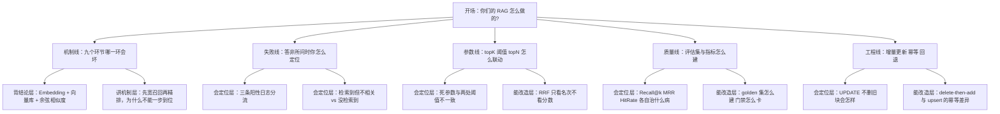
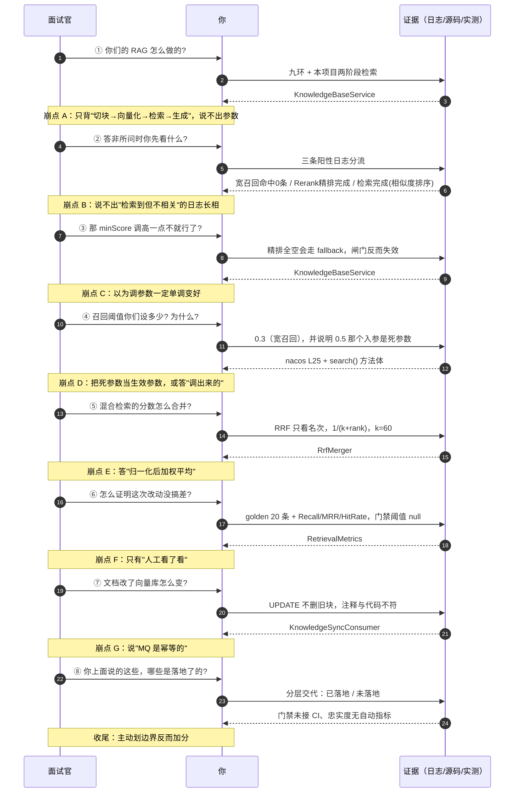

# RAG 检索增强生成：区分度全在"你怎么知道它坏了"

> **一句话结论**：RAG 面试题不是链路填空题，而是故障定位题——能把"没检索到""检索到但不相关""检索到了模型没用"这三件事分开，并各自说得出日志与参数，就算过关。
> **阅读前置**：读过 [01-SpringAI入门](../01-SpringAI框架集成/01-SpringAI入门.md) 里 VectorStore / Embedding 两节，知道 topK（返回条数）与相似度阈值（低于它的候选直接丢弃）分别是什么；本篇不再解释 Embedding 数学。
> **证据基线**：Spring AI 2.1.0（本机 m2 内 1.1.4 与 2.1.0 并存）+ Spring Boot 4.2.0 + Spring Framework 7.1.0 + JDK 17；A 级摘录 905 份已入库 `learning-docs/24-源码分析/assets/source/`；B 级行号为 2026-11 当次核对；预计 100~120 分钟。

| 类别 | 本仓状态 | 本篇怎么处理 |
| --- | --- | --- |
| A 源码摘录 | VectorStore / SearchRequest / VectorStoreRetriever / TokenTextSplitter / Document / RetrievalAugmentationAdvisor / ContextualQueryAugmenter / VectorStoreDocumentRetriever / ConcatenationDocumentJoiner 均已入库 | 讲框架机制一律挂 `[[源码:文件.java.md#L起-L止]]` 或 `(src: 文件#L起-L止)` |
| B 本项目源码 | KnowledgeBaseService / ChatServiceImpl / SiliconFlowRerankService / RagAclFilter / HybridRetriever / RrfMerger / KnowledgeSyncConsumer / RetrievalMetrics / EvalGateConfig 全部可读，行号当次核对 | "本项目怎么做"的答案必带 `文件#L起-L止` |
| C 可复现实测 | 允许 node 纯计算、pwsh 静态统计、javap 看 m2 内 jar 签名（不启服务、不联网、不跑 mvn） | 每条命令都给真实输出 + "怎么读" |
| 未落地 | 忠实度（faithfulness）自动评分、NDCG/Precision 指标、`RetrievalAugmentationAdvisor` 实际装配、评估门禁接 CI | 明确写"本项目未落地"，不拿官方文档冒充实测 |

---

## 0. 先看现象

**现象一：被追问"你怎么知道是检索坏了、还是模型在胡说"，答不出来。**

很多人的 RAG 叙述止步于"文档切块 → 向量化 → 检索 → 拼 Prompt → 生成"。面试官只要多问一句"线上答非所问时，你第一步看什么"，回答就变成"看日志吧"。而真正的日志长这样：

```text
知识库[knowledge]宽召回完成: 命中0条
```

（`ai-cs-chat/src/main/java/com/aics/chat/service/KnowledgeBaseService.java#L277`）

同一时刻，模型收到的那段上下文是这一句硬编码占位：

```java
promptRegistry.render("rag",
        java.util.Map.of("context", context.isBlank() ? "（未检索到相关资料）" : context, "message", message));
```

（`ai-cs-chat/src/main/java/com/aics/chat/service/impl/ChatServiceImpl.java#L444-L445`）

这两行一出现就意味着：**问题不在模型，在召回——候选池是空的，模型只能凭参数里的世界知识硬答**。而它的兄弟现象完全不同：召回 20 条、精排全被砍掉、退化成相似度排序，日志里根本看不到"0 条"（详见 3.3）。分不清这两者，就分不清该修检索还是该修 Prompt。

**现象二：能背"两阶段检索"，但说不出参数为什么是这两个数。**

被问"你们的 topK 和阈值怎么定的"，标准翻车回答是"调出来的"。本项目真实配置只有两项在管这件事：

```text
L17: top-n: 5
L18: min-score: 0.7
L23: recall-top-k: 20
L25: recall-threshold: 0.3
```

（`tools/nacos-config/ai-cs-chat.yml#L17-L25`）

更致命的是追问"那 `search(kb, q, 5, 0.5)` 里的 0.5 生效了吗"——它**没生效**：`KnowledgeBaseService.search` 的第四个参数 `threshold` 在方法体里从未被读取，真正生效的是字段 `recallThreshold`。

```java
public List<Document> search(String knowledgeBase, String query, int topK, double threshold) {
    // 阶段一：宽召回
    List<Document> recallDocs = searchRaw(knowledgeBase, query, recallTopK, recallThreshold);
```

（`ai-cs-chat/src/main/java/com/aics/chat/service/KnowledgeBaseService.java#L228-L230`，调用方传 `5, 0.5` 见 `ai-cs-chat/src/main/java/com/aics/chat/service/impl/ChatServiceImpl.java#L437`）

**现象三：答的是旧版知识，代码一写就编译不过。**

"给 RAG 加个过滤条件，用 `QuestionAnswerAdvisor.builder(vs).filterExpression(...)`"——这是 1.x 时代的答案形状。本机 2.1.0 的真实签名里没有这个方法：

```text
public final class QuestionAnswerAdvisor$Builder {
  public Builder promptTemplate(PromptTemplate);
  public Builder searchRequest(SearchRequest);
  public Builder protectFromBlocking(boolean);
  public Builder scheduler(Scheduler);
  public Builder order(int);
  public QuestionAnswerAdvisor build();
}
```

（C 级实测：`javap -classpath spring-ai-vector-store-advisor-2.1.0.jar -public org.springframework.ai.chat.client.advisor.vectorstore.QuestionAnswerAdvisor$Builder`）

连 artifact 和包名都换过一次：m2 里 `spring-ai-advisors-vector-store` 只有 1.1.4，2.1.0 叫 `spring-ai-vector-store-advisor`，包从 `chat.client.advisor` 挪到 `chat.client.advisor.vectorstore`。细节见 §7。

**这些现象指向同一件事：RAG 的知识点密度不在"有几个环节"，而在每个环节坏了之后你能拿出什么可核对的信号——日志、参数、签名、指标。背链路的人在第一句追问就露馅，能定位的人能一路答到"怎么验证修好了"。**

---

## 1. 整体地图

面试官问"你们的 RAG 怎么做的"时，其实是在五个岔路口等你选一条往下走。这张图标的是**追问路径**，不是数据流。



> **读图说明**：五条虚线路径是从同一个开场问题长出来的，面试官通常只选一条深挖两三层——你在 `B1` 停留还是走到 `C2`，决定了他给你定级为"背过"还是"做过"。注意 `D1` 那条：它是图上唯一"答错会立刻暴露没读过自己代码"的节点，因为死参数只有真读过方法体的人才知道。如果你把这张图读成"数据从 A 到 F 的顺序流程"，就会误以为 §4 的追问链是固定顺序——实际上面试官随时会从 `E2` 跳回 `C1` 验你。

| 考点 | 考察层级 | 面试官的判定信号 |
| --- | --- | --- |
| RAG 定义与价值 | 背结论 | 能说出"外部知识 + 生成"即可，不加分 |
| RAG 与微调取舍 | 背结论 | 能说清成本/时效/可溯源三维即可 |
| 九环节失败模式 | 讲机制 | 能说出每环坏了长什么样，加分起点 |
| 两阶段检索原理 | 讲机制 | 能解释"为什么阈值要低、闸门放后面" |
| 三类失败分流 | **会定位** | 能给出可 grep 的日志行 |
| 参数联动 | **会定位** | 知道 topK/阈值/topN 各管哪一段，且知道死参数 |
| RRF 只看名次 | 能改造 | 能推公式、说清 k 的作用、说清何时不该用 |
| 评估指标与评估集 | 能改造 | 能写出指标公式与 golden 集字段 |
| 增量更新幂等 | 能改造 | 能指出 UPDATE 分支的缺陷并给修法 |

---

## 2. 关键概念与关键类/关键参数

| 名称 | 所在位置 | 一句话准确定义 | 本项目取值 |
| --- | --- | --- | --- |
| `VectorStore` | `[[源码:VectorStore.java.md#L64-L66]]` | 向量库抽象：`add` 负责向量化并落库，`similaritySearch` 负责检索；重复 id 的行为交给底层 provider | Chroma 0.5.20 单机，集合 `aics-knowledge`，三服务共用 |
| `SearchRequest` | `[[源码:SearchRequest.java.md#L59-L64]]` | 一次检索的全部参数：`query` / `topK` / `similarityThreshold` / `filterExpression` | 宽召回用 `topK=20`、阈值 0.3 |
| `VectorStoreRetriever` | `[[源码:VectorStoreRetriever.java.md#L50-L56]]` | 函数式接口，只暴露"检索"能力，把读操作从 `VectorStore` 里切出来 | 未直接用；本项目手写 `KnowledgeBaseService` 封装 |
| `TokenTextSplitter` | `[[源码:TokenTextSplitter.java.md#L56-L66]]` | 按 token 数切块（chunking，把长文档切成可独立检索的小片段） | `new TokenTextSplitter()` 全默认：800 token/块、overlap 0、最短块 350 字符 |
| `Document.metadata` | `[[源码:Document.java.md#L321-L333]]` | 随向量一起存的键值对，检索回来还在，是溯源的唯一依据 | 三键：`knowledgeBase` / `documentId` / `title` |
| `recallTopK` / `recallThreshold` | `KnowledgeBaseService.java#L93-L99` | 第一阶段宽召回的候选池大小与入口阈值 | 20 / 0.3，来自 `aics.rag.recall-*` |
| `topK`（精排入参） | `KnowledgeBaseService.java#L228` | 第二阶段要返回几条，同时是精排 `topN` 与退化路径的截断长度 | 5（`ChatServiceImpl#L437`） |
| `topN` / `minScore` | `RerankProperties.java#L34-L37` | 精排模型返回条数 / 相关度闸门（交叉编码器打分，与向量余弦不同量纲） | 5 / 0.7 |
| `RerankService` | `ai-cs-chat/src/main/java/com/aics/chat/rag/rerank/RerankService.java` | 可选依赖：`ObjectProvider` 注入，bean 不存在即退化为相似度排序 | `SiliconFlowRerankService`，模型 `BAAI/bge-reranker-v2-m3` |
| RRF（倒数排名融合） | `ai-cs-search/src/main/java/com/aics/search/hybrid/RrfMerger.java#L66` | 多路结果按名次给分：第 rank 名贡献 `1/(k+rank)`，累加后降序 | `k=60`，见 `HybridSearchServiceImpl.java#L44` |
| `RetrievalMode` | `ai-cs-chat/src/main/java/com/aics/chat/rag/retrieve/RetrievalMode.java` | 四种检索模式枚举：纯向量 / 混合 / 改写 / 图谱 | 默认纯向量，两开关默认 false |
| `RagAclFilter` | `ai-cs-chat/src/main/java/com/aics/chat/security/RagAclFilter.java#L39-L69` | 在 `buildContext` 之前剔除无权限文档，库级置空 + 文档级剔除 | 唯一调用点 `ChatServiceImpl#L439` |
| `RetrievalMetrics` | `ai-cs-chat/src/main/java/com/aics/chat/rag/eval/RetrievalMetrics.java#L46-L71` | 单条用例的 Recall@k / MRR / HitRate 纯计算 | 汇总取平均，见 `RagEvalServiceImpl.java#L163-L165` |
| `GoldenCase` | `src/main/resources/eval/golden-set.json`（ai-cs-chat 模块内） | 评估集的断言单元：问题 + 期望命中文档 + 参考答案 | 20 条，6 字段 |
| `EvalGateConfig` | `ai-cs-chat/src/main/java/com/aics/chat/rag/eval/EvalGateConfig.java#L40-L43` | 门禁扩展阈值（P95 延迟、平均 Token），`null` 语义 = 不判定 | 两个都是 null，即只记录不卡 |

一句话记住分工：**`TokenTextSplitter` 决定"候选长什么样"，`SearchRequest` 的两个数决定"候选池多大"，`RerankProperties` 的两个数决定"谁能进 Prompt"，`RagAclFilter` 决定"谁不许进 Prompt"。**

---

## 3. 逐题精讲

### 3.1 Q1：什么是 RAG？它解决什么，又不解决什么？

**问题**

让你用一分钟讲清 RAG，以及"为什么有了 RAG 还会胡编"。

**30 秒答案骨架**

1. RAG = 检索（Retrieval）+ 生成（Generation）：先按问题去知识库捞出相关片段，再把片段拼进 Prompt，让模型"照着资料说"而不是凭参数记忆说。
2. 它改变的是**信息从哪来**，解决时效、私域知识、可溯源、上下文窗口这四件事。
3. 它**不改变模型会不会编**——检索为空、资料不相关、资料本身过期，都能生成一段通顺的错话。
4. 所以工程上真正的护栏是三样：检索质量（召回 + 精排）、提示词契约（无资料时如实说）、引用溯源（答案能被人工核对）。
5. 本项目的提示词契约是写死在模板里的：`请严格基于下面的【知识库资料】回答` + `如果资料中没有相关信息，请如实告知`。

第三条和第五条的证据：模板原文在 `ai-cs-chat/src/main/resources/application-prompt.yml#L61-L63`；而检索为空时系统并没有跳过生成，而是塞了占位句继续调模型（`ChatServiceImpl.java#L444-L445`）。

**深挖追问**

- **"那框架有没有更硬的做法？"** 答：有，Spring AI 的 `ContextualQueryAugmenter` 默认 `allowEmptyContext=false`，命中为空时直接返回"无上下文"提示而不放行模型（`{{allowEmptyContext}}` 默认值见 `[[源码:ContextualQueryAugmenter.java.md#L92]]`）。本项目走的是手写 Prompt 路径，等价逻辑靠模板文本保证，强度弱于框架的硬约束。
- **"RAG 和微调怎么选？"** 答：知识高频变 → RAG；说话风格/格式/领域语气要变 → 微调；两者不互斥。判断依据是"变的是知识还是行为"。
- **"你怎么量化它到底有没有用？"** 答：固定 golden 集跑 Recall@k / MRR / HitRate 三项前后对比，不看单次问答体感（详见 3.7）。

**常见错误答案**

- ❌ "RAG 通过检索真实文档，从根本上消除幻觉。" —— 错在把"有据可查"等价成"必然正确"。检索空时本项目仍然调模型，模型照样答；资料里写错了，模型会忠实地把错误复述出来。
- ❌ "RAG 就是把知识库塞进 Prompt。" —— 错在忽略检索环节。塞整库既超上下文窗口也无法定位来源，RAG 的核心价值恰恰是"只塞最相关的几条"。

### 3.2 Q2：RAG 全链路每一环坏了长什么样？

**问题**

把 RAG 拆成环节，并说出每环失效时的可观测症状。这是把"背过"变成"做过"的第一道分水岭。

**30 秒答案骨架**

1. 九环：解析 → 切块 → Embedding → 索引写入 → 召回 → 融合 → 重排 → 拼装 → 生成。
2. 前四环坏了，症状是"知识永远检索不到"，且**入库日志里就有痕**；中间三环坏了，症状是"检索到了但不相关"；最后两环坏了，症状是"检索对了但答案没采用"。
3. 所以定位顺序永远是反的：先看召回条数，再看精排结果，再看 Prompt 里的 `【资料N】`，最后才怀疑模型。
4. 本项目每一环都有对应日志，能拼成一张"阳性日志清单"。

**逐环失败模式与项目证据**

| 环节 | 正常长相 | 坏了长什么样 | 本项目暴露位置 |
| --- | --- | --- | --- |
| 解析 | PDF/Office/HTML 三段解析器各自成功 | 解析器 `catch` 后返回空列表，入库静默成功 0 条 | `ai-cs-chat/src/main/java/com/aics/chat/rag/DocumentLoader.java#L57-L58`（PDF）、`#L76-L77`（文本）、`#L93-L94`（Tika） |
| 切块 | 800 token 一块，块够长时按标点回退切分 | 长度 ≤5 的块被直接丢弃；块 ≤350 字符时不启用句子边界优化，切点落在句子中间；overlap=0 让跨块答案被切断 | `[[源码:TokenTextSplitter.java.md#L56-L66]]` 的常量，丢弃判定见 `#L264-L280`；空内容日志 `ai-cs-knowledge/src/main/java/com/aics/knowledge/service/KnowledgeVectorService.java#L70-L72` |
| Embedding | 每条分块拿到向量 | 调用失败 → `catch` 后 `return 0`，**消息消费成功但库里没数据** | `ai-cs-knowledge/src/main/java/com/aics/knowledge/service/KnowledgeVectorService.java#L88-L91` |
| 索引写入 | `入库完成, 共N个分块` | 写 0 条、或写入时 `knowledgeBase` 元数据缺失 → 后续按库过滤永远查不到 | `KnowledgeBaseService.java#L168-L175`（元数据三键）、`#L179`（入库条数） |
| 召回 | `宽召回完成: 命中N条` | `命中0条`：阈值过高 / 元数据过滤串写错 / 查询与文档不同嵌入空间 | `KnowledgeBaseService.java#L277` |
| 融合 | `混合检索完成: 融合结果N条` | 单路挂 → 静默降级成一路，召回多样性丢失但日志只说"降级" | `ai-cs-search/src/main/java/com/aics/search/hybrid/HybridSearchServiceImpl.java#L61-L68` |
| 重排 | `Rerank精排完成: 召回20条 -> 返回3条` | 全被 `minScore` 砍掉 → 退化 `检索完成(相似度排序)`，闸门形同失效 | `KnowledgeBaseService.java#L248` 与 `#L258` 两条互斥日志 |
| 拼装 | `【资料1】…【资料2】…` | 上下文为空 → 塞占位句；或条数超预算被模型截断 | `KnowledgeBaseService.java#L287-L293`、`ChatServiceImpl.java#L444-L445` |
| 生成 | 答案引用了资料 | 兜底文案 `AI 助手暂时繁忙，请稍后重试。`；或答对了但没标引用 | `ai-cs-chat/src/main/java/com/aics/chat/service/impl/ResilientAiService.java#L448-L455` |

**深挖追问**

- **"最容易被忽略的是哪一环？"** 答：索引写入。因为它失败时上游全绿——文档表里有记录、MQ 消息被消费成功、`vectorize` 返回 0 被当作正常返回。唯一线索是那条 warn：`向量化无内容/失败: action={}, documentId={}`（`ai-cs-knowledge/src/main/java/com/aics/knowledge/mq/KnowledgeSyncConsumer.java#L70`）。
- **"切块这一环你会怎么排查？"** 答：先确认块数（`入库完成, 共N个分块`），再确认两个默认值的真实语义：`MIN_CHUNK_SIZE_CHARS=350` 是**句子边界优化的门槛**——块长 ≤350 字符时直接原样返回、不再往最后一个标点回退（`[[源码:TokenTextSplitter.java.md#L264-L280]]`）；被真正丢弃的是长度 ≤5 的块（`MIN_CHUNK_LENGTH_TO_EMBED`）。再加上 `DEFAULT_CHUNK_OVERLAP=0`——**没有重叠**，跨块边界的答案会被切断，这是很多"答案差半句"的真因。

**常见错误答案**

- ❌ "切块一般设 500~1000 token、overlap 10~20%。" —— 这句话描述的是某类通用经验，不是本项目的运行时事实。本项目用无参构造器，overlap 是 **0**（`[[源码:TokenTextSplitter.java.md#L58]]`）。被追问"你们 overlap 多少"时答 20% 就是背书。
- ❌ "解析失败会抛异常，接口会报错。" —— 错。三个解析器全部 `catch` 后返回空列表，接口照样返回成功，`addChunks` 写 0 条也照样返回 0。这是"静默失败"，必须靠日志兜。

### 3.3 Q3：答非所问时，"检索到但不相关"和"没检索到"怎么区分？

**问题**

这是本篇最值钱的一题。两类故障的修法完全相反：前者修精排与阈值，后者修入库与召回；搞反了越调越差。

**30 秒答案骨架**

1. 先看召回条数这条日志：`宽召回完成: 命中0条` → **没检索到**，问题在入库/过滤/嵌入空间，跟 Prompt 无关。
2. 有命中就要看**第二条互斥日志是谁打出来的**：`Rerank精排完成: 召回20条 -> 返回3条` 说明精排生效；`检索完成(相似度排序): 召回20条 -> 返回5条` 说明精排全被 `minScore` 砍掉、已退化成相似度排序——这时返回的 5 条**很可能不相关**，这就是"检索到但不相关"的日志长相。
3. 两条都不是，但 `context` 里明明有资料、答案却没提 → 第三类：**检索到了但没被采用**，去查拼装与生成（占位句、条数预算、模型换档）。
4. 记住一个反直觉点：`minScore` 闸门很严时，你**看不到"返回0条"**，只看到 fallback 的"返回5条"，因为空精排结果会走退化分支。

第 2 条的代码依据是这段互斥逻辑：

```java
if (reranked != null && !reranked.isEmpty()) {
    // 精排有结果：按精排顺序回取原文档
    log.info("知识库[{}]Rerank精排完成: 召回{}条 -> 返回{}条", knowledgeBase, recallDocs.size(), result.size());
    return result;
}
...
// 退化路径：向量检索结果已按相似度降序，直接取 Top-N
List<Document> fallback = recallDocs.size() <= topK ? recallDocs : recallDocs.subList(0, topK);
log.info("知识库[{}]检索完成(相似度排序): 召回{}条 -> 返回{}条", knowledgeBase, recallDocs.size(), fallback.size());
```

（`ai-cs-chat/src/main/java/com/aics/chat/service/KnowledgeBaseService.java#L240-L259`）

**深挖追问**

- **"怎么把这三类判断固化成手段，而不是靠眼睛？"** 答：抓 trace 的 `hitCount` 与 `detail`。检索 span 上挂了 `hitCount`（召回条数）和 `detail`（前 20 个 documentId，截断防敏感信息外泄），位置在 `ChatServiceImpl.java#L969-L973`；`hitCount>0` 但没有 `Rerank精排完成` 日志 → 直接落到第二类。
- **"怎么证明不是模型的问题？"** 答：做三段对照——同一问题分别走①纯向量、②关掉缓存、③把召回条数调到 50。若 ③ 仍不相关，检索侧实锤；若 ① 不相关而 ② 相关，是缓存污染（语义缓存 0.92 就把旧答案给了你）。
- **"混合检索降级会伪装成哪一类？"** 答：伪装成"检索到但不相关"。因为 ES 路或向量路挂掉后只剩一路，`HybridSearchServiceImpl` 只记一条 `降级为仅向量结果`，上层看到的融合结果条数依旧正常（`ai-cs-search/src/main/java/com/aics/search/hybrid/HybridSearchServiceImpl.java#L61-L68`）。所以排查时要先确认 `RAG增强检索: mode=..., degraded=...` 里的 `degraded` 是不是 true（`ChatServiceImpl.java#L951-L952`）。

**常见错误答案**

- ❌ "召回为空就说明知识库里没有这个知识。" —— 错。本项目召回带库过滤：`knowledgeBase == '...'`（`KnowledgeBaseService.java#L273` 附近），元数据写错库名同样命中 0 条，而知识明明在库里。也可能是嵌入空间不一致（写路径用了另一个 provider）。
- ❌ "把相似度阈值从 0.3 提到 0.8 就能过滤掉不相关的。" —— 错在**改了不生效**：`search()` 的 `threshold` 入参没被读，真正生效的是 `recallThreshold`（`aics.rag.recall-threshold`）。要提质量应该动 `minScore`（精排闸门），或两条日志里那条 fallback 是不是在骗你。

### 3.4 Q4：两阶段检索的 topK、阈值、topN 怎么联动？

**问题**

三个数看起来都在"调相关度"，为什么必须分两段？

**30 秒答案骨架**

1. 三个数管三段：`recall-top-k=20` 管候选池大小，`recall-threshold=0.3` 管入池门槛，`top-n=5` + `min-score=0.7` 管出池闸门。
2. 第一段阈值必须**低**（0.3）：向量余弦只反映"语义大致相近"，卡高了会把改写句、同义句挡在门外，而漏召回无法在第二段补救。
3. 第二段闸门必须**高**（0.7）：交叉编码器（rerank 模型，把 query 和文档拼在一起打分）精度高，用它做质量闸门；代价是慢，所以只喂 20 条。
4. 参数是耦合的：`minScore` 太高 → 精排全空 → 走退化分支直接给相似度 topK，闸门**反过来失效**；`recallTopK` 太小 → 精排没有可挑的。
5. 本项目还有一处配置不一致：Spring AI 的 advisor 路径用 `topK=5 / threshold=0.3`，手写路径用 `20 → 5`，同一问题两条腿。

第 5 条证据：advisor bean 在 `ai-cs-chat/src/main/java/com/aics/chat/config/SpringAiConfig.java#L266-L274`（`similarityThreshold(0.3d)` / `topK(5)`），并被 `defaultAdvisors(ragAdvisor)` 挂到每个 ChatClient 上（`#L285-L289`）；手写路径配置在 `KnowledgeBaseService.java#L93-L99`。

**深挖追问**

- **"`topK` 和 `topN` 有什么区别？"** 答：`topK` 是业务语义的"我要几条参考资料"，`topN` 是精排模型的出参上限。本项目 `search()` 把 `topK` 直接传给 `rerankService.rerank(query, recallDocs, topK)`（`KnowledgeBaseService.java#L239`），同时又让精排按 `properties.getMinScore()` 过滤，所以**真实返回条数 = min(topK, 通过 minScore 的条数)**。
- **"精排为什么按 `index` 回取，不直接用精排返回的文本？"** 答：`RerankResultItem` 只带下标与分数，按 `item.getIndex()` 取回 `recallDocs.get(idx)` 才能保住原始 `metadata`（`KnowledgeBaseService.java#L242-L247`）——**metadata 是溯源与 ACL 的依据，不能丢**。
- **"精排超时了会怎样？"** 答：静默降级。超时 5s、异常 `onErrorResume` 返回 `Mono.empty()`，上层看到 `reranked == null` 就走相似度排序（`ai-cs-chat/src/main/java/com/aics/chat/rag/rerank/SiliconFlowRerankService.java#L155-L159`）。所以**精排变慢时答案是"悄悄变差"的，不会报错**。
- **"你会怎么验证参数改动的效果？"** 答：改完跑 golden 集，看 HitRate 与 MRR 一起动——只涨 Recall 但 MRR 掉，说明候选变多但排序变差。

**常见错误答案**

- ❌ "两阶段就是先用大 topK 再用小 topK，跟阈值无关。" —— 错在把阈值当装饰。没有精排时阈值就是唯一质量闸门；有精排时阈值必须让位（降噪前移会漏召回），两个数是一对反向旋钮。
- ❌ "我把 `search(kb, q, 5, 0.5)` 的阈值提到 0.8 就变严了。" —— 死参数，不生效（见 §0 现象二）。

### 3.5 Q5：RRF 为什么只看名次不看分数？

**问题**

混合检索把 BM25（关键词打分，无上界）和向量相似度（有界）合并，为什么不加权求和？

**30 秒答案骨架**

1. 因为两者**量纲不可比**：BM25 分数没有上界，随语料长度和词频漂移；余弦相似度被限制在固定区间。直接相加等于让量纲大的那路独裁。
2. RRF（Reciprocal Rank Fusion，倒数排名融合）只用名次：第 rank 名贡献 `1/(k+rank)`，同一文档在多路都靠前就累加——**共识优先**，且对分数量纲免疫。
3. `k`（本项目 60）是平滑常数：k 越大，`1/(k+1)` 与 `1/(k+20)` 的差距越小，名次差异被压平；k 越小越"赢者通吃"。
4. 代价是丢掉分数信息：如果两路同源同模型（分数可比），加权求和更好；RRF 的价值恰在异源。
5. 本项目实现在 `RrfMerger`，公式一行：`scores.merge(item.getId(), 1.0 / (k + rank), Double::sum)`。

公式证据：`ai-cs-search/src/main/java/com/aics/search/hybrid/RrfMerger.java#L66`；`k` 的取值 `RRF_K = 60` 在 `ai-cs-search/src/main/java/com/aics/search/hybrid/HybridSearchServiceImpl.java#L44`；对话侧还有一份 `aics.rag.rrf-k` 默认 60（`ai-cs-chat/src/main/java/com/aics/chat/rag/retrieve/RagRetrieveProperties.java#L22-L23`）。

**可复现验证（C 级）**

```text
$ node -e "const K=60;const vec=['docA','docB','docC'],es=['docB','docD','docA'];..."
1 docB 0.032522 vec=2 es=1
2 docA 0.032266 vec=1 es=3
3 docD 0.016129 vec=- es=2
4 docC 0.015873 vec=3 es=-
```

怎么读：`docB` 在向量路第 2、ES 路第 1，两路都在前列，累加后反超了在向量路第 1 的 `docA`——这就是"共识优先"的具体数值。`docD` 只有 ES 一路命中，靠 `1/(60+2)` 也能进前 3，说明 RRF 不会因为单路缺失就彻底埋掉一条结果。注意所有分数都在 0.03 量级：**RRF 分数没有绝对值含义，只有相对次序**，别拿它当相似度阈值用。

**深挖追问**

- **"两路结果 id 口径不一致会怎样？"** 答：融合直接失效——同一条文档被当成两个 id 各得一份分，谁都不累加。本项目对齐键是"ES 的 `_id` == Chroma 的 `metadata.documentId`"（`ai-cs-search/src/main/java/com/aics/search/hybrid/HybridSearchServiceImpl.java#L100-L101` 与 `#L136-L137`），这是写库时必须保证的约定。
- **"合并时字段谁优先？"** 答：先到者优先，`fillMissing` 只补空不覆盖（`RrfMerger.java#L78-L97`）——保证 ES 路的 `title` 不被向量路的空值冲掉。
- **"k 你会调吗？"** 答：一般不调。k 只改变"名次差的敏感度"，数据分布变了才动；调参优先级低于召回率和 `minScore`。

**常见错误答案**

- ❌ "混合检索就是把两路分数归一化后加权平均，权重 0.5/0.5。" —— 归一化需要全量分布，线上做不到稳定归一（新文档进来分布就变）；而且这就是 RRF 要绕开的坑。
- ❌ "RRF 分数可以当相似度阈值，比如 >0.03 才算命中。" —— 错。RRF 分数只由名次决定，与语义相关度无关；阈值应该设在精排的 `minScore`。

### 3.6 Q6：引用溯源与忠实度怎么保证？

**问题**

"你们的答案能追到原文吗？模型引用了资料却没照资料说，你怎么发现？"

**30 秒答案骨架**

1. 溯源靠**入库时写全 metadata**：`knowledgeBase` / `documentId` / `title` 随分块一起存，检索回来还在，出库时直接映射成引用卡片，不用二次查库。
2. 引用在生成后立刻构建：`buildCitations` 输出 `documentId/title/page/score/content` 五字段，随回答下发前端。
3. 忠实度（faithfulness：答案里的每个断言是否有资料支撑）本项目**没有自动指标**，只有两条弱保障：模板里的"只依据资料回答"契约，以及 LLM-as-Judge 的 1~5 分均分。
4. 还有一个前置保障是 ACL：无权限文档在拼装前就被剔除，模型没有机会引用它。
5. 所以诚实的回答是：**能追溯到片段，不能自动判定"是否忠于片段"**。

证据：`buildCitations` 五字段与 `documentId` 转换逻辑在 `ai-cs-chat/src/main/java/com/aics/chat/service/impl/ChatServiceImpl.java#L1041-L1078`；ACL 的"检索阶段过滤而非事后补救"这条设计意图直接写在 `ai-cs-chat/src/main/java/com/aics/chat/security/RagAclFilter.java#L40-L42` 的注释里。

**深挖追问**

- **"引用为空说明什么？"** 答：三种可能——召回为空、全部被 ACL 剔除（库级 ACL 直接把整库置空，`RagAclFilter.java#L49-L54`）、或命中文档缺 `documentId` 元数据。三者的区别在日志：ACL 会写审计事件 `RAG_ACL_DENIED`。
- **"`documentId` 是怎么来的？"** 答：**这是本项目的真实隐患**。入库时写的是 `chunk.getId()`（子分块自己的 id，通常是 UUID 形式），不是父文档 id（`KnowledgeBaseService.java#L171`）；而 `buildCitations` 会尝试 `Long.valueOf(...)` 转数字，失败就**静默跳过**（`ChatServiceImpl.java#L1050-L1058`）。也就是说前端拿到的 `documentId` 可能是空——引用卡片能显示标题和片段，但点不回去原文。对比之下 knowledge 侧写的是父文档 id（`ai-cs-knowledge/src/main/java/com/aics/knowledge/service/KnowledgeVectorService.java#L81`），两条写路径口径不一致。
- **"怎么补忠实度？"** 答：可落地的是"引用覆盖率"近似——检查答案是否包含 citation 片段里的关键句（`epectedKeywords` 已有现成字段）；框架级的 RAGAS faithfulness 未入库、未实测。

**常见错误答案**

- ❌ "有引用就说明忠实。" —— 错。模型可以引用 A 段却按自己的记忆作答；引用只证明"资料进过 Prompt"，不证明"答案来自资料"。
- ❌ "引用卡片点进去就是原文页。" —— 本项目要打问号：`page_number` 只有 PDF 解析器（`PagePdfDocumentReader`，`withPagesPerDocument(1)`，见 `ai-cs-chat/src/main/java/com/aics/chat/rag/DocumentLoader.java#L46-L53`）会写，文本/Office 来源没有页码；`documentId` 又可能转 `Long` 失败。

### 3.7 Q7：评估指标怎么算？评估集怎么建？

**问题**

"你怎么证明这次改动没有把效果搞差？"——没有固定评估集的团队答不了这题。

**30 秒答案骨架**

1. 三个指标治三种病：Recall@k 治"召回全不全"，MRR 治"排得前不前"，HitRate 治"到底有没有命中"。
2. 定义要背准：Recall@k = 命中的期望文档数 / 期望文档总数；MRR = 1 / 首个命中排名的平均；HitRate = 至少命中一条的用例占比。
3. 评估集（golden 集）= 固定一批「问题 + 期望命中文档 id + 参考答案 + 期望关键词」，相当于检索的单元测试。
4. 本项目 20 条、6 字段、默认 `classpath:eval/golden-set.json`；跑法是 POST `/rag/eval/run`，报告含汇总指标 + LLM 均分 + 逐条明细 + `passed`。
5. 门禁阈值支持 P95 延迟与平均 Token，但**两个阈值都是 null**，等于只观测不判定。

指标实现：`ai-cs-chat/src/main/java/com/aics/chat/rag/eval/RetrievalMetrics.java#L46-L71`（`hitCount` 累加、`firstHitRank` 记录首命中、末尾三行分别算 recall/hitRate/mrr）；汇总取算术平均在 `ai-cs-chat/src/main/java/com/aics/chat/rag/eval/RagEvalServiceImpl.java#L163-L165`；门禁合流 `hitPass && llmPass && p95Pass && tokenPass` 在 `#L183-L195`。

**可复现验证（C 级）**

```text
$ node -e "const c=require('./ai-cs-chat/src/main/resources/eval/golden-set.json');..."
cases=20
keys=id,question,knowledgeBase,expectedDocumentIds,referenceAnswer,expectedKeywords
id0=gc-001 kb=product-manual
docIds0=["101"]
```

怎么读：`expectedDocumentIds` 是字符串数组，说明指标比对的是**文档 id 而不是分块 id**——这要求检索结果能还原到文档粒度，而本项目检索返回的是分块。**这是评估链路的真实口径缺口**：`RetrievalMetrics.compute` 拿到的 `retrievedIds` 是分块侧标识，要和 `["101"]` 比中，必须依赖 `metadata.documentId` 恰好是文档 id（chat 写路径恰恰不是，见 3.6 追问二）。

**深挖追问**

- **"Recall@k 的分母为什么是期望文档数而不是检索条数？"** 答：因为要衡量"该找到的都找到了吗"，分母必须是"应该找到的"。代价是：当 golden 一条用例只标 1 个期望文档时，Recall@k 退化成 0/1，和 HitRate 几乎等价——这是很多团队"Recall 很好看"的幻觉来源（本项目 gc-001 就只标了 1 个）。
- **"MRR 有什么盲区？"** 答：只看首个命中，第 2 条正确但第 1 条错时惩罚很轻；它不惩罚重复、不看后面几条。要看整体排序质量得上 NDCG——**本项目未落地**。
- **"门禁为什么设 null？"** 答：设计意图写在注释里：先只观测、团队对齐基线后再收紧，且"没有依据就不判定"（`EvalGateConfig.java#L20-L27` 的类注释 + `#L34` 的 `@ConfigurationProperties(prefix = "aics.eval.gate")`）。代价是这个门禁目前**没有牙齿**。
- **"评估真的在 CI 跑吗？"** 答：没有。pom 里有 `-Peval` profile（`ai-cs-chat/pom.xml#L226-L244`），但仓库里唯一的 workflow 是 `python-learning-validate.yml`（`.github/workflows/` 下只此一个），Java 评估从未进流水线。这是"有代码无治理"的典型，面试时主动说出来比被问出来好。

**常见错误答案**

- ❌ "我们用人工抽查看效果。" —— 抽样无法回归，改一次参数就断了可比性。
- ❌ "Recall@K 越高越好，所以我们把 K 设成 50。" —— K 变大 Recall 单调上升，指标失去区分度，同时精排成本与延迟上升；评估要固定 K 再比较。

### 3.8 Q8：增量更新与幂等怎么做？

**问题**

"文档改了一版，向量库里发生什么？重复消费同一条消息会怎样？"

**30 秒答案骨架**

1. 写路径是异步的：DB 写入 → 投 MQ（`knowledge-doc-sync-topic`，tag = action）→ 消费者按 action 分支 → 切块 → 写 Chroma。
2. 幂等的正确姿势是"按 `documentId` 先删后写"：Chroma 支持按元数据过滤表达式批量删，删干净再 add，重复消费结果一致。
3. 本项目**只对 DELETE 做了删除**；UPDATE 走的是和 CREATE 同一个分支，**直接 add 新分块而不删旧分块**。
4. 后果：同一文档新旧两版共存，检索时两版都会被召回——表现为"文档明明改了，回答还是旧口径"，而且引用里出现重复片段。
5. 更麻烦的是类注释声称"重复消费 UPDATE 会先删除旧分块再写入，结果幂等"，与实际代码不符——**这是注释骗人的典型，面试时可以主动指出**。

代码证据：`ai-cs-knowledge/src/main/java/com/aics/knowledge/mq/KnowledgeSyncConsumer.java#L57-L71`（只有 `DELETE` 分支调删除，else 一律 `vectorize`）；同文件 `#L23-L26` 的设计说明写着"先删除旧分块再写入"；删除能力本身是有的：`ai-cs-knowledge/src/main/java/com/aics/knowledge/service/KnowledgeVectorService.java#L103-L116`（按 `documentId == '...'` 过滤删除）。投递侧失败只告警不影响 DB：`ai-cs-knowledge/src/main/java/com/aics/knowledge/mq/KnowledgeSyncProducer.java#L54-L58`。

**深挖追问**

- **"重复 id 写进向量库会怎样？"** 答：框架不保证。`add` 对重复 id 的语义"交给底层 provider"（`[[源码:VectorStore.java.md#L64-L66]]`），所以可能是覆盖、可能是共存两份。2.1.0 新增了 `upsert`（replace-by-id 语义，`[[源码:VectorStore.java.md#L95]]`），但本项目用的是 `add`。
- **"那怎么修？"** 答：三条路，按成本排——① UPDATE 分支里先 `deleteByDocumentId` 再 `vectorize`（改 3 行，见效最快）；② 用内容 hash 做稳定 chunk id + `upsert`（改动中等，天然幂等）；③ 引入版本号元数据，检索时按 `version` 过滤（最重，但支持灰度与回滚）。
- **"失败会重试吗？"** 答：会，但是"消费成功式的失败"。`vectorize` 内部 `catch` 后 `return 0`（`KnowledgeVectorService.java#L88-L91`），消费者看到 0 只打一条 warn 就算处理完成，于是 RocketMQ 的重试机制**根本不会触发**。这是"吞异常"最危险的一种：错误被降级成日志。

**常见错误答案**

- ❌ "MQ 消费是幂等的，重复消费没问题。" —— 方向对但结论错：幂等要设计出来。本项目 DELETE 幂等、UPDATE 不幂等。
- ❌ "全量重建索引最省事。" —— 一次重建的成本是"全库 embedding 费用 + 重建窗口内检索退化"，只适合离线小库；线上要的是按文档粒度的增量删除。

### 3.9 Q9：上线后效果回退，你按什么顺序查？

**问题**

"上线一周，客服说 AI 答得不如以前。给我一个排查顺序。"

**30 秒答案骨架**

1. 先分层：缓存层 → 索引层 → 检索层 → 生成层，从外往里剥。
2. 第一刀看缓存：命中缓存直接返回、**不检索、不过 ACL、不触发评估**，所以"某个问题一直旧答案"通常是语义缓存（阈值 0.92）在给旧回答。
3. 第二刀看检索：抓 `rag.retrieval` 的 `hitCount` 与 `degraded`；`degraded=true` 说明混合/改写链路降级成纯向量了。
4. 第三刀看精排：`Rerank精排完成` 与 `检索完成(相似度排序)` 谁出现——后者占比上升就是质量闸门失效。
5. 第四刀才是生成：模型是否换档（fallback 到备用模型）、提示词版本是否变（`rc.setPrompt(scenario, version)` 里记了版本）。
6. 最后用 golden 集前后各跑一次，给结论：是检索退步（Recall/MRR 掉）还是生成退步（LLM 均分掉）。

**各层证据**

| 层 | 可观测点 | 位置 |
| --- | --- | --- |
| 缓存 | 命中即返回，注释明说"不触发线上采样评估" | `ai-cs-chat/src/main/java/com/aics/chat/service/impl/ChatServiceImpl.java#L424-L433` |
| 检索 | `hitCount`、`detail`（前 20 个 documentId） | `ChatServiceImpl.java#L969-L973` |
| 增强检索 | `RAG增强检索: mode=..., degraded=..., hits=...` | `ChatServiceImpl.java#L951-L952` |
| 精排 | `Rerank完成: 输入N条, 过滤后M条` / 降级两条 warn | `SiliconFlowRerankService.java#L131`、`#L157`、`#L199-L200` |
| 生成 | 兜底文案 + 提示词版本 | `ResilientAiService.java#L448-L455`、`ChatServiceImpl.java#L446-L449` |
| 库侧 | 入库条数 / 向量化失败 warn | `KnowledgeBaseService.java#L179`、`KnowledgeSyncConsumer.java#L70` |

**深挖追问**

- **"怎么快速确认是缓存而不是检索？"** 答：换个说法问同一件事（绕过精确匹配），若答案恢复正常 → 语义缓存命中；本项目语义缓存阈值 0.92、200 条上限、168h TTL（`ai-cs-chat/src/main/resources/application.yml#L170-L174`），TTL 一周意味着**知识更新后旧答案最多能活 7 天**。
- **"知识更新了，缓存会失效吗？"** 答：不会自动失效。缓存 key 只由 `knowledgeBase + question` 决定，没有知识版本维度——所以"改了文档但答案没变"这类工单，第一嫌疑人永远是缓存不是检索。修法是知识更新事件触发清缓存，本项目未落地。
- **"流式接口的症状会不一样吗？"** 答：会。流式分支是另一条链路（`retrieveRagDocs` 在 `ChatServiceImpl.java#L587` 附近另有一次调用），且流式不重试、不走 fallback、usage 恒为 null——如果"只有流式变差"，先查这两条差异而不是检索。

**常见错误答案**

- ❌ "先让算法同学调 Prompt。" —— 顺序反了。Prompt 改动影响面最大、最难归因，必须排在检索指标排查之后。
- ❌ "看监控大盘的 P99 延迟。" —— 答非所问。延迟与相关性是两条正交指标；本项目连评估门禁的 P95 阈值都是 null。

---

## 4. 一次完整追问链时序

下面这条链是"你答得不错，面试官开始加压"的真实节奏。参与者只有三个：面试官、你、以及你手里能拿出来的证据。



> **读图说明**：注意 `Note over` 的位置——七个崩点都发生在"你给结论之后、面试官给下一问之前"，也就是说崩的不是知识量，而是**结论后面没有证据垫底**。第 ⑧ 步是唯一一个不靠证据、靠诚实的节点：前面的问答如果能一路挂上源码行号，这一步主动说"这两处本项目未落地"会显著加分；反过来，前面全是背书的话，这一步无论怎么答都像补救。别把这张图读成"必须答满 8 步"——真实的面试通常在崩点 B 或 D 就定级了，后面只是确认。

| 崩点 | 触发条件 | 面试官的内心判定 | 补救话术 |
| --- | --- | --- | --- |
| A | 只讲九环不讲参数 | "背过八股" | "我可以从参数讲起：候选池 20、入口阈值 0.3、出池闸门 0.7" |
| B | 说不出日志长相 | "没排查过线上问题" | "我们的阳性信号是三条互斥日志，我按召回条数先分流" |
| C | 认为调参单调变好 | "不懂耦合" | "闸门太严会触发退化分支，等于关掉闸门，这是反直觉点" |
| D | 把死参数当生效 | "没读过自己代码" | 直接承认并给出真正生效的配置项 |
| E | 说"归一化加权" | "没理解 RRF 动机" | "量纲不可比，所以只看名次；同源同模型才该用分数融合" |
| F | 只有人工抽查 | "没有质量工程习惯" | "我们有 20 条 golden 集和三个指标，但门禁阈值还没设" |
| G | 说"MQ 天然幂等" | "没审过写入路径" | "DELETE 幂等，UPDATE 不幂等，我可以说出缺陷和三种修法" |

---

## 5. 答题策略取舍

| 问题类型 | 好的答法 | 差的答法 | 为什么 |
| --- | --- | --- | --- |
| "什么是 RAG" | 一句话定义 + 一句"它不解决幻觉" | 背诵五段式流程图 | 边界感比完整度更值钱 |
| "你们怎么做的" | 先给参数（20/0.3 → 5/0.7），再给理由 | 只说"用了 Spring AI 的 VectorStore" | 参数是可核对的，框架名谁都会说 |
| "怎么定位故障" | 给可 grep 的日志行 + 分流顺序 | "看日志、看监控" | 定位手段是判断题的唯一硬通货 |
| "为什么这么设" | 说清 trade-off（漏召回 vs 噪声） | "业界通常这样" | 伪证据一句话露馅 |
| "效果怎么保证" | 指标公式 + 评估集规模 + 门禁现状 | "我们做了人工评估" | 可重复性才是工程 |
| "有什么不足" | 主动点名 2~3 处未落地 | "目前没有明显问题" | 自评缺陷=真做过 |
| 版本细节（API 形状） | 说"以我本机 2.1.0 的签名为准"并给方法集 | 按记忆写 1.x 的 API | 记忆会过时，证据不会 |

**会就说会、不会怎么优雅收尾**

- 会：给结论 → 给证据（文件#行号 / 命令输出）→ 给边界（"这条只在 X 条件下成立"）。三句话结束，不铺陈。
- 不会：**先定性再边界**——"这一块我没在生产上踩过，我的理解是……，如果要确认我会去看 X 的源码/跑一次 Y"。然后立刻把话题拉回你会的邻域（"不过它的降级路径我读过，是……"）。
- 绝对不要做的三件事：编造行号与版本号；用"业界普遍认为"当证据；把官方文档的推荐值说成"我们线上就是"。

---

## 6. 踩坑：背过了还是答错

| # | 错误认知 | 正确认知 | 怎么验证 |
| --- | --- | --- | --- |
| 1 | 阈值调高一定更准 | 召回阈值调高只减少候选；出池闸门 `minScore` 太严会让精排全空、退化回相似度排序，**闸门反向失效** | 看日志是 `Rerank精排完成` 还是 `检索完成(相似度排序)`（`KnowledgeBaseService.java#L248` / `#L258`） |
| 2 | `search(kb,q,5,0.5)` 的 0.5 生效 | 第四参数 `threshold` 在方法体内从未被读；生效的是 `aics.rag.recall-threshold` | 读 `KnowledgeBaseService.java#L228-L230`；改 nacos 的 0.3 才看得到日志变化 |
| 3 | 切块 overlap 一般 10~20% | 本项目 `new TokenTextSplitter()` 全默认：`DEFAULT_CHUNK_OVERLAP=0`；≤5 字符的块被丢弃，≤350 字符的块不启用句子边界优化（不是"350 以下就丢"） | `[[源码:TokenTextSplitter.java.md#L56-L66]]` 与 `#L264-L280`；grep `new TokenTextSplitter()` 看有无参数 |
| 4 | RRF 分数可以当相似度阈值 | RRF 分数只由名次决定，量级 0.0x，没有语义含义 | 跑 §3.5 的 node 模拟，观察分数分布 |
| 5 | MQ 消费天然幂等 | 本项目 DELETE 幂等、UPDATE 不幂等（同分支 add 不删旧块），且类注释与代码不符 | 读 `KnowledgeSyncConsumer.java#L57-L71` 对照 `#L23-L26` |
| 6 | 向量化失败会重试 | `catch` 后 `return 0`，消费成功，RocketMQ 不会重试；只有一条 warn | `KnowledgeVectorService.java#L88-L91` + `KnowledgeSyncConsumer.java#L67-L71` |
| 7 | 引用里一定有文档 id | 入库写的是 `chunk.getId()`，转 `Long` 失败会静默跳过，前端可能只有标题与片段 | `KnowledgeBaseService.java#L171` + `ChatServiceImpl.java#L1050-L1058` |
| 8 | 有 RAG 就是"已落地 RAG 治理" | 三开关默认 false、门禁阈值 null、评估未进 CI、忠实度无指标 | `RagRetrieveProperties.java#L14-L20`、`EvalGateConfig.java#L40-L43`、`.github/workflows/` 只有 python 一条 |

**两条真调试手法**

手法一：把"阳性日志清单"一次性捞出来，确认自己的观测点没记错。

```powershell
Select-String -Path ai-cs-chat\src\main\java\com\aics\chat\service\KnowledgeBaseService.java `
  -Pattern "宽召回完成|Rerank精排完成|检索完成\(相似度排序\)|Rerank调用异常" -Encoding UTF8
```

真实输出：

```text
L248: log.info("知识库[{}]Rerank精排完成: 召回{}条 -> 返回{}条", ...);
L252: log.warn("知识库[{}]Rerank调用异常，降级为相似度排序: {}", knowledgeBase, e.getMessage());
L258: log.info("知识库[{}]检索完成(相似度排序): 召回{}条 -> 返回{}条", ...);
L277: log.info("知识库[{}]宽召回完成: 命中{}条", knowledgeBase, results.size());
```

怎么读：这四行是**互斥/递进**关系，不是四条独立日志——`L277` 先出（召回），然后要么 `L248`（精排成功）要么 `L252`+`L258`（精排失败/全被过滤后退化）。线上排查时先确认 `L277` 的条数，再确认后三条谁出现，一次就能把故障定位到段。

手法二：确认自己嘴里说的 API 真的存在（面试前 30 秒自检）。

```powershell
jar tf "$env:USERPROFILE\.m2\repository\org\springframework\ai\spring-ai-vector-store-advisor\2.1.0\spring-ai-vector-store-advisor-2.1.0.jar" |
  Select-String QuestionAnswerAdvisor
```

真实输出：

```text
org/springframework/ai/chat/client/advisor/vectorstore/QuestionAnswerAdvisor$Builder.class
org/springframework/ai/chat/client/advisor/vectorstore/QuestionAnswerAdvisor.class
```

怎么读：包名是 `chat.client.advisor.vectorstore`，**1.x 时代在 `chat.client.advisor`（少一层 `vectorstore`）**。如果你记得的包名少一层，说明你记的是旧版；接着用 `javap -public` 看 Builder 的方法集，就能验证"filterExpression 到底有没有"。

---

## 7. ⚠️ 版本差异

RAG 相关 API 恰好是 Spring AI 从 1.x 到 2.x 改动最密集的地方，去年的标准答案今年常常编译不过。

| # | 旧答案怎么讲 | 当前基线怎么讲 | 变化点 | 面试官会怎么挖 |
| --- | --- | --- | --- | --- |
| 1 | 依赖 `spring-ai-advisors-vector-store` | 依赖 `spring-ai-vector-store-advisor` | artifact 更名（m2 里前者只有 1.1.4，后者只有 2.1.0） | "你 jar 名说错了" —— 让你现场翻 pom |
| 2 | Advisor 在 `chat.client.advisor` 包 | 在 `chat.client.advisor.vectorstore` 包 | 包路径下沉一层 | 让你手写 import，写错就露馅 |
| 3 | RAG 就一个 `QuestionAnswerAdvisor` | 官方主推 `RetrievalAugmentationAdvisor`（独立制品 `spring-ai-rag`），可组合 retriever / expander / augmenter / joiner | 从"一个 advisor"变成"一条可编排流水线" | "你们为什么还用老的？" 答"我们手写检索更可控"要有理由 |
| 4 | Advisor 构造器传 `Filter.Expression` | builder 只有 `promptTemplate/searchRequest/protectFromBlocking/scheduler/order`；过滤走运行时 `query.context()` 的 `FILTER_EXPRESSION` | 静态过滤 → 动态上下文过滤 | 让你"加一个按租户过滤"，看你写不写得出来 |
| 5 | `vectorStore.add()` 重复 id 会覆盖 | 重复 id 行为"由 provider 决定"；2.1.0 新增 `upsert`（replace-by-id） | 语义从模糊到显式 | "重复写入会怎样" —— 答"覆盖"就是猜 |
| 6 | 检索接口只有 `similaritySearch(String)` | 还有 `similaritySearch(float[] queryEmbedding, SearchRequest)`，跳过库内嵌入模型 | 支持外部自算向量（跨模型一致性问题） | "两个 embedding provider 混了怎么办" |
| 7 | 空召回自己判空拼提示 | `ContextualQueryAugmenter` 默认 `allowEmptyContext=false`，空上下文直接拒答 | 空上下文从"约定"变"默认硬约束" | "你怎么保证空召回不乱答" |
| 8 | 评估只看正确率 | 门禁还含 P95 延迟与平均 Token 上限（可空语义） | 质量门禁扩展为"质量+成本" | "上线怎么防成本爆炸" |
| 9 | 分块"chunk 500~1000、overlap 10~20%" | 框架默认 800 token / overlap 0 / 最短 350 字符 / 单文档最多 10000 块 | 默认值就是线上事实，经验值不等于运行值 | "你们 overlap 多少" —— 答百分比就错了 |

**为什么去年的标准答案今年是错的**

三件事同时发生了：①**制品拆分**——RAG 的 advisor 从 `advisors-vector-store` 里独立成 `spring-ai-rag`，类名和包名都换了；②**API 面收敛**——builder 的方法集被裁剪，靠构造器塞 `Filter.Expression` 的写法没了，过滤改成运行时上下文；③**默认值变成契约**——`TokenTextSplitter` 的 overlap 默认 0、`ContextualQueryAugmenter` 默认拒答空上下文，这些默认值不是你"可以忽略的细节"，而是线上行为的直接决定因素。所以回答版本相关问题时，正确姿势是**先声明基线**（"以我本机 2.1.0 的签名为准"），再给方法集或默认值，而不是复述记忆里的写法。

本项目的一个真实张力：`ai-cs-chat/pom.xml#L74-L78` 只声明了 `spring-ai-vector-store-advisor`（即老的 `QuestionAnswerAdvisor` 路线），并且把它通过 `defaultAdvisors` 挂到每个 ChatClient（`ai-cs-chat/src/main/java/com/aics/chat/config/SpringAiConfig.java#L285-L289`），而业务主链路 `ChatServiceImpl` 又是手写 `search → buildContext → render("rag")`。**两条腿并存、参数还不一致**（advisor 0.3/5 vs 手写 0.3/20→5）——这类"框架能力与业务实现重叠"的现象，面试时主动讲出来，比背十条最佳实践更有说服力。

---

## 8. 高频问与答

> 只列问题。答案在 §3 与 §9、自测题里。

1. RAG 和微调的本质区别是什么？什么场景必须选 RAG？
2. 为什么说 RAG 不能消除幻觉？有哪几类幻觉它是治不了的？
3. 你们的两阶段检索，两个阶段各自解决什么问题？为什么不能一步到位？
4. `recall-top-k`、`recall-threshold`、`top-n`、`min-score` 四个数分别管哪一段？
5. `minScore` 设得太高会发生什么？为什么说这是"闸门失效"而不是"更严格"？
6. 线上答非所问，你怎么在 5 分钟内判断是没检索到还是检索到但不相关？
7. 召回为 0 有哪几种原因？每种的验证方式是什么？
8. 混合检索为什么用 RRF 而不用加权求和？k 的作用是什么？
9. 两路结果 id 口径不一致会怎样？你们靠什么字段对齐？
10. 引用溯源需要哪些 metadata？为什么说 `documentId` 是最容易出错的一个？
11. 忠实度（faithfulness）你们怎么度量？没有自动指标时怎么退而求其次？
12. Recall@k、MRR、HitRate 分别治什么病？各自的盲区是什么？
13. golden 评估集怎么建？一条用例该包含哪些字段？20 条够吗？
14. 评估门禁为什么可以设成 null？代价是什么？
15. 文档更新后向量库怎么变？UPDATE 分支有什么坑？
16. 重复消费同一条同步消息会怎样？`add` 和 `upsert` 的幂等语义差在哪？
17. 语义缓存会不会污染 RAG 效果？知识更新后旧答案能活多久？
18. 这套 RAG 里哪些是真正落地的、哪些只是代码写了但没接治理？

---

## 9. 动手练习

**练习 1（限时口述，3 分钟）**
不看文档，口述"三类失败分流"：没检索到 / 检索到但不相关 / 检索到了没采用，每类必须说出**一条可 grep 的日志**和**一个要动的参数**。
通过标准：三类都能给出日志原文（不必逐字，但关键词要对：`命中0条`、`检索完成(相似度排序)`、`（未检索到相关资料）`），且参数不串段（召回段不提出池闸门）。

**练习 2（白板画图，10 分钟）**
画出九环链路，并在每环旁边写"坏了长什么样 + 看哪条日志"。不许写"可能有问题"这类模糊话。
通过标准：九环齐全，至少 6 环挂上了真实路径或日志字符串；解析环与索引环能指出"静默失败"这个共同特征。

**练习 3（写最小验证代码，15 分钟）**
用 node 复现 RRF：两路各 3 条，其中 1 条在两路都出现，验证它是否反超单路第 1。然后改 `k` 为 1 和 1000 各跑一次。
通过标准：能观察到 ①双路共识反超 ②k 变小时差距放大、k 变大时名次差异被压平；能解释"为什么 RRF 分数不能当阈值"。

**练习 4（读真实签名，5 分钟）**
用 `jar tf` + `javap -public` 打印本机 2.1.0 的 `QuestionAnswerAdvisor` 与 `QuestionAnswerAdvisor$Builder` 方法集，并与你记忆中的 1.x 写法逐条对照。
通过标准：列出至少 3 处差异（包名、builder 方法、常量 `RETRIEVED_DOCUMENTS`），并能说出"过滤条件现在怎么传"。

**练习 5（读一段真实源码再讲，20 分钟）**
读 `KnowledgeBaseService.java#L228-L293`，向别人讲清三件事：哪个参数是死参数、精排失败怎么退化、`buildContext` 为什么用 `【资料N】` 编号。
通过标准：能指出 `threshold` 未使用、能画出"精排空 → sublist 退化"的判定分支、能解释编号是为了让模型/引用可定位到具体片段。

**练习 6（造一条 golden 用例，15 分钟）**
照着 `golden-set.json` 的 6 个字段，为你熟悉的一个知识库造一条用例（问题、期望文档 id、参考答案、期望关键词），并说明为什么这条用例能抓到"召回空"这类故障。
通过标准：字段齐全且 `expectedDocumentIds` 是真实存在的文档 id；能说明该用例在"阈值调高"和"切块过碎"两种改动下分别会怎么变。

**练习 7（日志判定，5 分钟）**
给定四行日志：`宽召回完成: 命中12条` / `Rerank调用异常，降级为相似度排序` / `检索完成(相似度排序): 召回12条 -> 返回5条` / `RAG对话完成: 检索命中5条, 引用5条`，判断故障段与下一步动作。
通过标准：能定位到"精排段"（不是召回段），并给出两条互斥的下一步（查 rerank apiKey/网络、或查 `minScore` 是否过严），且指出"有引用≠答案忠实"。

---

## 小结

- RAG 的面试区分度不在链路名词，在**故障定位**：能拿出可 grep 的日志、可核对的参数、可复现的命令，等级立刻不同。
- 三类失败必须能分开：没检索到（`命中0条`）、检索到但不相关（精排退化后的 `检索完成(相似度排序)`）、检索到了没采用（有 `【资料N】` 但答案不提）。
- 参数是耦合成对的：入口阈值低（0.3）+ 候选池大（20）→ 出池闸门高（0.7）+ 条数小（5）；闸门过严会触发退化分支，**严格反而失效**。
- RRF 的动机是量纲不可比：只看名次 `1/(k+rank)`，共识优先；分数绝对值无意义。
- 溯源靠 metadata，不靠模型：`knowledgeBase/documentId/title` 入库即写全；引用能追到片段，但"是否忠于片段"需要另外的指标。
- 指标要背公式与盲区：Recall@k 分母是期望文档数、MRR 只看首命中、HitRate 退化后与 Recall 等价；评估集是回归的前提。
- 写路径的坑比读路径深：UPDATE 不删旧块、`vectorize` 吞异常返回 0、类注释与代码不符——这三条都是"线上静默变差"的来源。
- **可操作归纳**：被问 RAG 时按这个顺序开口——①先声明基线（Spring AI 2.1.0）→ ②给四个关键参数（20/0.3 → 5/0.7）→ ③给三条互斥日志说明怎么分流 → ④给一处真实缺陷（死参数 / UPDATE 不删旧块 / 引用 id 转换）→ ⑤最后划边界（门禁阈值 null、评估未进 CI、忠实度无指标）。**参数、日志、缺陷三处看清了，剩下的都是业务代码。**

## 自测题

1. RAG 相比微调，最本质的三个优势是什么？举一个"必须用 RAG 而不是微调"的场景。

<details><summary>参考答案</summary>

知识更新的时效性（改文档即生效，无需重训）、私域知识的可接入性（无需把语料喂进参数）、可溯源（每条回答能追到片段，见 `ChatServiceImpl.buildCitations` 的 `documentId/title/page/score/content` 五字段）。典型必须用 RAG 的场景：商品说明书/价格政策这类每周变、且答案需要给出处的内容。

</details>

2. 写出 Recall@k、MRR、HitRate 的定义，并指出各自的一个盲区。

<details><summary>参考答案</summary>

Recall@k = 命中的期望文档数 / 期望文档总数；MRR = 首个命中排名的倒数的平均；HitRate = 至少命中一条期望文档的用例占比（`ai-cs-chat/src/main/java/com/aics/chat/rag/eval/RetrievalMetrics.java#L46-L71`）。盲区：期望文档只标 1 条时 Recall@k 退化成 0/1 与 HitRate 等价；MRR 只看首命中、不惩罚重复；HitRate 完全不看排序质量。

</details>

3. `KnowledgeBaseService.search` 的四个参数里，哪个是死参数？真正生效的阈值配置项叫什么？

<details><summary>参考答案</summary>

第四个 `threshold` 在方法体内从未被读取；真正生效的是字段 `recallThreshold`，绑定 `aics.rag.recall-threshold`（默认 0.3，`KnowledgeBaseService.java#L97-L99`），调用方 `ChatServiceImpl.java#L437` 传的 0.5 不起作用。

</details>

4. `minScore` 调到 0.95 会发生什么？日志上如何看出来？

<details><summary>参考答案</summary>

精排结果被全部过滤 → `reranked` 为空 → 走退化分支按相似度取 `topK`，日志从 `Rerank精排完成: 召回20条 -> 返回N条` 变成 `检索完成(相似度排序): 召回20条 -> 返回5条`（`KnowledgeBaseService.java#L240-L259`）。此时返回的 5 条可能是低相关的，闸门实际失效。

</details>

5. 为什么 RRF 用 `1/(k+rank)` 而不是直接相加两路分数？

<details><summary>参考答案</summary>

BM25 分数无上界、余弦相似度有界，量纲不可比，相加会让量纲大的一路独裁；RRF 只用名次，天然跨量纲且对分布漂移免疫。公式实现见 `ai-cs-search/src/main/java/com/aics/search/hybrid/RrfMerger.java#L66`，`k=60` 见 `HybridSearchServiceImpl.java#L44`；k 越大名次差异被压平。

</details>

6. 混合检索的单路降级为什么可能伪装成"检索到但不相关"？

<details><summary>参考答案</summary>

任一路异常时 `HybridSearchServiceImpl` 返回另一路结果并只打一条降级日志（`HybridSearchServiceImpl.java#L61-L68`），上层看到的条数照常，但召回多样性消失。排查要看 `ChatServiceImpl.java#L951-L952` 的 `degraded` 字段是否为 true。

</details>

7. 切块用 `new TokenTextSplitter()` 时，默认的块大小、overlap、最短块长度各是多少？overlap=0 的现实后果是什么？

<details><summary>参考答案</summary>

`DEFAULT_CHUNK_SIZE=800` token、`DEFAULT_CHUNK_OVERLAP=0`、`MIN_CHUNK_SIZE_CHARS=350`（`[[源码:TokenTextSplitter.java.md#L56-L66]]`）。overlap=0 意味着块之间没有重叠，跨块边界的答案会被切断，表现为"答案差半句/缺前提"。

</details>

8. 文档 UPDATE 后，向量库会发生什么？给出至少一种修法。

<details><summary>参考答案</summary>

`KnowledgeSyncConsumer` 只对 `DELETE` 调删除，UPDATE 与 CREATE 同分支直接 `vectorize`（`#L57-L71`），旧分块残留，新旧两版同时被召回。修法：UPDATE 分支先 `deleteByDocumentId` 再 `vectorize`（`KnowledgeVectorService.java#L103-L116` 已有删除能力），或用内容 hash 做稳定 chunk id + `upsert`（`[[源码:VectorStore.java.md#L95]]`）。

</details>

9. `vectorize` 失败时 RocketMQ 会重试吗？为什么？

<details><summary>参考答案</summary>

不会。`vectorize` 内部 `catch(Exception)` 后 `return 0`（`KnowledgeVectorService.java#L88-L91`），消费者只把 0 当"无内容/失败"打一条 warn（`KnowledgeSyncConsumer.java#L67-L71`），消息视为消费成功，重试机制不触发。这是"吞异常导致静默数据缺失"的典型。

</details>

10. 引用溯源里 `documentId` 为什么可能为空？根因在哪两处？

<details><summary>参考答案</summary>

入库时 chat 侧写的是 `chunk.getId()`（子分块 id）而非父文档 id（`KnowledgeBaseService.java#L171`），而 `buildCitations` 会尝试 `Long.valueOf` 转换，失败即静默跳过（`ChatServiceImpl.java#L1050-L1058`）。对比 knowledge 侧写的是父文档 id（`KnowledgeVectorService.java#L81`），两条写路径口径不一致。

</details>

11. 评估门禁的两个阈值为什么可以留 null？代价是什么？

<details><summary>参考答案</summary>

`EvalGateConfig` 用包装类型 `Long` 表达"未配置"（`EvalGateConfig.java#L40-L43`），设计意图是先观测、团队对齐基线后再收紧，且"没有依据就不判定"。代价是门禁没有牙齿：即使质量崩了构建也不会失败，且仓库唯一的 workflow 是 python 校验，`-Peval` profile（`ai-cs-chat/pom.xml#L226-L244`）从未在 CI 跑。

</details>

12. 语义缓存为什么会造成"改了知识但答案没变"？给出两个相关参数。

<details><summary>参考答案</summary>

缓存 key 只由 `knowledgeBase + question` 构成、没有知识版本维度，相似度 ≥ 0.92 即命中并直返，命中路径完全不检索、不过 ACL、不触发评估（`ChatServiceImpl.java#L424-L433`）。相关配置：`threshold: 0.92`、`ttl-hours: 168`（`ai-cs-chat/src/main/resources/application.yml#L170-L174`），即旧答案最长能存活 7 天。

</details>

13. 一个"看起来很完备"的 RAG 项目，面试时你会主动指出哪三处未落地？

<details><summary>参考答案</summary>

①三开关 `hybridEnabled/rewriteEnabled/graphEnabled` 默认 false 且 nacos 未覆盖（`RagRetrieveProperties.java#L14-L20`），对话侧实际走纯向量；②评估门禁阈值 null 且未接 CI；③忠实度无自动指标，只有 LLM-as-Judge 1~5 分均分与提示词契约（`ai-cs-chat/src/main/resources/application-prompt.yml#L61-L63`）。

</details>

14. 用一句话说清"检索到但不相关"与"检索到了没采用"的判别差异。

<details><summary>参考答案</summary>

前者是精排/阈值问题，日志会显示精排退化或精排返回低分条目；后者是拼装/生成问题，日志里 `hitCount>0`、`citations` 也有内容，但答案里找不到 `【资料N】` 的对应信息——判据是"有据没引"而不是"没有据"。

</details>
