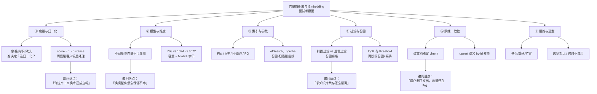
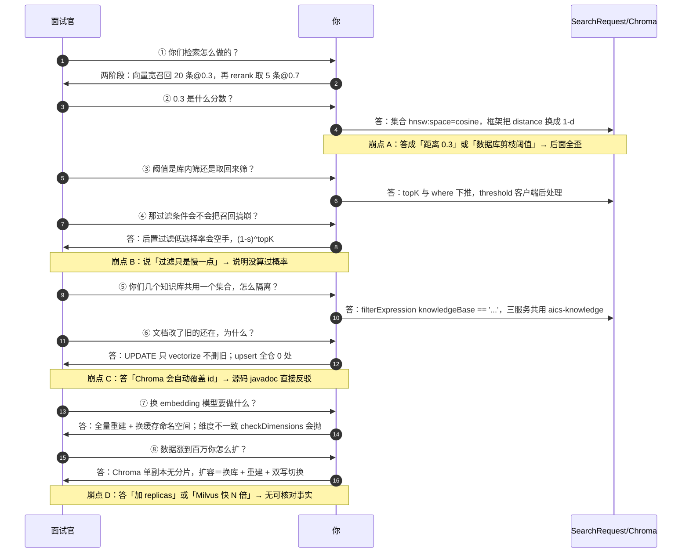

# 向量数据库与 Embedding 面试题精讲

> **一句话结论**：向量库的面试几乎不考公式——考的是「为什么这么选、出问题怎么查、什么规模会撞墙」，而这三件事在本仓库都能落到具体文件行号与 jar 字节码上，答得有据可查就是满分答案。
> **阅读前置**：先读 [01-向量与相似度](../05-向量数据库/01-向量与相似度-把文字变成坐标.md) 的 3.3~3.8 节与 [02-索引算法](../05-向量数据库/02-索引算法-向量检索怎么从全表扫描里活下来.md) 的 3.3~3.8 节；知道 `VectorStore.similaritySearch(SearchRequest)` 的四个参数是什么。
> **证据基线**：Spring AI 2.1.0（本机 `~/.m2` 中 1.1.4 与 2.1.0 并存，可对拍）+ Boot 4.2.0 + Chroma 0.5.20 单机；A 级 16 处、B 级 24 处、C 级 11 处（javap 字节码 6 处 + node 计算 2 处 + pwsh 静态统计 3 处）。预计阅读 45~55 分钟。

## 证据边界（本篇能证到哪一步）

| 类别 | 本仓可证的形态 | 本篇怎么处理 |
| --- | --- | --- |
| A 级 · 框架源码 | `learning-docs/24-源码分析/assets/source/` 已入库的 2.1.0 摘录（908 份，绝大多数是 Spring / Spring AI） | 讲「框架怎么定义语义」必挂 `[[源码:Xxx.java.md#L起-L止]]` 或代码块首行 `(src: …)` |
| B 级 · 本项目 | `ai-cs-chat` / `ai-cs-knowledge` / `ai-cs-search` 的真实文件与行号（215 个 java 的 chat 是唯一完整 AI 能力的服务） | 讲「本项目怎么做」必给 `路径#L行`；没落地的就写「本项目未落地」 |
| C 级 · 可复现实测 | `javap` 看 `~/.m2` 里 jar 的真实签名/字节码（javap 17.0.19）；`node` 做容量与召回计算；`pwsh` 做静态统计 | 命令 + 真实输出 + 怎么读；**不启服务、不联网、不跑 mvn/npm、不连中间件** |
| ❌ 不可证 | 本机无 docker/redis/mysql/chroma/es，Chroma 集群行为、Milvus 压测数字、线上召回率 | 一律写「未入库 / 未实测，依据官方文档」，绝不编 benchmark |

---

## 0. 先看现象

### 现象一：被追问一句「这个 0.3 是什么单位」就答不下去

面试里你说「我们的阈值是 0.3」，面试官接着问：「0.3 是余弦相似度还是距离？库内部做剪枝还是取回来再筛？如果换一种距离度量这个 0.3 还成立吗？」——三个问题一个都答不上来。

对应到本项目的现场，日志长这样（**数值是我按真实日志模板填的示例，不是跑出来的**）：

```text
2026-11-27 10:12:41 INFO  KnowledgeBaseService - 宽召回完成: 命中 7 条
2026-11-27 10:12:42 INFO  KnowledgeBaseService - Rerank精排完成: 召回 7 条 -> 返回 3 条
```

`ai-cs-chat/src/main/java/com/aics/chat/service/KnowledgeBaseService.java#L277` 打「宽召回完成」，`#L248` 打「Rerank精排完成」，两行之间夹着 20 条候选与 5 条精排的取舍。说不出 0.3 的语义，就等于说不出这两行日志为什么是 7 变成 3。

### 现象二：HNSW 的 `M` / `efConstruction` / `efSearch` 背得滚瓜烂熟，问「本项目哪一行配的」却答不上

背参数的人最容易在这里崩：因为本项目**一行都没配**。下面这条静态统计在 `ai-cs-*` 全部 `src` 下的 `.java` / `.yml` 里跑（大小写敏感）：

```pwsh
cd D:\Projects\Persion\ai-customer-service
$f = Get-ChildItem ai-cs-*\src -Recurse -Include *.java,*.yml | Select-Object -ExpandProperty FullName
Select-String -Path $f -Pattern "efSearch|ef_search|nprobe|nlist|hnsw" -CaseSensitive | Measure-Object
```

```text
Count : 0
```

0 命中。Chroma 侧的索引参数根本不在 Java 代码里，它在「集合被创建的那一刻」写进集合元数据——这一点后面 Q5 用字节码给出证据。面试官问「你项目 efSearch 设多少」，正确答案不是数字，而是「我们这个规模没暴露这个旋钮，我把旋钮在哪、为什么不拧讲清楚」。

### 现象三：把「换 Embedding 模型」当成改一行 yml

真实代码里换模型不是一行。本项目同时存在两个维度（768 本地哈希 / 1024 bge-m3），而 Chroma 集合一旦建好，维度就固定了：

```text
ai-cs-common/src/main/java/com/aics/common/ai/embedding/HashEmbeddingModel.java#L31   → DIMENSIONS = 768
ai-cs-chat/src/main/java/com/aics/chat/config/SpringAiConfig.java#L155              → 注释「1024 维向量」
```

两个 provider 的 javadoc 甚至互为备份：`HashEmbeddingModel.java#L25-L26` 直接写「哈希向量没有语义泛化能力；生产必须切换 bge-m3」，而 `SpringAiConfig.java#L164-L167` 写「知识库写入与对话检索必须使用同一个 EmbeddingModel，否则向量无意义」。知道这两句存在的人，被问「换模型要不要重建」时不会迟疑。

> 这些现象指向同一件事：**向量检索的每个数字都是「模型 × 度量 × 索引 × 过滤 × 阈值」五层里某一层的产物**，答不出数字的出处，就只能背结论；而面试官挖的正是出处。

---

## 1. 整体地图



> **读图说明**：六个分支是**并列的考察维度**，不是流程顺序；每个分支下面两个节点是该维度里最常被追问的两件事，虚线外的 X/Y/Z/W 是面试官的「落点」——他会从任意一个分支切进去，但最终都落到那四个问题上。读图的正确方式是：看到 `④ 过滤与召回` 时，别只想到「加个 where 条件」，要顺着 `F2` 意识到 topK 和 threshold **不是同一层的东西**（topK 下推服务端、threshold 客户端后处理，Q1/Q7 有字节码证据）。最常见的看错方式是：把 `⑤ 数据一致性` 当成「运维细节」跳过——恰恰这一支是本仓库唯一能给出反面证据（UPDATE 不删旧 chunk）的地方。

| 考点 | 背结论 | 讲机制 | 会定位 | 能改造 |
| --- | --- | --- | --- | --- |
| 度量选择与归一化 | 「都用余弦」 | 余弦 = 归一化后的内积；Chroma 建集合时写 `hnsw:space=cosine` | 看到 `score=1-distance` 反推度量 | 换成 l2 集合时重算阈值口径 |
| 模型不可混用 | 「换模型要重建」 | 维度 + 空间 + 归一化方式都是模型私有 | 用 `checkDimensions` 报错反查 | 加模型名到集合名/缓存键 |
| 维度与成本 | 「维度不是越高越好」 | 容量 = N×d×4 字节，检索是 O(N·d) | 用 `du` / `node` 算一遍 | 量化/PQ 降维预算 |
| 索引算法 | 「HNSW 最好」 | 图/倒排/有损压缩三种取舍 | 找不到旋钮时确认它在集合元数据 | 换 Milvus 才能调 efSearch |
| 过滤与召回 | 「metadata 过滤会慢」 | 前置 vs 后置决定召回 | 看 filter 是否进 QueryRequest | 调大 topK 或改双集合 |
| 数据一致性 | 「Chroma 会覆盖」 | `add` 不保证覆盖，`upsert` 才是 replace-by-id | 看 MQ 消费分支 | 先 delete 再 add |
| 运维选型 | 「Milvus 强」 | 规模/过滤/运维三维取舍 | 数副本数、数镜像 tag | 重建 + 双写切换 |

---

## 2. 关键概念与关键类/关键参数

### 2.1 概念表（名称 / 所在位置 / 一句话准确定义 / 本项目取值）

| 名称 | 所在位置 | 一句话准确定义 | 本项目取值 |
| --- | --- | --- | --- |
| Embedding（嵌入向量） | `EmbeddingModel` 接口 | 把一段文本映射成定长 `float[]`，方向编码模型训练时学到的共现关系 | 768（哈希）/ 1024（bge-m3）双 provider |
| 余弦相似度 | 集合元数据 `hnsw:space` | 两向量夹角的余弦，等于先各自 L2 归一化再点积 | `cosine`（Spring AI 建集合时的默认值） |
| 距离 distance | Chroma 返回的 `distances` | 集合所配度量的距离值；cosine 时为 `1 - 余弦相似度` | 隐含使用，未直接展示 |
| 相似度分数 score | `ChromaVectorStore.search` 里算 | Spring AI 统一成 `1 - distance` 后再比较阈值 | 本项目阈值 0.3 作用在这个 score 上 |
| topK | `SearchRequest.topK` | 服务端返回条数，下推到 `n_results` | 召回 20 → 精排 5 |
| 相似度阈值 | `SearchRequest.similarityThreshold` | **客户端**对返回结果的后置过滤，取值必须在 [0,1] | 召回 0.3；精排 0.7（另一套分数！） |
| 过滤表达式 | `SearchRequest.filterExpression` | 字符串 DSL 解析成 `Filter.Expression`，最终变成 Chroma 的 `where` | `knowledgeBase == '...'` |
| HNSW | Chroma 集合索引（服务端） | 分层可导航小世界图，用图遍历换近似召回 | 用默认参数，Java 侧不可配 |
| PQ（乘积量化） | 索引压缩手段 | 把向量切成 m 段、每段查码本存 1 字节，有损压缩 | 未使用（规模不需要） |
| 派生数据 | 向量相对源文档的地位 | 向量可由源文本随时重算，不该当成唯一真相 | 源文档在 MySQL，向量可重建 |

### 2.2 关键类/关键参数（名称 / 所在位置 / 语义 / 证据）

| 类 / 参数 | 位置 | 关键语义 | 证据 |
| --- | --- | --- | --- |
| `VectorStore` | `spring-ai-vector-store` | `add` / `upsert` / `delete` ×2 / `similaritySearch` | [[源码:VectorStore.java.md#L40-L110]] |
| `SearchRequest` | 同上 | 四字段 + `threshold ∈ [0,1]` 断言 | [[源码:SearchRequest.java.md#L158-L177]] |
| `similaritySearch(float[], SearchRequest)` | `VectorStoreRetriever` | 2.1.0 新增，直接喂查询向量 | [[源码:VectorStoreRetriever.java.md#L62-L80]] |
| `EmbeddingModel.dimensions()` | `spring-ai-model` | 默认实现真的调一次远端拿长度 | [[源码:EmbeddingModel.java.md#L130-L139]] |
| `initializeSchema` | `ChromaVectorStore.Builder` | 是否由框架建集合（建则写 cosine） | `ai-cs-chat/src/main/java/com/aics/chat/config/VectorStoreConfig.java#L85` |
| `recallTopK` / `recallThreshold` | `KnowledgeBaseService` | 两阶段第一段：20 条 / 0.3 | `ai-cs-chat/src/main/java/com/aics/chat/service/KnowledgeBaseService.java#L95-L99` |
| `topN` / `minScore` | `RerankProperties` | 两阶段第二段：5 条 / 0.7 | `ai-cs-chat/src/main/java/com/aics/chat/rag/rerank/RerankProperties.java#L34-L37` |
| `knowledgeBase` metadata | `KnowledgeVectorService` | 写入时打三个键，检索时按它过滤 | `ai-cs-knowledge/src/main/java/com/aics/knowledge/service/KnowledgeVectorService.java#L80-L82` |
| 集合名 | 三份 yml | 三服务共用一个 `aics-knowledge` | `ai-cs-chat/src/main/resources/application.yml#L49` |

---

## 3. 逐题精讲

先给一张定位速查表——面试里你先听到的是**症状**，再往回推根因。用法：拿到现象先对症，再按第三列验证，**不要跳过验证直接改代码**。

| 症状（日志/表现） | 根因 | 定位手法 | 修法 |
| --- | --- | --- | --- |
| 召回条数总是 0 或 1，明明知识库有内容 | threshold 是客户端后置过滤，过滤后不足 topK 条 | 把 `similarityThreshold` 调到 0.0 看条数是否恢复 | 降阈值或加大 topK 再精排 |
| 多知识库提问串数据 | 检索没带 `knowledgeBase` 过滤，三服务共用集合 | 看 `SearchRequest` 是否带 `filterExpression` | 必带过滤，且过滤字段要建在 metadata |
| 文档更新后旧答案还出现 | UPDATE 只 vectorize 不删旧 chunk | 查同 `documentId` 的 chunk 数是否变多 | 先 `delete(filter)` 再 `add`，或用 `upsert` |
| 换模型后检索全乱 | 集合维度/空间与模型不符 | 看 `checkDimensions` 是否抛异常 | 全量重建集合 |
| 检索延时不稳、偶发超时 | 图遍历 + 过滤后候选不足 | 看 Chroma 侧耗时 vs rerank 耗时 | 调 topK、加缓存、换库 |
| 精排后反而更差 | 把 rerank 的 0.7 当成向量相似度 0.7 | 看两个分数的来源 | 两套阈值分别调，不要混用 |

### Q1 · 相似度的度量怎么选？你们那个 0.3 到底是什么单位？

**问题**：你项目里 `similarityThreshold(0.3)` 的 0.3 是什么？余弦相似度、距离、还是框架自造的分数？换个向量库还成立吗？

**30 秒答案骨架**：
1. 度量由**集合**决定，不由查询决定。Spring AI 建 Chroma 集合时默认写 `hnsw:space=cosine`，所以本项目跑的是余弦。
2. Spring AI 拿到 Chroma 返回的距离后统一换成 `score = 1 - distance`，所以我们的 0.3 是「余弦相似度 0.3」，不是距离 0.3。
3. 阈值是**客户端后处理**：topK 和过滤条件下推给 Chroma，阈值在 Java 侧对返回结果二次筛。
4. 因此换一种度量（比如 l2），`1 - distance` 就不再落在 [0,1]，0.3 这个数立刻失去意义，阈值必须重标。

**深挖追问**：
- 追问「余弦和点积什么关系」——余弦就是先各自 L2 归一化再点积；不归一化时点积会被向量模长带偏。
- 追问「那要不要在代码里手动归一化」——不用，本项目两侧都由 provider 管：`HashEmbeddingModel.java#L107-L119` 自己 L2 归一化，bge-m3 返回的也是归一化向量；手动再归一化是幂等的，改不了排序。
- 追问「你怎么证明阈值不是下推的」——见下面证据锚点：Chroma 的查询请求体里根本没有阈值字段。

**常见错误答案**：
- ❌「阈值下推给数据库做 ANN 剪枝，所以设 0.3 只会让库少扫点。」错在把两件事混了：库只认 `n_results`（topK）和 `where`，阈值在客户端。
- ❌「score 就是余弦相似度，一定在 [0,1]。」只有在集合 `hnsw:space=cosine` 且由 Spring AI 创建时成立；集合若是别人用默认 l2 建的，`1 - distance` 会是负数。
- ❌「用欧氏距离更准。」排序上欧氏与余弦在未归一化时并不等价，见下面 C 级实测：同一批数据，余弦与内积给出不同的第一名。

**证据锚点**：
- A 级：阈值语义由框架源码写明——「Note that this is a post-processing step performed on the client not the server side」，并且断言范围 [0,1]：[[源码:SearchRequest.java.md#L164-L177]]
- C 级（字节码）：2.1.0 的 `ChromaVectorStore#search(float[], SearchRequest)` 里，先构造 `QueryRequest(查询向量, topK, where)`，再对每条返回结果把 `distances` 取出来做 `1 - d`，然后与 `getSimilarityThreshold()` 比较、小于则跳过；文档 metadata 里另外记了一个 `DocumentMetadata.DISTANCE`。
- C 级（可复现计算，度量分叉）：

```js
// vec-a.mjs 节选：同一批向量，三种度量的第一名不同
const norm = (v) => Math.hypot(...v);
const dot = (a, b) => a.reduce((s, x, i) => s + x * b[i], 0);
const cos = (a, b) => dot(a, b) / (norm(a) * norm(b));
const l2 = (a, b) => Math.sqrt(a.reduce((s, x, i) => s + (x - b[i]) ** 2, 0));
const q = [1, 1], A = [10, 0], B = [1.4, 1.4];
for (const [n, v] of [['A', A], ['B', B]])
  console.log(`doc${n} cos=${cos(q, v).toFixed(3)} dot=${dot(q, v).toFixed(3)} L2=${l2(q, v).toFixed(3)}`);
```

```text
docA cos=0.707 dot=10.000 L2=9.055
docB cos=1.000 dot=2.800 L2=0.566
```

怎么读：按内积（dot）A 排第一，按余弦（cos）B 排第一，按欧氏距离（L2 越小越好）B 排第一。**度量换了，第一名就换了**，所以「阈值 0.3」永远绑定在某一种度量上。

---

### Q2 · Embedding 到底输出了什么？凭什么说「距离近 = 语义近」？

**问题**：模型吐出 1024 个浮点数，这 1024 维有什么含义？为什么距离能代表语义？

**30 秒答案骨架**：
1. 框架层面它就是个 `float[]`：`EmbeddingModel` 只有「文本进、向量出」这一件事，接口里连相似度都没有。
2. 语义相近是**训练目标的副产品**：模型在大量语料上被训练成「上下文可互换的片段向量要接近」，所以共现关系被压进了方向里，而不是某一维。
3. 因此维度**不可解释**——第 37 维不是「情感」，不要做单维分析；也不能把不同模型的维度对齐。
4. 本项目要诚实补一句：本地默认 provider 是哈希向量，它不是语义模型，只在字面重叠上有效。

**深挖追问**：
- 追问「`dimensions()` 怎么来的」——默认实现是**真的去调一次远端** `embed("Test String")` 再取长度，所以第一次调用会带一次网络开销；知道维度就该覆盖它（这正是「维度是模型私有属性」的框架级表达）。
- 追问「池化/pooling 是什么」——token 级向量要合成句向量，常见是取 `[CLS]` 或均值池化；这是模型内部实现，Spring AI 不暴露。
- 追问「本项目那个 768 维真是语义吗」——不是。`HashEmbeddingModel` 用双哈希把英文单词和中文二元字组打到固定桶里再累加，本质是可复现的词袋。

**常见错误答案**：
- ❌「每一维代表一个语义特征，可以解释。」错：分布式表示没有单维含义，任何「第 N 维 = 情感」的说法都是编的。
- ❌「向量长度代表文本长度/重要性。」错：方向才有意义，模长是归一化前的噪声。
- ❌「哈希向量和 bge-m3 都是 768/1024 维，接一起用也行。」错：维度都不一致，见 Q3。

**证据锚点**：
- A 级：[[源码:EmbeddingModel.java.md#L49-L60]]（`embed(String)` / `embed(Document)` 的唯二入口）、[[源码:EmbeddingModel.java.md#L130-L139]]（`dimensions()` 默认实现调远端，javadoc 建议覆盖）
- B 级：`ai-cs-common/src/main/java/com/aics/common/ai/embedding/HashEmbeddingModel.java#L77-L96`（英文 `w:` + 中文二元 `c:` 的 token 化）、同文件 `#L25-L26`（「哈希向量没有语义泛化能力；生产必须切换 bge-m3」）

---

### Q3 · 不同 Embedding 模型的向量能混用吗？换模型要做哪些事？

**问题**：知识库用 A 模型入库，问答用 B 模型检索，会怎样？换模型时正确的操作顺序是什么？

**30 秒答案骨架**：
1. 不能混。向量空间、维度、归一化方式都是模型私有的，混用不是「效果差一点」，是**结果无意义且可能不报错**。
2. 框架只保证「维度对不上就抛异常」（`checkDimensions`），维度碰巧相同时它不会救你——源码注释的原话是结果无意义但不会报错。
3. 换模型的唯一正确姿势是**全量重建**：新集合（或清空旧集合）→ 用新模型重灌全部 chunk → 切流量。
4. 本项目还有一层：embedding 缓存按模型名做命名空间，换模型后旧缓存必须失效，这点代码注释里写死了。

**深挖追问**：
- 追问「维度不一致会怎样」——Chroma 路径上会 `IllegalArgumentException`；但本项目里手写余弦（`EmbeddingClusterService.java#L125-L137`）用的是 `Math.min(a.length, b.length)`，维度不一致时**静默按短的算**，这是同一系统里两套度量、两种失败姿态的活例子。
- 追问「怎么保证写入方和检索方是同模型」——本项目靠 `@Primary` + 三服务共用同一份 Nacos 配置键（`aics.embedding.model`），chat 与 knowledge 各有一份 `@Value` 且注释「与 ai-cs-chat 保持一致」。
- 追问「重建要多久」——按 chunk 数 × 单次 embed 延迟估；本项目没有实测数据，只能说重建是串行调用外部 embedding API 的过程，要限流。

**常见错误答案**：
- ❌「维度不一致就截断到短的。」这是旧稿里出现过的危险建议：截断破坏了归一化与空间结构，检索出来的东西更没意义；本项目手写余弦的 `Math.min` 是**缺陷**不是方案。
- ❌「两个模型都注入了，Spring 会自己选对的。」`@Primary` 只解决注入歧义，不解决语义一致性。
- ❌「Chroma 按 id 存，换模型只覆盖值就行。」覆盖后同一集合里新旧空间混杂，见 Q8 的 upsert 语义。

**证据锚点**：
- A 级：直接喂查询向量的重载方法把这事写进 javadoc——「query embedding must come from the same model, with the same settings, as the stored embeddings; otherwise the results are meaningless even though no error is raised」：[[源码:VectorStoreRetriever.java.md#L62-L80]]
- C 级：`javap -p -cp spring-ai-chroma-store-2.1.0.jar org.springframework.ai.chroma.vectorstore.ChromaVectorStore` 可见 `doSimilaritySearch(float[], SearchRequest)` 第一句就是 `checkDimensions("Query embedding", query.length, vectorDimensions())`；`vectorDimensions()` 由私有的 `resolveVectorDimensions()` 惰性解析（字段 `private volatile int resolvedVectorDimensions`）。
- B 级：`ai-cs-chat/src/main/java/com/aics/chat/config/SpringAiConfig.java#L164-L167`（写入与检索必须同模型）、`#L202`（缓存键以模型名做命名空间，换模型旧缓存必须失效）；`ai-cs-common/src/main/java/com/aics/common/ai/embedding/EmbeddingAutoConfig.java#L14-L22`（`aics.ai.embedding.provider=local` 时默认装哈希模型）。

---

### Q4 · 维度是不是越高越好？成本怎么算才不算拍脑袋？

**问题**：1536 维和 1024 维差在哪？你们为什么是 1024？存 100 万条要多少内存？

**30 秒答案骨架**：
1. 先算容量：`字节数 = N × d × 4`（float32），1024 维一条 4 KiB，100 万条约 3.81 GiB，只剩原始向量，不含图索引、metadata、副本。
2. 再算算力：暴力检索是 O(N·d) 次乘加，维度翻倍就是计算翻倍；ANN 索引虽然省扫描，但距离计算还是按 d 付钱。
3. 维度带来的是表达能力上限，不是线性收益；多数中文检索任务 1024 维已足够，往上加主要是在买边际收益。
4. 真要省，量化（int8 省 4 倍）和 PQ 压缩（1024 维可压到 32 字节，128 倍）比降维更划算。

**深挖追问**：
- 追问「阈值 0.3 和维度有关吗」——无关；阈值是度量上的数，维度影响的是容量与可分性。
- 追问「Matryoshka 截断靠不靠谱」——只有当模型按 MRL（Matryoshka Representation Learning）训练过才成立，普通模型截断等于随机破坏空间；本项目用的 bge-m3 未做实测，不吹。
- 追问「Chroma 集合能改维度吗」——不能，集合维度在建集合时固定，所以本项目 chat/knowledge 都设了 `initialize-schema: false`，不负责建集合。

**常见错误答案**：
- ❌「3072 维一定比 1024 好。」没有任务指标的对比就是拍脑袋；维度上去后容量与延迟线性变差。
- ❌「存不下就分库分表。」向量检索分片是另一件事（02 篇 3.10），不能照搬关系库思路。
- ❌「float32 太大，存 double。」反了，方向没错但更贵。

**证据锚点**：
- C 级（真实输出，`node vec-a.mjs`）：

```text
d=768 3072B/条  1e4=0.03GiB 1e5=0.29GiB 1e6=2.86GiB 1e7=28.61GiB
d=1024 4096B/条  1e4=0.04GiB 1e5=0.38GiB 1e6=3.81GiB 1e7=38.15GiB
d=1536 6144B/条  1e4=0.06GiB 1e5=0.57GiB 1e6=5.72GiB 1e7=57.22GiB
d=3072 12288B/条  1e4=0.11GiB 1e5=1.14GiB 1e6=11.44GiB 1e7=114.44GiB
HNSW M=16: 图指针 128B/条
HNSW M=32: 图指针 256B/条
PQ d=1024 m=32: 32B/条 (128x)
PQ d=1024 m=64: 64B/条 (64x)
PQ d=1024 m=96: 96B/条 (43x)
```

怎么读：第一列是维度，`4096B/条` 是 `1024×4`；GiB 那几列是裸向量。**图指针**那两行是 HNSW 的额外开销（每条上下行各 M 个 4 字节指针），M=32 时每条再加 256 B——这就是「100 万条 3.81 GiB 的裸数据，实际内存要往上加一大截」的量化解释。PQ 那三行说明压缩比只取决于子空间数 m，和维度无关（`d×4/m`）。

- A 级：`dimensions()` 是模型属性且默认要打远端才知道：[[源码:EmbeddingModel.java.md#L130-L139]]
- B 级：`ai-cs-chat/src/main/java/com/aics/chat/config/SpringAiConfig.java#L155`（注释「1024 维向量」）、`ai-cs-common/src/main/java/com/aics/common/ai/embedding/HashEmbeddingModel.java#L31`（`DIMENSIONS = 768`）

---

### Q5 · Flat / IVF / HNSW / PQ 怎么取舍？你们项目用的是哪个？

**问题**：说说过滤（filter）之外，索引层你懂多少？HNSW 的 M、efConstruction、efSearch 分别管什么？你们配了多少？

**30 秒答案骨架**：
1. Flat 是全表精确扫描，N 上万后延迟线性上升；IVF 用聚类倒排，用 `nprobe` 换召回；HNSW 用分层图，召回高延迟低但吃内存、删除要靠标记；PQ 是有损压缩，通常叠在 IVF 上用。
2. HNSW 三个参数：`M` 是每个节点的连接数（越大越准越占内存）、`efConstruction` 是建图时的候选宽度（越大建得越慢越准）、`efSearch` 是查询时的候选宽度（越大召回越高越慢）。
3. 我们项目这几个旋钮**一个都没配**——不是漏了，是 Chroma + Spring AI 这条路没暴露：`SearchRequest` 只有四个字段，没有索引参数。
4. 所以诚实答案是：规模只有万级 chunk，默认参数够用；要调 `efSearch` 得换 Milvus / Qdrant / pgvector 这类把索引建在 SQL/集合定义里的库。

**深挖追问**：
- 追问「那 Chroma 的索引参数到底在哪」——在集合创建时的元数据里。Spring AI 只在**它自己建集合**时写一条 `hnsw:space=cosine`，其余靠 Chroma 默认；集合已存在时度量以既有配置为准。
- 追问「换成 Milvus 你要改多少代码」——本项目只依赖 `VectorStore` 接口，改动集中在 `VectorStoreConfig` 的 builder 与 yml，业务代码（`KnowledgeBaseService`）不动，注释里就写了这三点。
- 追问「HNSW 删除为什么麻烦」——图里删点要重连边，多数实现用标记删除 + 后台合并，所以 delete 之后召回空间里还有「幽灵」。

**常见错误答案**：
- ❌「我们在 application.yml 里配了 ef-search。」本仓库 `Select-String` 大小写敏感搜 `efSearch|ef_search|nprobe|nlist|hnsw` 命中 0 次，这类回答一查就露。
- ❌「HNSW 是精确检索。」它是近似（ANN）——这正是 Q6 要讲召回率的原因。
- ❌「PQ 无损。」PQ 有损，压缩比越高召回越低。

**证据锚点**：
- A 级：`SearchRequest` 只有 query / topK / similarityThreshold / filterExpression 四个字段，没有索引参数：[[源码:SearchRequest.java.md#L56-L60]]
- C 级（字节码，`javap -p -c -cp spring-ai-chroma-store-2.1.0.jar "org.springframework.ai.chroma.vectorstore.ChromaApi$CreateCollectionRequest"`）——无参构造器只有一句赋值：

```text
 6: ldc   #19   // String hnsw:space
 8: ldc   #21   // String cosine
10: invokestatic #23  // Map.of:(Object;Object;)Map
```

怎么读：`hnsw:space=cosine` 是**建集合时**写进去的默认元数据。这解释了 Q1（度量由集合决定）和 Q5（Java 侧没有 efSearch 旋钮，因为 Chroma 的 HNSW 参数不在这个请求模型里）。
- B 级：`ai-cs-chat/src/main/java/com/aics/chat/config/VectorStoreConfig.java#L81-L89` 的 builder 链只有 collectionName / databaseName / tenantName / initializeSchema / observation / batching，没有索引项；同文件 `#L40-L45` 注释说明换库只需换 starter、yml、以及本类。

---

### Q6 · 「调大 efSearch 召回就上去了」——这条曲线长什么样？

**问题**：你怎么说服我「召回已经够了」？调参的代价是什么？

**30 秒答案骨架**：
1. 这类参数（`nprobe` / `efSearch`）本质是**扫描预算**：预算越大，候选集越接近全量，召回单调上升、延迟单调上升。
2. 我用 IVFFlat 语义复现了一条曲线：nprobe=1 只扫 1.9% 数据，recall@10 只有 0.30；nprobe=16 扫到 24.9% 才到 1.00。
3. 结论是「召回 90%+ 通常要扫 20% 以上的数据」，所以 ANN 的收益主要来自「从 100% 降到 20%」，而不是「近似检索不要钱」。
4. 定参的方法不是猜，是用 golden 集回归：本项目有 20 条 golden 集与 `aics.eval.gate` 门禁配置，但阈值字段全是 null，等于**未启用**——这点我不会说成「已上线门禁」。

**深挖追问**：
- 追问「你的曲线是 Chroma 测的吗」——不是。这是自己写的 IVFFlat 复现代码跑出的量级感，我会明确标注「模拟，不是 Chroma 实测」，因为本机没有 Chroma。
- 追问「HNSW 的曲线形状一样吗」——同一族：`efSearch` 增大召回上升、延迟上升；但 HNSW 的拐点更靠左，这也是它流行的原因之一（未实测）。
- 追问「延迟怎么算」——扫描条数 × d 次乘加 + 图遍历开销；所以 `nprobe` 翻倍大致等于延迟翻倍量级。

**常见错误答案**：
- ❌「设置 `efSearch=1000` 就没召回损失，且不慢。」两个断言都缺数据。
- ❌「ANN 召回损失是 1%~2%，可以忽略。」没有证据的 1% 就是编的。
- ❌「采样 100 条随机查询测召回就够了。」查询分布要和真实流量一致，否则曲线是假的。

**证据锚点**：
- C 级（真实输出，`node vec-b.mjs`，K=64、N=10000、D=16、40 条查询）：

```text
nprobe= 1 扫描1.9% (193条) recall@10=0.30
nprobe= 2 扫描3.3% (329条) recall@10=0.30
nprobe= 4 扫描6.5% (653条) recall@10=0.60
nprobe= 8 扫描12.3% (1231条) recall@10=0.80
nprobe=16 扫描24.9% (2492条) recall@10=1.00
nprobe=32 扫描49.9% (4992条) recall@10=1.00
40 条查询平均: 1->0.26  2->0.41  4->0.59  8->0.76  16->0.93  32->1.00
```

怎么读：第三列是「扫了多少数据」，第四列是「top-10 命中真值的比例」。第一行到第二行 nprobe 翻倍但 recall 不动（又是 0.30），说明**聚类分布不均时小预算会连续踩空**；末两行 recall 都到 1.00，说明再加大只是浪费。真实调参就是找「recall 已经平了」的那个点。
- B 级：`ai-cs-chat` 模块资源目录下的 `resources/eval/golden-set.json`（`ConvertFrom-Json | Measure-Object` 实测 20 条）；`ai-cs-chat/src/main/java/com/aics/chat/rag/eval/EvalGateConfig.java#L34-L43`（`aics.eval.gate` 前缀，`p95LatencyMs` / `avgTokensPerRequest` 都是 `Long` 包装类型，「配置缺失即 null = 不判定」）

---

### Q7 · metadata 过滤为什么会把检索搞崩？

**问题**：多知识库共用一张表/一个集合，检索时加个 `where kb = 'x'` 就行了？为什么很多线上事故是「加了过滤就搜不到」？

**30 秒答案骨架**：
1. 关键看 topK 是「过滤前取」还是「过滤后取」。**后置过滤**（先 ANN 取 topK 再筛 metadata）在低选择率下会崩塌：topK=20、选择率 1% 时，期望只剩 0.2 条，81.8% 的概率一条都不剩。
2. 前置过滤（先按条件缩子集再检索）召回正常，但会让向量索引失效或变慢，需要专门的「带过滤的索引」（多数库叫 filtered ANN）。
3. 所以正确的工程姿势是：过滤条件尽量下推（让库来筛），并把 topK 设到「期望剩够条数」的量级；不能既低选择率又小 topK 还要求召回。
4. 阈值是另一层后置过滤——它也会砍掉结果，所以「过滤 + 阈值」是两次削减，很容易把条数削到 0。

**深挖追问**：
- 追问「Spring AI 走的是哪条路」——Chroma 路径上是**下推**：`filterExpression` 被转成 JSON `where` 塞进查询请求；但阈值仍在客户端。所以我们是「过滤下推 + 阈值后置」的组合。
- 追问「本项目真的踩过吗」——不知道有没有踩过，但代码里有明确的防御：检索必须带 `knowledgeBase == '...'`，因为三服务共用 `aics-knowledge` 集合。
- 追问「那为什么不给每个知识库建一个集合」——那样过滤天然消失，但集合数量随知识库线性增长，创建/删除集合成了运维负担；这是取舍，不是唯一解。

**常见错误答案**：
- ❌「加 metadata 过滤只会慢一点，不影响召回。」这就是召回崩塌的标准误解。
- ❌「把 topK 设成 20 就够筛了。」在选择率 1% 时期望只有 0.2 条，20 是白取。
- ❌「阈值下推了，所以库会多取一些来补偿过滤。」请求体里没有阈值字段，库不会替你补。

**证据锚点**：
- A 级：阈值后置 + 过滤表达式是「字符串 DSL 解析成 Filter.Expression」：[[源码:SearchRequest.java.md#L164-L177]]、[[源码:SearchRequest.java.md#L286-L289]]
- C 级（字节码）：`search(float[], SearchRequest)` 先 `FilterExpressionConverter.convertExpression` → `jsonToMap` → `new QueryRequest(向量, topK, where)` → `chromaApi.queryCollection(...)`。`ChromaApi$QueryRequest` 是 record，字段只有 `queryEmbeddings / nResults / where / include`——**没有 threshold**。
- C 级（真实输出，`node vec-a.mjs` 后置过滤段）：

```text
过滤 s=50.0% 剩10.00条 空手0.0% 需topK≈5
过滤 s=10.0% 剩2.00条 空手12.2% 需topK≈29
过滤 s=5.0% 剩1.00条 空手35.8% 需topK≈59
过滤 s=1.0% 剩0.20条 空手81.8% 需topK≈299
过滤 s=0.1% 剩0.02条 空手98.0% 需topK≈2995
蒙特卡洛 T=200000 s=5%: 空手 35.9%
```

怎么读：`s` 是 metadata 条件的选择率；「空手」是我对「一条都没命中」的口语简称，解析值 `(1-s)^20`，最后一个蒙特卡洛行用 20 万次抽样验证了解析值（35.9% vs 35.8%），说明这个指数崩塌不是模型假设，是纯概率。
- B 级：`ai-cs-chat/src/main/java/com/aics/chat/service/KnowledgeBaseService.java#L269-L274`（`SearchRequest` 同时带 `topK`、`similarityThreshold`、`filterExpression`）；三份 yml 共用同一集合：`ai-cs-chat/src/main/resources/application.yml#L49`、`ai-cs-knowledge/src/main/resources/application.yml#L31`、`ai-cs-search/src/main/resources/application.yml#L43`。

---

### Q8 · 文档改了、删了，向量怎么保持一致？为什么会出现「残留 chunk」？

**问题**：知识库文档更新后，旧内容的答案还在出现，你怎么定位？`add` 和 `upsert` 到底差在哪？

**30 秒答案骨架**：
1. 向量是**派生数据**：源文档变了，向量必须重算；关系库里 update 一条，向量库里不会自动跟着变。
2. `add` 是「追加」，重复 id 的行为由底层 provider 决定；`upsert` 是 2.1.0 才有的「按 id 覆盖」，语义是 replace-by-id——两者不能互相替代。
3. 我们项目里 `VectorStore.upsert` 调用 **0 处**：UPDATE 消息只重新 `vectorize`（写新 chunk），不删旧 chunk，所以同一 `documentId` 会残留两份内容。
4. 正确做法是先 `delete("documentId == '...'")` 再 `add`，或者整体切到 `upsert` 并把 chunk id 设计成稳定的（例如 `documentId#序号`）。

**深挖追问**：
- 追问「怎么定位」——`deleteByDocumentId` 已存在，说明「按 documentId 聚合」是现成能力；数一下同 `documentId` 的 chunk 数量变没变，就能确认是否残留。
- 追问「MQ 重复消费会怎样」——会重复写；javadoc 声称「先删旧再写新，结果幂等」，但实现只写了新，注释与代码不一致，这是**必须点出来的缺陷**（`KnowledgeSyncConsumer.java#L25-L26` vs `#L57-L72`）。
- 追问「失败会重试吗」——不会，消费异常被 catch 后只打日志「知识文档同步消息消费失败」，不重抛，等于丢消息。

**常见错误答案**：
- ❌「Chroma 会自动按 id 覆盖。」`add` 的 javadoc 原话是「Throws an exception if the underlying provider checks for duplicate IDs」，重复 id 的行为被明确交给了 provider。
- ❌「删文档时把整个集合清空最省事。」会把没变的文档一起干掉，重建成本巨大。
- ❌「用同一个内容算同一个 id 就够了。」哈希内容做 id 可以缓解，但 chunk 边界一变 id 就全变。

**证据锚点**：
- A 级：`add` 与 `upsert` 的语义差异（含 2.1.0 新增、默认实现直接抛 `UnsupportedOperationException`）：[[源码:VectorStore.java.md#L48-L66]]、[[源码:VectorStore.java.md#L74-L82]]
- C 级（版本对拍，`javap` 1.1.4 vs 2.1.0）：1.1.4 的 `VectorStore` 接口**没有 upsert 方法**；2.1.0 才有 `default void upsert(java.util.List<EmbeddedDocument>)`。`ChromaVectorStore` 2.1.0 也相应多出 `supportsUpsert()` 与 `doUpsert(...)`。
- B 级：`ai-cs-knowledge/src/main/java/com/aics/knowledge/service/KnowledgeVectorService.java#L103-L109`（`vectorStore.delete("documentId == '...'")`）；`ai-cs-knowledge/src/main/java/com/aics/knowledge/mq/KnowledgeSyncConsumer.java#L17-L18`（CREATE/UPDATE → `vectorize`，DELETE → `deleteByDocumentId`）、`#L73-L77`（catch 吞异常）。

---

### Q9 · 向量库怎么备份、怎么重建、怎么扩容？

**问题**：Chroma 挂了怎么办？数据量涨到百万级你怎么扩？

**30 秒答案骨架**：
1. 备份优先级最低：向量可由源文档重算，真正的资产是 MySQL 里的文档与 `documentId`，所以「能重建」比「能备份」重要。
2. 重建路径：新集合（或新库）→ 按文档批量重灌 → 用 golden 集对比新旧召回 → 切流量。
3. 扩容先看架构：本项目是单副本 StatefulSet + 持久卷，`replicas: 1`，没有分片也没有多副本——**单点**，扩容等于换库，不是加副本。
4. 上百万条要换 Milvus/Qdrant 这类支持分片副本的库，并重新设计 id 与 metadata（分片键要和过滤条件对齐）。

**深挖追问**：
- 追问「重建要多久、要多少钱」——等于「chunk 数 × 一次 embed 调用」，外部 API 有 QPS 限制，所以要限流 + 断点续灌；本项目没实测数字。
- 追问「切流量怎么做到不丢」——双写过渡：新文档同时写新旧集合，历史数据重灌完成后再读切新集合。
- 追问「持久卷挂了数据能恢复吗」——只能重建，且要保证源文档的切块规则（`TokenTextSplitter` 默认参数）没变，否则 chunk id 全变。

**常见错误答案**：
- ❌「Chroma 有集群模式，加副本就行。」本项目部署清单是单副本 0.5.20，集群形态未实测，不能这么答。
- ❌「向量数据是核心资产，必须先做定时备份。」把派生数据当真相，是本末倒置。
- ❌「扩容就是把 `replicas` 改成 3。」无共享存储的 StatefulSet 加副本会得到三份不同数据。

**证据锚点**：
- B 级：`deploy/k8s/chroma.yaml#L33`（`replicas: 1`，注释「单副本：学习环境，数据一致性简单」）、`#L44`（`image: chromadb/chroma:0.5.20`，注释「固定版本号，避免 latest 导致行为漂移」）、`#L49`（`mountPath: /chroma/chroma` 持久卷）
- B 级：`ai-cs-chat/src/main/resources/application.yml#L52`（`port: ${CHROMA_PORT:8000}`，所有服务指向同一个单点）
- 延伸阅读：[04-生产运维-向量库跑起来之后才会遇到的事](../05-向量数据库/04-生产运维-向量库跑起来之后才会遇到的事.md) 的 3.1 节（「向量是派生数据」）、[03-选型与容量规划](../05-向量数据库/03-选型与容量规划.md) 的 3.9 节（迁移四步）

---

### Q10 · 向量库选型怎么答才不像背广告？

**问题**：Chroma / Milvus / Qdrant / pgvector / ES 你选哪个？为什么？

**30 秒答案骨架**：
1. 先问三个约束：数据量级（万 / 百万 / 十亿）、过滤复杂度（是否需要多字段组合过滤）、团队运维能力（能不能维护一个有状态集群）。
2. 万级 + 单机 + 学习/演示：Chroma 或内存向量库，零运维；百万级 + 已有 Postgres：pgvector；亿级 + 强过滤：Milvus；已有 ES：直接用 ES 的向量字段，省一个组件。
3. 我们项目选 Chroma 的理由是「Chroma 单机 + 三服务共用一个集合 + 零额外运维」，而且业务代码只依赖 `VectorStore` 接口，换库只改配置类。
4. 我不会给你「Milvus 比 Chroma 快 N 倍」这种数字，因为我没有可复现的 benchmark。

**深挖追问**：
- 追问「多组件代价」——每加一个中间件就多一套监控/备份/权限；ES 已经在项目里（搜索服务），所以「用 ES 顺便存向量」是很实际的选项。
- 追问「Chroma 的短板」——单机、无分片、索引参数不暴露、过滤与索引的配合能力弱；这些正好是它「开箱即用」的代价。
- 追问「你会怎么迁移」——换 starter + 换配置 + 重灌数据 + golden 集回归，业务代码不动（本项目注释写明了这一点）。

**常见错误答案**：
- ❌「业界普遍用 Milvus，所以我们用 Milvus。」无来源的「业界普遍」= 伪证据。
- ❌「Chroma 只能做 Demo。」对万级规模是够用的，说「只能」是没算过容量。
- ❌「向量库都差不多，随便选。」过滤能力、索引参数、运维形态差别恰恰是选型的全部。

**证据锚点**：
- B 级：`ai-cs-chat/src/main/java/com/aics/chat/config/VectorStoreConfig.java#L38-L45`（注释：换库三步——换 starter 依赖、改 yml、业务代码一行不改，因为只依赖 `VectorStore` 接口）
- B 级：`ai-cs-search/src/main/resources/application.yml#L41-L46` 与 `ai-cs-chat/src/main/resources/application.yml#L45-L52` 说明「搜索服务也在用 chroma」，即「一个组件被三个服务共用」是真实约束。

---

### Q11 · 什么时候**不该**用向量库？

**问题**：什么问题你会拒绝上向量检索？

**30 秒答案骨架**：
1. 精确匹配：订单号、手机号、SKU——这些要等值/前缀查询，B+树或 ES keyword 又准又快，向量只会带来「差不多但错」。
2. 规则明确：命中关键词就走固定话术，本项目的规则相似度阈值 `0.7` 就是干这个的，不需要向量。
3. 规模极小：几百条以内，内存里全量遍历既准又简单，引入中间件纯亏。
4. 只有字面匹配需求：BM25 就够了，向量反而是噪声源。

**深挖追问**：
- 追问「那混合检索呢」——真实系统常常是「关键词 + 向量」并行再融合，本项目有 `HybridRetriever`，检索同样带 `knowledgeBase` 过滤。
- 追问「怎么判断该不该上」——看查询是否「用户用自己的话问、答案散落在非结构化文本里」；是则向量，否则索引。
- 追问「向量检索的失败模式」——答非所问但分数很高（因为字面重叠），这就是纯向量方案的固有缺陷。

**常见错误答案**：
- ❌「先上向量库，不行再优化。」中间件成本与数据一致性负担是立刻产生的。
- ❌「向量检索能替代 ES。」两者解决不同问题，本项目两个都留着。
- ❌「相似度 0.9 就一定对。」分数只表示模型空间里的接近，不等于业务正确。

**证据锚点**：
- B 级：`ai-cs-chat/src/main/java/com/aics/chat/agent/AgentProperties.java#L48`（`ruleSimilarityThreshold = 0.7`）、`ai-cs-chat/src/main/java/com/aics/chat/agent/tool/KnowledgeRuleProvider.java#L40`（把 `ruleTopK` / `ruleSimilarityThreshold` 传给规则检索）
- B 级：`ai-cs-chat/src/main/java/com/aics/chat/rag/retrieve/HybridRetriever.java#L291-L292`（混合检索里同样用 `topK` + `filterExpression`）

---

### Q12 · 两阶段召回为什么是 20→5？0.3 和 0.7 为什么不能混着说？

**问题**：你们 topK 和阈值到底几个？为什么召回用 0.3、精排用 0.7？

**30 秒答案骨架**：
1. 两个阶段两套分数：第一段是**向量相似度**（`1 - cosine distance`，阈值 0.3，`topK=20`，宽召回、宁滥勿缺）；第二段是 **rerank 模型给的相关度**（`topN=5`、`minScore=0.7`，精排、宁缺勿滥）。
2. 两个分数来自不同模型，**数值不可比**：0.3 和 0.7 只是各自量纲上的门槛，混着调就是把两种尺子当一把用。
3. 两阶段的结构性好处是：第一段便宜（一次向量检索）但粗；第二段贵（一次 rerank API）但准，所以先用 20 条覆盖住，再用 5 条收敛。
4. 精排失败要能降级：`RerankService` 异常时降级为相似度排序并打 warn 日志，不能让整条链路挂。

**深挖追问**：
- 追问「20 怎么定的」——经验值，配合 0.3 一起在 golden 集上调；本项目门禁阈值未启用（`aics.eval.gate` 全 null），所以这是「待校准」而不是「已最优」。
- 追问「0.3 调高会怎样」——宽召回变窄，精排就没有素材，最终答案条数下降；调低会引入噪声并增加 rerank 费用。
- 追问「两段都能配 Nacos 吗」——可以：`aics.rag.recall-top-k` / `aics.rag.recall-threshold` 在 Nacos 配置里，`aics.rerank.*` 是另一组前缀。

**常见错误答案**：
- ❌「把 0.7 设成向量阈值更准。」把 rerank 的尺子套到向量分数上，结果要么全被过滤要么全放过。
- ❌「有 rerank 就不需要阈值了。」没有第一段的阈值，噪声明细会撑爆 rerank 的输入长度与费用。
- ❌「topK 越大越好。」20→100 时 rerank 费用与延迟线性涨，且召回质量不一定涨。

**证据锚点**：
- B 级：`ai-cs-chat/src/main/java/com/aics/chat/service/KnowledgeBaseService.java#L95-L99`（`recallTopK = 20` / `recallThreshold = 0.3`）、`#L228-L260`（`search()`：先 `searchRaw` 宽召回，再 `rerankService.rerank(...).block()`，`#L248` 打「Rerank精排完成」，`#L251-L257` 异常降级为相似度排序）、`#L265-L279`（`searchRaw` 组装 `SearchRequest`）
- B 级：`tools/nacos-config/ai-cs-chat.yml#L22-L25`（`rag.recall-top-k: 20` / `rag.recall-threshold: 0.3`）；`ai-cs-chat/src/main/java/com/aics/chat/rag/rerank/RerankProperties.java#L34-L37`（`topN = 5` / `minScore = 0.7`）；`ai-cs-chat/src/main/java/com/aics/chat/rag/rerank/SiliconFlowRerankService.java#L194-L197`（按 `minScore` 过滤再按分数降序）

---

## 4. 一次完整追问链时序

下面这条链是「向量库」这一题最常见的 8 连问，从你自报的「阈值 0.3」开始，到面试官确认你真的动手调过为止。



> **读图说明**：箭头方向是「面试官提问 → 你回答」，`participant S` 代表你回答时应该指向的具体代码/请求对象（不是第三个人）。看这张图的关键是四个 `Note`：A 在②之后（度量语义一旦说错，⑦⑧ 也就无从谈起）、B 在④之后（过滤与召回的概率账）、C 在⑥之后（`add` 与 `upsert` 的语义）、D 在⑧之后（扩容能力必须和部署清单对齐）。读错的常见方式是把①~⑧ 当成必须全部答满的清单——真实面试里你只要把①②③ 答实、④⑥ 各补一句量化，就已经明显区别于背题的人。

| 崩点 | 会在哪一步崩 | 崩掉的信号 | 救回来的说法 |
| --- | --- | --- | --- |
| A | ② 度量语义 | 说「0.3 是距离」或「阈值下推剪枝」 | 「阈值是客户端后处理，topK 才是下推的」 |
| B | ④ 过滤与召回 | 说「过滤只是慢一点」 | 「选择率 1% 时期望只剩 0.2 条」 |
| C | ⑥ 一致性 | 说「Chroma 自动覆盖同 id」 | 「`add` 行为交给 provider，覆盖要用 `upsert`」 |
| D | ⑧ 扩容 | 说「加副本」或给出无来源倍数 | 「单副本 StatefulSet，扩＝换库重建」 |

---

## 5. 答题策略取舍

| 问题类型 | 好的答法 | 差的答法 | 为什么 |
| --- | --- | --- | --- |
| 「X 是什么」定义题 | 一句话定义 + 本项目的具体取值 + 证据位置 | 教科书定义背三段 | 面试官要的是「你项目里是什么」 |
| 「为什么选 X」取舍题 | 给约束（规模/过滤/运维）+ 备选 + 放弃理由 | 「业界都用 X」 | 无约束的选型等于没选 |
| 「出问题怎么查」定课题 | 症状 → 根因假设 → 验证命令 → 修法 | 直接说「重启试试」 | 面试官在验排查方法论 |
| 「参数设多少」数字题 | 说清量级与来源（算出来/经验值/待校准） | 报一个精确但无来源的数 | 编数字是最快露馅的方式 |
| 版本相关题 | 先说是哪个版本，再说差异 | 用 1.x 结论答 2.1.0 | 见第 7 节 |
| 没做过的题 | 「这部分我们没落地，我的理解是…（讲机制，不编数据）」 | 硬编一个实现细节 | 诚实 + 机制感 = 加分 |

**会就说会，不会怎么优雅收尾**：

- 三句式：**「这块我们没落地」+「我知道它在哪一层」+「如果要做我会先验证什么」**。例：「efSearch 我们没配，因为它不在 `SearchRequest` 里；如果要做，我会先确认集合的索引类型，再用 golden 集跑一条召回-扫描量曲线。」
- 绝不编：类名、行号、版本号、倍数、benchmark——这四样任何一样被追问细节就崩。
- 把「不知道」转成「可验证」：「这个数字我没实测，本机也没有 Chroma；能核的是这行配置/这个签名。」

---

## 6. 踩坑：背过了还是答错

| # | 错误认知 | 正确认知 | 怎么验证 |
| --- | --- | --- | --- |
| 1 | 「相似度分数就是余弦相似度」 | Spring AI 统一成 `score = 1 - distance`，具体度量由集合决定 | `javap -c ChromaVectorStore` 看 `fconst_1 / fsub`；或读 `SearchRequest` 阈值 javadoc 的「客户端后处理」 |
| 2 | 「阈值会下推给数据库做剪枝」 | 下推的是 topK 与 where，阈值在客户端 | `javap "ChromaApi$QueryRequest"` 看字段只有 queryEmbeddings/nResults/where/include |
| 3 | 「`initialize-schema: false` 就不会碰远端」 | `ChromaVectorStore` 实现 `InitializingBean`，建实例仍会查远端集合 | 读 `VectorStoreConfig.java#L33-L36` 注释 + `#L58-L71` 的懒代理；`javap` 看 `implements InitializingBean` |
| 4 | 「`add` 会按 id 覆盖」 | 重复 id 行为交给 provider，覆盖要用 `upsert` | `VectorStore.java` 的 `add`/`upsert` javadoc（A 级）；`javap` 对拍 1.1.4 无 upsert |
| 5 | 「换模型只改 yml」 | 维度/空间都变，必须全量重建；缓存键也要换命名空间 | `SpringAiConfig.java#L202` 注释 + 两个 provider 的维度常量 |
| 6 | 「我们配了 efSearch / hnsw 参数」 | 本仓库 0 命中，参数在集合元数据，不在 Java 配置 | `Select-String -CaseSensitive "efSearch|ef_search|nprobe|nlist|hnsw"` → Count 0 |
| 7 | 「rerank 的 0.7 和向量 0.3 可以放一起调」 | 两个分数来自不同模型，量纲不可比 | `RerankProperties.java#L34-L37` vs `KnowledgeBaseService.java#L95-L99`，两套字段各自独立 |
| 8 | 「多知识库过滤不影响召回」 | 后置过滤在低选择率下空手率高，要下推并放大 topK | `node vec-a.mjs` 的 `(1-s)^20` 那几行 |

---

## 7. ⚠️ 版本差异

上一版答案里很多话在 Spring AI **1.1.4** 成立，到 **2.1.0** 就不再成立。本机 `.m2` 里两个版本并存，可以逐条 `javap` 对拍。

| 旧答案怎么讲（1.1.4 时期） | 当前基线怎么讲（2.1.0） | 变化点 | 面试官会怎么挖 |
| --- | --- | --- | --- |
| 「VectorStore 只有 add/delete，没有 upsert；想覆盖只能 delete+add」 | `VectorStore` 有 `default void upsert(List<EmbeddedDocument>)`，未实现的 provider 抛 `UnsupportedOperationException` | 接口层新增 upsert（replace-by-id） | 「那你项目为什么还用 delete+add？upsert 有什么坑？」 |
| 「ChromaVectorStore 不支持 upsert」 | 2.1.0 的 `ChromaVectorStore` 有 `supportsUpsert()` + `doUpsert(List<EmbeddedDocument>)` | provider 实现跟进 | 「upsert 在 Chroma 里是原子覆盖吗？」（未实测，别答死） |
| 「检索只能传 query 字符串，框架内部再调一次 embed」 | 新增 `similaritySearch(float[], SearchRequest)`，可直接喂查询向量 | 检索入口从 1 个变 2 个 | 「什么时候你会绕过 EmbeddingModel 直接传向量？」 |
| 「Chroma 不校验维度，混用会静默出错」 | 2.1.0 的 `doSimilaritySearch(float[],…)` 首句 `checkDimensions(...)`，维度不符直接抛 | 加了维度校验 + `resolveVectorDimensions()` 惰性解析 | 「维度校验能救模型混用吗？」（不能，维度相同就漏过） |
| 「initialize-schema=true 才会连库」 | 两个版本都 `implements InitializingBean`，建实例就查远端集合 | 需靠懒代理规避启动失败 | 「为什么 Bean 要包一层 ProxyFactory？」 |
| 「集合度量随便，反正框架都算余弦」 | 度量在建集合时写入（`hnsw:space=cosine`），集合已存在时以既有为准 | 度量归属从「查询时」澄清到「建集合时」 | 「别人用 l2 建的集合，你的 0.3 还准吗？」 |

**为什么去年的标准答案今年是错的**：1.x 时代 Chroma 这条路没有 upsert，所以「先删后写」是**唯一正确解**，那是当时的工程事实；2.1.0 把 upsert 提到接口层并让 Chroma 实现，答案就从「只能删了重写」变成「优先 upsert、注意原子性与 id 设计」。面试官挖这条时，真正想确认的是你**知道这个答案有版本边界**，而不是记住哪个方法名。

---

## 8. 高频问与答（只列问题，答案在第 3 节与自测题）

1. 你们那个 0.3 是余弦相似度还是距离？换一种度量还成立吗？
2. 阈值是数据库内筛还是把结果取回来再筛？怎么证明？
3. 为什么 Chroma 建集合时写的是 `hnsw:space=cosine`，而不是查询时指定？
4. 不同 Embedding 模型的向量为什么不能混用？维度撞上了会报错吗？
5. 换 Embedding 模型你要做哪几件事？缓存怎么办？
6. 1024 维和 1536 维，存 100 万条差多少内存？怎么算的？
7. HNSW 的 M、efConstruction、efSearch 各管什么？你们配了吗？
8. 如果不用 HNSW，IVF 的 nprobe 怎么定？召回和扫描量是什么关系？
9. metadata 过滤为什么会导致「一条都搜不到」？怎么避免？
10. 你们几个知识库共用一个集合，怎么保证不串数据？
11. 文档更新后旧内容还在出现，根因是什么？怎么修？
12. `add` 和 `upsert` 有什么区别？Chroma 里 upsert 是原子覆盖吗？
13. 向量库怎么备份？挂了怎么恢复？重建要多久？
14. 数据从万级涨到百万级，你的方案怎么变？
15. 什么时候你会上向量库？什么时候坚决不上？
16. 召回 0.3 和精排 0.7 为什么不能合成一个数？

---

## 9. 动手练习

| # | 练习 | 通过标准 |
| --- | --- | --- |
| 1 | **限时口述**：3 分钟内讲完「0.3 是什么 → 谁筛的 → 换度量还成不成立」，录音回听 | 全程不出现「大概是/应该是」；至少点到 1 个类名 + 1 个字段名 |
| 2 | **白板画图**：画出「查询 → topK 下推 → where 过滤 → 返回 distance → 1-d → 阈值筛 → rerank → topN/minScore」的链路 | 图上能标出哪两步在服务端、哪两步在客户端；标错一处即不合格 |
| 3 | **写最小验证代码**：从正文复现 `node vec-a.mjs` 的度量分叉段，把 `q/A/B` 换成自己造的三组数，跑出「三种度量第一名不同」 | 输出里必须出现至少一次「dot 与 cos 的第一名不同」 |
| 4 | **读一段真实源码再讲**：用 `javap -p -c` 打开 `ChromaVectorStore`，找到 `search(float[], SearchRequest)` 里 `fconst_1 / fsub` 的位置，讲清「为什么 score 是 1-distance」 | 能指出这条指令前后各是什么（取 distances → 相减 → 比阈值） |
| 5 | **版本对拍**：分别 `javap` 1.1.4 与 2.1.0 的 `VectorStore`，列出差异方法清单 | 至少说出 upsert 与 `similaritySearch(float[],…)` 两项新增及其 `@since` |
| 6 | **读项目配置讲一致性**：同时打开 chat / knowledge / search 三份 `application.yml` 的 chroma 段，解释 `initialize-schema` 为何不一致、后果是什么 | 能说出「谁负责建集合」与「集合已存在时谁说了算」 |
| 7 | **实测容量**：改 `vec-a.mjs` 里的维度数组加入 512 与 2048，算 500 万条的 GiB，并与「内存 × 0.6 可用余量」对比 | 给出数字并说明是否该上 PQ、按什么比例压 |

---

## 小结

- 向量检索的每个数字都有出处：**度量在集合元数据、topK 与 where 在服务端、threshold 在客户端**，说不清出处就是背题。
- 「相似度 0.3」永远绑定一种度量；Chroma 路径下它是 `1 - cosine distance`，换 l2 就失去 [0,1] 语义。
- 不同模型的向量不可混用，维度相同也不救你；换模型 = 全量重建 + 缓存命名空间换掉。
- 容量先算账：`N × d × 4` 字节，1024 维百万条 ≈ 3.81 GiB 裸数据，图索引与 metadata 还要另算。
- HNSW/IVF/PQ 的取舍本质是「扫描预算换召回」：本项目不暴露这些旋钮，别硬编配置。
- 低选择率 + 后置过滤 = 召回崩塌，`(1-s)^topK` 这条概率账要在面试里当场算出来。
- 一致性靠 `upsert`（2.1.0 才有）或「先 delete(filter) 再 add」；本项目 UPDATE 只写不删，会残留 chunk。
- **这类问题的最短答题模板**：「这个数字属于哪一层（模型/度量/索引/过滤/阈值）→ 我项目里的具体取值和出处 → 换成别的会怎样 → 我会用什么命令/指标验证」。

---

## 自测题

### 自测 1 · `SearchRequest` 的四个字段是什么？阈值范围的断言是什么？

<details>
<summary>参考答案</summary>

`query` / `topK` / `similarityThreshold` / `filterExpression` 四个字段（见 [[源码:SearchRequest.java.md#L56-L60]]）。`topK` 断言非负（原文 "TopK should be positive."），相似度阈值断言 `threshold >= 0 && threshold <= 1`（原文 "Similarity threshold must be in [0,1] range."），见 [[源码:SearchRequest.java.md#L158-L177]]。

</details>

### 自测 2 · 为什么说阈值是「客户端后处理」？

<details>
<summary>参考答案</summary>

`SearchRequest` 里阈值的 javadoc 原话是「this is a post-processing step performed on the client not the server side」。另一条硬证据是 `ChromaApi$QueryRequest` 这个 record 只有 `queryEmbeddings / nResults / where / include` 四个字段，请求体里根本没有阈值可传。

</details>

### 自测 3 · Spring AI 什么时候会写 `hnsw:space=cosine`？

<details>
<summary>参考答案</summary>

只在它自己创建集合时。`javap -p -c` 看 `ChromaApi$CreateCollectionRequest(String name)` 的构造器，内部把 metadata 初始化成 `Map.of("hnsw:space","cosine")`。本项目 `ai-cs-chat/src/main/resources/application.yml#L48` 与 knowledge 侧都是 `initialize-schema: false`，所以集合不是这两个服务建的，度量以既有集合为准。

</details>

### 自测 4 · `score = 1 - distance` 在哪个方法里发生？

<details>
<summary>参考答案</summary>

在 `ChromaVectorStore#search(float[], SearchRequest)` 里：拿到每条结果的 `distances` 后字节码是 `fconst_1` 再 `fsub`，接着与 `getSimilarityThreshold()` 比较、用 `iflt` 跳过不达标的条目。所以 score 是框架统一后的口径，不是 Chroma 直接返回的分数。

</details>

### 自测 5 · `add` 与 `upsert` 的语义差别是什么？

<details>
<summary>参考答案</summary>

`add` 是追加，重复 id 的行为交给 provider，javadoc 原话是「Throws an exception if the underlying provider checks for duplicate IDs」。`upsert` 是 2.1.0 新增的 replace-by-id 语义，接口默认实现直接抛 `UnsupportedOperationException`，见 [[源码:VectorStore.java.md#L74-L82]]。

</details>

### 自测 6 · 怎么用 `javap` 证明 1.1.4 没有 upsert？

<details>
<summary>参考答案</summary>

`javap -cp spring-ai-vector-store-1.1.4.jar org.springframework.ai.vectorstore.VectorStore` 的输出里没有 `upsert`，`VectorStoreRetriever` 也没有 `similaritySearch(float[], …)`；同样两条命令换成 2.1.0 的 jar 就都能看到。对 `ChromaVectorStore` 做同样对拍，1.1.4 同样缺 `supportsUpsert()` 与 `doUpsert(...)`。

</details>

### 自测 7 · 本项目 UPDATE 消息为什么会导致 chunk 残留？

<details>
<summary>参考答案</summary>

`ai-cs-knowledge/src/main/java/com/aics/knowledge/mq/KnowledgeSyncConsumer.java#L17-L18` 把 CREATE/UPDATE 都路由到 `vectorize`，而 `KnowledgeVectorService#L85` 只做 `vectorStore.add(chunks)`，没有先删旧分块；同文件 `#L25-L26` 的 javadoc 却声称「先删旧再写新，结果幂等」，注释与实现不一致。

</details>

### 自测 8 · 本项目检索必带的过滤条件是什么？为什么要带？

<details>
<summary>参考答案</summary>

`filterExpression("knowledgeBase == '" + knowledgeBase + "'")`（见 `ai-cs-chat/src/main/java/com/aics/chat/service/KnowledgeBaseService.java#L269-L274`）。因为 chat / knowledge / search 三个服务共用同一个 Chroma 集合 `aics-knowledge`，不带过滤会跨知识库串数据。

</details>

### 自测 9 · 两阶段的四个数字分别是什么、各在哪配？

<details>
<summary>参考答案</summary>

召回阶段 `recallTopK=20`、`recallThreshold=0.3`（`KnowledgeBaseService#L95-L99`，外部键是 Nacos 的 `aics.rag.recall-top-k` / `aics.rag.recall-threshold`）；精排阶段 `topN=5`、`minScore=0.7`（`ai-cs-chat/src/main/java/com/aics/chat/rag/rerank/RerankProperties.java#L34-L37`，前缀 `aics.rerank`）。

</details>

### 自测 10 · 1024 维存 100 万条约多少裸容量？怎么算的？

<details>
<summary>参考答案</summary>

`1e6 × 1024 × 4 B ≈ 3.81 GiB`（`node vec-a.mjs` 的真实输出）。这个数不含 HNSW 图指针（M=16 时每条再加 128 B）与 metadata、副本，所以实际内存要往上加。

</details>

### 自测 11 · 后置过滤在选择率 1% 时为什么几乎必然空手？

<details>
<summary>参考答案</summary>

纯概率：topK=20 全不命中的概率是 `(1-0.01)^20 ≈ 81.8%`，期望只剩 0.2 条。`vec-a.mjs` 用 20 万次蒙特卡洛在 s=5% 上验到 35.9%（解析值 35.8%）；要 95% 概率命中至少一条，s=1% 时 topK 要放大到约 299。

</details>

### 自测 12 · 本项目哪两处各有一套「余弦」实现？失败姿态有何不同？

<details>
<summary>参考答案</summary>

库里那套是 Chroma 集合的 `hnsw:space=cosine`，比对在服务端，Spring AI 再换算成 `1-d`；本地那套是 `ai-cs-knowledge/src/main/java/com/aics/knowledge/ops/EmbeddingClusterService.java#L125-L137` 手写的 `cosine(float[], float[])`，它用 `Math.min(a.length, b.length)` 截短长度，维度不一致时会静默算出错误值，而库内路径由 `checkDimensions` 抛异常。

</details>

### 自测 13 · Chroma 的部署形态是什么？能不能靠加副本扩容？

<details>
<summary>参考答案</summary>

`deploy/k8s/chroma.yaml#L33` 是 `replicas: 1` 的 StatefulSet，`#L44` 镜像固定 `chromadb/chroma:0.5.20`，`#L49` 数据目录挂持久卷 `/chroma/chroma`。没有分片与多副本配置，靠加 replicas 只会得到多份互不同步的数据；扩容路径是换支持分片的库并重建。

</details>

### 自测 14 · 面试官问「你们 efSearch 配多少」，正确回答是什么？

<details>
<summary>参考答案</summary>

「没配，也不在这条路径上」。`SearchRequest` 只有四个字段没有索引参数，Chroma 的 HNSW 参数不在请求模型里，Java 侧也没有对应配置项——在 `ai-cs-*` 的 `src` 下大小写敏感搜 `efSearch|ef_search|nprobe|nlist|hnsw` 命中 0。真要调，得换 Milvus/Qdrant 这类把索引建在集合定义里的库，或直接对 Chroma 侧重建集合。
</details>
