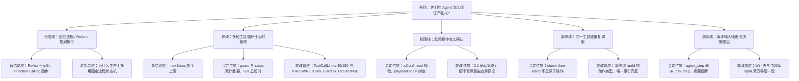
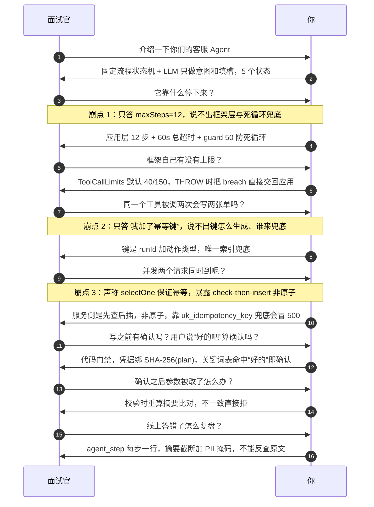

# AI Agent 与工具调用：高分答案不在"怎么让它调起来"，在"怎么让它停下来、别乱来"

> **一句话结论**：Agent 面试的区分度全在两句话——**上限在哪配**（框架层 `ToolCallLimits` 默认每工具 40 次、每轮 150 次；应用层 `maxSteps=12` + 60s 总超时）、**危险动作在哪拦**（确认凭据绑定参数摘要、未确认调写工具直接抛错）。说得出这两处的行号，比背 ReAct 三元组值钱。
> **阅读前置**：读过 [01-SpringAI入门](../01-SpringAI框架集成/01-SpringAI入门.md) 里 ChatClient 与 Advisor 两节（知道 advisor 就是挂在调用链上的拦截器），以及本目录 [01-AI基础与大模型原理](01-AI基础与大模型原理.md) 中 Function Calling 的协议流程；本篇不再解释"什么是大模型""什么是 JSON Schema"。
> **证据基线**：Spring AI 2.1.0（本机 m2 内 1.1.4 与 2.1.0 并存，版本差异用 `jar tf` 实测）+ Spring Boot 4.2.0 + Spring Framework 7.1.0 + JDK 17；A 级摘录 908 份已入库 `learning-docs/24-源码分析/assets/source/`；B 级行号为 2026-11 当次 `read` 核对；预计 90~110 分钟。

| 类别 | 本仓状态 | 本篇怎么处理 |
| --- | --- | --- |
| A 源码摘录 | `ToolCallingAdvisor` / `ToolCallLimits` / `DefaultToolCallingManager` / `ToolMetadata` / `DefaultToolDefinition` / `ToolParam` / `JsonSchemaGenerator` / `MethodToolCallback(Provider)` / `DefaultToolExecutionExceptionProcessor` / `ToolCallDecisions` 均已入库 | 讲框架机制一律挂 `[[源码:文件.java.md#L起-L止]]`，贴码块首行标 `(src: 文件#L起-L止)` |
| B 本项目源码 | `AfterSaleAgentService`（833 行）/ `AgentProperties` / `AgentStateMachine` / `AgentToolRegistry` / `ToolAuthorizationService` / `ConfirmationService` / `AgentTraceRecorder` / `AfterSaleContext` / `RedisAgentRunStore` / `AgentController` / `OrderQueryService` / `CreateAfterSaleTool` / 建表 SQL 全部可读，行号当次核对 | "本项目怎么做"的答案必带 `文件#L起-L止` |
| C 可复现实测 | 允许 `javap` 读 m2 内 jar 签名与常量、`jar tf` 比对 1.1.4/2.1.0、pwsh 静态 grep（不启服务、不联网、不跑 mvn） | 每条命令给真实输出 + "怎么读" |
| 未落地 | 规划执行（Plan-and-Execute）式 Agent、真正的多 Agent 编排、`aics.agent`/`aics.security` 的 yml 配置块、`AgentToolRegistry` 状态白名单接线、`stepTimeoutMs`/`intentThreshold` 的生效点 | 明确写"本项目未落地/配置了但无读取点"，不拿官方文档冒充实测 |

---

## 0. 先看现象

**现象一：会背"Agent = LLM + 规划 + 工具 + 记忆"，却答不出"最多跑几轮就停"。**

面试官问"你们的 Agent 靠什么停下来"，常见回答是"设个 maxSteps 就行"。再追一句"框架层默认是多少、超了以后模型还收不收得到错误"，就答不上来了。这两句其实分属两层，本项目两层都有，而且第二层有真实代码：

```text
320:         int guard = 0;
322:             if (++guard > 50) {
326:             if (ctx.getSteps() >= properties.getMaxSteps()) {
327:                 return failWith(ctx, "AGENT_MAX_STEPS_EXCEEDED",
```

（`ai-cs-chat/src/main/java/com/aics/chat/agent/workflow/AfterSaleAgentService.java#L318-L332`）

注意这里有两个计数器：`guard`（循环跑了多少圈，硬上限 50）和 `ctx.getSteps()`（业务步骤数，上限取自配置 `maxSteps`）。为什么需要两个——6.1 详解。而框架层是另一套数：`DEFAULT_MAX_CALLS_PER_TOOL = 40`、`DEFAULT_MAX_TOTAL_TOOL_CALLS = 150`（A 级 `[[源码:DefaultToolCallingManager.java.md#L103-L110]]`）。答"我设了 maxSteps 所以安全"的人，把应用层闸门当成了全部。

**现象二：能画出 ReAct 的 Thought→Action→Observation 循环，却答不出"循环两圈会不会写两张售后单"。**

这是 Agent 面试最致命的一问，因为它直指"模型是概率性的，同一个意图可能触发两次工具调用"。本项目的对称证据在两侧同时存在——工具侧生成幂等键：

```java
dto.setIdempotencyKey(runId + ":" + plan.actionType().getCode());
```

（`ai-cs-chat/src/main/java/com/aics/chat/agent/tool/CreateAfterSaleTool.java#L64`）

服务侧却是"先查后插"：

```text
L57: 先按 idempotencyKey 查询 after_sale_application
L58-L64: 命中即 return 已存在记录（check-then-insert，非原子）
L88: insert
```

（`ai-cs-order/src/main/java/com/aics/order/service/impl/AfterSaleServiceImpl.java#L49-L96`，同段无 `@Transactional`）

一个进程里两次串行调用会被 L57 挡住；两个请求并发到两个线程，就可能双双查到 null 然后双双 insert——最后兜底的不是代码，是建表语句里的 `UNIQUE KEY uk_idempotency_key`（`deploy/mysql/after-sales-agent-init.sql#L111`）。说不出这一层的人，通常也没意识到"幂等"分三级（见 3.7）。

**现象三：把"让模型别乱写"当成提示词工程。**

很多人答"我在 System Prompt 里写了'执行前必须让用户确认'"。提示词只是第一道；本项目真正的门禁在方法体第一行：

```java
// 写操作门禁：未确认直接抛错，拒绝执行
if (!ctx.isConfirmed()) {
    throw new BusinessException(ResultCode.AGENT_WRITE_OP_NOT_CONFIRMED,
            "写操作未经确认，拒绝执行");
}
```

（`ai-cs-chat/src/main/java/com/aics/chat/agent/workflow/AfterSaleAgentService.java#L462-L467`）

更值得讲的是**门禁的完整性**：`AgentToolRegistry` 里确实有一张"状态 × 工具"白名单（`AgentToolRegistry.java#L63-L69`），但 `toolRegistry.` 在 `ai-cs-chat/src/main` 下 grep 命中 **0 次**——闸门写好了却没接线，生产路径上只剩 `ToolAuthorizationService` 的角色校验，而它的权限表默认是空 Map（见 3.6）。面试里主动说出"我这里有个已知缺口"，比声称"我们全防住了"更可信。

> **这些现象指向同一件事**：Agent 的可控性不是提示词问题，而是三个可核对的位置——**上限在哪配（框架 40/150 + 应用 12 步 + 60s）、危险动作在哪拦（确认凭据绑参数摘要）、重复执行靠什么去重（幂等键 + 唯一约束）**。这三处各有一行代码可以指给面试官看，而"我写了提示词"一行都指不出来。

---

## 1. 整体地图

面试官问"你们的 Agent 怎么保证不乱来"时，其实是在五个岔路口等你选一条，然后往下追两三层。这张图画的是**追问路径**，不是数据流。



> **读图说明**：五条线都从同一句开场话长出来，`A → C` 与 `A → D` 是最高频的两条主干（面试官想确认你"真的把 Agent 关进笼子"而不是只跑通过 demo），而 `A → B` 是热身线，答得再好也只到背结论层。注意 `E1` 那个节点：它是全图唯一"答错就立刻暴露没读过自己代码"的地方，因为 check-then-insert 这个缺陷只有真读过方法体才说得出来。若把这张图读成"从形态到观测的执行顺序"，就会误以为 §4 的追问链是线性的——实际上面试官随时会从 `F2` 跳回 `C2` 反验你。

| 考点 | 考察层级 | 面试官的判定信号 |
| --- | --- | --- |
| Agent 定义与三形态 | 背结论 | 能区分固定流程/ReAct/规划执行即可，不加分 |
| Function Calling 协议 | 背结论 | 能说清注册 schema→模型出 tool_calls→框架执行→结果回传 |
| 工具描述写法 | 讲机制 | 能解释"schema 是给模型的 API 文档"，且知道 required 默认 true |
| 循环何时停 | **会定位** | 能分别说出框架层与应用层的两套上限 |
| 框架级上限 | 能改造 | 知道 `ToolCallLimits` 包私有、只能配 `DefaultToolCallingManager` |
| 危险操作门禁 | **会定位** | 能指出抛错的那一行，并说明凭据绑参数摘要 |
| 幂等三级 | 能改造 | 能说清进程内/并发/跨实例各靠什么 |
| 状态与槽位 | **会定位** | 知道 run 状态存 Redis、TTL 与确认窗口的关系 |
| 转人工交接 | 讲机制 | 能列出交接载荷字段与其必要性 |
| 可观测与兜底 | 能改造 | 知道审计写入失败不能阻断业务、摘要是不可逆的 |

这张表怎么用：面试前只背前三行 + 标粗的三行。**标粗的是"没读过自己代码就答不出"的行**，也是唯一能把"背过"和"做过"分开的四个点。

---

## 2. 关键概念与关键类/关键参数

| 名称 | 所在位置 | 一句话准确定义 | 本项目取值 |
| --- | --- | --- | --- |
| Agent 固定流程 | `AgentStateMachine` | 状态机（state machine，有限状态 + 允许的迁移边）驱动的编排，谁调哪个工具由代码定，模型只负责填槽 | 5 状态：LOCATE_ORDER→CHECK_POLICY→COLLECT_EVIDENCE→CONFIRM_ACTION→EXECUTE_AFTER_SALE |
| ReAct | 概念 | Reason+Act 循环：模型输出"想法+要调的工具"，框架执行后把结果喂回，直到不再要工具 | 未作为主链路，仅通过框架的工具循环间接体现 |
| `ToolCallingAdvisor` | `[[源码:ToolCallingAdvisor.java.md#L86]]` | 2.1 的 advisor 实现：把工具调用循环搬进 advisor 链，让链上其它 advisor 能拦每一轮 | 本项目未显式装配，走 ChatClient 默认内部执行流 |
| `ToolCallingManager` | `[[源码:ToolCallingManager.java.md#L1-L40]]`（类存在，实现见下） | 工具执行的统一入口：给模型拿到的 tool_calls 执行回调、拼结果、判上限与确认 | 框架默认 `DefaultToolCallingManager` |
| `DefaultToolCallingManager` | `[[源码:DefaultToolCallingManager.java.md#L103-L110]]` | 默认实现，自带每工具/每轮调用上限与"需确认即暂停"语义 | 默认 40 次/工具、150 次/轮 |
| `ToolCallLimits` | `[[源码:ToolCallLimits.java.md#L37-L42]]` | 上限配置与判定逻辑的载体，**包私有**，只给 manager 用 | 未自定义，走默认 |
| `ToolCallLimitBehavior` | `[[源码:ToolCallLimitBehavior.java.md#L1-L30]]` | 超限后的两种行为：`THROW`（抛异常中止）或 `RETURN_ERROR_RESPONSE`（把错误文本回给模型继续） | 默认 `THROW` |
| `ToolMetadata.requiresConfirmation` | `[[源码:ToolMetadata.java.md#L46-L48]]` | 标记"这个工具调用前必须有人确认"，2.1.0 起才有 | 本项目自研确认流程，未用此开关 |
| `ToolMetadata.returnDirect` | `[[源码:ToolMetadata.java.md#L35-L37]]` | 工具结果直接返回给应用、不再回给模型 | 未使用 |
| `ToolDefinition` | `[[源码:DefaultToolDefinition.java.md#L31-L36]]` | 模型能看到的工具"说明书"三要素：name / description / inputSchema，三者都不许为空 | `@Tool` 注解生成 |
| `JsonSchemaGenerator` | `[[源码:JsonSchemaGenerator.java.md#L87]]` | 把方法参数反射成 JSON Schema，**默认所有属性 required=true** | 全默认 |
| `ToolExecutionExceptionProcessor` | `[[源码:DefaultToolExecutionExceptionProcessor.java.md#L41]]` | 决定工具抛异常时是"把异常文本喂回模型"还是"直接往外抛" | 默认 `alwaysThrow=false` |
| `AgentProperties` | `ai-cs-chat/src/main/java/com/aics/chat/agent/AgentProperties.java#L22-L34` | Agent 的阈值与上限配置，前缀 `aics.agent` | maxSteps 12、stepTimeout 15s、totalTimeout 60s、confirmTimeout 10min、intentThreshold 0.6 |
| `AgentStateMachine` | `ai-cs-chat/src/main/java/com/aics/chat/agent/state/AgentStateMachine.java#L52-L60` | 状态迁移表 + **状态→允许工具**白名单 | LOCATE_ORDER 允许 order_locator/product_recommend 等 |
| `AfterSaleContext` | `ai-cs-chat/src/main/java/com/aics/chat/agent/context/AfterSaleContext.java#L124-L139` | 单次 run 的槽位集合（slot，即多轮之间要记住的字段），`transit()` 累加 steps | 25 个槽位 + steps + needsUserInput |
| `AgentRunStore` | `ai-cs-chat/src/main/java/com/aics/chat/agent/store/RedisAgentRunStore.java#L24-L38` | run 状态的持久化，跨请求跨实例续跑 | Redis 键 `aics:agent:run:{runId}`，TTL=总超时+确认超时+60s |
| `ConfirmationService` | `ai-cs-chat/src/main/java/com/aics/chat/agent/confirm/ConfirmationService.java#L33-L60` | 写操作确认凭据的签发与校验，凭据绑操作计划摘要 | SHA-256(JSON(plan))，10 分钟过期 |
| `agent_run` / `agent_step` | `deploy/mysql/after-sales-agent-init.sql#L12-L47` | 审计表：一次 run 一行 + 每步一行，步级唯一键防重复记账 | `uk_run_step (run_id, step_no)` |

一句话记住分工：**`ToolDefinition` 决定"模型知不知道有这个工具"，`ToolCallLimits` 决定"框架让不让它继续调"，`AgentProperties.maxSteps` 决定"业务状态机走几步",`isConfirmed` 决定"写操作能不能落地"**。

---

## 3. 逐题精讲

### 3.1 Q1：Agent 有哪三种形态？可控性怎么比？

**问题**

让你讲清"固定流程 / ReAct / 规划执行"三类 Agent 的差别，以及为什么生产上常常不用最灵活的那种。

**30 秒答案骨架**

1. 三种形态按"谁决定下一步"排序：固定流程——代码（状态机）决定；ReAct——模型每一步现想；规划执行——模型先出整体计划，再逐步执行。
2. 灵活性反比于可控性：ReAct 最灵活但每步都不可预测、token 与延迟都不可估；固定流程最可控，但每个新场景要加状态。
3. 判据是**失败代价**：只读查询、推荐类适合 ReAct；涉及写库、退款、改状态，必须把动作收进白名单式的固定流程。
4. 本项目选的是"固定流程状态机 + LLM 只做意图与填槽"：`5` 个状态、每个状态允许调用哪些工具直接写死在迁移表里。
5. 所以它天然满足"可解释中止"——步骤超限、总超时、执行失败三条出口都能给用户一句人话。

证据锚点：状态与工具白名单在 `ai-cs-chat/src/main/java/com/aics/chat/agent/state/AgentStateMachine.java#L52-L60`（`buildAllowedTools`）；五状态分发在 `AfterSaleAgentService.java#L334-L344`。

**深挖追问**

- **问：那 ReAct 就一无是处？** 答：不是。ReAct 的价值在"路径未知"的任务（多跳检索、排障）；一旦路径已知（售后只有那几步），ReAct 只是把确定的事交给概率模型重算一遍，还多付 token。
- **问：规划执行比 ReAct 强在哪？** 答：把"想"和"做"分开——计划可以人工审、可以缓存、可以并行；代价是计划本身可能一开始就错，而且错误会被后续所有步骤继承。
- **问：混合形态怎么讲？** 答：外层固定流程（谁在什么状态能干什么），内层某一步自由（比如"推荐商品"让模型选），本项目 `LOCATE_ORDER` 状态同时放开 `order_locator` 与 `product_recommend` 就是这个思路。

**常见错误答案**

- ❌ "Agent 就是能调工具的 LLM。" —— 错在漏掉"循环 + 状态"。单次工具调用是 Function Calling，能根据结果决定下一步的才是 Agent。
- ❌ "生产上当然用 ReAct，最智能。" —— 错在把灵活性当收益。写操作场景里灵活性等于不可审计。
- ❌ "规划执行 = 多 Agent。" —— 错在混淆维度：规划执行是一个 Agent 的编排方式，多 Agent 是角色分工，两者可以任意组合。

### 3.2 Q2：工具描述怎么写，模型才用对？

**问题**

"工具就一个方法，为什么模型老是调错/不调？"——考的是你对 schema 即"给模型的 API 文档"这件事的理解。

**30 秒答案骨架**

1. 模型看不到你的实现，只看到 `ToolDefinition` 的 `name` / `description` / `inputSchema` 三要素，三者都不许为空（构造时就是 `Assert.hasText`）。
2. 名字用"动词_名词"且全局唯一（`create_after_sale`、`order_locator`），description 写"什么时候该用 + 参数含义 + 返回什么"，别写"查询订单"四个字。
3. 参数描述要带格式示例：本项目 `@ToolParam(description = "订单编号，格式如 ORD20260809001")`，模型据此才知道不能瞎编。
4. 最要紧的一条：**JSON Schema 里所有属性默认 required=true**，所以每个参数都得真有必要；否则模型会为了凑参数编造值。
5. 单一职责 + 返回自然语言：一个工具只干一件事，失败也返回可读句子（`ToolResult.fail("...请先登录")`），模型才能自我纠正。

证据锚点：`@Tool`/`@ToolParam` 的示范在 `ai-cs-chat/src/main/java/com/aics/chat/service/OrderQueryService.java#L37-L39`；required 默认值来自 `[[源码:JsonSchemaGenerator.java.md#L87]]`（`PROPERTY_REQUIRED_BY_DEFAULT = true`）与 `[[源码:ToolParam.java.md#L39]]`；三要素非空断言在 `[[源码:DefaultToolDefinition.java.md#L31-L36]]`。

**深挖追问**

- **问：description 和参数 description 冲突怎么办？** 答：都会进 schema，冲突时模型倾向信参数级描述；所以参数级写"格式与取值",工具级写"用途与时机"，别重复。
- **问：为什么不要给模型太多工具？** 答：工具清单是 Prompt 的一部分，工具越多越容易选错、越吃 token。本项目 chat 服务只注册了两个自由调用工具（订单查询、NL2SQL），其余全在固定流程里。
- **问：能不能让工具自己校验参数？** 答：能，而且必须。schema 只保证类型，不保证业务语义——`OrderQueryService` 里 `userId` 参数由模型填，工具内只信登录态（见 6.5）。

**常见错误答案**

- ❌ "工具描述随便写，反正模型很聪明。" —— 错在忽视 description 就是 Prompt；描述模糊必然选错工具。
- ❌ "参数加个 `required=true` 模型就不会漏。" —— 错在把约束当保证：schema 是软约束，模型仍可能漏或编，工具内必须兜底校验。
- ❌ "工具返回对象让前端解析更规范。" —— 对前端对，对模型不对：模型读的是文本，返回结构化对象前应先转成可读串（默认 `DefaultToolCallResultConverter` 会转 JSON）。

### 3.3 Q3：多轮工具循环什么时候停？

**问题**

"模型一直要工具怎么办？"——这题要分三档回答，能分档就赢一半。

**30 秒答案骨架**

1. 三档停止条件：**轮内**（单次响应里 tool_calls 的个数与总量，框架管）、**轮间**（一轮对话里循环几圈，框架/应用管）、**run 级**（一次业务流程的总步骤与总耗时，应用管）。
2. 框架档：`DefaultToolCallingManager` 默认每工具 40 次、每轮合计 150 次，超了按 `ToolCallLimitBehavior` 处理，默认 `THROW`。
3. 应用档：本项目 `maxSteps=12`（业务步骤数）、`totalTimeoutMs=60000`（从 `createdAt` 起算），两者都在状态机循环入口判。
4. 还有一档"防死循环"：`guard > 50`，它不是业务上限，而是"状态机自己抽风"时的保险丝——因为 `steps` 只在 `transit()` 时 +1，如果某状态来回迁移却不累计，`maxSteps` 会失效。
5. 停下来的方式要能解释：本项目统一走 `failWith()` 落 `errorCodeOf()` 三类错误码（AGENT_TIMEOUT / AGENT_MAX_STEPS_EXCEEDED / AGENT_EXECUTION_FAILED），用户看到的是人话而不是栈。

证据锚点：`AfterSaleAgentService.java#L318-L332`（双计数器 + 总超时）、`#L729-L754`（failWith 与错误码归类）、`AgentProperties.java#L22-L28`；框架默认值见 `[[源码:DefaultToolCallingManager.java.md#L103-L110]]`。

**深挖追问**

- **问：为什么 steps 要跟 transi t 绑，而不是每次工具调用 +1？** 答：本项目 `transit()` 才 `steps++`（`AfterSaleContext.java#L124-L129`），工具调用本身不加；这会让"同一状态内多次工具调用"不被计数，所以需要 `guard` 兜底。这是真实缺陷，说得出比藏起来好。
- **问：置信度算不算停止条件？** 答：算降级条件而非循环条件。本项目 `intentThreshold=0.6`（意图置信度低于它就不路由工具），但**主代码里没有读取点**，属于"配了没生效"。
- **问：总超时怎么判？** 答：`createdAt + totalTimeoutMs` 与 `now` 比较（`#L737-L742`），不是"累计执行时间"，所以排队等待与用户犹豫的时间也算进去。

**常见错误答案**

- ❌ "设 maxSteps 就停了。" —— 只覆盖 run 级一档，框架层与死循环都没管。
- ❌ "超时用 HTTP 客户端超时。" —— 错在层级：网络超时管一次请求，Agent 要管一次 run 的累计时长。
- ❌ "让模型自己判断该不该继续。" —— 错在把保险丝交给被保护对象。

### 3.4 Q4：框架级 `ToolCallLimits` 是什么？默认多少？超了会怎样？

**问题**

这题考"你有没有读过框架"：能说出默认值和两种行为，就跨过背结论层。

**30 秒答案骨架**

1. `ToolCallLimits` 是 `DefaultToolCallingManager` 内部的上限载体，**包私有 `final class`**，外部拿不到，只能通过 `DefaultToolCallingManager.Builder` 配。
2. 默认值：每工具 40 次（`DEFAULT_MAX_CALLS_PER_TOOL`）、每轮合计 150 次（`DEFAULT_MAX_TOTAL_TOOL_CALLS`）；`NO_LIMIT = -1` 表示不设限。
3. 计数不是 manager 自己记状态，而是**每轮从 Prompt 历史里重数**：扫 `ToolResponseMessage` 按工具名计数，且只数"最后一个 `UserMessage` 之后"的部分。
4. 超限行为两种：`THROW`（默认）抛 `ToolCallLimitExceededException`，把已执行部分的结果一起带走；`RETURN_ERROR_RESPONSE` 则跳过该次调用、把错误文本作为工具结果回给模型继续。
5. 所以"框架会不会把上限告诉模型"取决于你选哪个行为——默认 `THROW` 下模型收不到，是直接中止。

证据锚点：`[[源码:ToolCallLimits.java.md#L42]]`（`NO_LIMIT`）、`#L67-L91`（`countPriorToolCalls`）、`#L98-L105`（只取当前轮）、`#L113-L130`（`check` 的两段判定）；`[[源码:DefaultToolCallingManager.java.md#L301-L302]]` 与 `#L323-L346`。C 级实测见下：

```text
final class org.springframework.ai.model.tool.ToolCallLimits {
  static final int NO_LIMIT;
  private final int defaultMaxCallsPerTool;
  private final java.util.Map<java.lang.String, java.lang.Integer> maxCallsPerTool;
  private final java.util.Set<java.lang.String> toolsExcludedFromLimit;
  private final int maxTotalToolCalls;
  private final org.springframework.ai.model.tool.ToolCallLimitBehavior onLimitExceeded;
  org.springframework.ai.model.tool.ToolCallLimits(int, java.util.Map, java.util.Set, int, ToolCallLimitBehavior);
  org.springframework.ai.model.tool.ToolCallLimitBehavior onLimitExceeded();
  static java.util.Map<java.lang.String, java.lang.Integer> countPriorToolCalls(java.util.List<Message>);
  private static java.util.List<Message> currentTurnMessages(java.util.List<Message>);
  org.springframework.ai.model.tool.ToolCallLimits$Breach check(java.lang.String, int, int);
}
```

（C 级实测：`javap -p -classpath %USERPROFILE%\.m2\repository\org\springframework\ai\spring-ai-model\2.1.0\spring-ai-model-2.1.0.jar org.springframework.ai.model.tool.ToolCallLimits`）

怎么读这段输出：`final class` 前没有 `public`、方法也没有 `public`，说明配置入口不在这个类上；`check(...)` 返回 `ToolCallLimits$Breach`，说明"超限"被建模成"一条带 toolName 与 limit 的违规记录"，而不是布尔值——所以异常里能带出"哪个工具、上限几"。

**深挖追问**

- **问：为什么计数要从历史重数，而不是记在 manager 字段里？** 答：manager 是单例、被多会话共享，记字段会串会话；从 Prompt 历史重建等于把"状态"放在请求里，天然无状态、天然可恢复。
- **问：外部 ChatMemory 全量重放会不会把老轮次的计数灌进来？** 答：不会，`currentTurnMessages` 从尾部找最后一个 `UserMessage` 截断（`[[源码:ToolCallLimits.java.md#L98-L105]]`），这正是"每轮"的定义。
- **问：那我想给某个工具单独放行呢？** 答：`excludeToolFromLimit(String)` 进白名单，或用 `maxCallsPerTool(toolName, n)` 单配（C 级 `javap DefaultToolCallingManager$Builder` 可见这些方法）。

**常见错误答案**

- ❌ "在 `ToolCallingChatOptions` 上设 maxToolCalls。" —— 错在没有这个方法：C 级 `javap` 该接口只有 toolCallbacks / toolContext 与采样参数，上限只能配 manager。
- ❌ "超了就抛异常，模型会自己重试。" —— 默认 `THROW` 是把 breach 结果直接交给应用（`[[源码:ToolCallingAdvisor.java.md#L205-L215]]`），不回模型。
- ❌ "150 是所有工具在一个 run 里的总数。" —— 错在范围：是"当前轮"（turn），不是整个 run。

### 3.5 Q5：2.1 的 `ToolCallingAdvisor` 把循环搬进 advisor 链，意味着什么？

**问题**

"你们升级到 2.x 后工具调用有什么变化？"——答"没变化"就浪费了一个加分点。

**30 秒答案骨架**

1. 2.0 起多了一个 `ToolCallingAdvisor`：把原本藏在 ChatModel 内部的工具循环提升到 advisor 链上，于是链上其它 advisor（记忆、日志、护栏）能看到**每一轮**。
2. 它的 order 是 `HIGHEST_PRECEDENCE + 300`，比 memory advisor 默认的 `+200` 更靠前——刻意让记忆 advisor 待在循环外面，只记一次完整交互。
3. 循环本体是 `do { ... } while (isToolCall)`，出口只有四个：不再要工具、`returnDirect`、超限抛 breach、需确认而暂停。
4. 需确认时它**不执行任何调用**就退出，把"等待决策"的标记挂在 reply 的 metadata 上；恢复要应用侧拿 `ToolCallDecisions` 调 `executeToolCalls(Prompt, ChatResponse, ToolCallDecisions)`。
5. 这一点对上本项目很关键：本项目的"确认"是自己在状态机里做的（跨请求、跨进程），不是用框架的暂停语义——两者都可用，但后者要你处理"暂停后谁恢复"。

证据锚点：`[[源码:ToolCallingAdvisor.java.md#L53-L85]]`（类注释里的暂停与恢复流程）、`#L96`（order 常量）、`#L195-L244`（循环与四个出口）、`#L216-L222`（确认暂停）、`#L226-L237`（returnDirect）。

**深挖追问**

- **问：为什么不干脆用默认执行流？** 答：默认执行流下工具循环在 ChatModel 内部，链上的 advisor 看不到中间轮，护栏与日志都拦不住"第二轮才开始乱来"的情况。
- **问：暂停语义实现的难点在哪？** 答：状态在应用侧，框架只能给你"哪些调用在等决策"的 key 列表；下一次请求要带回整段对话历史 + 决策，否则计数与上下文都断。
- **问：`ToolCallAdvisor` 和 `ToolCallingAdvisor` 是一个类吗？** 答：不是。1.1.4 只有 `ToolCallAdvisor`，2.1.0 新增 `ToolCallingAdvisor`，包名同为 `org.springframework.ai.chat.client.advisor`（§7 有 `jar tf` 证据）。

**常见错误答案**

- ❌ "工具调用是 ChatClient 帮我解决的，我没管。" —— 说不出执行点在哪，等于承认没读过链路。
- ❌ "advisor 顺序无所谓。" —— order 决定"谁在循环内外"，这是 3.5 的加分点。
- ❌ "确认暂停后框架会自动恢复。" —— 恢复是应用的事（`ToolCallingManager#executeToolCalls` 三参重载）。

### 3.6 Q6：危险操作确认怎么做才不是摆设？

**问题**

"用户说'好'就执行退款，安全吗？"——这题考的是确认凭据的绑定与失效。

**30 秒答案骨架**

1. 先把门禁放在代码里：未确认走到写工具就抛 `AGENT_WRITE_OP_NOT_CONFIRMED`，不依赖模型自觉。
2. 确认要绑定**参数摘要**，不是绑定一句"确认"：本项目签发时有 `payloadDigest = SHA-256(JSON(plan))`，校验时重算比对，参数被改过就过不了。
3. 确认要有**有效期**：`confirmTimeoutMinutes=10`，过期走 `AGENT_CONFIRMATION_EXPIRED` 分支。
4. 确认要**落审计**：`agent_confirmation` 表一张单一行（`uk_run_action` 唯一键），记录 payloadDigest、状态、确认人、超时时间。
5. 还要有**纵深防御**：动作白名单（状态→工具）、角色权限矩阵、幂等键三层，任何一层不通过都不执行。

证据锚点：`AfterSaleAgentService.java#L462-L467`（未确认抛错）、`#L267-L299`（确认/拒绝/未知三态与过期分支）、`ConfirmationService.java#L33-L60`（签发与校验）、`ConfirmationService.java#L73-L87`（摘要算法）、`deploy/mysql/after-sales-agent-init.sql#L50-L64`（确认单表结构）。

**深挖追问**

- **问：为什么不用 `updateOrderStatus()` 这种"一句话确认"？** 答：因为没有绑参数。用户看到"换货 A 商品 1 件"点了确认，模型却组了"退款全部"，一句"确认"拦不住。
- **问：用户回复"好的吧"算确认还是拒绝？** 答：本项目靠关键词表 `containsAny(["确认","同意","可以","好的","好，","执行","是的"])`（`#L816-L828`），"好的吧"命中"好的"→确认。这是真实脆弱点：`/chat/agent/confirm` 接口干脆把 CONFIRM/REJECT 转成"确认"/"拒绝"文本再进同一分支（`AgentController.java#L88`）。
- **问：状态白名单为什么说是缺口？** 答：`AgentToolRegistry.assertToolAllowed` 存在（`#L63-L69`），但 `toolRegistry.` 在主代码 grep 命中 0 —— 有闸门、没接线。

**常见错误答案**

- ❌ "在提示词里写'执行前必须确认'。" —— 提示词可被绕，代码门禁不可。
- ❌ "确认就是弹个二次对话框。" —— 前端对话框不等于服务端校验，参数仍可能被改。
- ❌ "确认之后就可以不管了。" —— 还要幂等（可能重复点）与审计（谁确认的、确认的什么）。

### 3.7 Q7：幂等——同一个工具被重复调用会怎样？

**问题**

"如果模型把同一个工具调了两次，会不会写两张单？"——Agent 面试的分水岭题。

**30 秒答案骨架**

1. 先承认这是**必然事件**：模型是概率性的、框架有重试、用户会重复点、网络会超时重发。所以幂等不是优化，是正确性要求。
2. 幂等键要**确定性生成**：本项目用 `runId + ":" + 动作类型编码`，同一个 run 同一动作永远同一个键，换 run 就是新键。
3. 落地要靠**唯一约束**而不是"先查后插"：`after_sale_application` 的 `idempotency_key` 是 `NOT NULL` + `UNIQUE`，服务侧却只有 `selectOne` 后 return 的 check-then-insert——并发下会双双查到 null。
4. 所以现状是"尽力而为 + 数据库兜底"：串行重复提交被代码挡住，并发重复提交由唯一键挡住（异常会冒成 500，没有捕获 `DuplicateKeyException`）。
5. 更进一步的做法（本项目未做）：`INSERT ... ON DUPLICATE`、或用 Redis 分布式锁把"查-插"包成临界区。

证据锚点：`CreateAfterSaleTool.java#L64`（幂等键生成）、`ai-cs-order/src/main/java/com/aics/order/service/impl/AfterSaleServiceImpl.java#L57-L64`（check-then-insert）、`#L88`（insert）、`deploy/mysql/after-sales-agent-init.sql#L111`（唯一键）。

**深挖追问**

- **问：为什么不用 `application_no` 当幂等键？** 答：它是结果不是输入，重试时还没生成；幂等键必须来自请求侧已知信息。
- **问：工具侧有重试，会不会加重重复？** 答：会。`writeRetryTimes=1`（`AgentProperties.java#L56`）意味着失败会再调一次，这正是幂等键值必须与"第几次"无关的原因。
- **问：如果两次调用的参数不一样（用户改主意了）呢？** 答：键里含动作类型，换货改退款就是新键、新单；同一动作不同数量则是同一键被拦——这是本设计的取舍边界，说清比装作没有好。

**常见错误答案**

- ❌ "我们用了事务，所以不会重复。" —— 错在问题不是原子性而是去重；事务保证要么全成要么全不成，不保证两次都成时只留一条。
- ❌ "selectOne 查到了就 return，够了。" —— 错在并发窗口：查与插之间没有互斥。
- ❌ "加个 UUID 就行。" —— 每次生成不同的键等于没有幂等键。

### 3.8 Q8：状态与槽位——多轮之间靠什么不丢？

**问题**

"用户隔了 5 分钟才回'确认'，Agent 怎么知道在等什么？"——考会话状态放在哪。

**30 秒答案骨架**

1. 状态分两层：**run 级状态**（`AfterSaleState` + 槽位 + steps）与**会话级历史**（聊天消息）。前者是 Agent 的"工作记忆"，必须显式持久化。
2. 本项目把它序列化成 JSON 存 Redis：键 `aics:agent:run:{runId}`，TTL = 总超时 + 确认超时 + 60 秒缓冲，正好覆盖"等待用户确认"的最长窗口。
3. 槽位就是上下文字段：订单、候选订单、售后原因、操作计划、确认凭据、步骤摘要等，`transit()` 迁移时清 `needsUserInput` 并 `steps++`。
4. 缺槽位就让出控制权，而不是瞎猜：`collectEvidence` 缺原因 → `markWaitingUser()`；`locateOrder` 多候选 → 等用户选订单号。
5. 读写都降级：Redis 写失败只 warn 不阻断，读失败按"run 不存在"处理——于是超时后用户再发消息会得到"run 未找到"，而不是脏状态。

证据锚点：`RedisAgentRunStore.java#L24-L42`（键与 TTL、失败降级）、`#L46-L60`（读失败按空处理）、`AfterSaleContext.java#L96-L139`（槽位与 `transit`/`markWaitingUser`/`recordStep`）、`AfterSaleAgentService.java#L256-L314`（续跑入口）。

**深挖追问**

- **问：为什么不用 ChatMemory 存这些？** 答：ChatMemory 存的是"说过什么"，不是"做到哪一步"。槽位是结构化的，(模型读历史猜状态) 不如 (直接存状态) 可靠。
- **问：TTL 为什么这么算？** 答：`totalTimeoutMs/1000 + confirmTimeoutMinutes*60 + 60`，即"整个 run 的最长寿命 + 确认窗口 + 缓冲"；算小了用户在确认框前犹豫就丢状态（`RedisAgentRunStore.java#L36-L38`）。
- **问：序列化有什么坑？** 答：`streamListener` 必须 `@JsonIgnore` + `transient`，否则回调对象进 JSON 直接失败（`AfterSaleContext.java#L104-L109`）。这是被 redis 逼出来的注解。

**常见错误答案**

- ❌ "状态放内存 Map 就行。" —— 单机可以，多实例/重启即丢；本项目有 `InMemoryAgentRunStore` 与 `RedisAgentRunStore` 两实现，生产要后者。
- ❌ "状态让模型根据历史自己推断。" —— 概率推断替代不了确定状态，且成本高。
- ❌ "把整个 context 塞进 Prompt 更省事。" —— 又长又会泄漏内部字段，还吃 token。

### 3.9 Q9：什么时候转人工，交接什么？

**问题**

"什么时候放弃、交给人工？交接时人工需要什么？"——考降级设计是否闭环。

**30 秒答题骨架**

1. 四类触发，且**每类有独立 reason 码**：规则不满足（`POLICY_NOT_MET`）、情绪负面（`NEGATIVE_SENTIMENT`）、执行失败（`EXECUTION_FAILED`）、用户主动要求（`USER_REQUEST`）。
2. 触发点在代码里是明确的 if，而不是"感觉不对"：`checkPolicy` 不满足直接 `doHandoff`，情绪由意图结果里的 `sentiment` 判定（配置 `sentimentHandoff="ANGRY"`）。
3. 交接要带**上下文载荷**：runId、sessionId、订单号、情绪、问题摘要、以及"已执行步骤"的 JSON——人工最怕接到"用户说要退款"却没有前情。
4. 交接要**不阻断**：工单创建失败也照样转人工（`ticketNo` 为空继续走），因为"转不出去"比"工单没号"严重得多。
5. 终态要**强制置位**：迁移表不允许时直接 `setState(HANDOFF)`，保证 run 不会卡在中间态。

证据锚点：`AfterSaleAgentService.java#L537-L564`（doHandoff 载荷与不阻断）、`#L407-L411`（规则不满足转人工）、`#L224-L232`（情绪/主动要求）、`deploy/mysql/after-sales-agent-init.sql#L67-L88`（工单表字段，含 `executed_steps` JSON）。

**深挖追问**

- **问：为什么"已执行步骤"要摘要化而不是原文？** 答：审计表存摘要（截断 + PII 掩码），但交接给人看需要可读句子，所以 `stepSummaries` 是自然语言列表（"订单定位: 命中订单 ORD..."），两者分工不同。
- **问：工单失败还转人工，用户看到什么？** 答：`HandoffInfo` 里 ticketNo 为空，回复里带 reason 与摘要；后台有 `TOOL` span 与审计行可追。
- **问：怎么防止"转人工"被滥用成逃避？** 答：reason 码 + 优先级 + 计数可观测（`agent_step` 的 HANDOFF 行），异常高的转人工率本身就是指标。

**常见错误答案**

- ❌ "转人工就是返回一句'正在为您转接'。" —— 错在没有载荷，人工要重新问一遍。
- ❌ "先建工单，建失败就不转。" —— 顺序反了，转人工是承诺，工单是优化。
- ❌ "情绪判断交给模型自由发挥。" —— 应该是结构化字段（本项目意图结果里带 `sentiment`），才能配置阈值。

### 3.10 Q10：怎么观测每一步的输入输出与决策理由？失败兜底放哪？

**问题**

"线上 Agent 答错了，你怎么复盘？"——最后一题，考可观测性与兜底。

**30 秒答案骨架**

1. 两层记录、两种用途：**审计表**（`agent_run` 一行 + `agent_step` 每步一行）用于事后回放；**trace span**（`agent.tool.{toolName}`）用于看这次请求哪步慢。
2. 步级要防重复记账：`agent_step` 有 `UNIQUE KEY uk_run_step (run_id, step_no)`，stepNo 由 `ctx.getSteps()+1` 生成，重放不会写重。
3. 输入输出**摘要化**而不是原文：`inputDigest` 截 256、`outputDigest` 截 1024、先过 `PiiMasker.mask`、`digest()` 是 SHA-256 截 64——审计能对账但不能反查原文，这是合规取舍。
4. 决策理由靠三类字段拼：`step_type`（走了哪一步）、`tool_name`、`error_summary`，加上 run 级 `prompt_version`（"after-sale-v1"）——换提示词后出错能定位到版本。
5. 兜底分三层：工具异常默认不炸（`alwaysThrow=false`，异常文本回给模型让它自纠）、重试一次、仍失败转人工；审计/轨迹写入失败一律 warn 不阻断业务。

证据锚点：`AgentTraceRecorder.java#L39-L54`（createRun 与 promptVersion）、`#L74-L94`（step 的截断与 PII 掩码）、`ai-cs-chat/src/main/java/com/aics/chat/agent/workflow/AfterSaleAgentService.java#L510-L530`（双写注释与 span）、`[[源码:DefaultToolExecutionExceptionProcessor.java.md#L41]]`（`DEFAULT_ALWAYS_THROW = false`）、`deploy/mysql/after-sales-agent-init.sql#L45`（步级唯一键）。

**深挖追问**

- **问：为什么用指纹而不是存原文？** 答：PII 与体积。代价是"只能对账不能重放内容"，所以关键业务字段（订单号、申请单号）另存结构化列。
- **问：`agent_step` 里怎么看出"模型为什么这么决策"？** 答：看 `step_type` 序列 + `INTENT` 步的记录（`summarizeIntent` 输出 `意图(置信度) 情绪=`），而不是指望一句自然语言理由——本项目没有存 CoT（`#L795-L801`）。
- **问：工具异常回给模型会不会泄露内部信息？** 答：会，所以工具抛出的是业务友好的 `ToolResult.fail`，而真正的堆栈只在 `ToolExecutionException` 里、由 `alwaysThrow` 决定是否外抛。

**常见错误答案**

- ❌ "日志里都打了，出问题看日志。" —— 日志不可查询聚合、会被采样，审计要表。
- ❌ "把每次工具入参出参原文都存下来最保险。" —— 违反最小化原则，PII 与体积双爆。
- ❌ "工具报错就让 Agent 直接失败。" —— 默认行为不是这样，异常文本回模型更常见（也更能自纠）。

---

## 4. 一次完整追问链

下面这条链复刻"面试官顺着一个 Agent 自我介绍往下挖八层"的真实过程，每层都标了崩点。



> **读图说明**：五个参与点里真正决定成败的是三条 `Note over`——崩点 1 考"分层"，崩点 2 考"确定性"，崩点 3 考"并发"。注意第 11 步反问"并发两个请求"：它是唯一一个"答错会把前面的幂等答案全部作废"的箭头，因为前面说"加了唯一键"、这里说"selectOne 足够"，两句话自相矛盾。若把这条链读成"面试官按顺序问完八个问题"，就会低估它的跳跃性——真实面试里他可能在第 5 步直接跳到第 19 步的复盘问题来验你审计表是否真存在。

| 崩点 | 触发话术 | 为什么会崩 | 正确接法 |
| --- | --- | --- | --- |
| 1 | "它靠什么停下来" | 只想到业务超时，漏掉框架层上限与死循环保险丝 | 分三档答：轮内 40/150、run 级 12 步/60s、guard 50 |
| 2 | "调两次会写两张单吗" | 只会说"我加了幂等"却说不出键的来源 | 键 = runId + 动作类型；落地点是唯一约束 |
| 3 | "并发两个请求呢" | 声称 check-then-insert 安全 | 主动承认非原子，说明唯一键兜底 + 未捕获异常 |
| 4 | "用户说'好的吧'算确认吗" | 以为确认是布尔语义 | 关键词表 + 决策接口转译，说清误判风险 |
| 5 | "参数被改了怎么办" | 只校验"有没有确认"，不校验"确认的是不是同一件事" | payloadDigest 重算比对 + 有效期 |

---

## 5. 答题策略取舍

| 问题类型 | 好的答法 | 差的答法 | 为什么 |
| --- | --- | --- | --- |
| "你们怎么防 Agent 乱来" | 先给三层结构（框架上限 / 应用门禁 / 数据库约束），再各给一行证据 | 列举"提示词 + 人工 + 监控" | 结构先立住，面试官才知道该往哪追 |
| "框架默认多少" | 直接报 40/150，并说明单位是"当前轮" | "默认挺大的，够用" | 数字是硬证据，单位错一半分 |
| "会不会重复写库" | 承认概率性，讲三级幂等与唯一约束 | "不会，我们测过" | 概率性系统里"测过"不是证据 |
| "确认怎么做的" | 说凭据绑参数摘要 + 有效期 + 审计表 | "弹窗二次确认" | 前端交互 ≠ 服务端不可绕过 |
| "状态存哪" | Redis + TTL 与确认窗口对齐 + 降级语义 | "存 session 里" | 能讲 TTL 推导才是做过 |
| "出了事怎么复盘" | 审计表（可对账）+ span（可看耗时）分工 | "看日志" | 两类数据不同消费场景，混着讲显浅 |

不会的时候怎么优雅收尾，三句话模板：

1. **划边界**："这块框架 2.1 有 `ToolCallLimits`，但我们没有自定义，走的是默认 40/150，具体我记不牢。"
2. **给相邻事实**："我能确定的是我们应用层 `maxSteps=12`，在 `AfterSaleAgentService` 的循环入口判的。"
3. **给验证路径**："要确认框架默认值，`javap -constants` 看 `DefaultToolCallingManager` 的常量最快。"

反例（一句就废掉前面的可信度）："这些细节都是框架自动做的，我们没关注。"

---

## 6. 踩坑：背过了还是答错

**坑 1：把 maxSteps 当成 Agent 的全部上限。**
- 错误认知：设了 `maxSteps` 就安全了。
- 正确认知：三档上限各在一层——框架 40/150（`[[源码:DefaultToolCallingManager.java.md#L103-L110]]`）、run 级 12 步与 60s（`AgentProperties.java#L22-L28`）、死循环 guard 50（`AfterSaleAgentService.java#L322`）。
- 怎么验证：`grep -n "getMaxSteps\|guard" ai-cs-chat/src/main/java/com/aics/chat/agent/workflow/AfterSaleAgentService.java`。

**坑 2：以为 yml 里配了 `aics.agent` 就生效。**
- 错误认知：`stepTimeoutMs` 在跑，`intentThreshold` 在拦。
- 正确认知：全仓 yml 没有 `aics.agent` 块，两个字段在主代码里**只有声明没有读取点**，实际生效的只有 `maxSteps`（`#L326`）与 `totalTimeoutMs`（`#L737-L742`）。
- 怎么验证：`grep -rn "stepTimeoutMs\|intentThreshold" ai-cs-chat/src/main` 只命中 `AgentProperties.java` 的声明行。

**坑 3：以为"确认"是提示词或前端弹窗。**
- 错误认知：Prompt 里写清楚 + 前端二次确认就够了。
- 正确认知：服务端 `isConfirmed()` 抛错是第一道（`#L464-L467`），凭据绑 `SHA-256(JSON(plan))` 是第二道（`ConfirmationService.java#L73-L87`）。
- 怎么验证：把 `ctx.setConfirmed(true)` 那行注释掉跑单测，`executeAfterSale` 会抛 `AGENT_WRITE_OP_NOT_CONFIRMED`；或 `grep -n "AGENT_WRITE_OP_NOT_CONFIRMED" -r ai-cs-chat/src`。

**坑 4：把 check-then-insert 当幂等实现。**
- 错误认知：`selectOne(idempotencyKey)` 命中就 return，等于幂等。
- 正确认知：查与插之间无互斥，并发下会双插；真正兜底的是 `uk_idempotency_key`，且当前没有捕获 `DuplicateKeyException`（`AfterSaleServiceImpl.java#L57-L92`）。
- 怎么验证：读方法体看有没有 `@Transactional`（该类没有）；看 DDL `#L111` 的唯一键。

**坑 5：以为模型传的参数是"可信输入"。**
- 错误认知：schema 有 description，模型会按登录用户填 `userId`。
- 正确认知：`OrderQueryService#L70-L72` 里 `uid` 来自模型参数、仅做 `Long.parseLong` 兜底，模型完全可能填别人的 id；工具内应以登录态为准。
- 怎么验证：读该方法第 42-L45 与 L70-L72 的对照——一个用 `ChatUserContext`，一个用模型参数。

**坑 6：以为工具抛异常会让整个 Agent 挂掉。**
- 错误认知：工具一报错就要 try-catch 包起来并中止流程。
- 正确认知：默认 `alwaysThrow=false`，`DefaultToolExecutionExceptionProcessor` 把异常文本作为工具结果回给模型（`[[源码:DefaultToolExecutionExceptionProcessor.java.md#L41-L72]]`），模型可自纠；本项目另有 `writeRetryTimes=1` 重试与转人工兜底。
- 怎么验证：`javap -p` 看该类的 `alwaysThrow` 字段与 `DEFAULT_ALWAYS_THROW` 常量。

**坑 7（调试手法）：用 `jar tf` 而不是记忆判断 API 在哪个版本。**
- 错误认知：1.x 和 2.x 的类名一样，升级不影响。
- 正确认知：`spring-ai-model` 1.1.4 只有 `ToolCallingManager`，2.1.0 才新增 `ToolCallLimits` / `ToolCallDecisions` / `ToolCallConfirmationPolicy`；`spring-ai-client-chat` 1.1.4 只有 `ToolCallAdvisor`，2.1.0 才有 `ToolCallingAdvisor`。
- 怎么验证：`jar tf spring-ai-model-1.1.4.jar | findstr /i "tool"` 与 2.1.0 对比（§7 有实测输出）。

**坑 8（调试手法）：用 `javap` 确认"配置入口在不在这"。**
- 错误认知：上限应该在 `ToolCallingChatOptions` 上配（因为工具回调就在那儿配）。
- 正确认知：`javap` 该接口看不到任何 limit 方法，`ToolCallLimits` 是包私有类——入口只在 `DefaultToolCallingManager.Builder`。
- 怎么验证：`javap -classpath …spring-ai-model-2.1.0.jar org.springframework.ai.model.tool.ToolCallingChatOptions` 逐行看方法名。

---

## 7. ⚠️ 版本差异

| 旧答案怎么讲 | 当前基线怎么讲 | 变化点 | 面试官会怎么挖 |
| --- | --- | --- | --- |
| 工具循环藏在 ChatModel 内部，"框架自动处理" | `ToolCallingAdvisor` 把循环搬到 advisor 链，order = `HIGHEST_PRECEDENCE + 300` | 2.0 起循环可被链上 advisor 观测/拦截 | "那记忆 advisor 在循环里还是外？"（答案：外，靠 order） |
| 没有框架级上限，只有自己写计数 | `ToolCallLimits` 默认 40/150，2.0.1 起提供 | 上限成为框架能力 | "超了抛异常还是返回错误？"（`ToolCallLimitBehavior` 两值） |
| 确认只能自己在业务里做 | `ToolMetadata.requiresConfirmation` + `ToolCallConfirmationPolicy`，循环会暂停 | 2.1.0 新增确认语义（`@since 2.1.0`） | "暂停后谁恢复？"（应用调 `executeToolCalls` 三参重载） |
| `ToolCallAdvisor` 一词打天下 | 1.1.4 是 `ToolCallAdvisor`，2.1.0 新增 `ToolCallingAdvisor`，两者并存 | 类名、包都变过 | "你用的是哪个？"（`jar tf` 一查就见） |
| 上限配在 options 上 | options 只装 toolCallbacks / toolContext，上限配 manager | 职责切分更清 | "为什么不能配在 options？"（每次请求都带上限会串会话语义） |
| 多轮记忆靠自己拼历史 | 2.1 起有 Session Memory（`SessionService`），与本篇的 run 状态是两回事 | 记忆层独立出来 | "run 状态能不能用 Session 存？"（不建议：槽位是结构化业务状态） |

通用答法：**"我按当前基线的实物核对过——`javap`/`jar tf` 看过 m2 里 2.1.0 的 jar。"** 这一句能解释你为什么敢报 40/150 这种具体数字。

---

## 8. 高频问与答

以下只列问题（★ = 追问概率最高），答案见第 3 节对应小节。

1. ★ Agent 和 Function Calling 的区别是什么？（3.1）
2. 你们的 Agent 怎么保证不乱来？（3.3 + 3.6）
3. ★ 多轮工具循环靠什么停下来？（3.3）
4. ★ 框架层的工具调用上限是多少、在哪配？（3.4）
5. `THROW` 和 `RETURN_ERROR_RESPONSE` 差别在哪？（3.4）
6. 为什么框架计数要从历史重数而不是记字段？（3.4）
7. 工具描述怎么写模型才用对？（3.2）
8. JSON Schema 里 required 默认是 true 还是 false？（3.2）
9. ★ 同一个工具被调两次会不会写两张单？（3.7）
10. 幂等键怎么生成？为什么不用订单号？（3.7）
11. ★ 并发两个请求同时到怎么办？（3.7）
12. 写操作确认怎么做的？凭据里绑了什么？（3.6）
13. 用户说"好的吧"算确认还是拒绝？（3.6）
14. 确认过期了怎么处理？（3.6）
15. 状态和槽位存在哪？TTL 怎么算的？（3.8）
16. 为什么不用 ChatMemory 存槽位？（3.8）
17. ★ 什么时候转人工？交接带什么？（3.9）
18. 每步的输入输出怎么留痕？为什么用摘要？（3.10）
19. 工具报错会不会让整个流程挂掉？（3.10）
20. ★ 2.1 的 `ToolCallingAdvisor` 相比之前有什么变化？（3.5 + 7）

---

## 9. 动手练习

**练习 1：限时口述（3 分钟）**
不看稿讲"我们的 Agent 靠什么停下来 + 靠什么防重复写"。要求：三档上限各说出一个数，幂等三层各说一句。
- 通过标准：3 分钟内说满 6 个要点，且"40/150"与"12 步/60s"没有混为一谈。

**练习 2：白板画状态机**
画出 5 个状态与允许的工具，并标出"哪个状态能调写工具"。
- 通过标准：`CONFIRM_ACTION → EXECUTE_AFTER_SALE` 这条边能画出来，并说清只有这一处能调 `create_after_sale`（对照 `AgentStateMachine.java#L52-L60`）。

**练习 3：javap 读框架默认值**
```text
javap -constants -classpath %USERPROFILE%\.m2\repository\org\springframework\ai\spring-ai-model\2.1.0\spring-ai-model-2.1.0.jar org.springframework.ai.model.tool.DefaultToolCallingManager
```
- 通过标准：能报出 `DEFAULT_MAX_CALLS_PER_TOOL = 40` 与 `DEFAULT_MAX_TOTAL_TOOL_CALLS = 150`，并解释为什么 `ToolCallLimits` 的方法全是包私有（`javap -p` 验证）。

**练习 4：写最小验证脚本（node，纯计算）**
写一个脚本输入 `maxSteps=12`、`totalTimeout=60s`、每步平均 3s，输出"最坏情况下会不会先撞步骤数还是先撞总超时"。
- 通过标准：能算出 12 步 × 3s = 36s < 60s，即**先撞步骤数**；并能说明若单步 6s 则先撞总超时——这解释了为什么两个闸门都要有。

**练习 5：静态查"配了没生效"**
```text
grep -rn "stepTimeoutMs\|intentThreshold\|getMaxSteps" ai-cs-chat/src/main/java/com/aics/chat/agent
```
- 通过标准：能指出 `stepTimeoutMs`/`intentThreshold` 只有声明、`getMaxSteps` 只有一处读取，并给出"要么删配置、要么补读取点"的判断。

**练习 6：读真实源码再讲**
读 `ConfirmationService` 全 88 行与 `executeAfterSale` 的 `#L462-L499`，用 90 秒讲清"确认 → 执行 → 重试 → 转人工"这条路径在哪一步可能重复写库。
- 通过标准：说清 `payloadDigest` 的作用、重试循环的次数（`retries=1` 即最多两次）、以及重复调用时幂等键相同。

**练习 7：版本对照**
```text
jar tf %USERPROFILE%\.m2\repository\org\springframework\ai\spring-ai-model\1.1.4\spring-ai-model-1.1.4.jar | findstr /i "tool"
```
- 通过标准：能列出 1.1.4 缺 2.1.0 有的类（`ToolCallLimits`、`ToolCallDecisions`、`ToolCallConfirmationPolicy`、`ToolCallLimitBehavior`），并说明升级后哪一行代码可能编译不过。

---

## 小结

- Agent 面试的胜负在**可控性**三问：上限在哪配、危险动作在哪拦、重复执行怎么去重。
- 上限要分三档答：框架 `40/150`（当前轮）、run 级 `12 步 / 60s`、死循环保险丝 `guard 50`。
- 工具描述就是 Prompt：`name`/`description`/`inputSchema` 三要素非空，且 **schema 默认全部 required**，多余参数会诱发编造。
- 危险操作的硬门禁必须在代码里（未确认抛 `AGENT_WRITE_OP_NOT_CONFIRMED`），凭据必须绑参数摘要 + 有效期。
- 幂等三级：键的确定性生成（`runId + 动作码`）→ 代码去重 → 数据库唯一约束；check-then-insert 不是幂等。
- 状态与槽位显式持久化（Redis run store，TTL 对齐确认窗口），别让模型"从历史猜状态"。
- 转人工要带载荷（订单、情绪、摘要、已执行步骤）且不阻断；观测要双写（审计表对账 + span 看耗时），摘要化不可逆是合规取舍。
- **这一类问题的最短答题模板**：一句话结论（可控性靠三层：框架上限 / 应用门禁 / 数据库约束）→ 一句机制（工具循环 `do-while` 的四个出口）→ 一条本项目证据（`maxSteps=12` 判在 `AfterSaleAgentService#L326`，未确认抛错在 `#L464-L467`）→ 一条已知边界（状态白名单已实现但主代码未接线、`stepTimeoutMs` 无读取点）。

## 自测题

<details>
<summary>参考答案 1：Agent 与单次 Function Calling 的界限在哪？</summary>

单次工具调用只是模型输出一次 `tool_calls` 并按结果生成回答；Agent 的关键是**循环与状态**——能根据工具结果决定下一步，并把跨轮状态显式保存。本项目用 `AgentStateMachine` 的 5 状态迁移表达"下一步"，用 `AfterSaleContext` + `RedisAgentRunStore` 表达跨轮状态。
</details>

<details>
<summary>参考答案 2：框架级工具调用上限的默认值是多少？单位是什么？</summary>

`DefaultToolCallingManager` 的 `DEFAULT_MAX_CALLS_PER_TOOL = 40`、`DEFAULT_MAX_TOTAL_TOOL_CALLS = 150`（A 级 `DefaultToolCallingManager.java.md#L103-L110`）。单位是**当前轮（turn）**，由 `ToolCallLimits.currentTurnMessages` 从最后一个 `UserMessage` 起算，不是整个 run。
</details>

<details>
<summary>参考答案 3：为什么 `ToolCallLimits` 在应用里 new 不出来？</summary>

它是包私有 `final class`，`javap -p` 输出里类名和方法前都没有 `public`，只有 `DefaultToolCallingManager` 内部能构造。要改上限只能 `DefaultToolCallingManager.builder().maxCallsPerTool(...)` / `maxTotalToolCalls(...)` / `unlimitedTotalToolCalls()`。
</details>

<details>
<summary>参考答案 4：本项目有两个计数器，各自防的是什么？</summary>

`guard`（上限 50，`AfterSaleAgentService.java#L322`）防"状态机自己抽风来回迁移却不累计步骤"造成的死循环；`ctx.getSteps()` 对比 `maxSteps=12`（`#L326`）防业务步骤超限。因为 `steps` 只在 `AfterSaleContext.transit()` 里 +1，同一状态内多次工具调用不计入，所以需要 guard 兜底。
</details>

<details>
<summary>参考答案 5：`THROW` 与 `RETURN_ERROR_RESPONSE` 的差别？</summary>

`THROW`（默认）在超限时把已执行部分的 tool responses 拼成 partial history，抛 `ToolCallLimitExceededException` 交给上层（`DefaultToolCallingManager.java.md#L330-L342`）；`RETURN_ERROR_RESPONSE` 只把错误文本作为该次调用的结果、跳过执行继续处理批次（`#L344-L346`）。前者循环终止，后者模型能看到错误并可能改策略。
</details>

<details>
<summary>参考答案 6：工具描述三要素中哪个字段最容易被忽略？后果是什么？</summary>

`inputSchema` 的 required 语义。`JsonSchemaGenerator` 里 `PROPERTY_REQUIRED_BY_DEFAULT = true`（`JsonSchemaGenerator.java.md#L87`），`@ToolParam.required()` 默认也是 true（`ToolParam.java.md#L39`），于是每个参数默认"必须给"——没必要的参数会逼模型编造值。
</details>

<details>
<summary>参考答案 7：本项目的幂等键怎么生成？为什么这样设计？</summary>

`CreateAfterSaleTool.java#L64`：`runId + ":" + plan.actionType().getCode()`。它与"第几次调用"无关，因此重试、重复点击、模型重调都得到同一个键；换动作类型（换货→退款）则是新键新单，这是有意的边界。
</details>

<details>
<summary>参考答案 8：check-then-insert 为什么不算幂等实现？</summary>

`AfterSaleServiceImpl.java#L57-L64` 先 `selectOne(idempotencyKey)` 再 `insert`，两步之间没有互斥也没有 `@Transactional`，并发下两个线程可同时查到 null。真正兜底的是 DDL 里的 `UNIQUE KEY uk_idempotency_key`（`after-sales-agent-init.sql#L111`），而代码没捕获 `DuplicateKeyException`，所以会冒成 500。
</details>

<details>
<summary>参考答案 9：确认凭据里绑了什么？为什么必须绑？</summary>

`ConfirmationService` 签发时算 `payloadDigest = SHA-256(JSON(plan))`（`#L73-L87`）并与 token 一起存，校验时重算比对（`#L48-L60`），另有 `expiresAt`。绑摘要的意义是：用户确认的是"换货 A 商品 1 件"这件事本身，参数被改（金额、数量、动作）就必须重新确认。
</details>

<details>
<summary>参考答案 10：本项目"状态 × 工具"白名单在哪？现状如何？</summary>

在 `AgentStateMachine.buildAllowedTools`（`AgentStateMachine.java#L52-L60`）与 `AgentToolRegistry.assertToolAllowed`（`#L63-L69`）。现状是**有闸门未接线**：`toolRegistry.` 在 `ai-cs-chat/src/main` grep 命中 0 次，`assertToolAllowed` 只出现在测试里，生产路径只有 `ToolAuthorizationService` 的角色校验，而其权限表默认为空 Map 即恒放行。
</details>

<details>
<summary>参考答案 11：run 状态的存储键与 TTL 怎么算？</summary>

`RedisAgentRunStore.java#L24` 键前缀 `aics:agent:run:`；TTL = `totalTimeoutMs/1000 + confirmTimeoutMinutes*60 + 60`（`#L36-L38`），即"run 最长寿命 + 确认窗口 + 60 秒缓冲"。读写失败都降级：写失败只 warn，读失败按 run 不存在处理（`#L39-L59`）。
</details>

<details>
<summary>参考答案 12：转人工的四个 reason 码是什么？交接载荷有哪些？</summary>

`POLICY_NOT_MET`、`NEGATIVE_SENTIMENT`、`EXECUTION_FAILED`、`USER_REQUEST`（DDL `#L67-L88` 的注释枚举）。载荷由 `doHandoff` 组装：runId、sessionId、reason、priority、orderNo、sentiment、问题摘要、`executedStepsJson(stepSummaries)`（`AfterSaleAgentService.java#L541-L546`）。工单创建失败不阻断转人工（`#L550-L551`）。
</details>

<details>
<summary>参考答案 13：为什么审计表存摘要而不是原文？代价是什么？</summary>

`AgentTraceRecorder.java#L74-L94` 对入参截 256、出参截 1024，且先过 `PiiMasker.mask`，`digest()` 是 SHA-256 截 64（`#L117-L134`）。好处是合规（不落 PII）、体积可控；代价是无法从审计表重放原文，只能对账，因此关键业务标识（订单号、申请单号）另存结构化列。
</details>

<details>
<summary>参考答案 14：工具执行抛异常，默认行为是什么？为什么这样设计？</summary>

`DefaultToolExecutionExceptionProcessor` 的 `DEFAULT_ALWAYS_THROW = false`（`#L41`），`process()` 默认把异常转成文本作为工具结果返回给模型（`#L58-L72`）。设计意图是让模型看到"这个工具失败了、原因是什么"从而换参数或换路径，而不是让整条链路失败；需要强失败时把 `alwaysThrow` 打开或配置 `rethrownExceptions`。
</details>

<details>
<summary>参考答案 15：`ToolCallingAdvisor` 的 order 为什么是 +300？</summary>

`DEFAULT_ORDER = Ordered.HIGHEST_PRECEDENCE + 300`（`ToolCallingAdvisor.java.md#L96`），高于 memory advisor 的 `+200`。这样默认 order 的记忆 advisor 待在工具循环**外面**，只看到完整的一轮交互，而不是每轮迭代都被记忆写一次。
</details>
