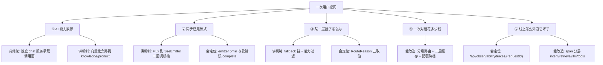
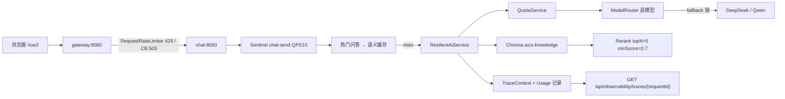
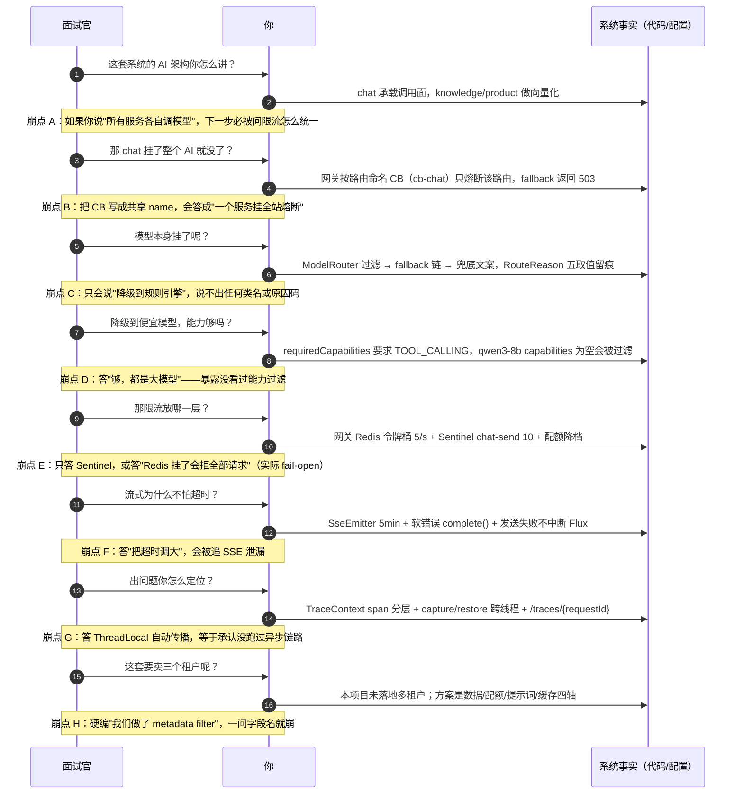

# AI 应用架构与系统设计：把不确定的模型放进确定的系统

> **一句话结论**：AI 应用架构题从来不考"你会不会画框图"，考的是当模型这个不可控依赖进系统后，你在**降级、限流、成本、隔离、可观测**这五件事上各自把开关放在了哪一层——能说清"开关在哪、默认值是多少、谁在什么条件下翻它"，这一章就答完了。
> **阅读前置**：会写 Spring Boot 的 Controller/Service，知道熔断、限流、超时是三个不同东西；不需要懂模型训练。建议先读 [AI 集成总览](../01-SpringAI框架集成/07-AI集成.md) 了解本仓 AI 能力装配顺序。
> **证据基线**：A 级 = `24-源码分析/assets/source/` 已入库源码摘录（本机实测 905 份 .md，Spring Cloud Gateway 5.1.0 / Spring AI 2.1.0）；B 级 = 本仓 `ai-cs-*` 源码与 `tools/nacos-config/*.yml`（行号均已 read 核对）；C 级 = 本机 pwsh/node 可复现实测。基线版本 JDK 17 + Spring Framework 7.1.0 + Boot 4.2.0 + Spring AI 2.1.0。**预计阅读 45~60 分钟**。

## 证据边界表（先摊牌，再答题）

| 类别 | 本仓状态 | 本篇怎么处理 |
| --- | --- | --- |
| A 源码摘录 | `RedisRateLimiter`、`RetryGatewayFilterFactory`、`Usage`、`ChatClientMessageAggregator`、`CircuitBreaker` 等已入库 | 讲框架机制一律挂 A 级锚点，写清类名+方法+行号 |
| B 本项目源码 | 网关路由/限流/CB、`ResilientAiService`、`ModelRouter`、`QuotaService`、`TraceContext`、Sentinel 规则、SSE 桥接全部真实存在 | "本项目怎么做"每句后面都有 `路径#行号` |
| C 可复现实测 | 模块 AI 能力分布统计、按 yml 单价算成本，均可复跑 | 给完整命令 + 真实输出 + 怎么读 |
| 未落地 | 多租户隔离（数据/配额/提示词）、按比例流量灰度、压测容量曲线、分布式 trace 后端落地（OTLP endpoint 指向本机 4318，未部署 collector） | 明确写"本项目未落地，只能讲方案"，不给假行号 |

> **读法**：本文所有"我们项目"的句子，如果后面没有 `路径#行号`，就应当作**没落地**处理。

## 0. 先看现象

**现象一：被问"你们的 AI 能力放在哪个服务"，答"统一 AI 中台"，然后就没词了。**

> 面试官：那你们 `ai-cs-chat` 里 215 个类在干什么？
> 你：……（心里想：AI 中台不就是 chat 吗？）

真实情况是"半边集中"：`ai-cs-chat` 有 215 个 main java 文件、38 个文件出现 AI 类型引用；而 `ai-cs-knowledge`（25 个文件）有 5 个 AI 相关文件在做向量化，`ai-cs-product`（25 个文件）有 4 个在做图片描述与商品向量。**AI 能力不是整块搬进一个服务，而是"调用面集中、向量化旁路分散"**。§3.1 会把这条分工讲透。

**现象二：被问"流式怎么保证不超时"，答"把超时调大"，追问"客户端 5 分钟还挂着怎么办"，卡住。**

`ai-cs-chat/src/main/java/com/aics/chat/service/impl/ChatServiceImpl.java#L156` 里写死了 `SSE_EMITTER_TIMEOUT = 5 * 60 * 1000L`，`#L525` 用它 `new SseEmitter(SSE_EMITTER_TIMEOUT)`。这不是"调大就完事"——`#L670-L687` 明确区分了**降级软错误**（`[ERROR]` 前缀 → 发 `{"error":...}` → `complete()`）与**真异常**（→ `completeWithError`）。超时是资源上限，降级是业务承诺，两者不能混。

**现象三：被问"模型挂了怎么降级"，答"降级到规则引擎"，追问"降级那一刻你从哪个接口能看出走了降级"，答不上来。**

降级如果没有留痕，就等于没做。本仓的留痕点在 `ai-cs-chat/src/main/java/com/aics/chat/modelrouter/RouteReason.java#L4-L10`：`SCENARIO_DEFAULT` / `PRIMARY_UNAVAILABLE` / `QUOTA_DOWNGRADE` / `QUOTA_NO_CHEAPER_MODEL` / `NO_ELIGIBLE_MODEL`——**五种取值就是五种降级姿势，能报出这个枚举名，追问就断在这里**。

> **这些现象指向同一件事**：AI 应用架构不是"把模型接进来"，而是"给模型的每一次不确定，在系统里预先指定一个有名字、有默认值、有观测点的落点"。

## 1. 整体地图



> **读图说明**：主干是"一次用户提问"分出的五条追问线，面试官通常按 ①→③→⑤ 顺序压——①答不出（说不清 AI 能力边界），后面所有降级讨论都会变成空谈；③→C2 那条边（能报出 `RouteReason` 具体取值）是"你真的运行过这套系统"与"你看过 PPT"的分水岭。最容易看错的是 ④→D1：成本治理不是"少调模型"，而是**先有分级路由（贵模型只给需要 tool-calling 的场景），再有缓存和三档价格**，顺序反了就会答成"我们省着用"。

| 考点 | 背结论（能否一句话定性） | 讲机制（能否说清链路） | 会定位（能否报出类/参数/接口） | 能改造（能否给方案与代价） |
| --- | --- | --- | --- | --- |
| AI 能力归属 | 集中 vs 分散各有代价 | 调用面集中、向量化旁路 | `ResilientAiService` 是唯一出口 | 新增场景只加 yml 还是加服务 |
| 同步 / 流式 | 两条路径两套超时与重试 | MVC 栈里 Flux 无法直出 SSE | `SseEmitter` 5min、`[ERROR]` 软错误 | 要支持断线续传怎么改 |
| 降级矩阵 | 模型挂/检索挂/工具挂三种不同 | 链式 fallback + 能力过滤 | `RouteReason` 五值 | 检索挂时能否只降答案质量 |
| 限流三层 | 网关/服务/供应商配额各管一段 | Sentinel 入口 + Redis 令牌桶 | `chat-send` QPS 10 | 配额从硬拒到降档怎么改 |
| 成本治理 | 分级路由是主开关，缓存是加速器 | 三档价格 × 场景绑定 | `aics.usage.pricing` | 加预算熔断会牺牲什么 |
| 多租户 | 数据/配额/提示词三条独立轴 | 有角色 ACL、无租户维度 | `RagAclFilter` + 全仓 `tenant` 几乎零命中 | 加租户要动哪几张表 |
| 可观测 | trace 必须跨异步线程 | ThreadLocal 捕获再恢复 | `TraceContextHolder.capture()` | span 分层怎么扩到工具调用 |
| 灰度与回滚 | 提示词灰度有实现、流量灰度没有 | `PromptRouter` 三策略 | 8 场景全 `pinned` | 要按流量比例灰度怎么加 |
| 容量规划 | 并发数 ≠ 模型 QPS | 排队 + 熔断 + 429 三层保护 | `timelimiter 30s/60s` | 加机器解决不了供应商配额 |

三条纪律压在这张表下面：**能报参数就不报形容词**（"replenish 5/s、chat-send 10 QPS、30s 超时"胜过"我们做了限流"）；**能报类名就不报架构名**（`ModelRouter`/`RouteReason` 胜过"AI 中台""多模型容灾"）；**不能报就不报**（未实测的数字一律说"没测过"）。

## 2. 关键概念与关键类/关键参数

| 名称 | 所在位置 | 一句话准确定义 | 本项目取值 |
| --- | --- | --- | --- |
| 降级（fallback） | `ResilientAiService#L186-L188` | 主模型不可用时按序切到备用模型，仍失败才返回兜底文案 | 主 `deepseek-chat` → 备 `qwen3-32b` |
| 兜底文案 | `ResilientAiService#L451-L456` | 全链失败的最终返回值，SUMMARY 场景返回空串避免污染上下文 | `"AI 助手暂时繁忙，请稍后重试。"` |
| 熔断（circuit breaker） | `ModelHealthRegistry#L34-L41` | 按模型维度统计失败率，超阈值 OPEN 直接跳过该模型 | COUNT_BASED 窗口 10、最小 3 次、50%、OPEN 30s、半开 3 次 |
| 能力过滤 | `ModelRouter#L38-L40` | 候选模型必须同时"注册在册 + 熔断可用 + 具备所需能力" | `chat/rag/agent/nl2sql` 需要 `TOOL_CALLING` |
| 分级路由 | `tools/nacos-config/ai-cs-chat.yml#L74-L84` | 按 tier 把贵/便宜模型绑到不同场景 | `qwen3-8b` 是唯一 `tier: cheap` |
| 配额降档 | `ModelRouter#L47-L51` | 超配额不拒绝请求，改选便宜档模型 | `over-limit-fallback-tier: cheap` |
| 配额检查 | `QuotaService#L72-L79` | Token 与费用双维度判断，异常时 fail-open 放行 | `quota.enabled: true`、`over-limit-fallback-tier: cheap` |
| fail-open | `QuotaService#L72-L79` | 治理组件自身故障时选择"放行"而非"拒绝" | 配额服务抖动不影响主流程 |
| fail-open（限流侧） | [[源码:RedisRateLimiter.java.md#L271-L273]] | Redis 报错时返回 allowed=1，限流形同关闭 | 框架行为，不是你写的 |
| 网关分布式限流 | `RouteConfig#L174-L187` | 每条路由挂 `RequestRateLimiter`，Redis+Lua 令牌桶多实例共享配额 | replenish 5/s、burst 10 |
| 限流键 | `RouteConfig#L155-L167` | 认证后用户优先，未认证退化为 IP | `"u:"+userId` 否则 `"ip:"+ip` |
| 本地兜底限流 | `RateLimitFilter`（gateway） | 全局过滤器内存限流，排在 `AuthFilter` 之后 | `aics.gateway.rate-limit.enabled: false` |
| 入口限流 | `SentinelFlowConfig#L27-L45` | 在 chat 服务内部按资源名挡请求 | `chat-send` QPS 10 预热 10s、`chat-rag` QPS 5 |
| 超时分层 | `ai-cs-chat/src/main/resources/application.yml#L77-L87` | 不同交互链路给不同上限 | chat 30s、sse 60s、vision 5s |
| 瞬时重试 | `ResilientAiService#L356-L367` | 只对连接/超时类异常重试一次 | `ResourceAccessException`、`SocketTimeoutException`、`TimeoutException` |
| SSE | `ChatController#L167-L180` | Server-Sent Events：服务端单向长连接推送，`text/event-stream` | `POST /chat/stream/sse` |
| SSE 桥接 | `ChatServiceImpl#L607-L644` | MVC 栈里 Flux 不能直接渲染，必须 `subscribe` 三回调手动写入 | 累积 StringBuilder 后一并入库 |
| 软错误 | `ChatServiceImpl#L670-L687` | 业务级降级信号（`[ERROR]` 前缀）走 `complete()` 而非 `completeWithError` | 客户端看到 `{"error":...}` |
| span | `TraceContext#L11-L19` | 一次请求内部的阶段耗时记录单元 | intent/retrieval/rerank/llm/tools/answer |
| 成本记录 | `ModelUsageRecorder#L74-L115` | 从 trace 取 requestId，把 token 与估算费用异步落库 | `estimated` 标记流式无精确 usage |
| 价格表 | `tools/nacos-config/ai-cs-chat.yml#L118-L128` | 每百万 token 的输入/输出单价 | deepseek 2.0/8.0、qwen3-32b 1.0/2.0、qwen3-8b 0.2/0.6 |
| 提示词灰度 | `PromptRouter#L42-L61` | 按 `weights` / `userId-mod` / `pinned` 三策略选版本 | 8 场景全 `pinned`（`application-prompt.yml#L20-L21` 起） |
| 走查入口 | `ObservabilityController#L42-L43` | 按 requestId 查回整条 trace 的唯一 HTTP 入口 | `GET /api/observability/traces/{requestId}` |
| 网关降级响应 | `GatewayFallbackController`（gateway） | 断路器 OPEN 时的统一 503 响应体 | `ResultCode.GATEWAY_SERVICE_UNAVAILABLE` |
| 场景枚举 | `ModelScenario`（`ResilientAiService` 入参） | 决定用哪个模型、要不要 tool-calling、失败怎么兜底 | chat / rag / agent / nl2sql / summary / intent / rewrite / chart / judge |

一句话记住分工：**网关管"谁能进来"，Sentinel 管"进来多少"，Resilience4j 管"下游坏了怎么办"，配额管"钱花超了切便宜档"，trace 管"事后能复盘"。**

## 3. 逐题精讲

### 3.1 AI 能力应该放在一个服务里，还是分散到各服务？

**问题**：你们有 11 个微服务，为什么只有 chat 一个服务接模型？这是设计还是偷懒？

**30 秒答案骨架**：
1. 我们分两类：**调用面集中**——所有 `ChatModel`/`ChatClient` 调用只出现在 `ai-cs-chat`，出口唯一在 `ResilientAiService`，路由、熔断、配额、成本、trace 只在那一处实现一次。
2. **数据面旁路**——向量化能力按数据归属下沉：`ai-cs-knowledge` 做知识文档向量化，`ai-cs-product` 做商品向量与图片描述，它们只依赖 `EmbeddingModel`，不依赖对话链路。
3. 判据是**变更频率与失败后果**：换模型、调参数、加降级要改的地方必须收拢；而"哪些数据要向量化"跟着业务数据走，强行集中反而制造跨服务批量调用。
4. 代价是 chat 成为热点：它一个人承担了 215 个 main 类和 38 个 AI 引用文件，所以必须在服务内部再分层（Controller → Service → ResilientAiService → ModelRouter）。

**深挖追问**：
- 追问"那 knowledge 服务为什么不也走 chat 的 ResilientAiService？"——因为向量化是**幂等批处理**，不需要对话的 fallback 链与 SSE 语义；强行共用会让 chat 承担离线任务的内存与超时风险。
- 追问"分散后怎么统一升级 Spring AI？"——靠父 `pom.xml` 统一版本（`spring-ai-bom`），不靠服务间调用。
- 追问"如果新业务要在 order 服务里加智能推荐？"——推荐场景走 `ai-cs-py-recommend`（Python 侧，无 Java AI 依赖），Java 侧仍只在 chat 调模型；这条边界能反向证明"集中"是有意识的约束。

**常见错误答案**：
- ❌"我们有个统一 AI 中台，所有服务调它。"——错在把中台当答案：说不出中台的边界、代码在哪、谁维护，等于没答。本仓真实分工是"调用集中 + 向量化旁路"。
- ❌"当然是分散，微服务就该每个服务自己管自己的 AI。"——错在把微服务教条套到**有外部成本与外部配额**的依赖上：每个服务各自调模型＝限流、配额、账单全部碎片化，供应商 429 时无法统一退让。
- ❌"chat 服务负责 AI，其他服务不碰 AI。"——事实层面就错，`ai-cs-knowledge` 有 5 个 AI 相关文件、`ai-cs-product` 有 4 个（§9 练习 1 可复跑统计）。

**证据锚点**：c 级统计见 §9 练习 1；`ResilientAiService` 是唯一模型出口，见 `ai-cs-chat/src/main/java/com/aics/chat/service/impl/ResilientAiService.java#L112-L159`（五个公开 API 全部返回 `CompletableFuture`，没有任何 Controller 直接碰 `ChatModel`）。

```java
// ai-cs-chat/src/main/java/com/aics/chat/service/impl/ResilientAiService.java#L130-L131
public CompletableFuture<String> callSummary(ModelScenario scenario, Prompt prompt) {
    return invokeNonStream(scenario, holder -> holder.getChatModel().call(prompt));
}
```

**读点**：摘要走 `ChatModel`（最底层接口，跳过 `ChatClient` 的 Advisor 链），普通聊天走 `ChatClient`（带 RAG/日志拦截器）。**同一条降级链上挂的是不同深度的客户端**——所以"集中"收拢的是治理逻辑（路由/熔断/配额/成本/trace），而不是把调用方式统一化。这也是为什么新增业务场景时，通常只需要在 `ai-cs-chat.yml` 的 `scenarios` 里加一段，而不是新建服务。

### 3.2 同步应答和流式应答，在架构上差在哪？

**问题**：同一个 `/chat/send` 和 `/chat/stream/sse`，基础设施上有哪些不同处理？

**30 秒答案骨架**：
1. **生命周期不同**：同步接口是"请求-响应-释放"，超时由 `timelimiter chatService 30s` 兜；流式是"长连接"，`SseEmitter` 上限 5 分钟，超时由容器回调而不是业务返回值体现。
2. **可重试性不同**：同步链失败可换模型重来（`callWithTransientRetry` 只重试一次瞬时异常）；流式 **一旦发出第一个 chunk 就不能重放**，所以 `ResilientAiService` 里流式明确"不重试、不走 fallback 链"（`#L245-L247`），失败只能发软错误文案。
3. **技术栈陷阱**：本项目是 Spring MVC/Servlet 栈，`Flux` 不能直接渲染成 SSE，必须在 `ChatServiceImpl#L607-L644` 用 `subscribe(onNext/onError/onComplete)` 手动往 `SseEmitter` 写。
4. **网关侧**：SSE 走的是"不缓冲直通"，一旦中间加了响应体改写/压缩缓冲，token 会攒住再吐，用户看到的是"卡 20 秒然后一大段"。

**深挖追问**：
- 追问"客户端 5 分钟到了还在等，服务端怎么办？"——`emitter.send` 抛异常时只 `log.warn`（`ChatServiceImpl#L696-L703`），**不中断 Flux**，因为要保证 `onComplete` 仍能执行（清洗、入库、推 done 事件）。
- 追问"为什么不直接用 WebSocket？"——单向推送用 SSE 更省：不需要协议升级、能复用 HTTP 鉴权与网关路由、断线由 EventSource 自动重连；代价是不能双向、不能自定义二进制帧。
- 追问"流式怎么算 token 成本？"——Spring AI 的 `Usage` 在流式场景需要聚合（[[源码:ChatClientMessageAggregator.java.md#L40-L54]] 用 `MessageAggregator` 把 chunk 合成单条响应再取出 usage）；本仓当前 `ResilientAiService#L277` 的 `usageRef` 从未被 set，所以**流式 usage 恒为 null，成本记录靠 `estimated` 标记**（`ModelUsageRecorder#L100`）。
- 追问"网关会不会缓冲 SSE？"——需要看是否加了 `ModifyResponseBodyGatewayFilterFactory` 这类响应体改写过滤器；本仓 `RouteConfig` 每条路由只挂 `retry/circuitBreaker/requestRateLimiter` 三件套，没有响应体过滤器，所以是直通。

**常见错误答案**：
- ❌"流式就是把同步接口改成 `Flux` 返回值就行。"——错在忽略 Servlet 栈没有响应式容器：MVC 下 `Flux` 会被当成普通返回值序列化，或者需要 `ResponseBodyEmitter`/`SseEmitter` 桥接，本仓选的就是后者的手动三回调。
- ❌"流式失败了重试一下，反正还没说完。"——错在违背流式的物理事实：chunk 已经写进 TCP 缓冲，重试会导致用户看到重复文本。本仓的取舍是**先降级文案，再靠历史消息补偿**。
- ❌"超时调大就不会断。"——错在把资源上限当业务承诺：`SseEmitter(5min)` 是防止连接泄漏的保护，调大只会让泄漏更久（`docs/28-故障案例库.md#L296` 就把"SSE 连接泄漏"列为待补充案例）。

**证据锚点**：B 级 `ai-cs-chat/src/main/java/com/aics/chat/service/impl/ChatServiceImpl.java#L492-L530`（两条流式入口 + `SseEmitter` 超时）。

```java
// (src: StreamingChatModel.java.md#L29-L49)
@FunctionalInterface
public interface StreamingChatModel extends StreamingModel<Prompt, ChatResponse> {

	default Flux<String> stream(String message) {
		Prompt prompt = new Prompt(message);
		return stream(prompt).map(response -> Optional.ofNullable(response.getResult())
			.map(Generation::getOutput)
			.map(AssistantMessage::getText)
			.orElse(""));
	}

	@Override
	Flux<ChatResponse> stream(Prompt prompt);
}
```

**读点**：流式模型在框架层只承诺 `Flux<ChatResponse>`，**既没有"重放"钩子，也没有"从第 N 个 token 继续"的语义**——所以"不能重试"不是本项目的偷懒，是接口契约决定的。另外注意 `stream(String)` 这类便利方法把 `ChatResponse` 直接 map 成纯文本，`Usage`/`tool_calls` 在这一步就被丢弃了，这正是"流式拿不到 usage"的框架级原因（本仓 `callSseStream` 用的就是 `.stream().content()`）。

### 3.3 模型挂了 / 检索挂了 / 工具挂了，分别怎么降？

**问题**：给一张降级矩阵：三种依赖，各自的降级动作和用户可见表现是什么？

**30 秒答案骨架**：
1. **模型挂**：走 `ModelRouter` 的候选链——主 `deepseek-chat` 不可用（熔断 OPEN 或未注册）就 `PRIMARY_UNAVAILABLE` 切 `qwen3-32b`；全挂返回兜底文案，SUMMARY 场景返回空串。
2. **检索挂**：检索要分细——**增强层（hybrid/改写/HyDE）挂了会降级**：`retrieveRagDocs` 里 `catch (Exception e)` 后 `log.warn("RAG增强检索失败，降级纯向量: ...")` 再回退 `knowledgeBaseService.search(...)`（`ai-cs-chat/src/main/java/com/aics/chat/service/impl/ChatServiceImpl.java#L954-L960`），注释写明"核心能力不被外围增强故障拖垮"；**检索没命中不算挂**：context 为空时注入"（未检索到相关资料）"继续生成（`#L445`）；但**纯向量检索本身抛异常时不降级**——`#L975-L980` 只 `observation.error(e)` 后原样上抛，RAG 接口整体失败。这三句合起来才是完整答案："增强项可降、核心项不降、空结果不算故障"。
3. **工具挂**：工具调用发生在 Spring AI 的 `ToolCallingManager` 内部（`ChatServiceImpl#L607-L644` 注释），失败对上层表现为"这一轮没有工具结果"，可降级成"提示用户改用人工/知识库"；`RouteReason` 里没有工具维度的原因码，**工具级降级本项目未落地**，只能讲方案。
4. 三维度的共同点：**降级必须留痕**——`RouteReason`（模型维度）+ 检索降级的那条 `log.warn`（检索维度）+ `TraceContext.status/errorSummary` 与 `ModelUsageRecorder` 的 `estimated` 标记。

**深挖追问**：
- 追问"熔断是怎么知道模型挂了的？"——`ModelHealthRegistry#L18-L30`：按 `modelId` 懒建 `CircuitBreaker`，`isAvailable` 只认 `CLOSED`/`HALF_OPEN`；`ResilientAiService#L268` 在流式路径取 breaker 并在 `doFinally` 里 `onSuccess/onError`（`#L296-L302`），非流式在 `timedCall` 里 `executeCallable`。
- 追问"熔断阈值凭什么定 50%/10 次？"——和 `application.yml#L117-L123` 的 `chatService` 配置对齐（COUNT_BASED、窗口 10、最小 3 次、50%、OPEN 30s、半开 3 次）。这里要能说出"为什么最小调用数是 3 而不是 1"：低流量下 1 次失败就熔断会误杀。
- 追问"降级到便宜模型后，能力够吗？"——`ModelRouter#L38-L40` 会做能力过滤：`chat/rag/agent/nl2sql` 要求 `TOOL_CALLING`，而 `qwen3-8b` 的 `capabilities` 是空数组（`ai-cs-chat.yml#L74-L84`），所以**超配额降档到 8b 时，需要 tool-calling 的场景会被过滤掉**，只能选 `QUOTA_NO_CHEAPER_MODEL` 分支。
- 追问"Spring Cloud 的 CircuitBreaker 帮不帮你降级？"——不帮。[[源码:CircuitBreaker.java.md#L31-L37]]：`run(Supplier)` 默认实现直接抛 `NoFallbackAvailableException`，必须显式传 `fallback` 函数才有降级。

**常见错误答案**：
- ❌"模型挂了就返回 500，让前端提示重试。"——错在把可预期依赖故障当程序缺陷：模型超时是常态，不是异常；本仓 `fallbackText` 给的是 200 + 文案。
- ❌"检索挂了就整条链路报错。"——错在把增强项当依赖项，检索失败应该降级成"无引用回答"，并且必须在回答里体现（否则用户以为答案有依据）。
- ❌"工具调用挂了重试三次。"——错在工具往往是**有副作用的写操作**（下单、退款），重试可能重复执行；正确做法是按幂等键判重或直接转人工。

**证据锚点**：`ai-cs-chat/src/main/java/com/aics/chat/modelrouter/ModelRouter.java#L38-L57`（候选过滤 + 配额降档）、`ai-cs-chat/src/main/java/com/aics/chat/modelrouter/RouteReason.java#L4-L10`。

```java
// ai-cs-chat/src/main/java/com/aics/chat/modelrouter/ModelRouter.java#L46-L53
if (request.isQuotaExceeded() && properties.getQuota().isEnabled()) {
    String cheap = cheapestEligible(required);
    if (cheap != null) {
        return decision(cheap, rest(candidates, cheap), RouteReason.QUOTA_DOWNGRADE);
    }
    return decision(candidates.get(0), rest(candidates, candidates.get(0)),
            RouteReason.QUOTA_NO_CHEAPER_MODEL);
}
```

**读点**：注意 `rest(candidates, cheap)` 这一手——降档到便宜模型时，**fallback 链也被重建成"剩下的候选"**，所以降档后仍有二次降级空间；而 `QUOTA_NO_CHEAPER_MODEL` 分支拿的是 `candidates.get(0)`（原主模型），意思是"宁可超预算也不降能力"。

模型维度的熔断参数不在 yml 里，而是硬编码在 `ModelHealthRegistry`：

```java
// ai-cs-chat/src/main/java/com/aics/chat/modelrouter/ModelHealthRegistry.java#L34-L42
private CircuitBreakerConfig config() {
    return CircuitBreakerConfig.custom()
            .slidingWindowType(CircuitBreakerConfig.SlidingWindowType.COUNT_BASED)
            .slidingWindowSize(10)
            .minimumNumberOfCalls(3)
            .failureRateThreshold(50)
            .waitDurationInOpenState(Duration.ofSeconds(30))
            .permittedNumberOfCallsInHalfOpenState(3)
            .build();
}
```

**读点**：这个 `config()` 的数值和 `ai-cs-chat/src/main/resources/application.yml#L117-L123` 里 Resilience4j `chatService` 的配置是同一组（窗口 10/最小 3 次/50%/OPEN 30s/半开 3 次）。**两处配置一致不是巧合而是必须**：否则会出现"模型维度已判死、但方法维度还在重试"的分裂状态。追问到这里能顺口说出"这两处必须同源"，比背一个数字更有说服力。

检索维度的降级长这样——注意它是**在一个 `catch` 里换实现，而不是换文案**：

```java
// ai-cs-chat/src/main/java/com/aics/chat/service/impl/ChatServiceImpl.java#L949-L960
try {
    RetrieveResult result = hybridRetriever.retrieve(knowledgeBase, message, mode, topK);
    log.info("RAG增强检索: mode={}, degraded={}, hits={}",
            result.getMode(), result.isDegraded(), result.getDocuments().size());
    docs = result.getDocuments();
} catch (Exception e) {
    log.warn("RAG增强检索失败，降级纯向量: mode={}, err={}", mode, e.getMessage());
    docs = knowledgeBaseService.search(knowledgeBase, message, topK, threshold);
}
```

**读点**：降级的判据是"**故障面大小**"——增强检索依赖 ES、依赖改写用的 LLM，外围比纯向量多两个可能坏的环节，所以降级动作放在这一层（注释原话：核心能力不被外围增强故障拖垮）；而 `degraded` 这个字段还会被 `HybridRetriever` 自己回填，说明"框架内部已经降过一次，业务层再兜一次"是双层保护。反过来看 `#L975-L980`：纯向量检索的异常只 `observation.error(e)` 然后原样抛出——**没有 catch，因为再往下没有更便宜的检索实现可用**，只能让接口失败。这就是"降级要有终点"的例子。

### 3.4 限流为什么是三层？三层各挡什么？

**问题**：你说有限流，是几层？分别挡什么、用什么实现？

**30 秒答案骨架**：
1. **网关层（谁能进来多少）**：`RouteConfig#L174-L187` 给每条路由挂 `requestRateLimiter(redisRateLimiter, userKeyResolver)`，Redis + Lua 令牌桶，多实例共享配额；`replenish-rate 5`、`burst-capacity 10`（`ai-cs-gateway/src/main/resources/application.yml#L48-L49`）。超限返回 429。
2. **服务层（业务处理多少）**：Sentinel 在 chat 内部按资源名限：`chat-send` QPS 10 + 预热 10s，`chat-rag` QPS 5（`SentinelFlowConfig#L27-L45`）。作用不是省钱，而是**别把请求堆到供应商那儿被 429 反噬**。
3. **模型配额层（钱花多少）**：`QuotaService` 检查 Token 与费用双维度，超限不拒绝，而是让 `ModelRouter` 降档到便宜模型（`QuotaService#L64-L70`、`ModelRouter#L47-L51`）。
4. 分工口诀：Sentinel 管入口，Resilience4j 管下游，配额管钱包——这句话在 `SentinelFlowConfig` 的类注释里就是这么写的。

**深挖追问**：
- 追问"限流键为什么是用户 ID 不是 IP？"——`RateLimitFilter` 类注释写明顺序陷阱：限流过滤器 order(+150) 必须晚于 `AuthFilter`(+100)，否则认证前客户端可伪造 `X-User-Id` 刷不同令牌桶。
- 追问"Redis 挂了限流还在吗？"——会**失效**。[[源码:RedisRateLimiter.java.md#L271-L273]] 在脚本执行异常时 `onErrorResume` 返回 `[1, -1]`，`allowed` 恒为 true（[[源码:RedisRateLimiter.java.md#L278]]）。所以 `ai-cs-gateway/src/main/resources/application.yml#L40` 保留了 `aics.gateway.rate-limit.enabled` 开关（默认 false）用于切回本地内存限流兜底。
- 追问"网关的重试会不会放大流量？"——会，且默认比你写的更危险：`RetryGatewayFilterFactory` 的 `exceptions` 默认是 `IOException` + `TimeoutException`（[[源码:RetryGatewayFilterFactory.java.md#L384]]），本仓额外限定 `setRetries(2)` + `setMethods(GET)` + `setStatuses(500,502)`（`RouteConfig#L174-L187`），即**只对幂等 GET 且明确状态码重试**。
- 追问"为什么 chat-rag 的 QPS 比 chat-send 低一半？"——RAG 每次要跑两阶段检索 + rerank，单位成本高；限制更严是为了保 P99 而不是保总量。
- 追问"预热（WarmUp）解决什么问题？"——服务刚启动时 JIT 未热、连接池未建，突然放入满速流量会集体超时；预热把阈值从 0 线性升到目标值，把冷启动期变成慢坡。

**常见错误答案**：
- ❌"限流用 Sentinel 就够了，网关不用管。"——错在层错了：Sentinel 在 chat 进程内，请求已经穿过网关、占用了连接与线程；恶意流量应该在最外层就掉。
- ❌"Redis 挂了限流会拒绝所有请求，所以要有兜底开关。"——方向反了：框架默认是 fail-open（全部放行），危险不是"拒全部"而是"没有限流"。
- ❌"配额超了直接返回 429。"——错在把成本治理做成了可用性故障：本仓选择降档（`QUOTA_DOWNGRADE`）而不是拒绝。

**证据锚点**：A 级 [[源码:RedisRateLimiter.java.md#L245-L286]] 是查表与限流判定全貌；B 级 `ai-cs-gateway/src/main/java/com/aics/gateway/config/RouteConfig.java#L50-L54`（`RedisRateLimiter` bean 的构造参数来自配置）。

```java
// (src: RedisRateLimiter.java.md#L269-L279)
Flux<List<Long>> flux = this.redisTemplate.execute(this.script, keys, scriptArgs);
return flux.onErrorResume(throwable -> {
    log.error("Error calling rate limiter lua", throwable);
    return Flux.just(Arrays.asList(1L, -1L));
}).reduce(new ArrayList<Long>(), (longs, l) -> {
    longs.addAll(l);
    return longs;
}).map(results -> {
    boolean allowed = results.get(0) == 1L;
```

**读点**：`-1L` 是"令牌数未知"，而 `results.get(0) == 1L` 判的是第一位的 **allowed 标志**——异常分支返回的 `[1L, -1L]` 里第一位就是 1，于是 **allowed 恒为 true**。这三行是整个"Redis 挂了限流怎么办"的标准答案，能背出来比说"我们会兜底"强十倍。

```java
// ai-cs-chat/src/main/java/com/aics/chat/config/SentinelFlowConfig.java#L27-L41
@PostConstruct
public void initFlowRules() {
    FlowRule sendRule = new FlowRule();
    sendRule.setResource(SentinelRules.RESOURCE_CHAT_SEND);
    sendRule.setGrade(RuleConstant.FLOW_GRADE_QPS);
    sendRule.setCount(SentinelRules.CHAT_SEND_QPS_THRESHOLD);
    sendRule.setControlBehavior(SentinelRules.CONTROL_BEHAVIOR_WARM_UP);
    sendRule.setWarmUpPeriodSec(SentinelRules.WARM_UP_PERIOD_SEC);

    FlowRule ragRule = new FlowRule();
    ragRule.setResource(SentinelRules.RESOURCE_CHAT_RAG);
    ragRule.setGrade(RuleConstant.FLOW_GRADE_QPS);
    ragRule.setCount(SentinelRules.CHAT_RAG_QPS_THRESHOLD);

    FlowRuleManager.loadRules(List.of(sendRule, ragRule));
}
```

**读点**：两条规则的差异就是答案——`chat-send` 带 `WarmUp 10s`（防冷启动打满），`chat-rag` 不带但阈值减半（5 QPS）。资源名常量在 `ai-cs-chat/src/main/java/com/aics/chat/config/SentinelRules.java#L15-L30`，`ChatController#L79` 用 `@SentinelResource` 把 `/chat/send` 绑到 `chat-send`。注意 `/chat/rag`（`#L119-L120`）**没有** `@SentinelResource`，因此 `chat-rag` 这条规则目前不会生效——这是真实存在的缺口，面试时主动说出来比被挖出来好。

### 3.5 成本治理：预算、分级路由、缓存，谁是主开关？

**问题**：一个客服系统日均 10 万轮对话，你怎么把成本压下来又不掉体验？

**30 秒答案骨架**：
1. **主开关是分级路由**：把"贵但有 tool-calling 能力"的模型只给需要它的场景（`chat/rag/agent/nl2sql` → `deepseek-chat`），把摘要/意图/改写/图表这类短任务绑到 `qwen3-8b`（`tier: cheap`，`ai-cs-chat.yml#L86-L113`）。
2. **第二层是缓存**：三层依次是热门问答 → 语义缓存（`threshold 0.92`、`max-entries 200`、`ttl 168h`）→ 完整 RAG 链路（`ai-cs-chat/src/main/resources/application.yml#L179-L192`，命中顺序注释在 `#L171`）。
3. **第三层是配额降档**：超预算不是拒服务，而是切到 `cheap` 档（`over-limit-fallback-tier: cheap`）。
4. **第四层是计量**：`ModelUsageRecorder` 把 `estimatedCost` 异步落库，价格来自 `aics.usage.pricing`（每百万 token），流式无精确 usage 时用 `estimated=true` 打标，统计时能过滤掉。

**深挖追问**：
- 追问"三档价格差多少？给我算一下。"——见 §9 练习 4 的真实输出：同样 1000 轮对话（输入 1200 / 输出 300 token），`deepseek-chat` 4.800 元、`qwen3-32b` 1.800 元、`qwen3-8b` 0.420 元，**最贵是最便宜的 11.4 倍**。这就是分级路由的收益上限。
- 追问"语义缓存 0.92 这个阈值怎么定的？"——本仓没有阈值调优记录，属**未实测**；能讲的是机制：阈值过高命中率低，过低会答错问题，`max-entries 200` 也说明它是"热点缓存"而不是"全量缓存"。
- 追问"缓存会不会把错误答案也缓存住？"——会。所以缓存只放在**检索成功且回答正常结束**的路径上；`[ERROR]` 软错误在 `ChatServiceImpl#L670-L687` 直接 `complete()` 返回，不进缓存。
- 追问"提示词压缩能省多少？"——旧版本这一章写过"Prompt 精简省 10%~30%"这类数字，**本仓没有任何实测依据**，正确说法是"能省输入 token，比例取决于历史消息占比，需要用自己的 golden 集测"。
- 追问"为什么流式 usage 拿不到还要记成本？"——拿不到精确值不等于不记账：`ModelUsageRecorder#L100` 用 `estimated` 标记 + 估算，保证统计口径有区分，不会被当成精确值。

**常见错误答案**：
- ❌"上语义缓存能省 30%~60%。"——这是旧文档的无出处数字，属于编造；只能说"命中率取决于问题重复度，本仓未实测"。
- ❌"降级到小模型就便宜了。"——不完整：小模型若无 `TOOL_CALLING` 能力，`ModelRouter` 会直接过滤掉它，降级根本发生不了（会走 `QUOTA_NO_CHEAPER_MODEL`）。
- ❌"把 max-tokens 调小就能省钱。"——只省输出侧，且会截断回答引发重问，实际可能更贵；成本大头常在输入侧（历史消息 + 检索上下文）。

**证据锚点**：`ai-cs-chat/src/main/java/com/aics/chat/observability/ModelUsageRecorder.java#L74-L115`（费用估算与落库）、`tools/nacos-config/ai-cs-chat.yml#L118-L128`（价格表）。

```yaml
# tools/nacos-config/ai-cs-chat.yml#L118-L128（节选，按每百万 token 计价）
aics:
  usage:
    pricing:
      deepseek-chat:
        input: 2.0
        output: 8.0
      siliconflow-qwen3-32b:
        input: 1.0
        output: 2.0
      siliconflow-qwen3-8b:
        input: 0.2
        output: 0.6
```

```java
// (src: Usage.java.md#L37-L46)（节选，省略 javadoc）
Integer getPromptTokens();
Integer getCompletionTokens();
```

**读点**：`Usage` 接口只承诺"有这两个取数方法"，**没有承诺返回值一定非 null**；`getTotalTokens()` 是个 `default` 方法（[[源码:Usage.java.md#L56]]）自己去拼。所以"流式拿不到 usage 就崩"的锅在调用方不在框架——本仓在 `ResilientAiService#L307-L312` 用 `if (usage != null)` 守住，宁可少打一个标签也不让打点抛异常。

`aics.model-router.scenarios` 到档位的映射，背下这张表就等于背下了分级路由：

| 场景 | 用哪个模型 | 档位 / 优先级 | 需要 tool-calling |
| --- | --- | --- | --- |
| `chat` / `rag` / `agent` / `nl2sql` / `judge` | `deepseek-chat`（备 `qwen3-32b`） | standard / 100 | 是（`requiredCapabilities` 会强制要求） |
| `summary` / `intent` / `rewrite` / `chart` | `siliconflow-qwen3-8b`（备 `qwen3-32b`） | cheap / 80 | 否 |
| `intent` 的额外兜底 | 再挂 `deepseek-chat` | standard / 100 | 是 |
| 超配额降档 | `siliconflow-qwen3-8b` | `over-limit-fallback-tier: cheap` | 否 → 需要工具时降不下去 |

**一句话**：这张表就是"成本治理"的全部骨头。能顺手答出"为什么 `intent` 多挂了一个 `deepseek-chat`"（`tools/nacos-config/ai-cs-chat.yml#L104-L106` 的注释：siliconflow 间歇性连接重置时保证意图识别可用），说明你读过配置而不是抄过配置。

### 3.6 多租户隔离：数据、配额、提示词三条轴怎么分开？

**问题**：如果这套系统要卖给三家公司，你会怎么隔离？

**30 秒答案骨架**：
1. **先说事实**：本仓**没有多租户**——全仓 `ai-cs-chat`/`ai-cs-gateway`/`ai-cs-knowledge` 源码里 `tenant` 只有零星命中（一个配置类和一条测试），没有租户上下文、没有按租户分集合、没有按租户配额。但**也不是零隔离**：有一层**角色级** ACL，下面展开。先讲清边界，再讲方案。
2. **数据轴**：向量库按租户分集合或按 metadata 过滤（本仓 Chroma 单机、集合 `aics-knowledge` 被 chat/knowledge/search 三服务共用，见 `ai-cs-chat/src/main/resources/application.yml#L48-L52`），关系型数据按 `tenant_id` 行级隔离。
3. **配额轴**：`QuotaService.check(userId, scenario)` 现在按用户查，多租户要变成"租户 + 用户"两级，且 `windowStart` 的日/周/月窗口要按租户计费周期算（`QuotaService#L84-L91`）。
4. **提示词轴**：`PromptProperties` 已按 `scenario` 分版本，多租户只是加一层 `tenant` 维度；难点是**版本爆炸**（租户 × 场景 × 版本），要靠 `pinned` 收敛。
5. **已有的那半层**：`RagAclFilter#L39-L69` 在检索后、`buildContext` 前做**知识库级 + 文档级 ACL**（无权限直接 `return List.of()`，逐条剔除并记 `RAG_ACL_DENIED` 审计事件）；但它是**角色**维度、不是租户维度，而且两个配置项在 yml 里没有任何赋值，默认空 map 就全部放行（`#L71-L81`）。

**深挖追问**：
- 追问"那你们现在到底有什么隔离？"——别答"没有"：有一层角色 ACL（`ai-cs-chat/src/main/java/com/aics/chat/security/RagAclFilter.java#L39-L69`），知识库/文档可以按角色白名单过滤，配置项是 `aics.security.rag-acl-knowledge-bases` 与 `rag-acl-documents`（`ai-cs-chat/src/main/java/com/aics/chat/security/SecurityProperties.java#L55-L58`）。**但要主动补一句"这两个 map 当前没有赋值，默认全放行"**——机制存在≠策略生效，这正是"能定位"和"背概念"的区别。
- 追问"metadata filter 和分集合哪个好？"——分集合隔离强、跨租户查询不可能误伤，但集合数量爆炸；metadata filter 便宜，但**每个查询都必须带过滤条件**，漏一处就是数据越权。本仓 `initialize-schema: false`，说明集合是外部预建的，这更偏向"集合由平台统一管理"。
- 追问"隔离不只是数据吧？"——对，还有三层：**配额隔离**（防一个租户吃满供应商 RPM）、**提示词隔离**（防 A 租户的行业术语泄漏给 B）、**缓存隔离**（语义缓存必须有租户维度，否则 A 的问题命中 B 的答案，这是最容易被忽略的越权）。
- 追问"那为什么不干脆每个租户一套部署？"——隔离最彻底但成本最高，且模型配额是账号级的，多套部署反而更容易撞总配额。

**常见错误答案**：
- ❌"我们做了多租户，用 metadata filter。"——如果代码里没有租户字段，这就是编造；面试官只要问"过滤条件写在哪一行"就会崩。
- ❌"多租户就是加个 tenant_id 字段。"——漏掉缓存与配额两条轴：语义缓存不分租户＝答案越权，配额不分租户＝一家超支拖垮所有家。

**证据锚点**：租户维度未落地，验证方式见 §9 练习 2（一条 grep 命令即可证明"没有租户字段"）；已落地的角色 ACL 在 `ai-cs-chat/src/main/java/com/aics/chat/security/RagAclFilter.java#L39-L81`。

把方案摊成表，比口头说"四轴隔离"更容易被追问到底：

| 轴 | 要隔离什么 | 本项目现状（已验证） | 最小改造点 |
| --- | --- | --- | --- |
| 向量数据 | 不同租户的知识不能互相检索到 | 单机 Chroma、集合 `aics-knowledge` 由 chat/knowledge/search 共用（`ai-cs-chat/src/main/resources/application.yml#L48-L52`） | 集合名按租户拼，或强制 metadata filter 并做"漏带过滤即报错"的防御 |
| 关系数据 | 会话/消息/用量不能串 | 无 `tenant_id` 字段（grep 仅命中两处非租户语义） | 表加 `tenant_id` + 全局拦截器自动注入 |
| 配额 | 一家超支不拖垮别家 | `QuotaService.check(userId, scenario)` 只按用户（`#L38`） | 改两级 key，`windowStart`（`#L84-L91`）按租户计费周期 |
| 提示词 | 行业术语/口径不串 | `PromptProperties` 按 `scenario` 分版本，无租户维度 | 加 `tenant` 一层，用 `pinned` 收敛版本爆炸 |
| 语义缓存 | 别家的问题命中自家答案（最隐蔽的越权） | 语义缓存 key 无租户维度（`application.yml#L184-L188` 只有 threshold/容量/TTL） | key 前缀加租户，或干脆对多租户部署关闭语义缓存 |

### 3.7 可观测：一次 trace 怎么贯穿模型调用和工具调用？

**问题**：线上用户投诉"答得慢"，你怎么在 5 分钟内定位是哪一段慢？

**30 秒答案骨架**：
1. **入口建上下文**：`TraceInterceptor#L32-L59` 在 `preHandle` 里从 `X-User-Id`/`sessionId` 解析并 `TraceContextHolder.begin(...)`，`resolveScenario`（`#L88-L108`）把 URL 映射成 `chat/rag/sse/agent/vision/history` 六类场景。
2. **异步边界要捕获再恢复**：`ResilientAiService#L173-L177` 在进入 `supplyAsync` **之前** `TraceContextHolder.capture()`，进线程后 `restore(...)`——ThreadLocal 不会自动跨线程池传播，这是 AI 链路最容易丢 trace 的地方。
3. **span 分层**：`TraceContext#L11-L19` 把一次请求拆成 `intent / retrieval / rerank / llm / tools / answer` 六段，`addSpan`（`#L84-L86`）逐步累积，`totalDurationMs`（`#L89-L91`）汇总。
4. **对外可查**：`ObservabilityController` 暴露 `GET /api/observability/traces/{requestId}`（`#L42-L43`），网关侧 `/api/observability/**` 是"不剥前缀直通"路由（`RouteConfig#L87-L90`）。
5. **跨到指标与成本**：`ResilientAiService` 用 `chat.llm` 这个 observation（`#L83`、`#L466-L499`）打低基数标签（`span.type/provider/model`）与高基数标签（`scenario/modelId/routeReason/fallbackFrom/attempt`），`ModelUsageRecorder#L83-L87` 再从 trace 取 `requestId` 把成本挂到同一条链上。

**深挖追问**：
- 追问"工具调用怎么落到 trace？"——`AgentTraceRecorder#L74-L82` 的 `step(ctx, stepType, toolName, ...)` 把每一步工具调用落 `agent_run`；`#L117` 的 `digest` 会过 `PiiMasker` 脱敏。注意：**通用 chat 的工具调用在 Spring AI `ToolCallingManager` 内部，外部 `subscribe` 只看到最终文本**（`ChatServiceImpl#L607-L644` 注释），这是可观测的天然盲区。
- 追问"低基数/高基数标签为什么要分？"——高基数（`requestId`、`modelId`、`attempt`）进指标会让时间序列爆炸；`#L466-L480` 只把 `span.type/provider/model` 作为低基数，把其余塞进 span attribute。
- 追问"OTLP 真的发出去过吗？"——`ai-cs-gateway/src/main/resources/application.yml#L63-L66` 配了 `sampling.probability` 与 `127.0.0.1:4318/v1/traces`，但**本仓没有部署 collector，属于"配好未验证"**，不要声称有链路追踪后端。
- 追问"线上评估有一条真实闭环吗？"——部分有：`OnlineEvalProperties` 存在（`enabled: false` 默认关闭，`sampleRate 0.01`），说明采样评估没开跑。

**常见错误答案**：
- ❌"我们接了 SkyWalking，全链路都能看。"——本仓没有 SkyWalking 依赖，OTLP endpoint 指向本机且无 collector；这么答等于自曝没看过配置。
- ❌"trace 用 ThreadLocal 就行，线程池会自己传。"——错得最典型：`ResilientAiService#L59-L61` 的类注释专门写了这条坑，`CompletableFuture.supplyAsync` 不会继承父线程 ThreadLocal。
- ❌"打点就是 log.info 记录耗时。"——日志不是 trace：没有统一 `requestId` 串联，跨服务、跨异步线程就断了。

**证据锚点**：`ai-cs-chat/src/main/java/com/aics/chat/observability/TraceContext.java#L27-L65`、`ai-cs-chat/src/main/java/com/aics/chat/observability/TraceInterceptor.java#L62-L85`。

```java
// ai-cs-chat/src/main/java/com/aics/chat/service/impl/ResilientAiService.java#L172-L177
private CompletableFuture<String> invokeNonStream(ModelScenario scenario, NonStreamCall call) {
    TraceContext captured = TraceContextHolder.capture();
    Long userId = ChatUserContext.getUserId();
    return CompletableFuture.supplyAsync(() -> {
        TraceContextHolder.restore(captured);
```

**读点**：`capture()` 在 `supplyAsync` **之前**，`restore()` 在 lambda **之内**——顺序颠倒（先 supplyAsync 再 capture）就会拿到空上下文，症状是"日志里所有 AI 调用都没有 requestId"。同一行还捕获了 `ChatUserContext.getUserId()`，因为它是同一个陷阱：不捕获就会**按匿名用户算配额**，配额永远不超限，账单却照涨。`TraceContextHolder` 一共只有五个静态方法（`begin/current/capture/restore/clear`，`#L1-L108`），背下来就能覆盖所有线程边界问题。

### 3.8 灰度与回滚：模型、提示词、路由三处怎么灰？

**问题**：你要把 `deepseek-chat` 换成新模型，怎么上线？出问题怎么回？

**30 秒答案骨架**：
1. **提示词灰度有真实实现**：`PromptRouter#L42-L61` 支持 `weights`（按权重分流）、`userId-mod`（按用户 ID 取模，同用户稳定命中同一版本）、`pinned`（全量固定）三策略，版本不存在时回退 `activeVersion`（`#L56-L61`）。**当前 8 个场景全是 `pinned`、`pinned: v1`**，也就是"机制在、灰度没开"——证据在 `ai-cs-chat/src/main/resources/application-prompt.yml#L20-L21`（另外 7 处在 `#L32-L33`、`#L45-L46`、`#L58-L59`、`#L71-L72`、`#L83-L84`、`#L96-L97`、`#L109-L110`），该文件由 `ai-cs-chat/src/main/resources/application.yml#L29` 以 `optional:classpath:application-prompt.yml` 导入。
2. **模型灰度的实现方式在本仓是"配置 + 场景绑定"**：换模型＝改 `aics.model-router.scenarios.*.primary/fallbacks`（`ai-cs-chat.yml#L86-L113`），回滚＝改回上一个 yml 值，Nacos 动态生效；没有按流量比例灰度模型的能力。
3. **网关路由灰度**：可以新增一条路由指向新实例并用权重负载均衡，但本仓 `loadbalancer` 是 `round-robin`（`application.yml#L57`），没有权重策略配置，属未落地。
4. **回滚的第一原则是"能一键回到上一个已知好配置"**：配置在 Nacos（`tools/nacos-config/ai-cs-chat.yml`），所以回滚动作是"发布上一版配置"，不是"重新发版"。

**深挖追问**：
- 追问"`userIdMod` 怎么保证同一用户不来回跳版本？"——`#L88-L100`：对 userId 取模，非数字 userId 视为未命中回退 `activeVersion`（所以未登录用户灰度不生效，这是设计上的取舍）。
- 追问"prompt 版本和模型版本能一起灰吗？"——能但要解耦维度：`TraceContext#L56-L65` 记了 `promptScenario/promptVersion`，而模型信息在 `startLlmObservation` 的 `modelId` 标签里；两者都在同一条 trace 上，才能做"哪个组合变差"的归因。
- 追问"灰度指标看什么？"——看 `RouteReason` 分布（`PRIMARY_UNAVAILABLE` 变多＝新模型不稳）、`chat.llm` span 的耗时与失败、以及 `ModelUsageRecorder` 的 `estimatedCost`（新模型也许更贵）。**不要**只看"用户满意度"这类滞后指标。
- 追问"评估门禁有跑吗？"——`aics.eval.gate` 的阈值当前**全是 null**，等于门禁未启用；20 条 golden 集在库里，但没有接入 CI 拦截。

**常见错误答案**：
- ❌"灰度用 Spring Cloud Gateway 的权重路由。"——本仓没配权重负载均衡；说的是框架可能性，不是本项目事实。
- ❌"提示词改了就发版，回滚就重新发版。"——错在把配置当代码：提示词在 Nacos，回滚应该是配置级、分钟级，不是构建级。
- ❌"灰度 5% 流量就行，模型没法按比例切。"——这恰恰是要点：AI 流量的灰度颗粒应该是**场景/租户/用户**而不是随机百分比，否则同一会话前后用不同模型，上下文行为会跳变。

**证据锚点**：`ai-cs-chat/src/main/java/com/aics/chat/prompt/PromptRouter.java#L42-L61`；配置侧 `tools/nacos-config/ai-cs-chat.yml#L48-L116`。

```java
// ai-cs-chat/src/main/java/com/aics/chat/prompt/PromptRouter.java#L48-L59
String chosen;
if ("weights".equalsIgnoreCase(strategy)) {
    chosen = byWeights(rollout.getWeights());
} else if ("userId-mod".equalsIgnoreCase(strategy)) {
    chosen = byUserIdMod(rollout.getUserIdMod(), userId, config.getActiveVersion());
} else { // pinned
    chosen = StringUtils.hasText(rollout.getPinned()) ? rollout.getPinned() : config.getActiveVersion();
}

// 命中版本不存在 → 回退 activeVersion；activeVersion 也不存在则回退 versions 首个 key
if (!versions.containsKey(chosen)) {
    chosen = config.getActiveVersion();
}
```

**读点**：这段代码最值钱的不是三策略，而是**最后两道回退**——配置里写了不存在的版本号时不会抛异常，而是静默回退到 `activeVersion`。这是"配置热更新系统必须有兜底"的典型写法，但也带来一个坑：**灰度失败会静默变成"全量用老版本"，你在监控上看不出任何异常**。要验证灰度是否真生效，只能像 `TraceContext#L62-L65` 那样把 `promptScenario/promptVersion` 打进 trace，事后按 version 分组统计。

### 3.9 容量规划：并发用户数和模型 QPS 怎么换算？

**问题**：产品说要支持 1000 并发在线，你要申请多少模型配额？

**30 秒答案骨架**：
1. **并发数不等于 QPS**：1000 在线用户按"平均 30 秒发一次问题"折算约 33 QPS；但每次请求的**模型占用时长**是几秒到几十秒，所以真正要算的是"在途请求数 × 单次耗时"。
2. **三层保护决定了实际承载**：网关 `replenish 5/s + burst 10`、chat `chat-send QPS 10`、`timelimiter chatService 30s`——**这三者里最小的是实际入口能力**，其中网关的 5/s 是最紧的约束。
3. **要按耗时拆分预算**：流式 `sseChatService` 给了 60s（`application.yml#L81-L83`），同步 30s；用 Little 定律（并发 = 到达率 × 平均停留时间），10 QPS × 30s ＝ 300 个在途线程，这才是线程池与连接池的规划依据。
4. **上限常常不在你这边**：供应商账号级 RPM/TPM 决定的 QPS 是硬顶，超了就是 429；`SentinelFlowConfig` 类注释里的动机就是这个——**别把请求堆到上游被 429 反噬触发熔断雪崩**。

**深挖追问**：
- 追问"加机器能解决吗？"——能解决线程与连接，不能解决供应商配额；这类系统的扩容是"买配额 + 加降档"，不是"加副本"。
- 追问"怎么验证算得对不对？"——本仓**没有压测数据或容量曲线**（未实测），只能说清方法论与约束点，不能报任何 TPS 数字。
- 追问"那你怎么知道 30s 够不够？"——靠 `firstTokenMs`（TTFT，首 token 时延）：`ResilientAiService#L279-L288` 记了首 token 时间，`#L313-L316` 打进标签；TTFT 才是流式体验的真实指标，而不是总时长。
- 追问"排队比拒绝好吗？"——分场景：同步接口排队 30s 后超时是双输（用户等了还失败）；流式可以"先推一句'正在思考'占住连接"。本仓的 `/chat/stream`（`ChatController#L145-L148`）是返回任务 ID 的异步排队模式。

**常见错误答案**：
- ❌"1000 并发就是 1000 QPS，上 10 个副本就够了。"——两个错误：并发≠QPS；副本数解决不了供应商配额。
- ❌"压测过，单机 500 并发。"——本仓无压测记录，这句话就是编造；正确说法是给约束点和公式。
- ❌"调大 `timelimiter` 就能扛更多并发。"——方向反了：超时越长，在途请求越多，吞吐越低。

**证据锚点**：`ai-cs-chat/src/main/resources/application.yml#L77-L87`（三档超时）、`ai-cs-gateway/src/main/resources/application.yml#L48-L49`（5/s + 10 burst）。

容量题要有"约束点清单"，否则一定被问穿：

| 约束点 | 本仓取值 | 谁决定 | 打满后的现象 |
| --- | --- | --- | --- |
| 网关令牌桶 | `replenish-rate 5/s`、`burst-capacity 10` | 运维配置（`ai-cs-gateway/src/main/resources/application.yml#L48-L49`） | 429，请求不转发下游 |
| 服务入口 QPS | `chat-send` 10、`chat-rag` 5 | 代码常量（`SentinelRules#L21-L24`） | Sentinel 限流，走 `blockHandler` |
| 同步在途时长 | `chatService` 30s（`cancel-running-future: true`） | Resilience4j `timelimiter` | 超时取消，返回兜底文案 |
| 流式在途时长 | `sseChatService` 60s、`SseEmitter` 300s | `timelimiter` + 容器 | 超时断开，客户端重连 |
| 用户预算 | Token 与费用双维度 | `QuotaService`（`#L64-L70`） | 降档到 cheap tier |
| 供应商账号配额 | RPM/TPM（外部） | 供应商 | 上游 429 → 熔断放大 → 全场景兜底 |

**读点**：这六行里只有最后一行不受你控制，而它偏偏是最容易被忽略的——**自己系统的限流做得再好，也挡不住供应商那边的 429**。所以容量规划的正确结论是"入口能力取六者最小值，并且必须给最后一行留降档通道"，而不是"我们单机能扛 X"。表里没有任何 TPS 数字，因为本仓没有压测数据，报数字就是编造。

### 3.10 一次用户提问的端到端架构图（白板必画）

**问题**：在白板上画一次提问从浏览器到模型再回来的完整路径，标出每个降级点。



> **读图说明**：注意两条箭头容易被忽略——`QR → MR` 是"配额降档"的入口（不是拒绝请求），`RS → TR` 是异步落库的成本记录（不影响主链路延迟）。如果把 `CA → RS` 看成必经路径就会答错缓存位置：热门问答与语义缓存都在 `ResilientAiService` **之前**（`ChatServiceImpl#L186-L192`），命中了根本不进模型。看错 `G → CH` 那条边上的两个注解，会把网关降级（503 fallback）和服务内降级（兜底文案）混成一句话，而它们是两个不同的用户可见结果。

**30 秒答案骨架**：
1. 网关做鉴权、限流、熔断、重试，超限 429、熔断走 `forward:/gateway-fallback` 返回 503。
2. chat 入口先过 Sentinel，再查三层缓存，未命中进 `ResilientAiService`。
3. `ResilientAiService` 先问配额（决定档位），再问 `ModelRouter`（选模型 + 给 `RouteReason`），再走熔断 + 超时 + 一次瞬时重试。
4. 全程 `TraceContext` 累积 span，结束时 `ModelUsageRecorder` 异步落成本，trace 可按 `requestId` 查回。

**深挖追问**：
- 追问"哪一层最该先优化？"——先看数据再优化：如果 `retrieval` span 占比高→优化检索；如果 `llm` 的 TTFT 高→换模型或减输入；不要凭感觉。
- 追问"用户看到 503 和看到'AI 助手暂时繁忙'，区别是什么？"——503 是**网关级**（服务不可达/断路器开），文案是**服务级**（模型全挂），排障时先看 HTTP 状态码就能定位到层。
- 追问"这条链路上哪一步不可重试？"——流式一旦发射；工具调用有副作用；`POST /chat/send` 本身非幂等（会写会话历史），所以网关重试只放 GET。

**常见错误答案**：
- ❌画出"网关 → 模型"直连，跳过 chat 服务。——那等于说没有业务编排、没有缓存、没有配额，全部机制消失。
- ❌把缓存画在 `ResilientAiService` 之后。——缓存的意义就是"不进模型"，画错位置等于说缓存不省成本。

**证据锚点**：`ai-cs-gateway/src/main/java/com/aics/gateway/config/RouteConfig.java#L66-L147`（路由与每路由 CB 名）、`ai-cs-chat/src/main/java/com/aics/chat/controller/ChatController.java#L78-L180`。

画完图一定要补一张"降级点 → 用户看到什么"，否则图是死的：

| 降级点 | 触发条件 | 用户可见结果 | 通道 |
| --- | --- | --- | --- |
| 网关限流 | 令牌桶耗尽（5/s + burst 10） | 429 + 统一错误体 | HTTP 状态码 |
| 网关熔断 | `cb-chat` OPEN | 统一失败响应（`forward:/gateway-fallback`） | HTTP 503 |
| Sentinel | `chat-send` 超 10 QPS | `chatSendBlocked` 兜底返回 | HTTP 200 + 业务错误码 |
| 配额降档 | Token 或费用超限 | **无感**（换 cheap 档模型） | 正常 200 |
| 模型 fallback | 主模型熔断/未注册 | **无感**（换备用模型） | 正常 200 |
| 全链兜底 | 所有模型都失败 | "AI 助手暂时繁忙，请稍后重试。" | HTTP 200 |
| 流式软错误 | 流式初始化失败（无可用模型） | 收到 `{"error":...}` 后流结束 | HTTP 200 + SSE 事件 |

**读点**：**只有前两行会让用户看到"系统忙"，中间四行用户完全无感**——这正是架构好坏的分界线：用户能感知到的降级越少，说明你的降级做得越靠内；而"全链兜底"虽然也是 200，但它是最后一道防线，出现频率应该被 `RouteReason` 统计盯着（`NO_ELIGIBLE_MODEL` 冒头说明模型注册或配置出了问题，不是流量问题）。

## 4. 一次完整追问链



> **读图说明**：整条链的节奏是"你给结论 → 面试官挑一个具体机制压 → 你给类名/参数 → 再压一层"。**所有崩点都发生在你刚给出一个漂亮结论之后**（A/C/E/F/G/H），而不是在你说不知道的时候——承认边界不会崩，含糊其辞才会崩。看错第 5 步与第 6 步的顺序（先限流后流式）会漏掉一条重要关联：流式的长连接会把"限流按请求数算"变成"按并发连接算"，这是限流与流式唯一真正的交叉点。

| 崩点 | 触发条件 | 面试官内心判定 | 补救话术 |
| --- | --- | --- | --- |
| A | 说"AI 中台"但不给边界 | 只有概念没有代码 | "我们调用面集中在 chat 的 `ResilientAiService`，向量化下沉到 knowledge/product" |
| B | 说网关 CB 用同一个 name | 没读过路由配置 | "CB 必须按路由命名，共享 name 会互相污染失败统计" |
| C | 说"降级到规则引擎" | 答的是别的公司的架构 | "我们有 `RouteReason` 五种原因码，兜底文案分场景" |
| D | 说"便宜模型也够用" | 没看能力字段 | "要不要 tool-calling 决定能不能降档到 8b" |
| E | 说"Redis 挂了拒绝请求" | 记反了 fail-open | "框架默认 fail-open，所以留了本地限流开关" |
| F | 说"超时调大" | 没处理过连接泄漏 | "5 分钟是资源上限，软错误走 complete 而不是 completeWithError" |
| G | 说 ThreadLocal 自动传 | 没跑过异步 AI 链路 | "`capture()` 再 `restore()`，这是线程池边界的固定动作" |
| H | 编造多租户实现 | 诚信扣分 | "本项目未落地，方案是四轴隔离" |

## 5. 答题策略取舍

| 问题类型 | 好的答法 | 差的答法 | 为什么 |
| --- | --- | --- | --- |
| "你们架构怎么设计" | 先给边界（谁承载调用面），再给一个可核对的类名 | 从"微服务架构图"讲起，讲三分钟组件 | 面试官只想知道你有没有真实系统，不要 PPT 复述 |
| "高并发怎么扛" | 报三层限流的具体参数（5/s、10 QPS）和最先打满的那层 | 罗列"缓存、队列、扩容、CDN"全套名词 | 参数证明你在现场，名词证明你在背书 |
| "模型挂了怎么办" | 给降级链顺序 + 原因码 + 用户可见的结果 | 说"多模型容灾" | 降级必须能落到"用户看到什么" |
| "怎么控制成本" | 分级路由是主开关，配价格差倍数 | 给一串百分比（省 30%~60%） | 无出处数字等于编造 |
| "怎么保证质量" | 说清 trace 的 span 分层与评估门禁现状（阈值 null） | 说"我们有人工抽检" | 现状的短板比编造的完善更可信 |
| "多租户怎么隔离" | 先承认未落地，再给四轴方案 | 硬编"我们做了" | 一问字段名就穿，且影响诚信判断 |
| 你完全不懂的追问 | "这块我没做过，我会先看 X 再决定 Y" | 硬编一个类名 | 编造类名是最容易被抓的作弊 |

三条收尾纪律：**会就说会并给行号；不会就说边界并给方案；任何数字先问自己"能不能复跑"。**

还有一个加分动作：**把形容词换成量词**。面试官说"高并发"，回问"是并发连接数还是 QPS，峰值持续多久、有没有明显峰谷"；说"成本太高"，回问"是单次成本还是月度总账，输入侧贵还是输出侧贵"。AI 架构题的模糊度极高，**先对齐口径再答**比抢答更能体现工程经验——而且这个问题本身会把你从"被考"拉回"一起设计"。

## 6. 踩坑：背过了还是答错

| 错误认知 | 正确认知 | 怎么验证 |
| --- | --- | --- |
| "降级 = 返回错误码让前端重试" | 降级是返回**可用但降质**的结果：换模型、裁剪上下文、兜底文案（200 语义） | 看 `ResilientAiService#L451-L456` 的 `fallbackText`，以及 SUMMARY 返回空串的用意 |
| "限流组件的故障会拒掉所有请求" | 框架默认 fail-open：Redis 报错时 allowed=1 | 读 [[源码:RedisRateLimiter.java.md#L271-L273]]，再对 `#L278` 的 `allowed` 赋值 |
| "网关重试是安全的" | 默认 `exceptions` 含 IOException/Timeout，且框架不会替你判断幂等 | [[源码:RetryGatewayFilterFactory.java.md#L384]] + 本仓 `RouteConfig#L174-L187` 只放 GET |
| "ThreadLocal 会跟着 CompletableFuture 走" | 不会；必须在进入异步前 `capture()`，进入后 `restore()` | 读 `ResilientAiService#L173-L177`，并注意类注释 `#L59-L61` 专门记了这条 |
| "流式也能重试/换模型" | Flux 一旦发射不可重放，流式路径明确不重试不 fallback | `ResilientAiService#L245-L250` |
| "流式能拿到精确 token 数" | `usageRef` 从未被 set，流式 usage 恒 null，成本靠 `estimated` 标记 | `ResilientAiService#L277` 与 `ModelUsageRecorder#L100` 对照 |
| "熔断和超时是一回事" | 熔断看失败率（跳过下游），超时看单次耗时（放弃等待），二者维度不同 | `ModelHealthRegistry#L34-L41` vs `application.yml#L77-L87` |
| "SSE 断了就等于请求失败" | 发送失败只 `log.warn`，Flux 继续跑完以入库 | `ChatServiceImpl#L696-L703` + `#L758-L804` |
| "配置写了就一定生效" | 配置项必须被代码读到才算数（本仓有过 `sandbox: true` 全仓零读取的死配置） | 见 `docs/28-故障案例库.md` 的 C3 案例：配置存在 ≠ 行为存在 |
| "加了 `@SentinelResource` 就一定被限流" | 资源名要与 `FlowRule` 的 resource 一致；`/chat/rag` 根本没加注解，`chat-rag` 规则不会生效 | 对照 `ChatController#L119-L120` 与 `SentinelRules#L18` |

## 7. ⚠️ 版本差异

| 旧答案怎么讲 | 当前基线怎么讲 | 变化点 | 面试官会怎么挖 |
| --- | --- | --- | --- |
| "建统一 AI Gateway 服务，所有服务调它" | 调用面集中在 chat，向量化旁路；出口是 `ResilientAiService` 而不是独立网关服务 | 架构从"多一层中台"变成"服务内分层" | "那你这个 AI Gateway 的代码在哪？" |
| "网关用默认的 Hystrix/Sentinel 熔断" | 网关用 Spring Cloud CircuitBreaker + 每路由独立 name，服务内用 Resilience4j 按模型维度 | 熔断粒度从"服务"细到"模型 ID" | "同一个服务的两个模型挂一个，会一起熔断吗？" |
| "限流只在网关做" | 三层：网关 Redis 令牌桶 + Sentinel 入口 + 模型配额降档 | 限流从"防刷"扩展到"保上游 + 控钱包" | "供应商 429 你怎么避免雪崩？" |
| "降级到规则引擎/人工" | 先降档模型（`QUOTA_DOWNGRADE`），再兜底文案，最后才是转人工 | 降级链有明确顺序与原因码 | "降级顺序反了会怎样？" |
| "RAG 用 PGVector" | 本仓用 Chroma 0.5.20 单机，集合 `aics-knowledge` 三服务共用 | 向量库选型不同，且是多服务共享集合 | "三个服务共用一个集合，脏数据怎么隔离？" |
| "语义缓存省 30~60%" | 语义缓存阈值 0.92、容量 200、TTL 168h；命中率未实测 | 无出处百分比换成真实配置 | "200 条够吗？超了淘汰谁？" |
| "多租户用独立库/Schema 三选一"（讲得很实） | 本项目未落地多租户，只有方案 | 从"已实现"退到"未落地" | "那你怎么敢写进简历？" |
| "TokenUsage / ModelRouter / FailoverChatModel"（示意代码） | 真实类是 `ModelUsageRecorder`/`ModelRouter`/`ModelHealthRegistry` | 旧稿的类名是编的，必须换成真名 | "FailoverChatModel 在哪？" |
| "配在 yml 里就是可调的" | 有一部分是硬编码常量：模型熔断参数在 `ModelHealthRegistry#L34-L42`，Sentinel 阈值在 `SentinelRules#L21-L24` | 配置与代码双源，改一处不算改 | "把 QPS 从 10 调到 20 要动几个文件？" |
| "降级只有一层（换模型）" | 实际四层：降档 tier → 换 fallback 模型 → 兜底文案 → 转人工 | 层数越多，用户可感知的故障越少 | "用户什么时候才会真的看到'系统忙'？" |

> **为什么去年的标准答案今年是错的**：现在的 AI 架构题已经默认"模型一定不稳定、账单一定超支"。所以考点从"你接入了吗"变成"你的失败路径有没有名字"。旧答案的共性是**只描述成功路径**——成功路径谁都能画，失败路径才需要你真的跑过。

## 8. 高频问与答

> 只列问题。会答的标准是：能连续答出 3 个追问且每个追问都带类名或参数。

1. 你们 AI 能力为什么只放在一个服务里？边界怎么划？
2. 如果 chat 服务挂了，整个 AI 功能是不是就没了？
3. 网关的熔断和业务里的熔断有什么区别？
4. 为什么断路器必须按路由/模型命名？共享一个会出什么事？
5. 同步接口和 SSE 接口在超时、重试、线程模型上分别怎么配？
6. 流式接口为什么不能重试？失败了用户看到什么？
7. 网关会不会缓冲 SSE？什么配置会导致 token 攒住再吐？
8. 模型挂 / 检索挂 / 工具挂，三种降级的动作分别是什么？
9. 降级到便宜模型时怎么保证能力够用？
10. 限流为什么要三层？最先被打满的是哪一层？
11. Redis 挂了分布式限流会怎样？你怎么兜底？
12. 配额超了是拒绝请求还是降档？为什么？
13. 语义缓存和热门问答缓存的区别？缓存怎么避免答错问题？
14. 一次对话的成本怎么算出来的？流式拿不到 usage 怎么办？
15. trace 怎么跨过 `CompletableFuture` 的线程边界？
16. 工具调用的耗时要怎么进 trace？为什么通用 chat 里看不到？
17. 新模型上线怎么做灰度？出问题怎么回滚？
18. 1000 并发在线要多少模型配额？怎么算的？
19. 要支持三个租户，数据/配额/提示词怎么隔离？
20. 这套系统现在最薄弱的三个点是什么？

## 9. 动手练习

**练习 1（限时口述 + 真实统计）**：30 秒内说出"AI 能力分布在哪些模块"，然后用下面命令验证你的说法。

```powershell
Get-ChildItem -Directory ai-cs-* | ForEach-Object {
  $f = Get-ChildItem -Recurse -Filter *.java -Path "$($_.Name)\src\main" -ErrorAction SilentlyContinue
  $ai = $f | Select-String -Pattern 'ChatClient|ChatModel|EmbeddingModel|VectorStore|Rerank|@Tool|SseEmitter' -List
  "{0,-16} java={1,4}  aiFiles={2,3}" -f $_.Name, $f.Count, $ai.Count
}
```

真实输出（本机实测）：

```text
ai-cs-chat       java= 215  aiFiles= 38
ai-cs-common     java=  26  aiFiles=  2
ai-cs-gateway    java=  14  aiFiles=  0
ai-cs-knowledge  java=  25  aiFiles=  5
ai-cs-message    java=  67  aiFiles=  0
ai-cs-mq         java=  18  aiFiles=  0
ai-cs-notify     java=  12  aiFiles=  0
ai-cs-order      java=  62  aiFiles=  0
ai-cs-pay        java=  30  aiFiles=  0
ai-cs-product    java=  25  aiFiles=  4
ai-cs-search     java=  14  aiFiles=  3
ai-cs-user       java=  13  aiFiles=  0
```

**怎么读**：chat 是 38/215 的"重度 AI 服务"；knowledge(5)/product(4)/search(3)/common(2) 是"点状使用 AI"的旁路服务——这就把"集中 vs 分散"从口号变成了可核对的分层证据。
**通过标准**：不看笔记说出"chat 38 个文件、knowledge 5 个、product 4 个、其余 0"，并能解释 common 里那 2 个是什么性质（`EmbeddingAutoConfig`、`HashEmbeddingModel`——本地哈希 768 维兜底）。

**练习 2（一条命令证明"未落地"）**：

```powershell
Get-ChildItem -Recurse -Include *.java -Path ai-cs-chat\src,ai-cs-gateway\src,ai-cs-knowledge\src |
  Select-String -Pattern 'tenant|Tenant' -List | ForEach-Object { $_.Path }
```

真实输出只有两条（一个配置类、一个测试类），没有任何租户上下文/过滤器/拦截器。
**注意别说过头**：本仓有一层**角色**级 ACL（`ai-cs-chat/src/main/java/com/aics/chat/security/RagAclFilter.java#L39-L81`），只是没有租户维度、且配置项 `rag-acl-knowledge-bases`/`rag-acl-documents` 未赋值（默认全放行）。说"零隔离"会被反问回这一层。
**通过标准**：能在面试里说出"本项目未落地多租户，验证方式是全仓 grep 只命中两处"，同时能补上"已有角色 ACL 但默认不设防"，并立刻给出四轴隔离方案（数据/配额/提示词/缓存）。

**练习 3（读真实源码再讲）**：打开 `ai-cs-chat/src/main/java/com/aics/chat/service/impl/ResilientAiService.java`，只看 `invokeNonStream`（`#L172-L240`）与 `invokeStream`（`#L252-L345`），在白板上写出两条路径的差异表（重试、fallback、usage、trace 恢复点）。
**通过标准**：能指出"非流式有 `callWithTransientRetry`，流式没有"；能说出"两条路径都在 `supplyAsync` 前做 `capture()`"；能解释 `#L277` 的 `usageRef` 为什么在 `doFinally` 里读到 null。

**练习 4（写最小验证代码：算钱）**：把 `tools/nacos-config/ai-cs-chat.yml#L118-L128` 的价格抄进一段 node 脚本，算 1000 轮对话的三种成本。

```javascript
const p = { 'deepseek-chat': [2.0, 8.0], 'siliconflow-qwen3-32b': [1.0, 2.0], 'siliconflow-qwen3-8b': [0.2, 0.6] };
const inTok = 1200, outTok = 300, n = 1000;
for (const [m, [pi, po]] of Object.entries(p)) {
  console.log(m, ((inTok * n * pi + outTok * n * po) / 1e6).toFixed(3), 'CNY per 1000 conv');
}
```

真实输出：`deepseek-chat 4.800`、`siliconflow-qwen3-32b 1.800`、`siliconflow-qwen3-8b 0.420`。
**通过标准**：能说出"最贵是最便宜的 11.4 倍"，并主动声明"输入输出 token 数是假设值，价格来自 yml 真实值，比例结论稳健、绝对值不可外推"。

**练习 5（白板画图 5 分钟）**：画 §3.10 那张端到端图，要求标出至少 5 个降级点（网关 429、网关 CB 503、Sentinel 限流、配额降档、模型 fallback、兜底文案），并给每个点标注"用户可见结果"。
**通过标准**：5 分钟内画完且每根箭头有方向语义；能回答"如果只看 HTTP 状态码，你怎么区分网关级降级和服务级降级"。

**练习 6（读配置找陷阱）**：读 `ai-cs-gateway/src/main/resources/application.yml#L40` 附近，回答"本地内存限流为什么默认关闭"，再读 `RouteConfig#L174-L187` 说明它和 `RequestRateLimiter` 的关系。
**通过标准**：能说出"旧版本地限流已由每路由 Redis 令牌桶取代，开关留着是为了 Redis 不可用时兜底"，并知道 `RateLimitFilter` 的 order(+150) 必须在 `AuthFilter`(+100) 之后。

**练习 7（限时 90 秒综合口述）**：完整回答"把不确定的模型放进确定的系统，你在哪五个地方加了确定性"，每点必须带一个类名或配置项。
**通过标准**：90 秒内覆盖降级（`ModelRouter`/`fallbackText`）、限流（令牌桶 5/s + `chat-send` QPS 10）、成本（`aics.usage.pricing` + 分级路由）、隔离（多租户未落地，讲四轴）、可观测（`TraceContext` + `/traces/{requestId}`），且没有一个编造数字。

**练习 8（找缺口：哪些接口真的接了限流）**：

```powershell
Select-String -Path ai-cs-chat\src\main\java\com\aics\chat\controller\ChatController.java -Pattern "SentinelResource|@PostMapping|@GetMapping" |
  ForEach-Object { "{0}: {1}" -f $_.LineNumber, $_.Line.Trim() }
```

真实输出：

```text
78: @PostMapping("/send")
79: @SentinelResource(value = SentinelRules.RESOURCE_CHAT_SEND, blockHandler = "chatSendBlocked")
119: @PostMapping("/rag")
145: @PostMapping("/stream")
167: @PostMapping(value = "/stream/sse", produces = MediaType.TEXT_EVENT_STREAM_VALUE)
191: @GetMapping("/history")
203: @PostMapping("/upload-image")
228: @PostMapping("/vision")
248: @PostMapping(value = "/vision/sse", produces = MediaType.TEXT_EVENT_STREAM_VALUE)
```

**怎么读**：九个映射里只有 `/send` 带 `@SentinelResource`，而 `SentinelRules` 定义了 `chat-send` **和** `chat-rag` 两条规则（`#L15-L24`）——说明 `chat-rag` 规则处于"注册了但没绑上"的状态，四个流式/视觉接口也没有入口限流，只能靠网关兜。
**通过标准**：能当场指出这个缺口，并给出两条修法（给 `/rag` 与 `/stream/sse` 加 `@SentinelResource` + 各自 `blockHandler`，或把规则改成按 URL 前缀的资源名），同时说明"为什么流式接口的限流维度应该是并发连接数而不是 QPS"。

## 小结

- 架构题的核心不是画图，是**给每一次"模型可能不听话"预先指定落点**：降级、限流、成本、隔离、可观测，五件事各有归属层。
- AI 能力的真实分工是"**调用面集中、向量化旁路**"：chat 215 个文件/38 个 AI 引用，knowledge 5、product 4、search 3、common 2。
- 降级必须有名字：`RouteReason` 五个取值就是五种降级姿势，说不出名字就等于没做过。
- 限流是三层不是一层：网关 Redis 令牌桶（5/s + burst 10）→ Sentinel（`chat-send` QPS 10）→ 模型配额（降档不拒绝）。
- 成本的主开关是**分级路由**（价格差 11.4 倍），缓存和配额降档是加速器，不是主开关。
- 流式的特殊性在于"不可重放"：不重试、不换模型、`SseEmitter` 5 分钟上限、软错误走 `complete()`。
- 可观测的命门是**异步线程边界**：`TraceContextHolder.capture()` 再 `restore()`，否则 trace 断在 `supplyAsync`。
- **最短答题模板**：先一句"我们把不确定性分五层收口"，然后按 `降级 → 限流 → 成本 → 隔离 → 可观测` 各给一句"开关在哪 + 默认值 + 谁翻它"，最后补一句"哪些我们没落地"，全程只报可核对的类名与参数。

## 自测题

<details>
<summary>参考答案（Q1：为什么 AI 调用面要集中在 chat 服务？）</summary>

因为路由、熔断、配额、成本、trace 这五件事只在唯一出口实现一次，出口就是 `ResilientAiService` 的五个公开方法（`#L112-L159`）。分散到各服务的代价是每家各自调模型，限流与供应商配额碎片化，429 时无法统一退让。而向量化下沉到 `ai-cs-knowledge`/`ai-cs-product`，因为它们只依赖 `EmbeddingModel`、是幂等批处理，不需要对话的 fallback 与 SSE 语义。
</details>

<details>
<summary>参考答案（Q2：网关熔断器为什么必须按路由命名？）</summary>

如果所有路由共享一个 CB name，失败统计会混在一起：一个下游服务挂掉把熔断器打开，所有路由一起返回 503，变成全站故障。本仓在 `RouteConfig#L66-L147` 给每条路由独立命名（`cb-chat`、`cb-rag`、`cb-user`…），`addResilience` 在 `#L174-L187` 用 `setName(cbName)` 绑定。类注释 `#L30-L31` 专门记了这条坑。
</details>

<details>
<summary>参考答案（Q3：Redis 挂了限流会拒绝全部请求吗？）</summary>

不会，方向相反——框架是 fail-open。`RedisRateLimiter.isAllowed` 在 Lua 执行异常时 `onErrorResume` 返回 `[1L, -1L]`（[[源码:RedisRateLimiter.java.md#L271-L273]]），`#L278` 判 `results.get(0) == 1L` 得到 allowed=true。所以危险是"限流失效"而不是"全拒"，本仓因此保留 `aics.gateway.rate-limit.enabled` 开关（gateway `application.yml#L40`）以切回 `RateLimitFilter` 本地内存限流。
</details>

<details>
<summary>参考答案（Q4：流式路径为什么不能重试？）</summary>

因为 `Flux` 一旦向下游发射过 chunk 就无法重放，重试会让用户看到重复或跳变的文本。本仓在 `ResilientAiService#L245-L250` 明确"流式不重试、不走 fallback 链、路由只执行一次"，失败只能返回 `[ERROR]` 软错误文案，由 `ChatServiceImpl#L670-L687` 转成 `{"error":...}` 后 `complete()`。
</details>

<details>
<summary>参考答案（Q5：MVC 栈里怎么把 Flux 变成 SSE？）</summary>

本项目是 Spring MVC/Servlet 栈，`Flux` 不能直接作为响应体渲染成 `text/event-stream`。做法见 `ChatServiceImpl#L607-L644`：返回 `SseEmitter`（超时 5 分钟，`#L156`/`#L525`），对 Flux 调 `subscribe(onNext/onError/onComplete)`，在 `onNext` 里 `emitter.send(...)`，`onComplete` 里清洗 `<thinking>`、入库并推 `{"done":true,"citations":[...]}`（`#L758-L804`）。
</details>

<details>
<summary>参考答案（Q6：配额超了为什么不直接拒绝？）</summary>

因为配额是成本治理而不是安全门禁。本仓 `QuotaService#L72-L79` 在异常时 fail-open 放行，超限时 `ModelRouter#L47-L51` 也不是拒绝，而是 `cheapestEligible()` 选 `tier: cheap` 模型（`QUOTA_DOWNGRADE`）；找不到更便宜的才退回原候选并标 `QUOTA_NO_CHEAPER_MODEL`。理由写在 `QuotaService` 注释里：宁可多花一点钱，也不能让配额服务抖动导致客服系统不可用。
</details>

<details>
<summary>参考答案（Q7：为什么降档到 qwen3-8b 可能失败？）</summary>

因为 `ModelRouter#L38-L40` 会按 `requiredCapabilities` 过滤，`chat/rag/agent/nl2sql` 要求 `ModelCapability.TOOL_CALLING`（`ResilientAiService#L433-L440`），而 `siliconflow-qwen3-8b` 在 `ai-cs-chat.yml#L74-L84` 里 `capabilities: []`。所以需要 tool-calling 的场景降档时会被过滤，最终落到 `QUOTA_NO_CHEAPER_MODEL` 分支，仍用原候选模型。
</details>

<details>
<summary>参考答案（Q8：三层限流分别在哪、参数是多少？）</summary>

① 网关：`RouteConfig#L174-L187` 每路由挂 `RequestRateLimiter`（Redis+Lua 令牌桶），`replenish-rate 5`、`burst-capacity 10`（gateway `application.yml#L48-L49`）。② 服务：Sentinel 按资源限流，`chat-send` QPS 10 且预热 10s、`chat-rag` QPS 5（`SentinelFlowConfig#L27-L45`）。③ 模型配额：`QuotaService` 双维度校验后交给 `ModelRouter` 降档。分工是"Sentinel 管入口，Resilience4j 管下游熔断/超时/重试"。
</details>

<details>
<summary>参考答案（Q9：trace 为什么会断在异步线程里，怎么修？）</summary>

`TraceContextHolder` 基于 ThreadLocal，而 `CompletableFuture.supplyAsync` 用的是线程池线程，不会继承父线程的 ThreadLocal。本仓在 `ResilientAiService#L173-L177` 进入异步**之前** `TraceContextHolder.capture()`，进入 lambda 后 `restore(...)`，`finally` 里 `clear()`（`#L237`）。类注释 `#L59-L61` 把这条列为设计要点之一。
</details>

<details>
<summary>参考答案（Q10：流式 usage 为什么恒为 null，造成的后果是什么？）</summary>

`invokeStream` 里声明了 `AtomicReference<Usage> usageRef`（`#L277`），但全类没有任何 `usageRef.set(...)` 调用，所以 `doFinally` 里 `if (usage != null)` 的 token 标签永远不打（`#L307-L312`）。后果是流式请求的成本只能靠 `ModelUsageRecorder#L100` 的 `estimated=true` 标记做估算，统计时必须把 `estimated` 的样本单独区分。框架侧若要精确 usage，需要像 [[源码:ChatClientMessageAggregator.java.md#L40-L54]] 那样先聚合流式响应。
</details>

<details>
<summary>参考答案（Q11：提示词灰度的三种策略是什么？现在开了吗？）</summary>

`PromptRouter#L42-L61`：`weights` 按权重分流、`userId-mod` 按用户 ID 取模（同一用户稳定命中同一版本，非数字 userId 视为未命中回退 `activeVersion`，`#L88-L100`）、`pinned` 全量固定。版本不存在时回退 `activeVersion`，再回退 `versions` 首个 key（`#L56-L61`）。**当前 8 个场景全是 `pinned` + `pinned: v1`**（`ai-cs-chat/src/main/resources/application-prompt.yml#L20-L21` 起，共 8 处，每处间隔 12~13 行），即机制已实现但灰度未启用。
</details>

<details>
<summary>参考答案（Q12：成本治理的正确优先级是什么？）</summary>

① 分级路由（主开关）：把昂贵模型只绑给需要 `TOOL_CALLING` 的场景，`chat/rag/agent/nl2sql → deepseek-chat`，`summary/intent/rewrite/chart → qwen3-8b`（`ai-cs-chat.yml#L86-L113`）。② 三层缓存：热门问答 → 语义缓存（0.92/200/168h）→ 完整 RAG。③ 配额降档（`QUOTA_DOWNGRADE`）。④ 计量落库（`ModelUsageRecorder`）。价格表在 `#L118-L128`，三档成本相差 11.4 倍，这是分级路由的收益上限。
</details>

<details>
<summary>参考答案（Q13：一次用户提问经过哪些组件，哪几处会降级？）</summary>

`gateway:8080`（限流 429、CB 503 + `forward:/gateway-fallback`）→ `chat:8083` 的 `ChatController`（`#L78`/`#L167`）→ Sentinel（`chat-send`）→ 三层缓存（`ChatServiceImpl#L186-L192`）→ `ResilientAiService`（配额 → `ModelRouter` → 熔断/超时/重试 → `fallbackText`）→ Chroma 检索 + rerank（topN 5 / minScore 0.7）。降级点：429、503、Sentinel 限流（走 `blockHandler`）、配额降档、模型 fallback、兜底文案。
</details>

<details>
<summary>参考答案（Q14：容量规划要盯哪三个数？）</summary>

① 入口最小配额（网关 5/s 是最紧约束，比 `chat-send` 的 10 QPS 更严）；② 在途请求数 = 到达率 × 平均停留时间（同步 30s、流式 60s，`application.yml#L77-L87`），它决定线程池与连接池；③ 供应商账号级 RPM/TPM，超了就是 429 并放大熔断。本仓**没有压测曲线**，任何 TPS 数字都不能报；能报的只有这三个约束点和 Little 定律。
</details>

<details>
<summary>参考答案（Q15：哪些东西在本项目未落地？）</summary>

多租户隔离（数据/配额/提示词/缓存四轴，全仓 `tenant` 几乎零命中）、按流量比例的模型灰度（只支持配置级替换）、供应商配额不足时的排队/预约、`aics.eval.gate` 阈值（全为 null，门禁未启用）、OTLP 后端（endpoint 指向本机 4318 但无 collector）、SSE 断线续传与连接泄漏的主动检测（`docs/28-故障案例库.md#L296` 仍列为待补充案例）。答这些时要明说"未落地"，不能编行号。
</details>
