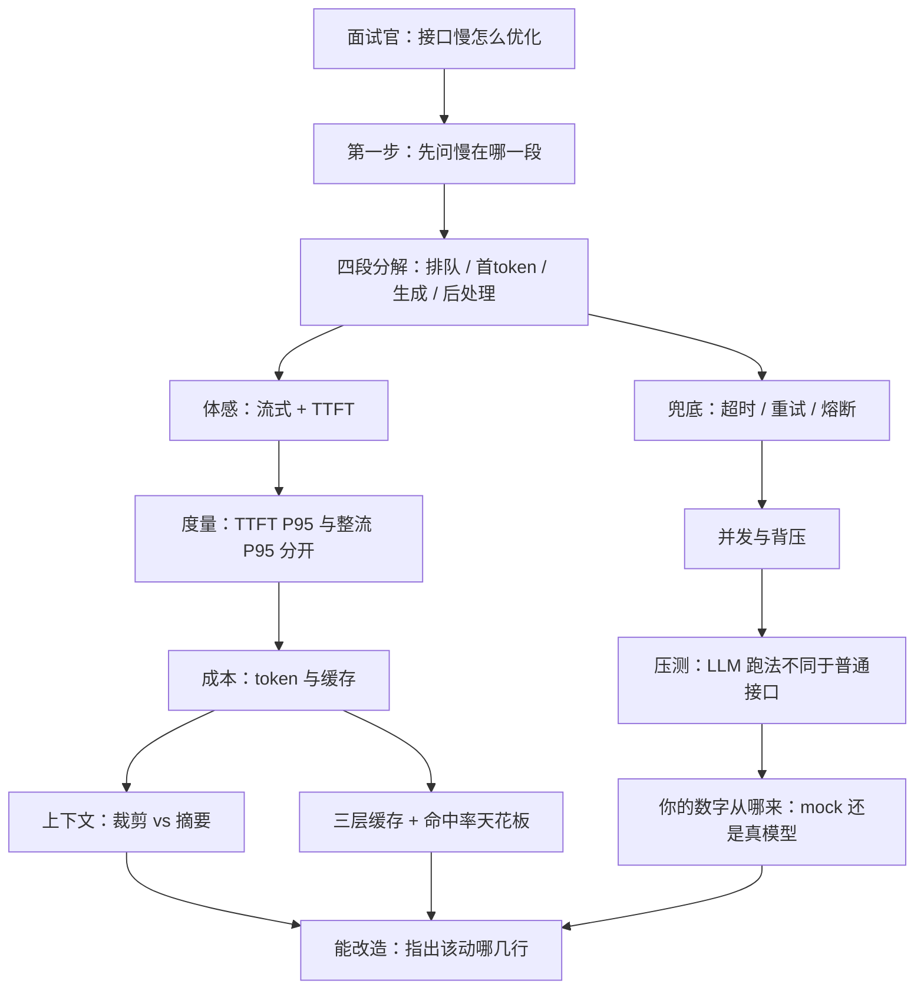
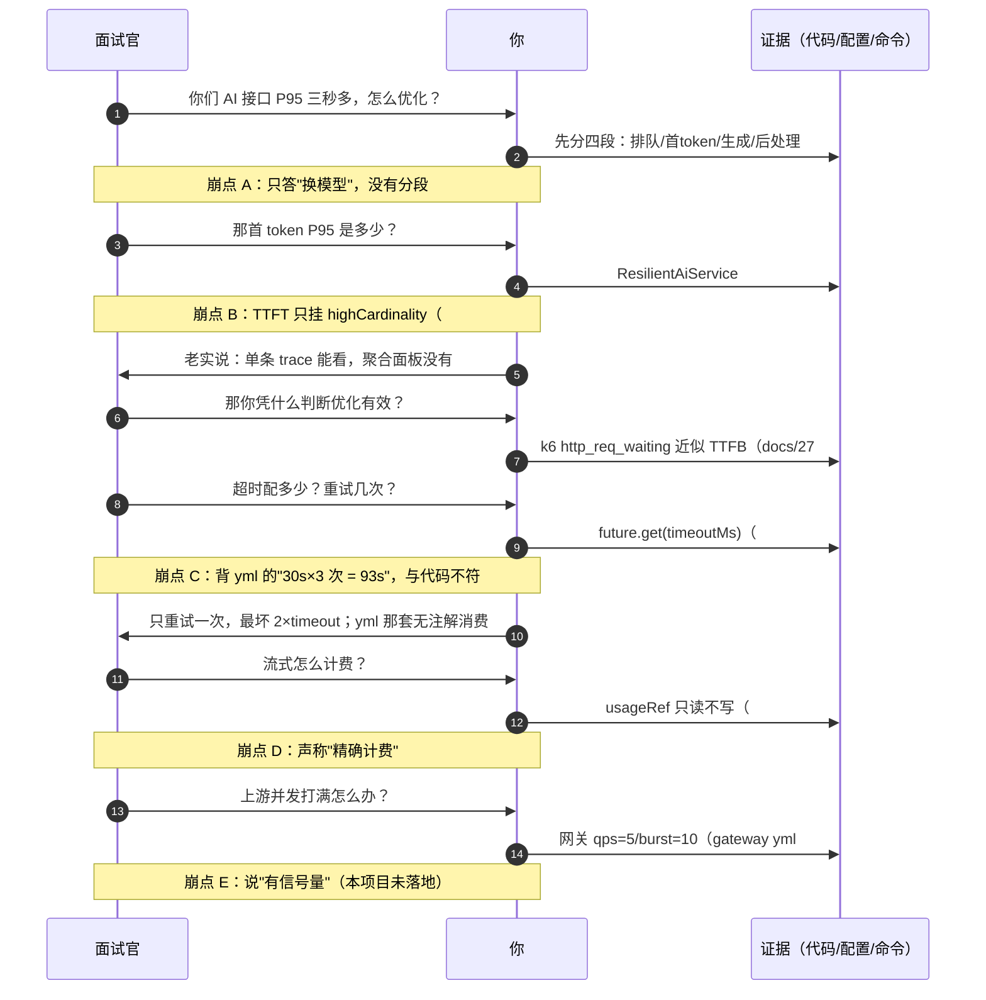

# AI 工程化与性能优化：性能题的正确答案几乎都指向「流式体验」与「首 token 时间」，而不是「换个更快的模型」

> **一句话结论**：AI 接口的"慢"不是一个数字，而是排队 / 首 token / 生成 / 后处理四段之和；能改造的只有你自己的那几段，上游生成速度只能靠路由与降级绕开——所以性能题的得分点全在"你怎么分段、怎么度量、怎么兜底"，不在"换哪个模型"。
> **阅读前置**：读过本目录 `01-AI基础与大模型原理.md`（知道 token / context window / 生成是逐 token 的）与 `03-RAG检索增强生成.md`（知道一次 RAG 请求内部有几段）。本篇不重复这些，只讲"时间花在哪、怎么把它变成可测量可控制的量"。
> **证据基线**：A 级 Spring AI 2.1.0 源码摘录 4 份（`StreamingChatModel` / `Usage` / `MessageWindowChatMemory` / `ChatClientMessageAggregator`）；B 级本项目 21 个真实文件行号（含 3 处"注释或配置与代码不一致"）；C 级 6 段可复现命令输出（powershell 静态统计 + node 纯算术，假设口径全部显式声明）。预计阅读 35 分钟。

| 类别 | 本仓状态 | 本篇怎么处理 |
| --- | --- | --- |
| 流式 API 与 usage 口径 | A 级源码已入库（Spring AI 2.1.0 摘录） | 直接引行号，讲清"框架给到哪、我们用到哪" |
| SSE 桥接 | B 级：`ChatServiceImpl` 手写 Reactive→Servlet 桥接 | 引真实行号 + 贴注释原文，不臆造框架能力 |
| 弹性（超时/重试/熔断） | B 级：yml 三套配置，只有 vision 被注解消费 | 明写"死配置"，给可复现的 grep 证据 |
| 压测数据 | C 级：`docs/27-性能基线报告.md` 实测表全部"待填"，本机无 docker / k6 | 只给"怎么算"和"怎么读"，**不给**任何没跑过的延迟数字 |
| 并发控制（信号量） | **未落地**：全仓没有为模型调用设置的 `Semaphore` | 明确标注"本项目未落地"，并给出该加在哪 |
| 缓存命中率 | **未埋点**：`CacheStatsController` 只有条目数，没有 hit/miss | 只给公式与假设口径，不给"我们命中率 80%" |

---

## 0. 先看现象

### 现象一：被问"接口 3 秒太慢怎么优化"，你答"换个小模型"，面试官下一句就问你哪一段占大头

面试官问：**"你们 AI 对话接口 P95 三秒多，你怎么优化的？"**
你答：**"我们把模型从 32B 换成 8B，快了不少。"**
面试官追问：**"首 token 快了多少？整流时长变了吗？哪一段原来是瓶颈？"**

断点在于：你说不出"哪一段"。本项目的真实调用链是四层套着的——

- 请求进 Servlet → `ChatServiceImpl.chatStreamSse(...)` 先建 `SseEmitter`（`ai-cs-chat/src/main/java/com/aics/chat/service/impl/ChatServiceImpl.java#L513-L525`）；
- 历史超长时先压缩，而压缩是**同步阻塞**的：`resilientAiService.callSummary(...).get()`（同文件 `#L300-L302`）；
- 再去拿 Flux：`Flux<String> flux = futureFlux.get();`（`#L600-L601`），订阅后才真正发请求（`#L646`）；
- 首个 chunk 到达之前的全部时间，就是你嘴上说的"3 秒"。

这四层里，只有第一层和第四层的一点点是你完全可控的；把"换模型"当答案，等于承认自己没做过分段测量。

### 现象二：简历写"流式输出把响应从 8 秒优化到 200 毫秒"，面试官问"总时长变了吗"，你答不上

面试官问：**"你说流式把 8 秒降到 200 毫秒，那总时长呢？"**
你答：**"总时长差不多，就是首 token 快了。"**
面试官：**"那你的首 token P95 是多少？"**

本项目里这个数字**根本不存在于任何聚合指标里**：

```java
// ai-cs-chat/src/main/java/com/aics/chat/service/impl/ResilientAiService.java#L284-L288
.doOnNext(chunk -> {
    if (firstTokenMs.get() < 0) {
        firstTokenMs.set(System.currentTimeMillis() - start);
    }
})
```

```java
// 同文件 #L313-L316：TTFT 只挂在 highCardinality 属性上
.ifPresent(s -> s.highCardinalityKeyValue("firstTokenMs", String.valueOf(firstTokenMs.get())));
```

`highCardinalityKeyValue` 的语义是"只进 trace、不进指标"。这条注释在本项目 `ObservabilityExecutorConfig#L12-L16` 里也印证过同一套思路：可枚举的维度才配做指标维度。结果就是：**TTFT 有值、能看单条 trace、但算不出 P95**。

### 现象三：被问"超时怎么配的"，你背出 yml 里的 30s / 60s / 重试 3 次，面试官一算就问"谁等 93 秒"

面试官问：**"你们模型调用超时多少？重试几次？"**
你答：**"TimeLimiter 30 秒，重试 3 次，指数退避。"**

`ai-cs-chat/src/main/resources/application.yml#L71-L159` 里确实写着这三套东西（`chatService` 30s / `sseChatService` 60s / `visionService` 5s，retry `max-attempts: 3`）。但真正消费它们的注解只有一处：

```powershell
PS> Get-ChildItem -Recurse -Filter *.java ai-cs-chat/src/main/java |
      Select-String -Pattern '@TimeLimiter|@Retry|@CircuitBreaker' |
      ForEach-Object { "$([System.IO.Path]::GetFileName($_.Path))#L$($_.LineNumber): $($_.Line.Trim())" }
Resilience4jConfig.java#L40: // 通过 @TimeLimiter(name = "chatService") / @Retry(name = "chatService") / @CircuitBreaker(name = "chatService")
ChatServiceImpl.java#L121: *                               │       ├── @TimeLimiter         // 超时控制
ChatServiceImpl.java#L122: *                               │       ├── @Retry               // 重试
ChatServiceImpl.java#L123: *                               │       ├── @CircuitBreaker      // 熔断
VisionModelClient.java#L153: @TimeLimiter(name = "visionService", fallbackMethod = "fallbackDescribe")
VisionModelClient.java#L154: @Retry(name = "visionService", fallbackMethod = "fallbackDescribe")
VisionModelClient.java#L155: @CircuitBreaker(name = "visionService", fallbackMethod = "fallbackDescribe")
VisionModelClient.java#L164: // 返回 Future 供 @TimeLimiter 通过 Future.get(timeout) 实现 5s 超时控制
```

怎么读这段输出：`Resilience4jConfig.java#L40` 是**注释**、`ChatServiceImpl.java#L121-L123` 是**javadoc 里的架构图**，两者都不产生任何 AOP 代理。真正被注解消费的只有 `visionService` 一套。所以"chat 走 30s TimeLimiter + 3 次重试"这句话是假的：真实生效的是 `ai-cs-chat/src/main/java/com/aics/chat/service/impl/ResilientAiService.java#L389-L390` 的 `future.get(definition.getTimeoutMs(), ...)` 配 `ai-cs-chat/src/main/java/com/aics/chat/modelrouter/ModelDefinition.java#L24` 的默认 30000ms，以及 `#L356-L367` 的**只重试一次**。

> **这些现象指向同一件事**：AI 性能题考的不是"模型多快"，而是你能不能把一个跨进程、跨栈的等待拆成「可测量、可控制、可降级」的几段，并且知道自己系统的每一段真实取值是多少——包括那些"配置里写了但代码没用"的取值。

---

## 1. 整体地图



> **读图说明**：注意 `A → B` 这条箭头是**唯一的分岔口**——从 `A` 直接跳到 `C`（"上流式"）或直接跳到 `I`（"上缓存"）的人，会被追问"你凭什么选这个"；而走 `B` 的人，后面每条支路都能被验证。另一个关键箭头是 `E → G`：如果 TTFT 和整流时长混在一个指标里（`E` 落在错误的度量口径上），后面 `G` 算出来的成本收益全部失真——这正是 `docs/27-性能基线报告.md#L84-L93` 专门定"指标口径表"的原因。最后 `K → L` 是分水岭：报不出数字又说不清数字来源的人，会在这一步被判定为"简历驱动"。

| 考点 | 考察层级 | 面试官判定信号 |
| --- | --- | --- |
| 延迟四段分解 | 讲机制 | 能说出每段的计时点和本项目对应代码位置，而不是背"网络/模型/数据库" |
| 流式与 TTFT | 会定位 | 明确区分"首 token"与"整流时长"，并知道本项目 TTFT 未入库（`ResilientAiService#L313-L316`） |
| 超时三层 | 会定位 | 说得出真实生效的是哪个值（`ModelDefinition#L24`），并能解释 yml 那套为什么不生效 |
| 重试与幂等 | 讲机制 | 主动提"重试会放大计费"，且知道本项目只重试一次（`#L356-L367`） |
| 并发与背压 | 能改造 | 说得出 SSE 长连接占线程这件事，以及"本项目没有信号量"该加在哪 |
| 缓存层次 | 讲机制 | 区分精确 / 语义 / 向量三级，主动交代"语义命中也要先算 embedding"（`SemanticCacheService#L68`） |
| 上下文治理 | 能改造 | 能算摊销成本，知道本项目摘要走 8B 且失败回退截断（`ChatServiceImpl#L312-L315`） |
| 可观测与压测 | 背结论 + 会定位 | 说得清 P50/P95/P99 各自用来做什么决策，以及 mock 与真模型压测的区别 |

---

## 2. 关键概念与关键类/关键参数

| 名称 | 所在位置 | 一句话准确定义 | 本项目取值 |
| --- | --- | --- | --- |
| TTFT（time to first token，首 token 时延） | `ai-cs-chat/src/main/java/com/aics/chat/service/impl/ResilientAiService.java#L279-L288` | 从发起调用到收到第一个增量 chunk 的时间，决定"用户多久看到第一个字" | 计算了，但只挂 `highCardinalityKeyValue`（`#L313-L316`），**不入库、无 P95** |
| 整流时长 | `ai-cs-chat/src/main/java/com/aics/chat/service/impl/ChatServiceImpl.java#L646` | 从发起到最后一个 chunk 收完的时间，等于用户真正拿到完整答案的时间 | 未单独埋点；压测侧用 k6 `http_req_duration` 近似（`docs/27-性能基线报告.md#L84-L93`） |
| P95 / P99 | `scripts/loadtest/k6/sse-chat.js` | 95% / 99% 的请求落在该值以内；P50 看体感、P95 定阈值、P99 定容量 | 阈值写在脚本里：`http_req_waiting p(95)<2000`、`http_req_duration p(95)<15000` |
| `StreamingChatModel` | `learning-docs/24-源码分析/assets/source/StreamingChatModel.java.md#L29-L38` | Spring AI 的流式模型接口，`stream(Prompt)` 返回 `Flux<ChatResponse>` | 由 `ChatModelRegistry` 构建的 `OpenAiChatModel` 实现，本项目不直接 new 实现类 |
| `Flux`（Reactive Streams 的 0..N 数据流） | `ResilientAiService.java#L275` | 惰性的、订阅后才真正发起请求的异步序列；**一旦发射就不可重放** | `call.call(holder)` 拿到后先不请求，`ChatServiceImpl#L646` 订阅时才真调上游 |
| `SseEmitter` | `ChatServiceImpl.java#L513-L525` | Spring MVC（Servlet 栈）里手写的 SSE 通道，一个 emitter 占一个 Tomcat 工作线程直到 complete | 超时 5 分钟（`#L156`），是兜底不是主控 |
| 每模型超时 | `ai-cs-chat/src/main/java/com/aics/chat/modelrouter/ModelDefinition.java#L24` | 单次模型调用的总时长上限，`CompletableFuture.get(timeout)` 用 | 默认 `30000`；Nacos 里 `siliconflow-qwen3-8b` 是 15000（`tools/nacos-config/ai-cs-chat.yml#L47-L84`） |
| fallback 链 | `ResilientAiService.java#L186-L188` | 主模型失败后按优先级换下一个模型的降级序列 | 只对**非流式**生效；流式失败直接吐 `[ERROR]` 文本（`#L261`、`#L339`） |
| 熔断器 OPEN / HALF_OPEN | `ai-cs-chat/src/main/java/com/aics/chat/modelrouter/ModelHealthRegistry.java#L23-L43` | OPEN=直接不选该模型；HALF_OPEN=放少量请求试探能否恢复 | 每模型独立；COUNT_BASED / 窗口 10 / 最少 3 次 / 失败率 50% / OPEN 30s / 半开放行 3 |
| 令牌桶限流 | `ai-cs-gateway/src/main/resources/application.yml#L45-L48` | 按固定速率补充令牌、桶里有令牌才放行的限流算法，允许短时突发 | 每用户 `qps: 5`、`replenish-rate: 5`、`burst-capacity: 10`，Redis + Lua |
| 语义缓存 | `ai-cs-chat/src/main/java/com/aics/chat/cache/SemanticCacheService.java#L63-L106` | 把问题向量化后与历史问题比相似度，超过阈值就直接返回旧答案 | 阈值 0.92 / 上限 200 条 / TTL 168h；**每次查找先算一次 embedding**（`#L68`） |
| 精确缓存（热门问答） | `ai-cs-chat/src/main/java/com/aics/chat/cache/HotQaCacheService.java#L58-L80` | 归一化问题文本做 hash 精确命中，O(1) | 累计被问 3 次晋级（`promote-threshold: 3`）、TTL 24h |
| L1 / L2 向量缓存 | `ai-cs-chat/src/main/java/com/aics/chat/cache/VectorCacheStore.java#L48-L78` | L1=进程内 LRU，L2=Redis；查 L1 未中查 L2，命中回填 L1 | L1 上限 4096、TTL 168h；淘汰手法与 MyBatis `LruCache` 同源 |
| 缓存 namespace | `ChatServiceImpl.java#L169-L178` | 缓存键的隔离前缀，决定"谁能复用谁的答案" | `knowledgeBase + ":user:" + userId`——**按用户隔离**，因为 RAG 结果过了 ACL |
| 上下文裁剪 / 摘要压缩 | `ChatServiceImpl.java#L262-L317` | 超长历史的两条治理路线：直接丢掉旧消息，或让模型把旧消息写成摘要 | 超过 20 条触发；成功则"摘要 + 最近 10 条"，失败回退纯截断（`#L312-L315`） |
| usage（用量） | `learning-docs/24-源码分析/assets/source/Usage.java.md#L37-L62` | 一次调用的 prompt / completion / total token 计数，计费的唯一依据 | 非流式能拿到（`ResilientAiService#L206-L207`）；**流式恒为 null**（`#L277`、`#L303`） |
| 观测上报线程池 | `ai-cs-chat/src/main/java/com/aics/chat/config/ObservabilityExecutorConfig.java#L27-L59` | 专门跑上报/评测的线程池，防止观测反过来拖死业务 | `usageExecutor` 1/4/队列 1000；`evalExecutor` 1/2/队列 500 |
| 检索段超时 | `tools/nacos-config/ai-cs-chat.yml#L12-L19` | rerank 这一次 HTTP 调用自己的上限，与模型超时是两码事 | `timeout-ms: 5000`，比模型超时小一个量级 |
| 输入输出单价 | `tools/nacos-config/ai-cs-chat.yml#L118-L128` | 每百万 token 的价格，输入与输出分开计价 | deepseek-chat 输入 2.0 / 输出 8.0；qwen3-32b 1.0/2.0；qwen3-8b 0.2/0.6（元/百万） |
| embedding 缓存 | `ai-cs-chat/src/main/java/com/aics/chat/cache/CachingEmbeddingModel.java#L43-L74` | 向量化的进程内缓存：逐条查、miss 的做批量、按原下标回填 | 键带模型名命名空间，换模型旧向量自动失效 |
| 降级档（tier） | `tools/nacos-config/ai-cs-chat.yml#L114-L116` | 配额超限时允许降到哪一档模型 | `over-limit-fallback-tier: cheap`，即降到 8B |
| `StreamingChatModel`（流式模型接口） | `learning-docs/24-源码分析/assets/source/StreamingChatModel.java.md#L29-L49` | 流式模型的最小契约：唯一抽象方法是 `Flux<ChatResponse> stream(Prompt)`，`Flux<String> stream(String)` 只是取 `AssistantMessage.getText()` 的便捷默认方法 | Spring AI 2.1.0；本项目流式最终拿到的就是这条 `Flux<String>` |
| `Usage`（用量元数据） | `learning-docs/24-源码分析/assets/source/Usage.java.md#L37-L68` | 一次请求的 token 用量只读视图：输入 `getPromptTokens()` 与输出 `getCompletionTokens()` 分开，`getTotalTokens()` 是加法默认方法 | 非流式能取到（`ResilientAiService#L206-L207`），流式恒 null |
| `getCacheReadInputTokens()`（提示词缓存命中的输入 token） | `learning-docs/24-源码分析/assets/source/Usage.java.md#L78-L92` | 2.0.0 起新增的默认方法，默认返回 null；非 null 才表示 provider 支持 prompt caching 且这次命中了 | 本项目**未接入**（默认 null），缓存省下的钱在账面上看不见 |
| `MessageWindowChatMemory`（滑动窗口记忆） | `learning-docs/24-源码分析/assets/source/MessageWindowChatMemory.java.md#L42-L50` | 按条数滑窗淘汰旧消息的 `ChatMemory` 实现，`DEFAULT_MAX_MESSAGES = 20`；2.1.0 起 `@Deprecated(forRemoval = true)`，官方指向 session memory 与 compaction | 本项目**没用它**，自己在 `ChatServiceImpl` 里实现 `MAX_HISTORY_SIZE = 20`——同一个数字，不同实现者 |

一句话记住分工：**`StreamingChatModel` 只负责"把 token 一个个吐出来"，`SseEmitter` 负责"把 token 一个个推给浏览器"，`CompletableFuture.get(timeout)` 负责"等不到就放弃"，`ModelHealthRegistry` 负责"连续失败就别再试了"——四件事分属四个组件，答错一个就全错。**

---

## 3. 逐题精讲

### 3.1 接口慢，怎么优化？

**问题**：你们 AI 对话接口 P95 三秒多，怎么优化？

**30 秒答案骨架**：

1. 先把一次请求切成四段：**排队**（等 Tomcat 线程、等配额、等网关令牌）、**首 token**（含 RAG 检索 + 上游 prefill）、**生成**（逐 token）、**后处理**（脱敏、引用构建、用量上报、入库）。
2. 每段单独打点，先看占比再动手；没有分段数据的"优化"都是猜。
3. 本项目可改的是：检索段（两阶段 topK=20 → rerank topN=5，`tools/nacos-config/ai-cs-chat.yml#L22-L25`）、缓存前置（热问 O(1) 命中直接短路）、观测上报移出主路径（`ObservabilityExecutorConfig#L27-L40`）。
4. 不可改的上游生成段，只能靠路由与降级绕开：`summary` / `intent` / `rewrite` 走 8B（`tools/nacos-config/ai-cs-chat.yml#L85-L113`），主力对话走 deepseek-chat。
5. 最关键的一条：把"总时长"换成"首 token + 整流"两个指标，因为用户感知的是前者。

**深挖追问**：

- **排队段你怎么测？** 从请求进入 Servlet 到业务方法第一行的时间差。本项目没埋这个点（诚实说未埋）；压测时可用 k6 的 `http_req_sending` 到 `http_req_waiting` 的间隔近似。容量侧的天花板是 Tomcat 默认 200 工作线程（`ObservabilityExecutorConfig#L12-L16` 注释里写死了这个前提）。
- **RAG 检索能吃掉多少首 token？** 两阶段：向量召回 topK=20 阈值 0.3，再 rerank 取 topN=5 且 minScore 0.7，rerank 自身超时 5000ms（`tools/nacos-config/ai-cs-chat.yml#L12-L19`）。也就是说**最坏情况下检索段单独就能吃掉首 token 的绝大部分**，这还没算 embedding 那一次调用。
- **后处理能不能移出关键路径？** 能，而且本项目已经做了一半：用量上报是 `usageExecutor.execute(...)` 异步（`ai-cs-chat/src/main/java/com/aics/chat/observability/ModelUsageRecorder.java#L106-L114`）。但反例也在同一层：历史压缩是 `callSummary(...).get()` 同步（`ChatServiceImpl#L300-L302`），把一次完整上游调用压进了关键路径。
- **为什么不能说"加机器"？** 因为瓶颈不在你机器上。加机器只改善排队段，而排队段通常不是最大项。

**常见错误答案**：

- ❌"换个更快的模型就好了"——错在把四段问题默认成一段，且换模型通常同时降低质量，面试官立刻会问"质量掉了怎么补"。
- ❌"我们接口平均 1.2 秒，P95 1.5 秒，达标"——错在只报数不报分段，无法回答"这 1.2 秒花在哪"。
- ❌"并发不够就加线程池"——错在 AI 链路的瓶颈是**等待上游**，线程池只是把更多请求同时挂在等待上，容易把上游打限流。

### 3.2 流式为什么改善体感，却不减少总时长？

**问题**：上了流式以后，响应真的变快了吗？

**30 秒答案骨架**：

1. 流式不减少工作量：token 总数不变，上游生成总时间不变，**总时长几乎不变**。
2. 它改变的是"等待的形状"：把"空白等 8 秒"变成"300 毫秒见到第一个字、之后持续有内容"。
3. 本项目是 Spring MVC（Servlet 栈），不能把 `Flux` 直接渲染成 SSE，必须手动桥接：`SseEmitter` + `flux.subscribe(onNext, onError, onComplete)`（`ChatServiceImpl#L603-L646`，注释原文写明了这条约束）。
4. 因此度量必须拆开：TTFT 一个指标、整流时长一个指标，混着报就是自欺。
5. 流式有代价：连接占用时间变长（一个 emitter 占一个线程直到 complete）、流式 usage 拿不到（`ResilientAiService#L277`、`#L303`）、失败后不可重放所以不能重试（`#L59-L62` 的设计说明）。

Spring AI 侧的契约其实只有这么几行，"流式"在框架层面的全部含义都在这里：

```java
(src: StreamingChatModel.java.md#L29-L49)
@FunctionalInterface
public interface StreamingChatModel extends StreamingModel<Prompt, ChatResponse> {

	default Flux<String> stream(String message) {
		Prompt prompt = new Prompt(message);
		return stream(prompt).map(response -> Optional.ofNullable(response.getResult())
			.map(Generation::getOutput)
			.map(AssistantMessage::getText)
			.orElse(""));
	}

	default Flux<String> stream(Message... messages) {
		Prompt prompt = new Prompt(Arrays.asList(messages));
		return stream(prompt).map(response -> Optional.ofNullable(response.getResult())
			.map(Generation::getOutput)
			.map(AssistantMessage::getText)
			.orElse(""));
	}

	@Override
	Flux<ChatResponse> stream(Prompt prompt);

}
```

读这三件事：①抽象方法只有一个，返回 `Flux<ChatResponse>`，**没有 callback、没有 completion 钩子**——所以"生成完了通知我"要靠 `doFinally` 自己接（`ResilientAiService#L292`）；②`Flux<String>` 那层只是把每个 chunk 的 `AssistantMessage.getText()` 抠出来，所以拿不到 usage 是**结构性的**，不是本项目写漏了（要拿得下潜到 `ChatResponse` 的 metadata）；③`Flux` 是 lazy 的，`stream()` 返回时上游还没开始生成，真正发请求是 `subscribe` 那一刻（本项目在 `ChatServiceImpl#L646`）。

**深挖追问**：

- **什么情况流式是假的？** 上游一次性返回完整答案、我们再切片下发时，TTFT 完全没有改善，只是把一次性停顿切成了密集小停顿。本项目不是这种情况：`Flux<String> flux = call.call(holder)`（`ResilientAiService#L275`）直接来自上游模型的流式响应，`ChatServiceImpl#L646` 订阅后才真正发起请求。
- **那总时长有没有可能变短？** 有可能，但机制不是"流式"，而是"流式让超时与取消更早生效"：首 token 超时能更快放弃一个已经卡死的上游。真正减少总时长的只有减少 token 数（裁剪上下文、缩短输出上限）或换更快的上游。
- **流式为什么不能重试？** Flux 一旦开始发射就不可重放（`ResilientAiService#L59-L62` 的设计要点原话）。所以本项目流式分支主模型失败**不降级**，只发一条 `[ERROR]` 文本（`#L261`、`#L339`），而 `ChatServiceImpl#L670-L685` 收到 `[ERROR]` 前缀后发 `{"error": ...}` 事件并 `complete()`——用正常结束而不是 `completeWithError`，因为降级是预期行为，不是异常。
- **流式拿不到 usage 是框架限制吗？** 不是，是**本项目没接上**。`Usage` 接口本身完整（`learning-docs/24-源码分析/assets/source/Usage.java.md#L37-L62`），Spring AI 也提供了把流聚合回单个响应的工具（`ChatClientMessageAggregator.java.md#L40-L55`）。本项目 L277 声明了 `AtomicReference<Usage> usageRef`、L303 读它，但**全文件没有一处 `usageRef.set(...)`**：

  ```powershell
  PS> Select-String -Path ai-cs-chat/src/main/java/com/aics/chat/service/impl/ResilientAiService.java -Pattern 'usageRef' |
        ForEach-Object { "L$($_.LineNumber): $($_.Line.Trim())" }
  L277: AtomicReference<Usage> usageRef = new AtomicReference<>();      // 流式场景里 Usage 只能在最后一个 chunk 里拿到，用 AtomicReference 跨 reactive 管道传递
  L303: Usage usage = usageRef.get();
  ```

  两行输出说明一切：声明了、读了、**没写过**。于是 `ModelUsageRecorder` 收到 null 后走 `#L91-L95` 的 null→0，并把 `#L100` 的 `setEstimated(true)` 打开——账目是估算的。

**常见错误答案**：

- ❌"流式把响应时间从 8 秒优化到 200 毫秒"——错在把 TTFT 当成响应时间，总时长根本没动。
- ❌"流式就是用 WebFlux"——错在本项目是 Spring MVC，桥接是手写的，这个区别面试官一问便知。
- ❌"流式实现很简单，调个 API 就行"——错在忽略了 complete / onTimeout / onError 三条收尾路径都要走（`ChatServiceImpl#L796-L804`、`#L829-L835`），漏一条就是连接泄漏。

### 3.3 超时应该分几层？超时之后怎么办？

**问题**：模型调用的超时你怎么配的？超时了怎么处理？

**30 秒答案骨架**：

1. 概念上要分三层：**连接超时**（TCP/TLS 建连）、**首 token 超时**（等上游第一帧）、**总时长超时**（整次调用上限）。
2. 本项目现状要诚实：真正生效的只有"总时长"——`future.get(holder.getDefinition().getTimeoutMs(), MILLISECONDS)`（`ResilientAiService#L389-L390`），取值来自 `ModelDefinition#L24` 默认 30000，Nacos 里 8B 模型 15000。
3. 连接层没有显式设置：`OpenAIOkHttpClient.builder().baseUrl(...).apiKey(...).build()`（`ai-cs-chat/src/main/java/com/aics/chat/modelrouter/ChatModelRegistry.java#L60-L63`）没配 connect/read timeout，走客户端默认。
4. 超时后：`future.cancel(true)` 中断挂起的 HTTP（`#L392`）→ 非流式降级到下一个模型 → 全失败返回兜底文案（`#L451-L456`，SUMMARY 场景返回空串）；流式直接吐 `[ERROR]`。
5. `SseEmitter` 的 5 分钟（`ChatServiceImpl#L156`）是**兜底**不是主控，注释写得很清楚：与上层超时配合、上层先触发、Emitter 兜底。

"超时到底卡在哪一行"这件事，看一段代码就够（`ResilientAiService#L378-L405`，省略号处是异常解包细节）：

```java
private ChatResponse timedCall(CircuitBreaker breaker, ModelClientHolder holder, NonStreamCall call) throws Exception {
    return breaker.executeCallable(() -> {
        CompletableFuture<ChatResponse> future = CompletableFuture.supplyAsync(() -> {
            ...
        });
        try {
            return future.get(holder.getDefinition().getTimeoutMs(), TimeUnit.MILLISECONDS);
        } catch (TimeoutException e) {
            future.cancel(true);
            throw e;
        } catch (ExecutionException | CompletionException e) {
            ...
        }
    });
}
```

读这段要看出三件事：①超时值是**每个模型自己的** `getTimeoutMs()`，不是一个全局常量；②熔断器把整个调用包住（`breaker.executeCallable`），所以"熔断"和"超时"是同一层；③`future.cancel(true)` 是唯一能真正释放挂起 HTTP 连接的动作。

**深挖追问**：

- **为什么不用 Resilience4j 的 TimeLimiter？** 因为 TimeLimiter 要求方法返回 `CompletionStage`/`Future` 并配线程池，而本项目已经把"异步 + 取超时"写在 `timedCall` 里了，注释原话是"用 `CompletableFuture.get(timeout)` 而非 HTTP 层超时"（`#L374`）。代价是三个：跑在 `ForkJoinPool.commonPool`（`#L382` 未指定线程池）、只有"总时长"一档、连接层不受控。
- **两个超时值打架怎么办？** 当前真实关系是 `ModelDefinition.timeoutMs`(30s) < `SSE_EMITTER_TIMEOUT`(5min)，所以正常路径一定是上游先超时、emitter 后收尾。如果反过来（emitter 先超时），`ChatServiceImpl#L696-L702` 的 `emitter.send` 会抛异常，日志是"SSE发送失败"，而 Flux 订阅不会中断——完整回复仍会入库。
- **超时了上游还在生成，钱还收吗？** 收。请求已经发给 provider，`cancel(true)` 只是本地不再等，token 已经产生。这条必须主动说，否则会被认为不懂成本。
- **首 token 超时为什么单独需要？** 因为"总时长 30s"无法区分"上游 25s 才开始吐字然后飞快吐完"和"上游立刻吐字吐了 25s"。前者用户已经走了，后者用户很满意，而总时长一样。

**常见错误答案**：

- ❌"我们 TimeLimiter 30 秒 + 重试 3 次，最坏 30×3+1+2 = 93 秒"——错在照抄 `docs/27-性能基线报告.md#L127-L136`。那份表与代码不符：yml 的 `chatService` 那套没有任何注解消费，真实是**只重试一次**（`ResilientAiService#L356-L367`），最坏 2×timeoutMs。
- ❌"超时时间配长一点更安全"——错在长超时会把线程和连接一起占住，上游抖动时雪崩。
- ❌"超时就是抛异常返回 500"——错在 AI 场景里超时是常态，应该降级出一个可读的兜底文案（`#L451-L456`）而不是把错误抛给前端。

### 3.4 重试的正确姿势：什么能重试、什么不能，重复计费怎么算？

**问题**：模型调用失败了要不要重试？重试几次？

**30 秒答案骨架**：

1. 先分类：**瞬时故障**（连接重置、读超时、`SocketTimeoutException`）可重试，**业务故障**（参数错、配额超限、内容拦截）不可重试。
2. 本项目按这个分类写了 catch 白名单：`ResourceAccessException | SocketTimeoutException | TimeoutException`，其它一律不重试（`ResilientAiService#L356-L367`）。
3. **只重试一次**，注释原话："模型调用成本高，多次重试会放大下游压力和费用"（同段）。
4. 幂等要分两层看：调用本身无副作用（chat 不改状态），但**计费不幂等**——每重试一次就多烧一次 token，且超时那次通常已经产生了输入费用。
5. 流式不重试（Flux 不可重放）；重试必须让熔断器看见，否则熔断统计失真——本项目失败路径都走 `breaker.onError(...)`（`#L296-L302`、`#L335`）。

"只重试一次"在代码里长这样（`ResilientAiService#L356-L367`）：

```java
private ChatResponse callWithTransientRetry(ModelClientHolder holder, NonStreamCall call) throws Exception {
    CircuitBreaker breaker = healthRegistry.breaker(holder.getDefinition().getId());
    try {
        return timedCall(breaker, holder, call);
    } catch (ResourceAccessException | SocketTimeoutException | TimeoutException e) {
        log.warn("模型瞬时故障，重试一次: modelId={}, err={}",
                holder.getDefinition().getId(), e.getMessage());
        return timedCall(breaker, holder, call);
    }
}
```

注意 `catch` 后的第二次调用**没有 for 循环、没有退避、没有再次 try**——第三次失败会直接抛出去，由上层 `invokeNonStream` 决定换下一个模型。这就是"最坏 2×timeoutMs"的来源，也是"为什么不是 93 秒"的答案。

**深挖追问**：

- **一次用户请求会给熔断器贡献几次失败？** 最多 2 次（首次 + 一次重试）。熔断窗口是 10 次调用、最少 3 次、失败率 50%（`ModelHealthRegistry#L34-L43`），所以**连续 3 个请求全失败就能把该模型打到 OPEN**，30 秒内不再选它。这个数字要能当场算出来。
- **重试会不会和事务打架？** 会。若把模型调用包进事务，重试会拉长事务、连接池被占，回滚时还可能"已付费未落库"。本项目全仓 `@Transactional` 只有 8 处，chat 的模型调用链路里没有——这是有意的，要能说清为什么。
- **重试要不要退避？** 要，且要有预算上限（总耗时不能超过前端的等待上限）。本项目用"固定只重试一次"这种最保守的预算策略；yml 里的 `multiplier: 2` 属于死配置，不能当答案讲。
- **遇到上游 429 怎么办？** 本项目的 catch 白名单不包含 429（它是业务异常），所以**不重试**——这在语义上是对的（重试只会更糟），正确做法是退避 + 换模型 + 降级到 cheaper tier（`tools/nacos-config/ai-cs-chat.yml#L114-L116` 的 over-limit 策略）。

**常见错误答案**：

- ❌"失败重试 3 次，指数退避，1s/2s/4s"——念 yml 的结果，与代码不符；而且没算"3 次重试把一次请求拉到 4×timeout"。
- ❌"重试是免费的，反正失败了"——错在忽略计费与上游配额。
- ❌"所有异常都重试最稳"——错在参数错误重试一万次也不会成功，只会放大日志和费用。

### 3.5 并发控制：信号量、线程池与背压

**问题**：上游模型有并发限制，你们怎么控制并发、怎么防止把上游打挂？

**30 秒答案骨架**：

1. 分三层控制：**入口**（网关令牌桶 + 业务配额）、**服务内**（线程池/信号量）、**上游**（provider 侧的并发配额与 429）。
2. 本项目入口是有的：网关每用户令牌桶 `qps: 5` / `burst-capacity: 10`（`ai-cs-gateway/src/main/resources/application.yml#L45-L48`），模型路由前还有配额检查（`ResilientAiService#L417-L427`），超配额降级到 cheap tier。
3. 服务内**没有**为模型调用设信号量——这是本项目未落地的一块，要敢承认，并说清该加在哪：`timedCall` 外层按 provider 设 `Semaphore`（或 `Bulkhead`），permits 取上游并发上限。
4. 真正的并发天花板不是 CPU，而是**长连接 × 流时长**：一个 SSE 连接占一个 Tomcat 工作线程直到 `complete()`，200 个默认线程意味着"20 个并发流"就吃掉 10%。
5. 观测上报必须隔离线程池，否则"观测把业务观测死"：`usageExecutor` 1/4/队列 1000（`ObservabilityExecutorConfig#L27-L40`，注释就是这个意思）。

容量估算不要凭感觉，用 Little 定律（并发 = 到达率 × 平均驻留时间）算一遍就有数了。下表按"普通接口单次 200ms、流式整流 15s"两种口径对比，用来说明为什么流式必须单独算容量：

| 场景 | 到达率 | 平均驻留时间 | 所需并发线程 | 占 200 线程池比例 |
| --- | --- | --- | --- | --- |
| 普通接口 | 100 req/s | 0.2 s | 20 | 10% |
| 流式（整流 15s） | 2 req/s | 15 s | 30 | 15% |
| 流式（整流 15s） | 5 req/s | 15 s | 75 | 37.5% |
| 流式（整流 40s，长回答） | 5 req/s | 40 s | 200 | 100% |

这张表是**算术推演不是实测**：它想说明的是"流式下吞吐不再由 QPS 决定，而由连接驻留时间决定"——同样是 100 个用户，普通接口只占 20 个线程，流式长回答能直接把 200 个线程占满。

**深挖追问**：

- **并发上限怎么算？** 用 Little 定律：并发 ≈ 到达率 × 平均驻留时间。若整流平均 15 秒、目标是 20 并发流，那就是 20 个线程被占着，加上普通接口的水位，200 线程的池子很快就紧张——所以流式场景要单独算容量，不能沿用普通接口的"单次 200ms"口径。
- **背压（backpressure，下游消费不过来时向上游反压）在这里是什么形态？** `Flux.subscribe(onNext, onError, onComplete)`（`ChatServiceImpl#L646`）没有 `request(n)` 控制，onNext 里直接 `emitter.send(...)`（`#L695`）。客户端网络慢时 `send` 阻塞，而 onNext 是串行回调（`#L636-L637` 注释说明 `StringBuilder` 因此无线程安全问题）——于是**慢客户端会把上游那条流的消费速度拖住**。这是本项目真实的背压缺口。
- **为什么不干脆上 WebFlux？** 那是架构级改造，要重写整条链路；本项目的取舍是"Spring MVC + 手写桥接"（`#L603-L643` 注释），好处是复用现有同步栈（鉴权、拦截器、事务），坏处就是上面说的背压与线程占用。
- **限流键为什么按用户而不是按 IP？** 按 IP 会误伤 NAT 后的整栋楼；按用户才能对上"每用户 5 QPS"的语义。这也是 `docs/27-性能基线报告.md#L267-L273` 把"限流键维度"列为已知风险的原因。

**常见错误答案**：

- ❌"我们用了 WebFlux，能扛十万并发"——错在把框架当容量。
- ❌"加个线程池就行"——错在不区分"等 IO"和"算 CPU"；对 AI 链路来说线程越多，挂在上游的请求越多。
- ❌"上游限流了我们重试就好"——错在 429 重试只会加重限流。

### 3.6 缓存层次与失效策略

**问题**：AI 场景怎么加缓存？缓存什么时候必须失效？

**30 秒答案骨架**：

1. 三级，按成本升序串联：**热问精确缓存**（归一化文本 hash，O(1)）→ **语义缓存**（向量相似度）→ **完整 RAG 链路**。本项目 `application.yml#L170-L171` 的注释就是这条顺序，`HotQaCacheService#L35-L36` 说明它与 CPU 的 L1→L2→内存分级同源。
2. 参数：热问 `promote-threshold: 3` / TTL 24h；语义 `threshold: 0.92` / 上限 200 条 / TTL 168h；向量缓存 L1 进程内 4096 条 + L2 Redis 168h（`application.yml#L177-L193`）。
3. 失效有三条腿：**TTL** 到期、**容量淘汰**（语义缓存按最近命中的 ZSET 分数删到上限，`SemanticCacheService#L143-L157`；L1 用 `LinkedHashMap(accessOrder=true)` + `removeEldestEntry`，`VectorCacheStore#L48-L54`）、**namespace 隔离**。
4. 必须按用户隔离：缓存键是 `knowledgeBase + ":user:" + userId`（`ChatServiceImpl#L169-L178`），否则会把 A 用户过了 ACL 的答案给 B 用户。
5. 成本要诚实：语义缓存**命中也要先算一次 embedding**（`SemanticCacheService#L68`），所以"命中≈零成本"是错的；而且命中率本项目**没有埋点**（`ai-cs-chat/src/main/java/com/aics/chat/controller/CacheStatsController.java#L36-L54` 只返回条目数，没有 hit/miss 计数器）。

**深挖追问**：

- **语义缓存命中一次到底省了什么？** 省了整条 RAG + 一次大模型生成；但没省那次 embedding，也没省"把 200 条向量从 Redis 拉回来 + 200 次点积"（`#L69`、`#L76-L87`）。类注释 `#L37-L38` 明确说 n≤200 时这叫"微秒级可接受"，上万条就该换 HNSW 索引了——这句话是"何时该换方案"的标准答案。
- **知识库更新后旧答案怎么办？** 本项目**没有版本化失效**：只能等 TTL 168 小时自然过期，或者重启/清 Redis。这是真实缺陷，面试官问"你怎么保证答案新鲜"时必须承认，并给出改法（缓存键带知识库版本号/文档更新时间戳）。
- **命中率大概多少？** 本项目未埋点、未实测。只能给结构上的天花板：因为 namespace 含 userId，跨用户完全不共享——假设每个用户自己的重复提问率是 20%，那么隔离后全局命中率恒为 20%，而如果跨用户共享则 10 个用户时能到 89.3%（C 级计算，见 §9 练习 3）。所以"命中率上不去"往往不是缓存实现的问题，是缓存键设计的问题。
- **为什么阈值定 0.92 这么高？** 客服问答里"退款怎么操作"和"退款多久到账"向量很近但答案不同，阈值低就会答错。高阈值换的是精确率，代价是命中率。

**常见错误答案**：

- ❌"加 Redis 缓存就好了"——错在没区分精确/语义/检索三层，也没说失效。
- ❌"语义缓存命中了就没有成本"——错在 embedding 那一次调用是省不掉的。
- ❌"把所有用户的问答放一起共享，命中率最高"——错在会绕过 ACL，`ChatServiceImpl#L169-L178` 的注释就是为这条踩坑写的。

### 3.7 上下文裁剪与摘要压缩：成本收益怎么算？

**问题**：会话历史长了怎么办？裁剪还是摘要？

**30 秒答案骨架**：

1. 两条路线：**硬截断**（丢掉旧消息，零额外成本、丢信息）与**摘要压缩**（让模型把旧消息写成一段摘要，保信息、要一次额外调用）。
2. 本项目是混合策略：历史超过 `MAX_HISTORY_SIZE = 20` 触发（`ChatServiceImpl#L150`、`#L341-L342`），保留最近 `KEEP_RECENT_SIZE = 10` 条（`#L153`），把更早的消息交给 `summary` 提示词压缩成一段 `SystemMessage`（`#L294-L311`）；**压缩失败则回退纯截断**（`#L312-L315`）。
3. 成本要算三份账：稳态每轮输入、单次压缩成本、摊销周期。按公开假设口径算出来（C 级，脚本可复现）：截断留 10 条 = 1580 token/轮，摘要 + 10 条 = 1730 token/轮，不压缩带满 20 条 = 2730 token/轮。
4. 结论反直觉：**如果目标只是"控制长度"，摘要比截断更贵**（+433 token/轮）；摘要真正省钱的场景是"你想覆盖比 20 条更长的历史"——相对带满 20 条它省 26.3%。所以摘要买的是"信息量"，不是"省钱"。
5. 延迟代价必须说：压缩那一次是同步 `.get()`（`#L300-L302`），走 `summary` 场景即 8B 模型（`tools/nacos-config/ai-cs-chat.yml#L85-L113`，timeout 15000），最坏给这一轮额外加一次完整上游调用。

下面这段是"两条路线怎么合流"的全部逻辑（`ChatServiceImpl#L278-L316`，省略号处是提示词渲染与链路追踪）：

```java
private List<Message> compressHistory(List<Message> history) {
    int splitIndex = history.size() - KEEP_RECENT_SIZE;
    List<Message> oldMessages = history.subList(0, splitIndex);
    List<Message> recentMessages = new ArrayList<>(history.subList(splitIndex, history.size()));
    ...
    try {
        ...
        String summary = resilientAiService.callSummary(ModelScenario.SUMMARY,
                new Prompt(summaryRp.text())
        ).get();
        ...
        List<Message> compressed = new ArrayList<>();
        compressed.add(new SystemMessage("以下是之前对话的摘要，请参考：\n" + summary));
        compressed.addAll(recentMessages);
        return compressed;
    } catch (Exception e) {
        log.warn("会话压缩失败，回退为截断模式", e);
        return recentMessages;
    }
}
```

读三点：①`splitIndex` 由 `KEEP_RECENT_SIZE` 决定，改这个常量就等于改摊销系数；②`.get()` 让异步 API 退化成同步等待，这是延迟代价的物理位置；③`catch` 的兜底和"截断方案"是同一份代码——所以**"摘要失败"在用户侧是完全无感的**，只在日志里留一条 warn。

**深挖追问**：

- **为什么不干脆带满 20 条？** 窗口是够的：20 条约 2300 token，占 deepseek 65536 上下文的 3.5%（C 级计算）。所以限制不是窗口，是**每轮 token 费用**和**首 token 延迟**。这一点能答出来，说明你不是在做"防溢出"，而是在做"单位经济"。
- **摘要会不会丢关键信息？** 会。摘要用小模型、单轮 prompt、无对照校验；而且失败时静默回退截断只 warn 一条日志（`#L312-L315`）。评测侧也没有覆盖：`aics.eval.gate` 的阈值全是 null，20 条 golden 集不测"长会话摘要"这条路径。
- **为什么不用 Spring AI 自带的窗口记忆？** 可以用，但要讲版本：`MessageWindowChatMemory` 在 2.1.0 已被标记废弃（`learning-docs/24-源码分析/assets/source/MessageWindowChatMemory.java.md#L42-L46`），官方建议改用 session 模块的 `EventFilter.lastN` 做窗口、用 compaction 替代淘汰；它默认上限也正好是 20（`#L50`）。本项目选择自己在 `ChatServiceImpl` 里做，好处是能把"摘要"塞进同一套提示词注册表，坏处是与框架演进脱节。
- **压缩周期怎么定的？** 触发时压 11 条、留 10 条，之后每轮 +2 条，回到 21 条需要 5 轮（C 级推导）——所以是"每 5 轮压一次"。这个周期直接决定摊销系数，改 `KEEP_RECENT_SIZE` 就是在改摊销。

**常见错误答案**：

- ❌"摘要一定省钱"——错在不算摊销；本项目口径下，对"只留 10 条"这个基线它是**更贵**的。
- ❌"历史全带上，反正窗口很大"——错在忽略每轮都付一次这笔钱。
- ❌"摘要用大模型效果更好"——错在忽略它会被放进关键路径（同步 `.get()`），压缩质量提升换的是用户多等一次。

### 3.8 可观测指标与压测：LLM 场景和普通接口到底差在哪？

**问题**：这些性能问题你怎么观测？压测怎么做？

**30 秒答案骨架**：

1. 四类指标分开建：**业务**（成功率、降级率）、**延迟**（TTFT / 整流 / P50/P95/P99）、**成本**（token/次、token/s、缓存命中率）、**上游**（每模型成功率、熔断状态、配额）。
2. 维度要分高低基数：`provider` / `model` 这种可枚举的才配当指标维度，`scenario` / `routeReason` / `fallbackFrom` / `attempt` 只进 trace（`ResilientAiService#L466-L480` 就是这么分的）。
3. 本项目现状要有缺口意识：TTFT 只在 span 上（`#L313-L316`），所以面板里没有首 token P95；模型用量是异步上报且流式场景标记为估算（`ModelUsageRecorder#L100`）。
4. 压测不能照搬固定 RPS：上游有排队与配额，必须 ramp 虚拟用户（VU）并看 TTFT 分位。本项目脚本是 `ramping-vus` 从 1 到 20、保持 1 分钟（`scripts/loadtest/k6/sse-chat.js`）。
5. 口径必须先钉死：k6 的 HTTP 模块要等整流读完才回调，所以 `http_req_waiting` 只能**近似**首 token（TTFB），逐帧指标需要 `xk6-sse` 扩展——这条写在脚本注释里，也是 `docs/27-性能基线报告.md#L84-L93` 定指标口径的原因。

**深挖追问**：

- **P50 / P95 / P99 分别用来干什么？** P50 代表体感（大多数人遇到的情况），P95 用来定超时阈值与告警线，P99 用来定线程池与连接池容量（尾部请求决定你需要留多少余量）。只报平均值等于放弃尾部。
- **为什么说"LLM 压测 ≠ 普通接口压测"？** 三个原因：①响应时长随输出长度线性变化，同一接口的耗时方差天然大；②上游有并发配额和排队，压测压力会直接传导成 429 与超时；③流式响应下"请求完成"的判定标准变了，普通接口看 `http_req_duration` 就够，流式必须同时看首 token 与整流。
- **用 mock 模型压出来的数字能用吗？** 不能当"真实性能"用。`docs/27-性能基线报告.md#L246-L253` 的红线写得很直白：不许写"首 token 200ms（没区分 mock 与真实模型）"、不许写"支撑百万级 QPS"。mock 压测只能验证"你自己的那段代码"（连接、桥接、序列化），不能验证模型延迟。
- **你们的压测结果表为什么是空的？** 因为本机没有 docker、没有 k6、中间件端口一个都没监听（`docs/27-性能基线报告.md#L25-L34` 的环境审计原文），所以 `#L196-L232` 的实测表全部留了 `待填`。这比填假数字有说服力——面试官问到这里，你要主动说"我只测了自己能测的那段"。

**常见错误答案**：

- ❌"我们平均 1.2 秒，性能很好"——错在只看均值。
- ❌"用 JMeter 打一万并发"——错在没考虑上游配额，压力全变成 429。
- ❌"流式接口用 `http_req_duration` 看首 token"——错在指标语义错位，那测的是整流时长。

### 3.9 成本题：一次对话多少钱，怎么把它降一半？

**问题**：这套 AI 对话一次大概花多少钱？你会从哪儿降成本？

**30 秒答案骨架**：

1. 成本公式只有一条：`输入 token × 输入单价 + 输出 token × 输出单价`，**输入与输出的单价是不同的**，输出通常贵 3~4 倍。
2. 单价不要背通用价格，取项目里的价格表：`tools/nacos-config/ai-cs-chat.yml#L118-L128` 写的是元/百万 token，deepseek-chat 2.0 / 8.0，qwen3-32b 1.0 / 2.0，qwen3-8b 0.2 / 0.6。
3. 结构性省钱先做在**路由**上：chat / rag / agent / nl2sql / judge 走 deepseek，summary / intent / rewrite / chart 走 8B（`#L85-L113`），配额超限再降一档到 cheap tier（`#L114-L116`）。
4. 剩下的按性价比排序：①缓存命中（直接少一次生成）②上下文治理（每轮都省一点）③输出长度上限（`max-tokens: 2048`，`#L6-L9`）。
5. 成本报表要带"估算"标记：流式 usage 拿不到，上报里 `estimated=true`（`ModelUsageRecorder#L100`），所以它是量级参考，不是财务账单。

**深挖追问**：

- **缓存能省多少钱？** 可以算，前提是先声明假设。按"一次 RAG 全链路 prompt 3000 token + 生成 400 token"算：

  ```text
  单次全链路 = (3000 × 2.0 + 400 × 8.0) / 1_000_000 × 1000 = 9.200 元 / 千次
  ```

  | 命中率 | 成本（元/千次） | 相对不缓存 | 平均延迟（假设全链路 3000ms、语义命中 120ms、热问命中 8ms） |
  | --- | --- | --- | --- |
  | 0% | 9.200 | — | 3000 ms |
  | 30% | 6.440 | -30.0% | 2136 ms |
  | 50% | 4.600 | -50.0% | 1560 ms |
  | 70% | 2.760 | -70.0% | 984 ms |
  | 90% | 0.920 | -90.0% | 408 ms |

  这张表是 C 级纯算术（假设口径写在表头，与 `learning-docs/tools/_perf-calc.mjs` 一致），**不是实测**。它的价值在于把"加缓存"从口号变成"命中率每提高 10 个点，成本降多少、延迟降多少"的可核对关系。
- **命中率上不去怎么办？** 先看结构而不是看实现：缓存键带 `userId`（`ChatServiceImpl#L169-L178`）意味着跨用户零复用，天花板就是单用户重复率。要动这个天花板，只能先解决 ACL 一致性，而不是换缓存组件。
- **降档降的是什么，风险在哪？** 降到 cheap tier 就是换 qwen3-8b，质量会降；而本项目的质量门禁 `aics.eval.gate` 阈值全是 null、CI 也只跑 python 那一条，所以**降档目前没有自动化的质量兜底**。这条要主动说，它能同时证明你懂成本也懂风险。
- **成本题最容易错在哪？** 把输入与输出混用一个单价。输出的单价通常是输入的 3~4 倍（8.0 vs 2.0），而输出 token 又由 `max-tokens` 与回答风格决定——所以"少说废话"在成本上是有效手段。

**常见错误答案**：

- ❌"用 GPT-4o-mini，一次几厘钱"——错在背外部价格，与本项目实际用的模型和单价无关。
- ❌"我们有成本监控，每笔都精确记账"——错在流式 usage 是 null，账面是估算（`#L100` 的 `estimated` 字段就是为这个存在的）。
- ❌"降本就是把模型换小"——错在没算质量代价，也没提缓存与上下文这两条更便宜的路径。

---

## 4. 一次完整追问链



> **读图说明**：整条链只有 `I->>Y: 那首 token P95 是多少` 这一问是硬分水岭——它逼你在"编一个数"和"承认没入库"之间选。选前者，后面每个追问都会越编越细直至被拆穿（`崩点 B`）；选后者，你反而拿到主动权，可以顺势讲 `docs/27` 的指标口径表。第二个关键箭头是最后的 `I->>Y: 上游并发打满怎么办`：如果看错成"这题在问限流参数"，你会背出 `qps: 5` 就停，而面试官真正想听的是"服务内部有没有信号量、SSE 长连接占多少线程"——`崩点 E` 就是这么产生的。

| 崩点 | 触发条件 | 面试官内心判定 | 补救话术 |
| --- | --- | --- | --- |
| A：不分段 | 第一答直接说"换模型/加缓存" | 没做过定位，只会套模板 | "我先拆一下我们那条链路，四段里我们量过的是这两段……" |
| B：编 P95 | 报一个自己没测过的分位数 | 数据造假，后面全不可信 | "这个数我没聚合出来，能看的是单条 trace 的 TTFT，压测侧用 TTFB 近似" |
| C：背 yml | 说"30s × 3 次重试" | 只读配置没读代码，且不懂成本 | "配置里有一套，但真正消费它的只有 vision；chat 走的是 get(timeout) + 单次重试" |
| D：假精确计费 | 说"我们每笔 token 都精确记账" | 没看过 usage 链路 | "流式这条 usage 拿不到，上报里带 estimated 标记，这是已知缺口" |
| E：虚构并发控制 | 说"有信号量/有背压" | 把设计意图当实现 | "入口有限流和配额，服务内没有信号量，这是我们该补的一层" |

---

## 5. 答题策略取舍

| 问题类型 | 好的答法 | 差的答法 | 为什么 |
| --- | --- | --- | --- |
| "接口慢怎么优化" | 先给四段分解，再指出本项目能改的两段，最后才提手段 | 直接报三个手段（缓存/流式/换模型） | 前者展示定位能力，后者听起来像抄清单 |
| "流式快了多少" | 分开报 TTFT 与整流，并说明总时长几乎不变 | 报一个"从 8s 到 200ms" | 混口径会被当成不懂原理 |
| "超时怎么配" | 说真实生效的取值 + 承认 yml 那套没被消费 | 背配置文件的数字 | 配置≠行为，这是区分"读过代码"的唯一硬点 |
| "重试几次" | 说"只重试一次 + 说明成本原因" | 说"3 次指数退避" | 前者体现成本意识，后者暴露只读配置 |
| "缓存命中率多少" | 说"未埋点" + 给结构天花板与公式 | 编一个 80% | 命中率是最容易被追问细节的指标，编了必崩 |
| "并发怎么控" | 入口/服务内/上游三层，缺哪层说哪层 | 说"有限流所以没问题" | 三层缺一层就是漏洞，主动承认反而加分 |
| "怎么压测" | 讲 ramp VU + 两个延迟指标 + mock 与真模型的区别 | 说"JMeter 一万并发" | 前者说明知道 LLM 的方差来源 |
| 完全不会的题 | 说"这块我没做过，但我知道它和 X 是同一类问题，我会这样验证……" | 硬编一个方案 | 迁移能力比记忆更被看重 |
| "怎么降成本" | 单价按模型分别取 → 三条降本路径排序 → 给公式不给假数 | 说"用便宜的模型" | 前者能算账，后者只会选型 |
| "容量怎么估" | Little 定律 + 说明流式按"连接×时长"算 | 说"看监控" | 估算能力是资深与普通的硬分界 |
| "这些配置有用吗" | 反查消费方，说清哪些是死配置 | 假设配置写了就生效 | 这条最能证明你真的读过代码 |

**会与不会怎么收尾**：①会的题收在"所以这个值是我们现在真实的取值"；②半会的题收在"我知道缺口在哪、补的话改哪一行"；③不会的题收在"我没做过，但我能说清怎么验证"——三句话都比继续编更安全。

---

## 6. 踩坑：背过了还是答错

| # | 错误认知 | 正确认知 | 怎么验证 |
| --- | --- | --- | --- |
| 1 | "yml 里配了 TimeLimiter 30s，所以超时是 30s" | 配置只有被注解消费才生效；本项目真正生效的是 `future.get(timeoutMs)`，默认 30000 | `Get-ChildItem -Recurse -Filter *.java ai-cs-chat/src/main/java \| Select-String '@TimeLimiter'` → 只有 `VisionModelClient` |
| 2 | "重试 3 次，最坏 93 秒" | 只重试一次，最坏 2×timeoutMs | 读 `ResilientAiService#L356-L367`：catch 后只有一次 `timedCall` |
| 3 | "流式也能拿到 usage，所以我们按 token 精确计费" | 流式 `usageRef` 只声明和读取，从未 `set`，`estimated` 恒为 true | `Select-String -Pattern 'usageRef' ResilientAiService.java` → 只有 L277/L303 两行 |
| 4 | "首 token 时延我们有监控" | 只挂在 `highCardinalityKeyValue`，进 trace 不进指标，无 P95 | 读 `ResilientAiService#L313-L316` + `ObservabilityExecutorConfig#L12-L16` 的分维度原则 |
| 5 | "缓存命中率高，成本低" | 命中率未埋点；且 namespace 含 userId，跨用户不共享，天花板受结构限制 | 读 `CacheStatsController#L36-L54`（只有 entries 计数）+ `ChatServiceImpl#L169-L178` |
| 6 | "语义缓存命中是零成本" | 命中前必先算一次 embedding，还要拉回全部条目做线性扫描 | 读 `SemanticCacheService#L68`、`#L69-L87` |
| 7 | "Spring MVC 也能直接把 Flux 当 SSE 返回" | 本项目注释明确写"不能，必须手动桥接"，桥接带来背压与线程占用问题 | 读 `ChatServiceImpl#L603-L643` 注释原文 |
| 8 | "摘要压缩省钱" | 对"只留最近 10 条"这个基线它更贵（+433 token/轮），只在覆盖更长历史时才省 | 跑 `learning-docs/tools/_perf-calc.mjs`，看 `B vs A` 一行 |
| 9 | "代码注释写了'带超时/重试/熔断'，说明这三层都有" | 注释与 javadoc 不是实现。压缩那段注释就是这么写的，而摘要调用实际只受手写单次重试 + `get(timeout)` 保护 | 读 `ChatServiceImpl#L291-L293` 的注释，再读 `ResilientAiService#L356-L367` 的实现，对比两者 |
| 10 | "输入 token 和输出 token 一个价" | 输出单价通常是输入的 3~4 倍（本项目 8.0 vs 2.0），所以"少说废话"是真的降本手段 | 读 `tools/nacos-config/ai-cs-chat.yml#L118-L128` 的价格表 |

**两条真调试手法**

第一条：确认"哪些配置是死的"。这不是靠读 yml，是靠反查谁消费了它。

```powershell
PS> cd D:\Projects\Persion\ai-customer-service
PS> Get-ChildItem -Recurse -Filter *.java ai-cs-chat/src/main/java |
      Select-String -Pattern '@TimeLimiter|@Retry|@CircuitBreaker' |
      Measure-Object | Select-Object -ExpandProperty Count
8
```

怎么读：8 条命中里，3 条是 `VisionModelClient` 的真注解、1 条是它自己的注释（`#L164`）、1 条是 `Resilience4jConfig#L40` 的注释、3 条是 `ChatServiceImpl#L121-L123` 的 javadoc 架构图。**没有一条属于 chat 主链路**——于是 yml 里 `chatService` / `sseChatService` 两套（超时 + 重试 + 熔断共 6 个实例配置）全部是死配置。

第二条：确认"计费口径有没有缺口"。找一个 `AtomicReference`，看它有没有写点：

```powershell
PS> Select-String -Path ai-cs-chat/src/main/java/com/aics/chat/service/impl/ResilientAiService.java -Pattern 'usageRef' |
      ForEach-Object { "L$($_.LineNumber): $($_.Line.Trim())" }
L277: AtomicReference<Usage> usageRef = new AtomicReference<>();      // 流式场景里 Usage 只能在最后一个 chunk 里拿到，用 AtomicReference 跨 reactive 管道传递
L303: Usage usage = usageRef.get();
```

怎么读：只有"声明"和"读"，缺"写"。这类缺口在静态层面就能定死，比跑一遍线上流量快得多；评审里拿这个当证据，谁也反驳不了。

---

## 7. ⚠️ 版本差异

| # | 旧答案怎么讲 | 当前基线怎么讲 | 变化点 | 面试官会怎么挖 |
| --- | --- | --- | --- | --- |
| 1 | "用 `MessageWindowChatMemory(maxMessages=20)` 管窗口" | 它在 2.1.0 已 `@Deprecated(forRemoval = true)`，官方指向 session 模块的 `EventFilter.lastN` 与 compaction [[源码:MessageWindowChatMemory.java.md#L42-L46]] | 窗口从"淘汰旧消息"变成"按轮次过滤 + 压缩" | "那你们 2.1 上还用不用它？不用的话你自己实现了什么？" |
| 2 | "自己搭语义缓存/自己做前缀缓存" | 2.0 起 `Usage` 多了 `getCacheReadInputTokens()` / `getCacheWriteInputTokens()`，provider 侧 prompt cache 有了计量口径 [[源码:Usage.java.md#L78-L92]] | 从"应用层自己糊"变成"框架给字段、你要不要接" | "前缀命中你算过省钱吗？字段你们读了没有？" |
| 3 | "流式就是 `stream()`，跟 1.x 一样" | `StreamingChatModel` 仍是 `@FunctionalInterface` + `Flux<ChatResponse>`，但 2.x 里 `ChatClient` 的流式入口与 advisor 链更完整 [[源码:StreamingChatModel.java.md#L29-L49]] | 接口稳定、上层装配变了 | "你流式是直接调 model 还是走 ChatClient？advisor 链上动过什么？" |
| 4 | "重试用 `@Retry(name=...)，配在 yml" | 注解方案只在 `VisionModelClient` 上成立；主链路是手写 `CompletableFuture.get(timeout)` + 单次重试 | 从"声明式"退化为"手写式" | "为什么不全用注解？手写的代价你清楚吗？" |
| 5 | "熔断用 Spring Cloud CircuitBreaker 抽象" | 本项目直接用 resilience4j 的 `CircuitBreakerRegistry` 自建每模型熔断器 | Spring Cloud 的抽象是 `run(Supplier, fallback)`，本项目绕开了它 | "`CircuitBreaker.run` 的 fallback 语义和你自己写的有什么区别？" |
| 6 | "压测指标看 QPS 和平均延迟" | 流式下必须看 TTFT 与整流两个延迟，QPS 因长连接而失真 | 从"请求数"变成"连接数 × 时长" | "20 VU 的流式压测，QPS 是多少？这个数有意义吗？" |

**为什么去年答案今年错**：去年主流还是"同步调用 + 全量返回"，性能题的核心是"快不快"；今年框架把流式、会话记忆、provider 侧缓存都做进了标准 API，性能题的核心变成"你怎么把一次请求拆成多个可度量的时间片，以及每个时间片的钱和延迟谁出"。同一个项目里，`docs/27-性能基线报告.md#L127-L136` 的弹性容错表还写着"重试 3 次、最坏 93 秒"，而代码已经是"单次重试 + 30s"——这类"文档滞后于代码"的地方，恰恰是最好的答题素材。

**本项目真实张力**：yml 里把三套弹性策略写得非常齐整（`application.yml#L71-L159`，共 9 个实例配置），代码里却只在视觉模型上用注解、主链路全靠手写；`ChatServiceImpl` 的 javadoc（`#L121-L123`）还在画 `@TimeLimiter/@Retry/@CircuitBreaker` 的架构图。**"配置的完备度"和"实际生效度"之间的落差，就是 AI 工程化里最容易骗自己也最容易骗面试官的地方。**

**自己复核版本差异的三条路子**（比记忆可靠得多）：

1. 看本地仓库里到底装着哪几个大版本——同名 artifact 并存的目录列表就是最小证据：

   ```powershell
   PS> Get-ChildItem "$env:USERPROFILE\.m2\repository\org\springframework\ai\spring-ai-model" -Directory |
         Select-Object -ExpandProperty Name
   1.1.4
   2.1.0
   ```

   怎么读：两个大版本并存，说明"我印象里是 1.x 还是 2.x"这种记忆完全不可靠；项目真正用哪个要看 `pom.xml` 里的 BOM 版本，而不是本地碰巧缓存了哪个。

2. 看类上还有没有 `@Deprecated`：`MessageWindowChatMemory` 的 `@Deprecated(since = "2.1.0", forRemoval = true)` 就是"这个答案今年要换说法"的硬信号 [[源码:MessageWindowChatMemory.java.md#L42-L50]]。
3. 看接口有没有新增默认方法：`Usage` 在 2.0.0 加了两个默认返回 null 的方法——官方在说"这个能力有了，接不接是你的事" [[源码:Usage.java.md#L70-L92]]。本项目就没接，所以流式 usage 仍是 null。

**一句话取舍**：版本差异题的正确答案从来不是"新版有什么新功能"，而是"我项目跑的是哪个版本、这个版本的具体行为和我刚才那句话对不对得上"。

---

## 8. 高频问与答

1. 你们 AI 接口的延迟是怎么分解的？每一段怎么度量？
2. 首 token 时延和整流时长，你更关注哪个？为什么？
3. 流式为什么不减少总时长？那它到底解决了什么问题？
4. 你们流式链路是怎么把 `Flux` 接到 Spring MVC 上的？
5. 连接超时、首 token 超时、总时长超时，你们分别配了多少？为什么？
6. 超时之后上游其实已经生成了 token，这笔钱怎么算？
7. 模型调用失败重试几次？为什么是这个次数而不是 3 次？
8. 重试会不会导致重复计费或者重复写入？你们怎么防？
9. 上游 provider 有并发上限，你们在服务内怎么控？
10. SSE 长连接会占线程吗？你们的容量怎么算？
11. 你们有几层缓存？语义缓存命中前还要做什么？
12. 知识库更新了，旧缓存怎么失效？最长会脏多久？
13. 会话历史超过多长会裁剪？裁剪和摘要怎么选？
14. 摘要压缩那次调用会不会拖慢用户的这一轮？
15. 流式场景你们能拿到 token 用量吗？计费是精确的还是估算的？
16. 你们的 P95 是怎么统计出来的？包不包含排队时间？
17. LLM 接口压测和普通接口压测有什么不同？
18. 用 mock 模型压测出来的首 token 数字能写进简历吗？
19. 降级和熔断分别在哪一层做？降级文案为什么不是抛异常？
20. 如果让你把这套链路的 P95 再降一半，你会先动哪一段？
21. 缓存命中率只有 10%，你先优化缓存还是先做上下文治理？
22. 你们的 token 单价从哪来？为什么输入和输出不是一个价？
23. 降到小模型之后，质量的兜底在哪里？
24. 一次 50 轮的长会话，成本曲线是什么形状？拐点在哪？

---

## 9. 动手练习

1. **限时口述（3 分钟）**：不看本文，对着白板讲"一次 AI 对话请求的时间花在哪四段"。**通过标准**：四段都说出来，且每段能说出一个本项目的具体位置（类名 + 行号级定位），中间不出现"大概""可能"。

2. **白板画图（10 分钟）**：画出"浏览器 → 网关 → chat 服务 → 模型"的时序，标出三处超时分别卡在哪、哪一处是兜底。**通过标准**：能指出 `SseEmitter` 的 5 分钟是兜底、真实主控是 `future.get(timeoutMs)`，并能解释为什么两者顺序不能反。

3. **写最小验证代码（C 级，可直接跑）**：跑本文的成本对照脚本，改三个假设重跑：把"摘要输出"从 150 token 改成 400、把 `KEEP_RECENT_SIZE` 从 10 改成 6、把触发阈值从 20 改成 40，观察 `B vs A` 与 `C vs B` 两行怎么变。**通过标准**：能说出"哪个参数一动，摘要就从亏变赚"。

   ```powershell
   PS> cd D:\Projects\Persion\ai-customer-service\learning-docs
   PS> node tools\_perf-calc.mjs
   === 每轮请求输入 tokens（稳态）===
   A 纯截断 10 条          : 1580
   B 摘要 + 10 条           : 1730
   C 不压缩，带 20 条      : 2730
   === B 的额外摊销（每 5 轮压缩一次）===
   单次压缩 tokens  : 1415 = 11条×115t + 摘要150t
   每轮摊销         : 283
   B 摊销后每轮等价 : 2013
   === 两两比较（正数=前者更省）===
   B vs A: 433 tokens/轮 → B 更贵（A 只留 10 条，丢掉更早历史）
   C vs B: 717 tokens/轮 → B 更省，省 26.3%
   ```

   **怎么读**：`A` 和 `B` 的差不是"摘要好不好"，而是"你放弃了多少历史"；`C vs B` 才是摘要真正的收益。脚本里所有数字都是假设，换成你自己系统的实测输入长度即可——**重点是这套三行账（稳态、单次、摊销）的算法，不是具体数字**。

4. **读真实源码再讲（15 分钟）**：打开 `ai-cs-chat/src/main/java/com/aics/chat/service/impl/ResilientAiService.java`，只读 `invokeStream`（约 L252-L345），讲清"为什么流式分支不能降级"。**通过标准**：能说出"Flux 一旦发射不可重放"这条约束（`#L59-L62` 有原话），并指出失败时走的是 `Flux.just("[ERROR]...")`（`#L261`、`#L339`）而不是抛异常。

5. **静态审计（10 分钟）**：用 §6 的第一条命令找出全仓所有弹性注解消费点，然后回答"yml 里哪几个实例配置是死配置"。**通过标准**：能准确说出"`chatService` 和 `sseChatService` 两套共 6 个实例配置没人消费，只有 `visionService` 一套生效"，且能给出用命令复现的路径。

6. **命中率推演（纸笔，10 分钟）**：假设每用户自己的重复提问率是 30%、系统有 8 个活跃用户，分别算"缓存键按用户隔离"和"跨用户共享"的全局命中率上限。**通过标准**：隔离 = 30%，共享 = 1-(0.7)^8 ≈ 94.2%；并能说出共享方案在什么前提下才允许（答案：必须保证知识库与 ACL 一致，否则会串答案）。

7. **压测方案口述（5 分钟）**：只有一台机器、没有 docker、没有真实上游配额，你要证明"桥接层没泄漏连接"。**通过标准**：能给出"ramp VU 到 N、看 5 分钟内连接数是否回到基线、看 `onTimeout`/`onError` 是否都 `complete()`"的方案，并明确声明"这个方案测不出模型延迟"。
8. **反查合同（10 分钟）**：在 chat 服务里找一处"注释声称有某能力、代码里没有"的地方，写出证据链。**通过标准**：能给出至少三处（`application.yml#L71-L159` 的 `chatService`/`sseChatService` 配置无消费方、`ChatServiceImpl#L121-L123` 的 javadoc 架构图、`#L291-L293` 注释里的"受 TimeLimiter 保护"），且每处都指出"声称在哪一行、实际实现在哪一行"。
9. **成本核算（C 级，15 分钟）**：改 `learning-docs/tools/_perf-calc.mjs` 里的输出长度假设，算"把 `max-tokens` 从 2048 降到 512"对每千次成本的影响。**通过标准**：能给出公式与量级，并主动指出这个改动的副作用——长回答被截断会导致用户重问，重问一次的成本远大于省下的部分（所以要靠评测而不是靠猜）。
10. **指标口径评审（10 分钟）**：拿 `docs/27-性能基线报告.md#L84-L93` 的口径表，逐行判断"这条指标能不能从本项目现有埋点直接算出来"。**通过标准**：能用的是吞吐与错误率；TTFT 需要拿 span 或 k6 近似值；**缓存命中率算不出来**（`CacheStatsController#L36-L54` 没有 hit/miss 计数器）；token/s 在流式场景算不出来（usage 恒 null）。

---

## 小结

- 性能题的第一动作永远是**分段**，而不是选手段；四段是排队、首 token、生成、后处理。
- 流式改的是"等待的形状"，不是总工作量；TTFT 与整流时长必须两个指标分开报，混着报就是不懂原理。
- 本项目 TTFT 有计算（`ResilientAiService#L284-L288`）但没有入指标（`#L313-L316`），这是可接的第一块短板。
- 超时要分三层讲，但**必须说真实生效的那一层**：`future.get(timeoutMs)`（`#L389-L390`）配 `ModelDefinition#L24` 的 30000；yml 里 chat 那套是死配置。
- 重试只重试一次、只重试瞬时故障；核心论证是"重试会放大计费和上游压力"，不是"重试提高成功率"。
- 缓存要讲三级（精确 / 语义 / 向量）+ 三条失效腿（TTL / 容量淘汰 / namespace），并且敢说"命中前还要算一次 embedding"和"命中率未埋点"。
- 上下文治理要算三份账（稳态 / 单次 / 摊销）：摘要买的是信息量，不一定是省钱；本项目摘要还在关键路径上同步阻塞（`ChatServiceImpl#L300-L302`）。
- **这一类问题的最短答题模板**：先说"我们把一次请求拆成四段，其中我们量过的是 X 和 Y，取值分别是 …（挂行号）；能改的是这一段，改法是 …；改不动的是上游，只能靠路由降级；这块的已知缺口是 …，要补就改这一行。"

---

## 自测题

1. 首 token 时延（TTFT）在本项目里有没有被统计？统计到哪一步为止？

<details><summary>参考答案</summary>

有计算：`ResilientAiService#L284-L288` 在 `doOnNext` 里用 `firstTokenMs.get() < 0` 判首帧、再 `set(System.currentTimeMillis() - start)` 记下耗时（`#L279` 注释写的是"CAS 只记录一次"，实际是 check-then-set，但 Reactor 保证同一订阅的信号串行到达，效果等价）。但 `#L313-L316` 只把它挂到 `highCardinalityKeyValue`，按 `ObservabilityExecutorConfig#L12-L16` 的分维度原则，这只进 trace、不进指标库，因此聚合不出 P95。

</details>

2. yml 里 `timelimiter.instances.chatService.timeout-duration: 30s` 生效吗？为什么？

<details><summary>参考答案</summary>

不生效。Resilience4j 的注解是 AOP 代理消费的，全仓只有 `ai-cs-chat/src/main/java/com/aics/chat/service/impl/VisionModelClient.java#L153-L155` 用了 `@TimeLimiter/@Retry/@CircuitBreaker`，且 name 都是 `visionService`；`chatService` 只出现在 `ai-cs-chat/src/main/java/com/aics/chat/config/Resilience4jConfig.java#L40` 的注释里。真实超时来自 `ResilientAiService#L389-L390` 的 `future.get(definition.getTimeoutMs())`。

</details>

3. 流式分支为什么主模型失败后不降级到备用模型？

<details><summary>参考答案</summary>

因为 `Flux` 一旦开始发射就不可重放（`ResilientAiService#L59-L62` 的设计要点），重放会重复计费且破坏已推送的内容。所以失败路径是 `Flux.just("[ERROR]AI 助手暂时繁忙，请稍后重试。")`（`#L261`、`#L339`），由 `ChatServiceImpl#L670-L685` 转成 `{"error": ...}` 事件后 `complete()`。

</details>

4. 流式场景的 usage 为什么恒为 null？

<details><summary>参考答案</summary>

`ResilientAiService#L277` 声明了 `AtomicReference<Usage> usageRef`，`#L303` 读取它，但全文件没有一处 `usageRef.set(...)`。所以 `ModelUsageRecorder#L91-L95` 收到 null 后按 0 处理，`#L100` 把 `setEstimated(true)` 打开，计费退化为估算。

</details>

5. 非流式调用失败一次，最多会给熔断器贡献几次失败？多久能打到 OPEN？

<details><summary>参考答案</summary>

最多 2 次（首次 + 一次重试，`ResilientAiService#L356-L367`），每次失败都走 `breaker.onError`。`ModelHealthRegistry#L34-L43` 的配置是 COUNT_BASED、窗口 10、最少 3 次、失败率 50%，所以连续 3 个请求全失败（6 次失败 / 6 次调用）就会 OPEN，随后 30 秒内 `isAvailable` 返回 false（`#L23-L31` 只剔除 OPEN，HALF_OPEN 放行探测）。

</details>

6. 为什么要按用户隔离缓存 namespace？不隔离会怎样？

<details><summary>参考答案</summary>

`ChatServiceImpl#L169-L178` 把键拼成 `knowledgeBase + ":user:" + userId`，注释说明 RAG 结果经过 ACL 过滤，共享缓存会让 A 用户的答案直接返回给 B 用户，绕过权限过滤。代价是命中率天花板被压到"单用户重复率"，C 级计算显示单用户 20%、10 个用户时，隔离恒 20% 而共享可到 89.3%。

</details>

7. 语义缓存命中一次，省了什么、没省什么？

<details><summary>参考答案</summary>

省掉整条 RAG 检索和一次大模型生成；没省 `SemanticCacheService#L68` 的 `embeddingModel.embed(question)`，也没省 `#L69-L87` 的"拉回全部条目 + 线性点积"。类注释 `#L37-L38` 说 n≤200 时这是微秒级可接受，上万条应换 HNSW。

</details>

8. 历史超过多长触发压缩？压缩后是什么结构？失败怎么办？

<details><summary>参考答案</summary>

超过 `ChatServiceImpl#L150` 的 `MAX_HISTORY_SIZE = 20` 触发（`#L341-L342` 等处），保留最近 `KEEP_RECENT_SIZE = 10` 条（`#L153`），更早的消息经 `promptRegistry.render("summary", ...)` 压缩后变成一个 `SystemMessage`（`#L307-L311`）。失败时 catch 后 `return recentMessages`，即回退纯截断（`#L312-L315`）。

</details>

9. 摘要压缩对用户这一轮的延迟有什么影响？

<details><summary>参考答案</summary>

压缩调用是 `resilientAiService.callSummary(...).get()`，同步阻塞在请求线程上（`ChatServiceImpl#L300-L302`），且走 `summary` 场景即 8B 模型（`tools/nacos-config/ai-cs-chat.yml#L85-L113`），最坏会给这一轮额外加一次完整上游调用。

</details>

10. 你说"流式不能直接返回 Flux"，依据是什么？

<details><summary>参考答案</summary>

`ChatServiceImpl#L603-L643` 的注释原文写明本项目是 Spring MVC 而非 WebFlux，无法把 `Flux` 直接渲染成 SSE，必须用 `SseEmitter` + `flux.subscribe(...)`（`#L646`）手动桥接。代价是：一个 emitter 占一个 Tomcat 线程直到 `complete()`，且 onNext 里 `emitter.send`（`#L695`）阻塞时会把上游消费拖慢。

</details>

11. `SseEmitter` 的 5 分钟超时和模型超时是什么关系？

<details><summary>参考答案</summary>

`SSE_EMITTER_TIMEOUT = 5 * 60 * 1000L`（`ChatServiceImpl#L156`）是兜底，注释说明它与上层超时配合、上层先触发、Emitter 后兜底；`ModelDefinition#L24` 的 30000ms 才是主控。两者顺序不能反：如果 emitter 先超时，`#L696-L702` 的 `emitter.send` 会抛异常并只 warn 一条"SSE发送失败"，但 Flux 订阅不中断，完整回复仍会入库。

</details>

12. 为什么说"缓存命中率高"这句话在本项目里无法证实？

<details><summary>参考答案</summary>

观测端点只有 `ai-cs-chat/src/main/java/com/aics/chat/controller/CacheStatsController.java#L36-L54`，它返回 semantic 的 enabled/threshold/maxEntries/entries 和 hotQa 的 enabled/promoteThreshold/top，**没有任何 hit/miss 计数器**。所以只能给公式与结构天花板，不能给实测命中率。

</details>

13. P50、P95、P99 分别拿来做决策？

<details><summary>参考答案</summary>

P50 代表多数用户的体感，用来判断优化有没有落到大众身上；P95 用来定超时阈值和告警线（`scripts/loadtest/k6/sse-chat.js` 里就是 `http_req_waiting p(95)<2000`、`http_req_duration p(95)<15000`）；P99 用来定线程池与连接池容量，因为尾部请求决定要留多少余量。只报均值等于放弃尾部。

</details>

14. 为什么用 mock 模型压出来的"首 token 200ms"不能当性能结论？

<details><summary>参考答案</summary>

因为它只验证了你自己那段代码（连接、桥接、序列化），没验证模型延迟——上游排队、prefill、并发配额全被 mock 抹掉了。`docs/27-性能基线报告.md#L246-L253` 的红线明确禁止把这类数字写成性能结论，正是同一条理由。

</details>
