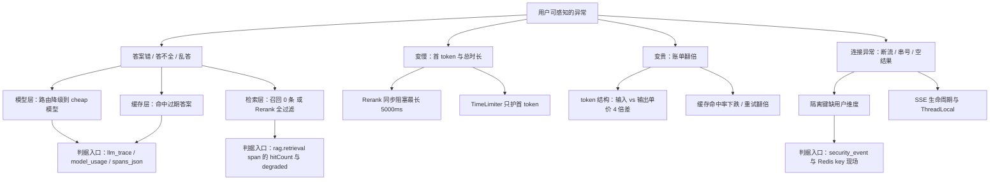
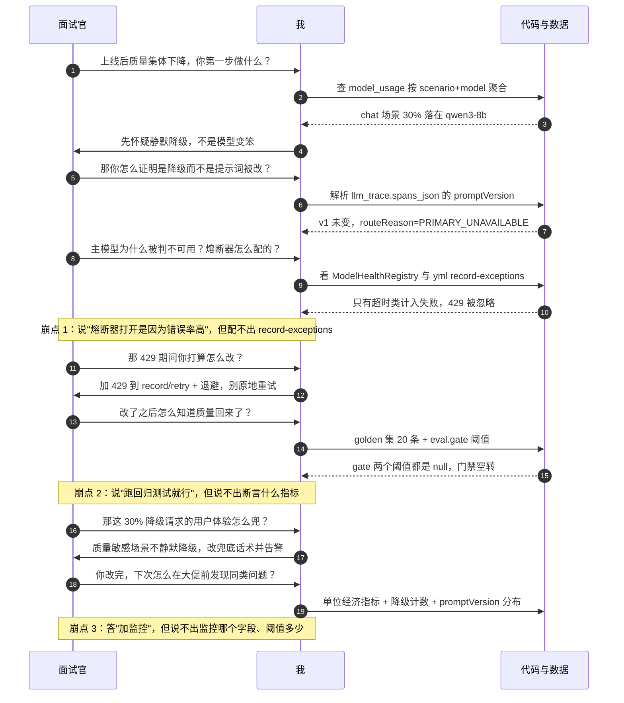

# 综合实战与高频场景题·面试精讲：面试官要的不是方案名，而是「先定位再动手」的判据链

> **一句话结论**：场景题的评分点在四个动作的完整性——① 你能把"回答变差了"翻译成一条可观测的口径（哪个 span、哪张表、哪个计数器）；② 你能说出**先做哪个判断实验**（一条命令/一次查询就能砍掉一半根因）；③ 你改动的落点具体到一个类的一行或一个配置项（不是"加缓存""换模型"）；④ 你能给出防复发的门禁（哪个指标越界就报警/哪个断言让 CI 红）。缺任何一环，方案名字说得再响也是 0 分。

> **阅读前置**：需要先读同目录 `01-AI基础与大模型原理`（token/usage/温度）与 `03-RAG检索增强生成`（两阶段检索），以及 `09-AI工程化与性能优化`（观测与限流）。本文所有命令都能在本机 30 秒内跑完，不启动服务、不联网、不连中间件。

> **证据基线**：Spring AI 2.1.0 + Boot 4.2.0 + Framework 7.1.0 + JDK 17（本地 21）｜A 级 = Spring 框架源码摘录（`learning-docs/24-源码分析/assets/source/`，908 份）；B 级 = 本仓库文件 + 当次核对的行号；C 级 = 本机 node/pwsh 可复现输出｜预计阅读 45~60 分钟。

**证据边界表（先摊牌，再答题）**

| 类别 | 本仓状态 | 本篇怎么处理 |
|---|---|---|
| 框架机制（向量检索参数、熔断抽象、ChatMemory、SSE 类型） | A 级已入库 | 一律挂 `[[源码:文件.java.md#L起-L止]]`，可点开逐行核对 |
| 本项目 chat 链路（缓存、路由、检索、降级、审计） | B 级已入库（215 个 java） | 每句"我们项目"后面必须有 `文件#L行号`，没有就写成"未落地" |
| 成本/串号/检索退化判定逻辑 | C 级可复现 | 给出 node 脚本 + 真实输出，说明这是"复刻判定逻辑"而非真实 embedding |
| 首 token 800ms→5s 的实测基线 | **未实测**（docs/27-性能基线报告.md#L3 明说实测数据待回填，本机无 Docker/k6） | 只讲"该看哪个字段、哪个根因能把延迟打满 5 秒"，不给任何 P95 数字 |
| 多模态/Agent 编排的场景题 | 部分未落地 | 明确标"本项目未落地"，不编 benchmark |

> 读法：本文所有"业界普遍""一般都会"的句子都被删掉了。凡是没有行号的数字，都当作**我没测过**处理。

---

## 0. 先看现象

**第一幕：把"加缓存"当答案**

> 面试官：大促当天模型账单翻了 3 倍，你怎么查？
> 你：加缓存，热门问题走 Redis，再上语义缓存，命中率能到 80%。
> 面试官：我问你怎么**查**，不是怎么**防**。你现在能说出账单里哪一项涨了吗？是输入 token 涨、输出 token 涨，还是调用次数涨？
> 你：……（答不出来）
> 断点在于：成本是**三项乘积**（次数 × 输入单价 × 输出单价），三者的修复动作完全不同；而本项目的 `model_usage` 表已经把这三项拆开存了（`deploy/mysql/llm-observability-init.sql#L29-L49`：`input_tokens` / `output_tokens` / `estimated_cost` / `scenario` / `model`），你却没在回答里用上它。

**第二幕：把"串号"当玄学**

> 面试官：用户投诉"看到别人的订单"，你怎么定位？
> 你：应该是缓存串了，我给 key 加上 userId 就好了。
> 面试官：那你告诉我，现在哪个 key 缺了 userId？会话历史 key 是什么样？缓存 namespace 是什么样？网关没传 `X-User-Id` 的时候会落到哪个桶？
> 你：……（三个问题一个都答不出）
> 断点在于：串号从来不是"缓存"一个地方的事，本项目至少有三条不同的隔离键：会话历史 `chat:history:{sessionKey}`（`ai-cs-chat/src/main/java/com/aics/chat/service/impl/ChatHistoryServiceImpl.java#L118-L120`）、缓存 namespace `kb:user:{userId|anonymous}`（`ai-cs-chat/src/main/java/com/aics/chat/service/impl/ChatServiceImpl.java#L175-L178`）、ACL 角色（`ai-cs-chat/src/main/java/com/aics/chat/security/RagAclFilter.java#L39-L54`）。**说不清哪条键缺维度，就等于没定位。**

**第三幕：把"检索全空"当模型笨**

> 面试官：上线后所有知识库问题都答"未检索到相关资料"，你先看什么？
> 你：换个模型试试，可能模型理解能力不够。
> 面试官：模型在这个链路里排在 Rerank 后面。检索空的时候，LLM 收到的上下文是这五个字「（未检索到相关资料）」（`ChatServiceImpl.java#L445`）；换模型只会让它把"没资料"编得更流畅。
> 断点在于：**症状发生在哪一层，判据就必须取自那一层**。`rag.retrieval` 这个 span 已经记了 `hitCount` 和命中文档 ID（`ChatServiceImpl.java#L972-L973`），一个字段就能把"检索源问题"和"ACL 过滤问题"分开。

> **这些现象指向同一件事**：场景题的答案不是"方案"，而是"现象 → 层 → 判据 → 落点 → 门禁"这条链。链条上任何一环用形容词代替（"应该""大概""一般"），整段就被判为背过题没做过事。

---

## 1. 整体地图



> **读图说明**：这张图的读法是"从上往下找层，从下往上找证据"。关键箭头只有两条：`A2 → F` 与 `B1 → B2`。看错 `A2 → F` 会得出**错误结论**——很多人以为"检索为空"是向量库挂了，其实 `hitCount>0 但 citations=0` 说明召回有货、是 `RagAclFilter` 把整库置空了（`RagAclFilter.java#L49-L54`：知识库级无权限时 `return List.of()`）；看错 `B1 → B2` 会以为"流式很慢是模型慢"，而 5000ms 这个数字恰好等于 Rerank 的超时配置（`tools/nacos-config/ai-cs-chat.yml#L19`）。

**考点 × 考察层级**（同一道场景题，四层答法分数完全不同）

| 考点 | 背结论（会说名词） | 讲机制（能说清顺序） | 会定位（能给出判据） | 能改造（能说改哪行 + 怎么防复发） |
|---|---|---|---|---|
| ① 质量集体下降 | "模型降级了" | 说清 `ModelRouter` 按场景链 primary→fallbacks 顺序挑（`ModelRouter.java#L29-L34`） | 看 `model_usage.model` 分布是否从 deepseek-chat 变成 qwen3-8b | 在 observation 里加 `routeReason` 告警；把 `RouteReason.PRIMARY_UNAVAILABLE` 计入 SLO |
| ② 成本翻 3 倍 | "加缓存" | 说清 cost = (in×单价+out×单价)/1e6（`ModelUsageRecorder.java#L127-L137`） | 按 `scenario`+`model` 聚合 `model_usage`，看是次数还是长度 | 给 `estimated=1`（流式估算）比例设阈值告警 |
| ③ 投诉乱答要举证 | "查日志" | 说清 requestId 串起 trace / usage / feedback 三表 | 拿 `session_id` + 时间窗反查 `llm_trace.spans_json` | 反馈入库时强制回填 requestId |
| ④ 检索突然全空 | "向量库挂了" | 说清两阶段检索顺序（召回 20 → Rerank 5） | 看 span 的 `hitCount` 与 `degraded` 区分 4 种根因 | 给"召回 0 条"单独打点，别和"ACL 过滤 0 条"混 |
| ⑤ 流式中途断 | "网络问题" | 说清 `SseEmitter` 5 分钟超时 + TimeLimiter 护首 token | 看客户端断连时刻 vs `onTimeout` 日志 | 补心跳事件；断连时主动 cancel 上游 Flux |
| ⑥ 答案互相串号 | "缓存串了" | 说清三条隔离键各自的维度 | 用 node 复刻 key 拼接，看哪两行拼出同一个 key | key 里强制带 tenantId；ACL 在缓存前 |
| ⑦ 供应商 429/宕机 | "加重试" | 说清熔断器按 modelId 隔离（`ModelHealthRegistry.java#L18-L21`） | 看 `429` 是否真的进了熔断统计 | 把 429 加进 `record-exceptions` |
| ⑧ 敏感信息进回答 | "脱敏" | 说清入口/出口双卡点顺序（`ChatServiceImpl.java#L214-L228`） | 看 `security_event` 的 `stage` 是 INPUT 还是 OUTPUT | 出口卡点接 `PiiMasker`（目前只用于审计摘要） |
| ⑨ 知识库更新后旧答案 | "刷新缓存" | 说清 chunk id 每次入库都是新的（`KnowledgeBaseService.java#L171`） | 看 `citations` 里 documentId 是否为旧 id | 入库前按文档 id 删除；缓存 namespace 带 KB 版本 |
| ⑩ 首 token 800ms→5s | "模型慢了" | 说清 Rerank 在 LLM 之前同步阻塞 | 看 `firstTokenMs` 与 Rerank 超时是否吻合 | 把 Rerank 改成可并行的旁路或压到 800ms 预算内 |

> 这张表怎么用：自我介绍阶段用"讲机制"这列建立可信度，中间一定切到"会定位"，收尾必须落到"能改造"——面试官最后 3 分钟只记一件事：你是不是真的改过线上。

---

## 2. 关键概念与关键类/关键参数

| 名称 | 所在位置 | 一句话准确定义 | 本项目取值 |
|---|---|---|---|
| `requestId` | `ai-cs-chat/src/main/java/com/aics/chat/observability/TraceContext.java#L75` | 一次请求的业务幂等键，是 trace / usage / feedback 三张表唯一的公共列 | `llm_trace` 主键（`deploy/mysql/llm-observability-init.sql#L22`） |
| `llm_trace.spans_json` | `deploy/mysql/llm-observability-init.sql#L19` | 一次请求内所有 span 的 JSON 数组，检索/LLM/工具各一段 | 由 `TraceRecorder.java#L47` 序列化写入 |
| `rag.retrieval` span | `ai-cs-chat/src/main/java/com/aics/chat/service/impl/ChatServiceImpl.java#L931-L939` | 检索环节的观测单元，区分低基数（可聚合）与高基数（只进明细）键 | 低基数 `span.type`/`knowledgeBase`；高基数 `query`/`topK`/`hitCount`/`detail` |
| `hitCount` | `ChatServiceImpl.java#L972` | 检索返回条数（**过滤前**），是"检索空"与"ACL 空"的分水岭 | 高基数键，只在 span 明细里 |
| `firstTokenMs` | `ai-cs-chat/src/main/java/com/aics/chat/service/impl/ResilientAiService.java#L279` | 首 token 到达耗时，流式链路的唯一延迟指标 | 由 `AtomicLong` 记录，`-1` 表示没到过 token |
| `estimated_cost` | `ModelUsageRecorder.java#L127-L137` | 按"元/百万 Token"单价估出的费用，落库精度 6 位小数 | 单价 `deepseek-chat` 2.0/8.0、`qwen3-32b` 1.0/2.0、`qwen3-8b` 0.2/0.6（`tools/nacos-config/ai-cs-chat.yml#L118-L128`） |
| `estimated` | `deploy/mysql/llm-observability-init.sql#L41` | 该笔费用是否为估算（流式拿不到精确 usage 时为 1） | 流式链路恒为估算：`usageRef` 只声明不赋值（`ResilientAiService.java#L277`） |
| `SessionRoute` / 场景链 | `tools/nacos-config/ai-cs-chat.yml#L85-L113` | 每个场景一条 primary + fallbacks 的确定性候选链，不引入 LLM 判断 | 9 个场景；`chat`/`rag` 主 `deepseek-chat`，`intent` 备链含两个模型 |
| `routeReason` | `ai-cs-chat/src/main/java/com/aics/chat/modelrouter/RouteReason.java` | 本次为什么选了这个模型：默认 / 主不可用 / 配额降级 / 无可用 | 写进 LLM observation 的高基数键（`ResilientAiService.java#L466-L480`） |
| 熔断器隔离粒度 | `ai-cs-chat/src/main/java/com/aics/chat/modelrouter/ModelHealthRegistry.java#L18-L21` | 每个 modelId 一个 `CircuitBreaker`，避免主模型故障连坐备模型 | 代码内 `CircuitBreakerRegistry.ofDefaults()`，与 `application.yml#L114-L145` 的 declarative 配置是两套 |
| `TimeLimiter` | `ai-cs-chat/src/main/resources/application.yml#L73-L87` | 只限"多久必须拿到第一个东西"，不限制后续时长 | `chatService` 30s、`sseChatService` 60s（注释写明是首次 token 限制）、`visionService` 5s |
| `SseEmitter` 超时 | `ChatServiceImpl.java#L156` | 服务端 SSE 连接的最长寿命，超时触发 `onTimeout` 回调 | `SSE_EMITTER_TIMEOUT = 5 * 60 * 1000L`（5 分钟） |
| 缓存 namespace | `ChatServiceImpl.java#L175-L178` | 三层缓存的隔离前缀：知识库 + 用户维度 | `kb + ":user:" + (userId==null ? "anonymous" : userId)` |
| `SimilarityThreshold` 语义 | `[[源码:SearchRequest.java.md#L44]]` | 阈值 0.0 = 接受全部候选，1.0 = 要求完全匹配 | 宽召回用 0.3；`HybridRetriever` 的纯向量兜底路径传 0.0（`ai-cs-chat/src/main/java/com/aics/chat/rag/retrieve/HybridRetriever.java#L153-L157`） |
| `CircuitBreaker`（框架抽象） | `[[源码:CircuitBreaker.java.md#L29-L37]]` | 只有两个方法：`run(Supplier)` 与 `run(Supplier, fallback)`，它决定"发不发请求"，不决定"降级成什么" | 本项目降级内容写在 `ResilientAiService.fallbackText`（#L451-L456） |
| `ChatMemory` 隔离键 | `[[源码:ChatMemory.java.md#L35-L40]]` | 框架的记忆实现按 `conversationId` 隔离，`CONVERSATION_ID` 是 context key 常量 | 本项目**没用**框架 memory，自研 Redis List（`ChatHistoryServiceImpl.java#L39`） |
| `aics.security.*` | `ai-cs-chat/src/main/java/com/aics/chat/security/SecurityProperties.java#L28` | 内容审核/工具权限/RAG ACL/SQL 白名单的总配置前缀 | `contentFailMode` 默认 `BLOCK`（#L43）、`ragAclKnowledgeBases` 默认空（#L55，空 = 未配置即放行） |
| `aics.eval.gate` | `ai-cs-chat/src/main/java/com/aics/chat/rag/eval/EvalGateConfig.java#L34` | 评估门禁阈值：P95 延迟上限、单请求平均 token 上限 | **全为 null = 不校验**（配置缺失时字段保持 null，注释 #L32） |
| golden 集 | `ai-cs-chat/src/main/resources/eval/` 下的 `golden-set.json` | 检索质量回归用的固定问答对，含期望 documentId 与关键词 | 20 条（`gc-001`~`gc-020`），全部 `knowledgeBase=product-manual`，期望 docId 101~120 |

---

## 3. 逐题精讲

> 每题固定五段：**问题** → **30 秒答案骨架** → **根因树 + 先做哪个判断实验** → **怎么修 / 怎么防复发** → **深挖追问 + 常见错误答案**。所有"你在这里会看到什么"都指向你打开文件能直接看到的代码。

### 3.1 场景①：上线后回答质量集体下降（不是个别问题变差）

**问题**：昨天发布后，客服回答质量"整体变差了"，用户能感觉到但说不清哪句错。你怎么定位？

**30 秒答案骨架**：
1. 先把"变差"拆成三条可测口径：检索命中率（`rag.retrieval` 的 `hitCount`）、模型分布（`model_usage.model` 里 `deepseek-chat` 占比）、缓存命中（`cacheSource` 分布）。
2. 三条口径里哪条在发布时刻跳变，就是那一层的问题——**同时变差才是"模型层"，只有检索变差是"检索层"，只有相似问题变差是"缓存层"**。
3. 本项目模型层的第一嫌疑不是模型本身，而是**静默降级**：主模型不可用时 `ModelRouter` 会按 fallbacks 顺序换模型（`ModelRouter.java#L37-L40`、`#L56-L58`），换完照样返回 200，只有 `routeReason` 变了。
4. 第二嫌疑是**提示词版本被改**：8 个场景全 `strategy: pinned`（`application-prompt.yml#L20-L21` 等），pinned 意味着"不会自动灰度"，但 `POST /api/prompts/{scenario}/active` 能手动切（`application-prompt.yml#L6`）。
5. 修完必须回答"为什么发布时的门禁没拦住"——`aics.eval.gate` 两个阈值全是 null（`EvalGateConfig.java#L34-L45`），门禁等于不存在。

**可能根因树**（按"查起来最便宜"排序）：
| 层 | 根因 | 一条能区分的特征 |
|---|---|---|
| 模型层 | 主模型被熔断，路由到 cheap 模型 | `model_usage.model` 出现 `siliconflow-qwen3-8b` 且 `scenario=chat/rag` |
| 模型层 | 配额超限触发降级 | `routeReason=QUOTA_DOWNGRADE`（`ModelRouter.java#L46-L54`） |
| 提示词层 | pinned 版本被手动切走 | span 里 `promptVersion` 变化（`TraceSpanObservationHandler.java#L67-L70`） |
| 检索层 | Rerank 降级为向量顺序 | `SiliconFlowRerankService` 打「Rerank调用失败，降级为向量相似度排序」（#L156-L159） |
| 检索层 | Hybrid 降级导致召回口径变了 | 日志 `RAG增强检索: mode=..., degraded=true`（`ChatServiceImpl.java#L951-L953`） |
| 缓存层 | 旧答案被语义缓存长期命中 | 响应里 `cacheSource=semantic`（`SemanticCacheService.java#L98`） |
| 安全层 | 输出审核把好答案换成兜底文案 | 用户看到"该回答未通过安全审核"（`ChatServiceImpl.java#L227`） |

**先做哪个判断实验**：先做模型分布统计，因为它一条 SQL 就能排除掉一半根因：

```sql
-- 按天看模型分布与失败率（表结构见 deploy/mysql/llm-observability-init.sql#L29-L49）
SELECT DATE(create_time) d, scenario, model, status, COUNT(*) c, SUM(estimated_cost) cost
FROM model_usage
WHERE create_time >= NOW() - INTERVAL 3 DAY
GROUP BY d, scenario, model, status
ORDER BY d DESC, c DESC;
```

**怎么读**：如果发布当天 `scenario=chat` 的行里 `model` 从 `deepseek-chat` 变成 `qwen3-32b`/`qwen3-8b`，结论是"降级导致质量下降"，去查 `ModelHealthRegistry` 为什么把主模型判成不可用（只有 OPEN 才剔除，`#L23-L31`）；如果模型分布没变，再去看 `hitCount` 与 `degraded`。

**定位后怎么修**：降级不是 bug，"静默降级无告警"才是。修复动作是让降级可见可拒绝——把 `routeReason != SCENARIO_DEFAULT` 打成一个指标并在超过 5 分钟时报警；对质量敏感场景（`chat`/`rag`）配置 `PRIMARY_UNAVAILABLE` 时走"少答但答对"的兜底文案，而不是悄悄换成 8B 模型硬答。

**怎么防复发**：把 `aics.eval.gate.p95-latency-ms` 与 `avg-tokens-per-request` 配上真实阈值（现在全 null），并给 20 条 golden 集加一条"模型分布断言"——回归时若 `chat` 场景主力模型不是 `deepseek-chat`，测试直接失败。

**你在这里会看到什么**：`ai-cs-chat/src/main/java/com/aics/chat/modelrouter/ModelRouter.java#L37-L58` 是候选链过滤与降级的全部逻辑，四十行里没有任何一行会抛异常——`noEligible()` 返回 `NO_ELIGIBLE_MODEL` 而不是 5xx（#L92-L99）。

**深挖追问**：
- **问：降级到 qwen3-8b 会差多少？** 答：本项目没有 A/B 实测数据，不能给分数。能说的是配置事实：8B 在 `intent`/`rewrite`/`summary`/`chart` 是**首选**（`tools/nacos-config/ai-cs-chat.yml#L94-L113`），说明团队认为它够用；一旦 `chat`/`rag` 也降到它，属于"跨能力等级使用"，这本身就是风险，不需要数字也成立。
- **问：为什么不给路由加一个小模型来判断？** 答：那是拿一个 LLM 调用去省另一个 LLM 调用，多一次延迟和失败面。本项目明确选了确定性链并写在注释里（`ModelRouter.java#L29`：零成本、可解释、可复现）。
- **问：如果是提示词被改坏的，你怎么在 10 分钟内确认？** 答：`TraceContext.setPrompt` 把 `promptScenario/promptVersion` 写进上下文（`TraceContext.java#L54-L72`），`TraceSpanObservationHandler` 再挂到 LLM span 上（#L67-L70），最终进 `llm_trace.spans_json`（`TraceRecorder.java#L47`）。按天解析 JSON 取版本号即可对比。
- **问：为什么不做自动回滚？** 答：回滚要能判定"变差了"，而判定需要评估门禁；门禁阈值现在全 null，所以自动回滚在本项目**未落地**——先补门禁，再谈回滚，顺序不能反。

**常见错误答案**：
| 错误说法 | 错在哪 |
|---|---|
| "换个更强的模型就好了" | 掩盖了降级事实；且本项目成本结构下换强模型会立刻触发②的成本问题 |
| "把温度调低一点" | 温度只影响解码随机性，压不住检索缺失与降级带来的系统性偏差（`ChatOptions` 只有 8 个可移植参数，`[[源码:ChatOptions.java.md#L35-L77]]`） |
| "看日志有没有报错" | 质量下降时日志**通常没有 error**：降级、缓存命中、空上下文全是 info 级别 |
| "上 A/B 测试" | 答复方向对但不是定位手段；A/B 需要事先埋点，事中救不了火 |

> **证据锚点**：降级链路 `[[源码:CircuitBreaker.java.md#L29-L37]]`（框架只给 run/run+fallback）+ `ModelHealthRegistry.java#L18-L31`（按 modelId 隔离、仅 OPEN 剔除）；提示词版本三点链 `TraceContext.java#L54-L72` → `TraceSpanObservationHandler.java#L67-L70` → `TraceRecorder.java#L47`；门禁空转 `EvalGateConfig.java#L34-L45`。

### 3.2 场景②：大促成本翻 3 倍

**问题**：大促当天 LLM 账单是平时的 3 倍，流量只有平时 2 倍。钱花哪了？

**30 秒答案骨架**：
1. 成本 =（调用次数 × 输入 token 单价 + 调用次数 × 输出 token 单价）/1e6，`estimateCost` 就是这么算的（`ModelUsageRecorder.java#L127-L137`），**两项单价差 4 倍**（2.0 vs 8.0），所以"输出变长"比"输入变长"贵得多。
2. 先按 `scenario` + `model` 聚合 `model_usage`，把"次数涨"和"长度涨"分开；再单独看 `estimated=1` 的行占比（流式估算）。
3. 大促最常见的三个真因：缓存命中率下跌（`cacheSource` 分布变了）、历史压缩失效导致输入膨胀（`MAX_HISTORY_SIZE=20` / `KEEP_RECENT_SIZE=10`，`ChatServiceImpl.java#L150-L153`）、重试放大（3 次尝试全失败仍可能计费）。
4. 反直觉的排除法：**降级不会让成本涨 3 倍，只会让它跌到 1/10**——所以"成本涨了"可以反证"降级没发生"，这条能把①和②互相校准。

**可能根因树**：
| 根因 | 判据 | 本项目取值/落点 |
|---|---|---|
| 调用次数涨 2 倍（大促本身） | `COUNT(*)` 按天翻倍 | 无可修，只能限流（`SentinelRules.java#L21-L24`：chat 10 QPS、rag 5 QPS） |
| 输入膨胀：历史没压缩 | 平均 `input_tokens` 上升 | `compressHistory`（`ChatServiceImpl.java#L278-L310`）超 20 条才触发 |
| 输出变长：没有 max-tokens 约束 | `output_tokens` 上升 | 2048（`tools/nacos-config/ai-cs-chat.yml#L50`） |
| 缓存失效：命中率跌 | `cacheSource` 为空的请求占比上升 | 三层缓存 TTL 168h/168h/24h（`application.yml#L180-L193`） |
| 重试放大 | `status=FAILED` 行变多 | `max-attempts: 3`（`application.yml#L92-L94`） |
| 语义缓存被穿透 | Rerank 变慢→相似问题都未命中 | 阈值 0.92（`application.yml#L186`） |

**先做哪个判断实验**：用真实单价复算一遍"翻 3 倍"需要什么条件——这一步不连数据库也能做，是本篇最便宜的判据：

```javascript
// 复刻 ModelUsageRecorder.estimateCost（#L127-L137）：单价单位是 元/百万 Token
const PER_MILLION = 1000000;
const pricing = {                        // tools/nacos-config/ai-cs-chat.yml#L118-L128
  "deepseek-chat":         { input: 2.0, output: 8.0 },
  "siliconflow-qwen3-32b": { input: 1.0, output: 2.0 },
  "siliconflow-qwen3-8b":  { input: 0.2, output: 0.6 },
};
const cost = (k, inTok, outTok) => (inTok / PER_MILLION) * pricing[k].input
                                + (outTok / PER_MILLION) * pricing[k].output;
console.log("基线 1500/400 × 10000 次 =", (cost("deepseek-chat", 1500, 400) * 10000).toFixed(2), "元/天");
console.log("输入×3 1500→4500 × 10000 次 =", (cost("deepseek-chat", 4500, 400) * 10000).toFixed(2), "元/天");
console.log("输出×3  400→1200 × 10000 次 =", (cost("deepseek-chat", 1500, 1200) * 10000).toFixed(2), "元/天");
console.log("降级 32b 1500/400 × 10000 次 =", (cost("siliconflow-qwen3-32b", 1500, 400) * 10000).toFixed(2), "元/天");
console.log("降级 8b  1500/400 × 10000 次 =", (cost("siliconflow-qwen3-8b", 1500, 400) * 10000).toFixed(2), "元/天");
```

真实输出（node 24，本机）：

```text
基线 1500/400 × 10000 次 = 62.00 元/天
输入×3 1500→4500 × 10000 次 = 122.00 元/天
输出×3  400→1200 × 10000 次 = 126.00 元/天
降级 32b 1500/400 × 10000 次 = 23.00 元/天
降级 8b  1500/400 × 10000 次 = 5.40 元/天
```

**怎么读**：单看"输入涨 3 倍"只让成本变 2 倍（因为输入单价只有输出的 1/4），"输出涨 3 倍"也只到 2 倍出头。**要真翻 3 倍，几乎必然是"次数 × 长度"两个因子同时涨**（例如输入 ×3 且调用量 ×3 → 5.9 倍）。同时注意最后两行：降级只会让成本掉一个数量级，所以"账单涨了"永远排除降级。

**定位后怎么修**：按判据分三路——次数问题走限流（网关 `replenish-rate: 5` / `burst-capacity: 10`，`ai-cs-gateway/src/main/resources/application.yml#L45-L46`）；长度问题把 `compressHistory` 的触发阈值从"20 条"改成"按 token 预算"，并在提示词里锁死输出长度；命中率问题先看 `CacheStatsController` 的 `/chat/cache/stats`（`ai-cs-chat/src/main/java/com/aics/chat/controller/CacheStatsController.java#L36-L37`）再决定是否扩 TTL。

**怎么防复发**：给成本建一条"单位经济"指标——**每万次请求的估算成本**（`SUM(estimated_cost)/COUNT(*)*10000`），它天然抵消掉流量波动；再给 `estimated=1` 的占比设阈值（流式链路恒估算，占比异常说明 usage 统计失真）。

**你在这里会看到什么**：`ai-cs-chat/src/main/java/com/aics/chat/observability/ModelUsageProperties.java#L46-L51` 只有 `input`/`output` 两个 `BigDecimal` 字段，默认都是 0——**没配单价的模型会被算成 0 元**，这是"账对不上"的常见第一嫌疑。

**深挖追问**：
- **问：为什么用 BigDecimal 而不是 double？** 答：金额累加有精度污染，`0.1+0.2≠0.3`；`estimateCost` 里 `divide(PER_MILLION, 10, HALF_UP)` 再 `setScale(6)` 就是为了对齐 `DECIMAL(12,6)`（`deploy/mysql/llm-observability-init.sql#L40`）。
- **问：流式为什么是估算？** 答：`usageRef` 在 `invokeStream` 里只声明不赋值（`ResilientAiService.java#L277`），只在 #L303 读了一次，永远是 null，所以流式只能按字符/估算记 `estimated=1`。这是本项目**已知缺陷**，不是设计优点。
- **问：配额降级能省钱，为什么不默认开？** 答：配额是成本治理不是安全门禁，`QuotaService` 在 Feign 异常时明确 fail-open（`ai-cs-chat/src/main/java/com/aics/chat/observability/QuotaService.java#L72-L80`，注释：宁可多花钱也不能让客服不可用）。
- **问：命中率 92% 阈值怎么定的？** 答：不知道，配置里没有推导过程（`SemanticCacheService.java` 只读 `threshold`）。能说的只有：阈值过高会漏命中、过低会串答案，本项目用 `kb:user:{id}` 做 namespace（`ChatServiceImpl.java#L175-L178`）来降低"低阈值串答案"的后果。

**常见错误答案**：
| 错误说法 | 错在哪 |
|---|---|
| "上语义缓存就能省 80%" | 命中率是结果不是手段；且本项目缓存已上线，问题多半是命中率**跌了** |
| "把 temperature 调成 0 省 token" | 温度不影响 token 数，只影响分布 |
| "换便宜的模型" | 直接掉质量（见①），且本项目成本问题通常不在单价而在长度/次数 |
| "输出 token 便宜，随便长" | 反了：输出单价是输入的 4 倍（8.0 vs 2.0） |

> **证据锚点**：单价与估算 `[[源码:Usage.java.md#L37-L62]]`（token 三件套口径）+ `ModelUsageRecorder.java#L127-L137`；表结构 `deploy/mysql/llm-observability-init.sql#L29-L49`；配额 fail-open `QuotaService.java#L72-L80`。

### 3.3 场景③：用户投诉"客服乱答"，要能举证

**问题**：客户投诉"你们机器人说我订单可以退，结果退不了"。你作为开发要拿出一条能自证的链路。怎么举？

**30 秒答案骨架**：
1. 举证的最小闭环是四件套：**问题原文 + 检索到的文档 ID + 送给模型的提示词版本 + 模型输出**，全部挂在同一个 `requestId` 上。
2. 本项目已经具备前两件与第四件的落点：`llm_trace`（requestId、scenario、`spans_json`、`error_summary`）、`model_usage`（requestId、model、tokens、status）、`user_feedback`（可按 requestId 反查）、`security_event`（可带 sessionId）。
3. 缺口也很明确：`llm_trace` 没有"用户输入原文"和"最终回答"的独立列——`spans_json` 里只有检索明细（文档 ID 而非全文，`ChatServiceImpl.java#L963-L971` 注释解释了为什么只存 ID）。
4. 更关键的工程事实：**检索为空时不拒答**。上下文会被替换成「（未检索到相关资料）」（`ChatServiceImpl.java#L445`、`#L590`），模型于是自由发挥——这是"乱答"的头号可举证主因。
5. 所以对客户的说辞不是"模型幻觉"，而是"该问题在知识库中无命中，系统按设计交给了通用回答"——这句话背后有 span 可以点开。

**可能根因树**：
| 根因 | 判据 | 落点 |
|---|---|---|
| 检索 0 命中仍作答 | span `hitCount=0` 且回答很长 | `ChatServiceImpl.java#L445` |
| 命中但 Rerank 全过滤后回退粗排 | `hitCount=20`，citations 里分数低 | `KnowledgeBaseService.java#L240-L259` |
| 缓存的旧答案 | 响应 `cacheSource=semantic`/`hot-qa` | `SemanticCacheService.java#L98` |
| 提示词版本退化 | span 的 `promptVersion` 变了 | `TraceSpanObservationHandler.java#L69-L70` |
| 越权文档被引用 | `security_event.type=RAG_ACL_DENIED` | `RagAclFilter.java#L49-L54` |
| 工具返回了错误数据 | span 里工具段 error | `ai-cs-chat/src/main/java/com/aics/chat/observability/TraceSpans.java`（span 明细） |

**先做哪个判断实验**：先按 `session_id` 把时间窗内所有 trace 拉出来，看投诉那句对应的 span 里 `hitCount` 是 0 还是有值——这一条就把"该答不知道"和"答了错资料"分开：

```sql
-- 1) 找这次会话的请求（llm_trace.session_id 是字符串，见 init.sql#L15）
SELECT request_id, scenario, status, total_duration_ms, create_time
FROM llm_trace WHERE session_id = ? AND create_time >= ? ORDER BY create_time;
-- 2) 再看该请求花了多少钱、用的哪个模型
SELECT scenario, model, input_tokens, output_tokens, status, error_summary
FROM model_usage WHERE request_id = ?;
-- 3) 用户是否点过"没用"
SELECT feedback_type, score, create_time FROM user_feedback WHERE request_id = ?;
```

**怎么读**：`hitCount` 在 `spans_json` 的检索段（key 名 `hitCount`，`ChatServiceImpl.java#L972`），是**过滤前**条数。若 `hitCount=0` → 知识库确实没有这条政策，产品侧要补文档；若 `hitCount>0` 但回答错 → 看 `detail` 里的文档 ID 是否就是那条过期政策（对应⑨）；若 `cacheSource` 非空 → 是缓存复读，看缓存写入时间。

**定位后怎么修**：把"检索空仍作答"这条设计改掉——在 `context.isBlank()` 分支改为返回固定话术并打 `degraded` 标记，而不是把"（未检索到相关资料）"喂给 LLM（现写法在 `ChatServiceImpl.java#L445` 与 `#L590` 两处）。同时对 `hitCount=0` 单独打点，它是"知识库覆盖缺口"的唯一可量化信号。

**怎么防复发**：给 `user_feedback` 与 `llm_trace` 建一条按 `request_id` 的 join 视图，把"被投诉的请求"变成可视化清单；反馈接口目前允许 `requestId` 为空（`ai-cs-chat/src/main/java/com/aics/chat/controller/ChatFeedbackController.java#L46` 注释），这会让举证断链，应改成前端必传。

**你在这里会看到什么**：`ChatFeedbackController.java#L50-L54` 把反馈转发给 `ai-cs-message` 的 `user_feedback` 表；`ObservabilityController.java#L42-L43` 提供 `/api/observability/traces/{requestId}` 单条回放——**没有**"按会话批量回放"的接口，这是举证时的真实手感：你得自己写 SQL。

**深挖追问**：
- **问：怎么证明不是模型幻觉？** 答：拿 span 里检索段喂给模型的那几条文档 ID + 提示词版本。若文档里写的确实是"7 天无理由"，那是知识过期（⑨）；若文档里没有这条，那是模型在无资料情况下编的（可用 `hitCount=0` 证明）。**举证的本质是把"模型的输入"拿出来，而不是解释"模型的输出"。**
- **问：Trace 里为什么只存 documentId 不存全文？** 答：代码注释写明 trace 可能被导出到第三方追踪平台，文档全文属业务敏感内容，ID 足够还原路径（`ChatServiceImpl.java#L963-L964`）。这条在面试里很加分——它证明你想过数据出域。
- **问：为什么 feedback 表不直接存回答全文？** 答：本项目未落地该设计；现状是 `user_feedback` 只存反馈类型与分数（`deploy/mysql/llm-observability-init.sql#L84-L89`），回答正文要靠 `spans_json` 或下游消息表回溯。
- **问：能不能给用户看"我是根据第 3 号文档回答的"？** 答：能，`citations` 就是这么来的（`ChatServiceImpl.java#L462`、SSE 的 `done` 事件 `#L792`），字段含 `documentId/title/page/score`。但 citations 只在前端展示，不进 `llm_trace`。

**常见错误答案**：
| 错误说法 | 错在哪 |
|---|---|
| "模型幻觉，无法避免" | 把工程缺陷说成宿命；本项目有四张表可以定位到具体环节 |
| "加个审核就没事了" | 审核管合规，不管"答错政策" |
| "调温度到 0 就稳定了" | 稳定地输出同一个错误答案，更糟 |
| "查一下 Nginx 日志" | Nginx 日志里没有检索命中数、没有提示词版本、没有模型名 |

> **证据锚点**：trace 三段式 `TraceContext.java#L54-L72` → `TraceSpanObservationHandler.java#L67-L70` → `TraceRecorder.java#L47`；表结构 `deploy/mysql/llm-observability-init.sql#L12-L26`（llm_trace）、`#L84-L89`（user_feedback）；空上下文兜底 `ChatServiceImpl.java#L445`。

### 3.4 场景④：检索突然全空

**问题**：所有知识库问答都回答"未检索到相关资料"，但服务健康检查是 UP。先看什么？

**30 秒答案骨架**：
1. "健康检查 UP" 在本项目**不能证明向量库可用**：`VectorStoreConfig` 用 `ProxyFactory` + `LazyInitTargetSource` 把 `ChromaVectorStore` 做成延迟代理（`ai-cs-chat/src/main/java/com/aics/chat/config/VectorStoreConfig.java#L58-L71`），目的就是让 Chroma 没启动时服务也能启动——所以"启动成功"与"检索可用"是两件事。
2. 先看 `rag.retrieval` span 的 `hitCount`：0 条是检索源问题，>0 条而回答仍空是 ACL 过滤或上下文拼装问题。
3. 检索源问题再分四种：集合名/知识库过滤不一致、embedding 空间不一致（768 vs 1024）、阈值口径不一致、异常被静默吞掉。
4. 本项目有两处**静默降级**必须记住：`HybridRetriever.searchVector` 捕获任何异常后 `return List.of()`（`ai-cs-chat/src/main/java/com/aics/chat/rag/retrieve/HybridRetriever.java#L302-L305`）；`Rerank` 失败返回空 Mono 后走向量顺序（`KnowledgeBaseService.java#L251-L259`）。
5. 所以"检索全空"的排查顺序是：**先证明有没有打到 Chroma（日志/异常）→ 再看维度 → 再看阈值 → 最后看 ACL**。

**可能根因树**：
| 根因 | 一条能区分的特征 | 落点 |
|---|---|---|
| Chroma 没起来 / 端口不通 | 检索抛异常但被吞，日志只有 `degraded=true` | `HybridRetriever.java#L302-L305` |
| 集合名不一致 | 三服务共用 `aics-knowledge`，写入与查询 collection 不同 | `application.yml#L49` |
| knowledgeBase 元数据过滤不匹配 | 入库 kb 名与查询 kb 名不同 | `KnowledgeBaseService.java#L170`、`HybridRetriever.java#L289-L293` |
| embedding 空间不一致 | 768 维哈希 vs 1024 维 bge-m3 | `ai-cs-common/src/main/java/com/aics/common/ai/embedding/HashEmbeddingModel.java#L31`、`SpringAiConfig.java#L171-L173` |
| 阈值口径变了 | 同一问题在纯向量/降级路径的命中差很多 | 召回 0.3（`ai-cs-chat.yml#L25`）vs 兜底 0.0（`HybridRetriever.java#L153-L157`） |
| ACL 整库置空 | `security_event.type=RAG_ACL_DENIED` | `RagAclFilter.java#L49-L54` |
| 召回有、精排全过滤 | `hitCount>0` 但 citations 分数 <0.7 | `SiliconFlowRerankService.java#L195-L198` |

**先做哪个判断实验**：先算一次"维度不一致时会发生什么"。这不是理论题——本项目同时存在 768 维与 1024 维两个 `EmbeddingModel`，一旦 `@Primary` 换掉或本地兜底被启用，向量库里就是两套空间的混合数据：

```javascript
// 768 维（HashEmbeddingModel）与 1024 维（bge-m3）不能互相比较
const cosine = (a, b) => {
  if (a.length !== b.length) return { ok: false, reason: `维度不一致 ${a.length} vs ${b.length}` };
  let dot = 0, na = 0, nb = 0;
  for (let i = 0; i < a.length; i++) { dot += a[i] * b[i]; na += a[i] * a[i]; nb += b[i] * b[i]; }
  return { ok: true, value: dot / (Math.sqrt(na) * Math.sqrt(nb)) };
};
const q768 = Array.from({ length: 768 }, (_, i) => Math.sin(i));
const d1024 = Array.from({ length: 1024 }, (_, i) => Math.cos(i));
console.log(cosine(q768, d1024));
// 精排全过滤 ≠ 返回空：KnowledgeBaseService 会回退粗排（#L256-L259）
const recall = [{ id: "doc-101", s: 0.52 }, { id: "doc-102", s: 0.48 }];
const rerank = [{ id: "doc-101", s: 0.35 }, { id: "doc-102", s: 0.28 }];
const passed = rerank.filter(d => d.s >= 0.7);
console.log("精排通过条数:", passed.length, "→ 实际喂给 LLM:", (passed.length ? passed : recall.slice(0, 5)));
```

真实输出（node 24，本机）：

```text
{ ok: false, reason: '维度不一致 768 vs 1024' }
精排通过条数: 0 → 实际喂给 LLM: [ { id: 'doc-101', s: 0.52 }, { id: 'doc-102', s: 0.48 } ]
```

**怎么读**：第一行告诉你**向量空间不一致不是"分数偏低"，而是根本不可比**（Chroma 会直接报维度错误）；第二行告诉你一个反直觉事实——**`minScore=0.7` 全过滤时检索不会返回空，而是退回粗排顺序**（`KnowledgeBaseService.java#L240` 的条件不成立 → 走 `#L257`）。所以"回答质量突然变差但检索没空"这个症状，就是精排失效。

**定位后怎么修**：四件事按顺序做——① 给 Chroma 检索异常加 `log.error`（现在 catch 后只返回空列表）；② 给 `hitCount` 打点并区分 `degraded` 原因（`RetrieveResult.setDegraded`，`HybridRetriever.java#L308-L316`）；③ 统一阈值口径（`HybridRetriever.vector` 传的 0.0 与宽召回 0.3 不一致，`#L153-L157`）；④ 入库时把 embedding 模型名写进 chunk metadata，检索前校验，防混空间。

**怎么防复发**：把 golden 集跑成 CI 门禁——20 条用例里有 `expectedDocumentIds`（`ai-cs-chat/src/main/resources/eval/` 下的 `golden-set.json`），检索命中率跌破阈值就红；再给 `/actuator/health` 加一个 `vectorStore` 探针（本项目**未落地**，health 只暴露 `health,info,prometheus`，`tools/nacos-config/aics-shared.yml#L28-L38`）。

**你在这里会看到什么**：`ai-cs-chat/src/main/java/com/aics/chat/service/KnowledgeBaseService.java#L265-L270` 里，查询文本被加上指令前缀「为这个句子生成表示以用于检索相关文章：」再向量化——**任何人绕过这段前缀做压测或对拍，分数都会漂**，这是"我本地测是好的"最常见的原因。

**深挖追问**：
- **问：`SearchRequest` 的相似度阈值默认是多少？** 答：`0.0`，即接受全部候选（`[[源码:SearchRequest.java.md#L44]]`，注释写明 0.0 全接受、1.0 完全匹配），默认 `topK=4`（`#L49`）。所以"没配阈值"不等于"有阈值兜底"。
- **问：为什么 Rerank 要放在检索之后而不是取代检索？** 答：职责不同。向量检索负责"召回得起"（扫全库、topK=20、低阈值 0.3），Rerank 是 cross-encoder 精排，只能对少量候选算相关性（`topN=5`、`minScore=0.7`），直接拿它扫全库成本不可接受。
- **问：Rerank 挂了怎么办？** 答：降级为向量顺序并且**打 warn**（`SiliconFlowRerankService.java#L156-L159`）。工程上这叫"能力降级但链路不断"，代价是准确率下降而调用方无感——所以必须靠日志/指标让运维有感。
- **问：Chroma 单机挂了整个链路会不会 500？** 答：不会。检索异常被吞成空列表，回答退化为"没资料自由发挥"。**这比 500 更危险**，因为监控看不到错误率。

**常见错误答案**：
| 错误说法 | 错在哪 |
|---|---|
| "健康检查 UP 就说明依赖正常" | 本项目刻意做了延迟代理，启动成功与依赖可用解耦 |
| "检索空就是没收录" | 可能是 ACL 整库置空、kb 名不匹配、维度不一致 |
| "把阈值降到 0 就能召回" | 会引入大量噪声，且 `minScore` 仍会过滤；正确动作是分层降阈值 + 看精排 |
| "换个大模型就能答" | 空上下文下大模型只会编得更像真的 |

> **证据锚点**：阈值语义 `[[源码:SearchRequest.java.md#L37-L58]]`；检索参数装配 `[[源码:VectorStoreDocumentRetriever.java.md#L57-L75]]`；空上下文策略 `[[源码:ContextualQueryAugmenter.java.md#L72-L77]]`（框架默认 `allowEmptyContext=false`，本项目是自己拼字符串，没走这个组件——这就是差别）。

### 3.5 场景⑤：流式回答中途断掉

**问题**：前端偶尔看到回答打了半句就没了，控制台没有报错。怎么定位？

**30 秒答案骨架**：
1. 先把"断"分成三种：**服务端主动结束**（正常 `done`）、**服务端异常结束**（`error` 事件）、**连接被单方面掐断**（既没 done 也没 error）。
2. 本项目的三个时限必须同时记住：`SseEmitter` 5 分钟（`ChatServiceImpl.java#L156`）、`TimeLimiter` 对 `sseChatService` 60 秒（只覆盖"拿到第一个 token 之前"，`application.yml#L81-L83` 有注释）、模型自身 `timeout-ms: 30000`（`ai-cs-chat.yml#L62`）。
3. 最长寿的那个先到，就是断的原因。5 分钟内没生成完 → `onTimeout` 触发并 `complete()`（`ChatServiceImpl.java#L829-L832`）；首 token 60 秒没来 → TimeLimiter 抛超时，被外层 catch 成 `error` 事件（`#L807-L827`）。
4. 第四个隐藏原因：流式兜底文案是 `Flux.just("[ERROR]AI 助手暂时繁忙，请稍后重试。")`（`ResilientAiService.java#L261`、`#L339`）——它走的是 `onNext`，前端会把它当**正文**渲染，看起来像"回答变成了一句话"。
5. 所以第一步永远是问："前端收到 `done` 了吗？" 有 → 服务端结束；有 `error` → 服务端异常；都没有 → 连接层。

**可能根因树**：
| 根因 | 判据 | 落点 |
|---|---|---|
| 生成总时长超 5 分钟 | `onTimeout` 日志（`SSE连接超时`） | `ChatServiceImpl.java#L829-L832` |
| 首 token 超 60 秒 | 日志 `SSE流式初始化异常` + error 事件 | `#L807-L827`、`application.yml#L81-L83` |
| 全模型熔断返回兜底文案 | 前端看到正文含 `[ERROR]` | `ResilientAiService.java#L339` |
| 下游代理/网关超时 | 无任何服务端日志，TCP 先断 | 网关配置（本项目未配响应超时） |
| 客户端断连后服务端继续写 | 日志多次 `send` 失败 | `emitter.send` 的 catch 分支（`#L797-L801`） |
| 上游 Flux 报错但没发 error 事件 | `onError` 分支 | `ResilientAiService.java#L290` |

**先做哪个判断实验**：先做"时间对齐"——把客户端观察到的断流时刻与三个时限对比，一条时间线就能排除两个根因：

```powershell
# 只看 chat 服务里 SSE 生命周期相关的日志（不启动服务，只筛已有日志文件）
Select-String -Path .\logs\ai-cs-chat*.log -Pattern "SSE连接超时|SSE流式初始化异常|SSE完成事件发送失败|SSE连接异常" |
  Select-Object -Last 20 | ForEach-Object { "$($_.LineNumber): $($_.Line.Trim())" }
```

**怎么读**：出现 `SSE连接超时` → 5 分钟寿命到了；出现 `SSE流式初始化异常` → 60 秒内没拿到 Flux（注意日志里 `cause` 已经是 `getFriendlyMessage` 后的人话，`#L810`）；两类都没有但前端断了 → 连接层（代理/客户端）。上机前请确认日志路径，本项目日志文件名由 logback 配置决定，未入库时可用 `Get-ChildItem -Recurse -Filter "*chat*.log"` 先找。

**定位后怎么修**：① 给 SSE 加**心跳事件**（每 15 秒发一个注释行或 `event: ping`），让代理不把空闲连接当死连接；② 客户端断连时主动 `cancel` 上游订阅，避免线程和配额被空转（现在 `onError`/`onTimeout` 只 `complete()`，不取消 Flux，`#L829-L836`）；③ 把 `[ERROR]` 兜底文案改成真正的 `error` 事件，别混在正文里（`ResilientAiService.java#L261`）。

**怎么防复发**：在 SSE 完成回调里记录"是否收到过 done"的计数（`done` 事件在 `#L790-L796`），断流率高说明时限或网络有问题；同时把 `firstTokenMs` 与总时长一起打点，让"慢"和"断"不再混为一谈。

**你在这里会看到什么**：`ChatServiceImpl.java#L544-L566` 是"缓存命中直接整段推送"的分支，它也会 `complete()`；`#L588-L596` 是 RAG 流式的组装；`#L601` 的 `futureFlux.get()` 是唯一会抛 `ExecutionException` 的同步等待点——**流式不是全异步**，这一行是阻塞的。

**深挖追问**：
- **问：为什么 `SseEmitter` 超时设 5 分钟而不是 0（永不超时）？** 答：代码注释直接写了"使用合理的超时时间，替代原来的 0L（永不超时）"（`ChatServiceImpl.java#L524-L525`）。永不超时在客户端悄悄断开时会**泄漏连接和线程**，这是 `docs/28-故障案例库.md#L291-L296` 里登记的待走读项之一（SSE 连接泄漏）。
- **问：`TimeLimiter` 和 `SseEmitter` 超时有什么区别？** 答：前者限制"多久必须开始响应"（首 token），到点抛异常走 catch；后者限制"连接最长活多久"，到点只回调 `onTimeout`。前者保护吞吐，后者保护资源。
- **问：为什么不用 WebFlux 直接返回 `Flux`？** 答：本项目是 Spring MVC（Servlet 栈），`Flux` 不能被 MVC 直接渲染成 SSE，必须 `SseEmitter` 手工桥接（`ChatServiceImpl.java#L607-L629` 的长注释就在解释这件事）。
- **问：流式拿到的 usage 能记账吗？** 答：不能，`usageRef` 从来不被赋值（`ResilientAiService.java#L277`），所以流式 `estimated=1`。要修就得在 `doFinally` 里从 `ChatResponse` 元数据取 usage 并 `usageRef.set(...)`。

**常见错误答案**：
| 错误说法 | 错在哪 |
|---|---|
| "流式就是异步的，没有超时问题" | 本项目流式里有同步 `.get()`、有两个超时、还有一个 Flux 超时，三层 |
| "加个重试就行" | SSE 已经开始输出了，重试会让用户看到重复的前半句 |
| "把 `[ERROR]` 文案当正常回答" | 它是兜底文案，混在正文里会误导用户与客诉判断 |
| "前端加自动重连" | 重连拿到的是新请求，历史会重复；要先定位断因 |

> **证据锚点**：`[[源码:ChatModel.java.md#L30-L64]]`（`ChatModel` / `stream(Prompt)` 是流式的框架入口）+ `[[源码:CircuitBreaker.java.md#L29-L37]]`（熔断只管发不发请求）；本项目三层时限 `ChatServiceImpl.java#L156`、`application.yml#L73-L87`、`ai-cs-chat.yml#L62`。

### 3.6 场景⑥：两个用户答案互相串号

**问题**：运营反馈"我登录 A 账号，看到的是 B 账号刚才问过的回答"。你怎么查、怎么改？

**30 秒答案骨架**：
1. 串号 = 隔离键缺维度。本项目有三条独立的隔离键，必须逐条查：**会话历史** `chat:history:{sessionKey}`（`ChatHistoryServiceImpl.java#L118-L120`）、**缓存 namespace** `kb:user:{userId|anonymous}`（`ChatServiceImpl.java#L175-L178`）、**ACL 角色**（`RagAclFilter.java#L71-L81`）。
2. 第一条**确实缺用户维度**：`buildKey` 只拼 `sessionKey`，全类没有 `expire`，也没有 userId 校验；而 Controller 对 `sessionId` 只做 `@NotBlank`（`ChatController.java#L80`），**谁拿到别人的 sessionId 就能读别人的历史**。
3. 第二条带了用户维度，但用户在**可空请求头**里：`X-User-Id` 是 `required=false`（`ChatController.java#L82`），网关没透传时全部落进 `kb:user:anonymous` 同一个桶——不同用户的**缓存答案**会互相命中。
4. 第三条在流式链路有漏洞：`RagAclFilter` 只在同步 RAG 路径调用了一次（`ChatServiceImpl.java#L439`），SSE 路径（`#L587-L594`）**没有调用**。
5. 还有一个线程级陷阱：`ChatUserContext` 是 ThreadLocal，SSE 端点里 `finally` 立刻 `clear()`（`ChatController.java#L174-L179`），异步回调阶段读到的是 null——凡是异步阶段依赖它的地方都会退化成"匿名"。

**可能根因树**：
| 根因 | 判据 | 落点 |
|---|---|---|
| 会话历史 key 无用户维度 | 两个用户同一 sessionId → 同一 Redis key | `ChatHistoryServiceImpl.java#L118-L120` |
| 网关未透传 `X-User-Id` | 缓存 namespace 全是 `anonymous` | `ChatController.java#L82`、`ChatServiceImpl.java#L176` |
| SSE 链路 ACL 未执行 | 流式回答引用了无权限文档 | `ChatServiceImpl.java#L587`（对比 `#L439`） |
| ThreadLocal 在异步阶段失效 | 异步里 userId 为 null | `ChatController.java#L174-L179` |
| 前端把 sessionId 放在可猜测的位置 | sessionId 是自增/时间戳 | 无校验，未落地防猜 |

**先做哪个判断实验**：用 node 复刻两个 key 的拼接函数，10 行就能看出哪两行撞车（**这是复刻判定逻辑，不是真实调用**）：

```javascript
// 复刻 ChatHistoryServiceImpl.buildKey(#L118-L120) 与 ChatServiceImpl.cacheNamespace(#L175-L178)
const HISTORY = "chat:history:";                  // ChatHistoryServiceImpl.java#L39
const SEM = "aics:semcache:entry:";               // SemanticCacheService.java#L49
const buildKey = (sessionKey) => HISTORY + sessionKey;
const ns = (kb, userId) => kb + ":user:" + (userId == null ? "anonymous" : userId);
const rows = [
  { who: "用户A", uid: 1001, sk: "sess-abc" },
  { who: "用户B", uid: 2002, sk: "sess-abc" },   // 同一个 sessionId
  { who: "用户C", uid: null, sk: "sess-x1" },    // 网关没透传 X-User-Id
  { who: "用户D", uid: null, sk: "sess-x2" },    // 同样没透传
].map(r => ({ 谁: r.who, 历史key: buildKey(r.sk), 语义缓存key: SEM + ns("product-manual", r.uid) }));
console.table(rows);
console.log("历史 key 去重后:", new Set(rows.map(r => r.历史key)).size, "/", rows.length);
console.log("缓存 key 去重后:", new Set(rows.map(r => r.语义缓存key)).size, "/", rows.length);
```

真实输出（node 24，本机）：

```text
┌─────────┬─────────┬────────────────────────┬─────────────────────────────────────────────────────┐
│ (index) │ 谁      │ 历史key                │ 语义缓存key                                         │
├─────────┼─────────┼────────────────────────┼─────────────────────────────────────────────────────┤
│ 0       │ '用户A' │ 'chat:history:sess-abc'│ 'aics:semcache:entry:product-manual:user:1001'      │
│ 1       │ '用户B' │ 'chat:history:sess-abc'│ 'aics:semcache:entry:product-manual:user:2002'      │
│ 2       │ '用户C' │ 'chat:history:sess-x1' │ 'aics:semcache:entry:product-manual:user:anonymous' │
│ 3       │ '用户D' │ 'chat:history:sess-x2' │ 'aics:semcache:entry:product-manual:user:anonymous' │
└─────────┴─────────┴────────────────────────┴─────────────────────────────────────────────────────┘
历史 key 去重后: 3 / 4
缓存 key 去重后: 3 / 4
```

**怎么读**：第 0、1 行历史 key 完全一样（用户 A/B 撞一个 key），说明**会话历史只隔离会话、不隔离用户**；第 2、3 行缓存 key 完全一样（两个匿名用户共享一个缓存桶），说明**缓存隔离依赖请求头而不是身份**。两个 3/4 就是两条串号路径的量化证明。

**定位后怎么修**：① `buildKey` 改成 `chat:history:{userId}:{sessionKey}`（或先 `GET` sessionId→userId 的归属关系做校验，不匹配就 403）；② `X-User-Id` 改为网关强制注入，服务端不再接受外部传入的 userId；③ SSE 路径补 `ragAclFilter.filter(...)`，并把 userId 在进入异步**之前**捕获成局部变量（`ResilientAiService` 就是这么做的，注释写明 ThreadLocal 不跨 `supplyAsync` 传播，`ResilientAiService.java#L173-L175`）。

**怎么防复发**：给会话历史补 TTL（现在 `append` 全程没有 `expire`，`ChatHistoryServiceImpl.java#L67-L83`，会导致 key 无限增长）；在 `CacheStatsController` 之外加一个"匿名桶占比"指标，`anonymous` 超过阈值即报警——它就是"网关没透传"的直接证据。

**你在这里会看到什么**：`ChatServiceImpl.java#L169-L178` 的注释明确写了为什么缓存必须按用户隔离（"否则用户 A 有权看到的文档回答可能被用户 B 从缓存直接取走，绕过 `RagAclFilter`"）——**这条注释和 `#L587` 没调 ACL 的事实放在一起，就是最真实的工程缺陷**：作者想到了，但只落到同步路径。

**深挖追问**：
- **问：为什么不让 Redis 用 `KEYS`/前缀扫描做隔离？** 生产禁用 `KEYS`；正确做法是 key 设计时就把维度放进去（本项目就是 `{kb}:user:{id}` 这种前缀式）。
- **问：框架的 `ChatMemory` 怎么隔离？** 答：按 `conversationId` 隔离（`[[源码:ChatMemory.java.md#L35-L59]]`），`CONVERSATION_ID` 是 context key 常量（`#L40`）。**框架只提供"键"，键由谁来、怎么校验归属，是应用层责任**——这正是本项目的缺口。
- **问：`anonymous` 桶为什么危险？** 答：它不是"一个用户"，是"所有未认证用户的合集"。缓存命中会跨用户返回引用列表，既是数据泄露也是投诉源头。
- **问：怎么在测试里卡住这类问题？** 答：写"同一 sessionId、两个 userId"的集成测试，断言 `buildKey` 不同；再写"无 header 请求"用例，断言缓存不命中并落 `anonymous` 计数。这类测试不需要中间件，纯单测即可。

**常见错误答案**：
| 错误说法 | 错在哪 |
|---|---|
| "给 Redis key 加 userId 就完了" | 只修了三条键中的一条，SSE 的 ACL 缺失与 ThreadLocal 失效仍在 |
| "串号是前端缓存问题" | 服务端 key 就撞了，先自证服务端 |
| "加分布式锁" | 锁解决并发不解决隔离 |
| "sessionId 是 UUID 猜不到，不用管" | 安全不能靠"猜不到"；且日志、分享链接、截图都会泄露 |

> **证据锚点**：框架记忆的隔离键 `[[源码:ChatMemory.java.md#L35-L59]]`、`[[源码:MessageWindowChatMemory.java.md#L29-L50]]`（本项目**没用**它，自研 Redis List）；本项目 key `ChatHistoryServiceImpl.java#L39`、`#L118-L120`，namespace `ChatServiceImpl.java#L175-L178`；ACL 唯一调用点 `#L439`。

### 3.7 场景⑦：模型供应商 429 或直接宕机

**问题**：供应商开始返回 429/503，你的服务怎么表现？怎么改？

**30 秒答案骨架**：
1. 先分清两个机制的责任：**重试**决定"同一个模型再试几次"，**熔断**决定"这段时间还发不发请求"（框架抽象只有 `run(Supplier)` 和带 fallback 的 `run`，`[[源码:CircuitBreaker.java.md#L29-L37]]`）。
2. 本项目的重试名单只有四个超时类异常（`application.yml#L95-L99`），熔断器的 `record-exceptions` 同样只列超时类（`#L114-L145`）——**供应商 429 抛出的 HTTP 异常不在名单里，既不会重试，也不会计入熔断失败率**。
3. 后果：429 期间每个请求都真实打到供应商，熔断器永远不打开，"雪崩"变成"持续小刀"。这是本项目**尚未覆盖的缺口**，面试里应当主动承认为"待补"，而不是假装有。
4. 兜底不会 500：全链路失败时返回固定文案（`ResilientAiService.fallbackText`，`#L451-L456`），流式返回 `[ERROR]` 文本（`#L339`）。
5. 多模型场景已有真兜底：`intent` 的备链是 `[qwen3-32b, deepseek-chat]`，配置注释写明是为了"siliconflow 间歇性连接重置时保证意图识别可用"（`ai-cs-chat.yml#L106-L107`）。

**可能根因树**：
| 根因 | 判据 | 落点 |
|---|---|---|
| 429 不在重试名单 | 日志无 retry，`Exception` 一路抛到 fallback | `application.yml#L95-L99` |
| 429 不计入熔断 | `model_usage.status=FAILED` 涨但 `ModelHealthRegistry` 不 OPEN | `application.yml#L114-L145` |
| 主模型 OPEN 后没备模型 | `routeReason=NO_ELIGIBLE_MODEL` | `ModelRouter.java#L92-L99` |
| 场景没配 fallbacks | 该场景 primary 挂了直接兜底文案 | `ai-cs-chat.yml#L85-L113` |
| 配额降级被误当故障 | `routeReason=QUOTA_DOWNGRADE` | `ModelRouter.java#L46-L54` |
| 半开探测放行过多 | 熔断后仍有 3 个请求穿透 | `ModelHealthRegistry.java#L23-L31`（仅 OPEN 剔除） |

**先做哪个判断实验**：先确认"外部 429 会走到哪一层"——看代码比压测快：

```powershell
# 重试与熔断各自认哪些异常（两段配置都在 ai-cs-chat/src/main/resources/application.yml）
Select-String -Path ai-cs-chat\src\main\resources\application.yml -Pattern "retry-exceptions|ignore-exceptions|record-exceptions|max-attempts|failure-rate-threshold|sliding-window-size" -Context 0,3 |
  ForEach-Object { $_.Line.Trim() }
```

**怎么读**：你会看到 `retry-exceptions` 里只有 `SocketTimeoutException`/`ConnectException`/`ResourceAccessException`/`TimeoutException`（`#L95-L99`），`ignore-exceptions` 是 `BusinessException`/`IllegalArgumentException`（`#L100-L102`）。Resilience4j 的语义是：**显式配了 `record-exceptions`，就只有这些异常算失败**，其余既不算成功也不算失败。所以 429（HTTP 客户端异常）被"安静地忽略"了。

**定位后怎么修**：把供应商限流/过载异常（429/503 对应的 HTTP 异常类型）显式加进 `record-exceptions` 与 `retry-exceptions`，但**重试必须带退避**（`wait-duration: 1s` + `multiplier: 2`，`#L93-L94`，现有配置已具备），否则重试会把 429 放大成 429 风暴；同时给 `routeReason` 与 `NO_ELIGIBLE_MODEL` 打点，让"没有模型可用"这件事从静默文案变成告警。

**怎么防复发**：给每个场景配两条以上互不相同的供应商（现在 `chat`/`rag` 的备链是同一家的 `qwen3-32b`，`ai-cs-chat.yml#L88-L93`，同厂商 429 时备链无效）；再加一个"429 比率 > 5% 自动把该 modelId 标记为不可用 N 分钟"的逻辑（本项目未落地）。

**你在这里会看到什么**：`ai-cs-chat/src/main/java/com/aics/chat/modelrouter/ModelHealthRegistry.java#L34-L43` 是代码内自建的熔断器配置（`COUNT_BASED`、窗口 10、最小调用数 3、失败率 50%、OPEN 30 秒、半开放行 3），与 `application.yml#L114-L145` 那套 **declarative 配置是两套并存**——面试时能主动指出这个重复，是加分点。

**深挖追问**：
- **问：熔断器为什么必须按 modelId 隔离？** 答：共享一个熔断器会让主模型故障连累备用模型，代码注释写得很直白（`ModelHealthRegistry.java#L19`）。
- **问：半开状态为什么要放行 3 个请求？** 答：`permitted-number-of-calls-in-half-open-state: 3` 是探测样本量，1 个太少容易被偶发抖动误导，太多会把刚恢复的供应商再打挂。
- **问：`429` 到底是限流还是故障？** 答：语义上是被限流，属于"可恢复"，所以正确动作是退避重试 + 降级到备模型，而不是把它当永久失败。本项目当前既没重试也没降级触发——这就是缺口。
- **问：为什么不全链路重试 3 次？** 答：`timedCall` 的外层已经有 `timeout-ms`（deepseek 30s、8b 15s，`ai-cs-chat.yml#L62`/`#L84`），再叠加 3 次重试最坏要 90 秒，用户早已流失。重试次数与超时必须联合设计。

**常见错误答案**：
| 错误说法 | 错在哪 |
|---|---|
| "加重试次数" | 429 时加重试是火上浇油；先退避、先换模型 |
| "熔断打开就返回 500" | 本项目 `noEligible` 返回内部标记不抛异常（`ModelRouter.java#L92-L99`），目的是不让模型选择变成 5xx |
| "多配几个模型就有高可用了" | 同一供应商的多个模型不构成故障隔离 |
| "用了 Resilience4j 就自动生效" | 配置只覆盖列出的异常类型；不在名单里的错误等于没接保护 |

> **证据锚点**：框架熔断抽象 `[[源码:CircuitBreaker.java.md#L29-L37]]`、`[[源码:CircuitBreakerFactory.java.md]]`；网关层限流实现 `[[源码:RedisRateLimiter.java.md#L245]]`（`isAllowed(routeId, id)` 是"每用户每路由一个令牌桶"的口径）；本项目配置 `application.yml#L88-L145`、`ModelHealthRegistry.java#L34-L43`。

### 3.8 场景⑧：敏感信息出现在回答里

**问题**：模型在回答里复读了知识库里的手机号/身份证号，甚至复读了别家客户的地址。怎么定位与堵住？

**30 秒答案骨架**：
1. 先分清"入口""出口""落库"三个位置：入口 `guardInput`（`ChatServiceImpl.java#L214-L217`）、出口 `guardOutput`（`#L222-L228`）、落库由 `SecurityAuditRecorder` 先脱敏再截断（`ai-cs-chat/src/main/java/com/aics/chat/security/SecurityAuditRecorder.java#L71`）。
2. **本项目的脱敏只在审计写入时做，不作用于返回给用户的回答**：`PiiMasker` 只被 `SecurityAuditRecorder` 引用（`ai-cs-chat/src/main/java/com/aics/chat/util/PiiMasker.java#L78-L92` 有手机号/身份证/银行卡/邮箱/门牌五条正则），`guardOutput` 里没有调用它。
3. 所以"回答里出现手机号"是**设计缺口**而不是模型不听话：模型只是忠实地把上下文里的明文复读出来。
4. 出口审核的强度可配：`aics.security.content-output-check-enabled` 默认 true（`SecurityProperties.java#L46`），审核器异常时按 `content-fail-mode` 决定拦或放（默认 `BLOCK`，`#L43`），并且**无论哪种都记一条 DEGRADE 审计**（`ContentSafetyService.java#L57-L72`）。
5. 修法很清楚：在 `guardOutput` 与 `cleanResponse` 之间插一层 `PiiMasker.mask`，并保证缓存只存脱敏后的答案（缓存回填在 `#L779-L783`，必须在脱敏之后）。

**可能根因树**：
| 根因 | 判据 | 落点 |
|---|---|---|
| 回答未脱敏 | 用户看到明文手机号 | `ChatServiceImpl.java#L222-L228`（无 mask 调用） |
| 知识库入库时未脱敏 | 检索片段里就是明文 | `KnowledgeBaseService.java#L168-L175`（只写 metadata） |
| 缓存把明文答案复用 | 命中缓存后同样带明文 | `SemanticCacheService.java#L120-L122`（只复制 content+citations） |
| 出口审核关掉了 | 配置被改成 false | `SecurityProperties.java#L46` |
| 审核器降级放行 | `security_event.stage=DEGRADE` | `ContentSafetyService.java#L66-L68` |
| 审计里反而留明文 | `input_digest` 是否被 mask | `SecurityAuditRecorder.java#L71` |

**先做哪个判断实验**：先确认"脱敏到底在哪一层"——一条 grep 就能定性：

```powershell
# PiiMasker 被谁调用（只应出现在审计路径）
Select-String -Path ai-cs-chat\src\main\java\com\aics\chat -Include *.java -Recurse -Pattern "piiMasker|PiiMasker" |
  ForEach-Object { "$($_.Path -replace '.*chat\\',''):$($_.LineNumber): $($_.Line.Trim())" }
```

**怎么读**：只要结果里只有 `security\SecurityAuditRecorder.java`（构造注入 + `mask` 调用）和 `util\PiiMasker.java` 自身，就说明**回答出口没有脱敏**。这条命令的输出可以直接当面试证据：不是"我以为做了"，而是"grep 只有一处调用"。

**定位后怎么修**：三步，顺序不能反——① 在 `guardOutput` 内先 `piiMasker.mask(response)` 再送内容审核（避免审核器把掩码后的文本误判）；② 缓存写入使用脱敏后的文本（`ChatServiceImpl.java#L779-L783` 在 `outputBlocked` 之后、`cacheRagAnswer` 之前需要插入）；③ 审计的 `input_digest` 已经是脱敏+截断（`SecurityAuditRecorder.java#L71`），保持不动。

**怎么防复发**：给 `security_event` 增加 `PII_MASKED` 事件类型（schema 里已预留：`deploy/mysql/security-guardrails-init.sql#L15` 的类型枚举含 `PII_MASKED`），每次出口脱敏记一条；再给"回答中含明文身份证/手机号"加一条 golden 用例（构造含手机号的知识片段，断言回答里出现 `****`）。

**你在这里会看到什么**：`ai-cs-chat/src/main/java/com/aics/chat/security/RegexContentReviewer.java#L25-L43` 是内容审核的全部实现：从 `aics.security.content-categories` 读正则、`Pattern.compile(...).find()` 命中即拦、规则解析失败只 warn 不抛——**所以"审核通过"只代表"没撞规则"，不代表文本安全**。

**深挖追问**：
- **问：为什么脱敏不能只做在日志里？** 答：日志脱敏防的是"内部人看到"，回答脱敏防的是"外部人看到"。两者威胁模型不同，本项目只做了前者。
- **问：审核器挂了怎么办？** 答：按配置降级（`content-fail-mode` 默认 BLOCK = fail-closed），并且**必须**记 DEGRADE 审计（`ContentSafetyService.java#L58-L68` 注释解释了 fail-closed 与 fail-open 的工程抉择）。
- **问：RAG ACL 能不能替代脱敏？** 答：不能。ACL 管"哪些文档能被检索"，脱敏管"文档里的敏感字段能不能出网"，两个维度。
- **问：为什么 `allowEmptyContext` 这类框架选项没用上？** 答：本项目自己拼【资料】字符串（`ChatServiceImpl.java#L443-L450`），没走 `ContextualQueryAugmenter`（`[[源码:ContextualQueryAugmenter.java.md#L72-L77]]` 的默认策略是"空上下文不许作答"）。**手写拼装丢掉了框架给的这道保险**。

**常见错误答案**：
| 错误说法 | 错在哪 |
|---|---|
| "加系统提示词『不要泄露个人信息』" | 提示词是建议不是约束，且这条只是把责任推给模型 |
| "在数据库里加密就行" | 检索要把明文喂给模型，加密不解决出网问题 |
| "有审核器就不用脱敏" | 审核器匹配的是违规类别，不是 PII 掩码 |
| "关掉输出审核能提高可用性" | fail-open 会让违规回答直接落库进历史（`ChatServiceImpl.java#L210-L212` 注释：输出审核在清洗之后、落库之前） |

> **证据锚点**：`PiiMasker.java#L33-L92`（五条正则与掩码规则）、`SecurityAuditRecorder.java#L24`（注释：原始输入经 PiiMasker 脱敏 + 截断后才写入事件）、`security_event` 表结构 `deploy/mysql/security-guardrails-init.sql#L12-L24`；框架侧空上下文策略 `[[源码:ContextualQueryAugmenter.java.md#L53-L77]]`。

### 3.9 场景⑨：知识库更新后旧答案仍在

**问题**：运营改了退换货政策文档，重新上传后，机器人还在说旧政策。怎么定位？

**30 秒答案骨架**：
1. 这条链上有**四个**都可能留旧答案的地方：向量库 chunk、热门问答缓存（24h）、语义缓存（168h）、会话历史里的历史回答。
2. 本项目的向量库侧**没有删除/更新能力**：`KnowledgeBaseService` 只有 `addText`/`addFile`/`addChunks`/`search`/`buildContext`（`ai-cs-chat/src/main/java/com/aics/chat/service/KnowledgeBaseService.java#L112-L181`），`KnowledgeBaseController` 只有 `POST /text`、`POST /upload`、`GET /search`（`ai-cs-chat/src/main/java/com/aics/chat/controller/KnowledgeBaseController.java#L44-L76`）；全仓 `upsert` 出现 0 次。
3. 更隐蔽：入库时 `documentId` 取的是**每个 chunk 自己的 id**（`KnowledgeBaseService.java#L171`：`meta.put("documentId", chunk.getId())`）。同一份文档重新上传，chunk id 全新 → 旧 chunk 不被覆盖，而是**与新 chunk 并存**，检索时谁分高谁上。
4. 缓存侧：namespace 只有 `kb:user:{id}`，**不含文档版本/更新时间**（`ChatServiceImpl.java#L175-L178`），所以知识库更新不会让缓存失效，只能等 TTL 到点。
5. 所以"改了文档没生效"最先要确认的不是模型，而是：**旧 chunk 还在不在、缓存 key 有没有变**。

**可能根因树**：
| 根因 | 判据 | 落点 |
|---|---|---|
| 旧 chunk 未删除 | 同一问题返回的 documentId 是旧值 | `KnowledgeBaseService.java#L171`、无 delete 方法 |
| chunk id 每次新生成 | 两次上传后 chunk 数翻倍 | `#L161`（TokenTextSplitter 切块）+ `#L171` |
| 语义缓存未失效 | 响应 `cacheSource=semantic` 且是旧结论 | `SemanticCacheService.java#L63-L106` |
| 热门问答未失效 | `cacheSource=hot-qa`，TTL 24h | `HotQaCacheService.java#L45-L47`、`application.yml#L192-L193` |
| 会话历史复读 | 同一 session 后续追问沿用旧答 | `ChatHistoryServiceImpl.java#L46-L60` |
| Rerank 把旧 chunk 排在前面 | citations 里旧文档 rerankScore 高 | `SiliconFlowRerankService.java#L195-L198` |

**先做哪个判断实验**：先复现"缓存不会随知识库更新失效"这件事——9 行 node 就能证明：

```javascript
// 复刻 SemanticCacheService.lookup 的判定（余弦 + threshold + TTL），向量为手写定值
const THRESHOLD = 0.92, TTL_HOURS = 168;              // application.yml#L186/#L188
const cos = (a, b) => (a[0]*b[0] + a[1]*b[1]) /
  (Math.hypot(a[0], a[1]) * Math.hypot(b[0], b[1]));
const namespace = "product-manual:user:1001";          // 不含 KB 版本号
const entry = { q: "退款多久到账？", v: [0.6, 0.8], a: "退款 7 个工作日到账", ageH: 72 };
const sim = cos([0.61, 0.79], entry.v);
console.log(`相似度=${sim.toFixed(4)} 阈值=${THRESHOLD} 命中=${sim >= THRESHOLD} 年龄=${entry.ageH}h TTL=${TTL_HOURS}h`);
console.log("返回答案:", sim >= THRESHOLD && entry.ageH < TTL_HOURS ? entry.a : "(未命中)");
console.log("namespace 是否含版本/更新时间:", /version|updated|v\d/i.test(namespace));
```

真实输出（node 24，本机）：

```text
相似度=0.9999 阈值=0.92 命中=true 年龄=72h TTL=168h
返回答案: 退款 7 个工作日到账
namespace 是否含版本/更新时间: false
```

**怎么读**：`命中=true` 且 `namespace` 不含版本 → 知识库改了也不会让这条缓存失效，旧答案最长可残留 `168/24 = 7` 天；热门问答缓存短一些（24h）。**所以"运营改完文档立刻看效果"这个流程在本项目是不成立的**，你必须主动清缓存或等 TTL。

**定位后怎么修**：① 给 `KnowledgeBaseService` 加 `deleteByDocumentId`（Chroma 支持按 filter 删除），入库前按文档 id 先删后写，把"并存"改成"替换"；② `documentId` 改为**文档级稳定 id**（上传文件时生成一次并复用），而不是 `chunk.getId()`；③ namespace 加 KB 版本或 `updatedAt`（`kb:user:{id}:v{N}`），版本一变整组缓存自然失效。

**怎么防复发**：给知识库更新加"生效校验"——更新后自动跑 golden 集里对应的 3~5 条用例（`ai-cs-chat/src/main/resources/eval/` 下的 `golden-set.json` 的 `expectedDocumentIds`），断言命中的是新 docId；失败就不许标记"已生效"。

**你在这里会看到什么**：`KnowledgeBaseService.java#L159-L181` 的 `addChunks` 只有"切块 → 打 metadata → `vectorStore.add`"三步，**没有一行是删除或覆盖**；对比框架抽象 `[[源码:VectorStore.java.md#L64-L66]]`，`add` 对**重复 id** 的行为是由底层 provider 决定的——而本项目每次都是新 id，所以连"重复 id 覆盖"这条可能性都用不上。

**深挖追问**：
- **问：为什么不做成 upsert？** 答：现状是全仓 `upsert` 0 处（可 grep 验证），属于未落地。要做得先解决"文档级稳定 id"，否则 upsert 也不知道覆盖谁。
- **问：`documentId=chunk.getId()` 有什么问题？** 答：它让"文档"这个概念在向量库里消失，只剩"块"。运营说"改第 3 号文档"，系统无法定位到该文档的所有块——这直接导致 ⑨ 无法增量更新，也会让 ③ 的举证说不清"是哪份文档"。
- **问：TTL 168h 合理吗？** 答：7 天对一个政策类知识库偏长；但 TTL 只是兜底，正确做法是"更新即失效"。TTL 越长，越依赖主动失效能力——而本项目恰好缺这个能力。
- **问：会话历史里的旧回答怎么办？** 答：`compressHistory` 只压缩不清理（`ChatServiceImpl.java#L278-L310`），历史会一直带着旧结论。合理做法是回答里带 citations 的 `updatedAt`，超过阈值时提示"该资料可能已过期"。

**常见错误答案**：
| 错误说法 | 错在哪 |
|---|---|
| "删 Redis 缓存就好了" | 只解决 4 个留旧答案位置中的 2 个；旧 chunk 仍在向量库里被召回 |
| "重新上传就会覆盖" | 本项目 chunk id 是新生成的，只会并存 |
| "把 TTL 调短就行" | 5 分钟 TTL 会让命中率崩、成本涨（反噬②） |
| "RAG 有实时性" | 向量库是**写入即固化**的存储，不是数据库视图 |

> **证据锚点**：`VectorStore.add(similaritySearch)` 的接口契约 `[[源码:VectorStore.java.md#L64-L66]]`；本项目入库 `KnowledgeBaseService.java#L159-L181`、检索 `#L228-L259`；缓存 TTL 与阈值 `application.yml#L180-L193`。

### 3.10 场景⑩：首 token 从 800ms 涨到 5s

**问题**：监控说首 token 从 800ms 变成 5s，但总回答时长没变多少。先看哪个数？

**30 秒答案骨架**：
1. 先确认你**有没有**首 token 指标：本项目流式里用 `AtomicLong firstTokenMs` 记（`ResilientAiService.java#L279`，`doOnNext` 里首次赋值 `#L284-L288`），但它只进 observation 的 keyValue（`#L313-L316`），**没有进 `llm_trace` 的独立列**（表里只有 `total_duration_ms`，`deploy/mysql/llm-observability-init.sql#L18`）。
2. "首 token 慢、总时长没变"是典型特征：说明**前面多等了一段固定耗时**，而不是模型变慢。
3. 本项目在 LLM 之前有一段同步阻塞：Rerank 用 `.block()` 等结果（`KnowledgeBaseService.java#L239`），超时上限 5000ms（`tools/nacos-config/ai-cs-chat.yml#L19`）——**5s 恰好等于这个超时值**，这是头号嫌疑，不是巧合。
4. 第二嫌疑是 RAG 增强链路：`HybridRetriever` 要 Feign 调搜索服务（`HybridRetriever.java#L179`），失败/空都会再回退一次向量检索，等于串行两跳。
5. 判据顺序：**先看是不是 RAG 请求特有**（纯 chat 路径没有 Rerank）→ 再看 Rerank 是否超时降级 → 再看 embedding 是否被缓存穿透。

**可能根因树**：
| 根因 | 判据 | 落点 |
|---|---|---|
| Rerank 超时打满 | 首 token ≈ 5000ms，日志有「Rerank调用失败，降级…」 | `ai-cs-chat.yml#L19`、`SiliconFlowRerankService.java#L155-L159` |
| Rerank 客户端未 subscribeOn，超时计时器不生效 | 等待时间可能远超 5s | `SiliconFlowRerankService.java#L136-L137`、`#L154` |
| Hybrid 多一跳 | 首 token 慢只出现在 `hybrid=true` | `HybridRetriever.java#L176-L213` |
| embedding 缓存未命中 | 每请求一次外部 embedding 调用 | `SpringAiConfig.java#L203`（`CachingEmbeddingModel`） |
| 上下文变长（历史膨胀） | 输入 token 涨、首 token 均匀变慢 | `ChatServiceImpl.java#L150-L153` |
| 模型侧慢（真变慢） | 首 token 与总时长同比涨 | `ai-cs-chat.yml#L62` 的 `timeout-ms` 未触发 |

**先做哪个判断实验**：先做"分路径对比"——把纯 chat 与 RAG 的首 token 分开看。如果只有 RAG 慢，Rerank 是第一嫌疑：

```sql
-- RAG 请求与普通 chat 的耗时分布（llm_trace 有 scenario 索引，见 init.sql#L24）
SELECT scenario,
       COUNT(*) c,
       AVG(total_duration_ms) avg_ms,
       MAX(total_duration_ms) max_ms
FROM llm_trace
WHERE create_time >= NOW() - INTERVAL 1 DAY
GROUP BY scenario ORDER BY avg_ms DESC;
```

**怎么读**：`scenario='rag'` 的均值明显高于 `chat` 且 `max_ms` 稳定卡在 5000~5500ms 档 → 就是 Rerank 超时（5000 是配置值，多出来的几百毫秒是网络与调度）。若 `rag` 与 `chat` 一起变慢 → 看模型侧 `timeout-ms`（30s/15s）与供应商状态，或用 `model_usage` 按 model 分组看是否换了模型。

**定位后怎么修**：① 给 Rerank 设**预算**而不是超时：把 5000ms 压到 800ms 以内并允许"超预算就用向量顺序"（现在是到 5s 才降级，等于把最坏情况当默认）；② 确认 `subscribeOn(Schedulers.boundedElastic())` 在位（`SiliconFlowRerankService.java#L154`），否则 `timeout` 计时器要等阻塞调用结束才开始计，超时形同虚设；③ 对 `hybrid=true` 的路径做单独预算，因为它是两跳。

**怎么防复发**：把 `firstTokenMs` 落成一列（或在 `spans_json` 里固定 key），给它设 SLO（例如 P95 < 1.5s）；把"Rerank 降级次数"做成计数器——**降级是延迟问题的影子指标**，降级一涨，说明上游正在超时。

**你在这里会看到什么**：`ai-cs-chat/src/main/java/com/aics/chat/rag/rerank/RerankProperties.java#L34-L40` 三个字段就是延迟预算的全部旋钮：`topN=5`、`minScore=0.7`、`timeoutMs=5000`；而**真正发给供应商的 topN 用的是入参**（`SiliconFlowRerankService.java#L180` 的 `Math.min(topN, documents.size())`），配置里的 `aics.rerank.top-n` 全模块 `getTopN` 零命中——**这是一条读不到的死配置**，面试里点出来很值钱。

**深挖追问**：
- **问：为什么 `.block()` 出现在一个"响应式"项目里？** 答：这里是 MVC 栈，检索是同步语义；`RerankService` 返回 `Mono` 是为了能在 `SiliconFlowRerankService` 内部用 `timeout` 和 `onErrorResume` 做超时与降级（`#L155-L159`），外层拿到的是阻塞结果。代价是**占用一个请求线程最多 5 秒**。
- **问：把 Rerank 改成并行能省多少？** 答：本项目未实测，不敢给数字。结构上可以把 embedding 检索与 Rerank 的"预热"重叠，但 Rerank 依赖召回结果，天然串行——真正的优化是"缩短超时 + 降级更快"，而不是并行。
- **问：为什么 5s 不是 500ms？** 答：`timeout-ms: 5000` 是拍的（配置里没有推导依据）。按 5s 设超时等于宣布"最坏情况可接受 5 秒"，这与客服场景的首 token 目标（本项目 docs/27 未回填实测基线）是矛盾的。
- **问：首 token 慢会不会是流式 usage 拿不到导致的？** 答：不会。`usageRef` 永为 null 是记账缺陷（`ResilientAiService.java#L277`），不影响时序。

**常见错误答案**：
| 错误说法 | 错在哪 |
|---|---|
| "模型供应商变慢了" | 首 token 慢而总时长不变，恰是"前面多等一段固定耗时"的特征 |
| "加机器" | 单请求内的串行等待，加机器只提高并发，不降延迟 |
| "把 TopK 调小" | topK 影响召回量，不影响那一跳 5 秒的超时上限 |
| "上 CDN/加缓存" | 缓存命中时压根不调 LLM，首 token 指标就失去意义 |

> **证据锚点**：流式首 token 记录 `ResilientAiService.java#L279-L288`、observation keyValue `#L313-L316`；Rerank 超时与降级 `SiliconFlowRerankService.java#L154-L159`；配置旋钮 `RerankProperties.java#L34-L40`、`ai-cs-chat.yml#L12-L19`。

---

## 4. 一次完整追问链

下面把场景①展开成一条真实的连续追问链（面试官不会让你换个话题，他会顺着你的答案往里挖）：



> **读图说明**：这张时序图的看点是三条 `Y->>E` 的"回话前先查证据"动作——真实面试里你没法打开数据库，但你可以说"我会看 `llm_trace.spans_json` 里的 `promptVersion`"，这句话本身就证明你知道数据在哪。**箭头的方向也很关键**：`I->>Y`（追问）永远指向你上一条答案的薄弱处；如果你发现连续两次追问都落在同一层，说明那一层你没讲透。

**崩点汇总**：

| 崩点 | 触发话术 | 为什么会崩 | 正确接法 |
|---|---|---|---|
| 崩点 1 | "熔断器怎么配的？" | 只会说"错误率高就熔断"，说不出 `record-exceptions` 名单 | 直接说：只有 4 个超时类计入失败（`application.yml#L114-L145`），429 不在名单 → 本项目缺口 |
| 崩点 2 | "怎么知道质量回来了？" | 说"跑测试"，但测试断言什么说不清 | 说 golden 集 20 条 + `expectedDocumentIds` + `eval.gate` 目前全 null |
| 崩点 3 | "下次大促前怎么发现？" | 答"加监控"这种空话 | 说"单位成本指标 + `routeReason` 计数 + `promptVersion` 分布"三个具体维度 |
| 崩点 4 | "你说加缓存，命中率多少？" | 报一个没测过的百分比 | 说"本项目未实测，能说的是阈值 0.92、TTL 168h、容量 200" |
| 崩点 5 | "这行代码为什么这么写？" | 说不出设计动机 | 引注释：`ModelRouter.java#L29` 解释"不引入 LLM 判断"的原因；`VectorStoreConfig.java#L33-L36` 解释延迟代理的原因 |

---

## 5. 答题策略取舍

| 问题类型 | 好的答法 | 差的答法 | 为什么 |
|---|---|---|---|
| 开放排查题（"你怎么查"） | 先给 3 个判据字段 + 一条 SQL/命令，再说结论 | 直接给结论（"是缓存问题"） | 面试官考的是路径，结论对错反而次要 |
| 参数细节题（"阈值多少"） | 报准确值 + 出处（0.92 / `application.yml#L186`） | 报约数（"大概 0.9 吧"） | 参数是可信度的硬通货，报错一个就全线被怀疑 |
| 项目落地题（"你们怎么做的"） | 说清做了什么 + **明确说没做什么** | 把论文里的方案说成自己做的 | 承认缺口的成本远低于被戳穿的代价 |
| 压力追问（"凭什么"） | 给一条可核对的事实（文件行号/表名/命令输出） | 给行业惯例（"业界普遍这么做"） | 惯例不能替代证据 |
| 数字题（"快多少/省多少"） | 给公式 + 假设 + 可复算例子，并声明"这不是实测" | 编一个 benchmark 数字 | 编数字是最容易被追问穿的地方（见 3.2 的复算） |
| 设计取舍题（"为什么不用 X"） | 说清 X 的代价 + 本项目实际选择 + 依据 | 说"X 太重了" | 没有代价分析等于没取舍 |

**会就说会，不会怎么优雅收尾**（三句话模板）：① 划边界——"这块我没做过线上排查，只读过代码"；② 给相邻的确定事实——"但我知道检索异常会被吞成空列表（`HybridRetriever.java#L302-L305`），所以错误率看板一定是 0"；③ 给可执行验证路径——"如果让我查，我会先看 span 的 `hitCount`"。反例："这个一般都用 Redis 解决"——既没边界也没事实。

---

## 6. 踩坑：背过了还是答错

**坑 1："检索全空 = 向量库挂了"**
- 错误认知：没结果就是底层存储故障。
- 正确认知：本项目至少有 6 条通向"空"的路——Chroma 未起（异常被吞，`HybridRetriever.java#L302-L305`）、集合名不一致（`application.yml#L49`）、kb 过滤不匹配（`KnowledgeBaseService.java#L170`）、embedding 维度不一致（768/1024）、ACL 整库置空（`RagAclFilter.java#L49-L54`）、精排全过滤后回退（`KnowledgeBaseService.java#L256-L259`）。
- 怎么验证：`Select-String -Path ai-cs-chat\src\main\java\com\aics\chat\rag\retrieve\HybridRetriever.java -Pattern "List.of\(\)|catch"`，你会看到异常被 catch 后返回空列表而不是抛出。

**坑 2："缓存 key 带了 userId 就安全了"**
- 错误认知：加了用户维度就万事大吉。
- 正确认知：userId 来自可空请求头（`ChatController.java#L82`），没透传时全部落 `anonymous` 桶；会话历史 key 压根没有用户维度（`ChatHistoryServiceImpl.java#L118-L120`）；SSE 路径没走 ACL（`ChatServiceImpl.java#L587`）。三条独立漏洞。
- 怎么验证：跑 3.6 的 node 脚本，看两个 `3 / 4`。

**坑 3："配了 Resilience4j 就有熔断和重试"**
- 错误认知：依赖引入 + yml 写了 `circuitbreaker` 段就生效。
- 正确认知：`record-exceptions` 显式列了 4 个超时类，**其余异常被忽略**；`ModelHealthRegistry` 还有一套代码内自建熔断器（`#L34-L43`），两套并存。429 既不计失败也不重试。
- 怎么验证：`Select-String -Path ai-cs-chat\src\main\resources\application.yml -Pattern "record-exceptions" -Context 0,6`，数一遍名单。

**坑 4："改配置就能调检索阈值"**
- 错误认知：调用方传 `threshold` 或改 `aics.rag.*` 就能调。
- 正确认知：`ChatServiceImpl` 传的是 `0.5`（`#L437`），但 `KnowledgeBaseService.search` 的形参 `threshold` 在方法体里没被使用，实际读的是 `recallThreshold` 配置（`#L230`）；`HybridRetriever.vector` 兜底路径又硬编码 `0.0`（`#L153-L157`）。**同一条链上有三套阈值口径。**
- 怎么验证：读 `KnowledgeBaseService.java#L228-L266`，看 `threshold` 形参出现几次。

**坑 5："流式能拿到精确 usage"**
- 错误认知：流式也会返回 token 用量。
- 正确认知：`usageRef` 只声明不赋值（`ResilientAiService.java#L277`），只在 `#L303` 读了一次 → 恒 null → 记账 `estimated=1`。框架侧 `ChatResponseMetadata` 的 usage 字段默认是 `EmptyUsage`（`[[源码:ChatResponseMetadata.java.md#L51]]`），取不到也不会 NPE，只是空。
- 怎么验证：`Select-String -Path ai-cs-chat\src\main\java\com\aics\chat\service\impl\ResilientAiService.java -Pattern "usageRef"`，数 `set(` 的出现次数（0）。

**坑 6："输出审核通过 = 回答安全"**
- 错误认知：`ContentSafetyService.reviewOutput` 过了就没问题。
- 正确认知：它只匹配配置里的违规正则（`RegexContentReviewer.java#L25-L43`），不识别 PII；`PiiMasker` 只在审计写入时调用（`SecurityAuditRecorder.java#L71`）。**回答里的手机号是原样出去的。**
- 怎么验证：grep `PiiMasker` 全模块，只有 `SecurityAuditRecorder` 一处调用。

**坑 7："知识库改了重新上传就生效"**
- 错误认知：上传即覆盖。
- 正确认知：`documentId` 用的是每个 chunk 的新 id（`KnowledgeBaseService.java#L171`），旧 chunk 不删；缓存 namespace 无版本维度（`ChatServiceImpl.java#L175-L178`），TTL 168h。
- 怎么验证：读 `KnowledgeBaseService.java#L159-L181`，确认没有 `delete`；再读 `KnowledgeBaseController.java#L44-L76`，确认没有 DELETE 端点。

---

## 7. ⚠️ 版本差异

面试官最爱用"你记忆中那套"来设陷阱。下表是本题域内最容易过期的地方：

| 旧答案怎么讲 | 当前基线怎么讲 | 变化点 | 面试官会怎么挖 |
|---|---|---|---|
| "用 `ChatMemory`/`MessageWindowChatMemory` 存会话" | 本项目自研 Redis List（`ChatHistoryServiceImpl.java#L39`），框架 `MessageWindowChatMemory` 在 2.1.0 已标 `@Deprecated` | 记忆实现从框架内置转向自研/外部存储 | "你的会话历史 key 怎么设计的？带用户维度吗？" |
| "`VectorStore` 有 `upsert`" | 接口只有 `add` / `similaritySearch`（`[[源码:VectorStore.java.md#L64-L66]]`），重复 id 行为交 provider；本项目 `upsert` 0 处 | 别把"业务上想覆盖"当成"接口有覆盖" | "重新上传会不会覆盖旧向量？" |
| "相似度阈值默认 0.8/0.9" | `SearchRequest` 默认 `SIMILARITY_THRESHOLD_ACCEPT_ALL = 0.0`、`DEFAULT_TOP_K = 4`（`[[源码:SearchRequest.java.md#L44]]`/`#L49`） | 默认值是"全接受"，不是"有过滤" | "你没配阈值时召回几条？" |
| "熔断用 Spring Cloud CircuitBreaker 统一配置" | 框架只给 `run(Supplier[, fallback])`（`[[源码:CircuitBreaker.java.md#L29-L37]]`）；本项目还有一套代码内 `CircuitBreakerRegistry`（`ModelHealthRegistry.java#L34-L43`） | 抽象归抽象，实例化在各处，容易漏配 | "你的 `record-exceptions` 覆盖了哪些？" |
| "流式用 `Flux` 直接返回给前端" | MVC 栈下必须 `SseEmitter` 手工桥接（`ChatServiceImpl.java#L607-L629` 注释），还要管 5 分钟寿命与 `onTimeout` | 技术栈（MVC vs WebFlux）决定实现方式 | "为什么不用 WebFlux？" |
| "空检索交给 LLM 兜底是标准做法" | 框架默认 `allowEmptyContext=false`（`[[源码:ContextualQueryAugmenter.java.md#L77]]`），即**不许空上下文作答**；本项目手拼字符串丢掉了这道保险（`ChatServiceImpl.java#L445`） | 框架默认策略比很多人的"最佳实践"更保守 | "空上下文的正确姿势是什么？" |

**通用答法**：被问版本差异时，先说"我这套结论对应 Spring AI 2.x / Boot 4.x"，再说"1.x 时代 X 是另一种写法"，最后补一句"差异点我能核对到具体类/行"。**绝不报具体性能数字**——本项目 `docs/27-性能基线报告.md#L3` 明说实测数据待回填，报数字就是自曝。

---

## 8. 高频问与答

（只列问题，答案自己先说一遍，再回 3.x 对答案）

1. 上线后回答质量集体下降，你的三个判据字段是哪三个？★
2. 账单翻 3 倍，你怎么用一条 SQL 区分"次数涨"和"长度涨"？★
3. 为什么说"降级只会让成本降、不会让成本涨"？这条结论能反证什么？
4. 用户在投诉里说"机器人说能退"，你拿什么证明送进模型的资料里没有这条政策？★
5. `llm_trace` 里为什么不存用户问题原文和回答全文？这样做有什么代价？
6. 检索全空时，`hitCount=0` 和 `hitCount>0 但 citations=0` 分别指向什么？
7. 768 维和 1024 维的 embedding 混在一个集合里会发生什么？
8. `Rerank` 全部低于 `minScore` 时，用户看到的是空还是旧顺序？为什么？★
9. SSE 断了，你怎么在 30 秒内判断是服务端超时、供应商超时还是连接被掐？
10. `TimeLimiter` 的 60 秒和 `SseEmitter` 的 5 分钟，分别保护什么？
11. 两个用户答案串号，你能列出本项目所有可能导致串号的隔离键吗？★
12. `X-User-Id` 缺失时缓存落到哪个 namespace？为什么这比 403 更危险？
13. 供应商 429 时，本项目的重试和熔断会不会生效？为什么？
14. 熔断器为什么要按 modelId 而不是按 provider 隔离？
15. 回答里出现手机号，你的修法插在哪一行？为什么不能只改提示词？
16. 知识库更新后旧答案还在，你能列出四个留旧答案的位置吗？★
17. `documentId=chunk.getId()` 这个写法会导致哪些下游能力缺失？
18. 首 token 从 800ms 涨到 5s，为什么"5 秒"这个数字本身就是线索？
19. `aics.rerank.top-n: 5` 这个配置读取了吗？你怎么验证？
20. 如果让你给这套系统加一条最有价值的告警，你加哪条，为什么？★

---

## 9. 动手练习

**练习 1（限时口述，8 分钟）**：任选 3.1~3.10 中一题，用"现象→层→判据→落点→门禁"五段式讲 90 秒，不许说"一般""应该""可能"。
- 要点：每段必须出现一个具体标识（类名/表名/配置键/行号）。
- 通过标准：90 秒内出现 ≥4 个可核对标识，且被追问一次时不改口、只补证据。

**练习 2（白板画图，10 分钟）**：不看本文，画出"一次 RAG 请求的完整链路"，标出 6 个可失败点：Chroma、Rerank、prompt 渲染、模型路由、SSE 桥接、缓存回填。
- 要点：每个失败点旁写"失败后的表现"（返回空？降级？兜底文案？）。
- 通过标准：6 个点一个不漏，且能说出其中 3 个"失败后不报错"（静默降级），并指出哪两个最危险。

**练习 3（写最小验证代码，15 分钟）**：用 node 复刻 `cacheNamespace` 与 `buildKey`，造出两个不同用户、不同 `X-User-Id` 场景，输出 key 撞车表格。
- 要点：必须以 `ChatServiceImpl.java#L175-L178` 与 `ChatHistoryServiceImpl.java#L118-L120` 为准，不许自己发明规则。
- 通过标准：能复现"历史 key 撞车"与"anonymous 桶撞车"两种现象，并说明各自修法（改 key 结构 vs 网关强制注入）。

**练习 4（读真实源码再讲，20 分钟）**：读 `KnowledgeBaseService.java#L228-L266`，回答三个问题：① 形参 `threshold` 用了吗？② `reranked` 为空时走哪条分支？③ `item.getIndex()` 越界怎么处理？
- 要点：三个答案都要给行号。
- 通过标准：① 没用（`#L230` 读的是配置）；② 走 `#L256-L259` 退化路径；③ `#L243-L247` 有 `idx >= 0 && idx < size` 双边界检查——能说出"这里防的是 Rerank 返回错 index 导致取错文档"。

**练习 5（复算成本，10 分钟）**：按 `ai-cs-chat.yml#L118-L128` 的单价，算出"输入 1500/输出 400、每天 1 万次"的日成本，再算出"输入 ×3 且调用量 ×3"的倍数。
- 要点：写出公式，保留 6 位小数（对齐 `DECIMAL(12,6)`）。
- 通过标准：单次 0.0062 元、日 62.00 元；组合后 366.00 元、5.90 倍；并能解释"为什么输入 ×3 只有 2 倍"（输出单价是输入的 4 倍）。

**练习 6（读故障案例库，15 分钟）**：读 `docs/28-故障案例库.md` 的 C1（事务注解自调用失效），用它的四段式（背景/现象/定位/根因+修复+验证）讲一遍；再读 `docs/29-用户接口输入校验与E2E测试.md#L43-L55` 的 `role=admin` 提权，说明"为什么单测没发现"。
- 要点：两个案例都要说出"验证手段"（集成测试断言 / E2E 复现）。
- 通过标准：能说出 C1 的 RED 输出「Expecting value to be true but was false」与修复方式（拆 Bean），能说出提权案例的修法（显式清除账号安全字段）。

---

## 小结

- 场景题的最小闭环是五段：**现象 → 层 → 判据 → 落点 → 门禁**。任何一段用形容词代替事实，就会被判为"背过题"。
- 判据永远取自症状所在的那一层：质量看 `model_usage.model` 与 `promptVersion`，检索看 `rag.retrieval` 的 `hitCount`，延迟看 `firstTokenMs`，串号看三条隔离键的拼接规则。
- 本项目最值钱的四个"反直觉事实"：静默降级不改状态码、精排全过滤会回退粗排、检索异常被吞成空列表、流式 usage 恒 null。
- 成本问题一定先拆成"次数 × 输入 × 输出"三项；输出单价是输入的 4 倍（8.0 vs 2.0），所以长度问题的修复动作与次数问题完全不同。
- 隔离问题一定先列全隔离键：会话 `chat:history:{sessionKey}`、缓存 `kb:user:{id}`、ACL 角色；三者维度不同，缺一个就是一条串号路径。
- 版本差异只说自己能核对的类与行，绝不报未实测的性能数字——`docs/27-性能基线报告.md` 的实测栏至今是空的。
- **这一类问题的最短答题模板**：「我先看 X（一个具体字段/表/span）。如果是 A，指向甲根因，改 `文件#行号`；如果是 B，指向乙根因，改 `配置项`。改完我会加一条 Y 门禁，阈值 Z，因为现在这个门禁是空的（`EvalGateConfig.java#L34-L45`）。」——四句话，四类证据，30 秒说完。

---

## 自测题

<details>
<summary>参考答案（1）回答质量集体下降，先查哪三个判据？</summary>

先查 `model_usage` 按 `scenario`+`model` 的分布（是否被路由到 cheap 模型）、`rag.retrieval` span 的 `hitCount`（召回是否掉）、以及响应里的 `cacheSource`（是否命中旧缓存）。三者分别对应模型层、检索层、缓存层，先分清层再动手。
</details>

<details>
<summary>参考答案（2）为什么"降级不会让成本翻 3 倍"？</summary>

因为降级只会换到更便宜的模型：按 `ai-cs-chat.yml#L118-L128` 的单价，`deepseek-chat` 单次 0.0062 元，`qwen3-8b` 只有 0.00054 元（约 1/11）。所以账单上涨可以反证"降级没发生"，把成本问题锁定在次数或长度上。
</details>

<details>
<summary>参考答案（3）`KnowledgeBaseService.search` 的 `threshold` 形参生效吗？</summary>

不生效。`search` 内部调用 `searchRaw(knowledgeBase, query, recallTopK, recallThreshold)`（`KnowledgeBaseService.java#L230`），读的是配置 `aics.rag.recall-top-k`/`recall-threshold`，调用方传的 `0.5`（`ChatServiceImpl.java#L437`）在方法体里没有被使用。
</details>

<details>
<summary>参考答案（4）精排分数全部低于 `minScore=0.7` 时，用户拿到什么？</summary>

拿到**粗排顺序的前 topK 条**，不是空。`SiliconFlowRerankService` 过滤后返回空 list，`KnowledgeBaseService` 的 `reranked != null && !reranked.isEmpty()` 条件不成立，走到 `#L257` 的退化路径 `recallDocs.subList(0, topK)`。所以精排失效的表现是"答案质量悄悄变差"，不是"检索为空"。
</details>

<details>
<summary>参考答案（5）为什么 `hitCount=0` 与 `citations=0` 要分开看？</summary>

`hitCount` 是**过滤前**条数（`ChatServiceImpl.java#L972`），`citations` 来自 `RagAclFilter` 过滤后的 `docs`（`#L439`、`#L462`）。`hitCount=0` 是检索源问题（Chroma/kb 名/维度/阈值），`hitCount>0 但 citations=0` 是 ACL 把整库置空了（`RagAclFilter.java#L49-L54`）。
</details>

<details>
<summary>参考答案（6）会话历史串号的根本原因是什么？</summary>

`buildKey(sessionKey)` 只拼 `"chat:history:" + sessionKey`（`ChatHistoryServiceImpl.java#L118-L120`），没有用户维度；`ChatController` 对 `sessionId` 只做 `@NotBlank`（`#L80`），不校验归属。因此拿到别人 sessionId 就能读别人历史。修法是 key 加 userId 或加归属校验，并补 TTL（`append` 里没有 `expire`）。
</details>

<details>
<summary>参考答案（7）`anonymous` 桶为什么会跨用户串答案？</summary>

因为缓存 namespace 是 `kb + ":user:" + (userId == null ? "anonymous" : userId)`（`ChatServiceImpl.java#L175-L178`），而 `X-User-Id` 是 `required=false`（`ChatController.java#L82`）。所有未带该头的用户共享同一个 `anonymous` 桶，缓存命中时直接返回别人的回答与引用列表。
</details>

<details>
<summary>参考答案（8）SSE 路径漏了什么安全调用？</summary>

漏了 `RagAclFilter.filter`。它只在同步 RAG 路径出现一次（`ChatServiceImpl.java#L439`），SSE 流式 RAG 组装（`#L587-L594`）没有调用，因此流式回答可能引用无权限文档。另外 `ChatUserContext` 在 SSE 端点 `finally` 立刻 `clear()`（`ChatController.java#L174-L179`），异步阶段读 userId 会得到 null。
</details>

<details>
<summary>参考答案（9）供应商返回 429 时，本项目的重试与熔断会生效吗？</summary>

都不会。`retry-exceptions` 与 `record-exceptions` 只列了 4 个超时相关类型（`application.yml#L95-L99`、`#L114-L145`），429 抛出的 HTTP 客户端异常不在名单里，既不会重试也不计入熔断失败率——所以熔断器不会打开，请求会持续打到供应商。这是本项目待补的缺口。
</details>

<details>
<summary>参考答案（10）回答里出现手机号，改在哪一层最有效？</summary>

改在输出卡点。`guardOutput`（`ChatServiceImpl.java#L222-L228`）里目前只做内容审核，没有脱敏；`PiiMasker.mask`（`PiiMasker.java#L78-L92`）只被 `SecurityAuditRecorder#L71` 用于审计摘要。应在 `guardOutput` 内先脱敏再审核，并保证缓存回填（`#L779-L783`）存的是脱敏后的文本。
</details>

<details>
<summary>参考答案（11）知识库更新后旧答案能留在哪四个地方？</summary>

① 向量库旧 chunk（`documentId=chunk.getId()` 每次新生成，`KnowledgeBaseService.java#L171`，且没有删除接口）；② 语义缓存（TTL 168h，`application.yml#L188`）；③ 热门问答缓存（TTL 24h，`#L193`）；④ 会话历史里已落库的旧回答（`ChatHistoryServiceImpl.java#L46-L60`）。
</details>

<details>
<summary>参考答案（12）首 token 从 800ms 涨到 5s，为什么"5 秒"是关键线索？</summary>

因为 `aics.rerank.timeout-ms` 就是 5000（`tools/nacos-config/ai-cs-chat.yml#L19`），而 Rerank 在 LLM 之前用 `.block()` 同步等待（`KnowledgeBaseService.java#L239`）。首 token 卡在 5 秒档、总时长基本不变，典型就是"Rerank 打满超时后降级"。还要确认 `subscribeOn(Schedulers.boundedElastic())` 在位（`SiliconFlowRerankService.java#L154`），否则超时计时器不生效。
</details>

<details>
<summary>参考答案（13）为什么说流式链路的成本是"估算"？</summary>

`invokeStream` 里 `usageRef` 只声明不赋值（`ResilientAiService.java#L277`），全类没有 `usageRef.set(...)`，只在 `#L303` 读取一次，恒为 null；框架侧 `ChatResponseMetadata` 的 usage 默认是 `EmptyUsage`（`[[源码:ChatResponseMetadata.java.md#L51]]`）。所以流式只能按估算写 `estimated=1`（`deploy/mysql/llm-observability-init.sql#L41`）。
</details>

<details>
<summary>参考答案（14）`aics.eval.gate` 现在能拦住质量回归吗？</summary>

不能。`EvalGateConfig` 的 `p95LatencyMs` 与 `avgTokensPerRequest` 都是 `Long` 包装类型，配置缺失时保持 null（注释 `EvalGateConfig.java#L32`），语义是"不校验"；而全仓 yml 里没有 `aics.eval.gate` 段。所以门禁存在但阈值空转，这也是①里"为什么发布没拦住"的答案。
</details>

<details>
<summary>参考答案（15）`aics.rerank.top-n: 5` 这条配置读到了吗？</summary>

没读到。`SiliconFlowRerankService.doRerank` 用的是入参 `Math.min(topN, documents.size())`（`#L180`），全模块 grep `getTopN` 零命中；实际 topN 来自 `ChatServiceImpl` 传的 `5`（`#L437`）。这是一条死配置，也是"改配置没效果"的典型。
</details>
