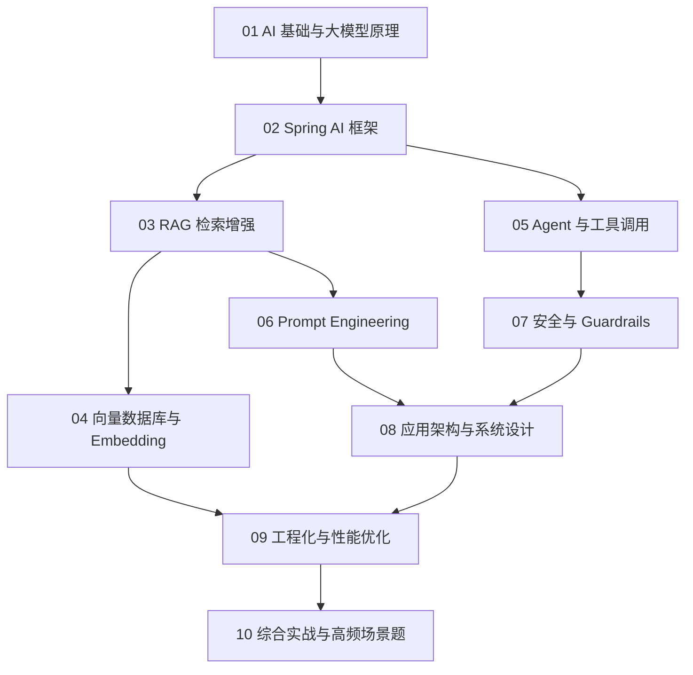
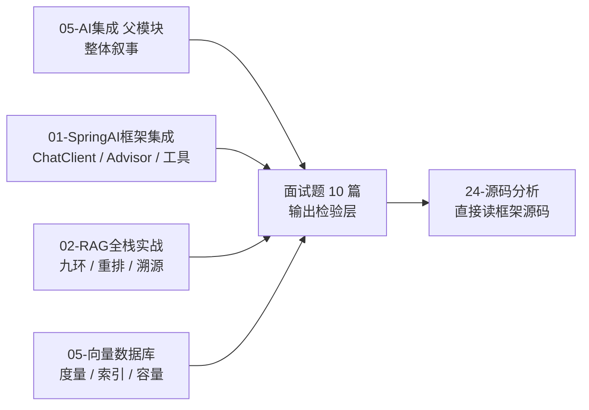

# AI 集成面试题：这一层不考你会不会背，考你能不能把话落回一行代码

> **一句话结论**：这十篇是"输出检验层"，不是题库——每道题真正在测三件事：能不能讲机制（框架里谁在什么时机、按什么顺序做了什么）、能不能定位故障（给一个症状，说得出先看哪层、哪个参数、哪条日志）、能不能改造（换 provider、加兜底、改指标要动哪几处、代价多大）。
> **阅读前置**：至少读过 [01-SpringAI入门](../01-SpringAI框架集成/01-SpringAI入门.md) 里 ChatModel / ChatClient / VectorStore 三个抽象，以及 [01-RAG检索增强生成](../02-RAG全栈实战/01-RAG检索增强生成.md) 里"RAG 九环"指哪九环。缺这两块，"答案骨架"对你只是顺口溜。
> **证据基线**：Spring AI 2.1.0 + Spring Boot 4.2.0 + Spring Framework 7.1.0 + JDK 17；A 级源码摘录 905 份 `.md` 已入库 `learning-docs/24-源码分析/assets/source/`；B 级行号为 2026-11 当次核对；C 级命令均本机可复现（不启服务、不联网、不跑 mvn/npm）；预计阅读 40~60 分钟。

| 类别 | 本仓状态 | 本文怎么用 |
| --- | --- | --- |
| A 源码摘录 | 目录内共 908 个文件，其中 905 份 `.md`（另 3 个 `.py` 是我自己留下的一次性脚本），`org.springframework.ai` 系列覆盖较全 | 讲框架机制一律挂 `[[源码:Xxx.java.md#L起-L止]]`，行号取摘录内嵌的原始行号，不是 `.md` 文件行号 |
| B 本项目源码 | chat 服务 215 个 `.java` 全部可读；参数大多在 `tools/nacos-config/ai-cs-chat.yml` 与各 `application*.yml` | "本项目怎么做"必带 `文件#L起-L止`，写不出来就当没做过 |
| C 可复现实测 | 允许 node 纯计算、pwsh 静态统计、javap 看 m2 里 jar 签名（m2 内 spring-ai 1.1.4 与 2.1.0 并存） | 每条命令给真实输出 + "怎么读"，也说明"你自己重跑大致会得到什么" |
| 未落地 | 流式 usage 落账、评估门禁接 CI、微调、MCP、业务多租户、提示词真实灰度、向量库 upsert | 见 §8 诚实清单，逐条点名，不拿官方文档冒充实测 |

### 这份材料写给谁

| 你的处境 | 从这里开始 | 别做的事 |
| --- | --- | --- |
| 刚读完正文，想确认自己真读懂了 | §7 打分表 → 空格的篇 | 别按篇号从头读到尾，十篇不是线性课程 |
| 一周内要面试，简历写了这个项目 | §4 路线 A + §8 诚实清单 | 别背范文，先把四组参数背死 |
| 已经在职，要接手这块 | §4 路线 B + §5 的依赖表 | 别跳过 03 直接看 08，架构题会答成空话 |
| 面试官/导师，要用它考别人 | §7 表 + 各篇自测题（都在 `<details>` 里） | 别只看第一格打勾，往下追两层 |

---

## 1. 定位：输出检验层，不是背题库

正文篇回答"这个机制是什么"，这十篇反过来问"不看资料，你能不能把它讲成一段有主语、有顺序、有数字的话"。所以本文不列目录摘要（目录看 §2 的图），只讲**这十篇怎么用、用到什么程度算过关**。

### 1.1 三个面试现场

**现场一：RAG 链路讲得头头是道，一追参数就断电。**

> 面试官：你们召回多少条？相似度阈值多少？
> 候选人：topK 一般 5 到 10 吧，阈值看情况……
> 面试官：那为什么不全量召回 50 条塞给模型？

本项目的答案是两个写死的数：召回 20 条、相似度阈值 0.3（低于它的候选直接丢弃），再交给 rerank 取前 5 条、最低分 0.7（`tools/nacos-config/ai-cs-chat.yml#L22-L25` 与 `#L13-L19`）。答不出这四个数字，面试官会推断整条链路你都是"听说的"。

**现场二：能背"Advisor 是有序链"，问谁把工具循环搬进来就停。**

> 候选人：Advisor 就是拦截器链，按 order 排序。
> 面试官：那"模型要工具 → 执行工具 → 再问模型"这个循环，2.x 里是谁跑的？

Spring AI 2.0 起这件事从调用方搬进了 advisor：`ToolCallingAdvisor implements CallAdvisor, StreamAdvisor, ToolAdvisor`（`[[源码:ToolCallingAdvisor.java.md#L86]]`，类注释标注 `@since 2.0.0`，见同文件 `#L84`），默认顺序 `Ordered.HIGHEST_PRECEDENCE + 300`（`#L96`）。答"我在 ChatClient 外层自己 while 循环"，在 2.x 里就是过时答案——尤其当你把它说成"最佳实践"时。

**现场三：简历写"实现了流式 token 计费"，被问数据从哪来。**

> 面试官：流式响应的 usage 从哪拿？
> 候选人：Spring AI 会给……

`Usage` 的两个取数方法是 `Integer getPromptTokens()` / `Integer getCompletionTokens()`，返回包装类型意味着**可以是 null**（`[[源码:Usage.java.md#L37-L46]]`）。本项目在 `ai-cs-chat/src/main/java/com/aics/chat/service/impl/ResilientAiService.java#L277` 声明了 `AtomicReference<Usage> usageRef`，但全仓搜 `usageRef.set` 命中 **0**：声明了，没人赋值。所以流式请求拿不到真实 usage，只能估算。说"我们按 usage 精确计费"，是把没验证过的话当事实讲。

> 这些现象指向同一件事：面试官在测你能不能把名词落回"我这行代码、这个参数、这条日志"。落不回去，讲得再顺也是二手知识。

### 1.2 四层考察：同一道题，答到哪层给哪档

| 层级 | 判据 | 面试官心里的判词 | 大致分段 |
| --- | --- | --- | --- |
| 背结论 | 说得出名词和定义，举不出参数、文件、日志 | "看过文章，没做过" | 及格线以下 |
| 讲机制 | 说得出"谁、什么时机、什么顺序、做了什么"，能给类名或默认值 | "读过源码或踩过坑" | 及格 |
| 会定位 | 给一个症状，说得出先看哪层、看什么日志、动哪个参数 | "能上手排障" | 良好 |
| 能改造 | 说得出换 provider / 加兜底 / 改指标各要动几处，以及代价 | "这块能交给他" | 优秀 |

十篇里每题的"深挖追问"就是往下一层推的钩子。判断自己到没到下一层的标准只有一个：**被追问两次之后，你还剩不剩具体事实。**

这张表怎么用：面试里你无法控制被推到哪一层，但可以控制**在每一层停住的位置**。到"讲机制"层就卡壳的题，允许自己说"细节我记不准，但机制是这样"；到"会定位"层就卡壳的题，不要硬编日志字段——一句"没实际排过这条故障"比编一个不存在的日志名安全得多。

### 1.3 这十篇不负责的事

- 不替代正文篇：这里没有从零推导，只有"考什么、怎么答、错在哪"。
- 不给"标准答案范文"：范文背下来正好是面试官最讨厌的那类回答。
- 不保证每篇证据一样厚：09、10 两篇还没按新范式重写（见 §3.1 的实测计数）。

---

## 2. 目录地图：三域十篇，收口在第 10 篇



> **读图说明**：实线是"前置关系"，不是"阅读顺序"。三条主干要看清：①`01 → 02` 是全程地基——02 讲的 Advisor 链、工具回调、结构化输出，全部建立在 ChatModel（模型抽象）与 ChatClient（面向业务的 fluent API）分工之上，跳过 01 直接看 02 会背成一串类名；②`03 → 04` 是唯一"先懂链路再懂存储"的方向——先知道 RAG 有召回/重排/拼上下文哪几环，才明白 04 里的度量、索引、`efSearch`（HNSW 图检索的候选扩展宽度）拧的是哪一环，反过来读会把向量库当成 RAG 的全部；③`07 → 08 → 09 → 10` 是工程线收口，10 的"设计一个智能客服系统"会把前九个域的点全拴在一张图上。**最容易看错的一处**：把 05（Agent 与工具）和 06（提示词）当成可选支线——它们恰恰是"AI 能真干活"的那部分，08 和 10 的追问几乎都会绕回工具循环与提示词版本管理。

### 2.1 推荐顺序

| 你的处境 | 建议顺序 | 为什么这么排 |
| --- | --- | --- |
| 只想面试不掉分 | 01 → 02 → 03 → 05 → 08 | 这五篇覆盖追问率最高的四条线：参数、Advisor、检索、工具循环、降级 |
| 真做过这个项目，要接住三轮追问 | 02 → 05 → 03 → 04 → 07 → 08 | 从"我怎么调模型"讲到"我怎么防它出事"，中间每步都有本项目代码可指 |
| 要负责上线（排障、成本） | 03 → 04 → 07 → 09 → 08 | 先能把"检索不准"拆开，再谈成本与容量，最后才谈架构 |
| 不知道自己缺哪块 | 先做 §7 打分表，再回对应篇 | 打分表是十篇的索引，空格子就是缺失域 |

### 2.2 一个容易踩的编号陷阱

父模块 [05-AI集成](../README.md) 的正文编号（01 入门、05 可观测、10 提示词灰度）与本组题目编号（01 基础原理、06 提示词、09 工程化）**不是同一套**。跨文件引用时别凭印象写"详见 10"，§3 的表里给了每篇对应的正文篇准确链接。

---

## 3. 每篇一句话摘要

| 篇 | 考察什么（一句话） | 对应正文篇 | 本项目证据强度 |
| --- | --- | --- | --- |
| [01-AI基础与大模型原理](01-AI基础与大模型原理.md) | token 怎么切、上下文窗口怎么算、temperature 改的是什么分布、幻觉分四层怎么各自缓解、微调与 RAG 何时选谁 | [01-SpringAI入门](../01-SpringAI框架集成/01-SpringAI入门.md)、[02-LLM工程化实践](../01-SpringAI框架集成/02-LLM工程化实践.md) | A 24 / 项目引用 25：原理题天然少落项目，靠 A 级撑 |
| [02-Spring-AI框架](02-Spring-AI框架.md) | ChatModel 与 ChatClient 的职责边界、Advisor 链顺序、`@Tool` 到 ToolCallback 的转换、结构化输出、记忆窗口、流式背压 | [01-SpringAI入门](../01-SpringAI框架集成/01-SpringAI入门.md)、[12-SpringAI-2.0升级评估与迁移指南](../01-SpringAI框架集成/12-SpringAI-2.0升级评估与迁移指南.md) | A 46 / 项目引用 14：A 级最厚的一篇 |
| [03-RAG检索增强生成](03-RAG检索增强生成.md) | 九环里每一环坏了各长什么样、"检索到不相关"与"没检索到"怎么区分、两阶段参数联动、引用溯源与忠实度 | [01-RAG检索增强生成](../02-RAG全栈实战/01-RAG检索增强生成.md)、[04-RAG进阶实战-Rerank重排序](../02-RAG全栈实战/04-RAG进阶实战-Rerank重排序.md) | A 15 / 项目引用 45：项目证据最密的故障定位篇 |
| [04-向量数据库与Embedding](04-向量数据库与Embedding.md) | 相似度的单位与量纲、换 Embedding 模型会连锁到哪、Flat/IVF/HNSW/PQ 怎么选、metadata 过滤与删除残留 | [03-选型与容量规划](../05-向量数据库/03-选型与容量规划.md)、[03-RAG向量检索实战](../02-RAG全栈实战/03-RAG向量检索实战.md) | A 18 / 项目引用 36 |
| [05-AI-Agent与工具调用](05-AI-Agent与工具调用.md) | Agent 三种形态、工具描述怎么写才不被误用、循环靠什么终止、危险操作确认、转人工怎么交接 | [04-智能客服Agent编排与人工转接实现文档](../01-SpringAI框架集成/04-智能客服Agent编排与人工转接实现文档.md)、[11-MCP协议实战-模型上下文协议](../01-SpringAI框架集成/11-MCP协议实战-模型上下文协议.md) | A 24 / 项目引用 19 |
| [06-Prompt-Engineering](06-Prompt-Engineering.md) | 提示词四段结构、few-shot 顺序、输出格式校验与重试、指令冲突的优先级、注入与数据指令分离、版本管理与回滚 | [10-提示词版本管理与灰度发布实战](../01-SpringAI框架集成/10-提示词版本管理与灰度发布实战.md) | A 32 / 项目引用 15：证据足但自测题偏少 |
| [07-AI安全与Guardrails](07-AI安全与Guardrails.md) | 直接注入与间接注入、输入侧正则的边界在哪、检索侧先过滤、输出侧审核、工具调用四道锁、PII 脱敏的绕过路径 | [06-AI安全网关与Guardrails实现文档](../01-SpringAI框架集成/06-AI安全网关与Guardrails实现文档.md) | A 9 / 项目引用 33：长篇但 A 级薄，讲机制时要自己补锚点 |
| [08-AI应用架构与系统设计](08-AI应用架构与系统设计.md) | 能力集中还是分散、同步与流式取舍、模型/检索/工具分别降级、三层限流、成本治理、多租户三轴、一次 trace 贯穿 | [05-LLM可观测性评估与成本治理实现文档](../01-SpringAI框架集成/05-LLM可观测性评估与成本治理实现文档.md)、[07-AI集成](../01-SpringAI框架集成/07-AI集成.md) | A 12 / 项目引用 42：架构结论有一半只能靠设计推理 |
| [09-AI工程化与性能优化](09-AI工程化与性能优化.md) | 延迟怎么拆、吞吐受什么限、可观测三件套、CI/CD、本地开源模型部署 | [05-LLM可观测性评估与成本治理实现文档](../01-SpringAI框架集成/05-LLM可观测性评估与成本治理实现文档.md)、[09-ai-cs-chat接口测试报告](../01-SpringAI框架集成/09-ai-cs-chat接口测试报告.md) | **弱：A 0 / 项目引用 0，仍是旧体例（只列问答对）** |
| [10-综合实战与高频场景题](10-综合实战与高频场景题.md) | 从零设计智能客服、情绪处理、多格式知识库、最大技术挑战、ROI、兜底、多模态、MCP 与 A2A、国产模型选型 | [08-AI功能与技术缺口分析](../01-SpringAI框架集成/08-AI功能与技术缺口分析.md)、[10-RAG全栈实战-知识点汇总](../02-RAG全栈实战/10-RAG全栈实战-知识点汇总.md) | **弱：A 0 / 项目引用 0，仍是旧体例** |

### 3.1 这张表的数字怎么自己数（C 级）

面试题最容易被写虚的地方就是"证据密度"。下表数字我自己重跑过，你也可以重跑（十秒级，不联网）：

```powershell
cd D:\Projects\Persion\ai-customer-service\learning-docs\05-AI集成\面试题
Get-ChildItem *.md | Where-Object Name -ne 'README.md' | Sort-Object Name | ForEach-Object {
  $c = Get-Content $_.FullName -Raw -Encoding UTF8
  "{0,-34} A={1,3} projectRef={2,3} details={3,3} lines={4,4}" -f $_.Name,
    ([regex]::Matches($c,'\[\[源码[:：]')).Count,
    ([regex]::Matches($c,'ai-cs-[A-Za-z0-9-]+/')).Count,
    ([regex]::Matches($c,'<details>')).Count,
    (Get-Content $_.FullName).Count
}
```

本机实测（2026-11）：

```text
01-AI基础与大模型原理.md                   A= 24 projectRef= 25 details= 14 lines= 612
02-Spring-AI框架.md                  A= 46 projectRef= 14 details= 15 lines= 560
03-RAG检索增强生成.md                    A= 15 projectRef= 45 details= 14 lines= 593
04-向量数据库与Embedding.md              A= 18 projectRef= 36 details= 14 lines= 535
05-AI-Agent与工具调用.md                  A= 24 projectRef= 19 details= 15 lines= 493
06-Prompt-Engineering.md           A= 32 projectRef= 15 details= 11 lines= 497
07-AI安全与Guardrails.md              A=  9 projectRef= 33 details= 16 lines= 878
08-AI应用架构与系统设计.md                  A= 12 projectRef= 42 details= 15 lines= 628
09-AI工程化与性能优化.md                     A=  0 projectRef=  0 details=  0 lines= 334
10-综合实战与高频场景题.md                   A=  0 projectRef=  0 details=  0 lines= 437
```

怎么读这三列：

- `A` 是硬证据密度，即能点开 `assets/source/` 对照的行号锚点条数。A 高说明"框架侧讲机制"有据可查；A 低（如 07 的 9）说明那篇的强项在项目落地而非源码。
- `projectRef` 是本项目路径被引用的次数（`ai-cs-*/...` 形态）。这一列为 0 基本等于"没落项目"——09、10 就是。
- `details` 是自测题条数。A 高但 `details` 低的（06：32 对 11），适合读、不适合拿来测自己。

行数会随仓库演进变化，兄弟篇目也可能正在被重写，**以你跑出来的为准**。

### 3.2 三秒判断一篇能不能直接用

- 三个计数里 `A` 或 `projectRef` 有一列为 0 → 这篇还没按新范式写，只能当问题清单用。
- 有 `A` 但 `details` 明显少 → 证据够、自测不够，读它、别指望它测你。
- 三个数都高但行数也巨大（例如 07 的 878 行）→ 内容厚，别一次读完，按 §9 的症状表跳读。

---

## 4. 三条刷题路线

| 路线 | 适合谁 | 顺序 | 耗时 | 产出物 |
| --- | --- | --- | --- | --- |
| A 面试速通 | 明天就面，只要不被问穿 | 01 的 token/窗口/temperature 三题 → 02 的 ChatClient 与 Advisor 链 → 03 的两阶段检索 → 05 的循环终止 → 08 的降级 | 1 天，约 6~8 小时 | 一页 A4：四组数字 + 三条"我改过什么" |
| B 深挖 | 简历真写了这个项目，要接住三轮追问 | 02 → 05 → 03 → 04 → 07 → 08（带着源码读） | 3 天，每天 3~4 小时 | 每域一条证据链：现象 → 类/参数 → 本项目行号 → 怎么验证 |
| C 自测打分 | 不知道自己缺哪块 | 先填 §7 打分表，只补空格子，再用各篇自测题验 | 半天 | 一张填满的表 + 3~5 条必补清单 |

### 4.1 路线 A：1 天速通（逐小时）

1. **第 1 小时｜01**：token 与窗口、temperature、幻觉四层。动手算一次"20 轮对话 ≈ 多少 token"，把窗口上限和裁剪策略对上。
2. **第 2 小时｜02**：ChatModel 与 ChatClient 的分工、Advisor 链顺序。记死一个默认值：`ToolCallingAdvisor` 的 `DEFAULT_ORDER = Ordered.HIGHEST_PRECEDENCE + 300`（`[[源码:ToolCallingAdvisor.java.md#L96]]`）。
3. **第 3 小时｜03**：两阶段检索。背 20 / 0.3 → 5 / 0.7，并说清"为什么不是召回 50 条全喂进去"（上下文成本 + 长上下文中间遗忘）。
4. **第 4 小时｜05**：Agent 循环怎么终止、危险操作怎么确认。能说出"没有上限的工具循环 = 账单事故"。
5. **第 5 小时｜08**：模型、检索、工具三条线分别怎么降级；限流为什么放在认证之后。
6. **第 6 小时｜收口**：按 §6 的四步闭环，把四组数字各口述三遍。

**产出物验收**：四组数字不看稿能说；每组至少挂一条 B 级行号；被追问"你改过哪行"时能指到文件。

### 4.2 路线 B：3 天深挖（每天一个主题）

- **Day 1｜调用层（02 + 05）**：Advisor 链 → 工具回调转换 → 2.x 把循环搬进 advisor 的影响。产出：手绘一张"一次带工具调用的请求"时序图，标出 3 个可能崩的点。
- **Day 2｜检索层（03 + 04）**：九环故障长相 + 两阶段参数 + 索引与 `efSearch`。产出：打开 `tools/nacos-config/ai-cs-chat.yml#L13-L25` 原文，逐行解释每个数字改大/改小会发生什么。
- **Day 3｜工程层（07 + 08）**：注入四道锁 + 三层降级 + 一条 trace 贯穿。产出：端到端白板图（用户 → 网关 → chat → 检索 → 模型 → 观测），标出限流点、降级点、审计点。

**产出物验收**：三张图都能在 5 分钟内讲完，且每张至少标出一个"这里出错会表现成什么样"。

### 4.3 路线 C：半天自测打分

1. 先做 §7 表，只勾"能不假思索说出来"的格子——犹豫就留空。
2. 空格子所在的篇，只做那篇的自测题（折叠答案先别看），限时 15 分钟。
3. 对完答案后，凡错在"讲机制"层的，回那一节正文重读；错在"会定位"层的，去 §8 找有没有对应的未落地说明。

**打分口径**：4 格全勾=能带节奏；3 格=能过；≤2 格=只是背过。

### 4.4 三条路线共同的禁区

- 不要从 09、10 开始：它们是旧体例（问答对），读了只会背台词，还容易把过时结论当基线。
- 不要在没跑过命令的情况下引用数字：本项目大量参数在 `tools/nacos-config/ai-cs-chat.yml` 与 `application*.yml` 里，不在 Java 代码里。
- 不要把"官方文档说"讲成"我们做了"：边界见 §8。

### 4.5 路线 A 那页 A4 长什么样

速通路线的产出物就一张纸，四块参数 + 三句"我改过什么"，每块后面挂一条能核对的锚点：

```text
【模型侧】deepseek-chat / temperature 0.7 / max-tokens 2048
          ← tools/nacos-config/ai-cs-chat.yml#L6-L9
【检索侧】召回 20 条、阈值 0.3 → rerank 取 5 条、最低分 0.7、超时 5s
          ← tools/nacos-config/ai-cs-chat.yml#L13-L19 与 #L22-L25
【缓存侧】L1 4096 条/168h｜语义缓存 阈值 0.92、200 条、168h｜热门问答 3 次/24h
          ← ai-cs-chat/src/main/resources/application.yml#L181-L193
【框架侧】ToolCallingAdvisor 默认 order = HIGHEST_PRECEDENCE + 300
          ← 源码摘录 ToolCallingAdvisor.java.md#L96
【我改过的三处】1) …… 2) …… 3) ……
```

怎么用这张纸：面试前半小时只看它。四个方块对应四条最常被追问的线（模型参数、检索链路、缓存、advisor 顺序），每个方块都能往下说三层——参数是多少、为什么是这个数、改大改小会怎样。第三层答不出时，老实说"没做过这个方向的调优"，比编一个理由安全。

---

## 5. 依赖关系：这三份前置缺一份，题就答不深



> **读图说明**：三条入边是三份前置知识，五条边里只有 `ME → NEXT` 是"读完这里再往下"的方向。看错这点的代价是：把面试题当成学习入口，遇到 A 级锚点就去翻 `assets/source/`，结果每个类都读得懂、串不起来。正确姿势是"先在正文篇里把链路走通，再来这里做输出检验"。

| 关系 | 真实链接 | 缺了它会怎样 |
| --- | --- | --- |
| 前置·调用层 | [01-SpringAI框架集成/01-SpringAI入门](../01-SpringAI框架集成/01-SpringAI入门.md) | 02/05 的答案骨架背得下来，但一被问"Advisor 在调用链的哪个位置"就答不出 |
| 前置·检索层 | [02-RAG全栈实战/01-RAG检索增强生成](../02-RAG全栈实战/01-RAG检索增强生成.md) | 03 的"九环故障"没法定位，只能笼统说"检索不准" |
| 前置·存储层 | [05-向量数据库/README](../05-向量数据库/README.md) | 04 的索引选型与容量换算无从下手，`efSearch` 之类的旋钮只能死记 |
| 上游总览 | [05-AI集成/README](../README.md) | 不知道这十篇在整个 AI 集成叙事里的位置，容易把它们当成全部 |
| 下游深入 | [24-源码分析/README](../../24-源码分析/README.md) | A 级锚点只能信、不能查；遇到版本差异时没法自己判 |

---

## 6. 使用方式：四步闭环，缺一步就只是"看过"

| 步骤 | 具体做什么 | 失败信号 | 耗时 |
| --- | --- | --- | --- |
| ① 先自答 | 只看题面，用手机录音或写关键词，限时 60 秒答完 | 开口就组织语言、说不出第二个事实 | 每题 1 分钟 |
| ② 看答案骨架 | 对照 3~5 句的骨架，找自己漏掉的"顺序词"和"数字" | 觉得"差不多"，但骨架里的顺序词你一个都没用 | 每题 1 分钟 |
| ③ 对照证据 | 把骨架里的每个事实去 `assets/source/`（A 级）或本项目文件（B 级）核一遍 | 有事实你找不到出处——那多半是你自己补的 | 每题 3~5 分钟 |
| ④ 回正文篇 | 标"不会"的那题，回 §3 表里对应的正文篇读那一节，再回来重答一遍 | 重答还是原话，说明没读到机制 | 按篇计 |

这四步的顺序不能换：先看答案再自答，你测的是记忆力而不是理解力；跳过第 ③ 步，你会把"听起来对"的东西带上考场。

### 6.1 一次完整闭环演示

拿 05 篇里那道「工具调用的循环是在哪里终止的」走一遍，四步各是什么样：

**① 先自答（60 秒，如实记录自己的原话）**："模型返回工具调用 → 我们执行 → 结果回填 → 再请求模型，直到模型不再要工具。终止条件……应该是模型说不用了？"

这句话暴露了两处空洞：**没说入口条件**（什么情况循环根本不进），**没说上限**（万一模型无限要工具呢）。

**② 看答案骨架（对照那篇的 3~5 句）**，合格骨架长这样：

1. Spring AI 2.0 起，这个循环由 `ToolCallingAdvisor` 承担，它同时实现 `CallAdvisor`、`StreamAdvisor`、`ToolAdvisor` 三种角色（`[[源码:ToolCallingAdvisor.java.md#L86]]`）。
2. 入口有前提：只有 `ChatOptions` 是 `ToolCallingChatOptions` 时循环才启动，否则 advisor 直接放行——所以自定义 options 写错会导致工具"静默不执行"。
3. 终止的判据是"模型这一次没有再返回工具调用"，不是某个写死的轮数。
4. 轮数/次数的护栏由 `ToolCallLimits` 承担（`[[源码:ToolCallLimits.java.md#L35-L37]]`，2.0.1 起引入，包私有类型）。
5. 危险工具的确认、幂等、审计属于业务侧，advisor 不管语义——这是工具设计题要自己补的那句。

**③ 对照证据**：打开 `assets/source/` 里那两个摘录，确认类声明与引入版本；再确认"默认 order 是 `HIGHEST_PRECEDENCE + 300`"（`#L96`）——这条决定了它排在你自定义 advisor 之前还是之后，答错顺序就等于答错整条链。

**④ 回正文篇**：我漏的是"入口条件"，回 05 篇对应节重读，然后重答一遍。重答时先报入口、再报终止、最后报上限——顺序本身就是评分点。

**验收**：这次口述里出现两个可核对事实（类名 + 上限类型），并能说出"什么情况下循环静默不执行"。做不到，就说明还停在"背结论"层。

---

## 7. 自测打分表：10 个能力域 × 4 个层级

用法：每一格只有在"不看稿、60 秒内、能给出一个可核对事实"时才打勾。

| 能力域 | 背结论 | 讲机制 | 会定位 | 能改造 |
| --- | --- | --- | --- | --- |
| 01 token / 窗口 / temperature | ☐ | ☐ | ☐ | ☐ |
| 02 Advisor 链与工具回调 | ☐ | ☐ | ☐ | ☐ |
| 03 RAG 九环与两阶段检索 | ☐ | ☐ | ☐ | ☐ |
| 04 度量 / 索引 / 容量 | ☐ | ☐ | ☐ | ☐ |
| 05 Agent 循环与交接 | ☐ | ☐ | ☐ | ☐ |
| 06 提示词结构与版本管理 | ☐ | ☐ | ☐ | ☐ |
| 07 注入与 Guardrails | ☐ | ☐ | ☐ | ☐ |
| 08 架构 / 降级 / 限流 | ☐ | ☐ | ☐ | ☐ |
| 09 延迟 / 吞吐 / 可观测 | ☐ | ☐ | ☐ | ☐ |
| 10 综合设计与取舍 | ☐ | ☐ | ☐ | ☐ |

读表方法：
- 一行 4 格全勾 → 这个域可以主动引导面试官问，你能带节奏。
- 一行只有前两格 → 能过，但别主动引战；被深挖就用 §8 的诚实说法收尾。
- 一行只有第一格或全空 → 先回对应正文篇，别硬答，硬答比说"这块我只做过浅层"更掉分。

---

## 8. 诚实清单：这些题的"项目答案"是未落地 / 只有设计

面试题最容易出事的地方，是把"框架支持"说成"我们做了"。下面每一条都给了当次核对的具体位置，被追问时照着说，比编一个细节安全得多。

| 条目 | 项目真实状态 | 证据（当次核对） | 面试怎么说 |
| --- | --- | --- | --- |
| 流式 token 计费 | 只有声明，没有赋值 | `ai-cs-chat/src/main/java/com/aics/chat/service/impl/ResilientAiService.java#L277` 声明 `usageRef`；全仓 `usageRef.set` 命中 0 | "流式下 usage 可能为空（`[[源码:Usage.java.md#L37-L46]]` 返回 `Integer`），我们按估算落账并标成估算值" |
| 评估门禁 | 有配置类，没有配置值 | `ai-cs-chat/src/main/java/com/aics/chat/rag/eval/EvalGateConfig.java#L34` 绑定 `aics.eval.gate`，字段用 `Long` 允许不配；全仓 yml 无该前缀 | "骨架在，阈值没定，因为没跑出可信基线" |
| golden 评估集 | 20 条，只是资源文件 | `ai-cs-chat` 模块内 `src/main/resources/eval/golden-set.json`（node 实测 20 条，含 `expectedDocumentIds`、`expectedKeywords` 等 6 个字段） | "20 条手工集，够回归、不够统计显著" |
| 忠实度 / NDCG 类指标 | 未实现 | 与 03 篇正文一致：只有召回类断言，没有 faithfulness 自动评分 | "我们只做了引用溯源，没算忠实度" |
| 微调 | 未落地 | 全仓 `finetun|fine-tun|sft` 命中 0 | "没做微调，走的是 RAG + 提示词" |
| MCP（模型上下文协议） | chat 服务内未接 | `ai-cs-chat/src/main` 内 `mcp` 命中 0 | "了解协议形态，项目里没接" |
| 业务多租户 | 只有单点配置 | `ai-cs-chat/src/main/java/com/aics/chat/config/VectorStoreConfig.java#L84` 是全仓唯一 `.tenantName(...)` | "向量库侧有 tenant 概念，业务侧没做隔离" |
| 提示词灰度 | 8 场景全部钉版本 | `ai-cs-chat/src/main/resources/application-prompt.yml#L13-L20` 起 8 个场景，全部 `strategy: pinned`；`canary|percent` 命中 0 | "机制支持灰度，当前全部钉在固定版本" |
| 向量库 upsert | 从不调用 | `[[源码:VectorStore.java.md#L78-L82]]`：`upsert` 是 2.1.0 才加的 `default` 方法，默认实现直接抛 `UnsupportedOperationException`；本仓 `upsert` 命中 3 处，全在 ai-cs-search 的 ES CDC 注释与日志里 | "写入走 add 不走 upsert，所以增量同步没有覆盖语义" |
| 后端 CI | 只有 python 一条 | `.github/workflows/` 下唯一 workflow 是 `python-learning-validate.yml` | "后端没有 CI 门禁，测试靠本地 mvn verify" |
| 向量索引调优 | 未调 | `ai-cs-chat/src/main` 内 `hnsw` 命中 1 处且是注释 | "Chroma 用默认参数，没做过 efSearch 曲线" |
| 流式与多模态的组合 | 分头做过，没打通 | 流式在 chat 主链路，图像理解走 VLM 文档（[03-多模态图生文实战](../01-SpringAI框架集成/03-多模态图生文实战-VLM视觉理解.md)） | "两条链路各自可用，没做同一请求内的组合" |

**30 秒自证法**：任何一条"我们没做 X"的说法，都可以用一条 grep 当场验证。示例：

```powershell
cd D:\Projects\Persion\ai-customer-service
Select-String -Path (Get-ChildItem -Recurse -Filter *.java ai-cs-chat\src\main).FullName -Pattern 'usageRef\.set' -Encoding UTF8 | Measure-Object
```

本机实测输出：

```text
Count : 0
```

怎么读：`Count : 0` 说明"声明了 `AtomicReference<Usage>` 但从未赋值"成立。把 `-Pattern` 换成 `mcp`、`finetun`、`hnsw`，就是另外三条诚实例子的验证方式。**面试前把这几条都跑一遍**，你对"未落地"的表述就有底气了。

### 8.1 三种最容易骗过自己的说法

- **"框架支持 = 我们做了"**：Spring AI 2.1.0 的 `VectorStore` 有 `upsert`，本仓一次都没调用（`[[源码:VectorStore.java.md#L78-L82]]`）。拆解法：问自己"哪一行代码调用了它"。
- **"配置项存在 = 逻辑生效"**：`aics.eval.gate` 的配置类在（`EvalGateConfig.java#L34`），但没有任何 yml 给它赋值，字段还是 `Long` 包装类型——不配就恒为 null，等于不校验。拆解法：问自己"这个值跑起来是多少"。
- **"跑通过一次 = 稳了"**：20 条 golden 集能跑出报告，但不构成基线，门禁阈值也就没法定。拆解法：问自己"样本多少条、谁维护、失败阈值多少"。

这三句的共同点：把"存在"当成"生效"。面试里最容易被这两层之间的差距问穿。

---

## 9. 常见问题直达表

| 症状 | 去哪篇 | 为什么先去那篇 |
| --- | --- | --- |
| RAG 讲得顺，一被问"你怎么知道检索坏了"就空 | [03-RAG检索增强生成](03-RAG检索增强生成.md) | 那篇把"没检索到"与"检索到但不相关"拆成了两种不同症状 |
| 说不清召回条数、相似度阈值、rerank 门槛为什么是这几个数 | [03-RAG检索增强生成](03-RAG检索增强生成.md) + [04-向量数据库与Embedding](04-向量数据库与Embedding.md) | 参数联动在 03，量纲与索引在 04；本项目取值 20 / 0.3 → 5 / 0.7 |
| 被问"换个 Embedding 模型会怎样" | [04-向量数据库与Embedding](04-向量数据库与Embedding.md) | 换模型要重算全量向量，维度不同还得重建集合 |
| 讲不清 Advisor 顺序、工具循环到底谁在跑 | [02-Spring-AI框架](02-Spring-AI框架.md) | 2.x 的答案在 `ToolCallingAdvisor`，含默认 order |
| Agent 循环停不下来、越调越贵 | [05-AI-Agent与工具调用](05-AI-Agent与工具调用.md) | 循环上限、危险操作确认、幂等都在那篇 |
| 被问"提示词怎么上线、怎么回滚" | [06-Prompt-Engineering](06-Prompt-Engineering.md) | 版本管理与灰度回滚是那篇的独立考点 |
| "你们防注入做了什么"只会说"加了正则" | [07-AI安全与Guardrails](07-AI安全与Guardrails.md) | 四道锁里正则只是一道，其余在检索侧、输出侧、工具侧 |
| "设计一个智能客服"讲成一堆组件清单 | [08-AI应用架构与系统设计](08-AI应用架构与系统设计.md) | 那篇要求画出端到端链路并标出降级点与限流点 |
| 延迟高 / 成本高，被追问怎么拆 | [08-AI应用架构与系统设计](08-AI应用架构与系统设计.md) + [09-AI工程化与性能优化](09-AI工程化与性能优化.md) | 08 给拆分框架，09 的问题清单可用于自查（注意 09 仍是旧体例） |
| 流式怎么实现、背压怎么办 | [02-Spring-AI框架](02-Spring-AI框架.md) | 流式返回与 Flux 背压在那篇的独立考点里 |
| 结构化输出老解析失败 | [02-Spring-AI框架](02-Spring-AI框架.md) + [06-Prompt-Engineering](06-Prompt-Engineering.md) | 转换器在 02，格式约束与校验重试在 06 |
| 转人工 / 交接怎么设计 | [05-AI-Agent与工具调用](05-AI-Agent与工具调用.md) + [04-智能客服Agent编排与人工转接实现文档](../01-SpringAI框架集成/04-智能客服Agent编排与人工转接实现文档.md) | 题目侧看 05，实现侧看正文篇 |

找不到对应症状时按 §2 的域定位：先判断是"模型/检索不懂"、"工具不会用"、还是"上线撑不住"，再进对应篇——这比从第一篇顺着读快得多。

---

读完之后下一步：挑一个你还敢主动引战的能力域，去 [24-源码分析](../../24-源码分析/README.md) 把那几处 A 级锚点所在的类真读一遍，回来把答案骨架重写一遍——通不过这一步的答案，都还只是别人的话。
