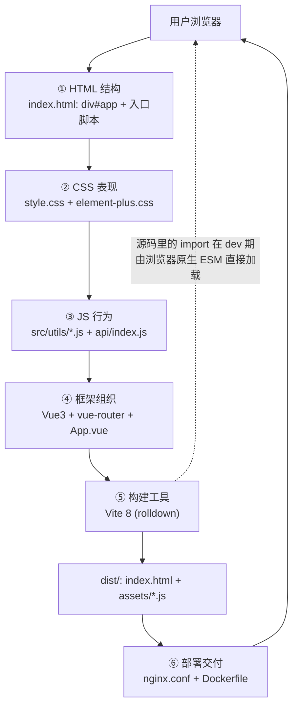

# 前端技术全景：六层栈各管什么失败，以及本仓库为什么是 Vue 3 + Element Plus + Vite

> 一句话结论：前端不是一张名词表，而是**六层各兜住一类失败**——HTML 兜"内容装不下/拿不到"，CSS 兜"看不见/闪一下"，JS 兜"状态变了视图不变"，框架兜"状态到视图的同步靠人手写会失控"，构建工具兜"源码浏览器根本不认识"，部署交付兜"文件到了用户手上还对不对"。真正让人上线炸掉的往往不是语法，而是**某一层的默认值**：本仓库的三处关键取舍就写在 `ai-cs-frontend/vite.config.js:50-63`（chunk 怎么切）、`ai-cs-frontend/src/utils/runtime.js:14-18`（空串该不该回退）、`ai-cs-frontend/nginx.conf:64-70`（找不到文件交给谁）。
>
> 阅读前置：会写 HTML/CSS/JS 三件套，用过任意一个前端框架（Vue/React 任选其一即可）；知道 npm 和 package.json 大概是什么。**不需要**读过本模块其它篇，本篇只看全景，不下场写代码。
>
> 证据基线：Vue 侧 `ai-cs-frontend`（vue ^3.5.39 / vite ^8.1.1 / element-plus ^2.14.3 / vue-router ^4.6.4，见 `ai-cs-frontend` 的 `package.json:16-36`），React 侧 `ai-cs-frontend-react`（react ^18.3.1 / antd ^5.22.5 / vite ^5.4.11，见 `ai-cs-frontend-react` 的 `package.json:11-24`）。B 级证据均为本仓库真实文件+行号；C 级为本机 node v24.16.0 实跑（直接 import 仓库里的 `.js` 模块、pwsh 统计文件数、读已有 `dist/` 产物），**未执行 `npm install` / `npm run build`**，本篇所有体积数字取自仓库里已存在的 `ai-cs-frontend/dist/assets`，不是本次构建结果。预计阅读 30 分钟。

---

## 0. 先看现象

### 现场 1：换台机器重新构建，`npm run build` 直接失败，报的不是业务错误

改造 `manualChunks` 时，很多人会凭 webpack 经验写成对象形式：

```js
// 凭 webpack 记忆写出来的"等价物"（错误写法，不要抄）
manualChunks: {
  charts: ['echarts', 'zrender'],
  element: ['element-plus'],
}
```

本仓库的配置里留着当时的现场记录，`ai-cs-frontend/vite.config.js:54-55` 原文：

```text
// 注意：Vite 8 底层换成了 rolldown，它只接受函数形式的 manualChunks，
// 写成对象会直接构建失败：`Invalid type: Expected Function but received Object`。
```

这条报错里没有一个字提到你的业务代码，却让整个发布卡住。它说明**构建工具层有自己的版本契约**，而这层的契约变化比框架层更硬（框架升级最多是警告，构建器升级是直接拒绝工作）。

### 现场 2：本地一切正常，生产包的请求却打到 `localhost`

`ai-cs-frontend/src/utils/runtime.js:8-9` 有一句注释专门记录这个坑：

```text
// 注意不能写成 `env.VITE_GATEWAY || 'http://localhost:8080'`：
// 空串是 falsy，会导致生产构建回落到 localhost。这正是本文件存在的原因。
```

本仓库 `.env.production` 里 `VITE_GATEWAY=` 是**故意留空**的（留空才走同源 `/api`）。把两种写法在本机直接跑一遍（C 级，`node` 直接 import 仓库源码）：

```powershell
node -e "import('file:///D:/Projects/Persion/ai-customer-service/ai-cs-frontend/src/utils/runtime.js').then(m => { const env={VITE_GATEWAY:''}; console.log(env.VITE_GATEWAY || 'http://localhost:8080'); console.log('resolveGateway =>', JSON.stringify(m.resolveGateway(env))) })"
```

本机真实输出：

```text
http://localhost:8080
resolveGateway => ""
```

读法：同一份"留空"的配置，`||` 写法产出 `http://localhost:8080`（用户电脑上的 8080 端口大概率没有服务，浏览器会报连接被拒），`resolveGateway` 产出 `""`（拼接后是相对路径 `/api`，交给同源 Nginx）。**一个字符之差，决定了这份产物能不能跨环境复用。**

### 现场 3：页面能点进去，按 F5 刷新就 404

`ai-cs-frontend/nginx.conf:64-67` 上面的注释就是给这件事写的：

```text
# ---------- SPA 兜底 ----------
# /chat、/order/123、/knowledge 这些路由在前端是 vue-router 管的，
# 服务端没有对应文件。try_files 找不到就交给 index.html，由前端路由接管。
# 少了这一行，用户刷新任何子页面都会 404（06/09 与 06/16 反复强调的点）。
```

`ai-cs-frontend/Dockerfile:12` 甚至把它写成了一条自检命令：`curl -I http://localhost:8081/order/1  # 期望 200 而不是 404（history 深链接）`。

开发期看不到这个 404，因为 Vite dev server 默认按 SPA 处理（无扩展名路径回退 `index.html`，框架默认行为、本机未单独实测）——**开发期的默认值和生产的默认值不是一套**，这就是部署交付层必须单独学的原因。

这些现象指向同一件事：**前端的失败集中在"层的边界"上**——构建器接不接受你的配置、环境变量空串是什么语义、静态服务器找不到文件交给谁。要判读这些，先得知道有哪几层、每层在替谁擦屁股。

---

## 1. 整体地图

一句话结论：浏览器里跑的东西永远是"HTML + CSS + JS"三样，框架、构建、部署都是围绕**怎么生产这三样、怎么把它们送到用户手上**加的三层工程化外挂。



> **读图说明**：图里纵向六层是"从上到下越来越远离浏览器"的工程化阶梯，但**箭头在最后绕回了用户浏览器**——这是全景图最容易被看错的地方：交付不是终点，交付层的产物（`dist/`）才是用户真正执行的代码。**实线闭环**代表"用户拿到的字节"；**虚线**是 dev 期的旁路：Vite 在开发时不打包，浏览器直接请求 `/src/main.js` 及它 import 的每个文件，所以开发期和上线后的加载路径是两条不同的路（§3.5 会展开）。看错这条虚线，就会误以为"本地加载 46 个文件、线上也 46 个"，从而低估构建层的体积与缓存设计。

| 层次 | 这一层负责什么 | 本仓库的实现 | 参与方 | 本仓库证据 |
|------|----------------|--------------|--------|------------|
| ① HTML 结构 | 提供内容骨架、脚本入口、资源引用 | 13 行 `index.html`，只有一个 `<div id="app">` 和一个 `<script type="module" src="/src/main.js">` | 浏览器 HTML 解析器、Vite 开发服务器 | `ai-cs-frontend/index.html:10-11` |
| ② CSS 表现 | 布局、配色、间距、主题、组件样式 | 全局 `style.css` + Element Plus 全量 CSS + 20 个 `<style scoped>` | 浏览器样式引擎、Element Plus 样式包 | `ai-cs-frontend/src/main.js:4`、`ai-cs-frontend/src/App.vue:151` |
| ③ JS 行为 | 状态、事件、请求、流式解析 | 17 个 `.js`（`api/index.js` 165 行 + `utils/` 下 5 个模块 + 全仓 7 个 `*.test.js`） | 浏览器 JS 引擎、网关、各微服务 | `ai-cs-frontend/src/utils/sse.js:16`、`ai-cs-frontend/src/api/index.js:9` |
| ④ 框架组织 | 状态→视图的同步、路由、组件复用 | Vue 3.5 + vue-router 4.6 + Element Plus 2.14；25 条路由全懒加载 | 开发者、Vue 运行时 | `ai-cs-frontend/src/router/index.js:4-35` |
| ⑤ 构建工具 | 把 ESM/Vue SFC 编译成浏览器能跑的产物，切 chunk、加 hash | Vite 8（rolldown）+ `manualChunks` 三分包 + `sourcemap:false` | 开发者、CI | `ai-cs-frontend/vite.config.js:44-63` |
| ⑥ 部署交付 | 静态托管、缓存策略、SPA 兜底、反代网关 | `nginx.conf` 74 行 + 多阶段 `Dockerfile`（node 构建 → nginx 托管） | Nginx、网关 8080、运维 | `ai-cs-frontend/nginx.conf:33-70`、`ai-cs-frontend/Dockerfile:16-35` |

补一句层与层的耦合顺序，它决定了排错方向：**③ JS 层的 bug 常常表现为 ④ 框架层的空白页，但根因可能在 ⑥ 交付层的缓存策略**（§3.7 有实例）。所以"哪层报错先看哪层"这个直觉经常是错的，正确做法是**沿着箭头反推**：先确认浏览器收到了什么字节，再判断是哪一层生产错了。

---

## 2. 关键概念与关键 API

一句话结论：这一节只保留"后面每层精读都要用到"的名词；每个名词都配一个本仓库的落点，否则它就不该出现在全景篇里。

| 名称 | 位置（本仓库 / 规范） | 角色 | 关键点 |
|------|----------------------|------|--------|
| `#app` 挂载点 | `ai-cs-frontend/index.html:10` | 唯一的 DOM 锚点 | CSR 下 HTML 只提供空容器；`dist/index.html` 里这个容器依然是空的（自测题 13 有实测） |
| SFC（单文件组件） | `.vue` 文件，本仓库 25 个 | 把一个组件的模板/逻辑/样式装进一个文件 | 三段 `<template>/<script setup>/<style scoped>`，由 `@vitejs/plugin-vue` 编译 |
| 组件化 / 组件树 | `ai-cs-frontend/src/App.vue:11-63`（壳）+ 24 个 views | 用树结构组织界面 | 本仓库**没有** `components/` 目录，全部是页面级组件（§5 代价一条） |
| 响应式（Vue） | `vue` 的 `ref`/`computed`/`watch` | 状态变了自动重渲染 | 靠 Proxy 拦截读写做依赖收集；改 `ref.value` 就触发 |
| 重渲染（React） | `ai-cs-frontend-react` 的 `src/App.jsx` | 状态变了重跑函数组件再 diff | 依赖 `useState`/`setState`；靠浅比较 + 虚拟 DOM 收敛真实 DOM 操作 |
| 客户端路由 | `ai-cs-frontend/src/router/index.js:32-35` | 不刷新页面换视图 | `createWebHistory()` 用 History API；**代价**：服务端必须配 `try_files` 兜底 |
| 路由守卫 | `ai-cs-frontend/src/router/index.js:38-48` | 拦截跳转做鉴权 | 读 `localStorage` 里的 token，不看后端；只拦"能不能进页面" |
| 懒加载 / 动态 `import()` | 25 处 `component: () => import(...)` | 把 view 拆成独立 chunk，首屏只下当前页 | 产物里每个 view 一个带 hash 的 `.js`（§3.4 有实测） |
| ESM（ES Module） | `"type": "module"`，见 `ai-cs-frontend` 的 `package.json:5` | 浏览器原生模块格式 | dev 期浏览器直接按 `import` 发请求；构建器负责把它压成一个包 |
| 内容 hash | `dist/assets/ChatView-NewHUriP.js` | 内容变则文件名变 | 让 `Cache-Control: immutable` 一年缓存变安全（`nginx.conf:33-37`） |
| dev server / proxy | `ai-cs-frontend/vite.config.js:24-42` | 开发期本地服务器 + 接口转发 | 5173 → 8080；顺带解决 dev 跨域，**不参与产物** |
| 环境变量注入 | `.env.development` / `.env.production` | 构建期把 `VITE_*` 常量烧进代码 | 留空=同源；`VITE_` 前缀的值会明文出现在产物里（不能放密钥） |
| SSR / CSR / SSG | 概念（本仓库只用 CSR） | 决定"HTML 在哪儿生成" | 见下面小表；本仓库是纯 CSR，`dist/index.html` 空容器可证 |
| 反向代理 | `ai-cs-frontend/nginx.conf:49-62` | 让浏览器以为前后端同源 | 透传 `/api` 前缀不 rewrite；SSE 必须 `proxy_buffering off` |
| 指令（directive） | `ai-cs-frontend/src/directives/permission.js` | 给 DOM 挂行为，如 `v-permission` | 本仓库用它做按钮级显隐；**不是**安全边界 |

易混淆的三组概念，混了就必然选错方案：

| 对比项 | 含义 | 本仓库的取值 | 判据 |
|--------|------|--------------|------|
| CSR vs SSR vs SSG | HTML 在浏览器生成 / 每次请求在服务端生成 / 构建时生成 | CSR | `dist/index.html` 里 `<div id="app"></div>` 内无任何业务文本 |
| dev 构建 vs prod 构建 | 不打包（原生 ESM + 依赖预构建） vs 全量打包+压缩+切 chunk | 两者路径完全不同 | dev 请求 `/src/main.js`；prod 请求 `/assets/index-*.js` |
| `dependencies` vs `devDependencies` | 运行时也要 vs 只在开发/构建时需要 | 7 / 10 | `ai-cs-frontend` 的 `package.json:16-36`；注意 `vite` 在 dev、`vue` 在 prod |

---

## 3. 原理与证据逐段精读

下面 3.1~3.6 严格对应六层，每小节固定四段：**在干什么 → 为什么这么设计 → 换写法会怎样 → 常见坑**；3.7 补一个"一个缺陷横跨三层"的实例，用来验证前面的地图确实可用。

### 3.1 HTML 层：13 行就够，因为它只负责"容器 + 入口"

**在干什么。** 本仓库的入口 HTML 全文只有 13 行：

```html
<!doctype html>
<html lang="en">
  <head>
    <meta charset="UTF-8" />
    <link rel="icon" type="image/svg+xml" href="/favicon.svg" />
    <meta name="viewport" content="width=device-width, initial-scale=1.0" />
    <title>ai-cs-frontend</title>
  </head>
  <body>
    <div id="app"></div>
    <script type="module" src="/src/main.js"></script>
  </body>
</html>
```

这是 `ai-cs-frontend/index.html` 的全部内容。逐句白话：`<meta charset>` 决定中文不乱码；`viewport` 让手机上不是缩小的桌面版；`<div id="app">` 是 Vue 的挂载点（`ai-cs-frontend/src/main.js:22` 的 `app.mount('#app')` 就找这个 id）；`<script type="module" src="/src/main.js">` 是唯一入口，`type="module"` 意味着浏览器按 ESM 语义加载（自带严格模式、延迟执行、支持 `import`）。

**为什么这么设计。** SPA 的 HTML 是"壳"，业务内容由 JS 运行时生成，所以入口 HTML 天生薄。好处是同一份 HTML 能服务 25 条路由（不用为每个页面写一份 HTML），坏处是把"内容何时可见"的责任推给了 JS 包体积——这份薄，正是 CSR 的代价所在，§3.5/§3.6 的优化都在还这笔账。

**换写法会怎样。** 若改成 SSR/SSG，这个文件会变成"每页一份、内含真实内容的 HTML"（Nuxt 干的事，见 [12-Nuxt与SSR入门](./12-Nuxt与SSR入门.md)，**本仓库未落地**）。那时 HTML 层要写模板、要处理 hydration（浏览器接管服务端生成的 DOM），换来的是首屏可见时间与 SEO。中后台登录后才用，SEO 无价值，所以不值得。

**常见坑。**
- 把 `<script>` 写成 `<script src="/src/main.js">`（漏 `type="module"`）：Vite 能编译，但 `import` 语法在浏览器里直接抛 `Uncaught SyntaxError: Cannot use import statement outside a module`。
- 在 `index.html` 里手写 `<link rel="stylesheet">` 引组件库：Element Plus 的 CSS 已在 `ai-cs-frontend/src/main.js:4` 引入，重复引入容易出现样式顺序错乱（同一优先级下后者覆盖前者）。
- 往 `index.html` 里塞业务内容：`dist/index.html` 是构建产物，构建会重写它，手写的东西大概率被覆盖或与新 chunk 名对不上。

### 3.2 CSS 层：一套全局 + 20 处 scoped，选择"够用就好"

**在干什么。** 样式来自三处，且只有一处是全局手写的：

- `ai-cs-frontend/src/style.css`（260 行非空）：全局基础样式，`main.js:9` 引入；
- `element-plus/dist/index.css`：组件库样式，`main.js:4` **全量**引入；
- 组件内 `<style scoped>`：C 级统计，`src/` 下 25 个 `.vue` 里 **20 个用了 scoped，只有 1 个是全局 `<style>`**（就是 `ai-cs-frontend/src/App.vue:151` 那个布局壳）。

**为什么这么设计。** `scoped` 让样式只在当前组件生效（Vue 编译时给元素加 `data-v-xxxx` 属性、给选择器加属性限定），避免 24 个 view 互相污染；而布局壳必须全局，因为 `el-container`/`el-aside` 的高度链要从 `html,body` 一路传下来，`ai-cs-frontend/src/App.vue:151-237` 那段 `.app-container{height:100vh}` 就是干这个。这套组合的收益是**没有引入任何 CSS 工程化工具**：`ai-cs-frontend` 的 `package.json:16-36` 里没有 sass/less、没有 tailwind、没有 CSS-in-JS——少一层工具，少一层构建配置和版本坑。

**换写法会怎样。** 换成 Tailwind（原子类）能省掉写选择器，但要加 `tailwind.config` + PostCSS 管线，并且和 Element Plus 的既有样式规则混用后，"哪个类名优先"要靠 `!important` 和 `@layer` 调；换成 CSS-in-JS 则把样式搬进 JS，SSR 下还要处理样式抽取。对"表单+表格为主、视觉要求稳定"的中后台，收益不明显。代价也很实在：**没有设计 token 体系**，颜色写死在组件里（例如 `App.vue` 侧栏 `#1d1e2c`），换主题要全文替换。

**常见坑。**
- 全量引入 Element Plus CSS：`dist/assets` 里 CSS 共 **377,796 字节**，其中 `element-DM8opQMk.css` 单文件 **356,555 字节**（占 94%，C 级实测）。想降这部分要上按需引入（`unplugin-vue-components`），本仓库**未落地**。
- `scoped` 管不到子组件内部结构：想改 `el-table` 单元格样式常要 `:deep()`，否则选择器不生效。
- 用 `display:none` 藏无权限按钮：`ai-cs-frontend/src/directives/permission.js` 明确选了 `removeChild`，理由是"DevTools 改样式就能点"。样式层的"藏"永远不是安全边界。

### 3.3 JS 层：手写 SSE 分帧，因为 `EventSource` 表达不了这个请求

**在干什么。** 流式对话是本项目最核心的交互，而它落在一个 78 行的纯函数模块上。核心是缓冲区 + 分隔符扫描：

```js
export function createSseParser(onEvent) {
  let buffer = ''

  function nextBoundary() {
    const lf = buffer.indexOf('\n\n')
    const crlf = buffer.indexOf('\r\n\r\n')
    if (lf === -1 && crlf === -1) return null
    if (crlf === -1 || (lf !== -1 && lf < crlf)) return { index: lf, length: 2 }
    return { index: crlf, length: 4 }
  }

  return {
    push(chunk) {
      buffer += chunk
      let boundary = nextBoundary()
      while (boundary) {
        dispatch(buffer.slice(0, boundary.index))
        buffer = buffer.slice(boundary.index + boundary.length)
        boundary = nextBoundary()
      }
    },
    flush() { /* 半帧也派发，见 sse.js:70-76 */ },
  }
}
```

取自 `ai-cs-frontend/src/utils/sse.js:16-64`（`dispatch` 体略）。`push` 把网络分片追加进 `buffer`，循环找最早的事件分隔符，切出完整帧交给 `dispatch`；`nextBoundary` 同时认 `\n\n`（2 字节）和 `\r\n\r\n`（4 字节），这是 W3C EventSource 规范要求的两种换行风格。`flush()` 处理"服务端来不及补最后一个空行"的半帧——不 flush 就会丢掉回答的最后一小段。

本机实测（C 级，node 直接 import 该模块，喂三段不规则的 chunk）：

```text
push 三段后已派发事件数: 2
事件内容: [{"data":"你好"},{"data":"第一行\n第二行"}]
flush() 返回            : 1  => 剩余半帧被补派发, 现在事件数 3
最后一个事件            : {"data":"半帧没有空行"}
```

读法：`data: 你` + `好\n\n` 被拼成 `你好`，证明**跨 chunk 的半个字符/半个事件不会丢**；两行 `data` 被 `\n` 拼成一个事件，符合"多行 data 拼接"规则；注释帧 `: keep-alive` 被丢弃、未产生事件；最后半帧靠 `flush()` 补出。

**为什么这么设计。** `ai-cs-frontend/src/utils/sse.js:4-6` 给了理由：流式接口是 **POST + JSON body + Authorization 头**，而浏览器原生 `EventSource` 只支持 GET、不能自定义请求头。所以只能 `fetch` 拿 `ReadableStream`，自己按规范分帧。选"手写 60 行解析器"而不是引入第三方库，是因为规范子集很小（只处理 `data`/`event`/`id`），且这份逻辑有单测兜底（`ai-cs-frontend/src/utils/sse.test.js`）。

**换写法会怎样。** 用 `EventSource` 就得把参数塞进 query string、把 JWT 塞进 cookie——前者泄露参数、后者要求后端改鉴权模型。用第三方库则多一个依赖，还要处理它和生产构建的兼容。另一种常见退化写法是"整段读完再 `JSON.parse`"，那样 SSE 就退化成普通请求，打字机效果消失。

**常见坑。**
- 只认 `\n\n`：Windows 风格代理（或某些网关）吐 `\r\n\r\n`，事件会永远凑不齐，表现是"AI 不回答，但其实后端早就返回了"。
- 忘记 `flush()`：最后一段回答偶发丢失，且难以复现（取决于服务端何时关流）。
- 用 `chunk.split('')` 手拼字符：多字节 UTF-8 字符被网络分片从中间切开时会乱码；本仓库的做法是先把 chunk 解码成字符串再进 buffer（`ai-cs-frontend/src/utils/sse.js:55` 的"已解码文本"注释）。

### 3.4 框架层：Vue 靠"拦截读写"重渲染，React 靠"重跑函数再 diff"

**在干什么。** 框架层在本仓库的具体形态是：`App.vue` 提供布局壳（`ai-cs-frontend/src/App.vue:11-63` 是 11 个 `el-menu-item` 的侧栏），`router/index.js` 提供 25 条路由，每个 view 自己管自己的状态。整条链上有个值得注意的事实：**本仓库没有 `stores/` 目录，也没有 pinia 依赖**，跨组件共享的登录态放在 `localStorage` 里，靠"路由变化时重读"同步：

```js
const currentUser = ref(getUser() || {})
watch(() => route.path, () => { currentUser.value = getUser() || {} })
```

取自 `ai-cs-frontend/src/App.vue:105-112`。`ref` 是 Vue 的响应式包装：`.value` 被读时记录依赖、被写时通知重渲染。`watch` 监听当前路由，路由一变就重新从 `localStorage` 取值——因为登录/退出都发生在路由跳转前后，这一手足够让侧栏用户名跟着变。

Vue 与 React 在这层的真实差异，落在两种不同的"同步"机制上：

| 维度 | Vue 3（`ai-cs-frontend`） | React 18（`ai-cs-frontend-react`） |
|------|--------------------------|-----------------------------------|
| 组件写法 | SFC：`<template>` + `<script setup>` + `<style scoped>` 三段 | 一个函数返回 JSX，样式另放 `src/style.css`（1150 行非空） |
| 更新触发 | 改 `ref.value` → Proxy 通知 → 精确重渲染用到它的组件 | 调 `setState` → 函数组件整体重跑 → 虚拟 DOM diff |
| 手写优化点 | 很少（依赖收集自动） | 常用 `useMemo`/`useCallback`/`memo` 防重跑 |
| 组织形态 | 本仓库**无** `components/`，24 个页面级 `.vue` + 1 个壳 | 本仓库有 `layouts/MainLayout.jsx`（122 行非空），view 侧仍是 24 个页面级 `.jsx` |
| 路由/守卫 | `router.beforeEach` 集中一条（`router/index.js:38-48`） | 包装组件 `<RequireAuth>`/`<PublicOnly>` 各自包一层 |
| 懒加载 | 25 条路由**全部** `() => import(...)` | 24 个 view **全部静态 import**，0 处 `lazy(`/`Suspense`（C 级统计） |

**为什么这么设计。** Vue 的模板 + 依赖收集让"状态改了就自动更新"几乎零心智负担，**对刚从 Java 转过来的人尤其友好**：模板长得像 HTML，`v-for`/`v-if` 就是循环和判断，不需要先把"函数组件每次执行都会重建所有局部变量"这件事想通。React 的心智模型是"渲染即函数求值"，灵活度更高（JSX 就是 JS），但需要额外记 `useEffect` 依赖数组、闭包陷阱这些规则。所以"团队上手成本"不是玄学，就是**这两套心智模型哪个更接近团队已有经验**。

**换写法会怎样。** 若把 25 条路由改成静态 import，产物会从"每个 view 一个 chunk"变成一个巨型入口包：现有 `dist/assets` 里能看到 `ChatView-NewHUriP.js`（11,311 字节）、`ProductView-D-LmIXgg.js`（11,146 字节）等按页拆出的 chunk，这些正是懒加载生效的物证（C 级实测）。反过来，React 侧 24 个静态 import 意味着首屏必须一口气解析完所有页面代码——功能没问题，首屏代价更大。若把登录态换成 Pinia，好处是跨组件响应式共享（相关能力见 [07-Pinia状态管理实战](./07-Pinia状态管理实战.md)），代价是多一个依赖 + 一个 `stores/` 目录，本项目目前用"localStorage + 路由 watch"扛住了。

**常见坑。**
- 解构 `ref` 后当普通变量传会丢响应性；本仓库规避方式是统一 `getToken()` 现取（`ai-cs-frontend/src/api/index.js:41-47`）。
- 在 `beforeEach` 里做异步请求（比如拉用户信息）：会让每次跳转都等一次网络，且失败时容易死循环重定向。
- 以为前端守卫是安全边界：`router/index.js:38-48` 只读 `localStorage`，用户手动写一个 token 就能过；真正的拦截在网关 JWT 与方法级 `@PreAuthorize`。

### 3.5 构建层：dev 不打包、prod 才打包，这是 Vite 与 webpack 最大的差别

**在干什么。** `ai-cs-frontend/vite.config.js` 66 行分成四块：产物与插件（L14-15）、别名（L17-22）、dev server 与代理（L24-42）、构建输出（L44-64）。构建相关的最关键一段：

```js
build: {
  outDir: 'dist',
  sourcemap: false,
  chunkSizeWarningLimit: 800,
  rollupOptions: {
    output: {
      manualChunks(id) {
        if (!id.includes('node_modules')) return
        if (id.includes('echarts') || id.includes('zrender')) return 'charts'
        if (id.includes('element-plus') || id.includes('@element-plus')) return 'element'
        if (/[\\/]node_modules[\\/](vue|vue-router|@vue)[\\/]/.test(id)) return 'vue'
      },
    },
  },
},
```

取自 `ai-cs-frontend/vite.config.js:44-63`。逐句白话：`outDir` 产物目录；`sourcemap: false` 生产不产 sourcemap（省体积、防源码泄露，排查白屏时临时开，见 L46-47 注释）；`chunkSizeWarningLimit: 800` 把"单个 chunk 超过 500KB 就警告"的阈值放宽到 800KB；`manualChunks` 是函数，输入模块 id，返回组名——echarts/zrender 进 `charts`，element-plus 进 `element`，vue 全家桶进 `vue`，**业务代码留在默认 chunk 里**。

dev 与 prod 是两条不同的路：dev 期 Vite 不做打包，浏览器按原生 ESM 逐个请求模块（`/src/main.js`、各 `.vue` 经插件即时编译），只有裸包名（`vue`、`element-plus`）会被预构建成单个文件以避免上百个请求；prod 期才真正 resolve、tree-shake、压缩、切 chunk、加 hash。

**为什么这么设计。** 这是 Vite 相对 webpack 的核心取舍：webpack 的 dev server 也要把整个依赖图打一遍（哪怕放内存），项目一大冷启动就几十秒；Vite 把"打包"推迟到生产，dev 期的成本变成"浏览器发多少请求"。代价是 dev 与 prod 的加载语义不同，某些只在 prod 暴露的问题（比如 chunk 切错导致循环依赖告警、`import.meta.env` 采样时机）在 dev 根本看不到。工程化的完整做法见 [09-前端工程化：Vite构建与规范](./09-前端工程化：Vite构建与规范.md)。

**换写法会怎样。** 关于 `manualChunks` 写成对象为什么会失败（现场 1）：Vite 8 底层换成 rolldown，契约只接受函数。想"少折腾"，最稳的是不写 `manualChunks`，让构建器自动切；但那样 element-plus 和 echarts 会跟业务代码混在同一个大 chunk 里，发一次版就让用户重下 2.7MB（`dist/assets` 总量 C 级实测 2,768,016 字节）。写了函数式切分，才有"vendor 命中缓存、只有业务 chunk 换 hash"的效果。

**常见坑。**
- `sourcemap: false` 前提下线上白屏，报错栈全是压缩后的 `index-a1b2c3.js:1:23456`；临时 `npm run build -- --sourcemap` 重构建（命令就在 `ai-cs-frontend/vite.config.js:46-47` 的注释里，**本机未实跑**）。
- `loadEnv(mode, process.cwd(), '')` 第三个参数传 `''` 会加载**所有**前缀变量：`ai-cs-frontend/vite.config.js:7-9` 注释说明它只用于 dev proxy、不进产物；但若你把 `process.env` 里的东西拼进 `define`，就会把服务端密钥打进前端包。
- alias `@`（`ai-cs-frontend/vite.config.js:17-22`）与测试配置必须一致：`ai-cs-frontend/vitest.config.js` 直接 `import viteConfig` 并 **以函数实参调用**（`viteConfig({ mode: 'test', command: 'serve' })`）再 `mergeConfig`，否则测试里 `@/xxx` 解析不到——函数式配置不能被当成对象直接合并。
- 忘记 `"type": "module"`（`ai-cs-frontend` 的 `package.json:5`）：配置文件里的 `import`/`export default` 会报 `Cannot use import statement outside a module`。

### 3.6 部署交付层：Nginx 的三条规则 + 多阶段镜像

**在干什么。** `ai-cs-frontend/nginx.conf` 74 行只做四件事，每件事对应一类线上事故：

```nginx
location /assets/ {
    expires 1y;
    add_header Cache-Control "public, immutable";
}
location = /index.html {
    add_header Cache-Control "no-store, no-cache, must-revalidate";
    expires -1;
}
location /api/ {
    proxy_pass http://aics_gateway;
    proxy_set_header Connection "";
    proxy_buffering off;
    proxy_read_timeout 300s;
}
location / { try_files $uri $uri/ /index.html; }
```

取自 `ai-cs-frontend/nginx.conf:33-70`（gzip、`client_max_body_size 20m` 等略）。四条规则一一对应：**带 hash 的静态资源**可以 `immutable` 缓存一年（内容变了文件名就变，见 §3.5 的 hash）；**`index.html` 绝对不能缓存**（它是"引用表"，缓存住就会去请求已被删除的旧 chunk，表现是白屏）；**`/api` 反代到网关**且**不 rewrite 掉 `/api` 前缀**（网关路由表本身就带 `/api`，见 `ai-cs-frontend/src/utils/runtime.js:24` 拼出的 `${GATEWAY}/api`）；**SPA 兜底**把找不到的路径交给 `index.html`，由 vue-router 接管。

`ai-cs-frontend/Dockerfile` 43 行是多阶段：`node:22-alpine` 里 `npm ci` + `npm run build`（L16-28），产物拷进 `nginx:1.27-alpine`（L31-35），并带一个真发 HTTP 的健康检查（L40-41）。`ai-cs-frontend/Dockerfile:8` 明确写着「本机没有安装 Docker，以下命令未实跑验证」——本篇照抄这个口径，**镜像相关结论均为配置阅读，不是实测**。上线全流程见 [16-前端上线实战](./16-前端上线实战.md)。

**为什么这么设计。** 交付层的核心矛盾是"同一份产物要能部署到任何环境"。本仓库的解法是把环境差异全部推到两个边界：构建期只烧一个可为空的 `VITE_GATEWAY`（`.env.production` 留空 → 同源相对路径），运行期由 Nginx 的 upstream 决定打到哪个网关（`ai-cs-frontend/nginx.conf:8-12` 写死 `api-gateway:8080`，注释说明 k8s 用 ConfigMap 覆盖）。于是镜像与配置解耦，dev/prod 用同一个包（`ai-cs-frontend/Dockerfile:26-27` 注释）。

**换写法会怎样。** 若按"给每个环境单独构建一次、把网关地址写死进产物"来，就会出现"测试环境包误发生产"这类事故，还要维护多套 CI。若不配 `immutable`，每次发版用户都要重新校验所有静态资源（304 往返）；若给 `index.html` 配了长缓存，发版后用户会停在旧版本且无法自愈。若 `proxy_buffering` 保持默认 `on`，SSE 会被 Nginx 攒起来一次性返回——打字机效果消失，这也是 `ai-cs-frontend/vite.config.js:32-39` 在 dev 期做同样处理的原因。

**常见坑。**
- 只配了 `try_files` 却把 `index.html` 一并缓存：深链接能开，但发版后继续引用旧 chunk → 白屏。两条规则必须成对。
- `proxy_read_timeout` 用默认 60s：大模型首 token 慢时网关侧先 504，而前端只看到"请求失败"（`nginx.conf:60` 注释点明）。
- 上传接口 413：Nginx 默认 `client_max_body_size 1m`，知识库/图片上传必炸（`nginx.conf:20-21` 提到）。
- 把 `/api` 前缀 rewrite 掉：前端拼的是 `/api/chat/...`，网关路由表也是 `/api/chat/**`，rewrite 之后直接 404。

### 3.7 跨层实例：一个 WebSocket 地址，同时踩了 JS、构建、部署三层

这是本仓库真实存在的缺陷，它比任何抽象讲解都更能说明"为什么要有全景图"。

**在干什么。** `ai-cs-frontend/src/views/NotifyView.vue:112-129` 里有这么一段：

```js
function connectWs() {
  try {
    ws = new WebSocket('ws://localhost:8085/ws/notify')
    ws.onopen = () => { wsConnected.value = true; addLog('WebSocket 已连接') }
    ws.onmessage = (e) => { addLog('收到通知: ' + e.data) }
    ws.onclose = () => { wsConnected.value = false; addLog('WebSocket 已断开') }
  } catch (e) {
    ElMessage.error('WebSocket 连接失败')
  }
}
```

逐句白话：新建一个 WebSocket 连到 `ws://localhost:8085/ws/notify`，打开/收消息/断开时更新 `wsConnected` 并往日志里塞一条。问题出在地址本身，而三处都错：

| 层 | 错在哪 | 证据 |
|----|--------|------|
| ③ JS / 协议语义 | 端口选错：`/ws/notify` 的处理器在 **notify 服务**，端口 8086；8085 是 message 服务 | `ai-cs-notify/src/main/java/com/aics/notify/config/WebSocketConfig.java:29` 注册 `/ws/notify`；`ai-cs-notify/src/main/resources/application.yml:3` 的 `port: 8086` |
| ④ 架构一致性 | 同文件其它调用都走 `notifyApi` 经网关，只有这一行绕过网关直连端口 | `ai-cs-frontend/src/views/NotifyView.vue:105` 用 `notifyApi.get('/online')` |
| ⑥ 部署交付 | `ws://localhost` 写死了 host 与协议：生产环境页面是 HTTPS，浏览器会按混合内容拦掉；且用户浏览器里的 `localhost` 是他自己电脑 | `ai-cs-frontend/nginx.conf` 里没有任何 `/ws` 反代，说明这条连接压根没打算走同源 |

**为什么这么设计（以及为什么错了）。** 开发时"直连后端端口"最省事——不用配代理、不用管网关对 WebSocket 的支持。但这份省事在 `try/catch` 的掩护下变得无声：即使连接失败，页面只显示"WebSocket 已断开"，看起来像网络抖动，而不像配置错误。所以这类 bug 的寿命特别长。

**换写法会怎样。** 正确写法是走同源：`new WebSocket(\`${location.protocol === 'https:' ? 'wss' : 'ws'}://${location.host}/ws/notify\`)`，同时在 `ai-cs-frontend/nginx.conf` 里加一段 `/ws/` 的 Upgrade 反代（`proxy_set_header Upgrade $http_upgrade; proxy_set_header Connection "upgrade";`）。代价是要动两处配置，好处是 ws 与 http 走同一个入口、同一套域名与证书。

**常见坑。**
- 用 `try/catch` 包住 `new WebSocket(...)` 以为能兜住连不上：构造本身几乎不抛错，失败是异步的 `onerror`/`onclose`。不监听 `onerror` 就永远只有一个"已断开"。
- 在 `onclose` 里无限重连：后端没恢复时会打出成百上千条日志，把真正的错误挤掉。
- 以为"本地能连就说明地址对"：`localhost:8085` 在你机器上可能恰好有别的服务在监听，返回一个 404 握手失败，看着也像"服务端问题"。

---

## 4. 一次完整执行时序

一句话结论：从敲下 `npm run dev` 到屏幕上出现打字机效果，跨了 dev server、网关、chat 服务三方，其中**唯一的分岔在路由守卫**，而最容易被误判的一步是"`/api` 到底被谁转发了"。

```mermaid
sequenceDiagram
    autonumber
    participant B as "浏览器"
    participant V as "Vite dev server :5173"
    participant G as "网关 :8080"
    participant C as "chat 服务 :8083"

    B->>V: GET /chat（地址栏输入或刷新）
    V-->>B: index.html（13 行，只有 div#app + module script）
    B->>V: GET /src/main.js（原生 ESM，dev 不打包）
    B->>V: GET /src/App.vue、/src/router/index.js（插件即时编译）
    B->>B: createApp(App).use(router).use(permission).mount('#app')
    B->>B: vue-router 匹配 /chat
    alt 未登录（无 aics_token）
        B-->>B: beforeEach 返回 { path:'/login', query:{redirect:'/chat'} }
    else 已登录
        B->>V: 动态 import ChatView.vue（懒加载 chunk）
        V-->>B: ChatView 模块
        B->>B: App.vue 渲染侧栏壳 + router-view 渲染 ChatView
        B->>V: POST /api/chat/stream/sse（相对路径 + Bearer token）
        V->>G: 代理转发（proxyRes 清 content-encoding）
        G->>G: JWT 校验 + stripPrefix(1)
        G->>C: /chat/stream/sse
        C-->>G: SseEmitter 逐条 write（服务端 5 分钟超时）
        G-->>V: chunk1 / chunk2 / ...
        V-->>B: 逐块到达（不缓冲）
        B->>B: sse.js push() 分帧 → onEvent 改 ref → 重渲染
        B->>B: reader done → flush() 补半帧
    end
```



> **读图说明**：全图只有一个 `alt` 分岔——第 7 步的路由守卫，它是"能不能看到页面"的唯一判据，且**只读前端 localStorage**（`ai-cs-frontend/src/router/index.js:38-48`），与后端无关；把它当成鉴权会得出错误结论（真正的拦截在第 14 步网关 JWT）。第二个要看的是**两次转发发生在不同层**：dev 期第 11 步由 **Vite proxy** 转发（`ai-cs-frontend/vite.config.js:29-40`），上线后同样的 `/api/...` 由 **Nginx** 转发（`ai-cs-frontend/nginx.conf:49-62`），前端代码一个字都不用改——这正是 `.env.production` 留空的意义。第三个易错点：第 12 步 `proxyRes` 里做了 `delete content-encoding`，所以浏览器拿到的不是 gzip 整体流，而是可增量读取的明文块；少了这一手，打字机效果会在 dev 期就消失。

每一步失败时看到的东西：

| 步骤 | 失败场景 | 用户/控制台看到什么 | 定位手段 |
|------|----------|---------------------|----------|
| 1-2 | dev server 没起 / 端口被占 | `Port 5173 is in use, trying another one...`（Vite 会自动换端口） | 看启动日志里的 actual port |
| 3-5 | 某个 `.vue` 语法错 | 浏览器控制台 `Internal server error: ...`，指向具体文件行 | 看终端里 Vite 的编译报错栈 |
| 6 | 路由表里没有该 path | 页面空白、`router-view` 无内容（本仓库**没有** catch-all 路由，`ai-cs-frontend/src/router/index.js:4-30`） | Vue DevTools 的 Routes 面板 |
| 7 | 无 token 访问受保护页 | 被重定向到 `/login?redirect=%2Fchat` | 看地址栏 query |
| 11 | 网关没起 | 浏览器 `net::ERR_CONNECTION_REFUSED`，Vite 终端打 `http proxy error` | 终端与 Network 面板交叉看 |
| 14 | token 过期 | 401 → 拦截器 `logout()` + `ElMessage.warning` + 跳登录页（`ai-cs-frontend/src/api/index.js:50-60`） | Network 面板过滤 401 |
| 15-17 | 代理开了缓冲 | 请求 pending 很久，最后一次性吐出全文 | Network 面板看响应是否分段到达 |
| 18-19 | 服务端漏最后一个空行 | 回答末尾少一句 | 断点打在 `sse.js:70` 的 `flush()` |

---

## 5. 设计取舍

一句话结论：本仓库前端每一条"看起来土"的选择，都能换到一个具体的收益；代价也都清楚，只是暂时没到必须偿还的时候。

| 设计决策 | 收益 | 代价 | 本仓库现状 |
|----------|------|------|------------|
| Vue 3 而非 React | 模板贴近 HTML，后端转前端上手快；SFC 让模板/逻辑/样式就近 | 复杂状态编排的生态不如 React 丰富；面试口径偏窄 | 落地：`ai-cs-frontend`，25 个 `.vue`、8 条 npm 脚本 |
| Element Plus 而非 antd | 中后台组件齐全（表格/表单/弹窗）、中文文档、`el-form` 自带校验规则 | **全量引入**：CSS 356,555 字节 + JS 1,119,291 字节（dist 实测） | 落地：`ai-cs-frontend/src/main.js:2-4`；按需引入未落地 |
| Vite 而非 webpack | dev 冷启动不打包、HMR 快；配置 66 行搞定 | Vite 8/rolldown 契约更硬（`manualChunks` 只收函数）；插件生态比 webpack 少 | 落地：`ai-cs-frontend/vite.config.js` |
| 前端自写 SSE 解析 | 支持 POST + 自定义头，零依赖 | 60 行解析器要自己维护规范一致性 | 落地：`ai-cs-frontend/src/utils/sse.js`，配 `sse.test.js` |
| localStorage 而非 Pinia | 零依赖、刷新不丢、DevTools 可直接看 | 无响应式共享，跨组件靠"路由 watch 重读"；多标签页不自动同步 | 落地：`ai-cs-frontend/src/utils/auth.js`；**pinia 未引入** |
| 纯 CSR 而非 SSR/SSG | 部署就是静态文件，Nginx 即可；无 Node 运行时 | 首屏依赖 JS 下载执行；SEO 差 | 落地：`dist/index.html` 内 `<div id="app"></div>` 为空 |
| 单仓库无 monorepo、双前端并行 | React 版当"对照实验"，验证同一需求两套实现的差异 | 两套界面要同时维护；React 侧无 lint 无测试 | 落地：`ai-cs-frontend-react` 仅 dev/build/preview 三个脚本 |
| 多阶段 Docker 镜像 | 运行镜像不含 node_modules 与源码 | 需要 Docker 环境；本机没有 | 配置落地：`ai-cs-frontend/Dockerfile:16-35`；**未实跑** |

被否决的替代方案，以及否决理由（一句话版）：

1. **Nuxt/SSR**：中后台登录后才用，SEO 收益为零，却要多养一个 Node 服务进程。
2. **qiankun 微前端**：单人单项目，拆出去只会多一层跨应用通信与版本对齐成本。
3. **monorepo + pnpm workspace**：Vue/React 两套工程没有共享代码，抽包收益不抵工具链复杂度。
4. **TypeScript 全量迁移**：能挡住字段拼写错误，但当前 0 个 `.ts` 文件（C 级统计），迁移是独立工程。
5. **axios 换成 fetch 统一封装**：`ai-cs-frontend/src/api/index.js:37-63` 的拦截器已经覆盖 401 与 token 注入，重写收益低。

可扩展点清单（都是"现在不做、需要时从这里下手"）：

1. Element Plus 改按需引入（`unplugin-vue-components`），把 356KB 的 CSS 砍到实际用到的部分。
2. 抽 `src/components/`：现在最大的 `ChatView.vue` 有 549 行非空，表格/表单重复片段可提。
3. 引入 Pinia 统一登录态，替掉 `App.vue:105-112` 的"路由 watch 重读"。
4. 加 catch-all 路由 `/:pathMatch(.*)*` 指向 404 页（当前 `router/index.js` 没有）。
5. React 侧补 `npm run lint` / `npm run test` 与 `React.lazy` 路由拆包。
6. E2E：`ai-cs-frontend/vitest.config.js` 注释里写明交给 Playwright，**尚未落地**（测试体系见 [15-前端测试体系](./15-前端测试体系.md)）。
7. `index.html` 的 `<title>` 随路由变化（现在是固定 `ai-cs-frontend`）。
8. 加 CSP 与 `X-Content-Type-Options`（`nginx.conf` 目前只有 `server_tokens off`）。
9. TypeScript：两套前端都没有 `.ts`（Vue 侧 C 级统计 `.ts` 文件数 0）。
10. 把 `NotifyView.vue` 的 WebSocket 地址改走同源 + Nginx 加 `/ws/` 升级反代（见 §3.7）。

---

## 6. 踩坑与调试手法

**坑 1：环境变量留空被 `||` 吃掉。** `ai-cs-frontend/src/utils/runtime.js:8-18` 的存在就是为了这个；`||` 把空串当 falsy，生产包会带着 `http://localhost:8080` 上线。判断方法：在产物里搜该字符串（`Select-String -Path dist\assets\*.js -Pattern 'localhost:8080'`，本机未实跑）。

**坑 2：`manualChunks` 写成对象。** Vite 8 底层 rolldown 只接受函数（`ai-cs-frontend/vite.config.js:54-55` 记录了报错原文 `Invalid type: Expected Function but received Object`）。编译期直接失败，改回函数即可。

**坑 3：`index.html` 被缓存 → 发版白屏。** 现象是"用户说打不开，让他 Ctrl+F5 就好"。`ai-cs-frontend/nginx.conf:39-44` 的 `no-store` 就是解药；验证方式是看响应头，见调试手法 1。

**坑 4：深链接刷新 404。** `/order/SO20260101...` 这类路径服务端没有文件。`ai-cs-frontend/nginx.conf:64-70` 的 `try_files` 兜底；验证方式是 `curl -I` 看状态码（命令见 `ai-cs-frontend/Dockerfile:12`，**未实跑**）。

**坑 5：SSE 被缓冲，打字机变"一次性"。** 三处都要关：Nginx 的 `proxy_buffering off`（`nginx.conf:58`）、`Connection ""` 让 HTTP/1.1 不保持长连接语义（L57）、dev 期 `proxyRes` 里删 `content-encoding`（`ai-cs-frontend/vite.config.js:34-39`）。任缺一处，效果就退化成"等 10 秒，全文一起出现"。

**坑 6：通知页 WebSocket 连错端口（真实已知缺陷）。** `ai-cs-frontend/src/views/NotifyView.vue:114` 写的是 `new WebSocket('ws://localhost:8085/ws/notify')`，而 `/ws/notify` 的处理器在 notify 服务里（`ai-cs-notify/src/main/java/com/aics/notify/config/WebSocketConfig.java:29`），notify 服务端口是 **8086**（`ai-cs-notify/src/main/resources/application.yml:3`），8085 是 message 服务。也就是说这一行连到了没有该端点的服务上，且 `ws://localhost` 写死了 host 与协议，生产（HTTPS 页面）下必然被判为混合内容。修法见 §3.7。

**坑 7：路由表没有 catch-all，错路径表现是"白屏"而不是"404 页"。** `ai-cs-frontend/src/router/index.js:4-30` 的 25 条路由里没有任何 `/:pathMatch(.*)*`，访问 `/not-exist` 时 `router-view` 什么都不渲染——用户看到的是空白，容易被误判成"页面挂了"。对比 React 侧有兜底：`ai-cs-frontend-react` 的 `src/App.jsx` 末尾有 `<Route path="*" element={<Navigate to="/" replace />} />`。

**调试手法 1：Network 面板看"是不是真的流式"。** DevTools → Network → 过滤 `Fetch/XHR` → 点开那条 `/api/chat/stream/sse` → 看 **Response** 是不是逐字增长、以及 **EventStream** 标签是否出现（Chrome 对 `text/event-stream` 会单独识别）；再点 **Timing** 看 `Content Download` 是不是持续很久。判定标准：如果 Response 一直空白、最后一次性刷出全文，说明中间某一层在缓冲（坑 5），而不是前端解析写错。配合命令观察服务端是否在写：`curl -N -H "Accept: text/event-stream" http://localhost:8080/api/chat/stream/sse`（`-N` 关闭 curl 自身缓冲；**本机未实跑**）。

**调试手法 2：断点打在分帧入口，而不是渲染处。** 在 `ai-cs-frontend/src/utils/sse.js:56`（`push(chunk)` 第一行）下断点，每来一个 chunk 就停一次：能看到 `chunk` 的实际内容（是否 `\r\n\r\n`、是否被 gzip、是否有 heartbeat 注释），以及 `buffer` 的累积过程。这比在组件里看 `messages` 数组有效得多——数组不对只是结果，`push` 收到的字节才是原因。Vue DevTools 的 Components 面板可同时确认 `ref` 是否有更新。

**调试手法 3：用编译报错的第一行定位文件。** 前端构建报错通常第一行就带 `文件:行:列`，后面才是语义解释。Vite 8 的 rolldown 报错更像"契约错误"（如坑 2 的 `Expected Function but received Object`），此时先搜配置而不是搜业务代码。本仓库有一条命令能一次跑完 lint + test + build：`cd ai-cs-frontend; npm run check`（脚本定义见 `ai-cs-frontend` 的 `package.json:14`，**本机未跑**，因为会触发安装/构建）。

**调试手法 4：体积归因——按名字加总 dist。** 不用构建也能知道谁大：直接统计已有产物（C 级，本机真实输出）：

```powershell
node -e "const fs=require('fs'),p='ai-cs-frontend/dist/assets';const f=fs.readdirSync(p).map(n=>({n,b:fs.statSync(p+'/'+n).size}));const s=r=>f.filter(x=>r.test(x.n)).reduce((a,x)=>a+x.b,0);console.log('files',f.length,'total',f.reduce((a,x)=>a+x.b,0),'js',s(/\.js$/),'css',s(/\.css$/),'element',s(/^element/),'charts',s(/^charts/))"
```

本机真实输出：

```text
files 53 total 2768016 js 2390220 css 377796 element 1475846 charts 1027047
```

读法：53 个文件、总 2,768,016 字节；`element*` 占 1,475,846（约 53%）、`charts*` 占 1,027,047（约 37%）——两个第三方库吃掉九成体积，业务代码只有几十 KB。想优化，目标一定在这两个前缀上（按需引入 / 图表异步加载），而不是去压缩 `views/`。

**调试手法 5：白屏先分辨"没下载"还是"下载了但报错"。** 打开 DevTools → Console 与 Network 同时看：Console 报 `Failed to fetch dynamically imported module` 且 Network 里某 chunk 404 → 是缓存/发版不一致（坑 3）；Network 全 200 但页面空 → 是 JS 运行时报错（看 Console 栈）。`sourcemap: false` 时栈是压缩坐标，按坑 2 的同类办法临时开 sourcemap 重构建再复现（命令在 `ai-cs-frontend/vite.config.js:46-47` 注释里，**未实跑**）。

---

## 7. 版本差异

一句话结论：本仓库两个前端恰好落在两代工具链上（Vite 8 + vue 3.5 vs Vite 5 + react 18），旧教程里的写法有一半会直接失败或静默走错路。

| 旧写法 | 当前基线 | 变化点 | 迁移动作 |
|--------|----------|--------|----------|
| `manualChunks: { vendor: ['vue'] }`（对象） | `manualChunks(id) { ... }`（函数） | Vite 8 换 rolldown，只收函数 | 改成函数式，见 `ai-cs-frontend/vite.config.js:56-61` |
| Vue 2 `new Vue({ router }).$mount('#app')` | `createApp(App).use(router).mount('#app')` | Vue 3 应用实例化 API | 见 `ai-cs-frontend/src/main.js:11-22` |
| Vue 2 Options API `data()/methods` | `<script setup>` + `ref/computed/watch` | 组合式 API 成为默认写法 | `App.vue:105-148` 是现成范例 |
| `vue-router` 3 `mode: 'history'` | `createRouter({ history: createWebHistory() })` | 路由实例化 + history 由工厂函数创建 | 见 `ai-cs-frontend/src/router/index.js:32-35` |
| 全局单例 axios + 手写拦截器 | 每服务一个 client 工厂 `createClient(baseURL)` | 15 个服务前缀各自独立实例，便于按域配超时 | 见 `ai-cs-frontend/src/api/index.js:37-63` |
| `import ElementPlus from 'element-plus'` 且无 locale | 追加 `zhCn` locale + 显式引入 CSS | 组件默认英文（分页/日期/空状态） | 见 `ai-cs-frontend/src/main.js:3,18` |
| React 17 `ReactDOM.render(<App/>, el)` | React 18 `createRoot(el)` | 并发渲染入口 | 见 `ai-cs-frontend-react` 的 `src/main.jsx` |
| antd 4 的 less 变量定制 | antd 5 的 `ConfigProvider theme.token` | 主题改为 CSS-in-JS token | 见 `ai-cs-frontend-react` 的 `src/main.jsx`（沿用 Element Plus 配色 `#409eff`） |
| CommonJS + `require` | `"type": "module"` + ESM | 配置文件也必须是 ESM 语义 | 见 `ai-cs-frontend` 的 `package.json:5` |
| 旧稿把 Pinia 写进"实际栈" | 仓库**没有** pinia 依赖 | 全局状态只有 `localStorage` 两个 key | 口径按 `ai-cs-frontend` 的 `package.json:16-36` 与 `ai-cs-frontend/src/utils/auth.js:4-5` 更正 |
| webpack + `mode: 'production'` | Vite dev 不打包 / `vite build` 打包 | 两套加载语义 | 见 §3.5 |
| `unplugin-auto-import` + 全量 CSS 引入组件库 | 目前仍是全量（`main.js:4`） | 按需引入成为主流，但需额外插件 | 尚未迁移，列为 §5 可扩展点 1 |
| 单阶段镜像 `FROM node && CMD npm start` | 多阶段 node 构建 → nginx 托管 | 运行镜像不含 node_modules | 见 `ai-cs-frontend/Dockerfile:16-35`（**未实跑**） |

---

## 8. 面试高频问与答

（只列问题，答案请自己先用本篇的图与表格讲一遍；能讲到"文件+行号"就算过关。）

1. 浏览器从拿到 HTML 到屏幕出现内容，中间发生了哪几件事？DOM/CSSOM/渲染树分别在第几步产生？
2. `defer`、`async`、`type="module"` 三者的执行时机有什么区别？为什么本仓库入口脚本用 `type="module"`？
3. CSS 的选择器权重与层叠顺序怎么算？`<style scoped>` 编译后变成了什么？为什么改组件库内部样式要用 `:deep()`？
4. `localStorage`、`sessionStorage`、Cookie 在容量、生命周期、是否随请求发送上有什么区别？本项目 token 为什么放 `localStorage`？
5. Vue 3 的响应式是靠什么实现的？和 Vue 2 的 `Object.defineProperty` 相比解决了什么问题？
6. Vue 的"精确重渲染"和 React 的"函数组件重跑 + diff"各自的开销在哪？为什么 React 需要 `useMemo`？
7. `v-if` 与 `v-show` 的差别？`v-for` 为什么必须给 `key`，用 index 当 key 会出什么 bug？
8. Vue Router 的 history 模式与 hash 模式，部署上分别要求服务器做什么？
9. 前端路由守卫能防住越权吗？如果用户手动往 `localStorage` 写一个 token 会怎样？
10. 为什么 `EventSource` 不适合本项目的流式对话？手写 SSE 解析要处理哪些边界（半帧、多行 data、heartbeat、`\r\n`）？
11. Vite 在 dev 和 build 两个阶段分别做了什么？为什么它比 webpack dev server 快，代价是什么？
12. 构建产物文件名里的 hash 是怎么算的？为什么它可以配 `Cache-Control: immutable` 而 `index.html` 不行？
13. `manualChunks` 按库拆包能带来什么收益？拆得过多（几十个小 chunk）有什么坏处？
14. CSR/SSR/SSG 三者的首屏、SEO、部署复杂度各自如何？什么业务该选哪个？
15. 前端如何拿到后端的接口地址？`VITE_*` 环境变量为什么不能放密钥？
16. 上线后用户反馈白屏，你的排查顺序是什么？如何区分"资源 404"和"JS 运行时异常"？
17. 一个 500 行的 `.vue` 文件该怎么拆？拆组件与抽组合式函数（composable）的边界在哪？
18. WebSocket 与 SSE 在浏览器侧、代理侧各要注意什么？为什么 Nginx 反代 WebSocket 要显式设置 `Upgrade` 头？
19. 同一份前端产物如何做到多环境部署？构建期注入与运行期配置各有什么利弊？

---

## 9. 动手练习

练习 1：**画出你自己项目的三层边界。** 打开 `ai-cs-frontend/vite.config.js`、`ai-cs-frontend/nginx.conf`、`ai-cs-frontend/.env.production`，在一张纸上标出"哪个配置属于 dev、哪个属于 prod、哪个两端都用"。
**验收标准**：能指着 `vite.config.js:24-42` 说出它只影响 dev；指着 `nginx.conf:49-62` 说出它只影响 prod；并解释 `.env.production` 为什么必须留空。

练习 2：**复现空串陷阱。** 用 `node -e` 分别计算 `({VITE_GATEWAY:''}).VITE_GATEWAY || 'http://localhost:8080'` 与 `resolveGateway({VITE_GATEWAY:''})`。
**验收标准**：两个结果分别是字符串 `http://localhost:8080` 和 `""`，并能说明前者会让生产包请求打到用户本机。

练习 3：**给已有产物做体积归因。** 用 §6 调试手法 4 的命令统计 `ai-cs-frontend/dist/assets`。
**验收标准**：输出 `files 53 total 2768016 ...` 这一行；能指出 `element*` 与 `charts*` 合计占比，并写出两条对应优化动作。

练习 4：**手工跑一遍 SSE 解析。** 写一个 10 行的 node 脚本 import `ai-cs-frontend/src/utils/sse.js`，先 `push('data: 你')`、再 `push('好\n\n')`，然后 `push('data: 半帧')` 并 `flush()`。
**验收标准**：第一次 push 后事件数为 0，第二次后为 1（内容 `你好`），`flush()` 返回 1 且最后一帧内容为 `半帧`。

练习 5：**给路由补一个 404 页。** 在 `ai-cs-frontend/src/router/index.js` 末尾加 `{ path: '/:pathMatch(.*)*', component: ... }`（可临时指向一个 `<div>404</div>` 的组件）。
**验收标准**：访问 `/not-exist` 显示 404 页而不是空白；`/chat` 等原有路由仍然正常；`npm run lint` 无新增 error（命令见 `ai-cs-frontend` 的 `package.json:12`）。

练习 6：**审一遍通知页的缺陷并写修复方案。** 读 `ai-cs-frontend/src/views/NotifyView.vue:112-129` 与 `ai-cs-notify/src/main/java/com/aics/notify/config/WebSocketConfig.java:29`。
**验收标准**：能说出"端点属于 notify(8086)、代码连的是 8085(message)、且 host/协议写死"三个事实，并给出改成同源 `wss://${location.host}/ws/notify` 的具体理由与需要同步改动的 Nginx 配置段。

练习 7：**验证"dev 不打包"。** 启动 dev server（`npm run dev`，本机是否执行自定），打开 DevTools → Network → 只看 `JS`，观察请求路径。
**验收标准**：能看到 `/src/main.js`、`/src/views/*.vue` 等**源码路径**的请求，以及 `node_modules/.vite/deps/` 下的预构建包；对比 `ai-cs-frontend/dist/index.html` 引用的 `/assets/index-*.js`，能说清两条加载路径的差别。

---

## 小结

- 前端的六层不是并列的名词，而是**一条越来越远离浏览器的工程化阶梯**；交付层的产物（`dist/`）才是用户真正执行的代码，箭头必须绕回浏览器。
- HTML 层在 SPA 里极薄（本仓库 13 行），代价被推给 JS 包体积；这就是 CSR 的账本。
- CSS 层本仓库选了"一套全局 + 20 处 scoped + 组件库全量 CSS"，零 CSS 工具链，代价是 356,555 字节的 `element-*.css` 与写死的颜色。
- JS 层的核心资产是 60 行 SSE 解析器：`EventSource` 不支持 POST + 自定义头，只能 `fetch` + 手写分帧，且 `flush()` 与识别 `\r\n\r\n` 两个细节缺一不可。
- 框架层记住一句：Vue 靠"拦截读写"精确更新，React 靠"重跑函数 + diff"；本仓库 25 条路由全懒加载，React 侧 24 个静态 import 且 0 处 `lazy`。
- 构建层的分界线是"dev 不打包、prod 才打包"，`manualChunks` 在 Vite 8 只接受函数；两套前端的依赖数 C 级实测为 17（7+10）与 10（8+2），脚本数 8 与 3。
- 部署层三条规则必须成对记忆：**hash 资源 immutable、`index.html` no-store、SPA `try_files` 兜底**；`/api` 反代不 rewrite 前缀，SSE 必须关缓冲。
- 下次遇到"本地好、线上炸"，按这个顺序查：① `dist/` 里有没有那个字符串 → ② 响应头缓存策略 → ③ Nginx 是否兜底/反代 → ④ 代理是否缓冲。四步走完，八成能定位到具体某一层的默认值。

---

## 自测题

**1. 本仓库的入口 HTML 有多少行业务结构？为什么可以这么少？**

<details><summary>参考答案</summary>

`ai-cs-frontend/index.html` 全文件 13 行，body 里只有一个 `<div id="app"></div>` 和一个 `<script type="module" src="/src/main.js">`。因为这是纯 CSR：内容由 JS 在运行时生成，HTML 只提供挂载点与入口。`ai-cs-frontend/src/main.js:22` 的 `app.mount('#app')` 就找这个 id。

</details>

**2. `ai-cs-frontend` 用了 Pinia 吗？它怎么共享登录态？**

<details><summary>参考答案</summary>

没有。`ai-cs-frontend` 的 `package.json:16-36` 里没有 pinia 依赖，`src/` 下也没有 `stores/` 目录。登录态存在 `localStorage` 的两个 key（`aics_token` / `aics_user`，见 `ai-cs-frontend/src/utils/auth.js:4-5`），跨组件同步靠 `ai-cs-frontend/src/App.vue:105-112` 里"watch 路由变化后重读 localStorage"。

</details>

**3. 为什么本仓库不用 `EventSource` 做流式对话？**

<details><summary>参考答案</summary>

因为流式接口是 POST + JSON body + `Authorization` 头，而 `EventSource` 只支持 GET 且无法自定义请求头（`ai-cs-frontend/src/utils/sse.js:4-6` 注释写明）。所以走 `fetch` + `ReadableStream`，把解码后的文本交给 `createSseParser` 分帧。

</details>

**4. `sse.js` 里 `flush()` 是干什么的？不调用会怎样？**

<details><summary>参考答案</summary>

它把缓冲区里没有以空行结尾的"半帧"也派发出去（`ai-cs-frontend/src/utils/sse.js:70-76`）。服务端关流前有时来不及补最后一个空行，不调用 `flush()` 就会丢掉回答的最后一段，且这种丢失取决于服务端时序、难以稳定复现。

</details>

**5. Vite 8 里 `manualChunks` 写成对象会怎样？为什么？**

<details><summary>参考答案</summary>

构建直接失败，报错原文记录在 `ai-cs-frontend/vite.config.js:54-55`：`Invalid type: Expected Function but received Object`。原因是 Vite 8 底层换成了 rolldown，契约只接受函数形式的 `manualChunks`。改法是 `manualChunks(id) { ... }`，见同文件 L56-61。

</details>

**6. 为什么 `.env.production` 里的 `VITE_GATEWAY` 要留空？**

<details><summary>参考答案</summary>

留空后 `resolveGateway` 返回空串，`API_BASE` 变成相对路径 `/api`，由同源 Nginx 反代到网关（`ai-cs-frontend/nginx.conf:49-62`）。这样产物与环境无关、无跨域无预检，且不会因为 `||` 回落成 `http://localhost:8080`（`ai-cs-frontend/src/utils/runtime.js:8-9`）。

</details>

**7. `index.html` 为什么必须 `no-store`，而 `/assets/` 可以 `immutable`？**

<details><summary>参考答案</summary>

`index.html` 是"引用表"，里面写死了本次构建的 chunk 文件名；它被缓存住，发版后用户就会去请求已被删除的旧 chunk，导致白屏。`/assets/` 下的文件名带内容 hash，内容一变名字就变，所以可以安全地 `expires 1y` + `immutable`。两条规则见 `ai-cs-frontend/nginx.conf:33-44`。

</details>

**8. `/api` 反代为什么不能在 Nginx 里 rewrite 掉前缀？**

<details><summary>参考答案</summary>

因为前端拼出的地址本身就带 `/api`（`ai-cs-frontend/src/utils/runtime.js:24` 的 `${GATEWAY}/api`），网关的路由表也是 `/api/**`（`ai-cs-frontend/src/api/index.js:11` 注释"网关 stripPrefix(1) 后对应各服务 Controller 路径"）。rewrite 掉前缀后网关匹配不到路由，直接 404。

</details>

**9. 开发期和上线后，同样的 `/api/chat/...` 请求分别由谁转发？**

<details><summary>参考答案</summary>

开发期由 Vite dev server 的 proxy 转发（`ai-cs-frontend/vite.config.js:29-40`），目标取自 `VITE_PROXY_TARGET || VITE_GATEWAY || 'http://localhost:8080'`；上线后由 Nginx 的 `location /api/` 反代到 upstream `aics_gateway`（`ai-cs-frontend/nginx.conf:49-62`）。前端代码无需改动，这正是留空配置的意义。

</details>

**10. Vue 和 React 在"更新机制"上的差别一句话概括是什么？**

<details><summary>参考答案</summary>

Vue 3 用 Proxy 拦截 `ref` 的读写做依赖收集，改值后精确重渲染用到它的组件；React 调 `setState` 后重跑整个函数组件，再靠虚拟 DOM diff 收敛真实 DOM 操作。所以 React 更常需要 `useMemo`/`memo`，Vue 侧基本不用手动优化。

</details>

**11. 本仓库的通知页 WebSocket 有什么真实缺陷？**

<details><summary>参考答案</summary>

`ai-cs-frontend/src/views/NotifyView.vue:114` 写死 `ws://localhost:8085/ws/notify`。而 `/ws/notify` 的处理器在 notify 服务（`ai-cs-notify/src/main/java/com/aics/notify/config/WebSocketConfig.java:29`），notify 端口是 8086（`ai-cs-notify/src/main/resources/application.yml:3`），8085 是 message 服务；同时 `ws://localhost` 写死 host 与协议，HTTPS 页面下会被判为混合内容。

</details>

**12. 怎么在不构建的前提下知道 `dist/` 里谁最占体积？**

<details><summary>参考答案</summary>

直接统计已有产物文件的字节数并按前缀归因，例如 §6 调试手法 4 的 node 脚本，本机真实输出 `files 53 total 2768016 js 2390220 css 377796 element 1475846 charts 1027047`。结论是 `element*` 与 `charts*` 两个第三方前缀占了约九成体积，优化目标应放在它们身上。

</details>

**13. 本仓库是 CSR、SSR 还是 SSG？有什么证据？**

<details><summary>参考答案</summary>

纯 CSR。证据是构建产物 `ai-cs-frontend/dist/index.html` 的 body 里只有 `<div id="app"></div>`，没有任何业务文本，页面内容全靠 `/assets/index-*.js` 运行时生成。SSR/SSG 需要 Nuxt 之类方案，本仓库未落地（相关能力见 [12-Nuxt与SSR入门](./12-Nuxt与SSR入门.md)）。

</details>

**14. 两个前端的依赖数和脚本数各是多少？这个差异说明什么？**

<details><summary>参考答案</summary>

C 级实测：`ai-cs-frontend` 有 7 个 `dependencies` + 10 个 `devDependencies`，共 17 个依赖、8 个脚本（含 `check` = lint && test && build）；`ai-cs-frontend-react` 有 8 + 2 = 10 个依赖、只有 `dev`/`build`/`preview` 3 个脚本。说明 Vue 侧是主力工程（有 lint、单测、构建门禁），React 侧定位是"对照/面试素材"，不做工程深化。

</details>

**15. 如果要把 element-plus 的体积降下来，第一步做什么？第二步？**

<details><summary>参考答案</summary>

第一步确认体积来源：`element-bl3CF7UA.js` 1,119,291 字节 + `element-DM8opQMk.css` 356,555 字节（C 级实测），来自 `ai-cs-frontend/src/main.js:4` 的整包 CSS 引入和 `app.use(ElementPlus)` 全量注册。第二步改按需引入（`unplugin-vue-components` + 解析器），并把 `main.js:14-16` 的全量图标注册改成按需 import。注意本仓库**尚未落地**这两步。

</details>

**16. 为什么说"前端守卫不是安全边界"？真正的边界在哪？**

<details><summary>参考答案</summary>

`ai-cs-frontend/src/router/index.js:38-48` 的守卫只读 `localStorage` 里有没有 token，用户手写一个任意字符串就能通过；`ai-cs-frontend/src/directives/permission.js` 的 `v-permission` 只是把按钮从 DOM 里移除（而且仅初始渲染时判断一次），DevTools 恢复 DOM 也不难。真正的拦截在网关的 JWT 校验与方法级 `@PreAuthorize`，前端这套只负责"不让人误点"。

</details>

**17. 同一个 `<style scoped>` 为什么改不动 `el-table` 内部元素的样式？**

<details><summary>参考答案</summary>

因为 `scoped` 只给**当前组件模板里出现的元素**加 `data-v-xxx` 属性，并给选择器加属性限定；`el-table` 内部的单元格是子组件渲染出来的，不带父组件的 `data-v-xxx`，所以匹配不上。做法是用 `:deep()` 生成穿透选择器（编译后不再附加属性限定），但要注意它会作用于整棵子树。本仓库 25 个 `.vue` 里有 20 个使用 `scoped`（C 级统计），这类问题在表格/弹窗改造时最常遇到。

</details>
