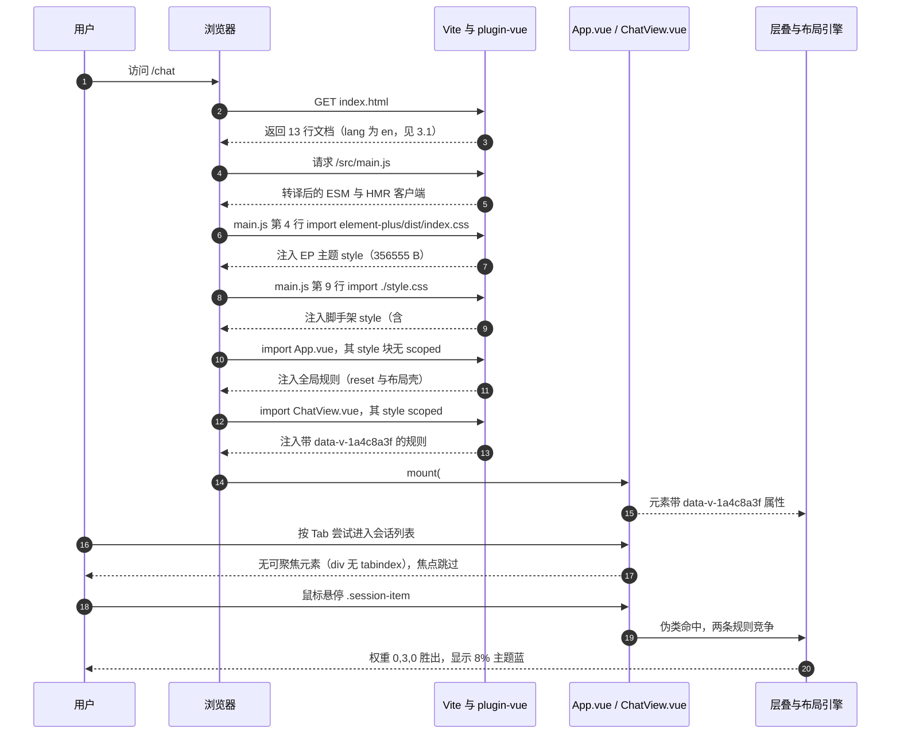

# HTML 与 CSS 基础：语义决定谁能用，层叠决定谁生效

> **一句话结论**：HTML 的 `lang`、`label`、键盘可达性决定「谁能用这个页面」，CSS 的盒模型、层叠顺序与作用域决定「哪条样式最终生效」；本仓库前端里"样式改了没反应""颜色死活不对""读屏念不出来"这三类事故，全部能在这两层里得到确定答案，而且**全都没有报错**。
> **阅读前置**：会写 `div`/`span`/`input` 这类标签、知道 `class` 与 `id` 的区别即可，不需要 Vue 基础；§3.6 之后开始引用 `.vue` 单文件组件的 `<style scoped>`，没读过也跟得上，卡住时回看 [04-Vue3核心基础](./04-Vue3核心基础.md) 的组件语法一节。
> **证据基线**：B 级证据全部取自本仓库 `ai-cs-frontend/`（Vue 3.5.39 + Element Plus 2.14.3 + Vite 8.1.1）、`ai-cs-frontend-react/`（React 18 + antd 5）当次读取的源码，以及 `ai-cs-frontend/dist/` 里已有的构建产物（`assets/*.css` 逐字节核对）；C 级证据为本机 pwsh / node 实测输出，命令与原始输出都贴进正文。凡是需要浏览器渲染才能下结论的地方一律标注「未本机实测」。预计阅读 45~60 分钟。

---

## 0. 先看现象

### 现场一：左菜单的 hover 色被 `!important` 硬盖着，而这条 `!important` 其实是多余的

设计稿要求侧边栏深底 `#1d1e2c`、悬停时盖一层 8% 透明度的主题蓝。代码里最终落成下面这样——颜色对了，但代价是两处 `!important`：一处守 hover、一处守选中态，谁也说不清它们到底在防谁。

`ai-cs-frontend/src/App.vue:189-196`（B 级，当次读取）：

```css
.side-menu .el-menu-item:hover {
  background-color: rgba(64, 158, 255, 0.08) !important;
}

.side-menu .el-menu-item.is-active {
  background-color: rgba(64, 158, 255, 0.12) !important;
  border-right: 3px solid #409eff;
}
```

这两条规则各带一个 `!important`，是全仓库仅有的 2 处（`src/` 下其它 700 余条样式声明一处都没有）。更尴尬的是：按 §3.6 的权重复算，删掉它们这两条规则**照样赢**。**控制台没有任何报错**——这类问题不产生异常，只留下一个"不知道将来会不会突然失效"的隐患。

### 现场二：本地是全宽布局，构建产物里 `#app` 却变成 1126px 居中带竖线

本地 `npm run dev` 打开，内容铺满屏幕。而已经提交的构建产物 `ai-cs-frontend/dist/assets/index-BDeApAtd.css`（5267 字节）里，`#app` 出现了两条互相冲突的声明，按出现顺序摘录：

```text
偏移 53   处： #app{width:100%;height:100%;font-family:Inter,...}
偏移 3530 处： #app{text-align:center;border-inline:1px solid var(--border);box-sizing:border-box;
                  flex-direction:column;width:1126px;max-width:100%;min-height:100svh;margin:0 auto;display:flex}
```

两条选择器都是 `#app`，权重完全相同（1,0,0），因此**后出现的那条赢**：线上页面会被锁成 1126px 居中、左右各一条 1px 竖线，并且 `text-align:center` 会让所有未显式对齐的文本居中。同一个文件里还能找到 `.hero`、`#next-steps`、`.ticks` 这些页面上根本不存在的选择器——它们是 Vite 脚手架的默认样式，被一起打进了生产包。

> **说明**：这一条是**静态分析构建产物**得出的结论，未在浏览器里实测渲染结果；核对方法见 §6 调试手法 1。

### 现场三：会话列表鼠标点得动、Tab 键停不住，读屏把所有图片都念成"图片"

`ai-cs-frontend/src/views/ChatView.vue:13-27`（B 级）：

```html
<div class="session-list">
  <div
    v-for="s in sessions"
    :key="s.id"
    :class="['session-item', { active: currentSession === s.id }]"
    @click="switchSession(s.id)"
  >
    <el-icon><ChatDotSquare /></el-icon>
    <span class="session-title">{{ s.title }}</span>
    <el-tooltip content="删除会话" placement="top">
      <el-icon class="session-delete" @click.stop="handleDeleteSession(s)"><Delete /></el-icon>
    </el-tooltip>
  </div>
</div>
```

一个 `div` 挂了 `@click`，配 `.session-item { cursor: pointer }`（同文件 `:521-524`），视觉上就是按钮，但：没有 `tabindex` → Tab 键永远停不到它；没有 `role` → 读屏不会说"按钮"；删除图标的样式是 `visibility: hidden` + `.session-item:hover` 才显示（`:528-532`）→ 键盘用户永远看不到这个入口。

同一文件的图片是 ``（`:40`）——`alt` 有，但内容是"图片"两个字，等于没说。

这不是个别疏忽。在本仓库 `ai-cs-frontend/src` 下统计（C 级，真实输出见 §6 手法 3）：

```text
aria- / role= / tabindex 命中：0 处
alt=                     命中：2 处（ChatView.vue:40、MockCashierView.vue:28，文案都是"图片"）
```

**这些现象指向同一件事：** HTML 决定"这个控件是什么、谁能操作它"，CSS 的层叠与作用域决定"哪条声明最终生效"；两者都不是"随便写写"的表达层——语义不写，可访问性就是空的（现场三）；层叠不懂，改样式只能靠 `!important` 试错（现场一），或者干脆不知道自己被谁的样式覆盖了（现场二）。

---

## 1. 整体地图

```mermaid
flowchart TD
  A["index.html<br/>lang / title / div#app"] --> B["main.js<br/>样式装载顺序"]
  B --> C["element-plus/dist/index.css<br/>356555 B 全量主题"]
  B --> D["./style.css<br/>Vite 脚手架残留 298 行"]
  B --> E["App.vue 的 style 块<br/>无 scoped，全局生效"]
  B --> F["20 个 view 的 style scoped<br/>编译期加 data-v-xxx"]
  C --> G["CSSOM：同源样式按装载顺序入栈"]
  D --> G
  E --> G
  F --> G
  G --> H["层叠 Cascade<br/>来源 → 权重 → 顺序 → important"]
  H --> I["计算值与布局<br/>盒模型 / Flex / 定位"]
  I --> J["绘制与合成<br/>transform / opacity 不重排"]
```



> **读图说明**：关键在两条容易看错的边。第一，`B → C/D`（`main.js` 的 `import` 顺序）在编辑器里看不出任何"优先级"痕迹，但它决定了 `style.css` 能不能盖住 Element Plus 的同权重规则——只看权重不看装载顺序，就会得出"我的选择器更长所以一定生效"的错误结论。第二，`F → G` 的 `data-v-xxx` 是**构建期**由 `@vitejs/plugin-vue` 写进选择器的，不是运行期加的，所以 `dist/` 里的 CSS 文件能看到它，而 `src/` 里看不到——把 `dist` 当成过期产物忽略掉，就永远解释不了现场二。

| 参与方 | 职责 | 关键产物 | 本仓库证据 |
| --- | --- | --- | --- |
| `index.html` | 文档骨架：语言、标题、挂载点、viewport | `<div id="app">` | `ai-cs-frontend/index.html:2,7,10-11`（13 行全文） |
| `src/main.js` | 决定所有全局样式的装载顺序 | 两条 `import '...css'` | `ai-cs-frontend/src/main.js:4`（EP 主题）、`:9`（`./style.css`） |
| Element Plus 主题 | 组件默认外观，356555 字节的单一 CSS 文件 | `element-DM8opQMk.css` | `ai-cs-frontend/dist/assets/` 目录实测字节数 |
| `src/style.css` | 脚手架遗留的整站基础样式（含 `#app` 尺寸） | 298 行、10 处 `@media` | `ai-cs-frontend/src/style.css:161-171` |
| `App.vue` 的 `<style>` | 全项目唯一的 reset 与布局壳，**没有 scoped** | `*` 归零 + `html,body,#app` | `ai-cs-frontend/src/App.vue:151-238` |
| 20 个视图的 `<style scoped>` | 单页私有样式，编译成 `[data-v-hash]` | `ChatView-CGwVyLam.css` 等 | `ai-cs-frontend/dist/assets/` 共 20 个视图 CSS |
| `@vitejs/plugin-vue` | scoped 编译、`:deep()` 展开、CSS 嵌套摊平 | `data-v-1a4c8a3f` | `dist/assets/ChatView-CGwVyLam.css` 首行 |
| 浏览器层叠引擎 | 在同等重要性的规则间判胜负 | 计算值 | 现场一/二的最终裁决者 |
| DevTools | 观察层叠结果的唯一窗口（只读地看、可改地试） | Styles / Computed 面板 | 见 §6 调试手法 1 |

---

## 2. 关键概念与关键 API

先给出生词表。"术语首现即解释"从这一节开始执行，后文不再重复解释。

| 名称 | 位置（本仓库） | 角色 | 关键点 |
| --- | --- | --- | --- |
| `lang` 属性 | `ai-cs-frontend/index.html:2` | 声明文档主语言，被所有后代元素继承 | 读屏据此选语音库；写错等于告诉辅助技术"这页是英文" |
| `<label for>` / 包裹式 label | EP 由 `el-form-item` 的 `label` 属性生成 | 给输入控件提供**可访问名**（accessible name） | 没有 label 时，`placeholder` 只是兜底，一旦开始输入就消失 |
| `tabindex` / `role` | `ChatView.vue:14-19`（缺失处） | 让非原生控件可聚焦、可被识别 | 键盘可达 = Tab 能到 + Enter/Space 能激活 |
| `box-sizing` | `App.vue:152` 的 `*` 规则 | 决定 `width` 是否包含 padding 与 border | 默认 `content-box`；`border-box` 下 `offsetWidth` 就等于 `width` |
| BFC（块级格式化上下文） | 本项目无显式声明 | 一块内部布局不透气的区域 | `float` 不溢出、父子 margin 不合并；`display:flow-root` 是最干净的触发器 |
| 层叠上下文（stacking context） | `TraceView.vue:195-196` 是唯一父子定位实例 | `z-index` 的比较范围 | 只有同一上下文内才比 `z-index`；`transform`、`opacity<1` 都会新建 |
| 选择器权重 | `App.vue:189` 对 EP 的 `.el-menu-item:hover` | 同重要性规则间的胜负判据 | 记作 (id, 类/伪类/属性, 元素)，逐位比较，不进位 |
| `!important` | `App.vue:190`、`:194`（全库仅此 2 处） | 把声明提到"作者重要"层 | 覆盖它只能靠同级 `!important`；后人无法预测它何时挡路 |
| CSS 自定义属性（CSS 变量） | `src/style.css:3-33` 的 `:root` | 运行期可继承、可被局部覆写的值 | 内联 `style` 上的自定义属性优先于任何样式表规则 |
| `<style scoped>` | `ChatView.vue:516` 等 20 处 | 编译期命名空间隔离 | 产物是 `.session-item[data-v-1a4c8a3f]` |
| `:deep()` | `ChatView.vue:519,536,565,586`、`ProductView.vue:364`，全库 5 处 | 穿透 scoped 去改子组件内部节点 | 编译成"父选择器带属性、子选择器不带" |
| `@media` / `@container` | `src/style.css` 内 10 处；`@container` 0 处 | 视口断点 / 容器断点 | 本项目**组件级断点 0 处**，只有脚手架里的 1024px |
| `rem` / `vw` / `vh` | 全库统计：`px` 477 处、`rem` 0 处、`vh` 4 处、`svh` 1 处 | 相对单位 | 0 处 `rem` 意味着改根字号不会缩放整站 |
| `transition` / `transform` / `opacity` | `ChatView.vue:523` 的 `transition: all 0.2s` | 动画与过渡 | 只有 `transform`/`opacity` 能走纯合成，其余多数要重排或重绘 |

---

## 3. 原理与证据逐段精读

### 3.1 `lang="en"`：一行属性让整站读音用错语言

**在干什么。** `ai-cs-frontend/index.html` 全文 13 行，第 2 行是 `<html lang="en">`；页面里的内容（"AI 客服平台""会话列表""请输入用户名"）全是中文。`lang` 是 HTML 的全局属性，写在 `<html>` 上会被所有后代元素继承，作用有三：辅助技术选发音语种、浏览器选断词与连字符规则、字体回退时挑中文字形。

**为什么这么设计。** 语言是文档级信息，逐元素标注既冗余又容易漏；需要局部覆盖时再用 `lang` 标在那一段上（比如英文缩写、代码块）。所以规范把它放在"一次声明、全局继承"的位置。

**换写法会怎样。** 同仓库的 React 版写对了：`ai-cs-frontend-react/index.html:2` 是 `<html lang="zh-CN">`，标题也改成了 `AI 客服平台（React）`（`:7`）；Vue 版标题仍是脚手架默认的 `<title>ai-cs-frontend</title>`（`:7`）。写成 `lang="en"` 的中文页面，屏幕阅读器会用英文语音念中文（听起来像乱码）、Chrome 的"翻译此页"会误判源语言；`zh` 与 `zh-CN` 都合法（BCP 47），差别只在地域性的字形与用词偏好。

**常见坑。** ① 以为 `lang` 只影响"翻译提示"——它直接影响读屏可用性，是最廉价的 a11y 修复；② 动态切换界面语言时忘了同步 `document.documentElement.lang`；③ 把 `<html lang>` 和 `<meta http-equiv="Content-Language">` 搞混，后者已不被主流浏览器用于判断页面语言。

### 3.2 `label` 与键盘可达性：Element Plus 的 `hasLabel` 分支决定了"有没有 label 元素"

**在干什么。** 可访问名的取用顺序大致是：`<label for>` / 包裹它的 `<label>` → `aria-labelledby` → `aria-label` → 元素自身文本内容 → `placeholder` 这类兜底。`el-form-item` 只有在拿到 `label` 属性或 `label` 插槽时，才会渲染一个真正的 `<label>` 元素。

证据在 EP 源码里（`ai-cs-frontend` 的 `node_modules` 内，当次读取）：`element-plus/es/components/form/src/form-item.vue_vue_type_script_setup_true_lang.mjs` 的 `L68-70` 是 `const hasLabel = computed(() => { return !!(props.label || slots.label); })`，而 `L271-278` 用 `hasLabel` 决定渲染 `label` 还是 `div`：

```javascript
// node_modules/element-plus/es/components/form/src/form-item.vue_...lang.mjs:271-278
default: withCtx(() => [
  !!(__props.label || _ctx.$slots.label)
    ? (openBlock(), createBlock(resolveDynamicComponent(labelFor.value ? "label" : "div"), {
        id: unref(labelId),
        for: labelFor.value,
        class: normalizeClass(unref(ns).e("label")),
        style: normalizeStyle(labelStyle.value)
      }, ...))
    : createCommentVNode("v-if", true)
])
```

对比本仓库两种写法。`ai-cs-frontend/src/views/LoginView.vue:14-19`（**无 `label` 属性**）：

```html
<el-form-item prop="username">
  <el-input v-model="loginForm.username" placeholder="用户名" :prefix-icon="User" clearable />
</el-form-item>
```

而 `ai-cs-frontend/src/views/GraphView.vue:9` 是有标签的写法：`<el-form-item label="知识库">`。全库 `label="` 共 215 次命中（含 `<el-tab-pane>`、`<el-step>` 等非表单场景）——说明"表单要标签"这件事项目里大部分地方知道，登录页是漏掉的那一处。

**为什么这么设计。** EP 把 label 与校验错误的可访问性绑在一起：`labelFor`（同文件 `L71-75`）在有 label 且表单给了 `id` 时自动生成 `for`，校验失败时 `aria-labelledby` 指向 label 节点（`L266` 的 `"aria-labelledby": isGroup ? labelId : void 0`）；没有 label 就无从关联，所以干脆不渲染。

**换写法会怎样。** 给 `el-form-item` 加 `label="用户名"`，输入框立刻获得可访问名，读屏会念"用户名，编辑框"；不想占左侧宽度就配 `label-position="top"`（`L38-45` 里 `labelPosition === 'top'` 时不算 `label-width`）。反过来，坚持只用 `placeholder`：视觉上够用，但输入一两个字提示就没了，且自动化审计（axe 的 label 规则）不把 placeholder 当合格标签。

**常见坑。** ① 加了 `label` 发现输入框变窄——因为默认给 label 留了 `label-width`，要么调 `label-width`，要么改 `label-position`；② 用 `div` + `@click` 当按钮（现场三），要补三件套：`role="button"`、`tabindex="0"`、`@keydown.enter` 与 `@keydown.space`；③ `visibility: hidden` 只在 hover 显示的图标，对键盘和触屏用户等于不存在，改 `opacity` + `:focus-within` 让它也能出得来。

### 3.3 盒模型与 `box-sizing`：`width: 100px` 到底占多宽（node 实测）

**在干什么。** 一个元素的占位宽度按 `box-sizing` 有两种算法。下面这段是本机 node 24 跑的纯算术（不是浏览器实测，是 CSS 基础盒模型规范公式的代入）：

```javascript
// 文件写到 %TEMP%\boxdemo.mjs 后 node 执行；输出见下方
const pad = 10, bd = 2, w = 100;
console.log("content-box  offsetWidth =", w + pad*2 + bd*2, " 内容宽 =", w);
console.log("border-box   offsetWidth =", w,                " 内容宽 =", w - pad*2 - bd*2);
console.log("padding-top:10% 于宽 800px 容器 =", 800*0.10, "px");
```

真实输出：

```text
[box] content-box  width:100px + padding:10px + border:2px  => offsetWidth = 124 px, 可用内容宽 = 100
[box] border-box   width:100px + padding:10px + border:2px  => offsetWidth = 100 px, 可用内容宽 = 76
[box] padding-top:10% 于宽 800px 容器 => 实际 80 px（不是高度的 10%）
```

**为什么这么设计。** `content-box` 是 CSS1 的历史默认值，那时页面是"文档"，`width` 描述的是文字栏宽；到了应用界面时代，设计师给的是"整个盒子多宽"，于是 `border-box` 更符合直觉。规范没有改默认值（会砸掉存量页面），而是提供开关。

**换写法会怎样。** 本项目的开关在 `ai-cs-frontend/src/App.vue:152`：`* { margin: 0; padding: 0; box-sizing: border-box; }`。注意它只写了 `*`，**没有覆盖 `::before` / `::after`**。伪元素不继承 `box-sizing`（`box-sizing` 本身不可继承，只能被 `*` 命中），所以任何同时设了 `width` 和 `padding` 的伪元素仍按 `content-box` 计算，比预期宽 20px 左右。旧稿第 3.3 节教的是 `*, *::before, *::after { box-sizing: border-box; }`，项目实际没这么写——这就是"文档写得对、代码没跟上"的典型（见 §7）。

**常见坑。** ① 以为 `box-sizing` 会继承，于是只在 `body` 上写一次；② `height: 100%` 不生效——百分比高度要求父链每一层都有确定高度，所以 `App.vue:153` 把 `html, body, #app` 三个都写了 `height: 100%`；③ 用 `padding-top: 56.25%` 做 16:9 占位（百分比 padding 按**包含块宽度**算，实测 800px → 80px），现代写法直接用 `aspect-ratio`。

### 3.4 BFC 与 margin 塌陷：本项目为什么"绕开"了而不是"解决"了

**在干什么。** BFC 是一块独立的布局区域，内部元素与外部互不干扰：包含浮动子元素时父元素会有高度、不与外面发生 margin 合并、`float` 不会溢出到外面。触发方式包括 `float` 非 none、`overflow` 非 visible、`display: flow-root`，以及 flex/grid 容器本身。

**为什么这么设计。** 早期网页靠 `float` 排版，需要一个"局部封闭"机制让布局可预测；后来它被顺带当成"清浮动 + 防 margin 塌陷"的瑞士军刀，`display: flow-root` 才是为这个目的专门加的。

**换写法会怎样。** 本项目 `float:` 命中 0 处（C 级统计），布局全部交给 flex；而 flex 容器天生就是一个独立的格式化上下文，所以"父元素高度塌陷"和"父子 margin 合并"这两类事故在这里不会发生。真正在用的是 `overflow`：全库 25 处 `overflow`（如 `App.vue:159` 的 `.app-aside { overflow-y: auto }`、`:236` 的 `.app-main { overflow-y: auto }`），它们原本只是为了滚动，副作用是顺手造了 BFC。

**常见坑。** ① 两个相邻 `<p>` 各设 `margin: 20px`，间距是 20px 而不是 40px（垂直方向合并取大者）；② 父元素没有 padding/border 时，子元素的上 `margin` 会"穿透"出去把父元素一起顶下来——这时最稳的修法是父元素加 `display: flow-root`，用 `overflow: hidden` 会连带裁掉下拉面板和阴影；③ 以为 `gap` 能替代 margin——`gap` 只对 flex/grid 容器生效，普通块级流里写了无效且不报错。

### 3.5 层叠上下文与 z-index 失效：`z-index: 9999` 为什么还是会输

**在干什么。** `z-index` 只在**同一个层叠上下文**内部比较大小。能新建上下文的常见条件：根元素；`position` 非 `static` 且 `z-index` 非 `auto`；`opacity < 1`；`transform` / `filter` / `will-change` 非 none；flex/grid 子项且 `z-index` 非 auto。

**为什么这么设计。** 上下文是把"局部图层"打包：一旦某个元素成为上下文，它的所有后代在外部看来只是"一张图"，内部怎么叠都影响不到外面的兄弟。这样才能在小组件里放心用 `z-index` 而不污染全局。

**换写法会怎样。** 本项目组件里 `z-index` 命中 0 处，全库仅 3 处，都在脚手架 `src/style.css:135,144,152` 的 `.hero` 里——也就是说，**弹窗、下拉、提示的层级完全由 Element Plus 自己的层级管理负责**。唯一的"父子定位"真实实例是 `ai-cs-frontend/src/views/TraceView.vue:195-196`：

```css
.gantt-track { position: relative; flex: 1; height: 22px; background: #f5f7fa; border-radius: 4px; }
.gantt-bar { position: absolute; top: 2px; height: 18px; border-radius: 3px; display: flex; align-items: center; }
```

`.gantt-bar` 没有写 `z-index`，靠 DOM 顺序压住轨道背景——这是最不容易出事的写法。如果哪天为了"性能优化"给 `.gantt-track` 加 `transform: translateZ(0)`，它立刻变成新的层叠上下文，`.gantt-bar` 的层叠关系被关进这个小盒子里；若再在外层给个 `z-index`，就可能和 EP 的弹层打架。

**常见坑。** ① 父元素写了 `opacity: 0.99` 做淡入，顺手打断了整条层叠链；② 给祖先加 `transform` 会改变 `position: fixed` 的包含块，弹窗突然"跟着滚动"；③ 在 `position: static` 的元素上写 `z-index`，直接无效（但 DevTools 会显示这条声明，容易被误认为生效）。

### 3.6 优先级：那条 `!important` 到底是不是必要的（node 复算权重）

**在干什么。** 权重记作三元组 (id 数, 类/伪类/属性数, 元素/伪元素数)，逐位比较、不进位。下面用 node 把现场一里竞争的两条真实选择器各算一遍：

```javascript
// 简化版权重计算：数 #id、.class/[attr]/:pseudo、元素/::pseudo
function spec(sel){
  const id  = (sel.match(/#[\w-]+/g) || []).length;
  const cls = (sel.match(/\.[\w-]+/g) || []).length
            + (sel.match(/\[[^\]]+\]/g) || []).length
            + (sel.match(/:(?!:)[\w-]+/g) || []).length;
  const el  = (sel.match(/(^|[\s>+~])[a-zA-Z][\w-]*/g) || []).length
            + (sel.match(/::[\w-]+/g) || []).length;
  return [id, cls, el];
}
```

真实输出：

```text
[spec] [0,3,0] <= .side-menu .el-menu-item:hover
[spec] [0,2,0] <= .el-menu-item:hover
[spec] [0,2,0] <= .el-menu-item.is-disabled
[spec] [1,0,0] <= #app
```

也就是说，项目那条 hover 规则 (0,3,0) 本来就赢过 EP 的 `.el-menu-item:hover` (0,2,0)。

**为什么这么设计。** EP 故意让默认规则保持低权重、并且**不带** `!important`（除禁用态），就是为了让使用者用普通选择器就能覆盖。它的主题机制是另一条路：`element-plus/es/components/menu/src/use-menu-css-var.mjs:5-15` 把 `text-color` / `bg-color` / `hover-bg-color` 等算成 CSS 变量，由 `menu.mjs:349,383` 以**内联 style** 挂在根 `<ul class="el-menu">` 上；其中 hover 底色由 `use-menu-color.mjs:4-9` 的 `new TinyColor(color).shade(20)` 得出——即"背景色提亮 20%"。项目传了 `background-color="#1d1e2c"`（`App.vue:14-17`），所以 EP 自己算出来的 hover 底色是一个偏灰蓝的 `#4a4c6e` 系，而不是设计稿的 8% 透明主题蓝。

**换写法会怎样。** 结论有点反直觉：**当前安装的 element-plus 2.14.x 下，这 2 处 `!important` 是冗余的**——普通选择器已经能赢；真正阻止"只靠继承变量"生效的不是权重，而是变量被内联写在根节点上（内联声明优先于任何样式表）。所以正确姿势是二选一：给 `.el-menu-item:hover` 直接写 `background-color`（项目做法，可去掉 `!important`），或者给菜单项这一层重新声明 `--el-menu-hover-bg-color`。

**常见坑。** ① `!important` 的成本不是"难看"，而是**不确定性**：一旦 EP 升级后把某条规则也标成 `!important`（`.el-menu--horizontal > .el-menu-item.is-active` 这一条现在就带），你今天的冗余防御就变成明天的必需品，而且没人记得为什么；② `:where()` 里的选择器权重恒为 0，适合写"允许被覆盖的默认样式"；`:is()` 取括号内最高权重；③ `@layer` 层叠层能让"整层无条件让位"，比堆 `!important` 可维护得多（本项目未使用，属可扩展点）；④ CSS 嵌套（`&:hover`）的权重按展开后的选择器算，跟视觉缩进无关。

### 3.7 CSS 变量的作用域与主题化：一整套 `--el-*` 摆着，项目一个都没覆盖

**在干什么。** CSS 自定义属性按 DOM 树继承：在 `:root`（就是 `html`）上定义，全站可见；在某个容器上定义，只影响它的子树；写在元素 `style` 属性上的，优先级高于任何样式表规则。

**为什么这么设计。** 它把"同一套设计值的多个副本"收敛成一个可继承的变量，改一处、全站跟；而且变量可以被媒体查询、伪类、JS 动态改写，这才让"暗色模式"和"主题切换"在纯 CSS 里成立。

**换写法会怎样。** 本项目 `src/style.css:3-33` 确实有一套 `:root` 变量（`--text` / `--bg` / `--border` / `--accent` / `--sans` 等），并在 `:35-53` 用 `@media (prefers-color-scheme: dark)` 整批翻转——但那是 **Vite 脚手架的变量**，服务于 `.base` / `.hero` / `#next-steps` 这些已经不在页面上的元素。真正在用的只有一处：`style.css:166` 的 `#app { border-inline: 1px solid var(--border) }`（也就是现场二那条竖线）。

与此同时，Element Plus 提供了完整的 `--el-*` 变量体系，而项目对它的引用数是 **0**：

```text
命令：Get-ChildItem ai-cs-frontend\src -Recurse -Include *.vue,*.css | Select-String -Pattern 'var\(--el-'
输出：（无匹配，命中 0 处）
```

项目的实际做法是用组件 prop 传色（`App.vue:14-17` 的 `background-color` / `text-color` / `active-text-color`）+ 两条 `!important`。对照 React 版：`ai-cs-frontend-react` 的 `src/main.jsx:11-40` 用 antd 的 `theme.token`（`colorPrimary: '#409eff'`、`Menu.darkItemHoverBg: 'rgba(64,158,255,0.08)'` 等）达成本项目用 `!important` 想要的效果，且整个 React 工程 `!important` 命中 **0 处**——同一批颜色，两条完全不同的实现路径。

**常见坑。** ① 覆盖 EP 变量必须写在 `import 'element-plus/dist/index.css'` **之后**（本项目 `main.js:4` 引入 EP 主题、`:9` 引入 `./style.css`，所以 `style.css` 里写覆盖是有效的；反过来就无效）；② 只改 `--el-color-primary` 不改派生的 `light-3/light-5/light-9`，hover 与禁用态颜色不会跟着变；③ 变量作用域是 DOM 树不是文件，写在某个卡片容器上只影响它内部；④ 内联 `style` 上的自定义属性无法被样式表覆盖（见 §3.6）。

### 3.8 样式隔离：scoped 编译出什么、`:deep()` 为什么必须存在、`App.vue` 为什么是全局的

**在干什么。** `<style scoped>` 的产物可以直接从构建产物里读出来。`ai-cs-frontend/dist/assets/ChatView-CGwVyLam.css` 首段（当次读取）：

```css
.chat-view[data-v-1a4c8a3f]{height:calc(100vh - 140px)}
.session-card[data-v-1a4c8a3f]{height:100%}
.session-card[data-v-1a4c8a3f] .el-card__body{height:calc(100% - 60px);padding:12px;overflow-y:auto}
.session-item[data-v-1a4c8a3f]{cursor:pointer;border-radius:8px;align-items:center;gap:8px;padding:10px 12px;
  transition:all .2s;display:flex}
.session-item[data-v-1a4c8a3f]:hover{background:#f0f2f5}
.session-item.active[data-v-1a4c8a3f]{color:#409eff;background:#ecf5ff;font-weight:500}
```

三条信息：① 每个选择器都被追加了 `[data-v-1a4c8a3f]`（构建期由 `@vitejs/plugin-vue` 生成，同时给该组件的模板元素加同名属性）；② `src` 里写的 `.session-card :deep(.el-card__body)`（`ChatView.vue:519`）编译成了 `.session-card[data-v-1a4c8a3f] .el-card__body`——**属性只留在父选择器上，被穿透的那一段不带属性**，这才改得动 EP 卡片内部的 `__body`；③ 全库 5 处 `:deep()` 中 4 处在 ChatView（`:519,536,565,586`），第 5 处在 `ProductView.vue:364`。

再看 `App.vue`。它的 `<style>`（`App.vue:151-238`）**没有 scoped**，所以是全局样式；证据是 `dist/assets/index-BDeApAtd.css` 里 `data-v-` 命中 **0 次**，而 20 个视图 CSS 每个都有（`ChatView` 34 次、`AgentView` 22 次、`TraceView` 21 次……）。这解释了为什么 `*` reset、`html,body,#app` 高度、`.app-container`、`.app-main` 这些"壳级"规则能生效：它们本来就该是全局的。

**为什么这么设计。** CSS 没有模块系统，`scoped` 用编译期属性模拟命名空间，比 Shadow DOM 兼容性好得多，也允许外部用更高权重覆盖（而 Shadow DOM 天然隔绝）。代价是"隔离"并不彻底：子组件的**根元素**同时带着父组件的 `data-v` 属性，所以父组件能改到子组件的外壳、改不到内部，必须靠 `:deep()`。

**换写法会怎样。** 假设有人把 `App.vue` 的 `<style>` 改成 `<style scoped>`：`html, body` 不在组件模板里，规则会失效；`*` 也不起作用（scoped 不给 `html` 加属性），页面立刻冒出 body 默认的 8px 外边距、布局壳塌掉。反过来，把某个视图的 scoped 去掉，它的 `.active`、`.session-item` 就会变成全站类名，与别的页面撞车。

**常见坑。** ① 父组件 scoped 里写 `.el-card { padding: 0 }` 无效——要改的是内部节点，得 `:deep(.el-card__body)`；② `/deep/`、`::v-deep` 作为组合符已废弃，请用 `:deep(选择器)` 函数式写法；③ scoped 里的 `@keyframes` 名字会被重命名（本项目 `@keyframes` 命中 0 处，尚未踩到）；④ `:deep()` 写进**无 scoped** 的样式块（如 `App.vue`）是没有意义的，`@vue/compiler-sfc` 会给出编译期提示（本项目未复现，属推断）。

### 3.9 Flex 与 Grid：本项目 80:0 的选择，判据是什么

**在干什么。** 一维排布（一行或者一列）用 flex；需要同时约束行列、或者要"按网格对齐"用 grid。本项目的统计是压倒性的：

```text
命令：Get-ChildItem ai-cs-frontend\src -Recurse -Include *.vue,*.css | Select-String -Pattern 'display:\s*grid|display:\s*flex'
结果：display: flex 命中 80 处；display: grid 命中 0 处
```

"卡片矩阵"这种典型 grid 场景，项目用的是 EP 栅格：`ChatView.vue:3-5` 的 `<el-row :gutter="20" style="height: 100%">` + `<el-col :span="6">` / `<el-col :span="18">`。栅格本质是"上层封装过的 flex + 百分比宽度（24 等分）"，好处是与设计稿的 24 栏体系对齐、坏处是不能自由指定行列。

**为什么这么设计。** 中后台的页面结构高度同构：侧栏 + 头部 + 内容区，内容区大多是"一堆横向排列的字段"，一维足够；栅格组件已经把二维需求吃掉了，再引入 grid 只会让两套布局体系并存。

**换写法会怎样。** flex 里"写死的宽度也会被改"。`TraceView.vue:194` 的 `.gantt-label { width: 200px; flex-shrink: 0 }` —— 如果去掉 `flex-shrink: 0`，按 flex 收缩算法（按各项目基准宽度加权分摊不足量）复算：

```text
[flex] 基准 [200,300] 容器 400 =>  [ 160, 240 ]
[flex] 基准 [200,300] 容器 600 =>  [ 200, 300 ]
```

容器只有 400px 时，200px 的标签会缩成 160px，中文标题被挤成省略号。这正是"盒模型不是死的"的第二层含义：静态宽度写完之后，布局算法还会再算一遍。

**常见坑。** ① flex 子项里 `text-overflow: ellipsis` 不生效——因为子项的 `min-width` 默认是 `auto`，内容不肯缩；项目里 `.session-title { flex: 1; overflow: hidden; text-overflow: ellipsis }`（`ChatView.vue:527`）能生效，是因为 `overflow: hidden` 顺手把 `min-width` 变成了 0；② 纵向 flex 里子元素滚动要 `min-height: 0`（旧稿推荐过），项目里则是用 `calc(100% - 60px)` 绕（`ChatView.vue:519`）——两种都能跑，前者更抗内容变化；③ `gap` 不能用在普通块级流里。

### 3.10 响应式与单位：477 个 `px`、0 个 `rem`、10 处媒体查询全在脚手架里

**在干什么。** 单位统计（C 级，本机 `pwsh` 真实跑过）：

```powershell
cd D:\Projects\Persion\ai-customer-service\ai-cs-frontend\src
$files = Get-ChildItem -Recurse -Include *.vue,*.css | Get-Content -Raw
foreach ($p in @('rem\b','\d+px','\d+vh','\d+vw','\d+svh','\d+%','clamp\(','calc\(')) {
  "{0,-10} {1}" -f $p, ([regex]::Matches($files, $p)).Count
}
```

真实输出（`src/` 下 25 个 `.vue` + 1 个 `.css` 全文）：

```text
rem\b       0
\d+px     477
\d+vh       4
\d+vw       0
\d+svh      1
\d+%       36
clamp\(     0
calc\(      4
```

再叠加：`@media` 10 处**全部**在 `src/style.css`（`L30,35,70,80,181,195,206,215,253,273`，其中 `L35` 是 `prefers-color-scheme`），组件级 `@media` **0 处**，`@container` **0 处**。

**为什么这么设计。** 这是桌面坐席端的中后台，目标视口基本固定（1280~1920），固定 `px` 与设计稿 1:1 对齐、沟通成本最低；没有移动端诉求，就没有断点。诚实的结论是：**本项目未落地响应式**，脚手架里那 10 处媒体查询服务于页面上不存在的 `.hero`，不能当作"项目已响应式"的证据。

**换写法会怎样。** 三种相对单位的取舍：

| 单位 | 基准 | 适合 | 代价 |
| --- | --- | --- | --- |
| `rem` | 根元素字号（默认 16px） | 字号体系、跟随系统字体缩放 | 全站尺寸都用它时，一个根字号改动会连带改变所有间距 |
| `vw` / `vh` | 视口宽 / 高的 1% | 整页等比缩放、通栏大屏 | 1px 边框在不同视口下会变成小数像素；移动端 `100vh` 会被地址栏吃掉 |
| `px` | 设备无关像素 | 与设计稿 1:1、可预期 | 不随视口缩放，窄屏只能靠断点或横向滚动 |

项目在 `100vh` 上是踩过坑的：`ChatView.vue:517` 用 `height: calc(100vh - 140px)` 撑满内容区，而脚手架那段用了更稳的 `min-height: 100svh`（`style.css:167`，`svh` = 小视口高度，扣掉移动端浏览器可收缩的工具栏）。

**常见坑。** ① `100vh` 在移动端浏览器里通常比可见区域高，导致底部按钮被顶出屏幕；② 媒体查询写在 `<style scoped>` 里是合法的，但本项目一处都没有，改起来要新建断点体系；③ 容器查询（`@container` + `container-type`）能解决"同一个卡片在窄容器里换布局"的问题，本项目未使用（未实测）。

### 3.11 动画性能：`transition: all 0.2s` 到底动了什么

**在干什么。** 全库唯一一处 `transition: all` 在 `ai-cs-frontend/src/views/ChatView.vue:521-524` 的 `.session-item` 上：

```css
.session-item {
  display: flex;
  align-items: center;
  gap: 8px;
  padding: 10px 12px;
  border-radius: 8px;
  cursor: pointer;
  transition: all 0.2s;
}
```

这条规则配合 `:525` 的 hover 背景与 `:526` 的 `.active`（同时改 `background-color`、`color`、`font-weight`）。`transition: all` 的含义是"对所有可动画属性都监听变化"，包括将来有人往这个类里加的任何属性。

**为什么这么设计。** `all` 是图省事的写法，原型阶段能少想一步；规范允许它是为了"过渡默认值"这种场景，不是为了常规样式。

**换写法会怎样。** 写成 `transition: background-color .2s, color .2s`，语义明确、可被审计。更关键的是**动什么属性**：`width` / `height` / `top` / `left` / `margin` / `padding` 会触发 Layout（重排整棵树），`background-color` / `box-shadow` / `border-radius` 触发 Paint（重绘），只有 `transform` 与 `opacity` 能只走 Composite（合成），这也是"动画只用 transform/opacity"这句话的出处。本项目里 `font-weight` 恰好落在 `all` 的监听范围里，但它**不可插值**，所以状态切换时字重是跳变的——视觉上会看到文字抖一下。

**常见坑。** ① 用 `transition: all` 做展开动画，结果高度变化连带触发整页重排；② 用 `top/left` 做位移动画，改成 `transform: translate()` 立刻省掉重排；③ 想验证到底重排了没有，用 DevTools 的 Rendering 面板（Paint flashing / Layer borders）——本项目未做此项实测，判读方法见 §6。

---

## 4. 一次完整执行时序

以"打开 AI 对话页并尝试用键盘选中一个会话"为例，把样式从文件到像素、再到一次真实的用户操作串起来。



> **读图说明**：两个关键箭头。第一，第 6~9 步的 `import` 顺序（EP 主题在 `main.js:4`、`style.css` 在 `:9`）是个隐形胜负手——`#app` 的两条规则权重相同，最终由**入栈顺序**决定，看错这一点会以为"我写的选择器不够长"。第二，第 16~17 步是"键盘可达性"的断点：焦点在 `.session-item` 上根本不存在，所以后面的 hover 高亮和点击逻辑对键盘用户全部无效——这条路径上没有任何报错，只有"按 Tab 没反应"。

每一步失败时看到什么（现状 vs 可能症状）：

| 步骤 | 失败条件 | 现象/报错 | HTTP/日志特征 |
| --- | --- | --- | --- |
| 2 | `index.html` 的 `lang` 写错 | 无报错，读屏语音错 | DevTools Elements 面板 `<html lang="en">` |
| 6 | EP 主题 CSS 404 或顺序被改到 `style.css` 之后 | 组件外观与覆盖同时失效 | Network 面板 CSS 请求 404，或 Styles 面板里规则被划掉 |
| 8 | `style.css` 被删掉 | `#app` 回到 100% 宽（现场二消失），但 `--border` 等变量全空 | 控制台无报错；Computed 面板里 `var(--border)` 显示为空 |
| 10 | 把 `App.vue` 的 `<style>` 改成 scoped | 全站 reset 失效，页面出现 8px body 外边距 | DevTools 里 `html` 上无 `data-v-*` 属性 |
| 12 | scoped 编译失败（CSS 语法错） | 终端打印 vite 的 CSS 插件报错，整个 style 块不注入 | 终端 `[plugin:vite:css]` 前缀 + `.vue:行号` |
| 16 | `div` 缺 `tabindex` | Tab 跳过、读屏不念 | 无报错；Elements 面板看不到 `tabindex` 属性 |
| 18 | EP 升级后提高 hover 规则权重 | hover 不再变化（此时 `!important` 才开始真正起作用） | Styles 面板出现删除线 |

---

## 5. 设计取舍

| 设计决策 | 收益 | 代价 | 本仓库现状 |
| --- | --- | --- | --- |
| reset 只写 `*`，不写 `::before/::after` | 少一行、覆盖常规元素够用 | 伪元素仍按 `content-box` 计算，尺寸易偏 | `App.vue:152` |
| 把 reset 与布局壳放在 `App.vue` 的无 scoped 样式里 | 壳级规则天然全局，改一处全站生效 | 组件与全局样式混在一处，`App.vue` 已 238 行 | `App.vue:151-238` |
| 用组件 prop + `!important` 改 EP 颜色 | 见效快、不用理解变量体系 | 2 处 `!important` 冗余且不可预测；主题无法整体换肤 | `App.vue:14-17,189-196` |
| 全 flex、零 grid，二维交给 EP 栅格 | 只有一套布局心智，栅格与设计稿 24 栏对齐 | 复杂二维布局（甘特、看板）只能堆嵌套 flex | `display:grid` 命中 0 处 |
| 固定 `px`、不做断点 | 与设计稿 1:1，沟通成本低 | 1366 以下笔记本上侧栏 220px 挤压内容 | `rem` 0 处，组件级 `@media` 0 处 |
| `:deep()` 穿透改 EP 内部节点 | 不改组件库源码就能微调 | 与 EP 内部结构耦合，升级可能失配 | 5 处（ChatView 4 + ProductView 1） |
| 保留 Vite 脚手架 `style.css` | 省一次清理 | 298 行死样式进生产包，且 `#app` 规则覆盖布局 | `style.css` 全文 + `dist/index-BDeApAtd.css` |
| 依赖 EP 自带层级管理，组件内不写 `z-index` | 不与弹层打架 | 遇到自定义浮层要自己理解 EP 的层级约定 | 组件内 `z-index` 0 处 |

可扩展点清单（都还没做，按性价比排序）：

1. `index.html:2` 改 `<html lang="zh-CN">`、`:7` 改中文标题——一行字，直接消除现场三的语言问题。
2. `LoginView.vue:14-19,30-38` 的四个 `el-form-item` 补 `label` 或 `aria-label`。
3. `ChatView.vue:14-19` 会话项补 `role="button"` + `tabindex="0"` + `@keydown.enter`；`:528-532` 的删除图标从 `visibility` 改为 `opacity` + `:focus-within` 可见。
4. 删除 `src/style.css` 里的脚手架残留（`.hero` / `#next-steps` / `.ticks` 等，约占 298 行中的大部分），同时删掉 `main.js:9` 的 import（或换成真正的 reset 文件）。
5. 验证并移除 `App.vue:190,194` 的 `!important`（先用 §6 手法 1 确认没有其它来源需要它）。
6. `App.vue:152` 的 reset 补 `*, *::before, *::after`。
7. 给侧栏加一个断点，例如 `@media (max-width: 1366px) { .app-aside { width: 64px } }`。
8. 把 `ChatView.vue:523` 的 `transition: all` 拆成具体属性，并把 SC 内的硬编码色值（`#409eff`、`#f0f2f5`）收敛成 CSS 变量，为将来的主题化留口子。
9. 引入 axe-core 之类做 a11y 冒烟测试（`package.json` 的 `check` 脚本目前是 `lint && test && build`，没有任何 a11y 检查）。
10. `style.css` 里那套 `prefers-color-scheme` 暗色变量，改成基于 `--el-*` 的真主题体系，才算"支持暗色"。

---

## 6. 踩坑与调试手法

**坑 1：改了 EP 组件样式完全没反应。**
症状是 DevTools 里连这条规则都看不到。原因通常是它写在了 `<style scoped>` 里，而目标节点是子组件内部（不带父组件的 `data-v`）。判据：`dist` 里那条规则长成 `.parent[data-v-x] .child` 才对；如果长成 `.child[data-v-x]` 就说明没穿透。修法：`:deep(.child)`。

**坑 2：加了 `!important` 有效，删掉也有效——不知道自己依赖了什么。**
这就是现场一的真相。这类"两个都能用"的状态最危险：一旦 EP 升级，只有 `!important` 那条能活，而没人记得它是防御谁的。判据：在 Styles 面板把 `!important` 勾掉，看生效规则是否还是自己那条。

**坑 3：样式被划掉，来源指向一个陌生的 `index-xxxx.css`。**
说明发生了跨文件覆盖（现场二）。先在 Styles 面板看被划掉那条的来源文件名与偏移顺序，再回源码找同名选择器。本项目最典型的是 `#app` 出现在两个地方：`App.vue:153` 与 `style.css:161`。

**坑 4：`height: 100%` 在一个新页面上不生效。**
百分比高度要求父链每层都有确定高度。本项目靠在 `App.vue:153` 一次性写死 `html, body, #app { height: 100% }` 解决，所以任何"新页面撑不满"的问题都应该先怀疑这中间被插入了没有高度的 `div`。

**坑 5：键盘用户完全用不了某个列表。**
判据是三步：Tab 能不能到、Enter/Space 能不能激活、聚焦时有没有可见轮廓。现场三三项全不满足（`div` 无 `tabindex`，且 `*` reset 没有动 `outline`，但 `cursor: pointer` 造成了"可点"的错觉）。

**坑 6：改完 CSS 线上没变化。**
先确认构建产物里到底有没有新规则（直接在 `dist/assets/*.css` 里搜选择器），再怀疑缓存。本项目 `nginx.conf` 对静态资源设了 immutable 缓存，`index.html` 设了 no-store——顺序错了就会"新 HTML 引用旧 CSS"或反之。这类问题属 [16-前端上线实战](./16-前端上线实战.md) 的范围。

### 调试手法 1：用 DevTools 的 Styles / Computed 面板读"谁赢了、为什么赢"

打开页面 F12，Elements 面板选中 `.el-menu-item`，右侧 Styles 面板在 Filter 里输入 `background-color`，会看到两条规则：被划掉的那条来自 `element-*.css`，生效那条来自 `App.vue`。往上看同一面板的 `element.style` 段，能看到 `<ul class="el-menu">` 上内联的 `--el-menu-hover-bg-color: …`——这就是 §3.6 里"变量被内联写在根节点上"的现场。再切到 Computed 面板可以读到最终的 `box-sizing`、`width`、`display` 计算值，这是判断"盒模型按哪种算法算"的唯一可靠途径。
**判读标准**：生效规则的行号与文件名必须与源码一致；如果生效的是 `element-*.css` 而你以为是自己的文件，就是权重或顺序问题。
**边界**：本项目未做浏览器实测，上述路径是 Chrome DevTools 的标准入口，不是"我在本机截到的图"。

### 调试手法 2：用 Network 面板核对"哪些 CSS 真的加载了、多大"

Filter 选 CSS，刷新页面，应该看到三类文件：`element-*.css`（本项目实测 356555 字节）、`index-*.css`（5267 字节）、以及按需加载的视图 CSS（如 `ChatView-CGwVyLam.css` 3129 字节）。任何一个 404 都会导致对应页面"裸奔"（EP 组件没有外观，或视图 scoped 样式全丢）。再看 Response Headers 的 `cache-control`，确认新版本是否被旧缓存挡住。
**怎么读**：`element-*.css` 占了全部 CSS 的 94.4%（实测 356555 / 377796 字节），这是"CSS 体积主要来自组件库主题"的量化证据；非 EP 部分只有 21241 字节（5.6%）。
**边界**：需要本地起服务，本机未跑（命令与判读方法如上）。

### 调试手法 3：静态复算——不用开浏览器也能定位大部分层叠与布局问题

这是本机真实跑过的一组命令（C 级）：

```powershell
cd D:\Projects\Persion\ai-customer-service\ai-cs-frontend\src
# 1) 全库 !important 出现在哪两个文件哪两行
Get-ChildItem -Recurse -Include *.vue,*.css |
  Select-String -Pattern '!important' | ForEach-Object { "{0}:{1}" -f $_.Filename, $_.LineNumber }
# 2) 关键特征命中数
foreach ($p in @('aria-','role=','tabindex','alt=',':deep\(','var\(--el-','@media','@container','@keyframes','z-index')) {
  $n = (Get-ChildItem -Recurse -Include *.vue,*.css | Select-String -Pattern $p).Count
  "{0,-12} {1}" -f $p, $n
}
```

真实输出（节选）：`!important` → `App.vue:190`、`App.vue:194`；`aria-` / `role=` / `tabindex` → 0；`alt=` → 2；`:deep(` → 5；`var(--el-` → 0；`@media` → 10；`@container` → 0；`@keyframes` → 0；`z-index` → 3。
**怎么读**：`aria/role/tabindex` 全 0 意味着这个工程从未做过 a11y 标注（现场三不是个例）；`var(--el-` 全 0 意味着主题化从未落地（§3.7）；`!important` 只有 2 处意味着"污染面"很小，删起来成本可控（§5 第 5 条）。

### 调试手法 4：DOM 断点 + Console 定位"谁动了我这个元素的 class/style"

在 Elements 面板右键目标元素 → Break on → `attribute modifications`，然后触发一次交互。命中断点时调用栈顶端会告诉你哪段 JS 改了 `class` 或 `style`（本项目大量使用 Vue 的 `:class` 绑定，例如 `ChatView.vue:17` 的 `['session-item', { active: … }]`，这类"样式变了但没人写 CSS"的问题只能这么抓）。
**配合手段**：在 Console 里 `getComputedStyle(document.querySelector('.session-item')).backgroundColor` 读最终计算值，比肉眼看颜色可靠。
**边界**：需要人工交互复现，未在本项目实际命中过（属通用手法）。

### 调试手法 5：编译报错定位——CSS 语法错误是硬失败

Vue 单文件组件的样式块编译失败时，Vite 终端会打印带 `[plugin:vite:css]` 前缀的错误并给到 `.vue` 文件的行号；此时**整个 style 块都不会注入**，页面表现为"这个组件的样式整体消失"，而不是某个属性失效。判据：页面局部裸奔 + 终端有 CSS 插件报错 = 先修语法，别去 DevTools 里找层叠原因。反过来，如果终端干净、样式却不生效，那一定是层叠/作用域问题，直接跳到手法 1。

---

## 7. 版本差异

下表逐条对照旧稿（本文档的上一版，400 行、五节结构）与本仓库当前真实基线。**旧稿只当素材不当事实**：它的教学口径基本正确，但有多处与本仓库现状不符。

| # | 旧写法（旧稿） | 当前基线（本仓库实测） | 变化点 | 迁移动作 |
| --- | --- | --- | --- | --- |
| 1 | 推荐 reset：`*, *::before, *::after { box-sizing: border-box }` | `App.vue:152` 只有 `* { margin:0; padding:0; box-sizing:border-box }` | 伪元素未覆盖 | 补伪元素，或明确记录"已知偏差" |
| 2 | 教 `:root { --el-color-primary: #409eff }` 覆盖 EP 主题 | 全库 `var(--el-` 命中 0 处，无任何 `--el-color-*` 覆盖 | 主题化未落地，颜色靠 prop + `!important` | 要么补变量体系，要么把这段改写成"EP 主题机制是什么、本项目用什么替代" |
| 3 | 骨架示例 `.app-body { display:flex; flex:1; min-height:0 }` | 实际是 `<el-container>` + `.app-container{height:100vh}`（`App.vue:5,155`），没有 `.app-body`，也没有 `min-height:0` | 布局由 EP 容器组件承担 | 以 `App.vue:5-6,152-161,233-237` 为准重画骨架图 |
| 4 | Grid 卡片墙示例 + `@media (max-width: 992px)` 响应式示例 | `display:grid` 0 处；组件级 `@media` 0 处；卡片矩阵用 `el-row/el-col` 栅格 | 响应式与 Grid 均未在项目落地 | 示例保留但标明"教学示例，本仓库未用"；去掉"本项目已响应式"的暗示 |
| 5 | Sass / Less / Tailwind 一节按"可选工具"介绍 | `package.json` 依赖里三种都没有（无 sass/less/tailwind，也无 TypeScript） | 技术选型未变 | 保留为视野，明确"未引入" |
| 6 | "Vite 构建不做类型检查，靠 ESLint + TypeScript 补" | 项目无 TS；`package.json` 的 `check` = `lint && test && build`（ESLint + Vitest + 构建） | 实际靠 ESLint + Vitest 兜底 | 改成"本仓库暂无类型系统，门禁是 lint+test+build 三件套" |
| 7 | "scoped 编译时给每个元素追加 `data-v-xxxx`" | 正确，但需补三点：子组件根元素也带父 hash、`:deep()` 的编译形态、`App.vue` 全局块 `data-v` 命中 0 次 | 讲解不完整 | 用 `dist/assets/ChatView-CGwVyLam.css` 的真实产物讲 |
| 8 | "实在压不过才用 `!important`" | 项目 2 处 `!important`，经权重复算是**冗余防御**（(0,3,0) 已胜过 (0,2,0)） | 结论从"必要"变"可疑" | 标注"删前先按 §6 手法 1 验证 EP 版本权重" |
| 9 | "语义化标签让页面更友好"（未提 a11y 落地） | `aria-* / role / tabindex` 命中 0 处；`index.html:2` 是 `lang="en"`；`alt` 仅 2 处且文案是"图片" | a11y 完全未落地 | 列为待办项，不许写成"已支持无障碍" |

---

## 8. 面试高频问与答

（本节只列问题，答案自己组织；每题都能在正文里找到判据。）

1. `<html lang="en">` 写错了会有什么实际后果？屏幕阅读器和浏览器各受什么影响？
2. 可访问名（accessible name）的取用顺序是什么？为什么 `placeholder` 不算合格的标签？
3. 一个 `div` 加 `@click` 当按钮用，要补齐哪几件事才算键盘可用？
4. `content-box` 与 `border-box` 下，`width:100px; padding:10px; border:2px` 元素的 `offsetWidth` 各是多少？为什么 `box-sizing` 要用 `*` 而不用继承？
5. BFC 是什么？有哪几种触发方式？为什么现在更推荐 `display: flow-root`？
6. 父子 margin 合并、兄弟 margin 合并分别怎么发生？`gap` 能解决吗？
7. `z-index: 9999` 依然被遮住，可能是哪几种原因？`transform` 为什么会让 `position: fixed` 的参照物改变？
8. 选择器权重 (0,3,0) 和 (0,2,0) 哪个赢？`:where()` 与 `:is()` 的权重差异是什么？`@layer` 想解决什么问题？
9. `!important` 的真实成本是什么？为什么"删掉也生效"是最危险的状态？
10. CSS 变量的作用域由什么决定？为什么写在元素 `style` 属性上的自定义属性无法被样式表覆盖？
11. `<style scoped>` 编译成什么？`:deep()` 编译成什么？为什么父组件能改到子组件根元素、却改不到子组件内部？
12. 什么场景该用 Grid 而不是 Flex？一个中后台系统全用 flex + 24 栅格，代价是什么？
13. `rem` / `vw` / `px` 分别适合什么？`100vh` 在移动端为什么会出问题，`svh` 修正了什么？
14. 为什么说"动画只用 `transform` 和 `opacity`"？`transition: all` 具体错在哪？
15. 页面样式"改了没生效"，说出你的完整排查顺序（从源码到 DevTools 到构建产物）。

---

## 9. 动手练习

练习 1：修掉登录页的 a11y 缺陷。
读 `ai-cs-frontend/src/views/LoginView.vue:13-23`，给四个 `el-form-item` 补上标签关联，再给密码框加上 `autocomplete`。
**验收标准**：① 页面首次渲染后，四个输入都能通过可访问名拿到"用户名/密码/昵称"这类文本（可用 DevTools Elements 面板确认 `<label for>` 与 `<input id>` 一致）；② 视觉上标签不挤压原有 400px 卡片宽度（用 `label-position="top"`）；③ 不改动其它页面。

练习 2：让会话列表键盘可达。
改造 `ai-cs-frontend/src/views/ChatView.vue:13-27`。
**验收标准**：① Tab 能依次落到每个会话项并显示聚焦轮廓；② Enter 切换会话、Delete 或 Space 能触发删除（或把删除做成独立可聚焦按钮）；③ 删除按钮在键盘聚焦时可见（不再依赖 `:hover`）；④ 鼠标操作行为完全不变。

练习 3：验证 `!important` 到底该不该留。
按 §6 手法 1，在 Styles 面板把 `App.vue:190` 的 `!important` 勾掉，观察 hover 是否仍然生效；再对 `:194` 的 `is-active` 做同样实验。
**验收标准**：写出一份结论——两条各自是否冗余、依据是哪两个选择器的权重、以及"如果 EP 升级后失效"的兜底方案；不许只写"能跑就行"。

练习 4：给 `#app` 的尺寸冲突做一次定因。
不启动浏览器，仅用 `node` 与文本搜索，在 `ai-cs-frontend` 里找出所有对 `#app` 设过尺寸的地方，并推算构建产物的最终生效值。
**验收标准**：① 列出全部出现位置（至少包含 `App.vue:153` 与 `style.css:161-171`）；② 说明为什么后出现的那条赢（权重相同 + 顺序）；③ 写出让"脚手架规则不生效"的最小改动方案。

练习 5：复算一次 flex 收缩。
用 node 实现 §3.9 的 `shrink([200,300], 400)`，再改造 `TraceView.vue:194` 去掉 `flex-shrink: 0`，推演甘特图标签的实际宽度。
**验收标准**：① 打印出 `[160, 240]` 这类具体数字；② 说明"为什么中文标题会先被截断"（`white-space: nowrap` + `text-overflow: ellipsis` + 容器变窄）；③ 给出"既保留 200px 又允许窄屏收缩"的替代方案（如 `flex: 0 0 200px` + 断点改小）。

练习 6：把一处硬编码色值升级成 CSS 变量。
选 `ChatView.vue` 里重复出现的 `#409eff` 与 `#f0f2f5`，改成自定义属性。
**验收标准**：① 只在 `App.vue` 的 `:root`（或 `style.css:3`）声明一次；② 修改该变量后页面颜色整体跟随（用一个临时改值验证）；③ 不引入任何新依赖；④ 说明"为什么不直接覆盖 `--el-color-primary`"（回到 §3.6 的内联变量结论）。

---

## 小结

- HTML 层最便宜的两个修复是 `lang` 和 `label`：本仓库 `index.html:2` 是 `lang="en"`，登录页四个输入只有 `placeholder`——两处都改一行字就能解决。
- 可访问性在代码里是**可量化**的：本仓库 `aria-* / role / tabindex` 命中 0 处、`alt` 仅 2 处，所以"支持无障碍"这句话目前不成立，只能写成待办。
- 盒模型的判据只有一句：`box-sizing` 决定 `width` 含不含 padding 与 border；`content-box` 下 `width:100px + padding:10px + border:2px` 占 124px，`border-box` 下占 100px 但内容区只剩 76px。
- 层叠的判据是三步走：先看来源与 `!important`，再比权重（(0,3,0) > (0,2,0)），最后看装载顺序——本仓库 `main.js:4` 先 EP 主题、`:9` 后 `./style.css`，这个顺序决定了同权重规则谁生效。
- `.scoped` 不是魔法：产物是 `.session-item[data-v-1a4c8a3f]`（可从 `dist/assets/` 直接读到）；`:deep(.el-card__body)` 编译成"父选择器带属性、子选择器不带"；`App.vue` 的样式块没有 scoped，所以它是全局的。
- 本项目 2 处 `!important` 经复算是冗余防御，而 `var(--el-*)` 命中 0 处意味着主题化从未落地——这两条一起说明"颜色是硬改的，不是配置出来的"。
- 布局与响应式的现状：`display:flex` 80 处、`display:grid` 0 处、`rem` 0 处、组件级 `@media` 0 处——**未落地响应式**，不要按"已适配移动端"去写文档或对外承诺。
- 下一步动作（挑一件今天就能做完的）：打开 `ai-cs-frontend/src/views/LoginView.vue`，给四个 `el-form-item` 加上 `label`，然后用 DevTools 确认每个 `<input>` 都拿到了 `id` 且与 `<label for>` 对上——这是本仓库最省力的一次可访问性修复。

---

## 自测题

**1. `<html lang="en">` 出现在一个全中文页面上，会造成什么影响？**

<details><summary>参考答案</summary>

`lang` 是会被后代继承的全局属性，屏幕阅读器据此选择发音语种，写成 `en` 会让中文被按英文语音朗读；浏览器的断词与字体回退也会偏。本仓库 `ai-cs-frontend/index.html:2` 就是错的，React 版 `index.html:2` 的 `lang="zh-CN"` 是对的。修法只改一行，`zh` 与 `zh-CN` 都合法。

</details>

**2. 为什么 `placeholder` 不能代替 `label`？**

<details><summary>参考答案</summary>

`placeholder` 只是可访问名计算的最后兜底，一旦用户开始输入就消失，且在自动化审计里不被视为合格标签。Element Plus 的 `el-form-item` 只有在拿到 `label` 属性或 `label` 插槽时才渲染真正的 `<label>` 元素（源码 `hasLabel` 分支），所以 `LoginView.vue:14-19` 那种只写 `placeholder` 的写法拿不到 label 元素。

</details>

**3. 一个 `div` 加了 `@click`，还需要补什么才算键盘可用？**

<details><summary>参考答案</summary>

三件套：`role="button"` 让辅助技术知道它是什么、`tabindex="0"` 让它能被 Tab 聚焦、`@keydown.enter`（或 `@keydown.space`）让键盘能激活。此外聚焦时必须可见轮廓，且只在 `:hover` 显示的入口（如 `ChatView.vue:528-532` 的删除图标）要对 `:focus-within` 也可见。

</details>

**4. `width:100px; padding:10px; border:2px` 的 `offsetWidth` 分别是多少？**

<details><summary>参考答案</summary>

`content-box` 下是 124px（100 + 10×2 + 2×2），内容区 100px；`border-box` 下是 100px，内容区只剩 76px。本仓库 `App.vue:152` 用 `*` 把全站改成 `border-box`，但没有覆盖 `::before/::after`，伪元素仍是 `content-box`。

</details>

**5. 为什么 `box-sizing` 必须用 `*` 声明，而不能像字号那样继承？**

<details><summary>参考答案</summary>

`box-sizing` 不是继承属性，只在选择器直接命中的元素上生效。写在 `body` 上只影响 `body`（除非显式 `box-sizing: inherit`），所以 reset 必须用 `*`（更完整的是 `*, *::before, *::after`）。本仓库只写了 `*`，这就是一处已知偏差。

</details>

**6. BFC 是什么？本项目为什么"没遇到"margin 塌陷？**

<details><summary>参考答案</summary>

BFC 是一块内部布局不泄漏的区域：包含浮动子元素会有高度、不与外部发生 margin 合并。触发方式有 `float` 非 none、`overflow` 非 visible、`display: flow-root`，以及 flex/grid 容器本身。本项目 `float:` 命中 0 处、布局全用 flex，容器天然是独立格式化上下文，所以这两类事故被"绕开"而不是"解决"。真要显式解决，`display: flow-root` 最干净。

</details>

**7. `z-index: 9999` 仍被遮住，可能的原因有哪些？**

<details><summary>参考答案</summary>

大概率是元素处在一个层叠上下文内部，`z-index` 只在同一上下文比较：祖先有 `opacity < 1`、`transform`、`filter`、`will-change` 或 `position + z-index` 都会新建上下文。另外 `z-index` 写在 `position: static` 元素上完全无效。附带的坑是 `transform` 会改变 `position: fixed` 的包含块。本项目组件内 `z-index` 命中 0 处，层级交给 Element Plus 管理，唯一父子定位实例是 `TraceView.vue:195-196`。

</details>

**8. 选择器权重怎么比？`:where()` 和 `:is()` 差在哪？**

<details><summary>参考答案</summary>

按 (id, 类/伪类/属性, 元素/伪元素) 三元组逐位比较、不进位。实测 `.side-menu .el-menu-item:hover` 是 (0,3,0)，`.el-menu-item:hover` 是 (0,2,0)，前者胜；`#app` 是 (1,0,0)。`:where()` 内部权重恒为 0（适合写可被覆盖的默认样式），`:is()` 取括号内最高的那个权重。`@layer` 用层叠层让整层无条件让位，是可替代 `!important` 的机制。

</details>

**9. 本仓库那 2 处 `!important` 有必要吗？**

<details><summary>参考答案</summary>

对当前安装的 element-plus 2.14.x 而言是冗余的：`.side-menu .el-menu-item:hover` (0,3,0) 已胜过 EP 的 `.el-menu-item:hover` (0,2,0)，而 EP 那条不带 `!important`（只有 `.el-menu-item.is-disabled` 带）。真正让"只靠继承变量"失效的原因是变量被内联写在 `.el-menu` 根节点上。因此 `!important` 的成本是不确定性：EP 升级提高权重后它才成为必需品，且没人记得原因。

</details>

**10. 为什么写在元素 `style` 属性上的 CSS 变量无法被样式表覆盖？**

<details><summary>参考答案</summary>

自定义属性也是声明，同样参与层叠；而内联 `style` 属于"作者来源、行内"层级，优先级高于任何作者样式表选择器（无论权重多高）。Element Plus 的 `useMenuCssVar` 就是把 `--el-menu-hover-bg-color` 等算好后以 `style` 挂在根 `<ul class="el-menu">` 上（`menu.mjs:349,383`），所以想改 hover 底色只能直接给 `.el-menu-item:hover` 写 `background-color`，或在菜单项这一层重新声明该变量。

</details>

**11. `<style scoped>` 和 `:deep()` 分别编译成什么？**

<details><summary>参考答案</summary>

scoped 给每个选择器追加属性选择器，例如 `dist/assets/ChatView-CGwVyLam.css` 里的 `.session-item[data-v-1a4c8a3f]`，同时该组件模板元素带上同名属性。`:deep(.el-card__body)` 编译成 `.session-card[data-v-1a4c8a3f] .el-card__body`——属性只留在父选择器上，被穿透段不带属性。因为子组件根元素同时带父组件的 hash，父组件能改外壳、改不到内部，所以 `:deep()` 才必要（全库 5 处）。

</details>

**12. `App.vue` 的样式为什么是全局的？有证据吗？**

<details><summary>参考答案</summary>

因为它的 `<style>` 没有 `scoped`（`App.vue:151-238`）。证据是构建产物 `dist/assets/index-BDeApAtd.css` 里 `data-v-` 命中 0 次，而 20 个视图 CSS 每个都有（ChatView 34 次、AgentView 22 次、TraceView 21 次）。所以 `*` reset、`html,body,#app` 高度、`.app-main` 这些壳级规则才能生效；一旦给它加 scoped，`html/body` 上的规则会直接失效。

</details>

**13. 一句话判据：什么时候用 Grid 而不是 Flex？本项目为什么全 flex？**

<details><summary>参考答案</summary>

需要同时约束行和列（仪表盘、卡片墙、对齐网格）用 Grid；只在一个方向上排布用 Flex。本项目 `display:flex` 命中 80 处、`display:grid` 0 处，二维需求交给 Element Plus 的 24 栅格（`ChatView.vue:3-5` 的 `el-row`/`el-col :span`），代价是复杂二维布局只能堆嵌套 flex，收益是只有一套布局心智。

</details>

**14. `100vh` 有什么坑？本项目怎么规避的？**

<details><summary>参考答案</summary>

移动端浏览器的地址栏/工具栏会收缩，`100vh` 通常高于实际可见区域，导致底部内容被顶出屏幕。较小视口高度单位 `svh` 修正了这一点，脚手架 `style.css:167` 用的是 `min-height: 100svh`。不过本项目的 `ChatView.vue:517` 仍在用 `height: calc(100vh - 140px)` 撑满内容区，属于桌面端可接受、移动端会出问题的写法。

</details>

**15. 为什么"动画只用 transform 和 opacity"？`transition: all` 具体错在哪？**

<details><summary>参考答案</summary>

改 `width/height/top/left/margin/padding` 触发 Layout（重排），改 `background-color/box-shadow` 触发 Paint（重绘），只有 `transform`/`opacity` 能只走 Composite（合成）。`transition: all` 的问题是语义不明：它监听所有可动画属性，包括将来新增的、以及像 `font-weight` 这种不可插值的属性（会跳变）——`ChatView.vue:523` 的 `.session-item` 就是这种写法。

</details>
