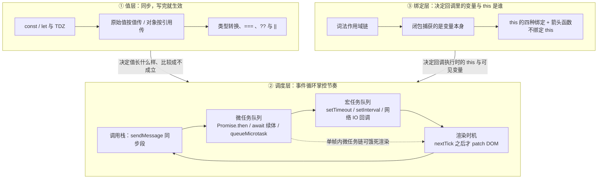
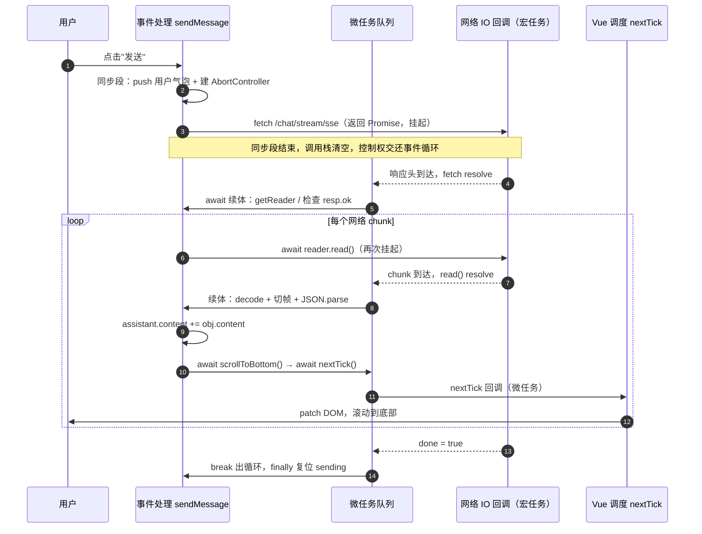

# 02. JavaScript 核心基础：动态类型、异步模型与 this／作用域

> **一句话结论**：本仓库前端里那些"说不清为什么"的 bug，根源几乎都落在 JS 的三层运行时规则上——值语义（动态类型 + 引用共享）、调度语义（事件循环 + 微任务）、绑定语义（this / 作用域 / 闭包）。读懂这三层，现象就能反推原因。
> **阅读前置**：会写 `const`/`let`、会用 `async/await` 的皮毛、跑过 `npm run dev`；不需要 V8 内部知识，但需要你愿意亲手跑一遍文中的 node 脚本。
> **证据基线**：`ai-cs-frontend/` 当前工作区源码逐行核对（B 级，标注 `路径#L行号`）+ 本机 `node v24.16.0` 真实运行输出（C 级，脚本与输出均为原文）；预计阅读 45~60 分钟。

## 0. 先看现象

一句话：**四个症状，四种"看起来不是同一个问题"的报错，其实是同一套语言规则在四个不同位置发作。**

**现象 1：把方法当回调传出去，this 当场丢失。**

```text
⑧ forEach 传方法引用: TypeError - Cannot read properties of undefined (reading 'name')
⑤ 摘下后调用: TypeError - Cannot read properties of undefined (reading 'name')
```

这是本机 `node` 跑最小复现脚本的原文输出（脚本见 §3.4）。代码长得完全无害：`list.forEach(timer.runRegular)`。在浏览器 DevTools Console 里看到的是同一句话，只是前缀变成 `Uncaught TypeError: Cannot read properties of undefined (reading 'name')`，堆栈第一帧指向**被调用方法的内部**——也就是你写 `this.name` 的那一行，而不是你传回调的那一行。这就是它难查的原因：报错位置和出错原因不在同一个地方。

**现象 2：流式对话不"流"了，最后一次性全蹦出来，或者直接变红字。**

```text
⚠️ 连接中断，回复未完成，请重试。
```

这句话来自 `ai-cs-frontend/src/views/ChatView.vue#L452`——`e?.message?.includes('Failed to fetch')` 分支。同一个 `catch` 里还分了一支：用户点"停止生成"时追加 `_（已停止生成）_`、**不弹红错**（`ai-cs-frontend/src/views/ChatView.vue#L444-L449`）。也就是说，一行 catch 里同时承担了"用户主动中止"、"浏览器中断 fetch"、"服务端返回错误"三种语义的区分。这类代码写错的概率很高，因为三种情况的报错形态都是"Promise reject"，而 reject 会在事件循环里改道（§3.6）。

**现象 3：组件早就卸载了，Network 面板还在每 2.5 秒打一次接口。**

复现步骤（这不是一段"输出"，是你要在面板里看的动作序列）：打开 `/mock-pay` 页并发起支付 → 立刻切走路由 → DevTools Network 面板过滤 `status` → **请求会继续按固定间隔出现**，而对应组件早已卸载。根因在 `ai-cs-frontend/src/views/MockCashierView.vue#L139-L169`：`startPolling` 是一个 `for` 循环套 `await sleep(interval)`（`interval` 默认 2500ms），而 `onUnmounted`（`ai-cs-frontend/src/views/MockCashierView.vue#L104-L106`）只 `clearInterval(timer)` 清掉了倒计时定时器，**没有任何机制取消这个 for 循环**——循环最多还能跑 120 次。具体行数与耗时以你本机面板为准，本文不代填数值。

**现象 4：深拷贝对象时直接崩。**

```text
③ structuredClone(含函数) 抛错: DataCloneError - () => 'fn' could not be cloned.
```

本机 node 实测原文（§3.7）。同样的对象用 `JSON.parse(JSON.stringify(x))` 不报错，但会静默丢函数、把 `Date` 变字符串、把 `undefined` 键删掉——**一个报错，一个悄悄改变语义**，两种失败模式。

四个症状的"归属层"先摆出来，后面每个症状都能一键跳回机制：

| 现象 | 表面看像什么 | 真正属于哪一层 | 对应小节 |
| --- | --- | --- | --- |
| 1 `Cannot read properties of undefined` | 数据没取到 | 绑定层：`this` 丢失 | §3.4 |
| 2 流"不流"、`连接中断` | 服务端/网络问题 | 调度层：异步边界 + 代理缓冲 | §3.5、§3.6 |
| 3 卸载后还在请求 | 重复点击/缓存问题 | 值层 + 调度层：未取消的异步循环 | §3.11 |
| 4 `DataCloneError` | 拷贝工具坏了 | 值层：拷贝语义边界 | §3.7 |

这些现象指向同一件事：**它们都不是"某个 API 用错了"，而是 JavaScript 的赋值语义、调度语义、绑定语义在你没盯住的地方生效了。** 下面按"值 → 调度 → 绑定"的顺序把这三层拆开，每一层都用本仓库的真实文件与本机真实输出做证据。

## 1. 整体地图

一句话：**一次"AI 打字机回复"从点击到像素更新，要穿过三层规则；看错任何一层，就会把"异步"误判成"卡死"、把"引用共享"误判成"响应式失效"。**



> **读图说明**：三条主线不是并列的模块，而是"值 → 调度 → 绑定"的依赖顺序。关键在两条跨层箭头：`L1 → L2`（值的形态决定了异步回调里拿到的是快照还是活引用）、`L3 → L2`（回调执行时 `this` 与作用域链已经换了一套）。**最容易看错的是 `B2 ⇢ B4` 这条虚线**：微任务和渲染不在一个队列里，微任务队列不清空，渲染就永远轮不到——这正是 §3.5 里"5 万次微任务饿死 setTimeout"那条实测的机制。另一条常见误读是把 `await reader.read()`（`ai-cs-frontend/src/views/ChatView.vue#L407`）当成"卡住主线程"的同步阻塞：它实际上是"交出控制权、等宏任务里的 IO 回调"，主线程期间是空转可用的。

各参与方的责任与在本仓库的落点：

| 参与者 | 责任 | 谁在用它 | 本仓库证据 |
| --- | --- | --- | --- |
| 调用栈（同步段） | 执行当前函数体；同步代码不被打断 | `sendMessage` 里 push 空气泡、建 `AbortController` | `ai-cs-frontend/src/views/ChatView.vue#L374-L385` |
| 微任务队列 | `then` 回调、`await` 之后的续体、`queueMicrotask` | 每一个 `await reader.read()` 之后的那半段函数体 | `ai-cs-frontend/src/utils/sseStream.js#L33-L38` |
| 宏任务队列 | 定时器回调、网络 IO 完成回调 | 15 秒看板轮询、2.5 秒支付状态轮询 | `ai-cs-frontend/src/views/Dashboard.vue#L161`、`ai-cs-frontend/src/views/MockCashierView.vue#L139-L169` |
| 渲染时机 | Vue 的 DOM patch 排在 `nextTick` 之后 | 逐 token 追加后滚动到底部 | `ai-cs-frontend/src/views/ChatView.vue#L468-L473` |
| 闭包（持久状态） | 跨多次回调保留状态 | SSE 分帧缓冲区 `buffer` | `ai-cs-frontend/src/utils/sse.js#L10-L68` |
| `this` 绑定 | 决定方法体里的 `this` 指向 | `axios` 拦截器用箭头函数回避 | `ai-cs-frontend/src/api/index.js#L41-L60` |
| 取消信号 | 让"进行中的异步"可被外部终止 | 停止生成、卸载清理 | `ai-cs-frontend/src/views/ChatView.vue#L379`、`#L462-L466` |

## 2. 关键概念与关键类/关键 API

一句话：**这一节的表是全文的索引——遇到问题时先在这里定位"它属于哪一层"，再跳到对应小节看机制。**

| 名称 | 位置 | 角色 | 关键点 |
| --- | --- | --- | --- |
| 执行上下文 / 作用域链 | 语言规范（ECMA-262） | 变量查找的路径 | 查找沿词法环境链向上，**不是**沿调用栈向上；`var` 挂函数作用域，`let/const` 挂块作用域并有 TDZ |
| 闭包 | 语言规范 | 函数 + 它捕获的词法环境 | 捕获的是**变量**不是值；被捕获的变量在有引用期间无法回收 |
| 原型链 / `class` | 语言规范 | 属性查找与继承 | `class` 是构造函数 + `prototype` 的语法糖；`instanceof` 查的是原型链，拷贝会断链 |
| `this` 四种绑定 | 语言规范 | 方法体的隐式参数 | 默认 / 隐式（`obj.f()`）/ 显式（`call/apply/bind`）/ `new`；箭头函数不参与，取外层 |
| 事件循环（宏/微任务） | 运行时（浏览器 / Node） | 决定回调顺序 | 每轮：一个宏任务 → 清空微任务队列 → 可能渲染；`await` 之后跑在微任务里 |
| `Promise` / `async` / `await` | 语言规范 | 异步值容器 + 语法糖 | `async` 函数返回 Promise；未 `await` 的 rejection 会逃出 `try/catch` |
| `Promise.allSettled` | 语言规范（ES2020） | 全量等待、不短路 | 与 `Promise.all` 的差别是"一个失败会不会带走其他结果" |
| `AbortController` / `signal` | 浏览器运行时 | 取消 fetch / 读流 | 触发后 reject 一个 `name === 'AbortError'` 的异常 |
| `ReadableStreamDefaultReader` | 浏览器运行时（Streams） | 背压式读流 | `read()` 返回"一块数据到达就 resolve"的 Promise，天然逐块驱动 |
| `structuredClone` | 运行时 API（Node 17+ / 现代浏览器） | 真深拷贝 | 支持 `Date`/`Map`/`Set`/循环引用，**遇到函数直接抛 `DataCloneError`** |
| 类型转换 / `===` | 语言规范 | 相等判断 | `==` 走抽象相等比较（会转型）；`===` 不转型；`??` 只对 `null/undefined` 兜底 |
| ESM / CJS | `ai-cs-frontend` 的 `package.json`（`"type": "module"`） | 模块系统 | ESM 是 live binding + 静态分析 + 顶层 `await`；CJS 是运行时 `require` + 值快照 |
| 弱引用（`WeakMap`/`WeakRef`） | 运行时 API | 不阻止回收的引用 | 只适合做缓存/元数据，`WeakMap` 键必须可被 GC |
| `TextDecoder` | 浏览器 / Node 运行时 | 字节流 → 字符串 | `decode(value, { stream: true })` 才能处理"一个汉字被切成两个 chunk" |
| `nextTick` / 渲染队列 | `ai-cs-frontend/src/views/ChatView.vue#L468-L473` | 等 DOM 更新完再操作 | `await` 它之后才拿得到最新的 `scrollHeight` |
| `queueMicrotask` | 运行时 API | 显式排微任务 | 与本轮 Promise 回调同队列，优先级高于任何宏任务；本仓库源码里未使用（**未落地**），本文只用它验证顺序 |

## 3. 原理与证据逐段精读

### 3.1 执行上下文与作用域链：变量是"按名字沿链找"的

**在干什么。** 每进入一个函数就建立一个执行上下文，里面挂着一个词法环境；变量查找沿这个环境的**外层链**往上走，直到全局。`var` 声明的变量挂在函数级环境上并预先置 `undefined`，`let`/`const` 挂在块级环境上并且"声明前不可访问"（TDZ）。

本机实测（`$env:TEMP\jsdoc-evidence\10-closure.mjs` 中的循环段）：

```text
var 版本: [ 3, 3, 3 ]
let 版本: [ 0, 1, 2 ]
```

**怎么读这个输出。** `var` 版本三个函数读到的是**同一个**变量（函数作用域，循环结束后它已是 3）；`let` 版本每轮循环都创建一个新的块级绑定，三个函数各捕获一个，于是拿到 0/1/2。这条差异不是"风格问题"，它是闭包捕获对象的差异。

**为什么这么设计。** `var` 是 1995 年"函数作用域 + 变量提升"的设计，为了省掉块级概念；`let` 是 ES2015 为了修补"变量泄漏到块外"和"循环里闭包共享同一变量"两个真实事故而加进来的。

**换写法会怎样。** 如果全用 `var`，本仓库里"`for` 循环里注册事件/定时器"的写法统统要配 IIFE 才能隔离状态；如果全用 `let` 又把它声明在函数顶部，等于人为扩大作用域，捕获问题会回来。

**常见坑。** ① TDZ 报错文案是 `Cannot access 'x' before initialization`，看着像"变量不存在"，其实是"还没初始化"；② `for (var i...)` 在 `setTimeout` 里访问 `i` 得到的是终值，这是 `ai-cs-frontend/src/views/Dashboard.vue#L161` 那类轮询代码最容易踩的变体；③ 顶层 `this` 在 ESM 里是 `undefined`（本机实测 `顶层 this: undefined`），在 CJS 里是 `module.exports`（实测 `CJS 顶层 this === module.exports ? true`）——同一句 `this.xxx = 1` 在两种模块里行为不同。

### 3.2 闭包：项目里最值钱的一个 `buffer`，也是最贵的一根内存绳

**在干什么。** 函数内部定义的函数如果引用了外层变量，那么这个"函数 + 变量"的组合会一起活下来。本仓库最典型的闭包不是面试题，而是 SSE 解析器：

```js
// ai-cs-frontend/src/utils/sse.js#L50-L58
  function push(chunk) {
    buffer += chunk
    let count = 0
    while (true) {
      const boundary = nextBoundary()
      if (!boundary) break
      const rawEvent = buffer.slice(0, boundary.index)
      buffer = buffer.slice(boundary.index + boundary.length)
      count += dispatch(rawEvent)
    }
    return count
  }
```

（上下文：`buffer` 是 `createSseParser` 里的 `let buffer = ''`，`push`/`flush` 共同闭包它，见 `ai-cs-frontend/src/utils/sse.js#L10-L68`。）

另一个必须亲手跑一遍的对比，是"闭包捕获的到底是变量还是值"（`10-closure.mjs` 输出原文）：

```text
闭包各自独立: a = 2  b = 1
闭包读到的最新值: 42
```

**怎么读这个输出。** ① 两次 `makeCounter()` 各自捕获**自己的** `count`，互不干扰（`a` 加到 2、`b` 还是 1）——闭包隔离的单位是"每一次函数调用的环境"，不是"每一个函数定义"。② `read()` 定义之后，外部把 `shared` 改成 42，`read()` 打印 42：捕获的是变量本身，不是创建时的快照。这两条合起来解释了 SSE 解析器为什么能工作——同一个 `buffer` 被 `push` 与 `flush` 共享，谁改对方都看得见。

**为什么这么设计。** 网络分块到达，一个 SSE 事件（`data: {...}\n\n`）很可能被切成两半：前半截在这次的 chunk 里，后半截在下次。必须有一个**跨调用存活**的地方存残帧——闭包就是最轻量的方案，不用类、不用全局变量、不用手写 `this.buffer`。

**换写法会怎样。** 三条替代路径各有代价：① 存到模块顶层变量 → 多路 SSE 并发时互相污染（本仓库确实可能并发：`ChatView` 与 `AgentView` 各自独立解析流）；② 每次 `read()` 新建 `TextDecoder`/`buffer` → 残帧丢失，表现为"偶发丢一段回答"，只在网络恰好切在事件中间时出现，极难复现；③ 用 `class` 包一层 → 等价但更啰嗦，且 `this` 又引入新的绑定问题（§3.4）。

**常见坑（内存代价）。** 闭包让变量不可回收：只要 `push`/`flush` 还被引用，`buffer` 就一直在。SSE 场景里 `buffer` 通常在几百字节级，安全；但如果把 `buffer` 换成"已累积的全部历史消息数组"或者"整段响应文本"，闭包就会跟着页面活到底。判断标准很简单——**闭包捕获的如果是"会一直增长的数据结构"，它就是泄漏源**。`ai-cs-frontend/src/views/ChatDashboardView.vue#L48-L102` 里 `let chartInstance = null` 在 `onBeforeUnmount` 显式 `dispose()`，是同一个道理的反面教材预防：ECharts 实例被闭包持有时，DOM 已卸载、实例还在监听、内存不还。

### 3.3 原型链与 `class`：语法糖底下是同一张属性查找表

**在干什么。** 读 `obj.x` 时，先找对象自身属性，找不到就沿 `[[Prototype]]` 链往上找，直到 `null`。`class A { m() {} }` 编译语义上就是"构造函数 + `A.prototype.m = function(){}`"，`new A()` 就是把新对象的原型指向 `A.prototype`。

本机实测（`04-copy.mjs` 片段）：

```text
④ clone 后 instanceof Point = false | typeof norm = undefined
```

**怎么读这个输出。** 一个 `class Point` 实例被"浅拷贝"成普通对象字面量后，原型链断了：`instanceof Point` 变 `false`，原型上的方法 `norm` 也访问不到。这说明"拷贝"在 JS 里默认只拷**自有可枚举属性**，不拷原型、不拷描述符、不拷 `getter`。

**为什么这么设计。** 原型链让方法只存一份（内存友好），同时允许继承；代价是"对象的行为"和"对象的字段"分散在两处，序列化/拷贝时天然丢失行为——这也是 `JSON.parse(JSON.stringify(instance))` 在项目里到处用的原因（本仓库 `api/index.js` 发出的都是 plain object，不传类实例）。

**换写法会怎样。** 用工厂函数返回闭包对象（`makeTimer()` 而非 `new Timer()`）可以彻底绕开原型与 `this`（见 §3.4 的 `makeCounter`），代价是每个实例各持一份方法、无法 `instanceof`、无法 `extends`。

**常见坑。** ① `class` 字段箭头函数（`handle = () => {}`）是"每个实例一份"，与原型方法（`handle() {}`）内存语义不同，但恰好能解决 `this` 丢失——选择时要清楚你在买哪个；② 给 `prototype` 赋值对象（`A.prototype = {...}`）会覆盖掉 `constructor`；③ `instanceof` 跨 iframe/跨 realm 会失效，判断"是不是数组"用 `Array.isArray`。

### 3.4 this 的四种绑定与箭头函数：报错位置和出错位置永远不在同一行

**在干什么。** 普通函数的 `this` 由**调用点**决定，优先级从低到高：默认绑定（严格模式 `undefined`，非严格全局对象）→ 隐式绑定（`obj.f()` 里是 `obj`）→ 显式绑定（`call/apply/bind`）→ `new` 绑定（新对象）。箭头函数不参与这套规则，它**没有自己的 `this`**，直接用外层的。

本机实测（`02-this.mjs` 输出原文）：

```text
顶层 this: undefined
① 方法调用: this.name = chat-timer
② 箭头作为对象属性: this = undefined
③ 方法内箭头: this.name = chat-timer
④ setTimeout 普通函数: this 是 Timeout
④ 对照 setTimeout 箭头: this.name = chat-timer
⑤ 摘下后调用: TypeError - Cannot read properties of undefined (reading 'name')
⑥ new 实例 name = new-timer
⑧ forEach 传方法引用: Cannot read properties of undefined (reading 'name')
call/apply/bind 后: other other other
之后 timer.runRegular(): chat-timer
```

**怎么读这个输出。** ①③ 是正常路径——`obj.f()` 与"方法里的箭头"都能拿到 `obj`。②⑤⑧ 是丢失路径，`this` 变成 `undefined`，于是方法体里的 `this.name` 抛 `TypeError`。④ 值得单独记住：`setTimeout(普通函数)` 在 Node 里 `this` 是 `Timeout` 对象、在浏览器里是 `Window`——**运行时替你塞了一个"意外的 this"**，代码不会报错，只会静默算错。最后两行说明 `bind` 只影响那一次调用的返回值，不改原方法。

**为什么这么设计。** `this` 是"动态作用域"残留：语言想让"方法知道是谁调用的"变得方便，但代价是函数脱离拥有者就没有上下文。箭头函数（ES2015）是官方给的逃生口：**词法 `this`**，写在哪就继承哪的 `this`。

**换写法会怎样（本仓库的真实取舍）。** `ai-cs-frontend/src/api/index.js#L41-L60` 的 axios 请求/响应拦截器全部用箭头函数：

```js
// ai-cs-frontend/src/api/index.js#L41-L47（节选）
  client.interceptors.request.use((config) => {
    const token = getToken()
    if (token) config.headers.Authorization = `Bearer ${token}`
    return config
  })
```

如果用 `function (config) {...}`，`this` 就指向 axios 内部上下文，虽然这里没用到 `this` 所以侥幸能跑——但同一个文件里响应拦截器要调 `logout()` / `redirectToLogin()`，一旦有人改成 `function` 并顺手写 `this.xxx`，就是一个只在 401 时发作的 bug。箭头函数在这里买到的是"不需要思考 this"。反面取舍在 `ai-cs-frontend/src/directives/permission.js#L11-L29`：`mounted(el, binding)` 是 Vue 指令钩子，由框架以"有确定上下文"的方式调用，用普通函数没问题。

**常见坑。** ① `forEach/setTimeout/Promise.then` 收方法引用必丢 `this`（⑤⑧ 实测）；② `bind` 返回新函数，`obj.f.bind(obj) !== obj.f`，事件监听 `addEventListener` 后想 `remove` 必须保存 bind 后的引用；③ 严格模式让默认绑定从"全局对象"变 `undefined`，于是"原来能跑"的代码在 ESM（默认严格）里直接炸；④ Vue 3 的 `setup` 里不需要 `.bind(this)`，因为根本没有组件 `this`——从 Vue 2 迁过来的代码常带着无用的 `.bind(this)`。

### 3.5 事件循环：一个宏任务 → 清空全部微任务 → 才轮得到渲染

**在干什么。** 事件循环每一轮：取一个宏任务执行 → 执行完把它产生的**所有**微任务跑完（微任务里再排微任务也一并跑完）→ 浏览器有机会渲染一帧 → 下一个宏任务。`await` 之后的续体属于微任务；`Promise.then`、`queueMicrotask` 也都是微任务；`setTimeout`、`setInterval`、网络 IO 完成回调是宏任务。

本机实测（`01-event-loop.mjs` 输出原文，标准答案可预测）：

```text
1 同步开始
2 async 函数体的同步段
3 同步结束
4 then #1（微任务）
5 queueMicrotask（微任务）
6.5 await 之后（微任务续体）
6 setTimeout 0（宏任务）
7 宏任务里排的微任务
8 then 里排的宏任务
```

**怎么读这个输出。** 前 3 行是同步段（`async` 函数被调用时，函数体到第一个 `await` 之前也是同步执行的——这一条最容易记错）。接着微任务按入队顺序清空：`then` 先于 `queueMicrotask`（因为先注册），`await` 的续体排其后。等微任务队列**彻底**空了，才轮到 `setTimeout 0`；宏任务里又排了一条微任务，它在下一个宏任务之前跑掉（第 7 行）；`then` 里排的 `setTimeout` 最后（第 8 行）。

微任务可以饿死渲染与宏任务，这是本机实测的另一条：

```text
setTimeout 0 终于执行了；此时微任务已跑 50000 次
```

**为什么这么设计。** 微任务是"当前任务的后置工作"，必须连贯完成才不破坏一致性（比如 DOM 变更的收尾）；宏任务之间才是"把控制权交还浏览器"的时机，渲染、输入事件都发生在这些间隙里。

三个队列里到底谁会投任务，对照本仓库就能记牢：

| 队列 | 谁往里投任务 | 本项目里的实例 |
| --- | --- | --- |
| 微任务 | `then/catch/finally` 回调、`await` 之后的续体、`queueMicrotask`、`MutationObserver` | 每次 `await reader.read()` 之后的那半段解析代码（`ai-cs-frontend/src/utils/sseStream.js#L33-L38`） |
| 宏任务 | `setTimeout`、`setInterval`、网络/IO 完成回调、用户输入事件 | 15 秒看板轮询（`ai-cs-frontend/src/views/Dashboard.vue#L161`）、2.5 秒支付轮询（`ai-cs-frontend/src/views/MockCashierView.vue#L139-L169`） |
| 渲染 | 一轮宏任务 + 清空微任务之后，浏览器才可能 patch 一帧 | `nextTick` 之后 Vue 才更新 DOM（`ai-cs-frontend/src/views/ChatView.vue#L468-L473`） |

**换写法会怎样（本仓库的真实压力）。** `ai-cs-frontend/src/views/ChatView.vue#L406-L437` 的读流主循环里，每收到一个 token 就 `assistant.content += obj.content` 再 `await scrollToBottom()`；而 `scrollToBottom`（`ai-cs-frontend/src/views/ChatView.vue#L468-L473`）第一句是 `await nextTick()`。也就是说**每个 token 至少产生一个微任务 + 一次 Vue 调度**。token 密的时候（几十毫秒一个）这没问题；如果服务端把整个回答一次性塞进一个 chunk，同步 `while` 内层循环会连续 append 几十次、`nextTick` 只排一次渲染——这正是"内容一次性蹦出来"的观感来源，而不是"流式失效"。

同步阻塞的代价同样可量：本机实测

```text
同步阻塞结束
setTimeout 0 实际延迟 ≈ 156 ms（前面有 150ms 同步阻塞）
```

**常见坑。** ① 把 `await reader.read()` 当"阻塞"——它让出主线程，UI 仍可响应；真正的阻塞是同步死循环、`JSON.parse` 巨型字符串、一次性 `v-for` 上万行；② 在微任务里写递归（`Promise.resolve().then(chain)`）会让定时器和渲染全部饿死；③ 用 `setTimeout(fn, 0)` 做"下一帧之后再算"是错的，要等布局用 `requestAnimationFrame`，要等 DOM 更新用 `await nextTick()`；④ 定时器不精确：`setInterval(..., 1000)` 只保证"不早于"，主线程忙时会累计漂移。

### 3.6 Promise 与 async/await 的错误传播：try/catch 有三个覆盖不到的地方

**在干什么。** `async` 函数体里的 `throw` 会变成返回 Promise 的 rejection；`await` 把 rejection 重新抛到当前位置，于是 `try/catch` 能抓到**被 await 的那一次**。抓不到的有三类：没被 await 的异步调用、异步回调（定时器/事件）里抛的错、以及 Promise 链末端的遗弃 rejection。

本机实测（`06-async-error.mjs` 输出原文）：

```text
① try 块正常走完，没有抛给 catch
② 没 await，这一行照样往下走，catch 一个都没进
③ Promise.all 在: 任务 2 失败 处短路
③ allSettled 状态 = fulfilled,rejected,fulfilled | 成功结果 = ok-1
④ uncaughtException 收到 = [ '定时器里抛的错' ]
④ unhandledRejection 收到 = [ '接口 500' ]
```

**怎么读这个输出。** ① 定时器回调里的 `throw` 发生在未来的宏任务里，那时 `try` 块早已结束，异常只能冒到 `process` 级（浏览器里是 `window.onerror`）。② `willReject()` 少写 `await`，返回的 Promise 被丢弃，`catch` 完全没被触发，错误进了 `unhandledRejection`。③ `Promise.all` 遇到第一个 reject 立刻短路，后面任务的结果全丢；`allSettled` 则把三个结果都收回来，适合"批量拉数据、允许部分失败"。

三条错误通道要分清楚，它们落到完全不同的地方：

| 抛出位置 | 谁能接住 | 本仓库对应处理 |
| --- | --- | --- |
| 同步段 / 被 `await` 的 Promise | `try/catch` | `ai-cs-frontend/src/views/ChatView.vue#L387-L458` 整块 try/catch 包住读流 |
| 定时器/事件回调里的 `throw` | 全局：浏览器 `window.onerror`，Node `uncaughtException` | 本项目无全局兜底（**未落地**），只能靠 Vue 的 errorHandler（`main.js` 未注册） |
| 没人接的 Promise rejection | 全局：浏览器 `unhandledrejection`，Node `unhandledRejection` | 同上；靠调用方自觉 `catch`（`ai-cs-frontend/src/api/index.js#L58-L60` 只做了 `Promise.reject` 透传） |

**为什么这么设计。** Promise 把错误当作"值"沿链传递，只有在被 `await`/`.catch` 接住的那一刻才变回异常；一旦没人接，运行时只能报"未处理"，而**报的时机是微任务队列清空后**，所以堆栈里往往看不出源头。

**换写法会怎样（本仓库的真实代码）。** `ai-cs-frontend/src/utils/sseStream.js#L39-L49` 在 `catch` 里先判 `if (signal?.aborted)`，是就 flush 并返回 `{ aborted: true }`——把"用户中止"从异常通道里摘出来，调用方不用写 try/catch 就能区分。这是正确解法的样板。反过来，`ai-cs-frontend/src/views/MockCashierView.vue#L139-L169` 的轮询在 `for` 循环里 `try { await payApi.get(...) } catch { /* 继续下一轮 */ }`，好处是单次失败不中断，代价是**最后一轮也失败时调用方永远等不到结果**——循环自然结束时不会通知任何人。

**常见坑。** ① `array.forEach(async (x) => await f(x))` 里的 `await` 无人等待（实测：`forEach 循环结束后立刻看到的 seen = []`），要用 `for...of` 或 `Promise.all`；② 串行与并发差一个数量级——本机实测 `串行耗时 ≈ 826 ms；并发耗时 ≈ 215 ms`（4 个任务，各约 200ms），`for...of + await` 是串行、`Promise.all` 是并发，选错不会报错只会慢；③ `new Promise(async (resolve) => ...)` 里抛错不会被外层捕获（executor 的返回值被忽略）；④ `.catch` 放在链中间会"吞掉"错误继续往下走，等价于恢复执行。

### 3.7 深浅拷贝与结构化克隆：一份数据两种命运

**在干什么。** 赋值与浅拷贝只复制**引用**，两个变量指向同一个对象；深拷贝要复制整棵图。JS 提供三种常见手段，能力与失败模式各不相同。

本机实测（`04-copy.mjs` 输出原文）：

```text
① 原对象 id = 1 | 原对象 tags = [ 'a', 'b', 'c' ]
② JSON 往返 createdAt 类型 = string | 值 = 2026-01-02T03:04:05.000Z
② handler = undefined | remark 还在吗 = false | tags 还是数组吗 = true
③ 深拷贝后原对象 tags = [ 'a', 'b', 'c' ] | createdAt 年份 = 2026 | Date instanceof Date = true
④ clone 后 instanceof Point = false | typeof norm = undefined
⑤ 解构出的 tags 与 order.tags 同一引用？true
```

**怎么读这个输出。** ① 是浅拷贝陷阱：改了副本的 `tags`，原对象的 `tags` 跟着变（`id` 是原始值所以不受影响）。② 是 `JSON` 往返的四宗罪：`Date` 变字符串、函数键直接消失（`handler = undefined`）、`undefined` 值键被删（`remark` 没了）、`Set/Map` 变空对象（这里的 `tags` 恰好还是数组所以幸存）。③ 是 `structuredClone` 的正确行为：真的隔离了，且保留了 `Date`。④ 是它的边界——它只克隆**数据**，原型链不保留。⑤ 是赋值与解构的真相：`const { tags } = order` 拿到的是同一个数组。

三种拷贝手段的能力边界，一张表记住：

| 手段 | 深度 | `Date` | 函数 | `undefined` 值 | 循环引用 | 原型/类方法 |
| --- | --- | --- | --- | --- | --- | --- |
| 赋值 / `{...obj}` / 解构 | 一层 | 保留（同一个对象） | 保留（同一个引用） | 保留 | 无所谓（没递归） | 不保留（新对象是字面量） |
| `JSON.parse(JSON.stringify())` | 全深 | 变字符串 | 静默丢弃 | 键被删 | 抛 `TypeError` | 不保留 |
| `structuredClone` | 全深 | 保留 | 抛 `DataCloneError` | 保留 | 支持 | 不保留（实测 `instanceof` 为 `false`） |

**为什么这么设计。** 引用语义是性能与共享状态的基础（大对象传递零成本）；深拷贝则必须显式选择，因为"多深算深"和"函数/原型怎么处理"没有唯一正确答案，语言只给了 `structuredClone` 这个"结构化数据"的保守定义。

**换写法会怎样。** 在 Vue 里这个选择尤其重要：`reactive` 对象解构会失去响应性（解构出的是当前值/引用），所以 `ai-cs-frontend/src/views/ChatView.vue#L219-L237` 更新历史消息时用的是 `arr.length = 0; arr.push(...list)`——**保持数组引用不变**，让响应式代理继续有效；换成 `arr = list` 就断链了。

**常见坑。** ① 用 `JSON` 深拷贝 `Date`/`undefined`/函数/`BigInt`/循环引用（后者直接 `TypeError: Converting circular structure to JSON`）；② `structuredClone` 遇函数抛 `DataCloneError`，遇 `Proxy`（Vue 的 `reactive` 就是）也可能失败，传参前先 `toRaw`；③ `{...obj}` 只拷一层且只拷自有可枚举属性，`Object.assign` 同；④ 深拷贝后 `instanceof` 失效，别拿它做类型判断。

### 3.8 类型转换与相等判断：`falsy` 是本仓库最容易出事的一个词

**在干什么。** JS 会在比较、运算、布尔上下文中做隐式转换；`==` 走抽象相等比较（先转型再比），`===` 不转型。`falsy` 值只有 8 个：`false / 0 / -0 / 0n / '' / null / undefined / NaN`。

本机实测（`07-coerce.mjs` 输出原文）：

```text
[] == false                    => true
empty string == 0              => true
null == undefined              => true
null == 0                      => false
0 == string 0                  => true
[] == []                       => false
NaN == NaN                     => false
Number(empty)                  => 0
Number(42px)                   => NaN
parseInt(42px)                 => 42
Number(null)                   => 0
Boolean([]) && Boolean({})     => true
or 吞掉 0: 10 | 空值合并保留 0: 0
严格相等不转型: false | includes 也不转型: false
```

**怎么读这个输出。** 前六行是 `==` 的转型魔法：数组先转成 `''`，`''` 再转成 `0`，于是 `[] == false` 成立；`null` 只和 `undefined` 相等（特殊规则，不和 `0` 等）。`NaN` 与自身不等，判空要用 `Number.isNaN`。`Number('')` 是 `0` 而 `Number('42px')` 是 `NaN`，`parseInt` 则会"读多少算多少"。最后三行是最有实战价值的三条：`||` 会把 `0` 当成空值吞掉，`??` 只在 `null/undefined` 时兜底，`===` 与 `includes` 都不转型。

**为什么这么设计。** 早期浏览器的表单值全是字符串，隐式转换是为了"少写代码"；代价是同一段比较在不同类型下结论不同，于是 ES2015 之后走向"显式"：`===`、`Number.isNaN`、`??`、`Object.is`。

**换写法会怎样（本仓库的真实坑）。** `ai-cs-frontend/src/utils/runtime.js#L9-L13` 的注释直接把这条规则写进了代码理由：

```js
// ai-cs-frontend/src/utils/runtime.js#L9-L13（节选）
// 不能写成 env.VITE_GATEWAY || 'http://localhost:8080'：
// 空串是 falsy，会让生产构建静默回落到 localhost
export function resolveGateway(env) {
  const raw = env?.VITE_GATEWAY
  if (typeof raw !== 'string') return 'http://localhost:8080'
  return raw.trim()
}
```

配合 `ai-cs-frontend/.env.production` 里的 `VITE_GATEWAY=`（**故意留空**），语义是"生产走同源 `/api`"。若用 `||`，空串会退回 `localhost:8080`，生产包直接连不上后端——一个字符的差别，一次线上事故。同类还有 `ai-cs-frontend/src/utils/format.js#L9-L20` 的 `formatSize`：先 `typeof bytes !== 'number' || !Number.isFinite(bytes) || bytes < 0` 多重校验再算，防的就是 `''`/`NaN`/`null` 被当成数字。

**常见坑。** ① 数字 `0`、空串 `''` 是合法业务值，用 `if (x)` 判"有没有值"会误杀，用 `x !== null && x !== undefined` 或 `??`；② `'1' === 1` 是 `false`（实测），接口返回字符串 id 与本地数字比较永远不中；③ `Number.isNaN` 优于全局 `isNaN`（后者会先转型，`isNaN('abc')` 也是 `true`）；④ 排序用 `sort()` 默认按字符串字典序，`[10, 9].sort()` 得 `[10, 9]`，要传比较函数。

### 3.9 数组/对象常用方法的复杂度：`includes` 在循环里就是 O(n²)

**在干什么。** 数组查找是线性扫描，`Set`/`Map`/对象键查找是哈希（均摊 O(1)）；`unshift`/`splice` 要搬元素，`push`/`pop` 不用。差别只在数据量上去以后才现形，而这恰好是列表页、去重、权限判断的常见形态。

本机实测（`08-complexity.mjs`，N=100000 数组、2000 次查找）：

```text
Array.includes ×2000               126.6 ms
Set.has ×2000                      0.7 ms
Array.filter 全量一遍                  1.7 ms
Array.map 全量一遍                     2.0 ms
arr.unshift ×1000                  0.2 ms
arr.push ×1000                     0.1 ms
对象展开 {...o} ×1000 键                0.6 ms
```

**怎么读这个输出。** 同一批 2000 次查找，`includes` 比 `Set.has` 慢约两个数量级（一个是 2000×100000 的扫描，一个是 2000 次哈希）——所以"在 `for` 里 `includes`"就是隐式 O(n·m)。`filter`/`map` 的绝对耗时是"全量遍历一遍"的成本，量级可接受，但**链式 `filter().map().filter()` 就是多遍遍历**，数据量大时合并成一次 `reduce`/单循环更划算。`unshift` 与 `push` 的差距在 1000 次量级还看不出（0.2ms vs 0.1ms），因为数据量太小、引擎有优化；真正的差别是算法上的 O(n) vs O(1)，不要在几万元素上反复 `unshift`。

按操作类型记住复杂度，比背 Big-O 符号实用：

| 操作 | 复杂度 | 什么时候真的会坑你 |
| --- | --- | --- |
| `arr[i]`、`push`、`pop` | O(1) | 基本无坑 |
| `includes` / `indexOf` / `find` / `some` | O(n) | 放进循环 → O(n·m)（实测 126.6ms vs 0.7ms） |
| `filter` / `map` / `reduce` | O(n) | 三次链式调用 = 三遍遍历，合并成一次更快 |
| `unshift` / `shift` / `splice(0, k)` | O(n) | 几万元素列表反复在头部增删 |
| `sort` | O(n log n) | 在 `computed` 里直接对源数组调用会就地改数据 |
| `Set.has` / `Map.get` / 对象键查找 | 均摊 O(1) | 换来的是额外内存，对象键还会丢顺序 |

**为什么这么设计。** 数组是"连续内存 + 索引访问 O(1)"的结构，牺牲了查找与中间插入；哈希表牺牲顺序与内存换查找速度。语言没有"全能容器"，只能按访问模式选。

**换写法会怎样。** 本仓库真实场景：`ai-cs-frontend/src/views/NotifyView.vue#L135-L138` 的日志用 `unshift` 插到头部 + 超过 50 条 `pop()` 截断，因为 UI 要"最新在上"；50 条规模的 O(n) 完全无所谓。反过来 `permission.js` 判断权限、`ChatView` 判断某个会话是否存在这类"每次都要查"的逻辑，就该用 `Set`。

**常见坑。** ① `for...of` 里对同一数组 `includes`/`find`，写起来最自然、复杂度最差；② `find`/`some`/`every` 都短路，`filter`/`map` 不短路；③ `sort` 就地修改且不稳定语义（现代引擎已稳定），在 `computed` 里对 `reactive` 数组调 `sort` 会改到源数组，先 `[...arr].sort()`；④ 删除元素用 `splice(i, 1)` 在 `for` 循环里会漏元素，倒序遍历或 `filter` 重建。

### 3.10 模块系统：ESM 是 live binding，CJS 是值快照

**在干什么。** ESM（`import`/`export`）在**加载时**就确定依赖图，导出的是"绑定"，导入方读到的永远是当前值；CJS（`require`/`module.exports`）在**运行时**执行、导出的是当时的对象/值的一份引用或拷贝。本仓库 Vue 侧 `ai-cs-frontend` 的 `package.json` 明确写了 `"type": "module"`，React 侧 `ai-cs-frontend-react` 的 `package.json` 同样如此，因此 `src` 下的 `.js` 一律按 ESM 解析。

本机实测（`11-cjs.cjs`、`12-main.mjs` 与 CJS 对照，输出原文）：

```text
CJS 顶层 this === module.exports ? true
CJS 里 require 可用: function
ESM 里访问 require: ReferenceError - require is not defined
ESM 里 import.meta.dirname: string | import.meta.url 前缀: file:
ESM 读第一眼: 0
ESM 调完 inc 再读: 1
CJS 解构后: 0
CJS inc() 之后: 0 （快照，不会变）
```

**怎么读这个输出。** 前四行是环境差异：CJS 有 `require`、顶层 `this` 是 `module.exports`；ESM 里 `require` 根本不存在（`ReferenceError`），路径信息从 `import.meta.url`/`import.meta.dirname` 拿。后四行是关键语义差异：ESM 导入的 `n` 是 live binding，被导出方 `inc()` 改了以后导入方立刻看到 `1`；CJS 里 `module.exports = { n, inc }` 导出的是 `n` 当时那个**值**，于是 `inc()` 之后读到的还是 `0`。

**为什么这么设计。** ESM 的静态结构让打包器能做 tree-shaking 与循环依赖的可预测处理（本仓库 `vite.config.js#L47-L54` 的 `manualChunks` 就是在这个图上做分包）；CJS 的运行时模型更"灵活"，代价是无法静态分析、循环依赖拿到半成品 `{}`。

**换写法会怎样。** 想在 ESM 里用 CJS 包只能 `import pkg from 'x'`（默认导出是 `module.exports`）；想在 CJS 里用 ESM 必须 `await import()`（或 Node 22+ 的 `require(esm)`，**本项目未涉及，未本机验证**）。本仓库还有一个 ESM 特性用得很多：路由懒加载——`ai-cs-frontend/src/router/index.js#L5-L29` 的 25 条路由全部写成 `component: () => import('../views/Xxx.vue')`，动态 `import()` 返回 Promise，命中路由时才下载 chunk，天然属于微任务/异步流程。

**常见坑。** ① 在 ESM 模块里写 `require('./x')` 直接 `ReferenceError`（实测）；② 把 CJS 具名导出用 `import { n } from './cjs.cjs'` 拿，Node 靠静态分析"猜"导出名，猜不到就失败；③ `import` 会被提升到模块顶部，`import` 之后写 `console.log` 不代表先执行；④ 循环依赖在 ESM 里是 TDZ 报错（`Cannot access before initialization`），在 CJS 里是 `undefined`——两种报错形态完全不同。

### 3.11 内存泄漏的四种真实形态（都在本仓库里能找到对应代码）

**在干什么。** JS 是标记清除式 GC，"泄漏"永远是"某个长生命周期对象还引用着本该释放的东西"。本仓库能点名的四种形态：

| 形态 | 机制 | 本仓库实例 |
| --- | --- | --- |
| 定时器未清 | `setInterval` 回调引用组件状态，组件已卸载 | `ai-cs-frontend/src/views/Dashboard.vue#L156-L170` **成对清理**（`onUnmounted` → `clearInterval`），是正确写法 |
| 异步循环未取消 | `for` + `await sleep` 的循环只受次数限制，组件卸载后继续跑 | `ai-cs-frontend/src/views/MockCashierView.vue#L139-L169`；`onUnmounted`（#L104-L106）只清倒计时定时器，**轮询循环没有取消机制**（真实隐患） |
| 三方实例未销毁 | ECharts/DOM 监听在 JS 侧仍持引用 | `ai-cs-frontend/src/views/ChatDashboardView.vue#L48-L102` 用 `chartInstance.dispose()` 并在 `onBeforeUnmount` 兜底（注释写明"防止内存泄漏"） |
| 闭包持有增长型数据 | 闭包捕获的数组/Map 永不收缩 | `ai-cs-frontend/src/utils/sse.js#L10-L68` 的 `buffer` 本身安全（事件处理完即切走），但同类写法若缓存全部历史消息就会一直涨 |

**为什么这么设计。** GC 只认"可达性"，不认"业务上已经没用了"。框架能帮你回收 DOM 与组件状态，但帮不了你自己创建的定时器、未结束的 Promise 链、浏览器侧实例。

**换写法会怎样。** 把轮询改成"可取消的一次性调度"就能根治：用一个 `let cancelled = false`，循环里 `if (cancelled) return`，`onUnmounted` 里置 `true`；或者直接用 `AbortController` 把 `signal` 传给 `axios`（本仓库 `ai-cs-frontend/src/views/ChatView.vue#L379` 已经在对 fetch 用这一招，轮询侧还没移植）。**代码未改动，此处只作改进方向**。

**常见坑。** ① `addEventListener` 配 `removeEventListener` 必须同引用（见 §3.4 的 `bind` 坑）；② `WeakMap` 做缓存键要是对象，别用字符串；③ Vue 的 `watch`/`effectScope` 在组件外创建不会自动停，要手动 `stop()`；④ 定位泄漏靠 DevTools Memory 面板的两次快照对比（§6 调试手法 1）。

## 4. 一次完整执行时序

一句话：**一条 SSE token 从网络到达，到屏幕上多出一个字，中间要跨 3 次队列交接；任何一次交接失败，报错形态都不一样。**



> **读图说明**：纵轴是任务的"归属队列"，横轴是时间。**注意 3 次交接点**：第 4 步（同步段结束、控制权交还事件循环）、第 6 步（IO 回调把结果投进微任务队列）、第 9-10 步（微任务里的续体又把控制权交回 IO 等下一块）。**最容易看错的是 loop 块的整体位置**：它看起来是一个 `while`，实际上每一次 `await reader.read()` 都把函数"暂停在微任务边界上"，所以中间夹着无数次的渲染与输入事件——这正是"流式"能逐字出现的原因。反过来，如果某一次 `read()` 拿到的 chunk 里包含几十个事件，内层 `while` 会在**同一个微任务**里把它们全部 append，`nextTick` 只合并触发一次 patch → 用户看到"一次性蹦出半段话"。

每一步失败时的具体报错（对照本仓库现有代码）：

| 步骤 | 失败条件 | 现象/报错文本 | 代码依据 |
| --- | --- | --- | --- |
| 2 同步段 | 流式进行中重复点击 | 静默 return，不发请求 | `ai-cs-frontend/src/views/ChatView.vue#L369` `if (sending.value) return` |
| 3 fetch | 网络断开 / 跨域 / 服务未起 | `TypeError: Failed to fetch` → 气泡显示 `⚠️ 连接中断，回复未完成，请重试。` | `ai-cs-frontend/src/views/ChatView.vue#L451-L452` |
| 3 fetch | 用户点"停止生成" | `AbortError` → 气泡追加 `_（已停止生成）_`，不弹红错 | `ai-cs-frontend/src/views/ChatView.vue#L444-L448`、`#L462-L466` |
| 3 fetch | 网关/服务返回非 2xx | `HTTP 500`（本仓库自己拼的 Error 文案） | `ai-cs-frontend/src/views/ChatView.vue#L399`、`ai-cs-frontend/src/utils/sseStream.js#L21-L22` |
| 5 响应检查 | 响应没有 body | `响应无 body，无法读取流` | `ai-cs-frontend/src/utils/sseStream.js#L22` 原文 |
| 8 解析 | 单个事件 JSON 损坏 | 该事件被跳过，不中断流 | `ai-cs-frontend/src/views/ChatView.vue#L421` `try { JSON.parse } catch { continue }` |
| 8 解析 | 服务端在流里下发 `error` 字段 | 循环结束后 `throw new Error(streamError)` | `ai-cs-frontend/src/views/ChatView.vue#L431`、`#L439` |
| 8 解析 | 服务端没补最后一个空行 | 残帧丢弃（`flush()` 可救） | `ai-cs-frontend/src/utils/sse.js#L61-L67` 与 `ChatView` 的内联实现对比 |
| 9-10 渲染 | DOM 引用未就绪 | 滚动无效但不报错 | `ai-cs-frontend/src/views/ChatView.vue#L470-L472` 有 `if (messagesRef.value)` 保护 |
| 收尾 | 未复位 `sending` | 输入框永久 loading，无法再发 | `ai-cs-frontend/src/views/ChatView.vue#L454-L458` finally 兜底 |

再补一条与本表无关但同源的坑：`ChatView.vue` 内联了一套极简解析（只认 `data:` 行、只按 `\n\n` 切帧），`ai-cs-frontend/src/utils/sse.js` 是完整版（兼容 `\r\n\r\n`、心跳注释、多行 `data`、`flush()`）。同一仓库两份实现并存，遇到"残帧丢了""心跳被当成事件"这类问题时，第一件事是确认**哪一份在跑**。

## 5. 设计取舍

一句话：**JS 的每个"顺手"都是某个取舍换来的；踩坑的本质是你付了代价却不知道换的是什么。**

| 设计决策 | 收益 | 代价 | 本仓库现状 |
| --- | --- | --- | --- |
| 动态类型 + 隐式转换 | 上手快、表单值不用手动转 | `''`/`0`/`null` 语义混乱，比较要写防御代码 | `ai-cs-frontend/src/utils/runtime.js#L9-L13`、`ai-cs-frontend/src/utils/format.js#L9-L20` 都是显式类型校验 |
| 引用语义（对象按引用传） | 大对象零成本传递、共享状态自然 | 浅拷贝穿透、响应式断链 | `ai-cs-frontend/src/views/ChatView.vue#L219-L237` 用 `arr.length=0 + push` 保引用 |
| 微任务优先于宏任务 | 异步连续性、`await` 语义连贯 | 微任务链可以饿死渲染与定时器 | 无显式 `queueMicrotask`，靠 `await` 自然形成 |
| `this` 动态绑定 | 方法可复用（`call`/`apply`） | 回调里必丢 `this` | 拦截器统一用箭头（`ai-cs-frontend/src/api/index.js#L41-L60`） |
| `class` 语法糖 | 继承与方法共享 | 拷贝/序列化丢行为 | `api/index.js` 只传 plain object |
| Promise 错误即值 | 组合自由（`all`/`allSettled`/`race`） | 漏 `await` 就逃出 `try/catch` | `ai-cs-frontend/src/utils/sseStream.js#L39-L49` 用 `aborted` 分支规避异常通道 |
| `structuredClone` 保守定义 | 行为可预测 | 遇函数/Proxy 抛错 | 源码未使用（**未落地**），仅在本文实测 |
| ESM 静态模块 | tree-shaking、懒加载、顶层 `await` | `require` 不可用、循环依赖报 TDZ | `package.json` 两套前端都是 `"type": "module"`，路由 25 条懒加载 |
| `fetch` + 手写 SSE 解析 | 能带 `Authorization`、能 POST、能 `abort` | 分帧/心跳/残帧全要自己写 | `sse.js` 69 行 + `ChatView` 内联一份 |

可扩展点清单（想改行为时该动哪里）：

1. `ai-cs-frontend/src/utils/sse.js` —— 统一 SSE 解析：把 `ChatView.vue` 的内联解析迁过来，`\r\n` 与 `flush()` 才有保障。
2. `ai-cs-frontend/src/utils/sseStream.js` —— 统一"带取消的流式请求"：`deps.fetchImpl` 已为单测预留注入点，轮询也可以改成同一套 `signal` 风格。
3. `ai-cs-frontend/src/views/MockCashierView.vue#L139-L169` —— 给轮询加取消标志或 `AbortController`，`onUnmounted` 里同步取消（本文**未改动代码**，仅列为改进项）。
4. `ai-cs-frontend/src/api/index.js` —— 拦截器层是加"请求去重/节流/重试"的正确位置（目前只做 token 注入与 401 跳登录）。
5. `ai-cs-frontend/src/views/ChatView.vue#L406-L437` —— 若 token 过密导致渲染抖动，可在此处做"合帧"（累积到下一帧再 append）。
6. `ai-cs-frontend/vite.config.js#L47-L54` —— `manualChunks` 函数体决定 chunk 切分粒度，是加载性能的第一旋钮。
7. `ai-cs-frontend/src/utils/runtime.js` —— 环境变量解析的唯一入口，新增 env 一律走显式类型判断。

## 6. 踩坑与调试手法

一句话：**这六个坑的共同点是"不报错或报错位置骗人"；对应的调试手法只有一条主线——把运行时真实顺序/真实引用打印出来，而不是靠读代码猜。**

| # | 现象 | 根因 | 验证手段 | 解法 |
| --- | --- | --- | --- | --- |
| 1 | `Cannot read properties of undefined (reading 'x')`，堆栈指向方法体内部 | 方法引用当回调传，`this` 丢失（§3.4 ⑤⑧） | 在方法第一行 `console.log(this)`，或在断点里看 Call Stack 的调用点 | 箭头函数 / 方法内 `bind` / 调用处 `() => obj.f()` |
| 2 | 流式回复"一次性蹦出来" | 服务端/代理把响应缓冲了，或整段在一个 chunk 里 | DevTools Network → 该请求 → 看 Timing 与 EventStream 是否有增量 | 代理侧关缓冲（本仓库 `ai-cs-frontend/nginx.conf#L49-L53` 已有 `proxy_buffering off`）、Vite dev 侧 `vite.config.js#L31-L36` 已删 `content-encoding` |
| 3 | 接口 401 后页面"闪一下就没反应" | 响应拦截器 reject，调用方没人 catch | Console 里看 `Unhandled Promise Rejection`，Network 看 401 | 统一在拦截器 `ElMessage` + 跳登录（`ai-cs-frontend/src/api/index.js#L50-L60`），调用方不必各自处理 |
| 4 | 生产包连不上后端（本地正常） | `||` 把空串环境变量吞了 | 构建产物里搜 `localhost`；或 `node` 里直接跑 `resolveGateway` 的最小用例 | 显式 `typeof` 判断（`ai-cs-frontend/src/utils/runtime.js#L9-L13`） |
| 5 | 组件卸载后接口还在打 | 未取消的异步循环（§3.11） | Network 面板保持打开、切路由观察请求是否继续 | 取消标志 / `AbortController`，`onUnmounted` 里触发 |
| 6 | 深拷贝后日期变字符串、字段消失 | `JSON.parse(JSON.stringify())` 语义损失 | 拷贝后立刻 `console.log(typeof x.createdAt, x.handler)` | `structuredClone` + 先 `toRaw`；含函数的数据结构就别拷贝 |
| 7 | 构建报 `Invalid type: Expected Function but received Object` | Vite 8 底层 rolldown 的 `manualChunks` 只接受函数 | 直接看构建报错文案 + 定位 `vite.config.js` 对应行 | 改成 `manualChunks(id) {...}` 函数形式（`vite.config.js#L47-L54` 注释已写明） |
| 8 | 同一个接口被重复请求，且次数越来越多 | 组件内定时器/监听未清理，叠加了多份 | 回调里放 `console.count('tick')`，切几次路由看计数是否翻倍 | 卸载时 `clearInterval` + 移除监听（`ai-cs-frontend/src/views/Dashboard.vue#L156-L170` 是正确样板） |

**调试手法 1：用 Sources 断点 + Call Stack 定位 `this` 与异步续体。** 在 `ai-cs-frontend/src/views/ChatView.vue#L424`（`assistant.content += obj.content`）下一行打断点，DevTools 的 Call Stack 会显示"`sendMessage` → 匿名 async 续体"，右键任意帧选 "Restart frame" 可重跑该次 `await` 之后的部分；在 Scope 面板能直接看到闭包里的 `buffer`、`assistant`、`streamError` 当前值。**关键判读**：如果 Call Stack 里没有你期望的调用者（例如 `forEach` 里调的 `runRegular`），说明这个函数是被"当值传出去"调用的，`this` 一定不是你以为的那个。

**调试手法 2：Network 面板看 EventStream 与 Timing，判定"是不是真流式"。** 筛选 `stream/sse`，点开请求：① Response 标签是"边到边显示"还是"结束时一次性出现"；② Timing 里 `Content Download` 的时长是否接近回复总时长（真流式）还是几乎为 0（被缓冲）；③ 若前端显示"连接中断"，看该请求的状态是 `(canceled)`（用户 abort / 路由切换）还是 `(failed)`（网络层）。这三个信号能把这三种语义分开——而它们在代码里全都表现为 Promise reject。

**调试手法 3：用 `node --input-type=module -e` 做 30 秒内的最小复现。** 本文所有 C 级实证都是这么跑的，例如验证"没 `await` 就逃出 try/catch"：

```powershell
node --input-type=module -e "process.on('unhandledRejection',(r)=>console.log('逃出去:',r.message)); const f=async()=>{throw new Error('接口 500')}; try { f(); console.log('try 走完了') } catch(e){ console.log('抓到了') } await new Promise(r=>setTimeout(r,50))"
```

判读：输出 `try 走完了` + `逃出去: 接口 500`，就证明这条路径必须补 `await` 或 `.catch`。把"服务端/浏览器里偶发"的现象缩小成 3 行 node 代码，是这类异步问题最快的收敛手段。

**调试手法 4：构建报错直接定位到配置行。** 本仓库 `vite.config.js#L47-L54` 注释记着一次真实教训——`manualChunks` 写成对象时 Vite 8 报 `Invalid type: Expected Function but received Object`。这类"配置结构不匹配"的报错文案里通常带着期望类型，先在配置文件里搜该键名，再看它的值类型是函数还是对象，比逐行读文档快。

**调试手法 5：用 `performance.now()` 打印"真实耗时"，判断是"慢"还是"等"。** 同一个接口感觉慢，可能是服务端慢，也可能是你自己在串行等待。在循环前后各取一次时间戳：

```js
const t0 = performance.now()
for (const id of ids) { await fetchOne(id) }   // 串行
console.log('串行总耗时', (performance.now() - t0).toFixed(0), 'ms')
```

判读方法：把 `for...of` 换成 `Promise.all(ids.map(fetchOne))` 再跑一次，若总耗时从"各任务之和"降到"最慢那个"（本文实测 826ms → 215ms），说明瓶颈是**串行等待**而不是接口本身；两次都慢，才去查服务端与 Network 的 `Waiting (TTFB)`。

## 7. 版本差异

一句话：**本篇讨论的是语言与运行时的语义，不是某个框架的版本差异；下表把"旧稿/旧写法"与"本仓库当前基线"并排放，方便迁移时对照。**

| 主题 | 旧写法（旧稿/历史代码） | 当前基线（本仓库可核对） | 变化点 | 迁移动作 |
| --- | --- | --- | --- | --- |
| 变量声明 | `var` + 变量提升 | `const` 为主，`let` 次之 | 块级作用域 + TDZ | 循环里注册回调改为 `let`，不必再包 IIFE |
| 空值兜底 | `x || default` | `x ?? default` + 显式类型判断 | `\|\|` 会吞 `0`/`''`（本文实测） | 数值/字符串配置项一律改 `??` 或 `typeof` 判断（`ai-cs-frontend/src/utils/runtime.js#L9-L13` 已是这种写法） |
| 相等判断 | `==` | `===` / `Object.is` | 抽象相等会转型（本文实测 7 条） | 只在 `x == null` 判"null 或 undefined"时保留 `==` |
| 异步错误处理 | 回调 + `try/catch` 一把抓 | `async/await` + `Promise.allSettled` | 未 `await` 的 rejection 逃出 try（本文实测） | 循环里逐个 `await`，批量用 `allSettled` 收集结果 |
| 深拷贝 | `JSON.parse(JSON.stringify())` | `structuredClone`（Node 17+ / 现代浏览器） | 保留 `Date`/`Map`/`Set`，函数则抛 `DataCloneError` | 拷贝前先 `toRaw`，含函数的数据结构改用手工拷贝 |
| 请求取消 | 无（请求发出后只能等） | `AbortController` + `signal` | 可中断 fetch 与读流，抛 `AbortError` | 卸载/重发时统一 `abort()`（`ai-cs-frontend/src/views/ChatView.vue#L379`、`#L462-L466`） |
| 模块系统 | CJS `require` / `module.exports` | ESM `import`/`export`，两套前端 `package.json` 均 `"type": "module"` | live binding vs 值快照（本文实测） | 新文件一律 ESM；需要 CJS 包时用默认导入 |
| 路由加载 | 全部同步 `import` 组件 | `() => import()` 懒加载，25 条路由全部如此（`router/index.js#L5-L29`） | 首屏 chunk 变小，多一次异步跳转 | 新增页面照抄函数式写法，避免静态引入大组件 |
| 打包分包 | `manualChunks` 对象形式 | 函数形式（`vite.config.js#L47-L54`） | Vite 8（rolldown）只接受函数 | 已迁移，注释里保留了报错原文备查 |
| 前端时区/格式化 | 手写字符串拼接 | 仍为手写（`ai-cs-frontend/src/utils/format.js#L9-L35`） | 未引入 dayjs 等库（**未落地**） | 若需要国际化/i18n，需另做方案，勿假设已具备 |
| 响应式数组更新 | `arr = list` 整体替换 | `arr.length = 0; arr.push(...list)`（`ai-cs-frontend/src/views/ChatView.vue#L219-L237`） | 替换会断掉响应式代理与外部引用 | 更新响应式数组一律"清空 + push"或 `splice` |
| 事件回调写法 | 普通函数 + `.bind(this)` | 箭头函数（Vue 3 的 `setup` 没有组件 `this`） | 箭头取词法 `this`，不需要 bind | 从 Vue 2 迁移时删掉无用的 `.bind(this)` |
| 全局异常兜底 | `window.onerror` 手写 | 未注册（`ai-cs-frontend/src/main.js#L1-L22` 只装了 Element Plus、router、指令） | `unhandledrejection` 目前无人监听 | 若要补，在 `main.js` 里加监听并上报，**当前未实现** |

## 8. 面试高频问与答

只列问题（每题都能在本文找到证据或实测路径）：

1. 说说 JS 的执行上下文与作用域链，"变量找不到"时它是沿着什么往上找的？
2. 闭包是什么？为什么 `for (var i...)` 里注册的回调拿到的是同一个值，而 `let` 不会？
3. 闭包会造成内存泄漏吗？说说你判断"这个闭包是安全的"的标准。
4. `class` 是语法糖吗？`instanceof` 依赖什么？浅拷贝一个实例后 `instanceof` 为什么变 `false`？
5. 说出 `this` 的四种绑定规则与优先级，箭头函数的 `this` 是怎么定的？
6. `const fn = obj.method` 之后调用为什么不报错/为什么会报错？（先讲严格模式与非严格模式的差别）
7. 事件循环一轮做了什么？宏任务与微任务的区别，`await` 之后的代码属于哪种？
8. 微任务能不能饿死渲染？举一个能饿死的写法。
9. `try/catch` 为什么抓不到 `setTimeout` 回调里的异常？为什么抓不到忘了 `await` 的 rejection？
10. `Promise.all` 与 `Promise.allSettled` 的区别，什么时候必须用后者？
11. `for` 循环里 `await` 与 `Promise.all` 的时间复杂度差多少？能解释为什么差一个数量级吗？
12. `==` 与 `===` 的区别？`[] == false` 为什么是 `true`？
13. `JSON.parse(JSON.stringify(x))` 深拷贝会丢什么？`structuredClone` 又有什么做不到？
14. 数组 `includes` 和 `Set.has` 的复杂度差多少，你会怎么在代码里发现隐式的 O(n²)？
15. ESM 与 CJS 的差别是什么？为什么 `import` 拿到的是 live binding 而 `require` 是快照？
16. 你见过哪些前端内存泄漏形态？怎么用 DevTools 定位？
17. Vue 里为什么"解构 `reactive` 对象会失去响应性"？这和 JS 的引用语义是什么关系？
18. 给你一段 20 行、混着 `async`/`setTimeout`/`Promise.then` 的代码，你能逐行说出输出顺序并解释每一行为什么在那个位置吗？

## 9. 动手练习

每题都给了验收标准，做不出来说明对应小节没读透。

1. **【事件循环预测】** 先手写预测、再跑：在一个 `async` 函数里依次放同步 `console.log`、`Promise.resolve().then`、`queueMicrotask`、`await Promise.resolve()` 之后的代码、`setTimeout(...,0)`，写出你预期的 8 行顺序。验收标准：与本文 §3.5 的实测输出逐行一致（含"`async` 函数体到第一个 `await` 之前是同步执行"这一条）。
2. **【this 复现】** 造一个对象 `timer`（有 `name` 和方法 `run`），分别用 `timer.run()`、`const f = timer.run; f()`、`arr.forEach(timer.run)`、`setTimeout(timer.run)`、`new` 调用，记录 `this.name` 或报错原文。验收标准：能解释 4 种"丢失路径"各自为什么丢失，并写出两种修复（箭头函数版、bind 版）。
3. **【闭包与内存】** 写一个 `createSseParser` 的极简版（只支持 `data:` + 空行分帧），故意把网络 chunk 切在事件中间（字符串分两次 `push`）。验收标准：两次 `push` 后恰好派发 1 个事件；再加一个 `flush()` 处理"最后没有空行"的情况，返回残帧数。
4. **【串行 vs 并发】** 用本文的 `sleep` 造 4 个各约 200ms 的异步任务，分别用 `for...of + await` 与 `Promise.all` 跑。验收标准：串行约 800ms、并发约 200ms（允许 2 倍误差），并能说明 `forEach(async ...)` 为什么两个都不等于。
5. **【深浅拷贝判据】** 造一个含 `Date`、函数、`undefined` 值、嵌套数组的对象，分别用 `{...obj}`、`JSON` 往返、`structuredClone` 处理。验收标准：能逐项说明三种手段对每组数据的处理结果，并列出 `structuredClone` 抛 `DataCloneError` 的触发条件。
6. **【真实文件排雷】** 打开 `ai-cs-frontend/src/views/MockCashierView.vue#L139-L169`，找出"卸载后轮询不止"的两处具体行，写出最小修改方案（不要求真改代码）。验收标准：能指出 `onUnmounted` 与 `for` 循环各自缺少什么，并给出"取消标志"或"AbortController"两种方案的一种伪代码。

## 小结

- JS 的坑集中在三层：**值语义**（动态类型 + 引用共享）、**调度语义**（事件循环）、**绑定语义**（`this`/作用域/闭包）。定位问题时先问"它属于哪一层"。
- `var` 与 `let` 的差别不是风格，是"闭包捕获的是同一个变量还是每轮的新变量"（实测 `[3,3,3]` vs `[0,1,2]`）。
- 闭包是状态容器，也是最贵的那根内存绳：`ai-cs-frontend/src/utils/sse.js#L10-L68` 的 `buffer` 便宜且正确；"闭包持有一直增长的数据结构"就是泄漏。
- `class` 只是构造函数 + 原型的语法糖，任何拷贝都会断原型链，所以 `instanceof` 与原型方法在拷贝后失效。
- `this` 由调用点决定，箭头函数是逃生口；`const f = obj.method` 与 `forEach(obj.method)` 是最高频的两种丢失路径，报错位置永远在方法体内部。
- 事件循环的顺序可预测：同步 → 清空微任务 → 宏任务；`await` 之前同步、之后微任务；微任务链可以饿死渲染与定时器。
- `try/catch` 只覆盖"被 `await` 的那一次"；忘 `await`、定时器回调、遗弃的 Promise 全都绕过它（分别落到 `unhandledRejection` 与 `uncaughtException`）。
- 可操作归纳：**新写异步代码时，先问三句——`this` 是谁？这个 Promise 有没有人接？这段代码卸载后还会不会跑？** 三问过关，本文 90% 的坑就不会踩。

## 自测题

<details>
<summary>参考答案 1：`async` 函数被调用时，函数体是同步执行还是异步执行？</summary>

函数体从开始到**第一个 `await`** 之前是同步执行的（本文实测第 2 行 `2 async 函数体的同步段` 排在同步段里）。第一个 `await` 之后的剩余部分被包装成续体，投进微任务队列。所以"`async` = 全部异步"是错误直觉，只有 `await` 之后才是异步。
</details>

<details>
<summary>参考答案 2：`var` 与 `let` 在循环闭包里为什么表现不同？</summary>

`var` 是函数作用域，整个循环共享一个绑定，循环结束后该绑定是终值 3，所以三个闭包都读到 3（实测 `var 版本: [ 3, 3, 3 ]`）。`let` 每轮迭代创建新的块级绑定并复制上一轮的值，三个闭包各捕获一份，得到 `[0, 1, 2]`。差别在"捕获的变量对象"而不是"回调怎么写"。
</details>

<details>
<summary>参考答案 3：`const f = obj.method; f()` 在严格模式与非严格模式下分别发生什么？</summary>

严格模式下（ESM、`class` 内部、`'use strict'`）默认绑定给 `this` 的是 `undefined`，方法体里访问 `this.x` 抛 `TypeError: Cannot read properties of undefined`（本文实测 ⑤）。非严格模式下 `this` 被替换成全局对象，代码不报错但静默算错——更危险。Vue 3 的 `src` 全是 ESM，因此本项目里永远是前者。
</details>

<details>
<summary>参考答案 4：箭头函数能当方法用吗？`{ run: () => this.name }` 会怎样？</summary>

不能。箭头函数没有自己的 `this`，它取定义处的词法 `this`。本仓库是 ESM、模块顶层 `this` 为 `undefined`（实测 `顶层 this: undefined`），所以对象字面量里的箭头方法拿到的 `this` 是 `undefined`（实测 ② `箭头作为对象属性: this = undefined`）。正确做法是对象方法 `run() {}` 或用普通函数 + 显式 `bind`。
</details>

<details>
<summary>参考答案 5：`try { setTimeout(() => { throw new Error('x') }, 0) } catch (e) {}` 能抓到吗？</summary>

抓不到。定时器回调在未来的宏任务里执行，那时 `try` 块早已结束、调用栈已清空，异常只能冒到全局（Node 的 `uncaughtException`，浏览器的 `window.onerror`）。本文实测输出 `① try 块正常走完，没有抛给 catch` 且 `④ uncaughtException 收到 = [ '定时器里抛的错' ]`。
</details>

<details>
<summary>参考答案 6：忘了 `await` 会怎样？`try { willReject() } catch {}` 能拦住吗？</summary>

拦不住。`willReject()` 返回的 Promise 被丢弃，`try` 块正常结束（实测 `② 没 await，这一行照样往下走，catch 一个都没进`），rejection 最终进入 `unhandledRejection`（实测 `④ unhandledRejection 收到 = [ '接口 500' ]`）。修复只有两条：补 `await`，或对返回值挂 `.catch(...)`。
</details>

<details>
<summary>参考答案 7：`Promise.all` 与 `Promise.allSettled` 的选择标准是什么？</summary>

`Promise.all` 只要有一个 reject 就立刻短路，其他任务的结果全部丢弃（实测 `③ Promise.all 在: 任务 2 失败 处短路`）；`allSettled` 等全部结束并保留每个结果的状态（实测 `fulfilled,rejected,fulfilled`）。"必须全部成功才能继续"用 `all`；"批量拉取、允许部分失败、要逐条展示失败原因"用 `allSettled`。
</details>

<details>
<summary>参考答案 8：`for...of` 里 `await` 与 `Promise.all` 的差别有多大？为什么？</summary>

本机实测 4 个约 200ms 的任务：串行约 826ms、并发约 215ms，差约 4 倍（任务数越多差得越开）。原因是串行时每个 `await` 都要等前一个完成才发起下一个，总耗时是各任务之和；`Promise.all` 先全部发起再一起等，总耗时约等于最慢的那个。`forEach(async ...)` 两者都不等于：循环本身同步结束，所有异步都没人等待（实测 `forEach 循环结束后立刻看到的 seen = []`）。
</details>

<details>
<summary>参考答案 9：`JSON.parse(JSON.stringify(x))` 做深拷贝会丢失什么？</summary>

四类损失（本文实测）：`Date` 变 ISO 字符串；函数值直接消失（`handler = undefined`）；`undefined` 值的键被删除（`remark` 不在了）；`Set`/`Map` 变空对象。此外循环引用会抛 `TypeError: Converting circular structure to JSON`。`structuredClone` 能正确处理 `Date`/`Map`/`Set`/循环引用，但遇函数抛 `DataCloneError`，且不保留原型链（实测 `instanceof Point = false`）。
</details>

<details>
<summary>参考答案 10：为什么 `[] == false` 是 `true`，而 `[] == []` 是 `false`？</summary>

`==` 走抽象相等比较：对象与布尔比较时，布尔先转数字（`false → 0`），对象再 `ToPrimitive` 变成 `''`，`''` 转数字是 `0`，于是 `0 == 0` 成立（实测 `[] == false => true`）。两个对象比较时比的是**引用**，字面量各自新建，所以 `[] == []` 必为 `false`。工程上统一用 `===`，只有 `x == null` 这个惯用法例外。
</details>

<details>
<summary>参考答案 11：`||` 与 `??` 的差别，为什么本仓库 `runtime.js` 特意写了注释？</summary>

`||` 对所有 falsy 值（`false/0/-0/0n/''/null/undefined/NaN`）都触发兜底，`??` 只对 `null/undefined` 触发（实测 `or 吞掉 0: 10 | 空值合并保留 0: 0`）。`ai-cs-frontend/src/utils/runtime.js#L9-L13` 的注释指出：`VITE_GATEWAY=` 在生产环境是**空串**，若写成 `env.VITE_GATEWAY || 'http://localhost:8080'` 会静默回落到 localhost，生产包连不上后端；所以代码改成 `typeof raw !== 'string'` 显式判断。
</details>

<details>
<summary>参考答案 12：ESM 与 CJS 的导出语义差别是什么？举一个会踩到的例子。</summary>

ESM 导出的是 live binding，导入方读到的永远是当前值（实测 `ESM 读第一眼: 0` → `调完 inc 再读: 1`）；CJS 的 `module.exports = { n, inc }` 导出的是当时那份值的快照，`inc()` 之后导入方读到的仍是 `0`。另外 ESM 里 `require` 不存在（实测 `ReferenceError - require is not defined`），路径要用 `import.meta.url`/`import.meta.dirname`。本仓库两套前端的 `package.json` 都是 `"type": "module"`，`src` 下一律按 ESM 解析。
</details>

<details>
<summary>参考答案 13：怎么发现并修掉"组件卸载后还在轮询"？</summary>

发现：切走路由后保持 DevTools Network 面板打开，看到同一接口按固定间隔继续出现（本文现象 3）。根因：`ai-cs-frontend/src/views/MockCashierView.vue#L139-L169` 的 `for` + `await sleep(2500)` 只受次数上限约束，而 `onUnmounted`（`#L104-L106`）只 `clearInterval` 了倒计时定时器。修法二选一：加 `let cancelled = false` 并在每轮开头 `if (cancelled) return`、卸载时置 `true`；或把 `AbortController.signal` 传进 `payApi.get`，卸载时 `abort()`（本文只给方案，**未改动代码**）。
</details>

<details>
<summary>参考答案 14：事件循环里微任务为什么能"饿死"渲染？给一个实测例子。</summary>

每轮事件循环必须在宏任务之间清空**全部**微任务，而微任务里可以继续排微任务，队列永远不空时浏览器就没机会渲染或执行下一个宏任务。本文实测把 50000 次 `Promise.resolve().then(chain)` 串起来，`setTimeout 0` 直到链跑完才执行（输出 `setTimeout 0 终于执行了；此时微任务已跑 50000 次`）。实践含义：不要在微任务里做递归，长循环要么分帧（`rAF`）要么让出（`setTimeout`）。
</details>
