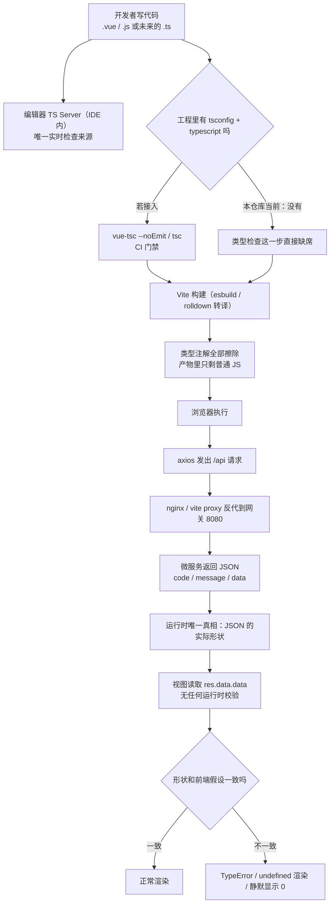
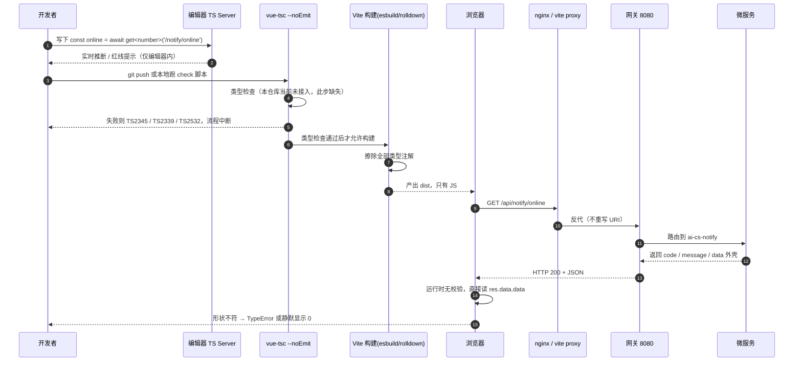

# TypeScript 快速上手：把「数据结构约定」变成编译期契约（以及它管不到的三件事）

> **一句话结论**：TypeScript 不消除错误，它只是把「这个字段一定是什么形状」从注释、口头约定和后端文档里搬进编译期，让不一致在敲代码时就报出来；代价是你要为这套契约维护类型，而类型体操一旦超过业务复杂度，维护成本就从业务转移到了类型本身。
> **阅读前置**：会写 ES Module 与箭头函数（见 [02-JavaScript核心基础](./02-JavaScript核心基础.md)）；知道 `ref` / `computed` / `defineProps` 的最低用法（见 [04-Vue3核心基础](./04-Vue3核心基础.md)）；不要求你写过任何 `.ts` 文件。
> **证据基线与预计阅读**：本仓库 `ai-cs-frontend` 当前是**纯 JavaScript** —— 工程根 `package.json` 里没有 typescript 依赖，src 下 0 个 `.ts` 文件，根目录 0 个 tsconfig。所以本篇所有「TS 会怎样」都是**推演 + 本机 node 实测**，没在本机跑过的一律标注「未实测」。Node 24（本机实测 v24.16.0）可用。预计 25 分钟。

---

## 0. 先看现象

三个现场，全部来自本仓库真实代码。第一个是「类型缺失导致的静默错误」，后两个是「你以为有类型、其实类型压根不存在」的实证。

### 现场一：业务失败被显示成「在线 0 人」

打开通知页 `NotifyView.vue`，在线人数一直显示 0，但后端服务是活着的。看代码：

```javascript
// ai-cs-frontend/src/views/NotifyView.vue:105-107（真实代码）
const res = await notifyApi.get('/online')
onlineCount.value = res.data?.data ?? 0
```

本仓库所有微服务都用同一个返回体外壳 `{ code, message, data }`（`code === 200` 才是业务成功）。这里直接取 `res.data.data`，**压根没看 `res.data.code`**。于是：

- 后端返回 `{ code: 200, data: 12 }` → 显示 12，正常；
- 后端返回 `{ code: 500, message: '服务繁忙', data: null }` → `?? 0` 把它兜成 0，页面安静地显示「0 人在线」；
- 服务整个挂了 → axios 抛错，反而能看到报错。

**HTTP 200 不等于业务成功**，这是本仓库最贵的一条隐性约定。它没有写在任何类型里，只写在 50 处手写的 `code === 200` 判断里（这个数字怎么数出来的见 §3.7 与 §3.10）。写完这行代码的人不是不认真，而是**没有任何工具告诉他 `res.data.data` 可能为空**——因为 `notifyApi.get()` 的返回值在编辑器里是 `any`。

> 说明：本条为静态代码判读，未在本机启动前后端实测浏览器行为，判读方法见 §6.1。

### 现场二：`role.split is not a function`

`auth.js` 里角色判断假定后端返回的 `role` 是一个逗号分隔字符串（`"ADMIN,USER"`）。我写了个 12 行的脚本，把 localStorage 里的 `role` 换成数组再 `import` 这个真实模块：

```javascript
// demo2.mjs —— 不改项目文件，只 stub 全局 localStorage 后 import 真实模块
globalThis.localStorage = {
  getItem: (k) => (k === 'aics_user' ? JSON.stringify({ role: ['ADMIN', 'USER'] }) : null),
  setItem: () => {}, removeItem: () => {}
}
const m = await import('file:///D:/Projects/Persion/ai-customer-service/ai-cs-frontend/src/utils/auth.js')
console.log('getUser() =', JSON.stringify(m.getUser()))
try { m.getRoles() } catch (e) { console.log('CRASH:', e.message) }
```

实测输出（Node v24.16.0，真实运行）：

```text
getUser() = {"role":["ADMIN","USER"]}
CRASH: role.split is not a function
```

页面表现是：**登录成功、菜单全掉了、按钮全灰了**，控制台就一句 `role.split is not a function`。根因不在前端：后端某次把 `role` 从 String 改成了 `List<String>`，前端一句注释也没改。如果这里有一行 `interface LoginUserVO { role: string }`，改后端的人至少会被迫看一眼前端契约。

### 现场三：带类型错误的 `.ts` 文件，node 直接跑通了

很多人装完 Node 24 后第一次发现「原来 node 能跑 .ts」，就以为「不用装 tsc 了」。我按这个误解写了个最小实验：

```typescript
// demo1.ts —— tsc 会在这里报 TS2339：属性 'split' 不存在于类型 'number'
interface UserVO { userId: number; role: string }
const vo = { userId: 1001, role: 'ADMIN' } as unknown as UserVO
const bad: string = vo.userId.split(',')
console.log(bad)
```

实测：`node -v` 输出 `v24.16.0`；`node demo1.ts` 的真实输出是

```text
const bad         = vo.userId.split(',')
                              ^
TypeError: vo.userId.split is not a function
    at Object.<anonymous> (...\demo1.ts:10:31)
Node.js v24.16.0
[exit=1]
```

类型注解在进入执行前就被**整段擦除**了，`vo.userId` 是数字这件事没有任何运行时痕迹。node 能跑 `.ts` 只证明它**会擦除**类型，不证明它**检查过**类型。

### 这三个现象指向同一件事

> **这些现象指向同一件事**：本仓库前端把「数据结构长什么样」这件事交给了注释、命名习惯和人的记忆。现场一是「约定的字段可能为空」没被表达，现场二是「约定的类型变了」没人被通知，现场三是「写了类型也不等于被检查」。TypeScript 恰好能治前两个，完全治不了第三个的一半——它把约定变成编译期契约，但**契约的执行要靠编译器，而运行时永远只认 JSON**。

---

## 1. 整体地图

先看清「类型」在这个工程里从写下到消失，一共经过几个环节。注意：本仓库当前**没有装 TS 编译器**，所以下图中那条「类型检查」的旁路在生产链路上是空的。



**读图说明**：图的左上两支是「写代码」，`B` 是编辑器内置的 TypeScript 语言服务——**即使工程里一个 `tsconfig.json` 都没有，IDE 也会给 `.js` 做部分推断**，这是很多人误以为「我已经有类型检查了」的来源。中间 `C → D` 是重点：本仓库走的是 `D` 这条路，即**编译期检查环节缺失**，代码直接进 `F` 被 Vite 转译。`F → G` 是类型擦除点，从此以后类型在物理上不存在。右侧 `K → L → M` 说明：真正的形状认知发生在运行时，而 `M` 处**没有任何校验代码**，形状不符就在 `N → P` 爆掉或静默错。整张图只有 `E` 一处能提前拦住错误，而它尚未接入。

| 组件 | 责任 | 参与方 / 关键 API | 本仓库落点 |
|---|---|---|---|
| TS 语言服务（编辑器） | 实时推断、跳转、红色波浪线 | `tsserver` | 开发者本机 IDE，无仓库配置 |
| `tsc` / `vue-tsc` | 全量类型检查、CI 门禁 | `--noEmit` | **未接入**：`ai-cs-frontend` 的 `package.json` 无 typescript |
| Vite 构建 | 转译 + 打包，**不做类型检查** | `@vitejs/plugin-vue` | `ai-cs-frontend/vite.config.js:15` |
| 类型声明来源 | 第三方库的类型 | `.d.ts` | `node_modules/element-plus/global.d.ts` 等均已随包提供 |
| axios 实例 | 发请求、注入 token，返回 `any` | `axios.create` | `ai-cs-frontend/src/api/index.js:37-63` |
| 后端返回体 | 契约的**源头** | `{ code, message, data }` | 各微服务统一外壳 |
| 运行时校验 | 兜住上游漂移 | 手写 `typeof` / `?.` / `??` | `ai-cs-frontend/src/utils/format.js:14` |

从表里能读出一个不对称：**契约的源头在后端，契约的消费在前端，而两端之间只有一根 HTTP 线**。TypeScript 只能约束线的这一端，永远管不到那一端。

---

## 2. 关键概念与关键类 / 关键 API

### 2.1 类型系统概念

| 名称 | 位置（出处） | 角色 | 关键点 |
|---|---|---|---|
| 结构化类型 structural typing | TS 语言本体 | 判断兼容性只看**形状**，不看名字 | 和 Java 的名义类型相反；两个不同 `interface` 只要形状一致就互通 |
| `interface` | 同上 | 描述对象形状、可声明合并 | 适合「契约」类，尤其是要被别人扩展的 |
| `type` | 同上 | 任意类型的别名 | 能表达联合、映射、条件类型；`type A = A & {…}` 不能递归合并 |
| 联合 `A \| B` | 同上 | 「或」 | 使用前必须先收窄 |
| 交叉 `A & B` | 同上 | 「且」 | 冲突字段会变成 `never`，不是报错 |
| 字面量类型 `'LIKE'` | 同上 | 把取值范围压到一个常量 | 本仓库 `'LIKE' \| 'DISLIKE'` 只写在注释里，见 §3.3 |
| `any` | 同上 | 关闭检查 | 会**传染**：`any` 参与的表达式结果还是 `any` |
| `unknown` | 同上 | 顶级安全类型 | 用之前必须收窄，`JSON.parse` 的正确返回类型 |
| `never` | 同上 | 空集 | 用于穷尽性检查与「永不返回」 |
| 泛型 `<T>` + 约束 `extends` | 同上 | 让一个实现服务多种形状 | 输入输出有关联时才需要，见 §3.5 |
| 工具类型 | TS 标准库 `lib.es5.d.ts` | `Partial` / `Pick` / `Omit` / `Record` / `ReturnType` | 从已有类型派生，避免抄第二遍 |
| 类型收窄 narrowing | 语言本体 | `typeof` / `in` / `===` / 判别字段后自动缩窄 | 与手写运行时判断是同一件事的两面 |
| 类型断言 `as` | 同上 | **命令**编译器相信你，不做检查 | 断言错了编译器不负责，运行时报错 |
| 声明文件 `.d.ts` | 工程配置 | 给无类型的 JS 补形状 | 本仓库缺 `env.d.ts`，见 §3.8 |
| `tsconfig.json` | 工程配置 | 编译选项 | `strict` 与 `noUncheckedIndexedAccess` 是两个不同档，见 §3.7 |
| 类型擦除 | 编译产物行为 | 类型不进产物 | node 直接跑 `.ts` 也是擦除，§0 现场三 |

### 2.2 本仓库当前实际使用的「类型替代物」

这一张表比上一张更重要，它说明**在没有 TS 的工程里，人是怎么手动补上那部分能力的**。

| 替代物 | 真实落点 | 它替代了什么 | 它的缺口 |
|---|---|---|---|
| JSDoc `@param` / `@returns` | `ai-cs-frontend/src/utils/format.js`（4 处）、`ai-cs-frontend/src/utils/sseStream.js:10-19` | 函数签名类型 | 编译器不强制、不检查调用方；本工程共 18 行此类注释 |
| `typeof` 手写守卫 | `format.js:14`、`format.js:26-40` | 参数运行时校验 | 只覆盖被写到的那个函数 |
| `?.` 可选链 | 全 src 共 90 行含此模式 | 「可能是 undefined」的心理标注 | 若源头的 key 名字写错，`?.` 会安静返回 `undefined` |
| `?? 0` 兜底 | `NotifyView.vue:106` | 同上 | **把错误兜成合法值**，正是现场一 |
| `code === 200` 手写判断 | 全 src 共 50 行，散在 17 个视图 | 业务成功的判定 | 忘写一处就静默失败，且没人能静态发现漏了哪处 |
| `as unknown as T` | 本仓库 0 处 | 无 | — |

---

## 3. 原理与证据逐段精读

每段固定四层：**在干什么 → 为什么这么设计 → 换写法会怎样 → 常见坑**。

### 3.1 类型擦除：类型是「写给编译器看的注释」，不是代码

**在干什么**：TS 编译器（以及 Vite/esbuild/rolldown、Node 的类型剥离）在读到你写的类型注解后，把它们**当注释删掉**，产出的 JS 与手写 JS 几乎一致。

**为什么这么设计**：前端生态的兼容性全押在这上面。浏览器不认识类型语法，如果类型要保留到产物里，就必须让所有浏览器先升级——那 TS 一天都活不下来。擦除保证了「TS 产物 = 合法 JS」，也让 `allowJs` 混编、增量迁移成为可能。代价是：**类型不可能承担任何运行时职责**，包括校验、转换、默认值。

**换写法会怎样**：如果类型真能保留到运行时（比如装饰器元数据 `reflect-metadata` 那一派），你就能在运行时 `instanceof` 一个接口、按类型自动反序列化。TS 主动放弃了这条路，换来了零运行时开销与零侵入。想走运行时校验就得引入另一套东西（手写守卫、schema 库、后端强校验），这是**额外的一层**，不是免费赠品。

**常见坑**：

- 以为 `node xxx.ts` 通了就等于类型没问题。§0 现场三已实证：带 `TS2339` 的代码在 node 里照样跑到运行时才崩。
- 以为 `as` 在运行时会「转换」。它什么都不做（§3.6）。
- 以为 `interface` 能在 `console.log` 里看到。打印出来永远是 `{}`，因为它在编译后不存在。

```typescript
// 擦除前后的对照（手写示意，本机未用 tsc 编译，本机未安装 typescript）
interface UserVO { userId: number; role: string }
const raw = JSON.parse('{"userId":1001}') as UserVO   // 断言：编译器信你，运行时不补字段
console.log(raw.role.length)                          // 编译期无错，运行时 TypeError
```

上面这段其实等于 §0 现场二的机制：**结构约定缺失的字段，运行时就是 `undefined`**，而 `undefined.length` 必然崩。

### 3.2 `interface` vs `type`：形状约定与类型别名

**在干什么**：两者都能描述对象形状。`interface` 声明一个可被「打开」扩展的命名类型；`type` 只是给任意类型表达式起个别名。

**为什么这么设计**：`interface` 的可扩展性是为**库作者**准备的——库里导出 `interface Options`，使用者能 `declare module` 合并字段，不用改库源码。`type` 的表达式能力是为**类型计算**准备的——你要写 `type Status = 'idle' | 'loading' | 'done'`、`type Props = Base & Extra`，`interface` 表达不了联合。

**换写法会怎样**：把一个纯联合类型写成 `interface`，你会被迫发明一个没有对象的「假接口」；反过来，把要被第三方扩展的配置对象写成 `type`，使用者就没法合并声明。本仓库 `directives/permission.js:21` 的 `binding.value` 是「一个字符串或字符串数组」，这就是天然的 `type Required = string | string[]`，写成 `interface` 只能绕着走。

**常见坑**：

- 以为 `interface` 和 `type` 性能有差别。在现代 TS 里这个差别只在极端递归场景才可观测，别当决策依据。
- 用 `type A = A & { b: string }` 想「往自己身上加字段」——这是直接循环引用，报错；`interface A { }` 再 `interface A { b: string }` 才是声明合并。
- 交叉类型字段冲突（`{ id: string } & { id: number }`）得到的 `id` 是 `never`，**不报错**，你会在使用处看到一个莫名其妙的「不能赋值给 never」。

```typescript
// 本仓库 permission.js:16-36 的真实形状（JS 原样，右列是「若改 TS」）
// const required = binding.value          → binding.value: string | string[]
// Array.isArray(required) ? required : [required]
//                                          → TS 会在 Array.isArray 之后自动收窄成 string[]
type Required = string | string[]           // 该用 type：它就是联合
interface RoleSource { role: string }       // 该用 interface：它是要被后端契约约束的对象
```

### 3.3 联合、交叉与字面量：本仓库有一个「写在注释里的字面量联合」

**在干什么**：字面量类型把取值范围收窄到一个具体常量（`'LIKE'`），联合把若干取值拼起来（`'LIKE' | 'DISLIKE'`），交叉把两个形状合起来。

**为什么这么设计**：业务里大量字段的真实取值就是「几个固定字符串」。用 `string` 描述它，等于放弃了全部检查力——拼错 `'LIKED'`、大小写不一致、后端改成 `'like'`，编译器全都放过。字面量联合是**成本最低、收益最高**的一步类型化。

**换写法会怎样**：本仓库 `ai-cs-frontend/src/api/index.js:88-92` 的反馈接口 JSDoc 里明确写着 `feedbackType: 'LIKE' | 'DISLIKE'`，`ChatView.vue:105` 也在用 `msg.feedback === 'LIKE' ? '👍' : '👎'`。**这个联合类型真实存在，但它只活在注释和字符串比较里**。于是：

- 后端把枚举改成 `LIKE / DISLIKE / NEUTRAL`，前端两个文件都不会报错，`NEUTRAL` 会被静默渲染成 👎；
- 有人在别处传了 `'dislike'`（小写），axios 照发，后端 400，前端只看到「操作失败」。

把同一份联合抽成 `type FeedbackType = 'LIKE' | 'DISLIKE'` 并让 JSDoc 的 `@param` 与模板判断共用它，这类错就从「上线后发现」变成「保存文件时红线」。

**常见坑**：

- 字面量联合放进 `const` 数组里，忘了 `as const`，数组元素会退化成 `string[]`，联合失效。
- 用 `enum` 代替字面量联合：`enum` 会生成运行时对象（破坏擦除、影响 tree-shaking），且与后端字符串枚举对不上时还要手写映射。**接口边界上的字符串枚举，优先字面量联合**。
- 把联合类型当「或」用在对象合并上：`A | B` 表示「是 A 或是 B」，取值时必须先收窄；要「A 且 B」得用 `&`。

```typescript
// 把本仓库注释里的契约搬到类型层（示意，未落地到仓库）
type FeedbackType = 'LIKE' | 'DISLIKE'

interface FeedbackPayload {
  sessionId: string
  feedbackType: FeedbackType   // 不再是 string
  score?: number
  comment?: string
}
// 模板侧也跟着统一：msg.feedback === 'LIKE' 时 msg.feedback 的类型是 FeedbackType | undefined
```

### 3.4 `never` / `unknown` / `any` 的边界

**在干什么**：三者是类型系统的三个特殊点。`any` 关闭检查并向外传染；`unknown` 是「存在但不知形状」，用前必须收窄；`never` 是空集，任何值都不能赋给它。

**为什么这么设计**：需要「逃生舱」（`any`，用于渐进迁移与无类型库）、需要「安全逃生舱」（`unknown`，用于外部输入）、需要「不可能」（`never`，用于穷尽性检查和 `throw` 的返回类型）。三者的存在说明 TS 的哲学是**可退让的严格**：你可以随时放弃检查，但放弃的地方会被记录在案——这就是为什么团队规范里通常只有一条硬规则：**`any` 只许出现在边界，且必须紧跟一行注释说明为什么**。

**换写法会怎样**：本仓库有 7 处 `JSON.parse`。在 TS 里 `JSON.parse` 返回 `any`——注意不是 `unknown`，是 `any`。这意味着 `JSON.parse(localStorage.getItem('aics_user'))` 之后的所有字段访问**全部跳过检查**，`auth.js` 的 `role.split(',')` 正是这条链的终点。若改成 `JSON.parse(s) as unknown` 再配一个手写守卫，`role` 是不是字符串就变成了必须显式回答的问题。

**常见坑**：

- `catch (e)` 里 `e` 在 `strict` 下是 `unknown`，直接 `e.message` 报错；正确姿势是 `e instanceof Error ? e.message : String(e)`。本仓库 `ChatView.vue:233` 附近就是 `console.warn('加载历史会话失败:', e.message)`——JS 下无事，TS 下必须改。
- 用 `any` 消掉一个报错，结果 `any` 顺着返回值一路污染，最后整个模块都失去检查。判断标准：**`any` 的传播距离超过一个函数就该重写**。
- `never` 被误用于「没有值」的字段（如 `data: never`），实际该用 `null` 或 `unknown`。
- `Object.entries()` 对**模块命名空间**的推断。`ai-cs-frontend/src/main.js:14` 的 `for (const [key, component] of Object.entries(ElementPlusIconsVue))`，在 TS 下 `component` 的类型会退化，`app.component(key, component)` 处容易触发类型不匹配。这是「第三方库提供的命名空间对象」与「普通对象字面量」推断不同的典型陷阱。

```typescript
// 三种「不知道」的正确用法（示意）
function parseUser(raw: string): unknown { return JSON.parse(raw) }        // 外部输入 → unknown
function assertUser(v: unknown): asserts v is { role: string } {          // 断言函数 → 收窄
  if (typeof v !== 'object' || v === null) throw new Error('not an object')
  if (typeof (v as { role?: unknown }).role !== 'string') throw new Error('role must be string')
}
function fail(msg: string): never { throw new Error(msg) }                // 永不返回 → never
```

### 3.5 泛型与约束：什么时候「该」用泛型

**在干什么**：泛型让一个实现同时服务多种形状，并在**调用点**把类型接上：`function first<T>(arr: T[]): T | undefined`。约束 `T extends X` 保证 `T` 至少有 `X` 的形状。

**为什么这么设计**：没有泛型时，要么为每种类型写一份实现（重复），要么用 `any`（丢失关联）。泛型的独特价值是**保持输入与输出之间的类型关联**：`T[] → T` 这条关系是 `any` 表达不出来的。判断该不该用泛型只有一条标准：**「这个类型参数是否出现在两个以上的位置，并且这些位置之间有约束关系」**。只出现一次的类型参数（`function f<T>(x: T): void`）几乎都可以删掉。

**换写法会怎样**：本仓库 `ai-cs-frontend/src/api/index.js:37-63` 的 `createClient(base)` 造出 15 个 axios 实例，每个实例的方法都返回 `{ code, message, data }` 但 `data` 内部形状各异。当前写法里 `data` 是 `any`，所以 `res.data.data.length`、`res.data.data.rows`、`res.data.data` 当数字用，全都不报错——**这就是现场一能存在的原因**。若给 client 加一层泛型 `request<T>(cfg): Promise<Result<T>>`，则每个调用点都要写出 `T`，`NotifyView` 会立刻发现「`/online` 返回的 data 是 number 还是对象，我其实不知道」。

反面也要说清：把泛型加到不需要的地方，读代码的人要在脑子里做类型替换，成本立刻超过收益。**类型体操比业务难维护，通常就是从「多加一个类型参数试试」开始的。**

**常见坑**：

- 泛型参数命名随意（`<T, U, K, V>` 混用），调用点看不出含义；约定俗成：集合用 `T`，键用 `K`，值用 `V`，错误用 `E`。
- 忘记默认值：`function useCache<T = unknown>()`，否则每个调用点都要显式给。
- 约束写成 `T extends any`（等于没约束）或 `T extends object`（把 `string` 排除了，会让 `Record` 类工具函数报奇怪错）。
- 在 `.vue` 里给 `defineProps` 加泛型参数时，误以为泛型能在运行时表现——不能，它是纯编译期。

```typescript
// 一处「值得」用泛型的地方：统一返回体（示意，本仓库尚未落地）
interface Result<T> { code: number; message: string; data: T }

async function get<T>(url: string): Promise<Result<T>> {
  const res = await client.get<Result<T>>(url)
  return res.data
}
// 调用点必须回答 data 是什么：这行代码本身就是一条契约
const online = await get<number>('/notify/online')
```

### 3.6 类型收窄与断言纪律：`as` 是「我保证」，不是「帮我转」

**在干什么**：收窄（narrowing）是编译器根据 `typeof`、`instanceof`、`in`、`===`、`Array.isArray`、判别字段自动缩小类型范围；断言（`as`）是你手工指定「就当它是 X」，编译器**不验证**。

**为什么这么设计**：运行时判断本来就写在代码里（`typeof bytes !== 'number'` 这种），编译器顺手复用这些判断的结论，零成本；而有些场景编译器确实推不出来（DOM 查询、第三方库返回 `any`），需要留一个逃逸口。断言的存在是为了**兼容推不出的情况**，不是为了让报错消失。

**换写法会怎样**：本仓库 `format.js:14` 的

```javascript
if (typeof bytes !== 'number' || !Number.isFinite(bytes) || bytes < 0) return '-'
```

是比较规范的运行时守卫。在 TS 里它同时还是**类型收窄**：守卫之后的 `bytes` 一定是 `number`。这就把「运行时校验」与「编译期收窄」合并成了一处代码、一份维护成本——这是本仓库现有代码里最值得保留的写法习惯。反之，如果写成 `const n = bytes as number`，运行时的 `'-'` 兜底就消失了，`'abc'` 会算出一个 `NaN`。

**常见坑**：

- `as any as T` 双重断言绕过一切检查。看到它就该当代码异味处理。
- `!` 非空断言（`el.value!.focus()`）与 `as` 同源，但更隐蔽；组件卸载时序不对时它必炸。
- 只用 `as` 收窄 union 的一半（`(msg as UserMsg)`），没做 `in` 判断，实际字段可能不存在。
- 忘了 `Array.isArray` 之后的分支里元素类型并没有被收窄（嵌套数组要显式处理）。

```typescript
// permission.js:21 的收窄在 TS 下是自动的（示意）
function toList(v: string | string[]): string[] {
  return Array.isArray(v) ? v : [v]   // 分支内 v 被收窄为 string[]
}
```

### 3.7 工具类型与 `noUncheckedIndexedAccess`：本仓库最该被拦下的两行

**在干什么**：工具类型从已有类型派生新类型，不抄第二遍：`Partial<T>` 全可选、`Pick<T,K>` 挑字段、`Omit<T,K>` 去字段、`Record<K,V>` 造字典、`ReturnType<F>` 取函数返回类型。`noUncheckedIndexedAccess` 是 tsconfig 的一个开关，让**下标访问的结果自动加上 `| undefined`**。

**为什么这么设计**：派生优于重写——重写就会漂移，漂移就产生 bug。下标访问同理：JS 里越界读数组、读不存在的对象 key，返回的是 `undefined` 而不是抛错，这是 JS 最容易静默出错的地方之一；这个开关让编译器强制你在使用前处理 `undefined`。

**换写法会怎样**：本仓库有两处代码是它的完美靶子。

```javascript
// ai-cs-frontend/src/utils/format.js:6 与 :23（真实代码）
const UNITS = ['B', 'KB', 'MB', 'GB', 'TB', 'PB']
// …… L23：
return `${value.toFixed(1)} ${UNITS[unitIndex]}`
```

JS 下 `UNITS[6]` 是 `undefined`，结果直接渲染成 `"1.0 undefined"`——一个**看起来像正常文本**的错误。开启 `noUncheckedIndexedAccess` 后 `UNITS[unitIndex]` 的类型是 `string | undefined`，插进模板字符串会直接报错，逼你写 `?? 'B'`。这是「编译期契约拦住一个真实显示缺陷」的最小样本。

第二处是 `ai-cs-frontend/src/views/ChatView.vue:211-216` 的 `sessionMessages.value[sessionId]`：作者已经知道可能为 `undefined`，所以先判断再补空数组（注释也写了）。**这个「作者已经知道」的知识，正是应该由编译器持有而不是由人记住的知识**。

```typescript
// 同一个字典，三种写法三种代价（示意）
const sessionMessages = ref<Record<string, Message[]>>({})

sessionMessages.value[id].push(msg)          // 开 noUncheckedIndexedAccess 后报错：可能 undefined
sessionMessages.value[id]!.push(msg)         // 用 ! 压掉报错：运行时可能 TypeError
(sessionMessages.value[id] ??= []).push(msg) // 正解：既收窄又兜底

type MessageView = Omit<Message, 'requestId'>                  // 视图层不需要的字段
type MessageDraft = Partial<Pick<Message, 'role' | 'content'>> // 草稿态
type StreamResult = ReturnType<typeof createSseStream>         // { aborted: boolean; events: number }
```

**常见坑**：

- `Partial<T>` 滥用：本该「要么全有要么全无」的对象变成「全可选」，于是每个使用点都要加 `!`，把检查成本转移了。
- `Omit<T, 'a'>` 里的 `'a'` 拼错——**不会报错**，只是什么都没删掉（`Omit` 对不存在的 key 是宽容的）。要严格就得改写成 `Omit<T, Extract<keyof T, 'a'>>` 或用 `satisfies`。
- `Record<string, T>` 让「不存在的 key」看起来总是存在；配合 `noUncheckedIndexedAccess` 才安全。
- 开了 `noUncheckedIndexedAccess` 后，`for (const x of arr)` 不受影响，但 `arr[i]`、`obj[key]` 都要重审。这会一次性炸出大量报错，**不要在一个 PR 里同时开 `strict` 和它**。

静态统计（命令与真实输出见 §3.10）里那 **50 处 `code === 200`** 值得单独说：它们分布在 17 个视图，是人工维护的「业务成功判定」。类型系统能帮你把它抽成 `Result<T>` + 一个 `isOk(res)` 类型谓词，但**它无法告诉你「第 51 个调用点忘了判断」**——除非所有调用点都走同一个函数。这件事的本质是「约定要靠唯一入口强制执行」，不是类型能自动解决的。

### 3.8 声明文件与第三方类型：本仓库缺的不是依赖，是自己的 `.d.ts`

**在干什么**：`.d.ts` 描述「已经存在的 JS 是什么形状」。第三方库发布时通常自带（`element-plus` 的 `global.d.ts`、`vite/client.d.ts`、`axios` 的类型入口，本机 `node_modules` 里都已核对存在），而**自己工程里的全局变量、`import.meta.env` 变量、无类型 JS 模块**，需要自己写。

**为什么这么设计**：TS 要能给「无法改写的 JS」加类型，唯一办法就是外挂一份声明文件。这也是渐进迁移（`allowJs` + `checkJs`）的技术基础：不动源码，先补声明。

**换写法会怎样**：本仓库 `ai-cs-frontend/src/utils/runtime.js:8` 的注释写着「注意不能写成 `env.VITE_GATEWAY || 'http://localhost:8080'`」，而 `resolveGateway(env)` 的入参在 TS 下类型应是 `ImportMetaEnv`——这个接口**不会自动出现**，必须由 `env.d.ts` 声明 `VITE_GATEWAY?: string`。没有这份声明，`import.meta.env.VITE_GATEWAY` 的类型会落到索引签名上（`any`），于是「留空串」与「未配置」在类型上完全等价，`runtime.test.js:11-16` 那条用例守住的东西，编译器一点忙都帮不上。

**常见坑**：

- 以为「装个 `@types/xxx` 就全有了」。`@types` 只覆盖 DefinitelyTyped 上有的库；本仓库的 `element-plus`、`axios`、`vite` 都自带类型，缺的是业务侧声明。
- 写了 `declare global` 却忘记 `export {}`，导致文件从「模块」退化成「全局脚本」，声明悄悄不生效。
- `env.d.ts` 里用索引签名 `[key: string]: any` 兜住所有 `VITE_*`——等于把整份声明作废。
- `include` 配置漏了 `.vue`，`vue-tsc` 根本不去检查组件，CI 绿得毫无意义。

```typescript
// 本仓库缺失的 env.d.ts（示意；未落地）
/// <reference types="vite/client" />

interface ImportMetaEnv {
  readonly VITE_GATEWAY?: string   // .env.production 里显式留空 → ''（见 runtime.js:8 的注释）
  readonly VITE_PROXY_TARGET?: string
}
interface ImportMeta { readonly env: ImportMetaEnv }
```

### 3.9 Vue 3 的 TS 用法：`defineProps` 泛型、`ref` 类型、`computed` 推导

**在干什么**：`<script setup lang="ts">` 下，`defineProps<T>()` 用一个类型参数描述 props；`ref<T>()` 显式给出内部值的类型；`computed` 从 getter 的返回值**自动推导**，通常不需要写类型参数。

**为什么这么设计**：宏（`defineProps` 等）在编译期被展开成运行时代码，所以只能靠**类型参数**而不是普通函数重载来描述；反过来，`computed` 的推导是纯类型推断，手写类型参数反而会覆盖掉更精确的推断结果。

**换写法会怎样**：写成运行时对象形式 `defineProps({ size: String })` 也能用，但取值类型会退化成 `string`，字面量联合（`'small' | 'large'`）就丢了。用泛型写法，`size` 越界在模板里就报错。**注意本仓库当前的 `.vue` 文件全部是 `<script setup>` 且无 `lang="ts"`**（静态统计：`lang="ts"` 命中 0），所以下面都是「若迁移」的示意。

```vue
<script setup lang="ts">
// 示意：本仓库 ChatView.vue 若迁移到 TS，props 与状态应这样写
interface Message {
  role: 'user' | 'assistant'
  content: string
  feedback?: 'LIKE' | 'DISLIKE'   // 对齐 api/index.js:88-92 注释里的契约
}

const props = withDefaults(
  defineProps<{ items?: Message[]; size?: 'small' | 'large' }>(),
  { items: () => [], size: 'small' }   // 对象/数组默认值必须是工厂函数
)

const sessionMessages = ref<Record<string, Message[]>>({})   // ref 需要显式给出内部类型
const userCount = computed(() => props.items.filter(m => m.role === 'user').length)
// computed 不写类型参数：它会推出 number；写了反而可能写宽成 number | undefined
</script>
```

**常见坑**：

- 错误示范：`const p = defineProps<{ size?: string }>(), { size: 'small' }` —— `defineProps` 是宏、返回 props，**没有第二个参数**，默认值必须靠 `withDefaults` 包一层。这个错误在旧稿里出现过，这里更正：正确写法是 `withDefaults(defineProps<T>(), {...})`。
- props 解构：`const { items } = defineProps<...>()` 在早期版本会**丢失响应性**；当前 Vue 3.5 基线下对 props 解构做了响应式处理，但团队里混用不同版本时仍应统一写成 `props.xxx` 或 `toRefs`。
- `ref([])` 推断成 `never[]`：空数组必须写 `ref<Message[]>([])`，否则后续 `push` 报错。
- `computed` 里做副作用（发请求、改别的 ref）——这是逻辑错误，类型系统不会拦。
- 模板里 `msg.feedback === 'LIKE'` 的 `msg` 来自 `ref` 数组，若 `ref` 类型写成 `any[]`，模板中所有字段访问都失去检查（本仓库 `ChatView.vue:192-208` 的 11 个 `ref()` 全是无类型写法）。

### 3.10 运行时真相：类型管不到的三件事（含本章全部实测命令与输出）

**在干什么**：把前面所有推演收束成一个可执行的判据——**类型只在编译期存在，所以「值从哪来、值是否合法、值代表什么语义」这三件事必须另有保障**。

**为什么这么设计**：TS 的类型是「对已经写好的代码的事后描述」，它无法验证网络数据、无法验证存储数据、无法理解端口号的语义。这不是缺陷，是定位：类型负责「内部一致性」，外部边界要靠运行时校验与测试。

**换写法会怎样**：想让类型覆盖边界，就必须引入「从类型生成校验器」的机制（schema 优先、zod 一类），那等于把契约源头从类型注解搬到运行时 schema，成本与收益都要重新算。

**常见坑 / 三个反例（全部来自本仓库真实代码）**：

1. **端口号写错**：`ai-cs-frontend/src/views/NotifyView.vue:114` 的 `new WebSocket('ws://localhost:8085/ws/notify')`，连的是 8085（message 服务）而不是 8086（notify 服务）。这是一个真实已知缺陷。**类型能表达 `port: number`，但表达不了「这个数字必须等于 notify 服务的端口」**——除非你把端口收拢到一个带 `as const` 的常量表并让类型从常量派生。类型拦不住「语义正确但取值错误」。
2. **业务失败被兜底**：`NotifyView.vue:105-107` 的 `?? 0`（现场一）。类型可以说「`data` 是 `number`」，但它无法表达「`code !== 200` 时 `data` 无意义」。要表达这个，需要**可辨识联合**：`type Result<T> = { code: 200; data: T } | { code: number; message: string }`。
3. **空串被 falsy 逻辑吃掉**：`runtime.js:8` 那条注释与 `runtime.test.js:11-16` 守的是同一个 bug——`.env.production` 里 `VITE_GATEWAY` 显式留空（为了让产物走同源 `/api`），旧代码 `|| 'http://localhost:8080'` 把空串当 falsy，生产环境请求打回 localhost，**上线即白屏**。类型层面 `string` 完全合法；救下它的是**一条测试**。

**C 级实测：静态统计（命令 + 真实输出）**

```powershell
# 在 ai-cs-frontend 目录下执行；只读统计，不装依赖、不联网，秒级返回
$src = Get-ChildItem src -Recurse -Include *.js,*.vue
"src 文件数    : " + $src.Count + "  行数: " + ($src | Get-Content | Measure-Object -Line).Lines
"ts 文件数     : " + (Get-ChildItem src -Recurse -Include *.ts,*.d.ts | Measure-Object).Count
"typescript 依赖: " + (Select-String -Path package.json -Pattern 'typescript|vue-tsc').Count
"lang=ts 的 SFC : " + (Select-String -Path $src.FullName -Pattern 'lang="ts"').Count
": any 标注     : " + (Select-String -Path $src.FullName -Pattern ':\s*any\b').Count
"as 断言        : " + (Select-String -Path $src.FullName -Pattern '\bas\s+(unknown|any|[A-Z]\w*)\b').Count
"code===200     : " + (Select-String -Path $src.FullName -Pattern 'code\s*===\s*200').Count
"ref() 调用     : " + (Select-String -Path $src.FullName -Pattern '\bref\(').Count
"含 ?. 的行     : " + (Select-String -Path $src.FullName -Pattern '\?\.').Count
"JSON.parse     : " + (Select-String -Path $src.FullName -Pattern 'JSON\.parse').Count
"JSDoc 类型行   : " + (Select-String -Path $src.FullName -Pattern '@(param|returns|type)\b').Count
```

真实输出：

```text
src 文件数    : 42  行数: 5466
ts 文件数     : 0
typescript 依赖: 0
lang=ts 的 SFC : 0
: any 标注     : 0
as 断言        : 2
code===200     : 50
ref() 调用     : 186
含 ?. 的行     : 90
JSON.parse     : 7
JSDoc 类型行   : 18
```

**这个数字有意义的部分**：

- `ts 文件数 0` + `typescript 依赖 0` + `lang=ts 0` —— 三条互相印证，本工程**确实没有 TS**。这是本篇所有「若迁移」句子的前提，也可以反过来说明：§3 里每条「TS 会拦住」的论证，在本仓库都还只是**潜力**，不是既得收益。
- `code===200 = 50` 且散在 17 个视图 —— 说明「业务成功判定」这件事被复制了 50 次。这是可维护性事实，与 TS 无关，但它是引入 `Result<T>` + 类型谓词的**最强动力**：把 50 处手工判断压成 1 个 `isOk()`。
- `JSDoc 类型行 18` —— 团队其实已经在「手写类型」，只是写在编译器看不见的地方。

**这个数字没有意义（甚至误导）的部分**：

- `any 标注 = 0` **完全不代表代码更安全**。这个正则数的是「类型语法 `: any`」，而工程里根本没有类型语法。真相是**每一个未注解的位置都是隐式 `any`**，数量级远大于 0。**用一个不存在的语法去数「有多少 any」，是本篇最该引以为戒的指标造假方式。**
- `as 断言 = 2`，而这两处没有一处是断言：

```text
ChatDashboardView.vue:39: import * as echarts from 'echarts'
main.js:5:                 import * as ElementPlusIconsVue from '@element-plus/icons-vue'
```

  两处都是 `import * as ns`（命名空间导入），正则把 `as` 后面的标识符当成了断言目标。**正则统计必须回看命中样本**，否则一个漂亮的数字会被用错方向。
- `含 ?. 的行 = 90` 不能推出「有 90 处做了空值处理」。`?.` 也可能是 `a?.b.c` 这种只保护了第一层，或者 `res.data?.data` 这种「保护了空对象但没校验形状」。数字只描述「有人在这里犹豫过」。

> 交叉印证：`tsconfig` 在本工程**根目录 0 个**，但 `node_modules` 里有 13 个（例如第三方包自带的 `@humanfs/types` 目录下就有一份）。同一类统计只要 `-Recurse` 而不过滤 `node_modules`，就会得出「这个工程有 13 个 tsconfig」的荒谬结论——**统计脚本的边界就是结论的边界**。

---

## 4. 一次完整执行时序（以「接入 TS 后修改一个 TS 文件」为主线）

下图把「写一行 TS」到「用户看到界面」的每一步摊开，并标出每一步**失败时报什么错**。注意第 3 步在本仓库当前是**跳过**的。



**读图说明**：1–2 步是**唯一的实时反馈**，但它的结论只活在编辑器里，不进仓库、不进 CI，换台机器就没了 —— 这就是「我本地没报错」的经典来源。3–5 步是**门禁**：`vue-tsc --noEmit` 只输出诊断、不产出文件，它一旦失败应该在 4 步就中断流程，绝不该走到 6 步。6–7 步是**信息不可逆丢失点**：类型在此消失，产物里再也找不回 `Message` 是什么。8–13 步是运行时链路，注意 12 步返回体的形状**完全由后端决定**，前端类型注解对它毫无约束力。14–15 步是全部前功尽弃的地方：**类型说得再准，最后一步的代码若信任了错误假设，就只剩 `TypeError` 或静默错误两种结局**。

**哪一步失败，报什么错**：

| 步骤 | 失败原因 | 典型报错 | 现象 |
|---|---|---|---|
| 2 | 参数形状不符 | `TS2345: Argument of type 'string' is not assignable to parameter of type 'number'` | 编辑器红线，仍能运行 |
| 2/4 | 访问不存在的属性 | `TS2339: Property 'split' does not exist on type 'number'` | §0 现场三的编译期版本 |
| 4 | 可能为 undefined | `TS2532: Object is possibly 'undefined'`（关 `strictNullChecks` 则**不报**） | 最常被 `!` 压掉 |
| 4 | 下标结果未判空 | 开 `noUncheckedIndexedAccess` 后 `Type 'string \| undefined' is not assignable to type 'string'` | 一次炸出几十处 |
| 4 | 引用不存在的类型 | `TS2304: Cannot find name 'Message'` | 常因 `include` 漏了 `.vue` |
| 7 | Vite 配置类型/形状不符 | 例：`Invalid type: Expected Function but received Object`（`ai-cs-frontend/vite.config.js:54-55` 注释记录了 rolldown 下 `manualChunks` 必须是函数） | 构建直接失败，与业务代码无关 |
| 11 | 网关未路由 / 服务未起 | HTTP 502 / 503，DevTools Network 里连 `code` 字段都没有 | 现场一的前置条件 |
| 14 | 形状不符（类型管不到） | `TypeError: xxx is not a function` / `Cannot read properties of undefined` | 白屏或局部渲染失败 |
| 14 | 业务失败被兜底 | **无报错**，页面显示 `0` | 最难查，必须看 Network 响应体 |

---

## 5. 设计取舍：四种「让约定可执行」的方案

| 方案 | 怎么落地 | 优点 | 代价 | 本仓库现状 |
|---|---|---|---|---|
| A. 纯 JS + JSDoc | 现有做法，`@param` / `@returns` | 零依赖、零构建改动、`checkJs` 可半自动检查 | 编译器默认不强制；只在 18 行注释里生效；无法表达复杂类型 | **当前就是这条** |
| B. 全量 TS `strict` | 加 tsconfig + `vue-tsc`，`strict` 全开 | 一次性拿到最大收益 | 存量 5466 行会一次性报出大量错误；`strict` + `noUncheckedIndexedAccess` 同开几乎无法推进 | 未落地 |
| C. 渐进迁移 `allowJs` + `checkJs` | 保留 `.js`，逐文件补 JSDoc 与 `// @ts-check`，新文件用 `.ts` | 可分批、不阻塞发版；编辑器立即受益 | 长期处于「一半有一半没有」的中间态，新人心智负担最高 | 未落地（旧稿给的四步法仍是可行路径） |
| D. 运行时 schema 校验 | 在后端返回体边界上用 schema 校验（zod 一类） | **能拦住现场一的真实错误**；类型可从 schema 派生 | 增加运行时体积与执行成本；要维护第二份契约 | 未落地；当前只有 `format.js:14` 这种手写 `typeof` |

**取舍的核心判断**：类型解决的是「代码内部一致」，schema 解决的是「外部输入可信」，测试解决的是「行为不回归」。本仓库三个真实缺陷里，现场一（`?? 0` 兜底）本该由 **D 或可辨识联合**解决，现场二（`role.split`）本该由 **B/C 的接口类型**解决，现场三（node 跑通 .ts）说明**任何方案都必须把检查放进 CI**，否则只存在于某个人的编辑器里。

**可扩展点清单**（按投入产出排序，均为未落地建议）：

1. `env.d.ts` + `ImportMetaEnv`：约 10 行，立刻让 `import.meta.env.VITE_*` 有类型，直接服务 `runtime.js` 那个「留空不能回退 localhost」的既有测试。
2. 一份全局 `api.d.ts`：把 `{ code, message, data }` 与各服务的 `data` 形状写成 `Result<T>` 与可辨识联合，用 JSDoc `@type` 引到现有 `.js`，**不改一行运行逻辑就能拿到检查**。
3. 抽一个 `isOk(res)` 类型谓词，把 50 处 `code === 200` 收敛成 1 处。
4. `vue-tsc --noEmit` 进 `check` 脚本与 CI；先只检查 `src/utils` 与 `src/api`（这两个目录最有价值、最稳定）。
5. 端口/前缀常量表（含 `as const`），把 `NotifyView.vue:114` 的 8085 与 `ai-cs-frontend/src/api/index.js:12-28` 的 `SERVICES` 对齐。
6. `satisfies` 用在配置对象上（如 `SERVICES`、`manualChunks` 映射）：既保留字面量推断，又校验形状。

---

## 6. 踩坑与调试手法

| # | 现象 | 根因 | 验证手段（可复制） | 解法 |
|---|---|---|---|---|
| 1 | 后端一切正常，页面数字恒为 0 | `res.data?.data ?? 0` 绕过 `code` 判断（`NotifyView.vue:105-107`） | DevTools → Network → 找 `/api/notify/online` → 看 Response 里 `code` 是否为 200 | 显式判断 `code`，失败走错误分支 |
| 2 | 菜单/按钮集体消失，控制台 `role.split is not a function` | localStorage 里 `aics_user.role` 不是逗号串（§0 现场二） | DevTools → Application → Local Storage → 看 `aics_user` 的 JSON | 边界处校验 + 类型收窄，别直接 `.split` |
| 3 | 装了 `vue-tsc` 后报错刷屏，全在 `node_modules` | `skipLibCheck: false` + 第三方 `.d.ts` 版本冲突 | `npx vue-tsc --noEmit 2>&1 \| Select-String node_modules` 看占比 | `skipLibCheck: true`，只审自己的代码 |
| 4 | `tsc` 一个错都没有，上线仍崩 | 只跑了 `vite build`（不检查类型），或 `.vue` 没被 `include` | `npx vue-tsc --noEmit --listFiles \| Select-String ChatView` 确认组件被检查 | 把 `--noEmit` 放进 CI，`include` 加 `.vue` |
| 5 | 加了 `noUncheckedIndexedAccess` 后几百个报错 | 存量代码大量下标访问 | 先只对 `src/utils` 单独建一份 tsconfig 试跑，估量规模 | 分批开；先修有测试覆盖的文件（`format.js` 有 `format.test.js`） |
| 6 | `as any` 一路传染，最后整个文件失去检查 | 用断言压报错而不是修形状 | 在文件里搜 `as any`、`!`，逐个加 `satisfies` 或真实守卫 | 规范：`any` 只许出现在边界，且必须紧跟理由注释 |
| 7 | WS 通知连不上，Network → WS 面板一直失败 | `NotifyView.vue:114` 连了 8085 而不是 8086（已知真实缺陷） | DevTools → Network → WS → 看请求 URL 的端口；对照服务端口表 | 端口常量集中管理；类型表达不了端口语义，需测试兜 |
| 8 | 构建直接失败，报 `Invalid type: Expected Function but received Object` | `ai-cs-frontend/vite.config.js:54-55`：rolldown 只接受函数形式 `manualChunks` | 报错行号直接指向 `vite.config.js` 的 `manualChunks` | 改成函数形式（仓库现有写法即为正解） |
| 9 | `node app.ts` 跑通了，但同事的 `tsc` 报错 | 类型剥离 ≠ 类型检查（§0 现场三实测） | `node -v` 确认版本；再单独跑 `npx tsc --noEmit` | 永远以 `tsc --noEmit` 为判据 |

### 6.1 真调试手法一：DevTools Network 面板判读「HTTP 200 但业务失败」

这是本仓库第一高频问题，因为所有服务都用 `{ code, message, data }` 外壳，**HTTP 状态码几乎永远是 200**。固定动作：

1. F12 → Network → 勾选 `Fetch/XHR` → 复现操作；
2. 点开目标请求 → **Response 标签**（不是 Headers）→ 看 JSON 里 `code` 的实际值；
3. 若 `code !== 200`，说明前端「没判断 code」或「判断了但被 `??` 兜掉」——直接去搜这个接口的调用点，确认它有没有 `code === 200` 判断（本仓库共 50 处，写法不统一）；
4. 若是 SSE 接口（`/chat/stream/sse`），Response 会持续流入而不是一次性返回；此时看 **EventStream 标签**，并检查 `Cache-Control` 是否为 `no-cache, no-transform`、有无 `Content-Encoding`（`ai-cs-frontend/vite.config.js:34-39` 的 `configure` 正是在删 `content-encoding` 并加这两个头，否则流会被缓冲到结束才吐）。

判读要点：**Headers 里的 200 只说明网关活着，Response 里的 `code` 才说明业务成不成**。

### 6.2 真调试手法二：断点 + Source Map 定位「值到底是什么形状」

`TypeError: role.split is not a function` 这类错，光看代码看不出问题（代码里写的就是 `role.split`）。定位靠**在错的现场看值**：

1. DevTools → Sources → `Ctrl+P` 搜 `auth.js`（Vite dev 下可直接看到源文件；生产需 `sourcemap: true`，本仓库 `ai-cs-frontend/vite.config.js:44-49` 里是 `false`）；
2. 在 `getRoles()` 的 `role.split` 那一行下断点，刷新页面触发；
3. 断住后看 Scope 面板里 `role` 的**运行时值**——是 `"ADMIN,USER"` 还是 `["ADMIN","USER"]`，一眼定案；
4. 若不方便打断点（例如首屏就崩），退一步在 Console 里 `JSON.parse(localStorage.getItem('aics_user'))` 直接看形状。

这套动作的价值在于：**类型系统能告诉你「你以为是什么」，只有断点能告诉你「实际是什么」**。两者缺一不可，这正是本篇主题的另一面。

### 6.3 真调试手法三：用编译器报错本身当定位工具

`tsc` / `vue-tsc` 的报错是**带文件、行号、列号、错误码**的，错误码本身就是分类索引：

- `TS2345` 参数不兼容 → 看调用点实参，而不是看函数体；
- `TS2339` 属性不存在 → 八成是「拼错字段名」或「后端改了形状」；
- `TS2532` 可能为 undefined → 问「这里凭什么保证非空」，答案通常是加 `if` 而不是加 `!`；
- `TS2304` 找不到名字 → 先查 `include` 与 `import`，再查 `types` 数组。

配合 `2>&1 | Select-String "error TS"` 只留错误行，几秒钟就能把「哪里契约破了」定位出来。**这条手法与 6.2 互补**：编译器报错告诉你「静态上不可能」，断点告诉你「动态上实际是什么」。

---

## 7. 版本差异

| 旧写法 / 旧认知 | 当前基线 | 变化点 | 迁移动作 |
|---|---|---|---|
| `const p = defineProps<{...}>(), { size: 'small' }` | `withDefaults(defineProps<T>(), { size: 'small' })` | 旧稿此处是**语法错误**：`defineProps` 是宏，没有第二个参数 | 默认值一律走 `withDefaults`；对象/数组默认值用工厂函数 |
| `defineProps` 只支持运行时声明 | 支持泛型类型参数声明（Vue 3.5 基线可用） | 类型即 props 契约，字面量联合不再丢失 | 新组件统一用泛型写法 |
| props 解构会丢响应性 | 当前基线对 props 解构做了响应式处理 | 老教程里「解构必炸」已不适用 | 仍要统一风格，避免混版本工程踩坑 |
| `ref([])` 就够用 | 空数组需 `ref<Message[]>([])` | 空数组推断为 `never[]` | 所有集合型 `ref` 显式给类型（本仓库 11 个 `ref()` 全是无类型） |
| `manualChunks` 写对象 | 必须写成函数 | `ai-cs-frontend/vite.config.js:54-55` 注释：rolldown 只接受函数形式，对象会报 `Invalid type: Expected Function but received Object` | 保持仓库现有函数写法 |
| 「`.ts` 必须先用 `tsc` 编译再运行」 | Node 24 可直接运行 `.ts`（本机 v24.16.0 实测） | 仅**类型剥离**，不做类型检查 | 别把「能跑」当「类型对」，CI 仍要 `tsc --noEmit` |
| 「本工程是纯 JS」 | **仍然成立**：工程根 `package.json` 无 typescript，src 下 0 个 `.ts`，根目录 0 个 tsconfig | 旧稿这句结论没变；但旧稿未提 `noUncheckedIndexedAccess` 与类型擦除实测 | 迁移路径见 §5 方案 C 与扩展点清单 |
| 类型也从值的位置导入 | 类型导入应写 `import type { Foo } from './x'` | 类型专用导入在擦除时更干净，也让打包器少一次解析 | 迁移时统一 `import type`，并在编译选项上开启对应严格项 |
| 用 `as` 强转配置对象 | 用 `satisfies` 校验形状但保留字面量推断 | `satisfies` 只检查、不改变推断类型 | 配置类对象（`SERVICES`、`manualChunks` 映射）优先用 `satisfies` |

> 说明：上表「当前基线」一列中，凡涉及第三方库版本的部分，一律以 `ai-cs-frontend` 的 `package.json` 里声明的范围为准（例如 `vue ^3.5.39`、`vite ^8.1.1`），本篇不额外声称任何未在该文件出现的版本号；TypeScript 本身未安装，故本篇不给 TS 版本号。

---

## 8. 面试高频问与答（只列问题）

1. 结构化类型与 Java 的名义类型有什么本质区别？为什么说 TS 的 `interface` 更接近「鸭子类型」？
2. `interface` 和 `type` 各自不可替代的场景是什么？为什么联合类型必须用 `type`？
3. `any`、`unknown`、`never` 三者在类型系统里分别处于什么位置？`catch (e)` 里的 `e` 为什么是 `unknown`？
4. 为什么 `JSON.parse` 的返回类型是 `any` 而不是 `unknown`？这个设计造成了什么风险？
5. 泛型「值得用」的判据是什么？举一个不该用泛型却常见被用的例子。
6. 类型收窄依赖哪些运行时语法？`Array.isArray`、`in`、判别字段各自能把联合收窄到什么程度？
7. `as`、`!`、`as any as T` 三者的区别与风险排序？团队规范该如何约束它们？
8. `Partial` / `Pick` / `Omit` / `Record` / `ReturnType` 各自最典型的真实用途，以及各自最容易踩的坑（提示：`Omit` 的 key 拼错会怎样）？
9. `noUncheckedIndexedAccess` 解决的是什么问题？为什么它常常不能与 `strict` 一起「一次开完」？
10. `.d.ts` 与 `declare global`、`declare module` 的关系？为什么忘记 `export {}` 会让声明失效？
11. Vue 3 里 `defineProps` 为什么只能用类型参数而不能靠运行时对象拿到字面量联合？`computed` 为什么通常不写类型参数？
12. 既然类型在编译后会消失，那「接口返回的数据形状」到底该由谁保证？你能给出几种落地方案并比较成本？
13. `satisfies` 与 `as` 的区别是什么？什么场景下必须用 `satisfies` 才能同时拿到「校验」和「精确推断」？
14. 一个 5466 行的纯 JS 工程引入 TS，你会按什么顺序推进？先开哪个选项、先改哪个目录、怎么防止 CI 长期红着？

---

## 9. 动手练习

### 练习 1：给 `auth.js` 写一份「零运行改动」的类型契约（难度 ★☆☆）

用 JSDoc `@typedef` + `@returns` 给 `ai-cs-frontend/src/utils/auth.js` 的 `getUser` / `getRoles` / `hasRole` 补上类型，并在文件顶部加 `// @ts-check`。不动任何运行逻辑。

**验收标准**：① `getRoles` 的返回类型是 `string[]`；② 把 `role.split(',')` 临时改成 `role.push('X')`，编辑器应当报错（证明 `role` 已被约束为 `string`）；③ 现有 `ai-cs-frontend/src/utils/auth.test.js` 仍全绿（本环境不许 `npm install`，用已有 `node_modules` 跑 `npm test` 或 `npx vitest run`）。

### 练习 2：把 `UNITS[unitIndex]` 的下标风险变成编译期错误（难度 ★★☆）

新建一个**只含类型检查配置**的 tsconfig（不进构建链路），把 `noUncheckedIndexedAccess` 打开，然后让 `ai-cs-frontend/src/utils/format.js` 通过检查。

**验收标准**：① `npx tsc --noEmit -p <你的tsconfig>` 首次运行必须在 `format.js` 的 `UNITS[unitIndex]` 那行报错；② 修完后（`?? 'B'` 或显式判断）不再报错；③ 说明你选 `'B'` 作为兜底的理由，并指出「越界读到 undefined」在页面上原来会显示成什么。

### 练习 3：用可辨识联合重写 `NotifyView` 的在线人数读取（难度 ★★☆）

把 `/notify/online` 的返回体描述成 `type Result<T> = { code: 200; data: T } | { code: number; message: string }`，并写一个 `isOk(res)` 类型谓词，让 `NotifyView.vue:105-107` 在 `code !== 200` 时走错误分支而不是显示 0。

**验收标准**：① 类型上「`code === 200` 分支内才能访问 `data`」由编译器保证（试着在 else 分支读 `res.data` 应当报错）；② 页面在服务异常时显示「—」或错误提示，而不是 0；③ 用 DevTools 的请求响应覆盖（或本地起一个 mock）构造一次 `code: 500` 响应，验证降级生效。

### 练习 4：迁移一个 `.vue` 组件到 `<script setup lang="ts">`（难度 ★★★）

选 `ai-cs-frontend/src/views/NotifyView.vue`（146 行，最小）整体迁移，props/emit 用泛型声明，`ref` 全部显式类型。

**验收标准**：① `npx vue-tsc --noEmit` 对该文件 0 报错；② `ref` 无一处被推断成 `any`（用 `noImplicitAny` 验证）；③ 顺手修掉 `NotifyView.vue:114` 的 8085→8086 端口缺陷，并把端口抽成常量；④ 在浏览器里验证通知页能正常连上 WS（需要起后端，若起不来则明确记录「未验证」）。

### 练习 5：统计指标的反向练习（难度 ★☆☆）

自己写一条 pwsh 命令统计本工程「隐式 any 的面积」，例如统计「没有 JSDoc 的导出函数数量」或「`Function` 参数个数」。要求你给出一个数字，并**明确指出这个数字哪里不可信**。

**验收标准**：① 命令可复现、单条 30 秒内返回；② 给出两个数字：一个「看起来有意义」的、一个「明显被正则带偏」的（比如把 `import * as` 数成断言）；③ 用一句话说明你的分母是什么、为什么选它。

### 练习 6：给 `SERVICES` 常量表加 `satisfies`（难度 ★★☆）

`ai-cs-frontend/src/api/index.js:12-28` 有 11 条服务名到网关前缀的映射。用 JSDoc 或迁到 `.ts` 后，用 `satisfies` 保证「每条 value 都符合网关前缀形状」，同时保留 `SERVICES.chat` 这种精确 key 访问能力。

**验收标准**：① 故意把一条 value 改成 `123`，必须报错；② 故意访问 `SERVICES.notExist`，必须报错；③ `Object.keys(SERVICES)` 的推断仍是字面量联合而不是 `string[]`（这正是不用 `Record<string,string>` 的原因）。

---

## 小结

- TypeScript 的产出物里**没有类型**：类型在编译期存在、运行时消失，所以它只能保证「代码内部一致」，永远保证不了「网络来的数据是那个形状」。
- 它真正解决的是「**不变量的表达**」：字段是否可能为空、取值范围是哪几个字面量、字典取值是否可能缺 key——这些以前写在注释和记忆里，现在写在编译器里。
- 本仓库当前**没有 TS**（src 下 0 个 `.ts`、工程根 `package.json` 无 typescript、根目录 0 个 tsconfig），但它已经在用「手写替代物」：18 行 JSDoc、90 行含 `?.`、50 处手写 `code === 200`。这些数字说明团队需要的是**把已有约定固化**，而不是引入一套新语法。
- 三个真实缺陷划清了边界：`role.split` 崩溃（类型能治）、`?? 0` 兜底（要可辨识联合或运行时 schema 才能治）、8085 端口写错（类型只能表达 `number`，表达不了「必须是 notify 的端口」，得靠常量和测试）。
- 断言的纪律只有一条：`as` / `!` 是「我保证」，不是「帮我转」；看到 `as any as T` 就当缺陷处理。
- 统计数字必须回看样本：`any = 0` 在一个没有类型语法的工程里毫无意义，`as = 2` 数的其实是 `import * as`。**指标的分母决定结论的方向。**
- 可操作归纳（下一小时就能做）：先在 `src/utils` 与 `src/api` 两个目录加 `// @ts-check` + 手写 `@typedef`（不改任何运行逻辑），把 `tsc --noEmit` 挂在 `check` 脚本上只检查这两个目录；同时补一份 `env.d.ts` 声明 `VITE_GATEWAY?: string`，让 `runtime.js:8` 那条注释里的坑第一次被编译器看见。

---

## 自测题

### 1. 为什么说「TS 的 interface 在运行时是 `{}`」？

<details>
<summary>参考答案</summary>

因为类型注解在编译期被**整段擦除**，产物里只剩下运行逻辑。`interface` 不生成任何对象、不做任何校验，`console.log` 一个「被标注成 `interface UserVO` 的变量」，看到的是变量本身的运行时值，接口本身不存在。本机实测（§0 现场三）可直接印证：带 `TS2339` 类型错误的 `.ts` 文件用 node 跑，类型被剥离后一路执行到运行时的 `TypeError`。推论：**任何「运行时判断类型」的想法都必须靠手写守卫或 schema，不能靠 `instanceof SomeInterface`**。

</details>

### 2. `any`、`unknown`、`never` 有什么区别？`catch (e)` 里为什么是 `unknown`？

<details>
<summary>参考答案</summary>

`any` 关闭检查并向外传染（`any` 参与的表达式结果仍是 `any`）；`unknown` 是「存在但形状未知」，任何值都能赋给它，但它不能被直接使用，必须先收窄；`never` 是空集，没有任何值可赋给它，用于「永不返回」的函数返回类型与穷尽性检查。`catch (e)` 用 `unknown` 是因为 throw 可以抛出任何东西（字符串、数字、对象），把它当 `Error` 用是历史遗留的坏习惯；正确写法是 `e instanceof Error ? e.message : String(e)`。

</details>

### 3. `interface` 和 `type` 该怎么选？

<details>
<summary>参考答案</summary>

按「需要什么能力」选：需要**声明合并 / 被第三方扩展 / 描述一个对象契约** → `interface`；需要**联合、交叉、映射类型、条件类型、元组、字面量别名** → `type`。两者在描述纯对象形状时几乎等价，别在性能上纠结。两条实用判据：① 想写 `A | B` 就只能用 `type`；② 想让使用者能 `declare module` 扩展字段就只能用 `interface`。另外 `type A = A & {...}` 是循环引用会报错，而 `interface` 的重复声明才是合并。

</details>

### 4. `JSON.parse` 返回 `any` 有什么风险？本仓库哪里有这个问题？

<details>
<summary>参考答案</summary>

风险是**检查链在这里断裂**：`JSON.parse(...)` 之后的所有字段访问都是 `any`，拼错的字段名、类型漂移、缺字段全部不报错。本仓库 `ai-cs-frontend/src/utils/auth.js` 用 `JSON.parse` 读 localStorage 里的 `aics_user`，随后 `getRoles()` 假定 `role` 是逗号串并调用 `role.split(',')` —— 一旦 localStorage 里是数组或后端把字段改成列表，就在运行时崩（§0 现场二实测输出 `TypeError: role.split is not a function`）。本工程共 7 处 `JSON.parse`。正解是解析后立刻按 `unknown` 处理并写守卫断言函数。

</details>

### 5. 什么时候「该」用泛型？给出不该用的例子。

<details>
<summary>参考答案</summary>

判据：**类型参数是否出现在两个以上的位置，并且这些位置之间有约束关系**。`function first<T>(arr: T[]): T | undefined` 里 `T` 同时约束入参元素与返回值，值得用；`function log<T>(x: T): void` 里 `T` 只出现一次，等于 `unknown`，应当删掉。本仓库真正需要泛型的地方是统一返回体：15 个 axios client（`ai-cs-frontend/src/api/index.js:37-63`）共享 `{ code, message, data }` 外壳而 `data` 各异，写成 `Result<T>` 才能让每个调用点回答「`data` 是什么」。反例：给只有一层配置的工具函数硬加三四个类型参数，读代码的人要在脑子里做类型替换，维护成本立刻超过业务代码。

</details>

### 6. `as` 和类型收窄有什么本质区别？断言纪律应该怎么定？

<details>
<summary>参考答案</summary>

收窄是编译器**根据你写的运行时判断**自动缩小类型范围（`typeof`、`instanceof`、`in`、`===`、`Array.isArray`、判别字段），判断本身在运行时也真实执行；`as` 是**你命令编译器相信**，编译器不验证、运行时无动作。纪律：① 能用收窄就不用断言；② `as` 只允许出现在「编译器确实推不出」的边界（DOM 查询、第三方 `any` 返回），且旁边写一句为什么；③ `as any as T` 与 `!` 视同缺陷，评审必须拦；④ 断言的替代品优先考虑 `satisfies`（只校验不改推断）。本仓库 `format.js:14` 的 `typeof bytes !== 'number'` 就是「收窄 + 运行时兜底」合一的正例。

</details>

### 7. `noUncheckedIndexedAccess` 具体能拦住本仓库哪个缺陷？

<details>
<summary>参考答案</summary>

它让所有下标访问结果带上 `| undefined`。本仓库最典型的是 `ai-cs-frontend/src/utils/format.js:23` 的 `` `${value.toFixed(1)} ${UNITS[unitIndex]}` ``：`UNITS` 只有 6 个元素，`unitIndex` 越界时 JS 返回 `undefined`，页面上渲染成「1.0 undefined」——一个看起来像正常文本的错误。开启该选项后 `UNITS[unitIndex]` 的类型变成 `string | undefined`，插进模板字符串直接报错，逼你写兜底。第二处是 `ai-cs-frontend/src/views/ChatView.vue:211-216` 的 `sessionMessages.value[sessionId]`，作者已经手写了「先判空再补数组」，这份知识本该由编译器持有。

</details>

### 8. 为什么不能在一个 PR 里同时打开 `strict` 和 `noUncheckedIndexedAccess`？

<details>
<summary>参考答案</summary>

因为两者的报错面积是乘法关系而不是加法关系。`strict` 会先把 `null`/`undefined`、隐式 `any`、`this` 类型等一大批问题暴露出来；`noUncheckedIndexedAccess` 则会让每一个数组下标、对象索引访问再加一层 `| undefined`——存量 5466 行代码里这类访问非常密集，合起来可能一次报出上千条，没人能在一个 PR 里审完，最终结果通常是「关掉选项」或「批量 `!` 压掉」，两者都比不开更糟。正确路径：先 `strict`（或至少 `strictNullChecks` + `noImplicitAny`），稳定一段时间后再单独开这个选项，且从有测试覆盖的目录开始。

</details>

### 9. `.d.ts` 是干什么的？`declare global` 为什么必须配 `export {}`？

<details>
<summary>参考答案</summary>

`.d.ts` 是「给已存在的 JS 补形状」的声明文件：不产生代码，只描述类型。第三方库通常自带（本机核对过 `element-plus` 的 `global.d.ts`、`vite/client.d.ts`、`axios` 的类型入口都存在），自己工程则需要补 `env.d.ts` 之类。`declare global` 只有在**模块文件**里才有意义；一个 `.ts`/`.d.ts` 若没有任何顶层 `import`/`export`，会被当成全局脚本，`declare global` 就成了非法嵌套或静默不生效——加一行 `export {}` 把它变成模块即可。本仓库缺的正是 `env.d.ts`：没有它，`import.meta.env.VITE_GATEWAY` 只能落到索引签名（`any`），`runtime.js:8` 那条「留空不能回退 localhost」的注释所描述的风险，编译器完全看不见。

</details>

### 10. Vue 3 里为什么 `defineProps` 要用泛型，而 `computed` 不用写类型？

<details>
<summary>参考答案</summary>

`defineProps` 是**编译期宏**，它在打包时被展开成运行时代码，所以只能通过类型参数把 props 的形状传给编译器；写成运行时对象（`{ size: String }`）虽然能跑，但类型会退化成 `string`，`'small' | 'large'` 这样的字面量联合就丢失了。`computed` 是普通函数，它的返回类型可以从 getter 的返回值**自动推断**，手写类型参数反而可能把精确类型写宽（例如写成 `number | undefined`）。同理 `ref([])` 因为空数组推不出元素类型才需要显式 `ref<Message[]>([])`。另外旧写法 `defineProps<T>(), {...}` 是错的：宏没有第二个参数，默认值必须 `withDefaults(defineProps<T>(), {...})`。

</details>

### 11. 类型擦除给「前端做接口校验」带来了什么后果？有哪几种解法？

<details>
<summary>参考答案</summary>

后果是：**编译期契约对网络数据完全没有约束力**。后端改字段、返回 `code:500`、返回 `null`，类型一律不知情。解法（成本递增）：① 手写守卫（本仓库 `format.js:14` 的做法），成本最低但只覆盖写到的函数；② 可辨识联合 + 类型谓词（`Result<T>` + `isOk()`），把「必须判断 code」变成类型要求，无运行时开销；③ 运行时 schema 校验（zod 一类），能从 schema 派生类型，一次定义两端用，但有运行时体积与执行成本；④ 后端契约测试 / 代码生成（OpenAPI → 类型），源头统一但工程改造最大。本仓库目前只有第 ① 种，且只覆盖了少数工具函数。

</details>

### 12. `satisfies` 和 `as` 的区别？什么场景必须用 `satisfies`？

<details>
<summary>参考答案</summary>

`as` 是断言：**不检查**，直接改变编译器对该值的类型认知；`satisfies` 是校验：**检查**该值是否符合目标类型，但**保留值本身的精确推断类型**（字面量、精确 key 集合）。必须用它的场景是「既想被约束、又不想丢掉精确类型」：例如服务前缀常量表 `SERVICES`，用 `Record<string, string>` 注解会丢掉具体 key（`SERVICES.chat` 变成索引访问、`SERVICES.notExist` 也不报错）；用 `as` 又会失去校验；只有 `satisfies` 能同时拿到「每条 value 形状正确」和「key 保持字面量联合」。同理适用于 Vite 的 `manualChunks` 映射、路由 meta 配置对象。

</details>

### 13. 一个 5466 行的纯 JS 工程要引入 TS，你会怎么排期？

<details>
<summary>参考答案</summary>

按「先拿收益、后扩面积、门禁先软后硬」排：① 第一步只加 `// @ts-check` + `env.d.ts`，不改构建，编辑器立刻有反馈；② 第二步只在 `src/utils`、`src/api` 这两个「纯逻辑、有测试、改动频繁」的目录上跑 `tsc --noEmit`（本仓库 `src/utils` 下 6 个文件都配有 `.test.js`，`format.js` 的下标问题正好在这里）；③ 第三步把 `--noEmit` 进 `check` 脚本，先 warning 后 error；④ 第四步新文件一律 `.ts` / `lang="ts"`，存量按改动就近迁移；⑤ 最后再讨论 `strict` 与 `noUncheckedIndexedAccess`，一个选项一个 PR。核心原则：**门禁面积要小于修复能力**，否则 CI 长期红着，团队会把它当噪音并最终绕过。

</details>

### 14. 为什么说「指标的分母决定结论」？用本篇的统计举例。

<details>
<summary>参考答案</summary>

因为同一个正则换一个分母就能得出相反结论。本篇实测：`: any` 命中 **0** 处——但工程里根本没有类型语法，这个 0 不代表代码安全，真正的隐式 `any` 无处不在；`as` 命中 **2** 处——回看样本后发现两处都是 `import * as echarts` / `import * as ElementPlusIconsVue` 这种**命名空间导入**，不是类型断言；tsconfig 递归数为 **13**——但排除 `node_modules` 后根目录是 **0**，13 个全是第三方包自带的。所以任何「代码质量数字」都必须同时公布：正则原文、搜索路径、是否排除 `node_modules`、命中的样本抽样。否则数字越大越像在骗人。

</details>
