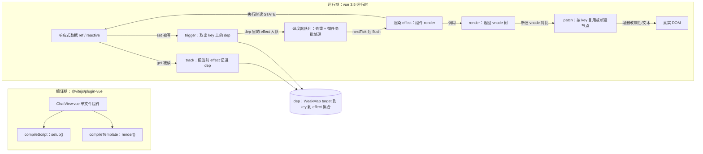
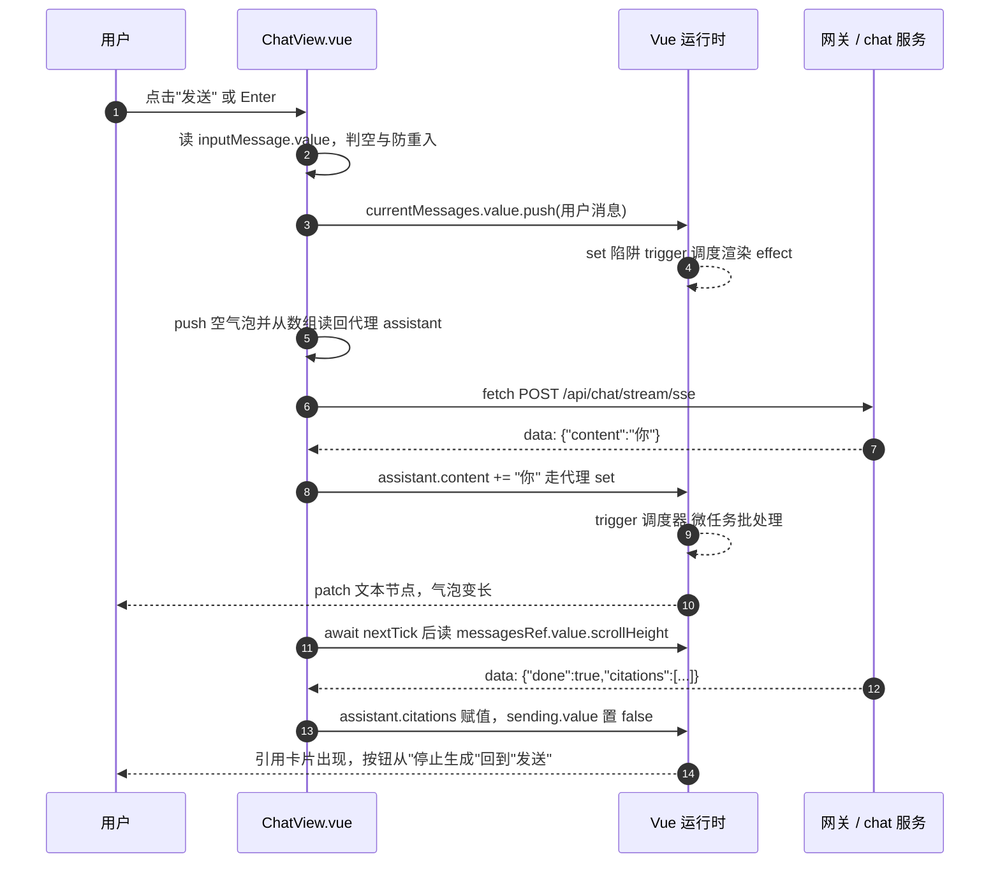

# Vue 3 核心基础：响应式系统与渲染函数

> **一句话结论**："数据改了视图就更新"不是魔法，而是一条三段链路——`Proxy` 在读写属性时做依赖收集与触发（`track` / `trigger`）、组件的渲染函数本身是主要订阅者（副作用 effect）、调度器把同一轮里的多次修改合并成一次 `patch`；任何一环断开（值被复制出代理、`key` 复用错位、`computed` 没有响应式依赖）都表现为"改了数据，视图不动"。
> **阅读前置**：会写普通 JavaScript（对象、闭包、解构、`async/await`），知道 ESM 的 `import`；不要求 Vue 2 或 React 经验。全文结论尽量落到本仓库真实文件的行号上，建议边读边在编辑器里打开 `ai-cs-frontend/src` 对照。
> **证据基线**：Node 18+；Vue 3.5 + Element Plus + Vite（本仓库 `ai-cs-frontend` 实装 `vue` 3.5.41、`vite` 8.1.1，见 `ai-cs-frontend` 工程的 `package.json`）。B 级证据 = 仓库真实文件 + 行号；C 级 = 本机 node 24 实测输出（不联网、不安装、不构建）。未实测的结论会显式标注"未本机实测"。预计阅读 45~60 分钟。

---

## 0. 先看现象

下面三个"现场"都来自本仓库前端，症状各不一样，但根因是同一件事。

**现场一：流式回答只刷新一次，后面收的 token 不显示。**
写这种"先插一个空气泡、再逐 token 追加"的代码时，最常犯的写法是把消息对象存到局部变量里再追加：

```js
const msg = { role: 'assistant', content: '' }
messages.value.push(msg)      // 推进数组的是原始对象
msg.content += '你'            // 改的是原始对象 -> trigger 不会发生
```

作者在代码里留下了当年踩坑的注释，说明这行必须怎么写：

`ai-cs-frontend/src/views/ChatView.vue:382-385`

```js
  // 预置空回复气泡，流式填充（需持响应式代理引用，逐 token 追加才会触发视图更新）
  currentMessages.value.push({ role: 'assistant', content: '' })
  const assistant = currentMessages.value[currentMessages.value.length - 1]
```

同样的注释在 `ai-cs-frontend/src/views/AgentView.vue:119` 又出现一次（"预置空回复气泡：需持响应式引用，流式追加才会触发视图更新"），说明这不是一次性笔误，而是一个反复出现的心智模型缺口。

**现场二：通知日志列表的样式/标签跟着内容错位。**

`ai-cs-frontend/src/views/NotifyView.vue:59` 用下标当 `key`：

```vue
            <div v-for="(log, i) in notifyLogs" :key="i" class="log-item">
```

而 `ai-cs-frontend/src/views/NotifyView.vue:136-137` 是**头部插入**：

```js
  notifyLogs.value.unshift({ time: new Date().toLocaleTimeString(), message })
  if (notifyLogs.value.length > 50) notifyLogs.value.pop()
```

下标 `0` 在两次渲染间代表的是**不同的一条日志**。视图能出内容（因为文本是逐条读出来重新渲染的），但凡是带内部状态的子组件（`el-tag`、`el-progress`、带过渡动画的节点），复用的实例会带着上一轮的状态，看起来就是"时间戳和消息对不上、动画乱跳"。

**现场三：模拟收银台切换订单后，二维码与倒计时不变。**

`ai-cs-frontend/src/views/MockCashierView.vue:70-74` 把路由参数读成**普通常量**：

```js
const orderNo = route.query.orderNo || ''
const amount = route.query.amount || '-'
const payType = route.query.payType || 'REDIRECT'
const codeUrl = route.query.codeUrl || ''
const expireTime = route.query.expireTime || ''
```

紧接着 `ai-cs-frontend/src/views/MockCashierView.vue:85` 用它算 `computed`：

```js
const isQrMode = computed(() => payType === 'QRCODE' && !!codeUrl)
```

这个 `computed` 的 getter 里**一次响应式读取都没有**，所以它算完一次就永远缓存那个值，永远不会失效。第一次进入页面时它是对的（`onMounted` 里的 `QRCode.toDataURL` 也只跑一次），但只要这层组件被复用（跳转到另一个订单、`route.query` 变了而组件实例没销毁），金额、二维码、倒计时全部停在旧值。

> 这三个现象指向同一件事：**"视图更新"依赖一条显式的追踪链——写入必须穿过 `Proxy`（现场一）、渲染必须能通过 `key` 认出"还是不是同一个节点"（现场二）、`computed` 必须有真实的响应式依赖（现场三）。** 链路任何一段被绕过，代码不会报错，只会安静地不更新。

---

## 1. 整体地图

Vue 3 的一生可以切成"编译期"和"运行期"两半：编译期把 `.vue` 文件切成 `setup()` + `render()`，运行期靠 `Proxy` 把数据和 `render` 绑起来。



> **读图说明**：这张图只有一个闭环，请盯住两条箭头。①`STATE -->|set 被写| TRIGGER --> SCHED --> EFFECT`：**写数据并不会立刻改 DOM**，它只是把 effect 塞进队列，真正的重渲染发生在微任务 flush（也就是 `nextTick` 兑现的那一刻），所以"改完数据马上读 DOM"读到的一定是旧值。②`EFFECT -->|执行时读 STATE| STATE -->|get| TRACK`：订阅关系是**在渲染过程中顺带建立的**——`render` 里没读过的东西，永远不会"触发更新"（现场三就是这么断的）。看错第二条箭头会得出"`reactive` 会自动追踪对象的一切"这种错误结论。

图中每个角色的责任、以及它在本仓库的落点：

| 角色 | 责任 | 关键 API / 机制 | 谁调用它 | 本仓库证据 |
|---|---|---|---|---|
| 单文件组件 SFC | 把模板/逻辑/样式装进一个 `.vue` 文件 | `<template>` `<script setup>` `<style scoped>` | 路由懒加载 `() => import(...)` | `ai-cs-frontend/src/router/index.js` 25 条懒加载路由 |
| 编译器 | 把模板编译成 `render()`，把 `script setup` 编译成 `setup()` | `compileScript` / `compileTemplate` | `@vitejs/plugin-vue`（构建期） | `ai-cs-frontend` 工程的 `package.json`（devDependencies 含 `@vitejs/plugin-vue`） |
| 响应式数据 | 承载会被视图读取的状态 | `ref` / `reactive` / `shallowRef` | 组件 `setup()` | 全仓 186 处 `ref(`、4 处 `reactive(`（见 §3.2 C 级统计） |
| effect（副作用） | "数据变了要重跑的那段代码" | 渲染 effect、`watch`、`watchEffect` | 运行时 / 开发者 | `ai-cs-frontend/src/App.vue:107` 的 `watch` |
| 调度器 | 同一 tick 内合并多次修改、按父子顺序 flush | `queueJob`、`nextTick` | 运行时 | `ai-cs-frontend/src/views/ChatView.vue:469` 靠 `nextTick` 等 DOM |
| patch / diff | 比较新旧 vnode，最小化 DOM 操作 | `key`、`patchKeyedChildren` | 渲染 effect 末尾 | 全仓 23 处 `v-for`、23 处 `:key=` |
| 真实 DOM | 最终用户看到的界面 | 模板引用 `ref="messagesRef"` | patch | `ai-cs-frontend/src/views/ChatView.vue:34` |

---

## 2. 关键概念与关键类/API

先把本文会反复出现的名词钉死（首现即解释）：

- **代理（Proxy）**：JavaScript 语言能力，能为一个对象的 `get` / `set` / `deleteProperty` 等操作装上拦截函数。Vue 3 的响应式就架在它上面。
- **副作用（effect）**：一段"被包起来、可被反复重跑"的函数。组件的渲染过程本身就是一个 effect。
- **依赖（dep）**：某个响应式属性 → 读过它的 effect 集合。`track` 往里加，`trigger` 往里取。
- **vnode / 虚拟 DOM**：用普通 JavaScript 对象描述"应该长什么样的 DOM"，`patch` 负责把它和上一次的 vnode 比出差异。
- **宏（macro）**：`<script setup>` 里 `defineProps` / `defineEmits` / `defineExpose` 这类**不需要 import** 的编译期语法，编译后变成普通函数调用或对象字段。

| 名称 | 位置 | 角色 | 关键点 |
|---|---|---|---|
| `ref(x)` | `vue`（`ref` 导出） | 把任意值包成 `{ value }` 并做深层代理 | 脚本里必须 `.value`；模板里自动解包；对象/数组也能包，且**推荐优先用 `ref`** |
| `reactive(obj)` | `vue`（`reactive` 导出） | 直接返回对象的 `Proxy` | 不能包原始值；赋值会**整对象替换**；`delete` 需要 `deleteProperty` 陷阱（Vue 已实现），手写内核常漏 |
| `track` / `trigger` | `@vue/reactivity` 内部 | 依赖收集 / 触发 | 只在存在"当前活跃 effect"时 `track` 才有意义（见 §3.1 的 `activeEffect`） |
| `computed(fn)` | `vue` | 带缓存的派生值 | 依赖不变就复用缓存；**getter 里不读响应式数据 = 永不失效**（现场三） |
| `watch(src, cb, opts)` | `vue` | 值变化后跑副作用，可拿新旧值 | 默认**惰性**（不立即执行）、默认 `flush:'pre'`（渲染前）；`immediate` / `deep` 是常用开关 |
| `watchEffect(fn)` | `vue` | 立即执行一次并自动收集依赖 | 不需要声明依赖源，靠"执行时读了什么"；清理函数用 `onCleanup` 形参 |
| `nextTick(fn?)` | `vue` | 等本轮 flush 结束后执行 | DOM 已更新完；返回 Promise，可 `await` |
| `onMounted` / `onBeforeUnmount` | `vue` | 生命周期钩子 | 必须在 `setup()` 同步执行期间注册，放进 `await` 之后会失效 |
| `defineProps` / `defineEmits` | `<script setup>` 宏 | 声明入参 / 事件 | 编译期宏，不能 `import`；本仓库使用次数为 **0**（见 §3.9） |
| `defineExpose` | `<script setup>` 宏 | 显式暴露给父组件 `ref` 实例的成员 | `script setup` 组件默认**完全封闭**，父组件拿不到内部 ref |
| `proxyRefs` | `@vue/runtime-core` 内部 | 让模板里的 `ref` 免 `.value` | 编译产物里模板访问的是 `$setup.xxx`，再被它解包（见 §3.3） |
| `patch` + `key` | `@vue/runtime-core` 内部 | 决定"复用旧节点还是新建" | `key` 是节点身份；用下标当 key 等于告诉 Vue"每次都是同一批节点" |
| `createApp` / `app.use` | `vue` | 应用实例与插件注册 | 本仓库挂载顺序见 `ai-cs-frontend/src/main.js` |

几张容易混的对照表：

| 容易混的一对 | 关键区别 | 本仓库现状 |
|---|---|---|
| `ref` vs `reactive` | `ref` 用 `.value` 包装（丢的是`.value`访问而非追踪能力，解构 `ref` 本身也能保活）；`reactive` 是透明代理，**解构即断链** | `ref` 186 处、`reactive` 4 处（`LoginView.vue:67-68`、`ShopView.vue:99`、`AgentView.vue:120` 等） |
| `computed` vs 普通函数 | `computed` 缓存 + 只有在被读取时才求值；普通函数每次渲染都重算 | `computed` 14 处；`TraceView.vue:121` 的 `maxEnd` 被循环里反复读，缓存收益明显 |
| `watch` vs `watchEffect` | `watch` 显式声明依赖源、默认惰性、能给新旧值；`watchEffect` 立即跑、依赖隐式、只能拿新值 | `watch` 4 处、`watchEffect` **0 处** |
| `v-if` vs `v-show` | `v-if` 增删节点（真销毁组件与状态）；`v-show` 只切 `display` | `v-if` 80 处、`v-show` **0 处** |
| `onMounted` vs `setup` 顶层直接写 | 顶层语句在 `setup()` 执行时就跑（此时还没挂载，`ref` 拿不到 DOM）；`onMounted` 在挂载后 | `onMounted` 26 处；但 `NotifyView.vue:140` 是顶层直接 `fetchOnlineCount()` |
| `:key="index"` vs `:key="item.id"` | 前者把"位置"当身份，插入/排序/过滤后实例整体错位；后者是真实身份 | 6 处用下标（§3.7 有完整清单） |

---

## 3. 原理与证据逐段精读

每小节固定四层：**在干什么 → 为什么这么设计 → 换写法会怎样 → 常见坑**。

### 3.1 `Proxy` 的 `get`/`set` 追踪：40 行内核与真实输出

**在干什么**：Vue 3 的响应式最小内核只有三样东西——一个"当前正在执行的 effect"（`activeEffect`）、一张"对象 → 属性 → effect 集合"的表（`targetMap`）、两个函数 `track`（读时登记）和 `trigger`（写时通知）。下面这段是本机可跑的 40 行版本（C 级，`node vue3-reactivity-demo.mjs`）：

```js
// 40 行简化版 Vue 3 响应式内核：Proxy + track/trigger + effect + computed
let activeEffect = null
const targetMap = new WeakMap()          // target -> key -> Set<effect>

function track(target, key) {
  if (!activeEffect) return              // 不在任何 effect 里读 -> 不登记
  let deps = targetMap.get(target)
  if (!deps) targetMap.set(target, (deps = new Map()))
  let dep = deps.get(key)
  if (!dep) deps.set(key, (dep = new Set()))
  dep.add(activeEffect)
}

function trigger(target, key) {
  const dep = targetMap.get(target)?.get(key)
  if (dep) for (const eff of [...dep]) eff()
}

const reactive = (raw) => new Proxy(raw, {
  get(t, k, r) { track(t, k); return Reflect.get(t, k, r) },
  set(t, k, v, r) { const ok = Reflect.set(t, k, v, r); trigger(t, k); return ok },
})

function effect(fn) { activeEffect = fn; fn(); activeEffect = null }

// ---- 演示 1：依赖收集与触发 ----
const state = reactive({ count: 0, other: 0 })
let runs = 0
effect(() => { runs++; console.log(`  [effect] 读到 count = ${state.count}`) })
state.count++          // 触发
state.other++          // 未被追踪的 key，不该触发
state.count = 10       // 触发
console.log(`--> effect 执行次数 = ${runs}（期望 3：1 次首次 + 2 次 count 变更）`)

// ---- 演示 2：解构丢响应性 ----
const { count } = state          // 解构发生在 effect 之外，拿到的是普通数值快照
effect(() => console.log(`  [effect] 解构后的 count = ${count}`))
state.count++                    // effect 不再重跑
console.log(`--> 解构后的 count 仍是 ${count}，state.count 已是 ${state.count}（视图会停在旧值）`)
```

本机真实输出（node v24.16.0）：

```text
  [effect] 读到 count = 0
  [effect] 读到 count = 1
  [effect] 读到 count = 10
--> effect 执行次数 = 3（期望 3：1 次首次 + 2 次 count 变更）
  [effect] 解构后的 count = 10
  [effect] 读到 count = 11
--> 解构后的 count 仍是 10，state.count 已是 11（视图会停在旧值）
```

**怎么读这个输出**：三行 `[effect] 读到 count` 对应"首次 1 次 + `count` 被改 2 次"，而中间的 `state.other++` **一行都没打印**——证明 `track` 是按 key 精确登记的，没被读过的属性改了不会惊动这个 effect。第 5、6 行是演示 2：新 effect 只跑了一次（打印 `解构后的 count = 10`），之后 `state.count` 改成 11，它再也没跑，而共享同一个渲染器的"读 `count` 的 effect"（第 6 行）跑了。这就是现场一、现场三的机器层面解释。

**为什么这么设计**：`WeakMap` 让目标对象被回收时整张依赖表一起消失（不阻碍 GC）；`Set` 保证同一个 effect 对同一属性只登记一次（幂等）；把"当前 effect"放进模块级变量（`activeEffect`）而不是传参，是因为 `render()` 里读属性的代码是用户写的普通表达式，没有地方传参——只能靠执行期间的隐式上下文。代价是**嵌套 effect 必须用栈恢复现场**（Vue 内部用的就是 effect 栈），否则内层跑完会污染外层。

**换写法会怎样**：Vue 2 用 `Object.defineProperty` 在初始化时把每个属性改成 getter/setter——那时新增属性、`delete` 属性、数组下标赋值都追踪不到，必须用 `Vue.set` / `Vue.delete`。Vue 3 换成 `Proxy` 后这三件事天然可追踪，代价是不支持 IE11（`Proxy` 无法 polyfill）与"代理不是原对象"（`state !== raw`）。本仓库的 `reactive` 用在 `ShopView.vue:99` 的 `qtyMap`（商品 ID 动态作 key 的映射表）——这正是 `Proxy` 相比 `defineProperty` 更省事的地方：动态新增 key 不需要额外 API。

**常见坑**：

- 把原始对象和代理混用。`messages.value.push(raw)` 之后必须**从数组里读回来**拿到代理再改（`ChatView.vue:384` 就是这么做的），改 `raw` 不会触发。
- 只实现 `set` 不够：`delete obj.k` 走的是 `deleteProperty` 陷阱，手写内核常漏（见 §3.2 C 级输出第 4 行）。
- 深代理有开销。纯展示用的大数组（如 `Dashboard.vue:172` 那种常量数组）根本不需要 `reactive`。

### 3.2 `ref` vs `reactive`：解构为什么丢响应性

**在干什么**：`reactive(obj)` 返回的是对象的代理，**它和原对象不是同一个引用**；`ref(x)` 返回一个只有 `value` 属性的对象，`value` 的读写被拦截。所以：

```js
const state = reactive({ count: 0 })
const { count } = state              // count 是数字 0 的快照，与 state 再无关系
state.count++                        // trigger 只通知"读过 state.count 的 effect"，与 count 无关
```

`ref` 被解构**不会**丢响应性（解构出来的还是那个 ref 对象本身），丢的是"忘记 `.value`"；`reactive` 被解构**一定**丢响应性（解构出来的是值）。

下面这段用**仓库里已装好的真实 Vue 3.5.41 运行时**验证四条常见结论（C 级，`node vue-real-runtime.mjs`，只 `import` 本机 `node_modules`，不联网）：

```js
const VUE = 'file:///D:/Projects/Persion/ai-customer-service/ai-cs-frontend/node_modules/vue/index.mjs'
const { ref, reactive, computed, effect, watch, watchEffect, nextTick, toRefs } = await import(VUE)

// 1) computed 缓存：依赖不变就不重算
const a = ref(1)
let getterRuns = 0
const double = computed(() => { getterRuns++; return a.value * 2 })
console.log('1) computed 读三次 =', double.value, double.value, double.value, '| getter 求值次数 =', getterRuns)
a.value = 5
console.log('   a 改成 5 后再读 =', double.value, '| getter 求值次数 =', getterRuns)

// 2) 解构 reactive 丢响应性 vs toRefs 保住
const state = reactive({ count: 0 })
const { count } = state
const { count: countRef } = toRefs(state)
let refRuns = 0
watch(countRef, () => { refRuns++ })
state.count++
await nextTick()
console.log('2) 解构 count =', count, '| state.count =', state.count, '| toRefs 的 watch 触发次数 =', refRuns)

// 3) watch 默认惰性 vs immediate；watchEffect 立即跑一次
let watchRuns = 0, effectWatchRuns = 0
watch(a, () => { watchRuns++ })
watch(a, () => { watchRuns++ }, { immediate: true })
watchEffect(() => { a.value; effectWatchRuns++ })
a.value = 7
await nextTick()
console.log('3) watch 回调次数 =', watchRuns, '| watchEffect 次数 =', effectWatchRuns)

// 4) 同一 tick 内连改 3 次，flush 队列只跑一次
let jobRuns = 0
watchEffect(() => { a.value; jobRuns++ })
const before = jobRuns
a.value = 8; a.value = 9; a.value = 10
await nextTick()
console.log('4) 同步连改 3 次后 watchEffect 净增 =', jobRuns - before, '| 终值 a =', a.value)
```

本机真实输出：

```text
1) computed 读三次 = 2 2 2 | getter 求值次数 = 1
   a 改成 5 后再读 = 10 | getter 求值次数 = 2
2) 解构 count = 0 | state.count = 1 | toRefs 的 watch 触发次数 = 1
3) watch 回调次数 = 3 | watchEffect 次数 = 2
4) 同步连改 3 次后 watchEffect 净增 = 1 | 读到的终值 a = 10
```

**怎么读这个输出**：第 1 行证明 `computed` 有缓存（读三次只算一次），第 2 行证明"依赖变了会失效重算"（求值次数 1→2，且新值 10 正确）。第 3 行是本文最容易被面试追问的一句：解构得到的 `count` 停在 `0`（快照），`state.count` 已经是 `1`，而同源数据用 `toRefs` 包一层后 `watch` 还能触发 1 次——**`toRefs` 不是"更好的解构"，它改变的是"你解构出来的是值还是 ref"**。第 4 行是 `watch` 与 `watchEffect` 的执行次数差异（`watch` = 惰性 1 + `immediate` 1 + 变更 1 = 3；`watchEffect` = 首次立即 1 + 变更 1 = 2）。第 5 行是批处理：连改 3 次只重跑 1 次，读到终值 10。

再看"代理身份"这件事，它解释了 `ChatView.vue:384` 为什么必须那样写（C 级，`node vue-proxy-identity.mjs`）：

```js
const { ref, reactive, isProxy, toRaw, effect, nextTick } = await import(VUE)

const messages = ref([])                      // 对应 ChatView.vue:197 currentMessages
const raw = { role: 'assistant', content: '' }
messages.value.push(raw)                      // 推入的是原始对象
const held = messages.value[messages.value.length - 1]   // 对应 ChatView.vue:384
console.log('held 是代理吗 =', isProxy(held), '| toRaw(held) === raw =', toRaw(held) === raw, '| held === raw =', held === raw)

let renders = 0
effect(() => { renders++; held.content })
held.content += '你'
held.content += '好'
await nextTick()
console.log('持代理引用改 2 次 -> effect 次数 =', renders, '| content =', held.content)

raw.content += '（绕过代理）'
await nextTick()
console.log('改原始对象绕过代理 -> effect 次数 =', renders, '| 代理读到的 content =', held.content)
```

本机真实输出：

```text
held 是代理吗 = true | toRaw(held) === raw = true | held === raw = false
持代理引用改 2 次 -> effect 次数 = 3 | content = 你好
改原始对象绕过代理 -> effect 次数 = 3 | 代理读到的 content = 你好（绕过代理）
```

**怎么读这个输出**：第一行给出三件关键事实——数组里存的是原始对象，**读出来的是代理**（`isProxy = true`），但代理 `!==` 原始对象。第二行 `effect` 次数从 1 涨到 3，说明走代理的写入每一次都触发了（这里用的是裸 `effect`，**同步触发、不批处理**；组件渲染 effect 带调度器才会合并）。第三行是致命的一条：改原始对象后，代理读出来的内容**已经变了**（`你好（绕过代理）`），但 effect 次数仍是 3——**数据变了、视图没动**，而且控制台里 `console.log` 打出来还是新值，排查时极易误判成"视图层有 bug"。

**为什么这么设计**：`ref` 统一了"基本类型"和"对象"两种状态容器（内部对对象仍用 `reactive` 包一层深层代理），让 API 只有一套；把 `.value` 作为访问门槛，是为了在 JavaScript 里传递 ref 时**保持引用稳定**（传对象，不传值）。`reactive` 保留可用，是因为"一堆字段的对象"用起来最自然（`LoginView.vue:67-68` 的表单）。

**换写法会怎样**：如果全用 `reactive`，本仓库 `ChatView.vue:195-197` 那种"`{ [sessionId]: 消息数组 }` 的动态字典"会很难维护（重新赋值会整体换代理，旧引用全部断开）；如果全用 `ref`，模板里到处 `.value` 也不现实——所以 Vue 才让模板自动解包。反过来，如果把 `reactive` 对象整个替换（`state = reactive({...})`），所有持有旧引用的地方（包括已经用 `:key` 绑定的节点、闭包里的捕获）都会失效——这正是 `ChatView.vue:213` 用 `{ ...sessionMessages.value, [sessionId]: [] }` **造新对象再整体赋值**的原因：字典本身是 ref 的 `value`，替换 ref 的值是安全的。

**常见坑**：

- 把 `reactive` 对象解构给 `v-model`／函数（`const { count } = state`），从此只有快照。
- 从接口数据里 `map` 出新对象后，**误以为改原接口对象能触发**——`ChatView.vue:227` 特意 `map` 成新对象再 `push`，是对的。
- `props` 同理：`const { seed } = props` 后 `seed` 是快照；本项目**没有子组件**（§3.9），但这是下一位改代码的人最容易踩的坑。

### 3.3 `<script setup>` 到底编译成了什么（模板里为什么不用 `.value`）

**在干什么**：`<script setup>` 是纯编译期语法糖。`ai-cs-frontend` 里 25 个 `.vue` 全部用它。下面用一个 12 行的迷你组件，调用仓库里已安装的 `@vue/compiler-sfc`（3.5.41）看真实产物：

```js
// node vue-sfc-compile.cjs —— 只读本机 node_modules，不联网
const { createRequire } = require('node:module')
const req = createRequire('D:/Projects/Persion/ai-customer-service/ai-cs-frontend/node_modules/')
const { parse, compileScript, compileTemplate } = req('@vue/compiler-sfc')

const source = `
<template>
  <div class="box" @click="inc">{{ label }} / {{ double }}</div>
</template>
<script setup>
import { ref, computed } from 'vue'
const props = defineProps({ seed: { type: Number, default: 1 } })
const emit = defineEmits(['change'])
const count = ref(props.seed)
const label = computed(() => 'count=' + count.value)
const double = computed(() => count.value * 2)
function inc() { count.value++; emit('change', count.value) }
defineExpose({ count })
</script>`
```

`compileScript` 的关键产物（节选，真实输出）：

```js
  props: { seed: { type: Number, default: 1 } },
  emits: ['change'],
  setup(__props, { expose: __expose, emit: __emit }) {
const props = __props
const emit = __emit
const count = ref(props.seed)
const label = computed(() => 'count=' + count.value)
const double = computed(() => count.value * 2)
function inc() { count.value++; emit('change', count.value) }
__expose({ count })
const __returned__ = { props, emit, count, label, double, inc, ref, computed }
Object.defineProperty(__returned__, '__isScriptSetup', { enumerable: false, value: true })
return __returned__
```

`compileTemplate` 的产物（节选）：

```js
export function render(_ctx, _cache, $props, $setup, $data, $options) {
  return (_openBlock(), _createElementBlock("div", {
    class: "box",
    onClick: $setup.inc
  }, _toDisplayString($setup.label) + " / " + _toDisplayString($setup.double), 1 /* TEXT */))
}
```

编译器对每个绑定推断出的类型（`script.bindings` 真实输出）：

```json
{ "seed": "props", "ref": "setup-const", "computed": "setup-const", "props": "setup-reactive-const",
  "emit": "setup-const", "count": "setup-ref", "label": "setup-ref", "double": "setup-ref", "inc": "setup-const" }
```

**怎么读这个输出**：①`defineProps` / `defineEmits` / `defineExpose` **没有出现在产物里**——它们变成了 `setup()` 内部对 `__props` / `__emit` / `__expose` 的使用，所以你不能 `import { defineProps }`。②`label` 被推断为 `setup-ref`，模板里却写 `$setup.label` 而不是 `$setup.label.value`——因为运行时给 `$setup` 套了 `proxyRefs`，读 ref 属性时自动解包；这就是"模板不用写 `.value`、脚本里必须写"的真正来源（它发生在**运行时**，不是编译器魔法）。③所有顶层绑定都被塞进 `__returned__` 返回，`script setup` 组件的**默认封闭**就来自 `__isScriptSetup` 这个非枚举标记：没写 `defineExpose` 时父组件拿不到任何东西。

**为什么这么设计**：让"声明顺序"就是"执行顺序"，把 `export default { setup() { return {...} } }` 这套样板（旧稿第六节 `useChat` 那类写法）压成纯 JS；`bindings` 元信息还能让编译器优化——知道 `inc` 是常量就不必每次渲染重建闭包，知道 `count` 是 ref 就生成解包代码。

**换写法会怎样**：写成普通 `<script>` + `export default defineComponent({ setup() { ... return { count } } })` 也能跑，但每个绑定要手写 `return`，且拿不到 `bindings` 优化；写成 Options API（`data(){}`）则响应式改成 `reactive(data())` 的内部约定，`this` 绑定与 `watch` 语义都回到 Vue 2 那套，和本文讲的三段链路对不上。

**常见坑**：

- `<script setup>` 里**不能**用 `this`；想拿组件实例用 `getCurrentInstance()`（本仓库 0 处）。
- 顶层 `await` 会把组件变成 async setup，需要 `<Suspense>` 兜住，否则父级渲染链报错。本仓库没有顶层 `await`。
- 顶层直接写 `fetchOnlineCount()`（`NotifyView.vue:140`）是合法的——它就在 `setup()` 里执行，但**早于挂载**，此时任何 `ref` 指向的 DOM 都是 `null`。

### 3.4 `computed` 的缓存与"没有依赖"的陷阱

**在干什么**：`computed` 是一个惰性 effect + 一个缓存位：只有被读时才求值，依赖没变就返回缓存；依赖变了只把标记置脏（dirty），下次读才重算。

本仓库两个正反例，正好并排：

`ai-cs-frontend/src/views/TraceView.vue:121-123`（**正例**：依赖真实响应式数组，且在模板循环里被反复读，缓存收益直接可见）：

```js
const maxEnd = computed(() =>
  spans.value.reduce((m, s) => Math.max(m, (s.startOffsetMs || 0) + (s.durationMs || 0)), 1)
)
```

`ai-cs-frontend/src/views/MockCashierView.vue:85`（**反例**：现场三，getter 里没有任何响应式读取）：

```js
const isQrMode = computed(() => payType === 'QRCODE' && !!codeUrl)
```

**为什么这么设计**：模板里 `{{ expr }}` 会在**每次渲染**时重算，若 `expr` 是 `spans.reduce(...)` 这类 O(n) 计算，一次渲染里被 20 个节点引用就是 20 次全表扫描。`computed` 把"重算"折叠成"最多一次/每个依赖版本"，是模板性能的基本盘。

**换写法会怎样**：写成普通函数 `function maxEnd() {...}` 依然能工作（本仓库 `TraceView.vue:125` 的 `barStyle(s)` 就是普通函数），但在模板里对每个 span 调一次 `maxEnd()` 就是 O(n²)。反过来，把 `computed` 当"副作用容器"用（在 getter 里发请求、写其它 ref）是错的：getter 可能一次都不执行（没人读），也可能执行多次（依赖变化），行为不可控。

**常见坑**：

- **getter 里只读普通常量** → 永不失效（现场三）。判断方法很机械：数一数 getter 里出现了几个 `.value`／`reactive` 属性读。
- **在 getter 里改响应式数据** → 依赖链自我触发，最轻的表现是控制台刷出 "Maximum recursive updates exceeded"。
- **`computed` 依赖了 `Date.now()` / `Math.random()`** → 依赖不变就不会重算，看起来像"时间不走"（`MockCashierView.vue:127-132` 的 `countdownText` 之所以能走，是因为它依赖 `remainMs` 这个被 `setInterval` 每秒更新的 ref，而不是依赖 `Date.now()` 本身）。

### 3.5 `watch` 与 `watchEffect` 的差异与清理

**在干什么**：`watch` 显式声明"看谁"，`watchEffect` 靠"执行时读了谁"。两者都是 effect，但 `watch` 默认惰性（`immediate: false`）、默认 `flush: 'pre'`（组件更新前跑，能拿到旧值新值）；`watchEffect` 立即执行一次。

本仓库的四个 `watch` 各有各的味道：

`ai-cs-frontend/src/App.vue:107-112`（getter 形式监听派生值，绕开"监听对象引用"的坑）：

```js
watch(
  () => route.path,
  () => {
    currentUser.value = getUser() || {}
  }
)
```

`ai-cs-frontend/src/views/ChatView.vue:329-334`（与 `switchSession` 重复，见下面"常见坑"）：

```js
watch(currentSession, (newId) => {
  if (newId) {
    switchToMessages(newId)
    loadHistory()
  }
})
```

**为什么这么设计**：`watch` 的源可以是 ref、getter 函数、数组或 `reactive` 对象（后者**隐式深监听**，且拿不到旧值）。给 getter 形式是为了让"依赖某个派生片段"变得廉价——`() => route.path` 只在路径真变时触发，而 `watch(route, ...)` 会因为 query/hash 变化也触发。

**换写法会怎样**：用 `watchEffect` 替代 `App.vue` 那段也能跑，但它会**在组件初始化时立刻读一次** `route.path`（结果同样是赋值一次，无害）；换成 `watch(route, ...)` 则会在 `?redirect=/x` 变化时多做一次无意义赋值。反过来，`ChatView.vue:329` 若改成 `watchEffect`，函数体里读的是 `currentSession.value`，同样会重复触发——问题不在 API 选择，而在与手动调用的叠加。

**常见坑**（本仓库真实存在的两处）：

- **watch 与手动调用重复**：`ChatView.vue:257-261` 的 `switchSession` 自己调了 `switchToMessages` + `loadHistory`，而 `currentSession.value = id` 又会触发同一对逻辑的 `watch`。`watch` 回调默认 `pre` flush，进的是同一个微任务队列，所以第一次 `loadHistory()` 的 `await` 还没回来时，第二次已经进了函数，`ChatView.vue:223` 的"已有消息则跳过"判断此刻为假（数组还空着）——**同一次点击会发出两次 `/message/history` 请求**。这是可静态推导的结论，验证方法见 §6 手法 2（Network 面板看同名字段连发两条）。
- **`watch` 没 `immediate` 导致首屏不加载**：`ai-cs-frontend/src/views/MqView.vue:346-349` 只在 tab **变化**时加载数据；如果初始 tab 恰好就是 `workOrder`，进页面不会请求，用户必须点一下别的 tab 再点回来。
- **清理**：`watch` / `watchEffect` 的清理用回调形参 `onCleanup`，组件卸载时自动 stop。本项目没有需要清理的 `watch`（4 处都是同步赋值或一次性加载），但 `setInterval` 需要手工清理（§3.6）。

### 3.6 生命周期钩子与 `setup` 的执行时机

**在干什么**：`setup()` 在 `beforeCreate` 之前同步执行（此时 `props` 可用、`this` 不可用），组件挂载后才有 `mounted`。挂载顺序与清理顺序如下：

| 时机 | 能做什么 | 不能做什么 | 本仓库落点 |
|---|---|---|---|
| `setup()` 同步段 | 建 ref、注册 `watch`、注册生命周期钩子 | 读 DOM（模板 ref 还是 `null`）、依赖子组件 | `ChatView.vue:192-208` 建全部 ref；`:337` 直接 `initApp()` |
| `onMounted` | 发首屏请求、初始化第三方实例（图表/地图） | —— | 26 处；如 `MockCashierView.vue:87` |
| `onBeforeUnmount` | 释放实例、解绑 | 再改会引发渲染的状态 | `ChatDashboardView.vue:100-102` 销毁 ECharts 实例 |
| `onUnmounted` | 清定时器、关连接 | —— | `Dashboard.vue:168-170` 清 `setInterval` |

**为什么这么设计**：SSR 友好（`setup` 里不碰 DOM 就能在服务端跑）；同时把"注册"和"执行"分开——钩子必须在 `setup()` 同步阶段注册，本质是"往当前实例的钩子数组里 push"，一旦 `await` 之后再注册，当前实例上下文已丢失。

**换写法会怎样**：把清理逻辑忘了，最常见的后果不是报错而是**内存与请求泄漏**：定时器还在跑、WebSocket 还在收消息、ECharts 实例仍持有 DOM 引用（`ChartDashboardView` 注释里写得很直白："组件卸载时释放图表实例，防止内存泄漏"）。反过来，把首屏请求从 `onMounted` 提到 `setup` 顶层（`NotifyView.vue:140`）也能出数据，但会提前到挂载前，且**每次组件重新创建都会跑**，看起来一样、语义更含糊。

**常见坑**：

- 定时器 / WebSocket 没清。`Dashboard.vue:156-170` 建与清成对；`NotifyView.vue:112-133` 只有 `connectWs` / `disconnectWs`，**没有 `onUnmounted` 兜底关闭**——用户没点"断开"就切走路由，连接会一直挂着（浏览器里可在 DevTools → Network → WS 看到遗留连接）。
- 依赖 `calc(100vh - 140px)` 这类布局值时，`onMounted` 里读到的尺寸可能还没稳定（`ChatView.vue:517`）。
- 使用 `keep-alive` 后 `onMounted` 只跑一次，需要用 `onActivated`（本仓库 0 处，未启用 `keep-alive`）。

### 3.7 模板编译与虚拟 DOM diff：`key` 才是身份

**在干什么**：`render()` 每次返回一棵新的 vnode 树；`patch` 对比新旧树，决定"复用旧 DOM 还是新建"。**列表**的对比靠 `key`：有 key 走 `patchKeyedChildren`（按 key 建索引，能识别移动/插入），无 key 或 key 重复则退化为按下标就地复用。

本仓库 23 处 `v-for` 都是**有 key** 的，但有 6 处把下标当 key（C 级实测清单，命令见 §6 手法 3）：

```text
文件数(vue+js，排除 *.test.js)          : 35
<script setup> 单文件组件              : 25
ref( 调用                              : 186
reactive( 调用                         : 4
computed( 调用                         : 14
watch( 调用                            : 4
watchEffect 调用                       : 0
nextTick 调用                          : 3
defineProps/defineEmits/defineExpose   : 0
provide/inject                         : 0
v-for 指令                             : 23
:key 绑定                              : 23
其中用下标当 key                        : 6
views\AgentView.vue:15  <div v-for="(m, i) in messages" :key="i" :class="['turn', m.
views\ChatView.vue:35  <div v-for="(msg, i) in currentMessages" :key="i" :class="['
views\NotifyView.vue:59  <div v-for="(log, i) in notifyLogs" :key="i" class="log-item
views\SearchView.vue:16  <div v-for="(item, i) in results" :key="i" class="result-ite
views\TraceView.vue:55  <div v-for="(s, i) in spans" :key="i" class="gantt-row" :tit
views\VectorKbView.vue:92  <div v-for="(r, i) in searchResults" :key="i" class="search-
```

**怎么读这个输出**：这 6 处不是全都错——只追加不重排的场景（`ChatView` 的聊天流只 `push`）用下标 key 的问题最轻；但**头部插入**（`NotifyView.vue:136` 的 `unshift`）、**整表替换**（`SearchView`／`VectorKbView` 的搜索结果）、**可排序的甘特行**（`TraceView`）都会出问题。判断标准只有一句：**这个列表会不会"在中间插入、删除、排序或整批替换"**；会，就必须用业务 id。

**为什么这么设计**：DOM 操作贵、组件状态更贵。有稳定 key，Vue 可以把"移动"变成 `insertBefore` 而不是"销毁 + 重建"，从而保住子组件内部状态（输入框光标、`el-progress` 的补间动画、`el-tag` 的过渡）。用下标当 key 等于宣称"第 n 个位置永远是同一个东西"，一旦插入就整体说谎。

**换写法会怎样**：把 `:key="i"` 换成 `:key="msg.id"`，`ChatView.vue:77-105` 那组反馈按钮（`v-if="!msg.feedbackSubmitted"` / `el-rate v-model="msg.score"`）的状态就不会串到别的消息上。注意 id 必须**在消息创建时生成并保持稳定**，不能是渲染时算出来的瞬时值（如 `Math.random()`），否则等于每次都是新节点，diff 成本反而更高。

**常见坑**：

- `key` 用数组下标 + `unshift`/`sort`/`filter` → 状态错位（现场二）。
- `key` 用 `index` 又在同一个列表里用 `v-model` 绑元素属性（`ChatView.vue:92` 的 `v-model="msg.score"`）→ 输入值跟着位置跑而不是跟着消息跑。
- `v-for` 里的 `el-input`／`el-select` 若被复用但数据换了，会出现"输一半被覆盖"的经典现象，本质也是 key 不唯一或不稳定。

### 3.8 `v-if` 与 `v-for` 的优先级：Vue 3 里 `v-if` 先执行

**在干什么**：同一个元素上同时写 `v-if` 和 `v-for` 时，Vue 3 的编译器**先处理 `v-if`**，也就是 `v-if` 表达式被提到列表之外求值——而那时循环变量还不存在。这一点可以直接用仓库里的 `@vue/compiler-dom` 编译看到（C 级真实输出）：

```js
const { createRequire } = require('node:module')
const req = createRequire('D:/Projects/Persion/ai-customer-service/ai-cs-frontend/node_modules/')
const { compile } = req('@vue/compiler-dom')
const out = compile('<ul><li v-for="item in list" v-if="item.ok">{{ item.name }}</li></ul>',
                    { mode: 'module', prefixIdentifiers: true })
console.log(out.code)
```

真实产物：

```js
export function render(_ctx, _cache) {
  return (_openBlock(), _createElementBlock("ul", null, [
    (_ctx.item.ok)                       // ← v-if 被提到列表外，这里 item 还不存在
      ? (_openBlock(true), _createElementBlock(_Fragment, { key: 0 }, _renderList(_ctx.list, (item) => {
          return (_openBlock(), _createElementBlock("li", null, _toDisplayString(item.name), 1 /* TEXT */))
        }), 256 /* UNKEYED_FRAGMENT */))
      : _createCommentVNode("v-if", true)
  ]))
}
```

**怎么读这个输出**：`_ctx.item.ok` 出现在 `_renderList` 的**回调之外**，而 `item` 只存在于回调参数里——所以运行时要么读到 `undefined.ok` 抛 `Cannot read properties of undefined (reading 'ok')`，要么（若 `ctx` 上恰好有同名属性）静默用错值。这段产物不是"某种边界情况"，它就是 Vue 3 的固定行为。判断代码是否符合规范，一条命令就够：本仓库 23 处 `v-for` 与 80 处 `v-if`，**没有任何一处写在同一元素上**（实测：按 `v-for=.*v-if=|v-if=.*v-for=` 搜索 .vue 文件，命中 0 行）。

**为什么这么设计**：`v-if` 的语义是"这个元素要不要渲染"，`v-for` 的语义是"这个元素渲染几份"。让条件在循环外求值，才能对整块做一次分支判断（也允许 `v-if` 与 `v-else` 成对使用）。Vue 2 是反过来的（`v-for` 优先级更高），所以从 Vue 2 迁过来的人最容易在这一格踩坑。

**换写法会怎样**：正确写法是把条件挪到"能被循环变量访问"的位置——①用 `<template v-for>` 包一层再在内部 `v-if`；②先算好过滤后的列表再 `v-for`。本仓库走的是第 ② 条路，`ai-cs-frontend/src/views/CheckoutView.vue:78` 和 `ai-cs-frontend/src/views/PromptView.vue:87` 都是 `computed` 先过滤（后者叫 `filteredScenarios`，名字就说明了用途）。

**常见坑**：

- `v-for` + `v-if` 同元素（编译后条件读不到循环变量）。
- 用 `v-if` 做"隐藏"却保留了组件状态：`v-if` 会**销毁并重建**子组件（连带重置内部状态、重跑 `onMounted`）；只想隐藏应该用 `v-show`（本仓库目前 0 处，页面级切换靠路由 + `v-if`）。
- 在 `v-for` 内部大量 `v-if="chatMode === 'rag'"`（`ChatView.vue:117/124`）是**同一条件重复求值**，条件稳定时无所谓；条件是函数调用且在长列表里时，应提前算成 `computed`。

### 3.9 组件通信：props / emit / provide-inject / expose

**在干什么**：父传子用 `props`（单向、只读），子传父用 `emit`（事件），跨层级用 `provide` / `inject`（祖先注入，后代消费），父要主动调子用模板 `ref` + 子组件 `defineExpose` 白名单。

**本仓库的事实（必须说清楚）**：这套机制在 `ai-cs-frontend` 里**一处都没用**——`defineProps` / `defineEmits` / `defineExpose` / `provide` / `inject` 的统计都是 **0**，`src` 下也没有 `components/` 目录。原因不是"不推荐"，而是结构上不需要：25 个页面级 `.vue` 全部由 `router/index.js` 直接渲染进 `ai-cs-frontend/src/App.vue:86-88` 的 `<router-view />`，页面之间**没有父子关系**，也就没有"向上冒泡"的通道。

那跨页面共享数据靠什么？靠模块单例 + 浏览器存储：`ai-cs-frontend/src/utils/auth.js` 里的 `getToken` / `getUser` / `hasRole` 被路由守卫、axios 拦截器（`ai-cs-frontend/src/api/index.js:41-47`）和权限指令（`ai-cs-frontend/src/directives/permission.js:17-23`）三方共用，登录态存在 `localStorage`，`App.vue` 用 `watch(() => route.path)` 在路由变化时重新读一遍。**代价**：`localStorage` 不是响应式的，所以必须"路由变了就手动重读"（`App.vue:105-112`），这就是没有状态管理库的直接后果。

**为什么这么设计（如果真的要写子组件）**：`props` 单向流动让数据变更只有一个入口，调试时能顺着 `emit` 事件往上找；`provide/inject` 解决"透传十层"的问题；`defineExpose` 默认关闭是为了让组件的公开 API 显式化（§3.3 的 `__isScriptSetup` 标记）。

**换写法会怎样**：子组件里直接改 `props.xxx` 会得到开发期警告并破坏单向流；用 `v-model` 语法糖（`v-model:xxx`）本质是 `props` + `emit('update:xxx')` 的语法包装。若将来要抽公共组件（如把 `ChatView.vue:43-75` 的引用溯源卡片抽成 `CitationCard.vue`），正确姿势是 `props: { citations: Array }`，不要在里面直接读 `msg`。

**常见坑**：

- 子组件**解构 props** 后不回填（`const { citations } = props` → 之后父级换数据不再更新），这与 §3.2 的 `reactive` 解构是同一类错误；Vue 3.5 起可以对 `defineProps` 返回值保持整体使用来规避。
- 事件名大小写：模板里用 `@custom-event`，脚本里 `emit('customEvent')` 在模板编译后仍按原样匹配，但混用 kebab/camel 极易失灵，团队约定一种即可。
- 想用 `provide/inject` 传递**响应式**数据时必须 `provide('k', ref(...))` 或 `reactive` 对象；`provide('k', somePlainObject)` 之后改它不会通知后代。

### 3.10 `nextTick` 与 DOM 更新时机

**在干什么**：`await nextTick()` 等到"本轮调度队列 flush 完"，此时 DOM 已经按最新状态更新。所以"改数据 → 立刻量高度/聚焦/滚动"必须夹一个 `nextTick`。本仓库 3 处 `nextTick(` 调用，全是这个用途：

`ai-cs-frontend/src/views/ChatView.vue:468-473`（滚动到底部）：

```js
async function scrollToBottom() {
  await nextTick()
  if (messagesRef.value) {
    messagesRef.value.scrollTop = messagesRef.value.scrollHeight
  }
}
```

`ai-cs-frontend/src/views/ChatDashboardView.vue:74-76`（先让容器渲染出来，再初始化 ECharts）：

```js
      answer.value = resp.data.data
      await nextTick()
      renderChart(answer.value)
```

**为什么这么设计**：一次用户操作里可能有十几处数据变化，如果每处都同步改 DOM，浏览器要重排十几次。Vue 把渲染 effect 丢进微任务队列（`Promise.then`），同一 tick 内的修改合并成一次 `patch`——§3.2 第 4 条实测就是"连改 3 次只跑 1 次"。`nextTick` 是这条队列的"兑现点"，它比 `setTimeout(0)` 更早（微任务 vs 宏任务），因此不会白等一帧。

**换写法会怎样**：用 `setTimeout(..., 0)` 也能滚动成功，但要多等一个宏任务，且在某些浏览器里会看到"闪一下再滚"；直接在 `push` 之后同步读 `scrollHeight` 则拿到的是**旧高度**（`ChatView.vue:380/385` 在 `push` 之后先 `await scrollToBottom()`，正是为了这个）。

**常见坑**：

- `await nextTick()` 之后 `messagesRef.value` 仍可能是 `null`——如果当前处于 `v-if` 为假的分支（`ChatView.vue:34` 的容器始终渲染，所以这里安全，但换成条件渲染就会踩）。
- 在 `nextTick` 回调里再改数据会开启新一轮 flush，写不好就是无限循环。
- 以为 `nextTick` 会等接口：它只等渲染队列，不等网络。

---

## 4. 一次完整执行时序

下面把"用户点发送 → 流式回答结束"整条链路按本仓库 `ChatView.vue` 的真实代码走一遍（`ChatView.vue:363-459` 是 `sendMessage` 主体）。



> **读图说明**：重点看第 4 步和第 8-10 步这一对。第 4 步说明**渲染不是 push 触发的**，push 只是把渲染 effect 排进队列；第 8-10 步是全篇的核心机制：`assistant.content += obj.content`（`ChatView.vue:424`）走的是**代理的 set**，于是触发一次调度，微任务 flush 时才真正 `patch` 文本节点。如果第 6 步拿的是原始对象而不是代理（§3.2 第三个 C 级实验），第 9-10 步整体消失——数据在变、界面不动，且**没有任何报错**。

每一步失败会看到什么（顺序与上图步骤号对应）：

| 步骤 | 失败条件 | 前端表现 | 控制台 / Network 特征 |
|---|---|---|---|
| 2 | `sending.value` 仍为 `true` | 点发送没反应 | 无请求（`ChatView.vue:369` 直接 return） |
| 4 | 推入的是原始对象且后续改原对象 | 气泡一直是空的 | 无报错，`console.log` 数据是新的 |
| 6 | 未登录 / token 过期 | 提示"登录已过期，请重新登录"并跳登录页 | 401（`api/index.js:53-57` 拦截器），SSE 走 `fetch` 不经过 axios，只能看到 401 状态码 |
| 6 | 网关不可达 | 气泡显示 `⚠️ 连接中断，回复未完成，请重试。` | Network 里请求 `(failed)`；`ChatView.vue:451` 用 `Failed to fetch` 判别 |
| 7-10 | 分帧没按 `\n\n` 切 | 回复半截或整段一次性出现 | 响应是 200 且 body 完整，看不出异常 |
| 10 | 后端 5 分钟不结束（`ai-cs-chat/src/main/java/com/aics/chat/service/impl/ChatServiceImpl.java:156` 的 `SSE_EMITTER_TIMEOUT = 5 * 60 * 1000L`） | 流被服务端关闭，气泡停在半截 | `reader.read()` 返回 `done`，前端按正常结束处理（可能显示"(无回复)"分支不会命中） |
| 11 | `done` 事件里的 `citations` 未赋值 | 回答正常但没有引用卡片 | 无报错，`msg.citations` 为 `undefined`（`v-if` 静默为假） |
| 12 | 用户中途点"停止生成" | 气泡追加 `_（已停止生成）_` | `AbortController.abort()`（`ChatView.vue:462-466`）；`e.name === 'AbortError'` |

> 后端还有一条更短的超时：Agent 流 `ai-cs-chat/src/main/java/com/aics/chat/agent/AgentController.java:117` 的 `AGENT_STREAM_TIMEOUT = 120_000L`（120 秒）。两者都只影响"服务端主动收尾"，前端不区分它们，统一按"流结束"处理——**未本机实测**（需要跑起 chat 服务与真实 LLM）。

---

## 5. 设计取舍

| 设计决策 | 收益 | 代价 | 本仓库现状与证据 |
|---|---|---|---|
| 以 `ref` 为主、`reactive` 为辅 | 解构不丢响应性、整体替换安全、模板自动解包 | 脚本里到处 `.value` | 186 : 4（§3.7 统计）；`reactive` 只用在"动态键字典/表单/单条消息" |
| 页面级组件不拆分（无 `components/`） | 零 props/emit 心智负担，改一页只看一个文件 | 单文件膨胀（`ChatView.vue` 587 行、`ProductView.vue` 15KB） | 全仓 `defineProps`=0；`router/index.js` 25 条懒加载直连 `views/` |
| 不带状态管理库 | 依赖少、构建小 | `localStorage` 非响应式 → 要手动 `watch(() => route.path)` 同步 | `package.json` 无 pinia/vuex；`App.vue:105-112` 手动重读 |
| 列表用下标当 key（6 处） | 少写一个 id 字段 | 插入/排序/整表替换后实例错位 | `NotifyView.vue:59+136`、`ChatView.vue:35`、`TraceView.vue:55` 等 |
| 浏览器直接 `fetch` + 手写分帧流式解码 | 能带 `Authorization` 头、能 `abort` | 与已有工具重复、边界（半帧、CRLF）容易漏 | `ChatView.vue:411-437`、`AgentView.vue:146-163` 各写一套；而 `ai-cs-frontend/src/utils/sseStream.js` + `ai-cs-frontend/src/utils/sse.js` 已有带单测的实现却**没有被任何 `.vue` 引用** |
| 派生数据用 `computed` 过滤 | 模板干净、能缓存 | 忘记"必须有响应式依赖"就永不失效 | `CheckoutView.vue:78`、`PromptView.vue:87`（正例）vs `MockCashierView.vue:85`（反例） |
| 首屏请求放 `onMounted` | 时序清晰、DOM 就绪 | 多一层缩进 | 26 处；例外 `NotifyView.vue:140` 放顶层 |
| 用 `v-if` 承载所有隐藏逻辑（0 处 `v-show`） | 语义直白 | 频繁切换时反复销毁/重建组件 | 80 处 `v-if` |
| 定时轮询 + 手动清理 | 无需 WebSocket 服务端配合 | 忘记清理即泄漏 | `Dashboard.vue:161-170`（建/清成对）、`NotifyView.vue:112-133`（缺清理） |

可扩展点清单（都能直接落在这套结构上）：

1. 抽 `components/CitationCard.vue`，把 `ChatView.vue:43-75` 那段引用卡片变成 `props: { citations }`，顺带把需要按 id 的 `v-for` 修好。
2. 把 `ChatView.vue:411-437` / `AgentView.vue:146-163` 的手写分帧换成 `utils/sseStream.js` 的 `streamSse`，边界处理与半帧 flush 立刻统一（该文件已有 `sseStream.test.js`）。
3. 把 `switchSession` 里的手动 `loadHistory()` 删掉，只留 `watch(currentSession, ...)`（或反之），消除双请求。
4. `MockCashierView.vue` 的 5 个 `route.query` 常量改成 `computed`，让组件可被复用。
5. `NotifyView.vue` 的 WebSocket 地址改走网关（或指向 8086 的 notify 服务，见 §6 坑 6），并补 `onUnmounted` 关闭。
6. 引入 Pinia 替代 `localStorage` 手动同步（对应 [07-Pinia状态管理实战](./07-Pinia状态管理实战.md)，当前工程未安装）。
7. 给 `el-input` 这类高频输入的 `v-model` 场景引入防抖 composable，用 `watch` + `onCleanup` 清掉定时器。
8. `TraceView.vue:55` 的甘特行加稳定 id（如 span 的 `spanId`）后，行高/展开状态才不会错位。
9. 抽 `usePolling(fn, ms)` composable：把 `Dashboard.vue`、`MockCashierView.vue` 里重复的"建定时器 + 卸载清理"收拢。
10. 用 `defineExpose` + 模板 `ref` 让父组件能"停止生成"子组件内的流（当前停止按钮只能控制本组件自己的 `AbortController`）。

---

## 6. 踩坑与调试手法

### 坑 1：把值从代理里"复制"出来

`const { count } = state`、`const msg = currentMessages.value[i]` 后再 `push(msg)`、`const info = props.info` —— 三种写法都可能拿到快照或原始对象。判定方法：`isProxy(x)`（§3.2 第三个 C 级实验里用过）或改完看 Vue DevTools 里对应值是否变化。本仓库的正确写法在 `ChatView.vue:384`（从数组读回代理）与 `AgentView.vue:120`（显式 `reactive()` 建对象再 push）。

### 坑 2：`key` 用下标 + 头部插入

`NotifyView.vue:59` + `:136`。改成 `:key="log.time + log.message"` 或给每条日志生成自增 id。验收：连点几次"连接/断开"，新日志应该出现在顶部且样式不错位。

### 坑 3：`computed` 里没有响应式依赖

`MockCashierView.vue:85`。检查方法：把 getter 抄到控制台，看里面有没有 `.value`／响应式属性读。修法：`const payType = computed(() => route.query.payType || 'REDIRECT')`。

### 坑 4：`watch` 与手动调用重复

`ChatView.vue:257-261` 与 `:329-334`。症状是"一次点击两个请求、偶尔列表被覆盖两次"。修法：二者留一。

### 坑 5：忘了清理

`NotifyView.vue` 无 `onUnmounted` 关 WebSocket；`Dashboard.vue:168` 有清理可以照抄；`ChatDashboardView.vue:100-102` 的注释说明了不清理的后果（"防止内存泄漏"）。

### 坑 6：前端硬编码端口与服务号对不上

`ai-cs-frontend/src/views/NotifyView.vue:114`：

```js
    ws = new WebSocket('ws://localhost:8085/ws/notify')
```

而通知服务是 **8086**、8085 是 message 服务：

```text
ai-cs-notify/src/main/resources/application.yml:3   → port: 8086
ai-cs-message/src/main/resources/application.yml:3  → port: 8085
```

所以这个页面的"连接 WebSocket"永远连到错误的服务上（`wsConnected` 停在"未连接"）。这是本仓库一个真实已知缺陷，正确做法是走网关或指向 8086。**未本机实测**（需要跑起 message/notify 服务），复现方法见手法 2。

### 手法 1：Vue DevTools 看"谁是响应式"

装 Vue DevTools 后，组件面板能直接看到 `setup` 里所有 ref 的实时值与更新次数；"改完数据计数不涨"就说明那个 effect 没被追踪。不装插件也有等价手段：本机 `node` 里用 `isProxy` / `isReactive` / `toRaw` 三个函数判断（§3.2 第三个实验完整可跑，输出里 `held === raw = false` 就是判据）。

### 手法 2：Network 面板抓重复请求与 WS 连接

打开 DevTools → Network，勾 **Fetch/XHR** 与 **WS**：

- 点一次会话，若看到两条同名 `history` 请求（坑 4），就是 `watch` 与手动调用重复。
- 点"连接 WebSocket"，WS 面板会出现一条到 `ws://localhost:8085/ws/notify` 的连接且随即 `closed`，说明地址错（坑 6）。**判读要点**：状态列的数字码 `101` 表示协议切换成功，`closed` 而没有 `101` 就是握手没成——而不是"前端 JS 写错了"。

### 手法 3：用编译产物和静态统计定位问题

两条都是本机真跑过的命令，5 秒出结果，不改仓库任何文件：

```powershell
# 1) 找出所有"下标当 key"的位置（配合 §3.7 的统计脚本）
cd D:\Projects\Persion\ai-customer-service\ai-cs-frontend\src
Select-String -Path (Get-ChildItem -Recurse -Include *.vue).FullName -Pattern ':key="(i|index|idx)"' |
  ForEach-Object { "{0}:{1}" -f $_.Filename, $_.LineNumber }

# 2) 看某个模板片段被编译成了什么（v-for/v-if 优先级、ref 解包全在这里暴露）
node -e "const{createRequire}=require('node:module');const r=createRequire('D:/Projects/Persion/ai-customer-service/ai-cs-frontend/node_modules/');console.log(r('@vue/compiler-dom').compile('<ul><li v-for=\`i in list\` v-if=\`i.ok\`>{{i}}</li></ul>',{mode:'module',prefixIdentifiers:true}).code)"
```

**怎么读**：第 2 条命令的输出里，如果 `_ctx.xxx` 出现在 `_renderList` 回调之外（§3.8 真实产物），就说明 `v-if` 被提前求值了。构建期报错同理可定位到配置：`ai-cs-frontend/vite.config.js` 里那段注释记录了一个真实构建失败——`manualChunks` 写成对象时 Vite 8（底层 rolldown）报 `Invalid type: Expected Function but received Object`，改成函数形式才通过（`vite.config.js:56-61`）。**这类报错的定位诀窍**：错误信息里出现 `Expected Function but received Object` 这种"类型不匹配"字样时，先去配置文件找最近改过的那个字段类型，而不是翻业务代码。

### 手法 4：断点定位"数据改了但没渲染"

在 `sendMessage` 里 `assistant.content += obj.content` 那行打条件断点（`ChatView.vue:424`），F10 单步后看右侧 Scope 里 `assistant` 是不是以 `Proxy` 开头——不是代理就一定不更新。若已在代理上仍不刷新，再往下一层查：`render` 里到底读没读到这个属性（现场三就是"压根没读"）。

---

## 7. 版本差异

| 旧写法 | 当前基线 | 变化点 | 迁移动作 |
|---|---|---|---|
| Vue 2 `Object.defineProperty` + `Vue.set` / `Vue.delete` | Vue 3 `Proxy`（本文 §3.1） | 新增 key、`delete`、数组下标赋值天然可追踪；不支持 IE11 | 删掉所有 `this.$set`，直接赋值；`reactive` 已覆盖动态键场景 |
| `new Vue({ el, data(){}, methods:{} })` + Options API | `createApp(App).use(...).mount('#app')` + `<script setup>`（`ai-cs-frontend/src/main.js`、25 个 SFC） | 逻辑按"关注点"而非"选项"组织；`this` 消失 | 把 `data` 拆成 `ref`，`methods` 拆成函数，`computed` 原样保留（自动解包 `.value`） |
| 旧稿 §3.3 的 `SERVICES = { chat: 'http://localhost:8083', ... }` 直连各微服务 | 统一走 `API_BASE` = `${GATEWAY}/api` 经网关转发（`ai-cs-frontend/src/utils/runtime.js:24`、`ai-cs-frontend/src/api/index.js:9-28`） | 端口硬编码、跨域、鉴权分散三件事一并消失 | 把 `createClient('http://localhost:8083')` 换成 `createClient(SERVICES.chat)`；请求前缀不再手写服务端口 |
| 旧稿 §3.1 的 `chatApi.post('/chat/send', { params })` 一次性返回 | `fetch` + SSE 流式（`ChatView.vue:394`、`AgentView.vue:125`） | 首 token 延迟从"整段生成完"降到"开始生成" | axios 换成 `fetch` + `ReadableStream`；注意 axios 在浏览器端拿不到增量 body（`ai-cs-frontend/src/utils/sseStream.js:6-8` 有说明） |
| 旧稿 §2.3 示例 `v-for="(msg, index) in messages" :key="index"` | 仍存在 6 处（§3.7），但已明确是待修项 | `key` 语义从"位置"纠正为"身份" | 给数据加稳定 id；自测见 §9 练习 4 |
| 旧稿称 "Vue 3.5 + Vite 8 + Vue Router 4" | 与 `ai-cs-frontend` 工程的 `package.json` 一致（`vue ^3.5.39`、`vite ^8.1.1`、`vue-router ^4.6.4`，实装 vue 3.5.41） | 这一条旧稿是对的，保留 | 无 |
| `manualChunks` 写成对象 `{ charts: [...], element: [...] }` | 必须写成函数 `manualChunks(id)`（`ai-cs-frontend/vite.config.js:56-61`） | Vite 8 底层换成 rolldown，配置项类型校验更严格 | 对象改成函数，按 id 正则分组，否则构建直接失败 |
| React 版 `ai-cs-frontend-react`（React 18 + antd，`ai-cs-frontend-react` 工程的 `package.json`） | Vue 版用 `Proxy` 自动追踪、可变写法 | React 是 `setState` + 不可变更新，同一功能两套心智模型（两工程 `views/` 目录名一一对应） | 迁移时把"改对象字段"改成"造新对象再 `set`"；`useMemo` 对应 `computed`、`useEffect` 对应 `watch`/`onMounted` |

---

## 8. 面试高频问与答

1. Vue 3 的响应式为什么从 `Object.defineProperty` 换成 `Proxy`？解决了哪些具体问题？
2. `track` / `trigger` 分别在什么时机执行？依赖是存在哪里的？为什么用 `WeakMap`？
3. `ref` 和 `reactive` 的本质区别是什么？为什么官方推荐优先用 `ref`？
4. 为什么 `const { count } = reactive({...})` 之后视图不更新？`toRefs` 做了什么？
5. 模板里写 `{{ count }}` 不用 `.value`，是编译器的功劳还是运行时的功劳？
6. `computed` 的缓存是怎么实现的？什么情况下它会"永远不失效"？
7. `watch` 和 `watchEffect` 有哪些区别？`flush: 'pre'` 与 `'post'` 影响什么？
8. `watch` 的清理函数怎么用？组件卸载时 `watch` 会不会自动停止？
9. `nextTick` 的微任务队列是怎么攒起来的？为什么它能合并同一 tick 的多次修改？
10. 虚拟 DOM 的 diff 为什么需要 `key`？用下标当 key 会导致哪些具体问题？
11. `v-if` 和 `v-for` 写在同一个元素上会发生什么？Vue 2 与 Vue 3 有何不同？
12. `<script setup>` 编译后变成了什么？`defineExpose` 为什么是必需的？
13. `props` 为什么不能直接修改？子组件想改父级数据有哪些正确方式？
14. `provide/inject` 传普通对象和传 `ref` 有什么差别？
15. `shallowRef` / `shallowReactive` / `markRaw` 分别在什么场景下用？为什么大列表或第三方实例要用它们？（本仓库 0 处使用，属"知道但未落地"）
16. 组件里异步拿到的数据为什么要放在 `ref` 里而不是普通变量？

---

## 9. 动手练习

> 全部练习都只在本机读代码/跑 node，**不需要 `npm install`、不需要起 dev server**；涉及改仓库文件的练习请在独立分支上做，不要动别人的文件。

**练习 1：手写内核跑起来，再加一个 `deleteProperty` 陷阱。**
把 §3.1 的 40 行代码存成 `vue3-reactivity-demo.mjs`，跑 `node vue3-reactivity-demo.mjs`；然后补上演示 4（`delete`）并实现 `deleteProperty` 陷阱让 effect 能触发。
*验收标准*：自加的输出里出现"delete 后 effect 重跑一次"，且 `state.other++` 仍然不触发任何重跑（证明追踪是按 key 精确的）。

**练习 2：用真实 Vue 验证 `shallowRef` 与 `ref` 的差别。**
用 §3.2 的方式 `import` 仓库里的 `vue`，分别用 `ref` 和 `shallowRef` 包一个 `{ list: [] }`，各自 `push` 一个元素，看 `watch(..., { deep: true })` 是否触发。
*验收标准*：能写出"`shallowRef` 只在 `.value` 整体替换时触发，深层 push 不触发"的实验结论和两行真实输出。

**练习 3：编译自己的 SFC，读懂 `bindings`。**
用 `@vue/compiler-sfc` 编译一个含 `defineProps`、`computed`、`defineExpose` 的 15 行组件，打印 `script.bindings`。
*验收标准*：能指出哪些绑定是 `setup-ref`、哪些是 `setup-const`，并解释 `render()` 里为什么是 `$setup.xxx` 而不是 `.value`。

**练习 4：把一处下标 key 改成稳定 id（只读推演 + 最小改动）。**
挑 `ai-cs-frontend/src/views/NotifyView.vue`，把 `:key="i"` 改成基于 `time + message` 的稳定 key；在纸上（或注释里）写出改前后"插入一条新日志"时 vnode 序列的差异。
*验收标准*：能说明改前 `key=0` 的节点被复用给了新日志（状态错位），改后新旧节点一一对应；改动不超过 2 行。

**练习 5：复现 `v-for` + `v-if` 的编译产物。**
用 §3.8 的 `compile()` 跑一遍，再跑一遍 `<template v-for="i in list"><li v-if="i.ok">`，对比两份产物。
*验收标准*：两份产物中 `_renderList` 与 `if` 判断的相对位置不同，能说清"为什么第二种是对的"。

**练习 6：写一个 `usePolling` composable 并说明它为什么必须清理。**
参照 `ai-cs-frontend/src/views/Dashboard.vue:156-170` 的结构，抽成 `usePolling(fn, ms)`，内部用 `onMounted` / `onUnmounted`（或 `onScopeDispose`）。
*验收标准*：给出函数代码 + 一句话说明"不清理会怎样"（定时器持续请求、组件卸载后仍改状态）。

**练习 7：定位一次"数据变了视图没动"。**
把 `MockCashierView.vue:85` 的 `computed` 和 `:70-74` 的常量抄进一个最小页面，用 `watch(route.query, ...)` 触发变更，观察视图不动；再改成 `computed` 依赖后观察恢复。
*验收标准*：能写出"改前 getter 里 0 个响应式读取 / 改后 2 个"的计数，并说明 `computed` 的失效条件。

---

## 小结

- Vue 3 的响应式 = `Proxy` 拦截读写 + `track`/`trigger` 维护依赖表（`WeakMap → Map → Set`）+ 渲染 effect 作为主要订阅者；三者缺一，视图就不更新。
- `ref` 与 `reactive` 不是"基本类型 vs 对象"的简单分工；真正区别是"你拿到的是包装对象还是代理"，所以 `reactive` 解构必断链、`ref` 解构丢的只是 `.value`。
- 模板不写 `.value` 是运行时 `proxyRefs` 解包的结果，不是编译器特判；`<script setup>` 只是把 `setup()` 与 `return {...}` 自动生成。
- `computed` 缓存的前提是"依赖被真实读取"；getter 里不读响应式数据（`MockCashierView.vue:85`），它算一次就永久冻结。
- `watch` 默认惰性、默认 `pre` flush；与手动调用叠加会造成重复请求（`ChatView.vue:257` + `:329` 双发 `/history`）。
- `key` 是节点身份：23 处 `v-for` 中有 6 处用下标，凡涉及插入/排序/整表替换（`NotifyView` 的 `unshift`、搜索结果的整批替换）都会状态错位。
- `v-if` 与 `v-for` 在 Vue 3 里 `v-if` 先求值，实测编译产物会把判断提到 `_renderList` 之外——所以本仓库 0 处这么写。
- 下一步动作：打开 `ai-cs-frontend/src/views/ChatView.vue`，用 §6 手法 4 的条件断点跟一遍 `sendMessage`，确认你能亲眼看到"`assistant` 是 Proxy → 改一次 → 渲染 effect 入队"这三步；然后读 [05-ElementPlus与前后端联调](./05-ElementPlus与前后端联调.md) 把组件层补齐。

---

## 自测题

**1. Vue 3 用 `Proxy` 替代 `Object.defineProperty` 之后，哪三类操作从"追踪不到"变成"能追踪"？**

<details><summary>参考答案</summary>

① 对象新增属性（`obj.newKey = 1`）；② `delete obj.key`；③ 数组下标赋值 / `length` 修改。原因是 `Proxy` 在**访问时**拦截整个对象的 `get`/`set`/`deleteProperty`，而 `defineProperty` 必须在**初始化时**枚举已知属性逐个改写。代价是不支持 IE11。

</details>

**2. `track` 为什么必须先判断 `activeEffect` 是否存在？**

<details><summary>参考答案</summary>

因为 `track` 的调用点在 `Proxy` 的 `get` 陷阱里，任何读取都会进来（包括 `console.log(state)`、`JSON.stringify`）。只有在"当前正有 effect 在执行"时读到属性才算真正建立订阅关系；否则 `activeEffect` 为 `null`，登记进去的是一个空引用，`trigger` 时会误触发或报错。

</details>

**3. 为什么 `const { count } = reactive({ count: 0 })` 之后视图不再更新？怎么修？**

<details><summary>参考答案</summary>

解构发生在 `setup()` 的普通语句里，`count` 拿到的是当时的值（`0`）——一个原始数值，与代理对象再无关联。之后 `state.count++` 触发的是"读过 `state.count` 的 effect"，而模板（或 watch）读的是那个副本。修法：① 不解构，始终 `state.count`；② 用 `toRefs(state)` 解构出 `{ count: countRef }`，拿到的是仍与源数据相连的 ref。

</details>

**4. 模板里 `{{ count }}` 不用写 `.value`，是编译期还是运行期的处理？**

<details><summary>参考答案</summary>

运行期。编译产物是 `_toDisplayString($setup.count)`（见 §3.3 真实产物），`$setup` 在运行时被 `proxyRefs()` 包过，读 `count` 属性时自动返回 `.value`。编译器只是通过 `bindings` 元信息知道 `count` 是 `setup-ref`，为后续优化留标记。

</details>

**5. `computed` 什么情况下会"永远不失效"？举一个本仓库的实例。**

<details><summary>参考答案</summary>

getter 执行期间**一次响应式属性都没读**时，它不依赖任何 dep，永远不会被置脏。实例：`ai-cs-frontend/src/views/MockCashierView.vue:85` 的 `computed(() => payType === 'QRCODE' && !!codeUrl)`，`payType`/`codeUrl` 来自 `:70-74` 的普通常量（`route.query` 的快照），所以只在首次求值一次。

</details>

**6. `watch` 和 `watchEffect` 的三个主要差异是什么？**

<details><summary>参考答案</summary>

① 依赖声明：`watch` 显式（ref/getter/数组/reactive），`watchEffect` 隐式（执行时读到什么就依赖什么）；② 执行时机：`watch` 默认惰性（`immediate: false`），`watchEffect` 立即执行一次；③ 回调参数：`watch` 提供 `(newVal, oldVal, onCleanup)`，`watchEffect` 只有 `(onCleanup)`。两者都可配 `flush` 与 `onCleanup`。

</details>

**7. `nextTick` 等的是什么？为什么连改三次数据只触发一次渲染？**

<details><summary>参考答案</summary>

等的是"本轮调度队列 flush 完成"（微任务）。渲染 effect 入队时会按 id 去重（`queueJob`），同一个 effect 在本轮只排一次，因此三次同步修改只是三次 `trigger`→三次入队尝试→队列里仍只有一条记录，flush 时执行一次。§3.2 实测第 4 条 `watchEffect 净增 = 1` 就是这条结论的可运行证据。

</details>

**8. `v-for` 用下标当 `key`，在什么情况下"看起来没问题"、什么情况下一定出问题？**

<details><summary>参考答案</summary>

只追加（append-only）且元素内部无状态时看起来没问题（如 `ChatView.vue:35` 的聊天流）。一旦发生中间插入/删除/排序/整表替换（`NotifyView.vue:136` 的 `unshift`、搜索结果整体替换、甘特图按耗时排序），下标就把"位置"错当"身份"，导致子组件实例被复用给另一条数据，状态与动画错位。

</details>

**9. 同一个元素上写 `v-for` 和 `v-if`，Vue 3 编译出什么？会怎样失败？**

<details><summary>参考答案</summary>

Vue 3 中 `v-if` 优先级更高，条件表达式被提到 `_renderList` 回调之外求值（§3.8 真实产物里的 `_ctx.item.ok`），此时循环变量 `item` 尚未定义，运行时抛 `Cannot read properties of undefined` 或读到错误的同名属性。正确做法：外层 `<template v-for>` 内层 `v-if`，或用 `computed` 先过滤（`CheckoutView.vue:78`、`PromptView.vue:87`）。

</details>

**10. `<script setup>` 里定义的 `count`，父组件通过模板 `ref` 能拿到吗？**

<details><summary>参考答案</summary>

默认拿不到。编译产物里所有绑定都被塞进 `__returned__` 并标记 `__isScriptSetup`，组件实例对外是封闭的；只有 `defineExpose({ count })` 显式列出的成员才能被 `ref.value.count` 访问（§3.3 产物中 `__expose({ count })` 那一行）。

</details>

**11. 为什么在 `ChatView.vue:384` 要写 `const assistant = currentMessages.value[length - 1]` 而不是保留 `push` 进去的那个对象字面量？**

<details><summary>参考答案</summary>

因为 `ref([])` 的数组是深层代理，`push` 进去的对象被代理包住，但**你手里的变量仍指向原始对象**。改原始对象不走 `set` 陷阱，不会 `trigger`，视图不更新（§3.2 第三个实验：`held === raw` 为 `false`，改 `raw` 后 effect 次数不变）。从数组读回来得到的才是代理，逐 token 追加才能触发渲染。

</details>

**12. `ChatView.vue` 里一次点击会话可能发出两次 `/history` 请求，原因和修法？**

<details><summary>参考答案</summary>

`switchSession`（`:257-261`）手动调了 `switchToMessages` + `loadHistory`，而 `currentSession.value = id` 又触发了 `watch(currentSession, ...)`（`:329-334`）执行同一对逻辑；`watch` 回调走 `pre` flush 微任务，在第一次请求 `await` 返回前执行，此时 `:223` 的"已有消息则跳过"判断仍为假，于是第二次请求也发出。修法：删掉 `switchSession` 里的手动调用（或删掉 `watch`），二者留一。

</details>

**13. `provide('k', plainObject)` 之后改这个对象，后代组件会更新吗？**

<details><summary>参考答案</summary>

不会。`provide` 只是把值放进原型链，不建立响应式连接；后代 `inject` 拿到的是同一个普通对象，读它的属性不会 `track`。要响应式必须 `provide('k', ref(...))` 或 `provide('k', reactive({...}))`。本仓库 0 处使用 `provide/inject`（全部是页面级组件 + `router-view`）。

</details>

**14. 本仓库通知页的 WebSocket 为什么连不上？**

<details><summary>参考答案</summary>

`ai-cs-frontend/src/views/NotifyView.vue:114` 硬编码 `ws://localhost:8085/ws/notify`，而 8085 是 message 服务（`ai-cs-message/src/main/resources/application.yml:3`），通知服务在 8086（`ai-cs-notify/src/main/resources/application.yml:3`）。应改走网关或指向 8086，并补 `onUnmounted` 关闭连接。

</details>

**15. 为什么"纯展示用的大数组/第三方实例"适合 `shallowRef` 或 `markRaw`？**

<details><summary>参考答案</summary>

深层代理会递归包裹每个元素与每个属性，既增加内存也拖慢渲染，而这些对象往往"整体替换"而非"改内部字段"（如 `Dashboard.vue:172` 的 `techs`、ECharts 实例）。`shallowRef` 只代理 `.value` 本身，`markRaw` 则让对象永久跳过代理。判断标准：**是否需要追踪对象内部的字段变化**；不需要就别深层代理。本仓库目前未使用（0 处），属可优化点。

</details>
