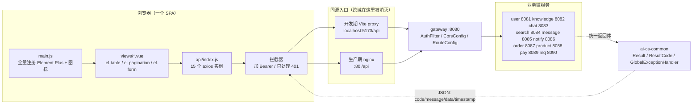
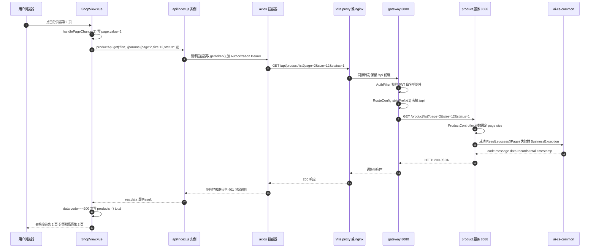

# Element Plus 与前后端联调：组件库省的是样式，联调省不了的是「契约」

> **一句话结论**：Element Plus 替你写好了按钮、表格、弹窗的样式与交互，但它替你不了「契约」——响应体的 `code` 到底该在哪儿判断、分页参数叫 `size` 还是 `pageSize`、业务失败为什么 HTTP 还是 200、时间字符串到底在哪个时区。本篇用本仓库 `ai-cs-frontend` 的真实代码去对齐 `ai-cs-common` 的真实 `Result`，把这四件事讲到能改代码。
> **阅读前置**：已读 [04-Vue3核心基础](04-Vue3核心基础.md)（SFC、`ref`、`v-model`）与 [06-路由守卫与Axios请求封装](06-路由守卫与Axios请求封装.md)（axios 实例 + 拦截器 + 路由守卫）。只想看中后台的「广度盘点」（多少张表、多少表单项）去看 [18-中后台硬技能](18-中后台硬技能.md)；跨域的原理细节在 [10-浏览器原理与HTTP跨域](10-浏览器原理与HTTP跨域.md)。
> **证据基线**：`ai-cs-frontend`（Vue 3.5 / Element Plus 2.14 / Vite 8，取值见 `ai-cs-frontend` 根目录的 `package.json`）、`ai-cs-common` 的 `Result`/`ResultCode`/`GlobalExceptionHandler`、`ai-cs-gateway` 的 `RouteConfig`/`CorsConfig`/`AuthFilter`；C 级命令 4 条已本机实跑并附真实输出。预计阅读 50~65 分钟，动手练习另需约 60 分钟。

## 0. 先看现象

**现场一：后端报错了，页面却像「什么都没发生」。**

商品页加载失败时，表格是空的、控制台没有一行红字、也没有任何 `ElMessage`。原因不在 Vue，而在这段取值代码——它根本没有判断业务码：

```js
// ai-cs-frontend/src/views/ProductView.vue#L342-L352（节选）
async function loadProducts() {
  try {
    const res = await productApi.get('/list', { params: { page: 1, size: 20 } })
    products.value = res.data?.data?.records || []
  } catch (e) {
    ElMessage.error('加载商品失败: ' + (e.response?.data?.message || e.message))
  }
}
```

后端抛运行时异常时，`ai-cs-common/src/main/java/com/aics/common/exception/GlobalExceptionHandler.java#L149-L154` 的兜底分支**没有** `@ResponseStatus`，于是响应是 `HTTP 200` + `{"code":500,...}`。axios 默认只看 HTTP 状态码，200 就是「成功」，`catch` 不会进，`data` 是 `null`，`|| []` 把空渲染成了正常空列表。本机用 node 复现了这条语义（本地 127.0.0.1 临时服务，无联网）：

```text
$ cd ai-cs-frontend && node --input-type=module -e "<起本地 server 打三个请求>"
/biz-fail -> resolved  status=200 body.code=500
/http-400 -> rejected  status=400 body.code=400 message=数量不能为空
/http-401 -> rejected  status=401 body.code=401 message=未认证，请先登录
axios version = 1.19.0
```

第一行的意思很直白：**HTTP 200 + `body.code=500` 走的是 `then`，不是 `catch`**。而 `ai-cs-frontend/src/api/index.js#L53` 的拦截器只处理 `status === 401` 这一种，业务码它一概不管。

**现场二：分页「点了没反应」，或者搜索之后表格突然空了。**

知识库页面把搜索按钮直接绑在 `fetchList` 上，而 `fetchList` 不重置页码：

```vue
<!-- ai-cs-frontend/src/views/KnowledgeView.vue#L14 -->
<el-button type="primary" @click="fetchList" :icon="Search">搜索</el-button>

<!-- ai-cs-frontend/src/views/KnowledgeView.vue#L42-L48 -->
<el-pagination
  v-model:current-page="page"
  v-model:page-size="pageSize"
  :total="total"
  layout="total, prev, pager, next"
  @current-change="fetchList"
/>
```

```js
// ai-cs-frontend/src/views/KnowledgeView.vue#L103-L112
async function fetchList() {
  try {
    const res = await knowledgeApi.get('/list', { params: { page: page.value, pageSize: pageSize.value, keyword: keyword.value || undefined } })
    const data = res.data?.data
    documents.value = data?.records || data || []
    total.value = data?.total || documents.value.length
  } catch (e) {
    ElMessage.error('加载文档列表失败: ' + (e.response?.data?.message || e.message))
  }
}
```

复现路径：翻到第 3 页 → 输入关键词点搜索 → 请求里 `page` 仍是 `3`，后端一共只有 8 条（1 页）→ 返回 `records: []`、`total: 8` → **表格空白、分页器却写着「共 8 条」**。Network 面板里那个请求的 Query String 会明明白白写着 `page=3`。

**现场三：同一个「创建时间」，三个页面三种长相。**

- `ai-cs-frontend/src/views/KnowledgeView.vue#L27`：`<el-table-column prop="createTime" label="创建时间" width="180" />` → 直接渲染后端字符串，屏幕上是 `2026-11-27T12:15:09`。
- `ai-cs-frontend/src/views/OrderView.vue#L74`：`String(t).replace('T', ' ').slice(0, 19)` → 屏幕上是 `2026-11-27 12:15:09`，看着正常，但它只是「换了个分隔符」，没有做任何时区换算；同一个函数在 `ai-cs-frontend/src/views/OrderDetailView.vue#L162` 被**又抄了一遍**。
- 反过来，后端的 `ai-cs-frontend` 拿到的这两个字符串都不带时区偏移（`+08:00`/`Z` 都没有），因为字段类型是 `LocalDateTime`（`ai-cs-knowledge/src/main/java/com/aics/knowledge/entity/KnowledgeDocument.java#L57-L58`），且全仓库 `application*.yml` 里没有任何 `spring.jackson.time-zone`/`date-format` 配置。

这些现象指向同一件事：**浏览器和 Element Plus 都没坏，坏在「契约」从来没被写成一处可执行的约定**——响应体的 `code`、分页的字段名、时间字符串的时区，三样全靠每个页面自己猜，猜法还不一样。

## 1. 整体地图



> **读图说明**：请求从左往右流，响应从右往左回。看懂三件事就够了：①**浏览器只认识一个同源前缀 `/api`**（A3/A4 里没有 `localhost:8081` 这种地址），开发期由 B1（`ai-cs-frontend/vite.config.js#L29-L31` 的 `'/api'` proxy）转发到 8080，生产期由 B2（`ai-cs-frontend/nginx.conf#L49-L62` 的 `location /api/`）反代到 `aics_gateway`；②**跨域不是被 CORS 解决的，是被「同源」绕开的**——前后端始终同源，`ai-cs-gateway/src/main/java/com/aics/gateway/config/CorsConfig.java` 那条 `allowedOriginPatterns("*")` 只在「前端直连 8080」时才用得上；③**响应体形状由 E1 一侧决定**（`Result` 四个字段），前端 A4 只对 HTTP 状态码做了反应，对 `code` 没有——这就是现场一的根。

组件站位与责任（每一行的路径都可在仓库里打开核对）：

| 组件 | 位置（真实文件） | 责任 | 参与方 |
|---|---|---|---|
| Element Plus 注册 | `ai-cs-frontend/src/main.js#L2-L18` | 全量引入 + 中文 locale + 全量图标 | 前端 |
| 15 个 axios 实例 | `ai-cs-frontend/src/api/index.js#L37-L79` | 按服务前缀建实例、注入 Bearer、处理 401 | 前端 |
| 网关地址解析 | `ai-cs-frontend/src/utils/runtime.js#L14-L24` | `VITE_GATEWAY` 空串 → 相对 `/api`（同源） | 前端 + 构建 |
| 开发期转发 | `ai-cs-frontend/vite.config.js#L24-L42` | 5173 上把 `/api` 代理到 8080，并为 SSE 关缓冲 | 前端 |
| 生产期转发 | `ai-cs-frontend/nginx.conf#L49-L62` | 80 上把 `/api` 反代到 `aics_gateway`，不 rewrite 前缀 | 运维 |
| 鉴权 | `ai-cs-gateway/src/main/java/com/aics/gateway/filter/AuthFilter.java#L87-L108` | 白名单 + 校验 JWT，401 短路 | 后端 |
| 路由去前缀 | `ai-cs-gateway/src/main/java/com/aics/gateway/config/RouteConfig.java#L67-L146` | 多数服务 `stripPrefix(1)`，少数直接透传 | 后端 |
| 统一返回体 | `ai-cs-common/src/main/java/com/aics/common/result/Result.java#L17-L27` | `code/message/data/timestamp` | 后端 |
| 错误码字典 | `ai-cs-common/src/main/java/com/aics/common/result/ResultCode.java` | 200/4xx/500 + 1xxx~9xxx 业务段 | 后端 |
| 异常→响应体 | `ai-cs-common/src/main/java/com/aics/common/exception/GlobalExceptionHandler.java` | 校验 400、业务 200+业务码、兜底 500 | 后端 |

## 2. 关键概念与关键类/关键 API

先把本篇会反复出现的词定死（**术语首现解释**）：

- **契约**（contract）：前端期望的请求参数名与响应结构，和后端实际产出的那两样东西的约定。它不是文档，是「两边代码对得上」这个事实。
- **传输码 / 业务码**：HTTP 状态码（200/400/401/500，属于协议层）与响应体里 `Result.code`（属于业务层）。本仓库同时用两套，所以必须两边都判。
- **受控用法**（controlled）：组件的状态由你的 `ref` 决定，组件只发事件、不自己改值；对应 `v-model:xxx` 是「受控 + 自动回写」的语法糖。
- **stripPrefix(1)**：Spring Cloud Gateway 的路由过滤器，表示「转发前砍掉路径的第 1 段」。`/api/product/list` 砍一段后到服务里就是 `/product/list`。

| 名称 | 位置 | 角色 | 关键点 |
|---|---|---|---|
| `app.use(ElementPlus, { locale: zhCn })` | `ai-cs-frontend/src/main.js#L18` | 全量注册组件 + 中文文案 | 全量引入 = 组件与样式一次性可用，代价是整包打进产物，无法 tree-shake |
| `zhCn` 语言包 | `ai-cs-frontend/src/main.js#L3` | 分页器「共 N 条」、日期面板等文案 | 不注册就是英文文案，与 Element Plus 组件是否可用无关，常被误当成「组件坏了」 |
| `el-form` + `rules` + `FormInstance.validate()` | 用法样例 `ai-cs-frontend/src/views/LoginView.vue#L13`、`#L89` | 声明式校验 | `validate()` 返回 Promise：**不合法时 reject**，`await` 必须包在 `try` 里 |
| `el-table` `:data` | `ai-cs-frontend/src/views/KnowledgeView.vue#L18` | 纯展示，**不分页、不请求** | 表格永远只渲染你给它的数组；分页是另一件事 |
| `el-pagination` | `ai-cs-frontend/src/views/KnowledgeView.vue#L42-L48`、`ai-cs-frontend/src/views/ShopView.vue#L67-L76` | 只发事件、不改数据 | `v-model:current-page` 与 `:current-page`+`@current-change` 两种写法等价性见 §3.3 |
| `ElMessage` / `ElMessageBox` | 全库 159 / 14 处（§3.7 有统计命令） | 轻提示 / 确认框 | `ElMessageBox.confirm` 取消时 reject 的是字符串 `'cancel'`，不是 Error |
| `axios.create({ baseURL, timeout })` | `ai-cs-frontend/src/api/index.js#L38` | 每个服务一个实例 | `baseURL` 里不要留尾斜杠，否则会拼出 `//list` |
| 响应拦截器 | `ai-cs-frontend/src/api/index.js#L50-L60` | 统一处理 401 | **只处理 401**，业务码判断全留给页面（这就是 50 处重复判断的来源） |
| `API_BASE` | `ai-cs-frontend/src/utils/runtime.js#L24` | 唯一的地址出口 | 值为 `${GATEWAY}/api`，生产 `GATEWAY` 为空串 |
| `Result<T>` | `ai-cs-common/src/main/java/com/aics/common/result/Result.java#L17-L27` | 所有接口的返回外壳 | 字段固定四个；`isSuccess()` 只认 `code == 200` |
| `ResultCode` | `ai-cs-common/src/main/java/com/aics/common/result/ResultCode.java` | 错误码字典 | 分段：1xxx 用户、2xxx 知识库、3xxx 对话（31xx Agent）、4xxx 搜索、5xxx 消息、6xxx 通知、7xxx 订单（71xx 售后）、8xxx 商品、9xxx 文件 |
| `GlobalExceptionHandler` | `ai-cs-common/src/main/java/com/aics/common/exception/GlobalExceptionHandler.java` | 异常 → `Result` | 业务异常是 **HTTP 200**；参数校验是 **HTTP 400**；兜底是 HTTP 200 + `code=500` |

## 3. 原理与证据逐段精读

每段都按同一套路走：**在干什么 → 为什么这么设计 → 换写法会怎样 → 常见坑**。

### 3.1 Element Plus 的使用模型：全量引入 vs 按需引入

**在干什么**：`ai-cs-frontend/src/main.js` 22 行里有 8 行在装配 Element Plus，方式是最朴素的「全量」：

```js
// ai-cs-frontend/src/main.js#L1-L21（节选，行号真实）
import ElementPlus from 'element-plus'
import zhCn from 'element-plus/es/locale/lang/zh-cn'
import 'element-plus/dist/index.css'
import * as ElementPlusIconsVue from '@element-plus/icons-vue'
// ...
for (const [key, component] of Object.entries(ElementPlusIconsVue)) {
  app.component(key, component)
}

app.use(ElementPlus, { locale: zhCn })
```

**为什么这么设计**：全量引入把「组件注册 + 样式 + 图标 + 中文语言包」四件事一次性解决，模板里写 `<el-table>` 就能用，不需要在每个 `.vue` 里 import；对教学仓库和中小后台，这个取舍是合理的——省下的心智成本远大于体积成本。图标之所以要自己 for 循环注册，是因为 `@element-plus/icons-vue` 是独立包，`app.use(ElementPlus)` 不会顺手把上千个图标注册进去；不注册就写 `<el-button :icon="Search">` 会得到「组件未解析」的警告与一个空白图标位。

**换写法会怎样**：

- 换按需引入（`unplugin-vue-components` + `ElementPlusResolver`）：模板里用到的组件才会被打进产物，`dist` 体积会明显下降；代价是①要改 `ai-cs-frontend/vite.config.js` 加插件，②图标得配 `IconsResolver` 否则 `:icon="Search"` 失效，③`ElMessage`/`ElMessageBox` 这类**函数式 API** 不会自动按需（样式也不自动带上），要手写 `import { ElMessage } from 'element-plus'` 并显式引样式。**本仓库目前没有装这两个插件**（`ai-cs-frontend` 根目录 `package.json` 的 devDependencies 里没有 `unplugin-vue-components`），所以这一项属于「可优化、未落地」。
- 换 CDN 外链：`index.html` 里引一份 UMD，`main.js` 不再 import。适合演示页，不适合本仓库——离线构建与 Docker 镜像自包含会一起坏掉。

**常见坑**：①以为「没装按需插件」=「不能用」，其实全量引入功能更全；②只 `import ElementPlus` 却忘了 `import 'element-plus/dist/index.css'`，页面出来是一堆无样式裸文字；③忘了 `locale: zhCn`，分页器出现 `Total 8`、日期面板英文，被误报成 bug；④图标「注册成全局组件后不作为标签用，而是作为 prop 传入」，写成 `<Search />` 才会渲染成组件。

### 3.2 主题变量覆盖：本仓库尚未落地

**在干什么**：`ai-cs-frontend/src/style.css`（298 行）里 `--el-` 与 `element-plus` 的命中数是 0——也就是说，**项目当前一行主题定制都没有**，用的是 Element Plus 默认主题。C 级核验命令与真实输出：

```text
PS> Select-String -Path ai-cs-frontend\src\style.css -Pattern '--el-|element-plus' -Encoding utf8 | Measure-Object | % Count
0
```

**为什么这么设计**：全量引入时样式是编译好的 `dist/index.css`，能改的只有运行时 CSS 变量（`--el-color-primary` 等），这是 Element Plus 官方推荐的「轻定制」路径：不动构建链、不改包，只在全局样式里覆盖几个变量。真正要做到「主色板、圆角、字号成套替换」，要么上 SCSS 变量 + 自定义 `@use "element-plus/theme-chalk/src/index.scss"`（编译期，必须放弃 `dist/index.css`），要么用 `<el-config-provider>` 局部换主题。三条路的定位完全不同：**CSS 变量 = 运行时可换肤；SCSS 变量 = 编译期定死；ConfigProvider = 组件树局部生效**。

**换写法会怎样**：如果现在在 `style.css` 里写 `:root { --el-color-primary: #1677ff; }`，所有 `type="primary"` 的按钮、标签、分页器选中色会一起变——这是唯一「零改造」就能生效的做法。但注意 `style.css` 在 `ai-cs-frontend/src/main.js#L9` 被 import，顺序在 Element Plus 样式之后，所以覆盖有效；若把它挪到 `index.html` 的 `<link>` 里且顺序在前，就会被 Element Plus 的默认值反覆盖（这是最隐蔽的一种「改了没反应」）。

**常见坑**：①覆盖了 `--el-color-primary` 但代码里写了 `style="color:#409EFF"` 这样的硬编码，出现「一半新一半旧」；②按需引入 + 自定义 SCSS 时忘了同时配置 `css.preprocessorOptions.scss.additionalData`，导致变量根本没注入；③在 `<style scoped>` 里覆盖变量——scoped 加的是属性选择器，`:root` 不再命中。

### 3.3 插槽与受控用法：同一个分页器，两种写法

**在干什么**：两个页面用了两种都「能跑」的分页写法。知识库是双绑：

```vue
<!-- ai-cs-frontend/src/views/KnowledgeView.vue#L42-L48 -->
<el-pagination
  v-model:current-page="page"
  v-model:page-size="pageSize"
  :total="total"
  layout="total, prev, pager, next"
  @current-change="fetchList"
/>
```

商城是受控 + 自己写回调：

```vue
<!-- ai-cs-frontend/src/views/ShopView.vue#L67-L76 -->
<el-pagination
  v-if="total > size"
  background
  layout="total, prev, pager, next"
  :total="total"
  :page-size="size"
  :current-page="page"
  class="pager"
  @current-change="handlePageChange"
/>
```

**为什么这么设计**：`v-model:current-page="page"` 等价于 `:current-page="page"` + `@update:current-page="page = $event"`。用双绑时，Element Plus 触发顺序是**先改值、再抛 `current-change`**，所以 `fetchList` 里读 `page.value` 拿到的是新页码，不会错。用受控写法时，值只在你手里变，`handlePageChange(p)` 里显式 `page.value = p; loadProducts()`（`ai-cs-frontend/src/views/ShopView.vue#L157-L159`）——多写一行，但「谁改了页码、什么时候请求」这条因果链更清楚。

插槽方面，表格里的自定义列是 `#default="{ row }"`（`ai-cs-frontend/src/views/KnowledgeView.vue#L29`）、删除确认是 `el-popconfirm` 的 `#reference`（同文件 `#L32-L36`）。**插槽解决的是「把渲染权交回给你」**，它不改数据、不请求，只是给你一个位置。

**换写法会怎样**：双绑 + `@current-change` 里再手动 `page.value = p`，就会出现「值被赋值两次」；虽然 Vue 会去重（同值不触发更新），但在 `@current-change` 里 `watch` 了 `page` 的代码会被触发两次，进而发出两次请求——Network 面板里同一秒两条一模一样的 `/list?page=2`，是这类写法最典型的指纹。

**常见坑**：①**只写了 `:current-page`（单向）却没写 `@current-change`**，页码永远停在 1，看起来像「分页器坏了」；②双绑绑在 `ref` 上却忘了 `layout` 里没有 `sizes` 时 `page-size` 改不了，`v-model:page-size` 是一条死绑；③给 `el-pagination` 传 `:total="records.length"`（当前页条数），总页数永远是 1。

### 3.4 表格与分页联动：服务端分页的真实写法

**在干什么**：真正的一次「服务端分页」必须同时维护四样东西——当前页、页大小、总数、数据数组，并在请求里把前两个发出去、从响应里把后两个取回来：

```js
// ai-cs-frontend/src/views/ShopView.vue#L117-L159（节选，去掉语义搜索分支）
async function loadProducts() {
  loading.value = true
  try {
    const params = { page: page.value, size: size.value, status: 1 }
    if (keyword.value.trim()) params.keyword = keyword.value.trim()
    if (categoryId.value) params.categoryId = categoryId.value
    const { data } = await productApi.get('/list', { params })
    if (data.code === 200 && data.data) {
      products.value = data.data.records || []
      total.value = data.data.total || 0
    }
  } catch (e) {
    ElMessage.error('加载商品失败')
  } finally {
    loading.value = false
  }
}
function handleSearch() {
  page.value = 1
  loadProducts()
}
function handlePageChange(p) {
  page.value = p
  loadProducts()
}
```

**为什么这么设计**：`records`/`total` 这两个键不是前端编的，而是 MyBatis-Plus 分页对象的 getter 名。C 级核验（本机 JDK 17.0.19）：

```text
PS> javap -cp C:\Users\16680\.m2\repository\com\baomidou\mybatis-plus-core\3.5.13\mybatis-plus-core-3.5.13.jar com.baomidou.mybatisplus.core.metadata.IPage
public interface com.baomidou.mybatisplus.core.metadata.IPage<T> extends java.io.Serializable {
  public abstract java.util.List<T> getRecords();
  public abstract long getTotal();
  public abstract long getSize();
  public abstract long getCurrent();
  public default long getPages();
  ...
}
```

怎么读：`getRecords()`/`getTotal()` 经 Jackson 序列化后就是 JSON 里的 `records`/`total`（Jackson 用 getter 名去 `get` 前缀、首字母小写）。所以**前端读 `data.data.records` 是有依据的**，`ai-cs-knowledge/src/main/java/com/aics/knowledge/controller/KnowledgeController.java#L74-L80` 返回 `Result<Page<KnowledgeDocument>>`、`ai-cs-product/src/main/java/com/aics/product/controller/ProductController.java#L92-L98` 返回 `Result<IPage<ProductVO>>`，两者 JSON 键一致。

但**参数名不一致**，这是本仓库最真实的契约裂缝：

| 服务 | Controller | 分页参数（真实签名） |
|---|---|---|
| knowledge | `ai-cs-knowledge/src/main/java/com/aics/knowledge/controller/KnowledgeController.java#L74-L80` | `page`、**`pageSize`**、`keyword` |
| product | `ai-cs-product/src/main/java/com/aics/product/controller/ProductController.java#L92-L98` | `page`、**`size`**、`keyword`、`categoryId`、`status` |

于是前端也必须跟着分叉：`KnowledgeView` 发 `pageSize`（`ai-cs-frontend/src/views/KnowledgeView.vue#L105`），`ShopView`/`ProductView` 发 `size`（`ai-cs-frontend/src/views/ShopView.vue#L136`、`ai-cs-frontend/src/views/ProductView.vue#L344-L346`）。**发错名字不会报错**——`@RequestParam(defaultValue="10")` 会安静地兜住，你只是永远拿到第 1 页 10 条。这是本篇最贵的一种错：没有报错、没有日志，只有「翻页没反应」。

对照一下「根本没有分页」的页面：`ai-cs-frontend/src/views/MessageView.vue#L103-L110` 一次拉全量 `messageApi.get('/sessions', { params: { userId } })`，表格 `#L44-L54` 没有分页器。会话一多就慢，但它至少不会错位。

**换写法会怎样**：如果改成「前端切片」（后端一次返回全部，前端 `slice` 出当前页），翻页会瞬间响应、也不消耗请求，但总数上限被全量数据卡死（1 万条会话时页面直接卡），并且搜索/排序必须回到后端重算——**分页属于数据层能力，放到视图层只是把问题挪到更晚爆**。

**常见坑**：①搜索时不重置 `page`（现场二）；②删除末页最后一条后没回退页码 → 空白页；③`total` 取 `records.length`；④`records` 为 `null` 时 `|| []` 掩盖了错误（现场一）；⑤`el-pagination` 的 `layout` 没写 `sizes` 却绑了 `page-size`，页大小永远改不了。

### 3.5 表单校验：`rules`、异步校验、动态字段

**在干什么**：全库 `el-form-item` 有 91 个，但 `:rules=` 只有 **2 处**，都在登录页；`.validate()` 也只有 **2 次**，也都在登录页：

```text
PS> Select-String -Path ai-cs-frontend\src\views\*.vue -Pattern ':rules=' -Encoding utf8
LoginView.vue:13  <el-form ref="loginFormRef" :model="loginForm" :rules="loginRules" ...>
LoginView.vue:29  <el-form ref="regFormRef" :model="regForm" :rules="regRules" ...>
PS> Select-String -Path ai-cs-frontend\src\views\*.vue -Pattern '\.validate\(' -Encoding utf8
LoginView.vue:89   await loginFormRef.value.validate()
LoginView.vue:117  await regFormRef.value.validate()
```

**为什么这么设计**：声明式校验把「什么时候校验（`trigger: 'blur'`/`'change'`）」和「校验什么（`rules`）」交给组件，`validate()` 只负责在提交那一刻再全量跑一遍。它的返回值是 Promise：**通过 resolve、不通过 reject**。这决定了调用点的写法。

**换写法会怎样（现场级证据）**：

```js
// ai-cs-frontend/src/views/LoginView.vue#L88-L95（节选）
async function handleLogin() {
  await loginFormRef.value.validate()   // ← 在 try 之外
  loading.value = true
  try {
    const { data } = await userApi.post('/login', loginForm.value)
    // ...
```

`validate()` 在 `try` 之外被 `await`：校验不通过时 Promise reject，异常直接冒泡到 click 事件 → 控制台一条 `Uncaught (in promise)`，用户只看到字段下面的红字，页面没有任何 `ElMessage`。功能上「能用」（红字提示了），体验上「像坏了」（点了按钮毫无反馈）。修法二选一：把它挪进 `try`，或用 `validate((valid) => {...})` 回调式写法。

再看另一端——知识库的保存按钮**一次校验都没有**（`ai-cs-frontend/src/views/KnowledgeView.vue#L131-L144` 直接 `knowledgeApi.post('')`），空标题会被后端 `MethodArgumentNotValidException` 拦成 `HTTP 400` + `{"code":400,"message":"标题不能为空"}`，前端 catch 到并显示。**这是「前端不校验、靠后端兜」的典型形态**：能防脏数据，但要浪费一次往返，且错误文案与字段位置绑不上。

异步校验与动态字段这两项在本仓库**未落地**，给出可落地的写法：

```js
// 异步校验：唯一性交给后端，注意 debounce 与「最后一次结果才生效」
const rules = {
  title: [
    { required: true, message: '标题不能为空', trigger: 'blur' },
    {
      validator: async (rule, value) => {
        if (!value) return
        const { data } = await knowledgeApi.get('/exists', { params: { title: value } })
        if (data.data === true) throw new Error('标题已存在')
      },
      trigger: 'blur',
    },
  ],
}

// 动态字段：prop 必须是「可被 lodash.get 解析的路径」，数组用下标
// <el-form-item :prop="`items.${index}.name`" :rules="{ required: true, message: '必填' }">
```

**常见坑**：①`rules` 写了但 `el-form-item` 忘了 `prop`，校验器根本没有挂上去；②`prop` 与 `v-model` 的字段路径不一致（`prop="title"` 而输入绑在 `docForm.name`），永远校验不到；③动态字段删除后忘记 `splice` 之外还要 `clearValidate()`，残留红字；④异步校验没做「结果过期丢弃」，快速输入时旧结果覆盖新结果。

### 3.6 对话框与表单重置：复用组件时的残留状态

**在干什么**：全库 8 个 `el-dialog`，`destroy-on-close`、`resetFields()`、`clearValidate()` 三个关键词命中数都是 **0**：

```text
PS> Select-String -Path ai-cs-frontend\src\views\*.vue -Pattern 'resetFields|clearValidate|destroy-on-close' -Encoding utf8 | Measure-Object | % Count
0
```

所有重置都靠手写对象赋值。知识库做得对（新增、编辑各造一个新对象）：

```js
// ai-cs-frontend/src/views/KnowledgeView.vue#L114-L124
function showCreateDialog() {
  editingDoc.value = null
  docForm.value = { title: '', category: '', content: '', status: 1 }
  dialogVisible.value = true
}
function editDoc(row) {
  editingDoc.value = row
  docForm.value = { ...row }   // 展开复制，不共享引用
  dialogVisible.value = true
}
```

商品页则是反面教材：**创建表单与编辑对话框共用同一个 `productForm`**：

```js
// ai-cs-frontend/src/views/ProductView.vue#L179-L186（定义，只此一份）
const productForm = ref({ name: '', description: '', price: 99, stock: 100, categoryId: 1, image: '' })

// ai-cs-frontend/src/views/ProductView.vue#L201-L212（编辑对话框打开时整体覆写它）
function openEdit(item) {
  editingId.value = item.id
  productForm.value = { name: item.name || '', /* ... */ price: Number(item.price || 0) }
  editDialogVisible.value = true
}
```

**为什么这是坑**：`productForm` 同时被「新增表单」（模板 `#L38-L60`）和「编辑对话框」（`#L123-L148`）绑定。用户点过「编辑商品 A」再去看新增框，新增框里现在是 A 的数据——**残留状态**。更阴的是它不影响提交（`createProduct` 会带上脏数据一起 POST），于是「新增」会变成「又建了一个商品 A」。

**为什么这么设计（作者的原意 vs 代价）**：复用一份表单对象省事，尤其在「新增/编辑同一套字段」时；`{ ...row }` 这种展开复制也够用。但复用就必须回答「谁负责清空、清空到什么程度」，一旦两个入口各自清空，就会出现「后开的覆盖先开的」。

**换写法会怎样**：三种正解，按侵入性排序——①`<el-dialog destroy-on-close>`：关闭即销毁内部 DOM 与组件实例，残留最少，代价是每次打开重建（有列表的对话框会重新请求）；②给 `el-form` 加 `ref` 并在打开时 `formRef.value.resetFields()`：只重置**带 `prop` 的字段**到 `:model` 初值，这正是「为什么 `prop` 必须写」的另一个理由；③像知识库那样每次造新对象（当前最省事，也最不容易错，但仍需人工记得写）。

**常见坑**：①`resetFields()` 无效 → 因为 `el-form-item` 没有 `prop`；②对话框里的表单和页面表单共用一个 `ref`（本仓库商品页）；③编辑时把 `row` 直接赋给表单（`docForm.value = row`），改表单等于改列表行——`KnowledgeView` 用 `{ ...row }` 恰好躲过；④关闭对话框不清 `editingId`，下次点「新增」走到 `PUT /{id}` 分支。

### 3.7 提示与错误反馈的统一封装：本仓库尚未落地

**在干什么**：提示是散装调用，没有任何统一封装。C 级统计（真实输出）：

```text
PS> Select-String -Path ai-cs-frontend\src\views\*.vue,ai-cs-frontend\src\api\*.js -Pattern 'ElMessage\.' -Encoding utf8 | Measure-Object | % Count
159
PS> Select-String -Path ai-cs-frontend\src\views\*.vue,ai-cs-frontend\src\api\*.js -Pattern '\b(7001|8001|1001|3003|3101|5001|6001|2001)\b' -Encoding utf8 | Measure-Object | % Count
0
```

怎么读：**159 处** `ElMessage.*` 分散在 24 个文件里（`ProductView` 24 处、`MqView` 13 处、`SearchView` 12 处……），而 `ai-cs-common` 里定义的业务错误码数字在前端出现 **0 次**。两句话就能概括现状：**提示文案由每个页面自己拼；后端错误码从未被翻译成用户话术**。典型形态是 `ElMessage.error('保存失败: ' + (e.response?.data?.message || e.message))`——直接把后端 `message` 怼给用户，于是用户会看到「Duplicate entry 'x' for key 'uk_name'」这类句子。

**为什么这么设计**：页面自己 `ElMessage` 最直观，不需要懂拦截器；坏处是同一个错误在不同页面的文案不一致、无法统一去重（连点两次按钮弹两条）、也无法集中做「错误码 → 话术」的映射。

**可落地的统一封装（未落地，建议按此改造）**：在 `ai-cs-frontend/src/api/index.js` 的响应拦截器里把「业务失败」收口。注意拦截器的 `fulfilled` 分支现在只 `return response`（`#L51`），改造点就在这里：

```js
// 建议实现（改的是 ai-cs-frontend/src/api/index.js 的响应拦截器，当前未实现）
const CODE_TEXT = {
  400: '请求参数有误', 401: '登录已过期，请重新登录', 403: '没有权限执行该操作',
  8001: '商品不存在或已下架', 7001: '订单状态已变更，请刷新后重试', 3003: '对话服务繁忙，请稍后再试',
}
function notifyOnce(text) { /* 1.5s 内相同文案只弹一次，避免重复点击刷屏 */ }

client.interceptors.response.use(
  (response) => {
    const body = response.data
    if (body && typeof body.code === 'number' && body.code !== 200) {
      notifyOnce(CODE_TEXT[body.code] || body.message || '操作失败')
      return Promise.reject(new Error(body.message || 'business error'))
    }
    return response
  },
  (error) => { /* 原有的 401 处理保留 */ }
)
```

改造后页面里那 50 处 `data.code === 200` 判断可以逐步删除——**但要在拦截器统一 reject 之后再删**，否则会从「判了两次」直接变成「一次都没判」。这也是本篇强调的顺序：先收口，再删重复。

**常见坑**：①拦截器 resolve 时返回 `response` 但页面用 `const { data } = await ...` 解构，改造后结构别顺手改掉；②`ElMessage` 参数是字符串或 `{ type, message }` 两种形态，抽封装时别混用；③把 `code !== 200` 一律弹错，会把「200 业务成功但 message 是提示语」的场景搞坏（本仓库 `Result.success(String, T)` 可以带自定义 message）。

### 3.8 联调五件事之一二：路径契约与字段命名

**（1）路径契约：网关砍不砍前缀，必须逐个路由确认。**

```java
// ai-cs-gateway/src/main/java/com/aics/gateway/config/RouteConfig.java#L67-L68（节选）
.path("/api/user/**")
.filters(f -> f.stripPrefix(1))
```

同文件里 knowledge（`#L72-L73`）、rag、chat、search、order、cart、pay、mq、product 也都是 `stripPrefix(1)`；但 observability（`#L88`）与 prompts（`#L94`）的注释写着「直接透传不去前缀」，message（`#L115`）与 notify（`#L120`）的注释写着「Controller 前缀为 /api/xxx，无需去前缀」，agent 更是用 `rewritePath` 把 `/api/agent/chat` 改写成 `/chat/agent`（`#L101-L106`）。

**为什么这么设计**：多数 Controller 的 `@RequestMapping` 是不带 `/api` 的服务内路径（如 `/product/list`），所以网关必须砍一段；而少数 Controller 自己就写了 `/api/message`，再砍就会 404。结果就是**同一个前端 `SERVICES` 表，前缀语义并不统一**。

**换写法会怎样**：如果统一成「全部 stripPrefix(1)」，那 message/notify 的 Controller 必须改成不带 `/api`；反过来统一成「全部透传」，则十几个服务都要改 `@RequestMapping`。两种都可行，但都得一次性改完并回归。**改动前先看网关注释，别按直觉猜**。

还有一个更细的坑：**尾斜杠**。`ai-cs-frontend/src/api/index.js#L104` 那行注释是被踩出来的——「不能带尾斜杠，Spring Boot 3 不再匹配 `/api/prompts/`」。前端的 `baseURL` 若写成 `${BASE_URL}/prompts/`，拼出来的 `/api/prompts//eval` 会 404，而 404 的响应体是 `Result` 包装的 `{"code":404,...}`，看着像「接口不存在」。

**（2）字段命名：数据库 snake、Java 驼峰、JSON 驼峰。**

- Java 实体是驼峰：`ai-cs-knowledge/src/main/java/com/aics/knowledge/entity/KnowledgeDocument.java#L57-L58` 的 `createTime`，MyBatis-Plus 会自动把列 `create_time` 映射上去。
- JSON 也是驼峰，因为**没有任何自定义命名策略**：`ai-cs-common/src/main/java/com/aics/common/autoconfigure/Jackson2AutoConfiguration.java`（22 行）只是为遗留代码保留一个 Jackson 2 的 `ObjectMapper`，项目里没有 `PropertyNamingStrategy.SNAKE_CASE` 之类的配置（全仓库 `application*.yml` 也只有数据源、端口等，没有 `spring.jackson.property-naming-strategy`）。
- 所以前端拿到的是 `createTime` / `categoryId` / `userId`，**千万不要在请求或响应里手写 `create_time`**。

**换写法会怎样**：如果后端某天加上 `property-naming-strategy: SNAKE_CASE`，全前端 50 处 `data.xxx` 会同时失效——这类全局配置属于「改一处、崩一片」的契约变更，必须和前端一起发版。**判断当前基线的最快方法**：打开任意接口的 Network → Response，看键名是 `createTime` 还是 `create_time`，别信文档。

**常见坑**：①`GET` 的查询参数名和 JSON 字段名是两套东西——`?pageSize=10` 里的 `pageSize` 由 `@RequestParam` 决定，和 JSON 序列化策略无关；②`userId` 写成 `user_id`，后端拿不到值也不报错（`required=false`）；③同一个概念不同服务不同名（`userId` 在购物车接口被塞进了请求头 `X-User-Id`，见 `ai-cs-frontend/src/views/ShopView.vue#L162-L181`）。

### 3.9 联调五件事之三四五：统一响应体、错误码话术、时区

**（3）统一响应体：三个字段怎么用、第四个字段为什么没人用。**

```java
// ai-cs-common/src/main/java/com/aics/common/result/Result.java#L17-L27
/** 状态码 */
private int code;
/** 提示信息 */
private String message;
/** 响应数据 */
private T data;
/** 时间戳 */
private long timestamp;
```

- `code`：业务码，`200` 才算成功（`isSuccess()` 只认 `ResultCode.SUCCESS.getCode()`，`#L78-L80`）。
- `message`：给人看的文案，**默认是通用文案**（`SUCCESS`/`FAIL` 的中文），业务异常里可以覆盖。
- `data`：载荷，列表接口里装 `records/total`，创建接口里可能是 `null`。
- `timestamp`：服务端毫秒时间戳，**本仓库前端没有任何一处读它**（`grep timestamp ai-cs-frontend/src/views/*.vue` 无命中）。它其实是最好用的联调工具：①判断响应是不是后端的（网关/nginx 自己生成的错误体没有这个字段）；②算「服务端时钟 vs 本机时钟」偏差——时区/时钟问题的第一现场。

**为什么这么设计**：统一返回体让前端只写一套解构逻辑，也能在同一通道里表达「HTTP 200 但业务失败」。代价是**必须两边都判**：HTTP 状态码判传输层，`code` 判业务层。本仓库只判了前者（`ai-cs-frontend/src/api/index.js#L50-L60`），所以业务失败要靠页面里那 50 处 `code === 200` 兜——`grep -c '\.code' ai-cs-frontend/src/api/index.js` 的结果是 **0**：

```text
PS> (Select-String -Path ai-cs-frontend\src\api\index.js -Pattern '\.code').Count
0
PS> (Select-String -Path ai-cs-frontend\src\views\*.vue -Pattern '\.code\s*===|\.code\s*!==').Count
50
```

怎么读：**api 层 0 处、视图层 50 处**——判断责任被完全下推给页面，于是每加一个页面就多几处重复，且新页面很容易忘。

**（4）错误码 → 用户话术：字典在，映射没写。**

`ResultCode` 的码段设计很清楚：1xxx 用户、2xxx 知识库、3xxx 对话（31xx Agent，如 `AGENT_SAFETY_BLOCKED`）、4xxx 搜索、5xxx 消息、6xxx 通知、7xxx 订单（71xx 售后）、8xxx 商品（`PRODUCT_NOT_FOUND` 起）、9xxx 文件。但前端出现这些数字的次数是 **0**（§3.7 的命令），所以现状是「后端精心分了段，前端全当字符串透传」。

**为什么应该映射**：`message` 面向开发（含参数、含内部术语），话术面向用户（「这件商品暂时买不了，换一件试试？」）。二者混用的结果就是 §3.7 里那句 MySQL 报错直接上屏。**可落地的映射表骨架**（未落地）：

| `Result.code` | 场景 | 建议话术 | 动作 |
|---|---|---|---|
| 400 | 参数校验失败 | 「{后端 message}」（校验文案本身就是给用户的） | 定位到字段 |
| 401 | 令牌缺失/过期 | 「登录已过期，请重新登录」 | 已在拦截器处理：清登录态 + 跳 `/login` |
| 403 | 无权限 | 「没有权限执行该操作」 | 不跳转，仅提示 |
| 8xxx | 商品域（如 8001 不存在） | 「商品不存在或已下架」 | 刷新列表 |
| 7xxx/71xx | 订单/售后状态冲突 | 「订单状态已变更，请刷新后重试」 | 重新拉详情 |
| 3xxx/31xx | 对话、Agent 安全拦截 | 「当前问题无法回答，请换个说法」 | 保留会话 |
| 500 | 兜底 | 「服务开小差了，请稍后重试」 | 展示 `timestamp` 便于报障 |

**换写法会怎样**：不映射、直接透传 `message` 的最坏情况不是难看，是**泄露内部信息**（SQL 约束名、表名、类名）。而过度映射（把所有 5xx 都变成「系统繁忙」）会让排障变难——所以建议「用户话术上屏 + 原始 `code`/`message` 打到 console 或上报」。

**（5）时区：三个时间戳，三种来源，零个约定。**

现状链条是这样的：数据库列名 `create_time` → 实体 `LocalDateTime`（无时区）→ `@TableField(fill = FieldFill.INSERT)` 由服务端时钟填充（`ai-cs-knowledge/src/main/java/com/aics/knowledge/entity/KnowledgeDocument.java#L57-L58`）→ Jackson 输出 ISO 字符串（**无偏移量**）→ 前端 6 处原样显示、2 处只把 `T` 换成空格。

```js
// ai-cs-frontend/src/views/OrderView.vue#L74-L76（与 OrderDetailView.vue#L162-L164 完全重复）
function formatTime(t) {
  return t ? String(t).replace('T', ' ').slice(0, 19) : '-'
}
```

**为什么这是错**：`LocalDateTime` 表示「墙上时间」，不含时区信息；服务端哪个时区、浏览器哪个时区、数据库连接串里的 `serverTimezone` 是什么，三者一旦不一致，用户看到的时间就偏。这个函数做的只是「换个分隔符」，既不换算也不校验。

**换写法会怎样**：三种正解，各有代价——①后端改用 `Instant`/`OffsetDateTime` 并配 `@JsonFormat(pattern=..., timezone="Asia/Shanghai")`，前端拿到的字符串自带偏移，`new Date(str)` 才可靠（改动面在实体与 DTO，推荐）；②后端直接返回 epoch 毫秒，前端 `new Intl.DateTimeFormat('zh-CN', { dateStyle:'short', timeStyle:'medium' }).format(ms)` 按浏览器时区渲染（最省心，但要改契约）；③维持 `LocalDateTime` 但**在文案里显式标注「北京时间」**，并把这个 `formatTime` 收进 `ai-cs-frontend/src/utils/format.js`（该文件目前只有 `formatSize`/`truncateMiddle`，**没有任何日期函数**）——这是成本最低的「先止血」方案。

**怎么自查**：DevTools → Network → 某个列表接口 → Response，找 `createTime` 的值，**看结尾有没有 `Z` 或 `+08:00`**。没有就是「裸墙上时间」，任何展示层都只能假设它已经是用户时区。再对一眼 `Result.timestamp`（毫秒）与 `Date.now()` 的差值，就能分离「时钟偏」与「时区偏」。

### 3.10 Mock 与联调切换：本仓库没有 Mock 基建

**在干什么**：全库搜索 `mockjs`、`msw`、`VITE_USE_MOCK`、`import.meta.env.DEV` 的命中数是 **0**（命令见下），也就是说**没有 Mock 层**：`ai-cs-frontend/src/api/index.js` 直接指向真实网关。

```text
PS> Select-String -Path ai-cs-frontend\src\*.js,ai-cs-frontend\src\**\*.js,ai-cs-frontend\src\**\*.vue -Pattern 'mockjs|msw|VITE_USE_MOCK|import\.meta\.env\.DEV' -Encoding utf8 | Measure-Object | % Count
0
```

**为什么这样就够用（以及不够用在哪）**：地址只有一个出口 `API_BASE`（`ai-cs-frontend/src/utils/runtime.js#L24`），所以「切环境」天然只需要改环境变量：`.env.development` 的 `VITE_GATEWAY=http://localhost:8080`（走 Vite proxy）、`.env.production` 的 `VITE_GATEWAY=` 留空（走同源 `/api`）。但**「后端没启」或「接口还没写」时没有退路**——这正是 Mock 层要解决的问题。

**三条可行路径（都未落地，按侵入性排序）**：

1. **代理指向本地 stub**：把 `VITE_PROXY_TARGET` 指到一个 node/Express 临时服务，改 `.env.development.local` 即可，不动代码。适合「只缺一两个接口」。
2. **dev-only MSW**：`msw` 在 Service Worker 层拦截 `/api/**`，只在 `import.meta.env.DEV` 时启动。适合「后端整体还没好」。
3. **拦截器里返回假数据**：最省事也最危险——`if (import.meta.env.DEV && import.meta.env.VITE_USE_MOCK) return Promise.resolve({ data: fake })`。风险是**假数据形状与真契约不一致**（比如假数据没有 `code`），上真环境立刻崩。

**常见坑**：①`import.meta.env` 只认 `VITE_` 前缀（`.env.development#L3` 的注释就是提醒这件事），写 `MOCK=true` 读不到；②改 `.env.*` 必须重启 dev server；③Mock 返回的形状必须照抄 `Result`（`code/message/data/timestamp`），否则就是给未来埋雷。

### 3.11 跨域与代理：Vite proxy 与 nginx 反代的差别

**在干什么**：开发期与生产期各有一层转发，**两层的目标一致（把 `/api` 送到网关），参数却完全不同**。

```js
// ai-cs-frontend/vite.config.js#L24-L42（节选）
server: {
  port: 5173,
  proxy: {
    '/api': { target: gateway, changeOrigin: true },
  },
  configure(proxy) {
    proxy.on('proxyRes', (proxyRes) => {
      proxyRes.headers['cache-control'] = 'no-cache, no-transform'
      delete proxyRes.headers['content-encoding']   // SSE 必须，否则浏览器攒一坨
    })
  },
}
```

```nginx
# ai-cs-frontend/nginx.conf#L49-L62（节选，注释为原文）
location /api/ {
    proxy_pass http://aics_gateway;            # 注意：不 rewrite，保留 /api 前缀
    proxy_http_version 1.1;
    proxy_set_header Connection "";            # 清空以便 keep-alive 复用
    proxy_buffering off;                       # SSE 必备：不缓冲
    proxy_cache off;
    proxy_read_timeout 300s;
    chunked_transfer_encoding on;
}
```

**为什么这么设计**：开发期前端在 5173、后端在 8080，**不同端口就是不同源**，直连必然触发 CORS 预检；用 Vite 的 proxy 让浏览器以为「只有 5173 一个源」，预检根本不发生——**跨域是被消灭的，不是被配置的**。生产期同理：`nginx.conf#L68-L70` 的 `try_files ... /index.html` 让 SPA 路由可用，`#L49-L62` 让 `/api` 同源反代，`#L33-L37` 给 `/assets/` 上 `immutable` 一年缓存、`#L41-L44` 给 `index.html` 上 `no-store`（发版立刻生效的关键）。

两者差别一张表说完：

| 维度 | Vite proxy（dev，5173） | nginx 反代（prod，80） |
|---|---|---|
| 生效范围 | 只在本机 `npm run dev` 进程内 | 部署后所有请求 |
| 前缀处理 | 默认**原样**转发 `/api/...` | 同样原样（本例**故意不 rewrite**，网关路由表带 `/api`） |
| `changeOrigin` | 显式设置（`#L30`），改写 `Host` 头 | 用 `proxy_set_header Host $host` 显式给出 |
| 超时 | 无（走 axios 的 `timeout: 30000`） | `proxy_read_timeout 300s` |
| 压缩 | 不压缩，并**删掉上游 `content-encoding`** | `gzip on`（`#L23-L28`） |
| 上传大小 | 无限制（Node 层） | `client_max_body_size 20m`（`#L21`，默认 1m 会 413）|
| SSE | 靠 `proxyRes` 里删 `content-encoding` + 禁缓存 | 靠 `proxy_buffering off` + `chunked_transfer_encoding on` |
| 配置文件 | `ai-cs-frontend/vite.config.js` | `ai-cs-frontend/nginx.conf` |

**换写法会怎样**：①把生产也改成「前端直连 8080」——立刻需要 CORS，`ai-cs-gateway` 的 `CorsConfig` 虽支持（`allowedOriginPatterns("*")` + `allowCredentials(true)`），但**带凭证的请求不允许 `*` 回显**，实际会因浏览器校验失败而报错，且 `Cookie`/`Authorization` 场景会变复杂；②nginx 里加 `rewrite ^/api/(.*) /$1 break`——网关路由表是 `/api/**`，去掉前缀后全部 404；③dev 环境关掉 proxy 直接写 `http://localhost:8080` 到 `API_BASE`——预检请求 OPTIONS 会被 `AuthFilter` 拦成 401（白名单里只有 `/api/user/login` 等四条）。

**常见坑**：①改了 `vite.config.js` 不重启，代理配置无效；②SSE 在 dev 正常、上线后「一次性蹦出全部内容」——因为 nginx 少了 `proxy_buffering off`；③上传大文件在 dev 正常、上线 413——`client_max_body_size`；④把 `location /api/` 写成 `location /api`（少尾斜杠），匹配规则会变，某些子路径漏掉。

## 4. 一次完整执行时序

以「商城页点击第 2 页」为例，把 §3 的所有契约串成一条线：



> **读图说明**：竖线从左到右是「谁把请求往下传」，反向是「谁把响应往回交」。三个要点：①**第 4 步是唯一注入身份的地方**（`ai-cs-frontend/src/api/index.js#L41-L47`），后面所有环节都靠这个头；②**第 7 步与第 8 步是路径契约的唯一分界**——`/api` 在网关被砍掉，所以服务里 Controller 写的是 `/product/list`；③**第 14 步是业务契约的唯一分界**：`data.code === 200` 之后才写表格，这一步漏了就是现场一。所以整条链上，**HTTP 状态码管「送达」，`code` 管「办成」**，两者缺一不可。

哪一步失败会报什么错（把这张表存下来，排障能省半小时）：

| 失败环节 | 症状（Network / 控制台原文形态） | 定位动作 |
|---|---|---|
| 没有 token / token 过期 | `HTTP 401` + `{"code":401,"message":"未认证，请先登录"}`；拦截器 `logout()` + 弹「登录已过期，请重新登录」+ 跳 `/login` | 看 Request Headers 有没有 `Authorization: Bearer ...` |
| 路径少/多一段前缀 | `HTTP 404` + `{"code":404,...}`；网关日志「No route matched」类提示 | 对照 `RouteConfig` 看该服务是 strip 还是透传 |
| 分页参数名写错（`pageSize` 发给 product） | **没有任何错误**：永远第 1 页 10 条，`total` 却是全量 | 看 Response 的 `data.current`/`data.size`，不是看有没有报错 |
| 请求体字段类型不对 | `HTTP 400` + `{"code":400,"message":"请求体格式错误或字段类型无效"}` | 对照 DTO 类型，别把 `"99"` 当数字发 |
| `@Valid` 校验失败 | `HTTP 400` + `{"code":400,"message":"标题不能为空"}`（多个错误用 `"; "` 拼接） | 后端 `GlobalExceptionHandler#L44-L52` 只保留了 message，字段名不返回 |
| 业务异常（如商品不存在） | **`HTTP 200`** + `{"code":8001,...}` | 看 Response 的 `code`，这就是现场一的坑 |
| 服务内部异常 | **`HTTP 200`** + `{"code":500,"message":"...","timestamp":...}` | 同时去后端日志找 `系统异常 [方法] URI` 那条 |
| 后端进程没起（dev） | axios 报 `Network Error`；Vite 终端出现 `http proxy error` + `ECONNREFUSED`（**未本机实测**，需后端未启动，判读关键词就是这两串） | 先 `Test-NetConnection localhost -Port 8080` |
| 后端没起（prod） | `HTTP 502 Bad Gateway` | 看 nginx `error.log` 里的 `connect() failed` |
| 直连 8080（绕过代理） | 控制台 CORS 报错：`has been blocked by CORS policy` / 预检 OPTIONS 返回 401 | 别直连，改回 `API_BASE` 同源 |

## 5. 设计取舍

| 议题 | 本仓库当前选择 | 好处 | 代价 | 换个选择什么时候更好 |
|---|---|---|---|---|
| Element Plus 引入方式 | 全量（`main.js#L2-L18`） | 零配置、模板即用、图标全有 | 产物含未用组件；无法按需摇树 | 页面多、首屏重要且愿意维护构建链时，改 `unplugin-vue-components` |
| 样式定制 | 默认主题（`style.css` 零 `--el-`） | 不改构建、升级无痛 | 品牌色无从体现 | 只要换主色：在 `style.css` 覆盖 `--el-color-primary`；要成套替换：上 SCSS 变量 |
| 响应体形态 | 统一 `Result` + HTTP 200 表达业务失败 | 前端一套解构；网关/服务风格一致 | **必须两边都判**，漏判即静默失败（现场一） | 若团队更信 HTTP 语义：业务失败用 4xx/5xx + `@ResponseStatus`，前端靠 catch 收口 |
| 业务码判断位置 | 视图层 50 处、api 层 0 处 | 页面能按场景定制提示 | 重复、易漏、文案不一致 | 收到拦截器统一 reject + 映射话术（§3.7），页面只处理 happy path |
| 分页参数命名 | knowledge `pageSize`、product `size` | 各服务自主演进 | 前端必须逐个核对，错名静默生效 | 全公司统一 `page/size`（或统一 `pageNum/pageSize`），在网关或 BFF 层收敛 |
| 分页控件写法 | 知识库双绑、商城受控 | 都能工作 | 两套心智模型，`page` 有两个写入口 | 统一受控（`:current-page` + `@current-change`），状态只有一处被改 |
| 对话框重置 | 手写对象赋值，0 处 `resetFields` | 无额外 API 依赖 | 复用同一 `ref` 时残留（商品页） | 表单加 `ref` + `prop` 后用 `resetFields()`；或 `destroy-on-close` |
| 时间字段 | `LocalDateTime` + 前端 `replace('T',' ')` | 后端简单、显示够用 | 无时区信息，跨时区必错；格式化函数重复两处 | 后端 `Instant` + `@JsonFormat(timezone)`，或返回 epoch 让 `Intl.DateTimeFormat` 渲染 |
| 环境切换 | `.env.*` + `VITE_GATEWAY` 单出口（`runtime.js`） | 只有一处地址来源，生产同源 | 无 Mock 层，后端没起就寸步难行 | 引入 dev-only MSW，形状照抄 `Result` |

**可扩展点清单**（每条都标了「现在在哪、改哪里」）：

1. **按需引入 Element Plus** → 改 `ai-cs-frontend/vite.config.js` 的 `plugins`；补 `IconsResolver`；函数式 API 显式 import。未落地。
2. **主题变量** → `ai-cs-frontend/src/style.css` 顶部加 `:root { --el-color-primary: ... }`；注意 import 顺序在 Element Plus 样式之后（`main.js#L4` vs `#L9`）。未落地。
3. **统一响应拦截器** → 在 `ai-cs-frontend/src/api/index.js#L50-L60` 增加 fulfilled 分支的业务码处理 + 话术映射。未落地。
4. **错误码字典前端化** → 在 `ai-cs-frontend/src/utils/` 下新建 `resultCode.js`，与 `ai-cs-common/src/main/java/com/aics/common/result/ResultCode.java` 对齐。未落地。
5. **日期工具收口** → `ai-cs-frontend/src/utils/format.js` 增加 `formatDateTime`，替换 `OrderView.vue`/`OrderDetailView.vue` 两份重复实现。未落地。
6. **分页参数统一** → 后端改 `ProductController` 的 `size`→`pageSize`（或反之），前端同步；或加一层参数适配。未落地。
7. **对话框规范** → 表单加 `ref` + `prop`，打开时 `resetFields()`；商品页拆成 `createForm`/`editForm` 两份。未落地。
8. **Mock 层** → dev-only MSW，假数据必须包含 `code/message/data/timestamp`。未落地。

## 6. 踩坑与调试手法

**坑 1（本仓库最贵的一个）：HTTP 200 + `code != 200` 被当成成功。**
现象是「页面空白/没变化，但控制台干净」。**调试手法（DevTools → Network）**：打开 Network，按 `api` 过滤，点开那个请求，**不要只看 Status 列，切到 Response（或 Preview）看 body 的 `code`**。只要 `code` 不是 200，就走 §3.7 的收口改造。更快的判读：在 Console 里粘

```js
// 直接在页面控制台核对契约（把 token 换成你的）
fetch('/api/product/list?page=1&size=2', { headers: { Authorization: 'Bearer ' + localStorage.getItem('aics_token') } })
  .then((r) => r.json()).then((b) => console.log('http ok, code =', b.code, 'data keys =', b.data && Object.keys(b.data)))
```

输出里 `code=200, data keys = ['records','total','size','current','pages',...]` 就说明分页契约与 §3.4 一致；`code` 非 200 却拿到表格空数组，就是漏判。

**坑 2：分页「点了没反应」/ 搜索后表格空白。**
**调试手法（DevTools Network + Vue DevTools）**：①Network 里连点两次分页，看是否**发出两个不同 `page=` 的请求**——如果请求没变，问题在组件绑定；如果变了但响应结构不对，问题在后端。②用 Vue DevTools 选中 `ShopView`/`KnowledgeView`，直接看 `page`、`pageSize`、`total` 三个值：`total=0` 说明取值失败（后端键名不对），`total` 有值而 `records` 为空说明「页越界」（搜索没重置页码，现场二）。③把请求 URL 复制成 curl 打一遍，排除前端状态。

**坑 3：通知页永远连不上 WebSocket。**
`ai-cs-frontend/src/views/NotifyView.vue#L114` 写的是 `ws://localhost:8085/ws/notify`，而 **8085 是 message 服务、8086 才是 notify**（`ai-cs-message/src/main/resources/application.yml#L3` 与 `ai-cs-notify/src/main/resources/application.yml#L3`）。**调试手法（DevTools → Network → WS）**：切到 WS 面板刷新页面，看握手请求的 URL 与状态码——`101 Switching Protocols` 才是成功；打了 8085 通常直接 failed/无响应。顺带两个附加问题：①`ws://localhost` 是绝对地址，生产同源部署时必然错（应改为按 `location`/网关推导）；②`ai-cs-notify/src/main/java/com/aics/notify/config/WebSocketConfig.java#L29-L30` 的 `setAllowedOriginPatterns("${AICS_ALLOWED_ORIGINS:http://localhost:5173}")` 是**字符串字面量**，占位符是否被解析**未实测**（验证法：握手时带 `Origin: http://127.0.0.1:5173`，看是否被 403 拒）。

**坑 4：表单校验失败后「什么都没发生」。**
**调试手法（DevTools → Sources 断点）**：在 `ai-cs-frontend/src/views/LoginView.vue#L88`（`handleLogin` 第一行）下断点，点登录，单步到 `#L89` 的 `await ... validate()`；校验不通过时这里会抛异常并直接跳出函数，断点后的 `loading.value = true` 永远不执行——这就是「按钮点了没反应」的机制性解释。修复：把 `validate()` 放进 `try`，或在 `catch` 里区分「校验失败」与「请求失败」。

**坑 5：对话框里的数据「串了」。**
**调试手法（Vue DevTools）**：打开商品页，先点「编辑」某商品、取消，再点「新增」，用 Vue DevTools 看 `productForm` 的值——如果还是刚才那件商品，就是 §3.6 的共用 `ref` 问题。修复：拆两份表单状态，或 `destroy-on-close`。

**坑 6：构建直接报错，指向 `manualChunks`。**
现象是 `npm run build` 失败并打印 `Invalid type: Expected Function but received Object`。定位方法：报错信息里的文件名与行号直指 `ai-cs-frontend/vite.config.js#L54-L61`——**Vite 8 用 rolldown 打包，`output.manualChunks` 只接受函数形式**，写成 `{ element: ['element-plus'] }` 这种对象形式会立刻失败。这个坑在旧文档里被当成正确写法（见 §7），照抄必炸。

**坑 7：改了 `.env.*` 或 `vite.config.js` 但没生效。**
这两类文件是**进程启动时读一次**的：改完必须 `Ctrl+C` 重启 `npm run dev`。判读方法：Network 里看请求是打到 `5173`（被代理）还是直接打到 `8080`（说明 `VITE_GATEWAY` 生效成了绝对地址）；`vite.config.js` 里 `gateway` 的取值链是 `VITE_PROXY_TARGET || VITE_GATEWAY || 'http://localhost:8080'`（`#L12`）。

**坑 8：时间差 8 小时 / 显示带 `T`。**
判读三步：①Network → Response 看字符串有没有偏移量（§3.9）；②后端日志与数据库 `SELECT NOW()` 对比服务端时钟；③浏览器 `new Date('2026-11-27T12:15:09')` 会被当**本地时间**解析，而 `new Date('2026-11-27T12:15:09Z')` 是 UTC——同一串文本加不加 `Z` 差 8 小时。别用 `slice(0,19)` 掩盖它。

**另外两条静态排查手法**（不依赖跑起来，1 秒出结果）：

```powershell
# 1) 前端到底用了多少个 Element Plus 组件（判断全量引入的“浪费面”）
Get-ChildItem -Recurse ai-cs-frontend\src -Include *.vue,*.js |
  Select-String -Pattern '<(el-[a-z0-9-]+)' -AllMatches |
  ForEach-Object { $_.Matches.Value -replace '^<','' } | Group-Object | Sort-Object Count -Descending

# 2) 页面里到底有多少处自己判业务码（改造收口前的地基数据）
(Select-String -Path ai-cs-frontend\src\views\*.vue -Pattern '\.code\s*===' -Encoding utf8).Count
```

第一条在本机跑出的结果是 **50 个不同的 `el-*` 标签**（`el-button` 112 次、`el-table-column` 109 次、`el-form-item` 91 次、`el-input` 62 次、`el-card` 51 次、`el-tag` 40 次……），第二条是 **50 处**。怎么读：组件覆盖面很广（全量引入是合理选择），而判断点又是 50 处（收口改造的规模也就有了估计）。

## 7. 版本差异

旧版本的这篇文档（295 行）里有五处写法与当前基线不符，照抄会直接踩坑。逐条对照：

| # | 旧写法（旧文档） | 当前基线（仓库真实代码） | 变化点 | 迁移动作 |
|---|---|---|---|---|
| 1 | 前端直连各服务：`const SERVICES = { product: 'http://localhost:8088', chat: 'http://localhost:8083', ... }` | `ai-cs-frontend/src/api/index.js#L9-L28`：`BASE_URL = API_BASE`，15 个前缀全是 `${API_BASE}/xxx` | 从「直连多端口」改为「统一走网关 8080」（dev 由 proxy、prod 由 nginx 同源） | 删掉一切 `localhost:80xx` 硬编码；用 `productApi.get('/list')`，前缀由实例 `baseURL` 带 |
| 2 | 拦截器读 `localStorage.getItem('token')` | `ai-cs-frontend/src/api/index.js#L42`：`getToken()`，键名 `aics_token`（`ai-cs-frontend/src/utils/auth.js#L4-L5`） | token 键名与读写入口统一 | 只经 `utils/auth.js` 读 token；别的地方出现 `localStorage.getItem('token')` 一律清掉 |
| 3 | SSE 用 `fetch('http://localhost:8083/api/chat/stream?...')` 手写逐字 append | `ai-cs-frontend/src/views/ChatView.vue#L361-L455` 走 `AbortController` + `ReadableStream`，端点 `stream/sse`（`#L393`），封装在 `ai-cs-frontend/src/utils/sseStream.js` | 端点统一为 `/chat/stream/sse`，且必须有「停止生成」与流中断处理 | 课程细节看 [17-流式对话前端实战](17-流式对话前端实战.md)；dev 侧必须保留 `vite.config.js#L34-L39` 删 `content-encoding`，prod 侧必须 `proxy_buffering off` |
| 4 | `manualChunks: { element: ['element-plus'], charts: ['echarts'] }`（对象形式） | `ai-cs-frontend/vite.config.js#L56-L61` 函数形式 | Vite 8（rolldown）只接受函数 | 对象写法会让构建失败（`Invalid type: Expected Function but received Object`），必须改成函数 |
| 5 | 「Element Plus 2.14」+ 未提引入方式 | `ai-cs-frontend` 根目录 `package.json` 里的 `element-plus ^2.14.3`；`main.js` 全量引入 + `zhCn` locale + 图标全量注册 | 引入方式与语言包被写死为全量 | 版本以 `package.json` 为准；`locale: zhCn` 不能省（否则分页器英文） |

另外两条与文档正确性相关的补充（旧稿里会误导人）：

- 旧稿示例把 HTML 注释塞进标签属性之间（`<el-input v-model="x" <!-- 自动高度 --> />`）。Vue SFC 模板的属性区不允许注释，**照抄会得到模板编译错误**；注释必须写在标签上一行。
- 分页契约在本仓库**不统一**（`pageSize` vs `size`，见 §3.4），旧稿按单一参数讲，会让人以为「照抄就对」。正确做法是打开对应 Controller 的 `@RequestParam` 确认。

构建/部署相关的版本事实也在变：`ai-cs-frontend/Dockerfile#L16-L31` 是 `node:22-alpine`（`npm ci` → `npm run build`）multi-stage 到 `nginx:1.27-alpine`，并带 `HEALTHCHECK`（`#L40-L41`）；但该文件 `#L8` 自己声明「本机没有安装 Docker，未实跑验证」——**镜像构建是否成功未本机实测**，验证命令是 `docker build -t aics-frontend ai-cs-frontend`（需 Docker 环境）。

## 8. 面试高频问与答（只列问题）

1. `v-model:current-page` 与 `:current-page` + `@current-change` 的等价性是什么？为什么用双绑时 `@current-change` 里读到的页码是新值？
2. 服务端分页要维护几个状态？搜索时必须重置哪个？为什么不重置就会「表格空白但总数正常」？
3. 为什么这个项目的分页器有 `@current-change` 却没有 `@size-change`？`page-size` 双绑了为什么还是改不了页大小？
4. 后端业务失败返回 HTTP 200 + `code=500`，前端怎么才能不把它当成功？拦截器应该改哪个分支？
5. 统一响应体 `Result{code,message,data,timestamp}` 里，`timestamp` 有什么用？为什么它比 `message` 更适合用来判「这是不是后端的响应」？
6. 为什么「HTTP 状态码」和「业务码」要同时判断？只判一个各会漏掉什么？
7. `LocalDateTime` 和 `Instant` 的区别是什么？为什么 `String(t).replace('T',' ').slice(0,19)` 不是时间格式化？
8. 同一个 `el-dialog` 里新增与编辑共用一份表单对象会出什么问题？`resetFields()` 为什么有时候不生效？
9. `el-form` 的 `validate()` 返回 Promise，校验失败时 reject 什么？直接 `await` 而不 `try/catch` 会发生什么？
10. 开发期用 Vite proxy、生产期用 nginx 反代，两者的差别在哪几个配置项上？为什么本项目 nginx **不** rewrite `/api`？
11. 为什么这个项目其实是「同源」而不是「跨域」？如果真的要直连 8080，需要后端哪几样配置，`allowCredentials(true)` + `allowedOriginPatterns("*")` 会有什么隐患？
12. 怎样在不跑页面的情况下，估算「前端有多少处自己判业务码」「用了多少个 Element Plus 组件」？
13. 全量引入 Element Plus 与按需引入的取舍是什么？按需引入时 `ElMessage` 为什么还需要单独处理？
14. 前端「错误码 → 用户话术」的映射应该放在哪一层？为什么不能直接把 `message` 上屏？

## 9. 动手练习

每个练习都给**可核对的验收标准**，不要只看「跑通了」。

**练习 1：把「业务码判断」收口到拦截器（半小时内）。**
在 `ai-cs-frontend/src/api/index.js` 的响应拦截器里加 fulfilled 分支：`code !== 200` 时 `ElMessage` 提示并按 §3.9 的映射表翻话术，然后 `Promise.reject`。
- 验收：`ProductView` 的商品列表在后端返回 `code=8001` 时，页面**弹出「商品不存在或已下架」**而不是空白表格；`(Select-String -Path ai-cs-frontend\src\views\*.vue -Pattern '\.code\s*===').Count` 从 50 降到 0（或说明哪些必须保留）。

**练习 2：修好知识库搜索不重置页码（15 分钟）。**
给 `fetchList` 加一个 `resetPage` 参数，`搜索` 按钮传 `true`。
- 验收：翻到第 3 页 → 输入关键词搜索 → Network 里该请求的 Query String 出现 `page=1`；`total` 小于 `pageSize` 时表格不再是空的。

**练习 3：统一分页参数（30 分钟，需改后端一处）。**
把 `ai-cs-product/src/main/java/com/aics/product/controller/ProductController.java#L92-L98` 的 `size` 改成 `pageSize`（或给 `/list` 加 `@RequestParam(value="size", required=false)` 兼容双名），前端同步。
- 验收：`ShopView` 与 `KnowledgeView` 的 `fetchList/loadProducts` 使用同一套参数名；改后翻页 Number 与表格内容对应正确；`ProductView.vue#L344` 同步改完，`grep -rn "size: size" ai-cs-frontend/src` 的结果能解释清楚每一处。

**练习 4：把两份 `formatTime` 收进工具函数并显式标注时区（30 分钟）。**
在 `ai-cs-frontend/src/utils/format.js` 新增 `formatDateTime`，替换 `ai-cs-frontend/src/views/OrderView.vue#L74` 与 `ai-cs-frontend/src/views/OrderDetailView.vue#L162`。
- 验收：`Select-String -Path ai-cs-frontend\src\views\*.vue -Pattern 'function formatTime'` 命中数为 0；`format.js` 里有单元测试用例（`ai-cs-frontend/src/utils/` 下已有 `*.test.js` 惯例），覆盖 `null`、带 `T`、带 `Z` 三种输入，且「带 `Z` 的输入」结果与本机时区一致。

**练习 5：商品页表单解耦（45 分钟）。**
把 `ai-cs-frontend/src/views/ProductView.vue` 的 `productForm` 拆成 `createForm` 与 `editForm`，或改用 `resetFields()`（需要给 `el-form` 加 `ref` 且每个 `el-form-item` 加 `prop`）。
- 验收：编辑商品 A → 取消 → 打开新增对话框，`productForm` 为空初值（Vue DevTools 或页面肉眼均可验证）；`(Select-String -Path ai-cs-frontend\src\views\ProductView.vue -Pattern 'resetFields|createForm').Count` ≥ 1。

**练习 6：用 DevTools 做一次「契约体检」并留证（20 分钟）。**
任选 3 个列表接口，用 Network 面板记录：请求 Query String 的参数名、响应体 `code`、`data` 的键名、`createTime` 是否带偏移量。
- 验收：产出一张 3 行的小表（接口/参数名/响应键/时间是否带偏移），并指出其中不一致的项；把结论写进 `ai-cs-frontend/README.md` 或本文件所在目录的随手记（不要改别人的文件）。

**练习 7（挑战）：给 SSE 加一条「上线后不缓冲」的核对清单。**
对照 `ai-cs-frontend/nginx.conf#L49-L62` 与 `ai-cs-frontend/vite.config.js#L34-L39`，列出两侧必须同时满足的 4 个条件。
- 验收：清单能解释「dev 流式正常、上线后一次性蹦出全部内容」的成因，并给出 nginx 侧的具体指令名（`proxy_buffering`、`chunked_transfer_encoding` 等）。

## 小结

- Element Plus 省掉的是**样式与交互**（全量引入 + `zhCn` locale + 图标全量注册，见 `ai-cs-frontend/src/main.js#L2-L18`），省不掉的永远是**契约**。
- 项目里两层地址出口只有一个：`API_BASE = ${GATEWAY}/api`（`ai-cs-frontend/src/utils/runtime.js#L24`），dev 由 Vite proxy、prod 由 nginx 同源反代，「跨域」是被同源消灭的，不是被 CORS 解决的。
- 统一响应体 `Result{code,message,data,timestamp}` 决定了**「送达」看 HTTP 状态码、「办成」看 `code`**；本仓库 api 层 0 处判 `code`、视图层 50 处判，这就是现场一的根。
- 分页的三件套是 `page/size/total`，但本仓库参数名不统一（knowledge `pageSize`、product `size`），**发错名字静默生效**——永远第 1 页 10 条，没有报错。
- 表单校验的 `validate()` 是 Promise，不合法即 reject；全库只有登录页做了声明式校验（`:rules` 2 处、`.validate()` 2 次），其余靠后端 400 兜。
- 对话框复用的最大坑是**共用同一个表单 `ref`**（商品页），`resetFields()` 生效的前提是 `el-form-item` 有 `prop`；`destroy-on-close` 是更省心的兜底。
- 时间字段用 `LocalDateTime` 且无时区配置 → 前端拿到「裸墙上时间」，`replace('T',' ')` 只换分隔符不做换算；这是「时区」这条契约目前唯一没被处理的一环。
- **可操作归纳**：先做一件事——把「业务码判断 + 话术映射」收进 `ai-cs-frontend/src/api/index.js` 的响应拦截器（§3.7 有可粘贴的实现骨架），再回头删页面里那 50 处重复判断；这一步做完，现场一、现场二里的「静默失败」会同时消失，剩下的分页与时区问题才有意义被逐个修。

## 自测题

**1. 为什么「后端报错，前端页面没有任何提示」？**
<details><summary>参考答案</summary>

因为后端业务异常/兜底异常都返回 **HTTP 200**（`ai-cs-common/src/main/java/com/aics/common/exception/GlobalExceptionHandler.java#L149-L154` 的兜底分支没有 `@ResponseStatus`），axios 默认按 HTTP 状态码判断成功，200 就进 `then`；而 `ai-cs-frontend/src/api/index.js#L50-L60` 的拦截器只处理 401；最后页面里若没有 `data.code === 200` 的判断（如 `ProductView.vue#L342-L352`），失败就被渲染成「空列表」。本机 node 实测：`/biz-fail -> resolved status=200 body.code=500`。
</details>

**2. `v-model:current-page="page"` 编译后等价于什么？**
<details><summary>参考答案</summary>

等价于 `:current-page="page"` + `@update:current-page="page = $event"`。它是「受控 + 自动回写」的语法糖；Element Plus 在用户点击时先 emit `update:current-page`（触发回写，`page` 变新值），再 emit `current-change`，所以 `@current-change` 的回调里读到的是**新页码**。
</details>

**3. 本仓库两个带分页的页面，分页参数名分别是什么？为什么发错不报错？**
<details><summary>参考答案</summary>

`ai-cs-frontend/src/views/KnowledgeView.vue#L105` 发 `pageSize`（对应 `KnowledgeController.java#L74-L80`）；`ai-cs-frontend/src/views/ShopView.vue#L136` 发 `size`（对应 `ProductController.java#L92-L98`）。后端的 `@RequestParam(defaultValue="10")` 在参数缺失时会用默认值兜住，所以写错名字不会 400/500，只会永远返回第 1 页默认 10 条。
</details>

**4. `records` 和 `total` 这两个键是哪来的？给出可核对的证据。**
<details><summary>参考答案</summary>

来自 MyBatis-Plus 分页对象的 getter：`IPage#getRecords()`、`#getTotal()`（`javap -cp mybatis-plus-core-3.5.13.jar com.baomidou.mybatisplus.core.metadata.IPage` 可见），Jackson 序列化 getter 时去掉 `get` 前缀并把首字母小写，于是 JSON 键是 `records`/`total`（另有 `size`/`current`/`pages` 等）。
</details>

**5. 搜索时为什么必须把 `page` 重置为 1？不重置会出现什么？**
<details><summary>参考答案</summary>

因为分页请求把当前页一并发出。不重置时，若用户在第 3 页搜索而结果只有 1 页，后端返回 `records: []`、`total: 8`，于是「表格空白、分页器写着共 8 条」。`ai-cs-frontend/src/views/KnowledgeView.vue#L14` 的搜索按钮直接绑 `fetchList`，`fetchList`（`#L103-L112`）不重置 `page`，就是这个 bug 的现场。
</details>

**6. `el-form` 的 `validate()` 校验不通过时返回什么？直接 `await` 不 catch 会怎样？**
<details><summary>参考答案</summary>

返回一个 **reject 的 Promise**（携带不合法的字段信息）。`ai-cs-frontend/src/views/LoginView.vue#L89` 把它放在 `try` 之外 `await`，异常会冒泡到事件回调，表现为控制台 `Uncaught (in promise)`，页面只有字段红字、没有任何全局提示。
</details>

**7. 打断点怎么证明「点了登录按钮什么都没发生」是校验失败导致的？**
<details><summary>参考答案</summary>

DevTools → Sources，在 `ai-cs-frontend/src/views/LoginView.vue#L88`（`handleLogin` 首行）下断点，点登录，单步到 `#L89` 的 `await loginFormRef.value.validate()`：校验失败时直接抛出并离开函数，后面的 `loading.value = true` 与请求都不会执行。这就是「无反应」的机制证据。
</details>

**8. 商品页「新增」里出现了刚才编辑过的商品数据，机制是什么？**
<details><summary>参考答案</summary>

创建表单与编辑对话框共用同一个 `productForm`（定义在 `ai-cs-frontend/src/views/ProductView.vue#L179-L186`，`openEdit` 在 `#L201-L212` 整体覆写它），模板里两处都绑这同一个对象，所以编辑后残留；提交时脏数据会被一起 POST，导致「新增」变成重复创建。
</details>

**9. `resetFields()` 为什么有时完全没效果？**
<details><summary>参考答案</summary>

`resetFields()` 只会重置**绑定了 `prop` 的 `el-form-item`** 到 `:model` 的初始值；若表单项没有 `prop`，或 `prop` 的路径与 `v-model` 的字段路径不一致，重置就无字段可重置。此外它需要 `el-form` 上有 `ref` 才能调用。
</details>

**10. 为什么说这个项目「没有跨域问题」？**
<details><summary>参考答案</summary>

因为浏览器始终只访问一个源：dev 是 `http://localhost:5173`（Vite proxy 把 `/api` 转到 8080，`ai-cs-frontend/vite.config.js#L29-L31`），prod 是同源 80（`ai-cs-frontend/nginx.conf#L49-L62` 反代到 `aics_gateway`）。跨域只在「前端直连 8080」时才发生，那时才需要 `ai-cs-gateway/src/main/java/com/aics/gateway/config/CorsConfig.java`。
</details>

**11. nginx 为什么不 rewrite 掉 `/api` 前缀？**
<details><summary>参考答案</summary>

因为网关的路由表是按 `/api/xxx/**` 声明的（如 `ai-cs-gateway/src/main/java/com/aics/gateway/config/RouteConfig.java#L67-L68` 的 `/api/user/**`），前缀由网关的 `stripPrefix(1)` 去掉。若 nginx 先 rewrite 掉，请求变成 `/product/list` 就打不到任何路由而 404。`ai-cs-frontend/nginx.conf#L47-L48` 的注释写明了这一点。
</details>

**12. 同一个 `/api` 前缀，为什么有的服务 strip、有的不 strip？**
<details><summary>参考答案</summary>

取决于各服务 Controller 的 `@RequestMapping` 是否自带 `/api`。多数服务不带（如 product 的 `/product/list`），网关必须 `stripPrefix(1)`；message/notify 的 Controller 前缀本身是 `/api/xxx`，再 strip 就 404，所以直接透传（`RouteConfig.java#L115`、`#L120` 的注释）；agent 则是 `rewritePath` 改写。
</details>

**13. 为什么前端代码里出现后端错误码数字是「问题」而不是「正确」？**
<details><summary>参考答案</summary>

数字本身不是问题，**缺失映射才是**：`Select-String ... -Pattern '\b(7001|8001|1001|3003|3101|5001|6001|2001)\b'` 命中 0 次，说明前端从不识别业务码，一律把后端 `message` 直接上屏，于是内部文案（甚至 SQL 约束名）会泄露给用户。正确做法是在一层统一映射表里把码翻成用户话术，见 §3.9 的映射表骨架。
</details>

**14. `LocalDateTime` 输出的时间字符串为什么不能直接 `new Date(str)`？**
<details><summary>参考答案</summary>

`LocalDateTime` 无时区/偏移信息，Jackson 输出的形如 `2026-11-27T12:15:09`（无 `Z`、无 `+08:00`）。此时 `new Date(str)` 按**浏览器本地时区**解析，字符串会被当成用户所在时区的墙上时间，跨时区必然偏。要可靠换算，后端应输出 `Instant`/带偏移的字符串（配 `@JsonFormat(timezone=...)`）或 epoch 毫秒。
</details>

**15. 怎么快速判断「这个响应是后端出的还是网关/nginx 自己出的」？**
<details><summary>参考答案</summary>

看响应体是否是 `Result` 形状（尤其 `timestamp` 字段）：正常业务响应的 `timestamp` 由 `Result` 构造器填 `System.currentTimeMillis()`（`ai-cs-common/src/main/java/com/aics/common/result/Result.java#L29-L38`）；nginx 的 502/网关自身的错误页不是这个结构。另外 nginx 会有 `Server:` 头（本项目 `nginx.conf#L73` 设了 `server_tokens off`，值被简化）。
</details>

**16. 改了 `vite.config.js` 里的 proxy 为什么没生效？**
<details><summary>参考答案</summary>

`vite.config.js` 与 `.env.*` 只在 dev server 启动时读取一次，必须重启进程。另外 `.env.development` 里 `VITE_PROXY_TARGET` 优先级高于 `VITE_GATEWAY`（`ai-cs-frontend/vite.config.js#L12` 的取值链），改错了变量也是「看起来没生效」。判读方法：Network 里看请求目标是 5173（被代理）还是 8080（绝对地址直连）。
</details>
