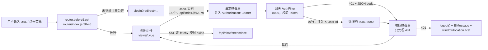
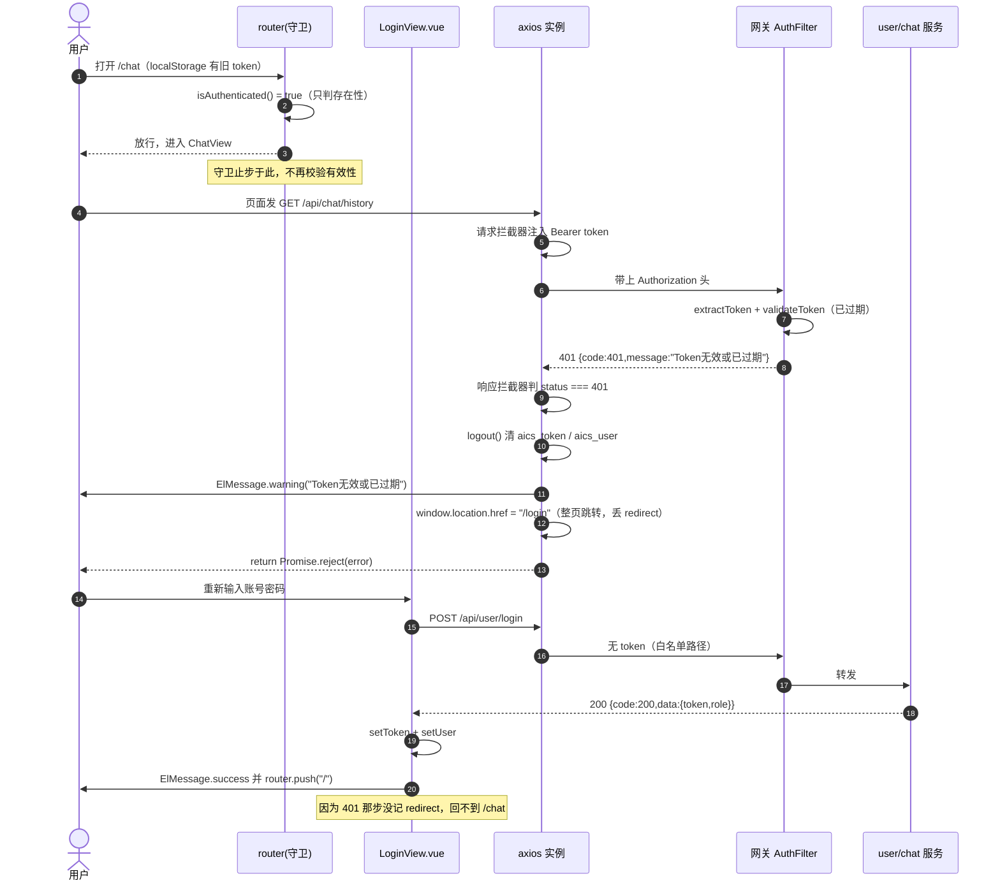

# 路由守卫与 Axios 请求封装

> **一句话结论**：本项目只有两个合法的「横切」位置——`ai-cs-frontend/src/router/index.js:38-48` 的全局 `beforeEach`（**谁能进哪个页面**）与 `ai-cs-frontend/src/api/index.js:37-63` 的 `createClient()`（**每个请求带什么、失败时统一做什么**）；其余 25 个页面只该消费结果，一旦把鉴权判断、Token 拼接、`data.code` 判断散到页面里，就会出现本篇第 0 节那几类事故。
> **阅读前置**：先看 [04-Vue3核心基础](./04-Vue3核心基础.md)（组件、`setup`、`ref/reactive`）与 [05-ElementPlus与前后端联调](./05-ElementPlus与前后端联调.md)（`ElMessage`、表单校验）；后端那侧的 Token 校验细节见 [09-安全与设计模式/01-JWT鉴权与异常处理](../09-安全与设计模式/01-JWT鉴权与异常处理.md)。
> **证据基线**：`ai-cs-frontend` 的 `package.json`（vue-router `^4.6.4`、axios `^1.18.1`、element-plus `^2.14.3`）与当前工作区源码；C 级命令实测环境为本机 node v24.16.0 ＋ 仓库里已装的 axios 1.19.0 / vue-router 4.6.4。预计阅读 45 分钟。

---

## 0. 先看现象

### 现场一：Token 过期了，但「守卫」放你进去，「网关」把你踢出来

浏览器里 `localStorage.aics_token` 有值（一个月前的），打开 `http://localhost:5173/chat`：

```text
GET /api/chat/... HTTP/1.1  ->  401
{"code":401,"message":"Token无效或已过期","data":null,"timestamp":1732600000000}
```

（`timestamp` 的数值每次不同，此处仅作示例；`AuthFilter.java:237-242` 拼的就是这四个字段。）

界面表现是：**先顺利进了 `/chat`（守卫放行），几百毫秒后才被弹回 `/login`**，且弹窗文案是「Token无效或已过期」。

守卫那一行代码是 `ai-cs-frontend/src/utils/auth.js:27-29`：

```javascript
export function isAuthenticated() {
  return !!getToken()
}
```

— 它只判断「有没有」，从不判断「还能不能用」。所以「未登录拦截」和「登录态失效」是两件不同的事，后者只能靠请求返回 401 兜底。

### 现场二：控制台红字一片，用户却什么都没看到

某个页面调接口时忘了写 `catch`，控制台留下：

```text
调用已返回，主流程没有被中断
拦截器 onRejected: status = 400 -> return Promise.reject(e)
[unhandledRejection] Request failed with status code 400
```

这不是浏览器编的：`api/index.js:58` 的 `return Promise.reject(error)` 让 Promise 处于 rejected 状态，而 `onRejected` 只做 401 处理、不弹提示，页面又不 `catch` —— 于是**错误既没人处理也没人展示**，只在控制台留一条 `unhandledRejection`（复现脚本见 §3.6）。

### 现场三：一次 401 弹出两个框

登录页密码输错（或 Token 过期后重新登录）时，`ElMessage` 出现两条：

```text
⚠ Token无效或已过期   ← api/index.js:55 拦截器弹的（网关 body 里没 message 时，退回默认文案「登录已过期，请重新登录」）
✗ Token无效或已过期   ← LoginView.vue:110 的 catch 又把同一个错误弹了一次
```

原因很直白：拦截器已经弹过一次，`LoginView.vue:109-110` 的 `catch` 又把同一个错误提示了一遍。全项目 `ElMessage` 出现在 24 个文件里（`ProductView.vue` 26 次、`MqView.vue` 15 次……），所以「重复弹窗」不是一个页面的事，是**提示权没有归属**。

> **这些现象指向同一件事**：路由守卫和请求封装是前端唯一两个横切点，而本项目只把「有没有 Token」和「401 跳登录」这两件最省事的部分放了进去，剩下的（有效性、业务 code、错误提示、traceId、取消、进度）全漏回页面，于是守卫放错人、拦截器漏提示、页面重复弹窗。

---

## 1. 整体地图



> **读图说明**：第一要看 `V -->|"SSE 走 fetch，绕过 axios"| SSE` 这条**绕过箭头**——流式对话在 `ai-cs-frontend/src/views/ChatView.vue:394-398` 直接用 `fetch` 发请求，Token 是手动拼的、401 也没人管，即地图上有两条并行出口，不是一条。第二要看 `RS -->|"401"| OUT` 用的是 `window.location.href`（`api/index.js:33`）而不是 `router.push`，所以它是**整页刷新重载**，不是路由跳转。

| 组件 | 责任 | 关键文件:行 | 谁调用它 | 本仓库证据 |
|---|---|---|---|---|
| 路由表 | 声明 25 条路径与按需加载 | `ai-cs-frontend/src/router/index.js:4-30` | `main.js:19` 的 `app.use(router)` | 每条 `component: () => import(...)` |
| 全局前置守卫 | 未登录跳登录页、已登录不进登录页 | `ai-cs-frontend/src/router/index.js:38-48` | vue-router 内部 | 只有 `meta.public` 一个判据 |
| 登录态工具 | 读写 Token / 用户 / 角色 | `ai-cs-frontend/src/utils/auth.js:4-59` | 守卫、拦截器、`App.vue` | `isAuthenticated()` 仅判存在性 |
| 网关地址解析 | 生产留空走同源 `/api` | `ai-cs-frontend/src/utils/runtime.js:14-24` | `api/index.js:9` | 空串是 falsy，故不能写 `\|\|` 兜底 |
| Axios 实例工厂 | 统一 `timeout`、挂两个拦截器 | `ai-cs-frontend/src/api/index.js:37-63` | 15 个 `xxxApi` 导出 | 每次调用都新建工厂产物 |
| 请求拦截器 | 注入 `Authorization: Bearer` | `ai-cs-frontend/src/api/index.js:41-47` | 每次请求 | 无 traceId、无取消、无进度 |
| 响应拦截器 | 401 → 清态 + 提示 + 跳登录 | `ai-cs-frontend/src/api/index.js:50-60` | 每次响应 | 成功分支只有 `(response) => response` |
| 网关 `AuthFilter` | 校验 JWT、注入用户头 | `ai-cs-gateway/src/main/java/com/aics/gateway/filter/AuthFilter.java:124-164` | 网关全局 | 401 是真 HTTP 401 |
| 按钮级权限指令 | `v-permission` 摘掉无权按钮 | `ai-cs-frontend/src/directives/permission.js:21-34` | `main.js:21` 注册 | 只管渲染，0 个路由 `meta.roles` |

---

## 2. 关键概念与关键类/关键 API

| 名称 | 位置 | 角色 | 关键点 |
|---|---|---|---|
| `createRouter` / `createWebHistory` | `ai-cs-frontend/src/router/index.js:1,32-35` | 创建路由器；history 模式 | 路由表是数据，守卫是函数，两者解耦 |
| `beforeEach`（全局前置） | `ai-cs-frontend/src/router/index.js:38` | 唯一一处「谁能不能进」 | 返回 `true`/`false`/路由对象，**不要无条件 return 新位置** |
| `beforeEnter`（路由独享） | 本项目未使用 | 单条路由的准入 | 只在进入该路由、且全局守卫放行后才跑 |
| `beforeRouteEnter`（组件内） | 本项目未使用 | 组件级准入 | 此时 `this` 不可用，取实例要用回调参数 |
| `meta` | `ai-cs-frontend/src/router/index.js:5` | 路由自带元数据 | 本项目只用了 `public: true` 一个键 |
| `axios.create({baseURL,timeout})` | `ai-cs-frontend/src/api/index.js:38` | 实例化，隔离配置 | 15 个实例意味着 30 个拦截器函数 |
| `interceptors.request.use` | `ai-cs-frontend/src/api/index.js:41-47` | 请求前改 `config` | 后注册先执行（LIFO） |
| `interceptors.response.use` | `ai-cs-frontend/src/api/index.js:50-60` | 响应后改数据/改错误 | 先注册先执行（FIFO） |
| `Result<T>`（统一响应体） | 后端 `ai-cs-common` 的 `Result` 类 | 业务信封 | `code/message/data`；业务失败 HTTP 仍是 200 |
| `AbortController` / `signal` | `ai-cs-frontend/src/views/ChatView.vue:379,397` | 取消在途请求 | axios 侧 0 处使用，只有 SSE 用了 |
| `Promise.reject` / `unhandledRejection` | `ai-cs-frontend/src/api/index.js:58` | 错误向下传 | reject 不等于「有人处理」 |
| `ElMessage` | `ai-cs-frontend/src/api/index.js:2,55` | 统一提示出口 | 散落 24 个文件，需去重 |
| `API_BASE` | `ai-cs-frontend/src/utils/runtime.js:24` | 请求前缀 | `${GATEWAY}/api`，生产为空串前缀 |

---

## 3. 原理与证据逐段精读

### 3.1 路由表怎么设计：懒加载决定 chunk 划分

**在干什么。** 25 条路由全部写成 `component: () => import('../views/Xxx.vue')`：

```javascript
// 摘自 ai-cs-frontend/src/router/index.js:4-30，节选
const routes = [
  { path: '/login', name: 'Login', component: () => import('../views/LoginView.vue'), meta: { public: true } },
  { path: '/', name: 'Dashboard', component: () => import('../views/Dashboard.vue') },
  { path: '/chat', name: 'Chat', component: () => import('../views/ChatView.vue') },
  { path: '/order/:orderNo', name: 'OrderDetail', component: () => import('../views/OrderDetailView.vue') },
  { path: '/feedback', name: 'Feedback', component: () => import('../views/ChatView.vue') },
]
```

① 每条 `component` 是一个**返回 Promise 的函数**，不是组件本身——路由被匹配到的那一刻才去下载对应模块。② 打包器（本项目 Vite 8，底层 rolldown）把每个 `import()` 切一个 chunk，chunk 文件名带 hash，命中缓存后长期不变。③ `'/order/:orderNo'` 是动态段，`to.params.orderNo` 取到 `SO2024...`；`'/feedback'` 复用 `ChatView.vue`，所以两个路由共享同一个 chunk。

**为什么这么设计。** 25 个页面里，`ChatView.vue` 587 行、`ProductView.vue` 上千行，如果静态 import，首屏要把全部页面代码下载并执行完才能渲染登录框。懒加载把首屏成本压到「壳 + 登录页」，其余按使用付费。

配合的构建侧配置在 `ai-cs-frontend/vite.config.js:44-63`：

```javascript
// 摘自 ai-cs-frontend/vite.config.js:44-63，节选
build: {
  outDir: 'dist',
  sourcemap: false,
  chunkSizeWarningLimit: 800,
  rollupOptions: {
    output: {
      manualChunks(id) {
        if (/echarts|zrender/.test(id)) return 'charts'
        if (/element-plus/.test(id)) return 'element'
        if (/([\\/])node_modules[\\/](vue|vue-router|@vue)[\\/]/.test(id)) return 'vue'
      },
    },
  },
}
```

① 函数式 `manualChunks` 把第三方库按名分三组：`charts`（echarts+zrender）、`element`、`vue`。② 业务视图各自成 chunk，改一个页面只失效那一个文件。③ `chunkSizeWarningLimit: 800`（KB）是把告警阈值抬高，避免 echarts 体积每 build 都刷警告。

**换写法会怎样。** 把 `component: () => import(...)` 改成 `import ChatView from '../views/ChatView.vue'; ... component: ChatView`（`ai-cs-frontend-react/src` 下的 `App.jsx` 第 5-28 行就是这种写法，全部静态 import）——功能一样能跑，但首屏必须下载全部页面模块；同时 `manualChunks` 只会把 `node_modules` 分包，业务代码全在一个大 chunk 里，任何一次改动让缓存整体失效。

**常见坑。** ① 本项目**没有** catch-all 路由：`router/index.js:4-30` 里没有 `{ path: '/:pathMatch(.*)*' }`，访问不存在的地址时 → 实测输出见 §3.4，`matched` 数量为 0、页面只剩骨架；而 nginx 的 `try_files` 又把这个请求以 200 返回，用户看不出是 404。② `manualChunks` 在 Vite 8 只能写函数，写成对象会在 build 阶段直接报 `Invalid type: Expected Function but received Object`（`vite.config.js:52-55` 的注释记了这件事）。

### 3.2 三类导航守卫与执行顺序

**在干什么。** 守卫分三类、挂在三个位置：全局（`router.beforeEach/beforeResolve/afterEach`）、路由独享（`beforeEnter`）、组件内（`beforeRouteEnter/beforeRouteUpdate/beforeRouteLeave`）。本项目只用了第一类的一个：`router/index.js:38-48`。

官方给出的完整顺序（Vue Router 4 文档「导航守卫」一节）是：失活组件的 `beforeRouteLeave` → 全局 `beforeEach` → 复用组件的 `beforeRouteUpdate` → 路由独享 `beforeEnter` → 解析异步组件 → 激活组件的 `beforeRouteEnter` → 全局 `beforeResolve` → 导航确认 → 全局 `afterEach` → DOM 更新 → `beforeRouteEnter` 里 `next` 的回调。

**为什么这么设计。** 把「全局」放在最外层，是为了让登录拦截这类判断在**任何路由级代码执行前**就能改变去向；组件内的 `beforeRouteLeave` 反而最先跑，因为它要回答「我能不能离开」，例如「表单没保存，确定走吗」。

**换写法会怎样。** C 级实测（`createMemoryHistory` + node，脚本见 §3.6 同目录思路）：无 token 时 `router.push('/chat')`，

```text
[全局 beforeEach] to = /chat  token = null
[全局 beforeEach] to = /login?redirect=/chat  token = null
[afterEach] 落在 /login?redirect=/chat | failure = none
最终路由: /login?redirect=/chat | query: {"redirect":"/chat"}
```

注意 `/chat` 上挂的 `beforeEnter` **一次都没打印**——全局守卫一旦返回新位置，本次导航被重定向，目标路由的路由独享守卫根本不会被调用。同一脚本把 token 配上再跑：

```text
[全局 beforeEach] to = /chat
  [路由独享 beforeEnter] 轮到我了
最终路由: /chat
```

**常见坑。** ① 把「必须登录」的判断写进组件的 `onMounted`——那时组件已经创建、接口已经发出去，拦截晚了一步。② 在 `beforeRouteEnter` 里访问 `this`：此时组件实例还没创建，只能 `next(vm => ...)` 拿。③ 以为 `beforeEach` 里 return 之后 `afterEach` 不会跑——实测上面 `failure = none` 而目标已是 `/login`，`afterEach` 拿到的是**重定向后的目标**。

### 3.3 登录态与权限守卫：Token 存在性 ≠ 有效性

**在干什么。** 守卫只问一个问题：`isAuthenticated()`（`ai-cs-frontend/src/utils/auth.js:27-29`），实现是 `!!getToken()`。角色体系另外放在 `auth.js:36-51`：

```javascript
// 摘自 ai-cs-frontend/src/utils/auth.js:31-51，节选
export function getRoles() {
  const role = getUser()?.role
  if (!role) return []
  return role.split(',').map((item) => item.trim().toLowerCase()).filter(Boolean)
}
export function hasRole(role) {
  if (!role) return false
  return getRoles().includes(role.trim().toLowerCase())
}
```

① 后端 `LoginVO.role` 是**逗号分隔串**（如 `ADMIN,USER`），前端 `split(',')` 后统一小写。② `hasRole` 大小写不敏感，因为后端会补 `ROLE_` 前缀、前端没补，大小写与前后缀只能放宽比较。③ 这个角色判断只用于**按钮级**渲染：

```javascript
// 摘自 ai-cs-frontend/src/directives/permission.js:21-34，节选
const list = Array.isArray(required) ? required : [required]
const allowed = list.some(hasRole)
if (!allowed) {
  el.parentNode.removeChild(el)
}
```

没有权限时**直接把元素从 DOM 摘掉**（而不是 `display: none`），注释写明原因：`display:none` 在 DevTools 里改一行样式就能点回来。

**为什么这么设计。** 前端权限永远只是「别让人误点」，不是安全边界。真正的拦截在三处：网关 `AuthFilter`（不合法直接 401）、后端方法级 `@PreAuthorize`、以及数据归属校验。把角色判断做厚，收益只有「界面干净」。

**换写法会怎样。** 想「进页面前就按角色拦住」，正确做法是给路由加 `meta: { roles: ['admin'] }`、在全局守卫里比对 `getRoles()`——但本项目**没这么做**：`router/index.js:4-30` 里 25 条路由只有 `public` 一个 meta 键，`App.vue` 的侧边栏 11 个菜单项也是写死的、不按角色过滤。也就是说：**把 URL 敲对，普通用户能打开管理员页面**（页面里的按钮会被 `v-permission` 摘掉，但页面本身能进、接口能不能成功要看后端）。这是真实缺口，不是演练题。

**常见坑。** ① 只看 Token 存在性 → 现场一（进得去、立刻被 401 踢出）。② `localStorage` 被手工改了 `aics_user.role` 就以为能提权，其实后端按 `X-User-Roles`（由网关从 JWT 解出来）判定，前端改的是自己的显示。③ `v-permission` 只在 `mounted` 判断一次，登录后角色变化（例如切换账号未刷新）不会重算。

### 3.4 重定向、死循环与 `next` 的经典错误

**在干什么。** 重定向在守卫里是「返回一个新位置」：`router/index.js:41` 的 `return { path: '/login', query: { redirect: to.fullPath } }`。登录成功后由 `LoginView.vue:83-86` 回跳：

```javascript
// 摘自 ai-cs-frontend/src/views/LoginView.vue:83-86
function gotoNext() {
  const redirect = typeof route.query.redirect === 'string' ? route.query.redirect : '/'
  router.push(redirect)
}
```

① 只用 `typeof === 'string'` 做类型收敛（`?redirect=a&redirect=b` 时 `route.query.redirect` 是数组）。② 直接 `router.push(redirect)`，**没有校验它是不是站内路径**。③ 缺省回落 `/`。

**为什么这么设计。** 记录 `to.fullPath` 而不是 `to.path`，是为了保留查询串：`/order/SO1?tab=pay` 登录后能原样回来。

**换写法会怎样（死循环）。** 守卫里写「无条件去登录页」是最常见的写法错误，用 node 实测（`vue-router` 4.6.4）：

```text
守卫第 1 次执行, to = /
守卫第 2 次执行, to = /login
…（连续打印到）守卫第 32 次执行, to = /login
```

随后 vue-router 主动中止并抛错：

```text
[Vue Router warn]: Detected a possibly infinite redirection in a navigation guard when going from "/" to "/login". Aborting to avoid a Stack Overflow.
Error: Infinite redirect in navigation guard
```

① 报错信息里那句 `Only return when redirecting or aborting` 就是解法。② vue-router 数到 **32 次**才放弃，说明它靠计数兜底而不是靠分析代码——所以「偶尔才复现」的重定向循环很可能永远不报错，只是页面反复闪。③ 用老 API 写 `next('/login')` 且不判断当前路径，是同一个 bug 的另一种形状。

**常见坑。** ① `redirect` 未校验前缀，`?redirect=//evil.com` 会被当作要跳的路径（vue-router 会当成未匹配路径，配上 catch-all 就是一次开放重定向）。② 本项目 `api/index.js:33` 用 `window.location.href = '/login'` 兜底 401，**不带 `redirect` 参数**，所以「接口 401 被踢出去」的人登录后一律回首页，回不到原页面。③ 登录页自己也在守卫覆盖范围内，忘记给 `/login` 标 `meta.public` 就会 301 到自己的循环。

### 3.5 Axios 实例化：为什么是 15 个实例

**在干什么。**

```javascript
// 摘自 ai-cs-frontend/src/api/index.js:37-63
function createClient(baseURL) {
  const client = axios.create({ baseURL, timeout: 30000 })

  client.interceptors.request.use((config) => {
    const token = getToken()
    if (token) {
      config.headers.Authorization = `Bearer ${token}`
    }
    return config
  })

  client.interceptors.response.use(
    (response) => response,
    (error) => {
      if (error.response && error.response.status === 401) {
        logout()
        ElMessage.warning(error.response.data?.message || '登录已过期，请重新登录')
        redirectToLogin()
      }
      return Promise.reject(error)
    }
  )

  return client
}
```

① `axios.create({ baseURL, timeout: 30000 })`：`baseURL` 由 `SERVICES`（`api/index.js:12-28`）给出，15 个服务前缀（user/chat/knowledge/message/notify/search/order/cart/product/pay/mq/rag/observability/prompts/agent）。② `timeout: 30000` 是全局唯一值，没有按接口区分——而对话类接口可能要 60s 以上，批量导出可能要更久。③ 请求拦截器里只要 `token` 存在就注入 `Bearer`，后缀由后端 `AuthFilter.extractToken`（`ai-cs-gateway/src/main/java/com/aics/gateway/filter/AuthFilter.java:226-232`）按 `Bearer ` 前缀解析，两边是一份契约。④ 响应拦截器成功分支是裸的 `(response) => response`。

**为什么这么设计。** 按服务分实例，好处是「一个服务的超时/重试/前缀不影响别人」；代价是配置复制。当前代码是「工厂函数 + 15 次调用」，复制被收敛成一个函数，所以代价可控。

**换写法会怎样。** 换成「1 个实例 + 每次请求自己拼前缀」：少 14 个实例、拦截图只有一份，但每个调用点都要记得写 `/chat`，漏写就 404；而且以后想给某个服务单独加超时，就没有落点了。反过来，如果给 15 个实例各写一套拦截器（而不是共用 `createClient`），任何一次改 Token 逻辑要改 15 处——这是老文档里「每个服务独立实例」这句话最容易被误读的地方。

**常见坑。** ① `timeout: 30000` 对 SSE 无效：流式接口走 `fetch`（`ChatView.vue:394-398`），axios 的超时管不到它；真正的超时在 nginx 的 `proxy_read_timeout 300s`（`ai-cs-frontend/nginx.conf:60`）。② 拦截器里 `config.headers.Authorization = ...` 如果写成 `config.headers = { Authorization: ... }`，会把 axios 默认头一起清掉。③ 15 个实例意味着 15 个 `createClient` 产物，但请求拦截器读的是**调用时刻**的 `getToken()`，所以登出后旧实例不会残留 Token——这点是对的，别「优化」成模块加载时取一次。

### 3.6 拦截器执行顺序与 Promise 链条（本篇最需要动手验证的一节）

**在干什么。** 拦截器不是「一条线」，是**两层数组**：请求拦截器向内包、响应拦截器向外包。也就是说，链条形状是

```text
调用处 -> req#2 -> req#1 -> adapter(网络) -> res#1 -> res#2 -> 调用处
```

C 级实测（axios 1.19.0，假 adapter 直接返回 200，不发真实网络请求）：

```javascript
// 复现脚本（node v24.16.0，写在任意临时目录即可）
import { createRequire } from 'node:module'
const req = createRequire('D:/Projects/Persion/ai-customer-service/ai-cs-frontend/package.json')
const axios = req('axios')

const client = axios.create({ baseURL: '/api', adapter: async (config) => ({
  data: { code: 200, data: 'pong' }, status: 200, statusText: 'OK', headers: {}, config,
}) })
client.interceptors.request.use((c) => { console.log('req#1 Token'); return c })
client.interceptors.request.use((c) => { console.log('req#2 traceId'); return c })
client.interceptors.response.use((r) => { console.log('res#1 解包'); return r })
client.interceptors.response.use((r) => { console.log('res#2 提示'); return r })

const res = await client.get('/ping')
console.log(`axios ${axios.VERSION} => ${res.data.data}`)
```

真实输出：

```text
req#2 traceId
req#1 Token
res#1 解包
res#2 提示
axios 1.19.0 => pong
```

① 请求拦截器**后注册先执行**（LIFO）：`traceId` 那条写在后面，却先跑。② 响应拦截器**先注册先执行**（FIFO）。③ 本项目每个实例只注册了一对（`api/index.js:41-47`、`50-60`），所以顺序问题暂时不显形；一旦有人再 `use` 一个「统一错误提示」，它就落在 401 处理**之后**。

**为什么这么设计。** 请求侧 LIFO 保证「最后注册的最靠近网络」，方便后来者覆盖前者（例如统一加 traceId 的在最外层包一层）；响应侧 FIFO 保证「最先注册的最先看到原始响应」，解包类逻辑写在最前、提示类逻辑写在后面。

**换写法会怎样。** 关键在**谁接 reject**。项目里 `onRejected` 不弹提示（只有 401 时弹），页面又不 `catch`，实测：

```text
调用已返回，主流程没有被中断
拦截器 onRejected: status = 400 -> return Promise.reject(e)
[unhandledRejection] Request failed with status code 400
```

① `await` 之后的主流程确实继续跑了——因为脚本里 `c1.get('/x')` 既没有 `await` 也没有 `catch`，返回值被直接丢弃，说明**拦截器 reject 只是把 Promise 变红**。② `[unhandledRejection]` 是 Node 的全局事件（浏览器里是 `window.onunhandledrejection`），它意味着「没有任何 handler」。③ 如果反过来在页面上补 `catch` 并弹 `ElMessage`，就回到现场三的重复弹窗。

B（上）与 C（下）两种情形可以用同一个脚本一次跑完：假 `adapter` 不发真实网络；`process.on('unhandledRejection')` 手动接管全局未处理拒绝，否则 node 18+ 遇到它就按未捕获异常处理、直接让进程退出。

```javascript
// 复现脚本二（node v24.16.0）
import { createRequire } from 'node:module'
const req = createRequire('D:/Projects/Persion/ai-customer-service/ai-cs-frontend/package.json')
const axios = req('axios')

process.on('unhandledRejection', (e) => console.log('[unhandledRejection]', e.message))
const ok = (data) => ({ data, status: 200, statusText: 'OK', headers: {}, config: {} })
const fail = (status) => Object.assign(new Error('Request failed with status code ' + status), { response: { status } })

// B：400 + 调用处不 catch
const c1 = axios.create({ baseURL: '/api', adapter: async () => { throw fail(400) } })
c1.interceptors.response.use((r) => r, (e) => {
  console.log('拦截器 onRejected: status =', e.response.status, '-> return Promise.reject(e)')
  return Promise.reject(e)
})
c1.get('/x')
console.log('调用已返回，主流程没有被中断')
await new Promise((r) => setTimeout(r, 50))

// C：HTTP 200 但 body.code = 5000
const c2 = axios.create({ baseURL: '/api', adapter: async () => ok({ code: 5000, message: '库存不足' }) })
c2.interceptors.response.use((r) => {
  if (r.data.code !== 200) return Promise.reject(new Error('业务失败: ' + r.data.message))
  return r.data.data
}, (e) => Promise.reject(e))
c2.interceptors.response.use((r) => r, (e) => {
  console.log('[#2 onRejected] 接到了:', e.message, '-> 统一弹窗')
  return Promise.reject(e)
})
try { await c2.get('/stock') } catch (e) { console.log('调用处 catch:', e.message) }
```

再验证一个更隐蔽的点：在**成功回调里**主动 reject（把 HTTP 200 + `code !== 200` 转成错误）时，谁接这个错？

```text
[#1 onFulfilled] HTTP 200, body.code = 5000 -> reject
[#2 onRejected] 接到了: 业务失败: 库存不足 -> 统一弹窗
调用处 catch: 业务失败: 库存不足
```

① **同一个拦截器对的 `onRejected` 接不到自己 `onFulfilled` 抛的错**，只能被「下一个」拦截器或调用处接。② 这决定了「解包 + 判 code」必须和「弹提示」拆成两个 `use`，并且解包的写在前面（FIFO），否则提示逻辑收不到业务错误。③ 本项目一条都没拆，所以 `code !== 200` 的错误全落到页面自己判（下节）。

**常见坑。** ① 在 `onRejected` 里 `return Promise.resolve(...)` 会把错误「吃掉」，调用处拿到 undefined，页面表现为「没报错也没数据」。② 401 时如果有两个拦截器都注册了 `onRejected`，执行顺序是后注册先执行，谁先 `redirectToLogin()` 谁决定用户体验（实测输出：`[#2 onRejected] 注册在后, 执行在先; status = 401`）。③ 忘记 `error.response` 可能不存在（网络断开、`timeout`、被 abort），`error.response.status` 会直接抛 `TypeError`。

### 3.7 响应解包与业务 code：两套语义并存

**在干什么。** 后端有两种失败形状，前端必须都认：

| 后端场景 | HTTP 状态 | 响应体 | 出处 |
|---|---|---|---|
| 参数校验失败 | **400** | `{"code":400,"message":"...","data":null}` | `ai-cs-common/src/main/java/com/aics/common/exception/GlobalExceptionHandler.java:44-52`（`@ResponseStatus(BAD_REQUEST)`） |
| 业务异常 `BusinessException` | **200** | `{"code":5000,"message":"库存不足","data":null}` | `ai-cs-common/src/main/java/com/aics/common/exception/GlobalExceptionHandler.java:35-39`（**无** `@ResponseStatus`） |
| 网关拦截 | **401** | `{"code":401,"message":"Token无效或已过期","data":null,"timestamp":...}` | `ai-cs-gateway/src/main/java/com/aics/gateway/filter/AuthFilter.java:237-242` |

① 业务失败走 HTTP 200，所以「`await` 没抛异常」不等于「成功」。② 网关 401 的 `message` 在**顶层**，不在 `data.message`。③ 页面写法因此长这样（`ChatView.vue` 等处）：

```javascript
// 摘自 LoginView.vue#L92-L108，节选
const { data } = await userApi.post('/login', { username, password })
if (data.code === 200 && data.data) {
  setToken(data.data.token)
} else {
  ElMessage.error(data.message || '登录失败')
}
```

**为什么这么设计。** 后端把「参数错」（框架层）与「业务错」（领域层）分开了状态码，前端若只判 HTTP 状态，业务错就会静默；若只判 `code`，401/400 这类没进业务信封的响应又会被漏掉。

**换写法会怎样。** 正确做法是把解包写进响应拦截器：`code === 200` 就 `return response.data.data`，`code !== 200` 就 `Promise.reject(new Error(message))`。本项目**没有这么做**，代价是 `data.code` 在页面里出现 **49 次**（`MqView.vue` 10 次、`ChatView.vue` 5 次、`ShopView.vue` 5 次、`OrderDetailView.vue` 4 次……），每个页面各写一遍「成功怎么取、失败怎么提示」，改一次协议要改 49 处。

**常见坑。** ① 只看 `data.code === 200`，不看 `data.data` 是否为 `null`，于是 `null.token` 报 `TypeError`。② 用 `data.success` 判断——本项目后端信封字段是 `code`，没有 `success`。③ 分页接口的 `data` 是 `{records, total}`，解包后仍要再拆一层，别把两层混成一个约定。

### 3.8 错误提示去重：谁来弹这个框

**在干什么。** 目前有三处会弹：拦截器（`api/index.js:55`，仅 401）、页面 `catch`（如 `LoginView.vue:110`）、页面 else 分支（`LoginView.vue:107`）。提示组件调用散落在 24 个文件里。

**为什么这么设计。** 没有设计——这是历史沉积。`ElMessage` 是全局单例但每次调用都新建一个实例，所以「同一错误弹两次」不会互相覆盖，只会叠在一起。

**换写法会怎样。** 常见两招：① 给错误对象打标 `error.handled = true`，谁先弹谁置位，后弹的检查后跳过；② 拦截器里按「消息文本 + 500ms 窗口」去重。本项目两条都没用，所以现场三必现。

**常见坑。** ① 只对 401 去重、忘了 400（参数错误）也会重复。② 用 `ElMessage.error` 弹了 `e.message`（`Request failed with status code 400` 这种英文机器话），用户读不懂——后端信封里的 `message` 才是给人看的。③ 在拦截器弹提示、又在页面弹，等于给同一个错误两个责任人，早晚不一致。

### 3.9 并发与取消：AbortController 只落在 SSE 一侧

**在干什么。** 唯一真实使用取消的地方是对话流：

```javascript
// 摘自 ai-cs-frontend/src/views/ChatView.vue:379 与 394-399，节选
abortController = new AbortController()
const resp = await fetch(`${API_ROOT}/chat/${endpoint}?${params}`, {
  method: 'POST',
  headers: { Authorization: 'Bearer ' + (getToken() || '') },
  signal: abortController.signal,
})
if (!resp.ok || !resp.body) throw new Error('HTTP ' + resp.status)
```

① `AbortController.signal` 交给 `fetch`，`abort()` 会让在途请求以 `AbortError` 拒绝。② 停止按钮的实现是 `stopGenerating()`（`ChatView.vue:462-466`）：置 `stopRequested = true` 再 `abort()`。③ 捕获侧必须分辨「用户主动停」与「真失败」：`if (stopRequested.value || e?.name === 'AbortError')` 时只追加「（已停止生成）」、不弹错（`ChatView.vue:444-449`）。

**为什么这么设计。** SSE 不能用 `EventSource`（它只支持 GET、不能带 `Authorization` 头），axios 浏览器端基于 XHR 拿不到增量 body（`ai-cs-frontend/src/utils/sseStream.js` 文件头注释写明这两点），所以只能用 `fetch` + 手写分帧，取消也只能走 `AbortController`。

**换写法会怎样。** axios 侧的取消目前是**0 处**（全项目 `AbortController` 只出现在 `ChatView.vue` 7 处与一个测试文件里）。若要在 axios 里做「切页面取消在途请求」，写法是把同一个 `signal` 塞进 `config.signal`：

```javascript
// 建议写法（本项目尚未落地，仅示意）
const ac = new AbortController()
state.loading = true
try {
  const res = await orderApi.get(`/${orderNo}`, { signal: ac.signal })
} catch (e) {
  if (e.name !== 'CanceledError') ElMessage.error(e.message)   // 主动取消不弹错
} finally {
  state.loading = false
}
onBeforeUnmount(() => ac.abort())   // 离开页面时取消
```

**常见坑。** ① 一个 `AbortController` 复用给多个请求，`abort()` 会把它们一起杀掉。② 不区分 `CanceledError`，用户点「停止」反而看到红色报错。③ 取消只是客户端不再理会响应，**服务端仍在跑**（对话接口的服务端 `SseEmitter` 有 5 分钟超时兜底，Agent 流 120 秒），所以流式对话的「省钱」不能只靠前端 abort。

### 3.10 重试与超时：现状是「一个 30s 到底」

**在干什么。** `timeout: 30000`（`api/index.js:38`）是全局唯一超时；重试 0 处；没有按接口覆盖 timeout 的调用。

**为什么这么设计。** 30s 覆盖了本项目绝大多数 CRUD；流式与长任务走 `fetch`，不在 axios 管辖内。

**换写法会怎样。** 想加「幂等 GET 失败重试一次」，正确位置是响应拦截器里判状态码 + 记录 `config._retry` 标记，而不是在页面里套 `for` 循环：

```javascript
// 建议写法（本项目尚未落地，仅示意）
client.interceptors.response.use(undefined, async (error) => {
  const cfg = error.config
  const retriable = !error.response || error.response.status >= 500
  if (retriable && cfg && (cfg.method === 'get') && !cfg._retried) {
    cfg._retried = true
    await new Promise((r) => setTimeout(r, 300))
    return client.request(cfg)
  }
  return Promise.reject(error)
})
```

① 只重试幂等请求（`GET`），POST 重试可能重复下单。② 必须打标，否则会无限重试。③ 重试要放在「提示」拦截器之前，不然每次重试都弹一次。

**常见坑。** ① 把重试写成「页面里 `try/catch` 再 `await` 一次」，退出条件靠肉眼。② axios 的 `timeout` 管不到「响应头已到、body 还在慢慢流」的场景——这条要靠 nginx `proxy_read_timeout`（本项目 300s）。③ 超时后 `error.response` 是 `undefined`，`error.code === 'ECONNABORTED'` 才是超时，别用 `error.response.status` 判。

### 3.11 上传下载：进度条和中断都还没接

**在干什么。** 唯一的上传入口是 `visionApi.uploadImage`（`api/index.js:158-162`，`FormData` + `post('/upload-image')`）。全项目 `onUploadProgress` 出现 **0 次**，也没有下载二进制（`responseType: 'blob'`）的封装。

**为什么这么设计。** 现阶段只上传小图（对话里的视觉识别），20MB 以内（nginx `client_max_body_size 20m`）几乎瞬间完成，做进度条收益低。

**换写法会怎样。** 要进度就得用 axios 的进度回调，并且**必须写 `Content-Type: multipart/form-data` 之外的字段都不动**（浏览器会自己补 boundary）：

```javascript
// 建议写法（本项目尚未落地，仅示意）
const fd = new FormData()
fd.append('file', file)
await visionApi.post('/upload-image', fd, {
  onUploadProgress: (e) => {
    if (e.total) percent.value = Math.round((e.loaded / e.total) * 100)
  },
  signal: ac.signal,
})
```

下载则要 `responseType: 'blob'` + `URL.createObjectURL` 触发 `a[download]`，并在 `finally` 里 `URL.revokeObjectURL` 释放内存。

**常见坑。** ① 忘了 `client_max_body_size 20m`：超限时 nginx 返回的是 **413 HTML 页面**，axios 拦到的是「非 JSON 的 413」，前端若按 `data.message` 取值会拿到 `undefined`。② 上传进度回调里的 `e.total` 可能为 0（服务端未给 `Content-Length`），要先判。③ 中断上传后再点上传，旧文件对象仍被 `FormData` 持有，别把它塞进全局变量。

---

## 4. 一次完整执行时序：从敲 URL 到被 401 踢回登录页



> **读图说明**：第一个关键点是第 5 行的 `Note over R`——守卫在校验「存在性」后就退场了，**有效性校验被推迟到第 7-8 步的网关**，这就是「进得去、几百毫秒后被踢出」的全部原因。第二个关键点是第 12 步 `window.location.href = "/login"`：它绕过了 vue-router，因此 `beforeEach` 不再执行第二次，也顺手丢掉了 `?redirect=` 参数。

| 第几步 | 失败会怎样 | 用户看到什么 | 代码位置 |
|---|---|---|---|
| 2 | Token 为空且路由非 public | 直接到 `/login?redirect=/chat` | `ai-cs-frontend/src/router/index.js:40-42` |
| 2 | 守卫写错成无条件重定向 | 32 次后抛 `Infinite redirect in navigation guard` | 见 §3.4 实测 |
| 5 | 拦截器没注入 token | 网关按「未携带 Token」返回 401 | `ai-cs-frontend/src/api/index.js:41-47` |
| 6 | 网关不可达 / 跨域失败 | 控制台 `Failed to fetch`，`error.response` 为 `undefined` | vite proxy 或 nginx 反代 |
| 8 | Token 过期 | 401 + `{"code":401,"message":"Token无效或已过期"}` | `AuthFilter.java:136-144,237-242` |
| 9 | 业务失败（非 401） | HTTP 200 + `code!=200`，**不跳登录、不弹提示** | 见 §3.7 |
| 10 | `logout()` 后页面未清干净 | 仍显示老用户昵称（`App.vue` 的 `currentUser` 由 `watch(route.path)` 重读） | `ai-cs-frontend/src/App.vue:100-115` |
| 19-20 | 登录成功但没回跳 | 落在 `/` 而不是原来的 `/chat` | `ai-cs-frontend/src/views/LoginView.vue:83-86` |

---

## 5. 设计取舍

| 决策点 | 本仓库做法 | 收益 | 代价 / 风险 | 替代方案 |
|---|---|---|---|---|
| 守卫层级 | 只用全局 `beforeEach` | 一处管 25 条路由，心智负担低 | 无法表达「某页要 admin」 | `meta.roles` + 路由独享 `beforeEnter` |
| 登录判据 | `!!getToken()` | 简单、无网络请求 | 存在性 ≠ 有效性（现场一） | 解 JWT `exp` 或后端 `/me` 探活 |
| 无权限时 | 不渲染菜单项 + `v-permission` 摘按钮 | 界面干净、不误导 | 无路由级拦截，URL 可直达 | 路由 `meta.roles` 校验 + 后端兜底 |
| 路由兜底 | **没有** catch-all | 少一个文件 | 未知地址白屏 | `{ path: '/:pathMatch(.*)*', redirect: '/' }` |
| 401 跳转 | `window.location.href` | 一定生效、能清掉内存态 | 整页刷新、丢 `redirect` | `router.push({ path:'/login', query:{ redirect }})` |
| 实例数量 | 15 个（按服务） | 各服务可独立配超时 | 15×2 个拦截器函数 | 单实例 + 每次带完整前缀 |
| 超时 | 全局 30s | 一处可改 | 长任务被误杀 / 短任务等太久 | 按服务或按调用覆盖 |
| Result 解包 | **页面层各自判**（49 处） | 页面能按场景自定义 | 协议一改要改 49 处，提示重复 | 响应拦截器统一解包成 `data` |
| 取消 | 仅 SSE 用 `AbortController` | 停止生成体验好 | 切页面时 axios 请求继续跑 | 全局 `signal` + `onBeforeUnmount(abort)` |
| traceId | **无** | — | 前端日志与后端 `traceId` 串不起来 | 请求拦截器加 `X-Request-Id`，网关透传 |
| 上传进度 | **无** | 少写代码 | 20MB 附近上传无反馈 | `onUploadProgress` + 进度条 |

**可扩展点清单**（按性价比排序，均为本仓库当前**未落地**）：

1. 响应拦截器统一解包：`code === 200` 返回 `response.data.data`，否则 `Promise.reject`——一次性消掉 49 处 `data.code`。
2. 提示去重：错误对象打 `handled` 标记 + 500ms 窗口去重，消除现场三的双弹窗。
3. traceId 注入：请求拦截器生成 `X-Request-Id`（`crypto.randomUUID()`），响应失败时连同 `config.headers['X-Request-Id']` 一起打日志，和后端日志对齐。
4. 路由 `meta.roles` + 守卫校验 + 侧边栏按角色过滤（`App.vue:19-62` 现在是写死的 11 项）。
5. catch-all 兜底路由：`/:pathMatch(.*)*` → 404 页或 `/`。
6. 401 跳转改用 `router.push` 并带 `redirect`，同时 `api/index.js` 的 `logout()` 与 `App.vue` 的 `currentUser` 联动刷新。
7. 全局取消：`onBeforeUnmount` 里 `abort()`，把 `CanceledError` 排除在报错之外。
8. 幂等 GET 重试（一次、300ms 退避、只对 5xx 与网络错误）。

---

## 6. 踩坑与调试手法

| # | 现象 | 根因 | 验证手段（可照做） | 解法 |
|---|---|---|---|---|
| 1 | 进了页面又立刻弹回登录页 | 守卫只判 Token 存在性 | DevTools → Application → Local Storage 看 `aics_token` 是否还在但已过期；Network 里看那条 401 的 response body | 登录时记录 `exp`，守卫里先判是否过期 |
| 2 | 一次操作弹两个提示框 | 拦截器 + 页面 `catch` 都弹 | Network 面板点该请求 → 看 Console 与页面上同时冒两个 `ElMessage` | 提示权收归拦截器，页面 `catch` 只处理「已 handled」的 |
| 3 | 控制台 `Uncaught (in promise) AxiosError` | 拦截器 reject、调用处无 `catch` | Console 里点开堆栈，或临时加 `window.addEventListener('unhandledrejection', e => console.log(e.reason))` | 每个业务调用都 `try/catch`，或统一提示拦截器兜底 |
| 4 | 键盘反复回车发出多份流式请求 | 按钮 `loading` 挡不住 Enter 键 | Network 面板按 Fetch/XHR 过滤，看同一 URL 的重复条目（Initiator 指向组件） | 函数入口显式防重入 `if (sending.value) return`（`ChatView.vue:368-369` 已这么做） |
| 5 | 点「停止生成」后仍收到一堆事件 | 只置了 UI 标志、没真正 abort | Network 面板看该请求状态是否变成 `(canceled)` | `abortController.abort()`，并在 `catch` 里排除 `AbortError` |
| 6 | 上传大文件失败、提示文案是空的 | nginx 返回 413 HTML，前端按 `data.message` 取值 | Network 面板看响应 `Content-Type: text/html` 与 413 状态 | 判 `error.response.status === 413` 单独提示；或提高 `client_max_body_size` |
| 7 | 刷新 `/order/SO1` 恰好 404 或白屏 | history 模式 + 无 catch-all / 无 try_files | Network 面板看首屏文档请求是否 404；Console 看 `[Vue Router warn]: No match found for location with path ...` | 服务端 `try_files ... /index.html`（`nginx.conf:68-70` 已配）；前端补 catch-all |
| 8 | 按钮凭空消失，怀疑被权限指令摘掉 | `v-permission` 用 `removeChild` 摘元素 | Console 执行 `document.querySelectorAll('[data-permission-denied]')` 看是否有残留标记（`permission.js:30-34` 会打标） | 确认 `getRoles()` 返回的数组；角色热更新时补 `updated` 钩子 |

**真调试手法 A：在拦截器里断点，看请求「发出去时」到底带了什么。** DevTools → Sources → 打开 `api/index.js`（Vite dev 下是原始源码，路径 `src/api/index.js`）→ 在 `api/index.js:44`（`config.headers.Authorization = ...`）行号上打断点 → 回页面触发一次请求 → 命中后在 Console 里敲 `config.headers`、`config.baseURL`、`config.url`。判读要点：`baseURL` 若是 `http://localhost:8080/api`，说明走的是 `.env.development`；若是 `/api`，说明拿到了空串（生产同源口径）。改完 Token 逻辑后断点不用重设，`Conditional breakpoint` 可加条件 `config.url.includes('/login')` 精确过滤。

**真调试手法 B：用 Network 面板的「保留日志 + 慢速网络」复现时序类问题。** DevTools → Network 勾选 `Preserve log`、把 Throttling 调成 `Slow 3G`，然后刷新 `/chat`：你会看到先有文档请求返回 200（HTML），随后 `/api/chat/history` 命中 401，紧接着一个 `login` 文档请求把页面整篇重载——这条「401 后又出现一条 document 请求」正是 `window.location.href` 的证据（如果是 `router.push` 就不会有新的 document 请求）。判读要点：**看 Type 列**（`document` vs `fetch`），这是区分「整页跳转」和「前端路由跳转」最快的方法。

**真调试手法 C：编译期报错按「第一行 + 我的文件」定位。** 例如把 `vite.config.js:56` 的 `manualChunks` 改成对象写法，`npm run build` 会报 `Invalid type: Expected Function but received Object` 并给出配置文件名与行号；这类错误不需要读全栈，只要看报错里第一个指向本项目文件的栈帧。另有一类静默失败要特别注意：`beforeEach` 里返回 `false`（或忘了 `return true` 又写了个 `return false`）不会抛错，表现只是「点击菜单没反应、URL 也不变」——这种问题只能靠给守卫加 `console.log(to.fullPath, from.fullPath)` 或 `afterEach` 里打 `failure` 来定位。

---

## 7. 版本差异

| 场景 | 旧写法 | 当前基线 | 变化点 | 迁移动作 |
|---|---|---|---|---|
| 网关地址来源 | 旧文档曾这样写：`const GATEWAY = import.meta.env.VITE_GATEWAY \|\| 'http://localhost:8080'` | `import { API_BASE } from '../utils/runtime'`（`ai-cs-frontend/src/api/index.js:9`） | 空串是 falsy，`\|\|` 会让生产构建回落到 localhost | 一律从 `runtime.js` 取；React 版仍留着老写法（`ai-cs-frontend-react/src/api/index.js:7`） |
| 服务实例数 | 9 个（user…product） | 15 个（多出 pay / mq / rag / observability / prompts / agent，`api/index.js:65-79`） | 业务扩了，前缀必须与网关路由表一致 | 新增服务时同时改 `SERVICES`、`createClient` 导出、网关路由三处 |
| `auth.js` 导出 | `getToken` / `setToken` / `logout` / `isAuthenticated` | 另有 `USER_KEY` / `getUser` / `setUser` / `getRoles` / `hasRole`（`ai-cs-frontend/src/utils/auth.js:4-51`） | 需要角色做按钮级权限 | 组件里用 `hasRole` 或 `v-permission`，别自己解析 `localStorage` |
| 路由表 | 4 条示例 + 「... 其余页面默认需要登录」 | 25 条明列（`router/index.js:4-30`） | 文档省略导致读者以为页面很少 | 新增页面必须进路由表，否则等于不可达 |
| 守卫返回值 | `next()` 三态（Vue Router 3 风格） | `return true` / `return { path, query }`（`router/index.js:38-48`） | Vue Router 4 推荐返回值，`next` 仍兼容 | 新代码统一 return，避免 `next` 与 return 混用 |
| 登录回跳 | 旧文档曾这样写：`router.replace(redirect \|\| '/')` | `router.push(redirect)`，且 `typeof === 'string'` 收敛（`ai-cs-frontend/src/views/LoginView.vue:83-86`） | `replace` 不产生历史记录，回退键行为不同 | 是否需要回退到登录页，按产品要求选 `push`/`replace` |
| 取消请求 | axios 0.x 的 `CancelToken.source()` | axios 1.x 的 `AbortController` + `config.signal` | `CancelToken` 已废弃 | 新代码只用 `signal`；注意 `CanceledError` |
| 构建分包 | `manualChunks` 写对象（`{ charts: ['echarts'] }`） | 函数式（`ai-cs-frontend/vite.config.js:56-61`） | Vite 8 底层 rolldown 只接受函数 | 对象写法会报 `Invalid type: Expected Function but received Object` |
| 守卫实现 | 只有导航钩子一种印象 | React 版用「包装组件 + `<Navigate>`」（`ai-cs-frontend-react/src` 下的 `App.jsx` 第 31-46 行） | 两个框架的守卫心智模型不同：一个是钩子，一个是渲染重定向 | 跨框架阅读时先找「谁在阻止渲染」 |

---

## 8. 面试高频问与答（只列问题，答案在自测题里）

1. 路由守卫有几种？在哪一层加登录拦截最合适，为什么？
2. `beforeEach` 里 `return { path: '/login' }`、`return false`、`return true` 三者分别会发生什么？
3. 守卫里 `next('/login')` 为什么容易写出死循环？vue-router 是怎么发现的？
4. `meta` 为什么能被子路由读到？`to.meta` 与 `to.matched` 的关系是什么？
5. 动态 `import()` 的路由组件在什么时机被下载？它和 `manualChunks` 分别影响什么？
6. axios 的请求拦截器和响应拦截器的执行顺序为什么相反？
7. 在响应拦截器的成功回调里 `Promise.reject(...)`，这个错误会被谁的 `onRejected` 接住？
8. 拦截器里 `return Promise.reject(error)` 之后，页面不写 `catch` 会怎样？
9. 后端「业务失败返回 HTTP 200 + code=5000」时，前端应该在哪一层判断？为什么不能在拦截器里只判 HTTP 状态？
10. 一次 401 弹了两个提示框，你会怎么改？
11. 如何取消一个在途请求？取消后为什么不能当错误弹给用户？
12. Token 存在但已过期，路由守卫和请求拦截器各该承担什么责任？
13. 为什么流式对话不用 axios 而用 `fetch`？它带来了哪些「第二套实现」的成本？

---

## 9. 动手练习

**练习 1（守卫必修）：给路由加角色准入。**
给 `/mq` 加 `meta: { roles: ['admin'] }`，在 `router/index.js:38-48` 的全局守卫里判断 `getRoles()`，不匹配时跳到 `/` 并 `ElMessage.warning('无权访问')`。
*验收标准*：① 用非 admin 账号登录后敲 `/mq`，URL 变成 `/` 且只弹一次提示；② 守卫里**没有**出现「无条件 return 新位置」的写法；③ 控制台无 `Infinite redirect` 警告。

**练习 2（守卫必修）：补 catch-all 并验证。**
在路由表末尾加 `{ path: '/:pathMatch(.*)*', name: 'NotFound', redirect: '/' }`。
*验收标准*：① 访问 `/not-exist` 后落地 `/`；② 修改前先在 Console 里看到 `[Vue Router warn]: No match found for location with path "/not-exist"`，修改后该警告消失；③ 能在文档里说清它与 nginx `try_files` 的分工。

**练习 3（拦截器必修）：统一解包 Result。**
在 `api/index.js:50-60` 的响应拦截器成功分支里实现：`code === 200` 返回 `response.data.data`，否则 `Promise.reject` 一个带 `handled` 标记的错误。挑一个页面（建议 `OrderDetailView.vue`）改成直接使用解包后的数据。
*验收标准*：① 该页面里 `data.code` 的出现次数降为 0；② 别的页面不受影响（不改动超出本练习范围的文件）；③ 用一个 `code=5000` 的接口验证：页面能拿到 `Error('库存不足')` 而不是 `undefined`。

**练习 4（拦截器必修）：提示去重。**
在拦截器里实现 500ms 窗口去重：同一条 `message` 在窗口内只 `ElMessage` 一次；页面 `catch` 里若 `error.handled === true` 则不再弹。
*验收标准*：① 复现现场三（登录页密码错），只能看到 1 个提示框；② 连续快速点两次「保存」造成两次 401，只弹 1 次；③ 不同错误（400 与 5000）仍能各弹一次。

**练习 5（可观测性）：加 traceId。**
请求拦截器里 `config.headers['X-Request-Id'] = crypto.randomUUID()`，响应失败时 `console.error` 打出该 id 与 URL。
*验收标准*：① Network 面板里每个请求都能在请求头看到 `X-Request-Id`；② 造一个 500 错误，Console 里能拿到与 Network 中一致的 id；③ 能说清前端 traceId 与后端 `traceId` 的衔接还需网关做什么（本项目网关目前不透传该头，属未落地）。

**练习 6（取消与进度）：给上传接进度、给页面接取消。**
给 `visionApi.uploadImage`（`api/index.js:158-162`）加 `onUploadProgress`，并把进度百分比显示在按钮旁；同时给某个列表页加 `onBeforeUnmount(() => ac.abort())`。
*验收标准*：① Slow 3G 下能看到百分比递增；② 上传中途离开页面，Network 里该请求状态为 `(canceled)`；③ 取消不会被当成错误弹出红色提示。

**练习 7（对照阅读）：画出两套实现的差异。**
逐行读 `ai-cs-frontend/src/api/index.js` 与 `ai-cs-frontend-react/src/api/index.js`，列出至少 3 处差异。
*验收标准*：① 至少指出「网关地址取法」「是否有 `.env` 文件」「是否有 catch-all 路由」「视图是否懒加载」中的 3 项；② 每项写清后果，例如 React 版无 `.env.production` 时生产构建仍指向 `http://localhost:8080`。

---

## 小结

- 全项目只有两个合法横切点：`router/index.js:38-48`（谁能进哪个页面）与 `api/index.js:37-63`（每个请求带什么、失败统一做什么），其余位置都只该消费结果。
- 守卫判「存在性」，网关判「有效性」——两者之间那段空档，就是「进得去又被踢出来」的来源；`isAuthenticated()` 的实现只有 `!!getToken()`。
- 拦截器是两层数组不是一条线：请求侧后注册先执行、响应侧先注册先执行；在成功回调里 `reject` 的错误只能被下一个拦截器或调用处接住。
- `Promise.reject` 不等于「有人处理」：拦截器 reject、页面不 catch，就只剩一条 `unhandledRejection`，用户零反馈。
- 后端有两套失败语义（400 参数错 / 200 业务错 / 401 网关拦截），前端必须在拦截器里同时认，否则业务错会静默。
- 本项目真实缺口：无 traceId、无统一解包（`data.code` 散落 49 处）、无提示去重（`ElMessage` 散落 24 个文件）、无 catch-all、无路由级角色校验、axios 侧无取消与进度、401 跳转丢 `redirect`。
- 下一步动作（可操作）：先做练习 1 与练习 3——一个把「谁能进」补成完整判断，一个把 `Result` 收敛到拦截器；这两件做完，本文第 0 节的三个现场全部消失。

---

## 自测题

> 每题先自己答，再展开对照。答不上来的回对应小节读一遍。

**1. 路由守卫分几类？本项目在哪一层做登录拦截？**

<details><summary>参考答案</summary>

三类：全局（`beforeEach` / `beforeResolve` / `afterEach`）、路由独享（`beforeEnter`）、组件内（`beforeRouteEnter` / `beforeRouteUpdate` / `beforeRouteLeave`）。本项目只在全局 `beforeEach`（`ai-cs-frontend/src/router/index.js:38-48`）做，25 条路由共用一份判断，另两类一处都没用。
</details>

**2. 一个真实缺口：普通用户能打开管理员页面吗？为什么？**

<details><summary>参考答案</summary>

能打开。路由表 25 条里只有 `meta.public` 一个键，没有 `meta.roles`；全局守卫只判「有没有 Token」。侧边栏菜单（`App.vue:19-62` 的 11 项）也是写死的，不按角色过滤。页内按钮会被 `v-permission`（`directives/permission.js:21-34`）从 DOM 摘掉，但页面本身能进，接口能不能成功取决于后端 `@PreAuthorize`。
</details>

**3. `isAuthenticated()` 为什么不足以判断登录态？**

<details><summary>参考答案</summary>

它实现是 `!!getToken()`（`ai-cs-frontend/src/utils/auth.js:27-29`），只判「localStorage 里有没有这个键」，不看 JWT 的 `exp`、不看签名、不看服务端会话。Token 过期后守卫照样放行，直到第一条业务请求被网关 `AuthFilter` 返回 401 才被踢出——表现为「先进入页面，几百毫秒后被弹回登录页」。
</details>

**4. 守卫里 `return { path: '/login' }` 写错会怎样？怎么发现？**

<details><summary>参考答案</summary>

如果它在任何情况下都返回（例如没判断当前路径），就会无限重定向：vue-router 数到 32 次后抛 `Error: Infinite redirect in navigation guard`，并先给出 `[Vue Router warn]: Detected a possibly infinite redirection in a navigation guard ... Only return when redirecting or aborting`。发现办法：给守卫加日志看 `to.fullPath` 是否在两个值之间来回。正确写法是「只在需要拦截时返回新位置，其余 `return true`」。
</details>

**5. `return false`、`return true`、`return { path }` 三者区别？**

<details><summary>参考答案</summary>

`true`（或 `undefined`）：放行，导航继续。`false`：中止本次导航，URL 与页面停在上一个路由——**不报错**，表现是「点了没反应」，最难查。`{ path, query }`（或路由名对象）：中断当前导航并重定向到新位置，会重新走一遍完整的守卫流程。
</details>

**6. 全局 `beforeEach` 重定向之后，目标路由的 `beforeEnter` 还会执行吗？**

<details><summary>参考答案</summary>

不会。实测（§3.2）：无 token 访问 `/chat` 时只打印两次全局守卫与一次 `afterEach`，最终落在 `/login?redirect=/chat`，`/chat` 上的 `beforeEnter` 一次都没跑。因为重定向意味着「这次导航被替换」，目标路由的路由解析根本没走到那一步。配上 token 再跑，顺序才是 `[全局 beforeEach]` → `[路由独享 beforeEnter]`。
</details>

**7. 请求拦截器和响应拦截器的执行顺序，为什么相反？**

<details><summary>参考答案</summary>

实测输出：`req#2 traceId -> req#1 Token -> res#1 解包 -> res#2 提示`。请求侧是「后注册先执行」（LIFO），响应侧是「先注册先执行」（FIFO）。原因是拦截器用 `unshift`/`push` 组合成 Promise 链：请求侧靠外层的先跑，响应侧靠内层的先跑，所以两半的顺序天然相反。
</details>

**8. 在响应拦截器的成功回调里 `Promise.reject(new Error('业务失败'))`，谁能接住？**

<details><summary>参考答案</summary>

只有**下一个**拦截器的 `onRejected` 或最终调用处的 `catch` 能接住；同一个 `use(onFulfilled, onRejected)` 里配对的 `onRejected` 接不到。实测：`[#1 onFulfilled] ... -> reject` 之后是 `[#2 onRejected] 接到了` 与 `调用处 catch`。推论：解包/判 code 必须写在提示拦截器之前，否则提示逻辑看不到业务错误。
</details>

**9. 项目里某页面没写 `catch`，请求 400 时用户看到什么？**

<details><summary>参考答案</summary>

什么都看不到。拦截器 `onRejected` 只处理 401（`api/index.js:52-59`），其余错误原样 `Promise.reject`，于是只产生一条全局未处理拒绝：控制台 `[unhandledRejection] Request failed with status code 400`（浏览器里是 `Uncaught (in promise) AxiosError`）。修法是加统一提示拦截器或每个调用点 `try/catch`。
</details>

**10. 后端业务失败的 HTTP 状态码可能是 200，前端要怎么处理？**

<details><summary>参考答案</summary>

必须同时认两套语义：`BusinessException` 走 `Result.fail(code,msg)` 但没有 `@ResponseStatus`（`GlobalExceptionHandler.java:35-39`），所以 HTTP 200 + `code=5000`；参数校验有 `@ResponseStatus(BAD_REQUEST)`（同文件 `:44-52`），所以 HTTP 400；网关拦截是真的 401（`AuthFilter.java:237-242`）。正确落点是响应拦截器：先判 `error.response.status`，成功分支再判 `body.code`，两处都转成 reject 后统一提示。
</details>

**11. 为什么 401 时页面会弹两个提示框？怎么根治？**

<details><summary>参考答案</summary>

拦截器 `api/index.js:55` 弹了 `ElMessage.warning(error.response.data?.message)`，页面 `catch` 又弹一次（如 `LoginView.vue:109-110`）。根治思路：提示权收归一处（拦截器），错误对象打 `handled = true` 标记，页面只在未 handled 时兜底；再配 500ms 窗口按文案去重。注意 `ElMessage` 每次调用都新建实例，不会互相覆盖，只会叠加。
</details>

**12. 401 之后为什么回不到原页面？**

<details><summary>参考答案</summary>

因为拦截器用 `window.location.href = '/login'`（`api/index.js:30-35`）整页跳转，**没带 `?redirect=`**；而守卫触发的跳转（`router/index.js:41`）是带 `to.fullPath` 的，所以只有「未登录直接访问」才能回跳。改成 `router.push({ path: '/login', query: { redirect: 当前路径 } })` 即可，代价是要处理「拦截器里拿不到 router 实例」的问题（通常把 router 注入到 api 模块或用一个轻量的跳转回调）。
</details>

**13. 如何取消在途请求？取消后为什么不能当错误弹提示？**

<details><summary>参考答案</summary>

用 `AbortController`：`const ac = new AbortController()`，请求带 `signal: ac.signal`，需要停止时 `ac.abort()`。取消会让 Promise 以 `CanceledError`（fetch 是 `AbortError`）拒绝，这是**用户意图**而不是故障，所以要在 `catch` 里排除它。本项目 SSE 侧已这么做（`ChatView.vue:444-449` 判 `stopRequested || e?.name === 'AbortError'`），axios 侧还没有任何取消逻辑。
</details>

**14. 为什么流式对话不用 axios？代价是什么？**

<details><summary>参考答案</summary>

`EventSource` 只支持 GET 且不能带 `Authorization` 头；axios 浏览器端基于 XHR，拿不到增量 body（这两点在 `ai-cs-frontend/src/utils/sseStream.js` 文件头注释里写明）。所以流式改走 `fetch` + 手写分帧（`ChatView.vue:394-436`）。代价是「第二套实现」：Token 手动拼 `Bearer ${getToken()}`、401 不触发拦截器也不跳登录（`ChatView.vue:399` 只抛 `HTTP 401`）、超时与重试都得自己写。
</details>

**15. 前端怎么定位「重复弹窗」这类问题的证据？**

<details><summary>参考答案</summary>

三步：① Network 面板开 `Preserve log` 找到那条失败请求，确认只有一次（排除后端重复响应）；② Console 看是否同时出现两条 `ElMessage` 对应文案；③ 全局搜索 `ElMessage` 与 `catch` 的落点（本项目 `ElMessage` 出现在 24 个文件：`ProductView.vue` 26 次、`MqView.vue` 15 次……），逐个确认是否有「拦截器 + 页面」两个人负责同一个错误。
</details>

