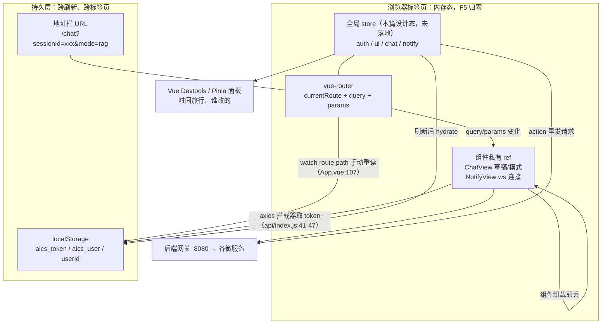

# Pinia 状态管理实战：哪些状态该放全局，哪些不该

> **一句话结论**：状态管理的分水岭不是「用不用 Pinia」，而是「哪些状态该进全局」——放错位置的状态会以三种方式反噬你：刷新即失、多标签页不同步、调试时找不到谁改的。Pinia 只是让"放对了之后"的写法变顺手，它不会替你做分类决策。
> **阅读前置**：Vue 3 组合式 API（`ref` / `reactive` / `computed`）、`vue-router` 基本用法、`localStorage` 会读写。建议先读同目录 [04-Vue3核心基础](04-Vue3核心基础.md) 与 [06-路由守卫与Axios请求封装](06-路由守卫与Axios请求封装.md)，本篇会直接引用那两篇讲过的 `auth.js`、路由守卫和 axios 拦截器。
> **证据基线**：`ai-cs-frontend/` 与 `ai-cs-frontend-react/` 真实源码（行号均已 read 核对）+ 本机 node 24 复现的 4 个 JS 语义实验（命令与输出原文见 §3）；**Pinia 相关代码在本仓库一律未落地**，凡属设计方案都会明确标注。预计阅读 45~60 分钟。

---

## 0. 先看现象

### 症状一：F5 之后顶栏用户信息是空的，随手点一下菜单又"自己好了"

打开 `ai-cs-frontend` 登录，顶栏右上角显示昵称；按 F5 刷新，昵称变空、头像变回默认；随后**任意点一个菜单**（触发路由跳转），昵称又回来了。

现场代码在 `ai-cs-frontend/src/App.vue:105-111`：

```js
// ai-cs-frontend/src/App.vue
const currentUser = ref(getUser() || {})
// 路由变化时重新读取登录信息（登录/退出后 localStorage 已更新）
watch(() => route.path, () => {
  currentUser.value = getUser() || {}
})
```

注意这里的因果链：真正的事实来源是 `localStorage.user` 里那个 JSON，`currentUser` 只是一个**快照**。快照要更新，靠的是"路由发生变化"这个副作用，而不是"数据变了"本身。所以只要某个时刻 `localStorage` 变了、路由没变，界面就一定是旧的。

### 症状二：从对话页切到别的页面再切回来，草稿、模式、知识库选择全部归零

`ChatView` 里有一整块会话状态（`ai-cs-frontend/src/views/ChatView.vue:192-208`）：`sessions`、`currentSession`、`sessionMessages`（按 sessionId 缓存已加载的消息数组）、`inputMessage`、`chatMode`（`'normal'` / 别的模式）、`knowledgeBase`、`uploadedImageUrl`。它们全是组件私有 `ref`，组件卸载即销毁：

```text
// 复现路径（未本机实测，属 Vue 组件生命周期的必然结果）
1. /chat 里选好知识库 + 输入半句话，不发送
2. 点左侧菜单去 /knowledge
3. 浏览器后退回 /chat → 输入框空了，知识库下拉回到默认，chatMode 回到 'normal'
   （唯一活下来的是 sessionMessages 里已写入 localStorage 的部分？没有 —— 它也在内存里）
```

更糟的一点在 `ai-cs-frontend/src/views/ChatView.vue:394-398`：发消息走的是原生 `fetch` 手工拼 `Authorization`，**绕过了 axios 拦截器**——

```js
const response = await fetch(`${API_ROOT}/chat/${endpoint}?${params}`, {
  method: 'POST',
  headers: { Authorization: `Bearer ${getToken() || ''}` },
  signal: abortController.signal,
})
```

而统一登出逻辑只写在 `ai-cs-frontend/src/api/index.js:50-60` 的 axios 响应拦截器里（`status === 401` → `logout()` + 跳登录页）。于是：SSE 请求 401 时 Network 面板能看到 401，但**页面不会跳登录页**，用户看到的是流式气泡永远空着。

### 症状三：把 store 用到"模块顶层"或直接解构，报错长这样

本机 node 24 复现（脚本见 §3.9、§3.10），两个错误原文：

```text
[解构]            token=t1
[toRefs]          token=t1
[computed]        isAuthenticated=true
--- 执行 store.token = "t2" ---
[toRefs]          token=t2
```

解构出来的 `token` 在值变化后**再也不打印**了，而 `toRefs` 出来的会重跑——这就是"视图不更新"的静态证据。

```text
[dep.mjs]  顶层执行，此刻 globalThis.__pinia = undefined
Error: getActivePinia was called with no active Pinia. Did you forget to install pinia?
    at file:///C:/Users/16680/AppData/Local/Temp/aics-state-demo/dep.mjs:4:9
    at ModuleJob.run (node:internal/modules/esm/module_job:439:25)
Node.js v24.16.0
```

这些现象指向同一件事：**这个工程没有"状态层"这个概念**——该持久的靠 `localStorage` 手动读写（`ai-cs-frontend/src/utils/auth.js`），该共享的靠路由变化手动重读（`App.vue`），该跨页面活着的被塞在组件里（`ChatView`、`NotifyView`），而"谁改的、什么时候改的"从来没有人记录过。

---

## 1. 整体地图



> **读图说明**：图上三个方框代表三类"状态的家"。① 最上面一格是**内存**：组件 `ref` 和 store 都活在这里，特征是完全相同的——F5 就没了；区别只在于组件 `ref` 跟着组件生死，store 跟着页面进程生死（本篇 §3.1 有实测）。② 左下是**持久层**：`localStorage` 与地址栏 URL，它们才是刷新后还能活下来的东西；本仓库现在的做法是"内存里放快照 + 在路由变化时手动回读持久层"（`App.vue:107` 那条虚线箭头），这条虚线就是症状一的全部原因。③ 右下是**后端**：只有 store 的 action 和组件的请求函数会碰到它，也就是说"状态从哪来"这件事在图上永远经过一次网络。④ 最右的 Devtools 只连 store，不连组件 `ref`——这解释了为什么"放错地方的状态既不能持久，也无法被时间旅行看到"。

### 组件 / 责任 / 参与方站位表

| 角色 | 责任 | 本仓库证据（真实文件） | 现状问题 |
|---|---|---|---|
| 状态工厂 | 定义全局状态、派生、动作 | **不存在**。`package.json` 无 `pinia` 依赖，`src/` 下 grep `pinia\|defineStore` 命中 0 次 | 没有状态层 |
| 持久层读写 | 把 token / user 序列化进 `localStorage` | `ai-cs-frontend/src/utils/auth.js`（59 行，纯函数） | 非响应式，改动没人通知 |
| 内存态消费者 | 顶栏展示、路由守卫、请求头注入 | `App.vue:105`、`ai-cs-frontend/src/router/index.js:38-48`、`ai-cs-frontend/src/api/index.js:41-47` | 三处各自读、各自判断 |
| 组件级状态持有者 | 页面内数据 | `ChatView.vue:192-208`、`NotifyView.vue:79-81` | 该跨页面的被锁在组件里 |
| 权限判定 | 角色 → 能不能看 | `ai-cs-frontend/src/directives/permission.js:17-36` | 只在 `mounted` 判一次，注释里自认不支持热更新 |
| 主入口 | 装插件 | `ai-cs-frontend/src/main.js:11-22`，只有 `ElementPlus` / `router` / `permission` | **没有 `createPinia()`** |
| React 版对照 | 同类问题的另一种解 | `ai-cs-frontend-react/src` 下的 `App.jsx`（L31-L46）两个包裹组件直接调 `isAuthenticated()` | 无 Context、无 Redux/Zustand |

---

## 2. 关键概念与关键类 / 关键 API

| 名称 | 位置 | 角色 | 关键点 |
|---|---|---|---|
| `ref` / `reactive` | Vue 3 运行时 | 最底层的响应式容器 | `reactive` 只能包对象/数组；`ref` 可以包任意值，取值要 `.value` |
| `toRefs(obj)` | `vue` | 把对象的每个属性转成 `ref` | 保住"引用关系"，是解构后还能响应式的唯一正确姿势之一 |
| `storeToRefs(store)` | `pinia` | 专为 store 设计的 `toRefs` | 只转 state/getters，**不转 actions**（actions 是方法，不需要响应式） |
| `defineStore(id, setup)` | `pinia` | setup 语法定义 store | 就是一个 `setup()` 函数，返回什么就导出什么，最接近组合式 API |
| `defineStore(id, options)` | `pinia` | options 语法定义 store | `state/getters/actions` 三段式，从 Vuex 迁移过来最省事 |
| `state` | store 内 | 唯一事实来源 | 必须是可序列化的纯数据，别塞 DOM、WebSocket、定时器 |
| `getters` | store 内 | 派生值（缓存） | 类似 `computed`，**只读**；不要在里面发请求 |
| `actions` | store 内 | 改 state 的唯一入口 | 可以 async；`this` 就是 store（options 语法） |
| `$patch` | store 实例 | 批量改 state | 对象形式浅合并，函数形式适合数组 push 之类 |
| `$subscribe` | store 实例 | 订阅变更（含来源） | 想追"谁改的"时，在这里 `console.trace()` |
| `$reset()` | store 实例 | 回到初始 state | **只有 options 语法自带**，setup 语法要自己写 |
| `storage` 事件 | 浏览器 Window API | 跨标签页广播 | 只有**别的**标签页改动才会触发，本页不触发 |
| `localStorage` | 浏览器 | 字符串键值、同源共享、永久 | 只有字符串；`JSON.parse(null)` 返回 `null` 不报错（§3.5 实测） |
| Vue Devtools → Pinia 面板 | 浏览器扩展 | 看 state、时间旅行 | 只有装进 app 的 store 会出现；组件 `ref` 不在这里 |
| `useRoute().query` | `vue-router` | 把状态放进 URL | 可分享、可刷新、可前进后退；代价是类型是字符串 |

---

## 3. 原理与证据逐段精读

### 3.1 一个 store 到底是什么：模块级 reactive 单例

**在干什么。** 不管 Pinia 的源码怎么写，它给你的效果只有一句话：`useXxxStore()` 第一次调用时创建对象，之后每次调用都返回**同一个**对象，这个对象是响应式的。没有 Pinia 也能手搓，本机实测（node 24）如下。

```js
// store.mjs —— 模块级 reactive，等价于"手搓 store"
const vue = await import('file:///D:/Projects/Persion/ai-customer-service/ai-cs-frontend/node_modules/vue/index.mjs')
export const store = vue.reactive({ count: 0, token: '' })
console.log('[store.mjs] 模块求值一次，store 实例创建，初始 count=' + store.count)
```

```text
# 命令：node singleton.mjs（连跑两次，第二次相当于浏览器 F5）
[store.mjs] 模块求值一次，store 实例创建，初始 count=0
[A.mjs]   改完 count=1
[B.mjs]   只是读，count=1
[B.mjs]   改完 count=2
[main]    进程结束，内存态随之消失
```

**为什么这么设计。** 因为 ESM 模块有"单次求值"保证：同一进程里 `import './store.mjs'` 被执行多次，模块体只跑一遍，导出的对象永远是同一个引用。Pinia 内部维护一张 `Map<storeId, store>`，本质是同一个把戏，只是多了 `devtools` 挂载和"按需创建"。

**换写法会怎样。** 如果不导出实例、而是导出一个**工厂函数**（`export function useStore() { return reactive({...}) }`），那么 A 组件调一次、B 组件调一次，会得到两个互不相干的对象——A 改的 B 看不见。这正是"为什么 store 必须是单例"的直觉来源。

**常见坑。** 上面输出的第二段（第二次运行 `count` 又从 0 开始）就是最贵的那个坑：**单例 ≠ 持久化**。很多人把内存态当成了"存在了什么地方"，一刷新全没了；而"刷新即失"和"多标签页不同步"其实是同一个病的两种发作形式——单例的边界是**一个进程**，不是一台机器，更不是一个用户。

### 3.2 本仓库的现状：状态根本没"住"在内存里，而是住在字符串里

**在干什么。** 看 `ai-cs-frontend/src/utils/auth.js`（59 行）的四个函数就够了：`getToken` / `setToken` / `getUser` / `setUser` 全是 `localStorage` 的薄封装，`isAuthenticated()` 就是 `!!getToken()`（`:27-29`），`getRoles()` 把后端给的逗号串拆成小写数组（`:36-43`）。

```js
// ai-cs-frontend/src/utils/auth.js 关键片段
export function getUser() {
  try {
    return JSON.parse(localStorage.getItem(USER_KEY)) || null
  } catch {
    return null
  }
}
export function isAuthenticated() {
  return !!getToken()
}
```

**为什么这么设计。** 这在"只有一个登录态、几处消费"的小工程里是最省事的：不引库、不建层、SSR 也不用考虑（本项目纯 SPA）。而且 `try/catch` 兜底说明作者踩过脏数据的坑。

**换写法会怎样。** 换成 store：`user` 是响应式的，改一次顶栏/守卫/指令/请求头同时知道；而读 `localStorage` 永远是"取样快照"，要读者自己安排"什么时候再读一次"。`App.vue:106` 那句注释「路由变化时重新读取登录信息」就是这种安排的化石证据（真正的 `watch` 在 `:107-111`）。

**常见坑。** ① 语义漂移：`isAuthenticated()` 只判断 token 是否存在，**不判断是否过期**，token 过期后前端仍认为已登录，直到某个请求 401 才被动登出。② 事实来源分裂：`Dashboard.vue:148` 写的是 `getUser()?.userId || localStorage.getItem('userId') || 1`，`CartView.vue:57`、`CheckoutView.vue:71`、`OrderDetailView.vue:63`、`OrderView.vue:42` 是同一行代码的四个副本——**除了 `aics_user` 还有一个裸的 `userId` key 在野**，谁写的、什么时候写的无人知晓。这种"两套登录态"就是"放错地方"的典型代价。③ 无法调试：`localStorage` 的变化不会有任何调用栈，Chrome 也不会告诉你"是哪个组件把它写成这样的"。

### 3.3 setup 语法 vs options 语法：不是风格问题，是能力边界问题

**在干什么。** 同样一个"登录态 store"，两种写法（**设计方案，本仓库未落地**）：

```js
// stores/auth.js —— options 语法
import { defineStore } from 'pinia'
import { getToken, setToken, setUser, logout as clearAuth } from '@/utils/auth'

export const useAuthStore = defineStore('auth', {
  state: () => ({ token: getToken(), user: null }),
  getters: {
    isLogin: (s) => !!s.token,
    roles: (s) => (s.user?.role || '').split(',').filter(Boolean).map((r) => r.toLowerCase()),
  },
  actions: {
    async login(payload) { /* 调 userApi，再 setToken/setUser + 落 localStorage */ },
    logout() { clearAuth(); this.$reset() },
  },
})
```

```js
// stores/auth.js —— setup 语法
import { defineStore } from 'pinia'
import { computed, ref } from 'vue'
export const useAuthStore = defineStore('auth', () => {
  const token = ref(getToken())
  const user = ref(null)
  const isLogin = computed(() => !!token.value)
  const roles = computed(() => (user.value?.role || '').split(',').filter(Boolean))
  function logout() { token.value = ''; user.value = null }
  return { token, user, isLogin, roles, logout }
})
```

**为什么这么设计。** options 语法的三段式（`state/getters/actions`）是 Vuex 用户的心智延续，`this` 指向 store，`$reset()` 自动可用；setup 语法是"把组件里的 `<script setup>` 搬到模块里"，组合式函数（composable）能直接复用、`watch` 能写在 store 里、类型推断更贴手写代码。

**换写法会怎样。** 用 setup 语法就**失去了 `$reset()`**（因为 Pinia 不知道初始值该是什么，只能自己写一个 `reset()`）；用 options 语法则在需要 `watch` 联动、需要复用已有 composable 时会别扭。**一个工程里别混用两种风格**——混用时规则记不住，`$reset` 时灵时不灵。

**常见坑。** ① setup 语法里 `return` 漏了某个变量，它就变成"只在内部可见"，外面 `store.xxx` 是 `undefined`；② 把 `state` 定义成 `state: { token: getToken() }`（对象而非函数），多实例/热更新时会共享同一个初始对象；③ 在 `state` 里放 `new WebSocket(...)`、`setTimeout` 的 id、DOM 引用——它们不可序列化，devtools 里会变成一团 `undefined`，快照/时间旅行也会失效。

### 3.4 判据：哪些状态该放全局，哪些绝对不该

**在干什么。** 这里给一组可以当着代码评审说出口的三问，然后拿它逐个审判本仓库真实存在的状态。

1. **它要活多久？** 只需活到本页面卸载 → 组件 `ref`；要跟着整个会话活 → store。
2. **它要被几个"不相邻"的组件读？** 父子就够 → `props`/`emit`；跨三层以上或兄弟组件 → store 或 `provide/inject`。
3. **它需不需要"可分享 / 可回退 / 可刷新"？** 需要 → **放进 URL**，别放 store（store 再好也不进浏览器历史）。

| 真实状态 | 现在住在哪（文件:行） | 跨组件 | 跨路由 | 跨刷新 | 该放哪 |
|---|---|---|---|---|---|
| 访问 token | `auth.js:8/12` → `localStorage.aics_token` | 是（拦截器、SSE、指令） | 是 | 是 | **store + 持久化**（两件事分开设计） |
| 当前用户资料 | `auth.js:17/24` + `App.vue:105` 快照 | 是 | 是 | 是 | **store + 持久化** |
| 角色/权限 | `auth.js:36-43`、`permission.js:17-36` | 是 | 是 | 是 | store 的 **getters**（只读派生） |
| 会话列表 / 当前会话 | `ChatView.vue:192-208`（全在组件内） | 否 | **期望是** | **期望是** | **当前会话进 URL**，列表进 store |
| 输入框草稿 | `ChatView.vue:198` `inputMessage` | 否 | 期望 | 可选 | 组件内 + `keep-alive`，或 store |
| `chatMode` / `knowledgeBase` | `ChatView.vue:205-206` | 否 | 期望 | **期望是** | **进 URL query** |
| WS 连接 + 通知日志 | `NotifyView.vue:79-81`（含 `let ws`） | 否 | **期望是** | 是 | **store（连接是有副作用的长生命周期资源）** |
| 大屏轮询结果 | `Dashboard.vue:156-170`（15s `setInterval`） | 否 | 否 | 否 | 组件内就够；要缓存就上查询库 |
| 表格分页/筛选 | 各 `MqView` / `ProductView` 等局部 ref | 否 | 否 | **期望是** | **URL query**（可分享的筛选条件） |
| 主题/紧凑模式 | 不存在 | 是 | 是 | 是 | store + 持久化（**未落地**） |

**为什么这么设计。** 三条判据分别对应三种"代价"：活得太短 → 体验断（症状二）；读得太远 → 数据不同步；放下 URL 该放的地方 → 分享链接失效、刷新归零、后退无效。Pinia 只能解决第二条和第一条的"内存部分"，第三条它管不了。

**换写法会怎样。** 假设把"当前会话 id"塞进 store 而不是 URL：用户刷新 → store 归零 → 回到空白对话；用户把链接发给同事 → 对方看到的是自己的空白对话。这就是"能放 URL 的偏不放"的直接后果，本仓库 `ChatView` 现在正是这个形态（`currentSession` 是 `ref`，不进 URL）。

**常见坑。** ① 把所有东西都搬进 store，结果 store 成了一个 600 行的"第二个 App"，改一个字段要先在 5 个地方翻半天——这比组件内 `ref` 更难维护。② 反向的坑：明明两个兄弟组件共享"选中的商品"，却用 `emit` 往上抛三跳。③ 最隐蔽的：把一个"服务端数据"（会话列表）当成"客户端状态"，于是自己手写缓存、手写失效——这类数据更该用请求缓存（如 TanStack Query / SWR 思路），store 只存"用户的意图"。

### 3.5 持久化：`localStorage` 手写 vs 插件，以及"敏感信息不能落盘"的边界

**在干什么。** 手写持久化就是本仓库现在这套：`setToken` / `setUser` 里 `JSON.stringify` + `setItem`，读的时候 `JSON.parse` + `try/catch`（`ai-cs-frontend/src/utils/auth.js:15-25`）。插件方案是 `pinia-plugin-persistedstate`（**本仓库未安装，禁止在此环境 `npm install`，本节代码标注为设计方案**）：

```js
// main.js（设计方案，未落地）
import { createPinia } from 'pinia'
import piniaPluginPersistedstate from 'pinia-plugin-persistedstate'
const pinia = createPinia()
pinia.use(piniaPluginPersistedstate)
app.use(pinia)

// stores/auth.js（设计方案）
defineStore('auth', () => ({ /* ... */ }), { persist: { key: 'aics_auth', pick: ['token'] } })
```

**为什么这么设计。** 插件的价值不是"少写两行"，而是：① 声明式地说明"哪些字段要落盘"（`pick`/`omit`），避免把整坨 state 序列化进去；② 自动 hydrate，刷新后 store 一起来就是有值的，不需要 `App.vue` 那种"路由变了再读一遍"的补丁；③ 统一 key 与版本，迁移/清空有单一入口。

**换写法会怎样。** 手写的坏处不是难写，是**会分叉**：本仓库已经分叉了——`aics_user` 与裸 `userId` 两个 key 并存（`Dashboard.vue:148` 等 5 处）。插件方案的坏处是引入一个依赖 + 一个隐式生命周期（什么时候 hydrate、什么时候写回），出问题时要读插件源码。

**敏感信息边界（这一条比用什么方案更重要）。**

- **不能落盘的东西**：密码、支付/身份证等 PII 明文、任何服务端密钥、刷新令牌（长期凭据）。JWT 放 `localStorage` 的固有风险是"任何一次 XSS 都能被 `document.cookie`/`localStorage` 读走"，缓解手段是 **httpOnly + Secure + SameSite Cookie**（本仓库未落地，属安全改造项）、缩短 token 寿命、CSP。
- **可以落盘的东西**：token 本身（折中，本仓库现状）、用户展示信息（昵称/头像/角色名，**不要**放手机号/身份证）、UI 偏好（主题、侧栏折叠）。
- **这条边界有仓库内的书面证据**：`ai-cs-frontend/.env.development` 里写着——

```text
# 不要把密钥写在这里 —— VITE_ 前缀的变量会被打进前端产物，人人可见
VITE_GATEWAY=http://localhost:8080
```

同一逻辑适用于 `localStorage`：**任何进入浏览器的字符串，都视为已经公开**。所以"多存一个字段"要当成"公布一个字段"来审。

**常见坑。** ① `JSON.parse` 不 try/catch → 历史脏数据让整个应用白屏（本仓库有反例防御：`ai-cs-frontend/src/utils/auth.test.js:25-29` 专门测了 `'{not-json'` 返回 `null`）。② 把 `reactive` 的对象直接 `JSON.stringify`（丢了 `ref` 的 `.value` 包装，存进去的是 `{}`）。③ 存了 `undefined`/`Date`/`Map`，回来全是错的类型。④ 多标签页各自写，最后写入者覆盖前面的（§3.7）。

### 3.6 响应式丢失：解构 store 与 `storeToRefs`

**在干什么。** 这大概是最常见的"用了 Pinia 但页面不更新"的原因。`store` 是 `reactive` 对象，`const { token } = useAuthStore()` 拿到的是**字符串**，赋值那一刻就断了链。本机实测（§3.1 同目录脚本 `reactivity.mjs`，vue 3.5.41）：

```js
const store = reactive({ token: 't1', user: null })
const { token } = store                        // 快照
watchEffect(() => log.push('[解构]            token=' + token))
const { token: tokenRef } = toRefs(store)      // 引用
watchEffect(() => log.push('[toRefs]          token=' + tokenRef.value))
const isAuthenticated = computed(() => !!store.token)
watchEffect(() => log.push('[computed]        isAuthenticated=' + isAuthenticated.value))
store.token = 't2'
await nextTick()
```

```text
[解构]            token=t1
[toRefs]          token=t1
[computed]        isAuthenticated=true
--- 执行 store.token = "t2" ---
[toRefs]          token=t2
```

**为什么这么设计。** `reactive` 的响应式是通过 `Proxy` 的 get 拦截建立的：只有**每次读属性时**经过代理，Vue 才能登记依赖。解构之后读的是普通变量，代理根本不在链路上——所以是纯粹的 JS 语义，不是 Pinia 的 bug。

**换写法会怎样。** 正确写法是 `const { token, user } = storeToRefs(useAuthStore())`，需要 action 时再单独 `const auth = useAuthStore()` 然后 `auth.login()`。`storeToRefs` 与 `toRefs` 的差别：前者只转 state 和 getters，不会把 actions 也包成 ref（不然 `auth.login()` 要写成 `login.value()`）。

**常见坑。** ① 把 `storeToRefs` 用在"整个 store 的所有字段"上然后传进 `v-model`——`getters` 转出来的 `ref` 是只读的，写了会警告。② 上面输出里 `[computed]` 那行**没有**重跑：因为 `'t1' → 't2'` 都是 truthy，`isAuthenticated` 的结果没变。这不叫"响应式失效"，这叫"派生值按结果缓存"——判断"响应式是否丢失"时，先确认**你观察的值真的变了**。③ 模板里 `{{ token }}` 没问题（模板访问经过代理），真正出事的是 `<script>` 里解构后又被闭包捕获。

### 3.7 多标签页同步：只有 `storage` 事件这一条路

**在干什么。** 用户开了两个标签页，A 页点了"退出登录"，B 页顶栏还显示昵称——B 的 store 没收到任何通知。浏览器给的唯一官方广播是 `storage` 事件（同源、**其他**标签页触发、本页不触发）：

```js
// 设计方案，未落地。放在 stores/auth.js 或 main.js
window.addEventListener('storage', (e) => {
  if (e.key === 'aics_token') {
    const auth = useAuthStore()
    e.newValue ? (auth.token = e.newValue) : auth.logout()   // 别在这里回写 localStorage，否则死循环
  }
})
```

**为什么这么设计。** `localStorage` 是进程外的共享存储，浏览器不允许"直接改内存"，所以设计了"值变了就发事件给同源的其他文档"。注意它**只对 `localStorage`/`sessionStorage` 生效**，对 `IndexedDB` 不发；而 `BroadcastChannel` 是更现代的替代品（同一份逻辑，语义更清楚，本仓库未用）。

**换写法会怎样。** 如果不用 `storage` 事件，就只能靠轮询（每个标签页定时读一次 `localStorage`）或后端推送（WebSocket 广播"你在别处登出了"）。本仓库其实已经有一条 WS 通道（notify 服务推通知），理论上可以用它做"登出广播"，但 `NotifyView.vue:112-129` 的连接是**组件级**的，离开页面就断——所以现在做不到。

**常见坑。** ① 在 `storage` 回调里写回 `localStorage` → 两个标签页互相触发，形成风暴（上面的 `auth.token = ...` 只改内存，不回写，就是为了避开这一点）。② 在**同一个**标签页里监听自己写入的事件——不会触发，容易误判成"功能没生效"（这是查这个问题时 90% 的假阳性，见 §6.4 的调试手法）。③ `sessionStorage` 天生按标签页隔离，用它做登录态会导致"新开标签页要重新登录"。

**未实测声明**：多标签页 `storage` 事件在本环境无法自动化复现（需要两个真实浏览器上下文），本节给的是可手工验证的步骤，见 §6.4。

### 3.8 组件通信手段取舍表：props / provide / store / 事件总线 / URL

**在干什么。** store 只是五种手段之一。选错的典型症状是"能用但越来越难改"。

| 手段 | 适合 | 不适合 | 本仓库用法 |
|---|---|---|---|
| `props` / `emit` | 父子、一层兄弟；数据流向清晰 | 跨 3 层以上（prop drilling） | `ChatView` 内部子组件、`App.vue` 传给布局 |
| `provide` / `inject` | 跨多层但**只属于某棵子树**（如表单上下文、主题） | 全局单例（用它做全局等价于藏了一个 store） | **未使用**（grep 无命中） |
| store（Pinia） | 跨路由、跨不相邻组件、需要 devtools | 页面局部临时数据、服务端数据缓存 | **未落地** |
| 事件总线（`mitt` / 自建 `EventTarget`） | 一次性通知（"刷新一下列表"） | 承载**状态**（事件是流，不保存当前值） | **未使用** |
| URL（`query` / `params` / `hash`） | 可分享、可刷新、需要前进后退的"视图状态" | 大数据、敏感数据 | 登录回跳 `router/index.js:41`、`LoginView.vue:83-86` |

**为什么这么设计。** 判断标准其实只有一句：**这份数据归谁所有**。归某个父组件 → props；归某棵子树 → provide；归整个应用 → store；归"用户当前看到的这个视图" → URL。事件总线之所以危险，是因为它把"状态"伪装成"动作"，新同事找不到"当前值存在哪"。

**换写法会怎样。** 事件总线改成 store：从"广播了一次"变成"有一个可读的当前值"，调试时能看到。URL 改成 store：链接不再可分享（§3.4 的坑）。

**常见坑。** ① 用 `provide` 传一个 `reactive` 对象却不给 `readonly` 包装，任何注入者都能改，等于全局可变状态但没有 devtools。② 事件总线事件名拼错，静默无人接收（没有类型检查时尤其常见）。③ 把 URL query 当成强类型值，忘了它永远是字符串（`?page=2` 是 `'2'`）。

### 3.9 大 store 的拆分与命名：`useAuthStore` 只干认证

**在干什么。** 一个健康的前端状态层大致长这样（**设计方案，目录未落地**）：

```text
src/stores/
├── index.js      # createPinia 实例 + 插件注册（main.js 只 import 这里）
├── auth.js       # token / user / roles / login / logout（唯一碰 localStorage 的地方）
├── ui.js         # 侧栏折叠、主题、全局 loading
├── chat.js       # 会话列表、当前会话 id、流式状态
└── notify.js     # WS 连接、连接状态、最近 N 条通知
```

命名规则三条：① 文件名 = store id = `use<Name>Store` 里的 `<Name>`，`defineStore('auth')` 对应 `stores/auth.js`；② **一个 store 只对应一个业务名词**，出现 `useCommonStore` / `useGlobalStore` / `useAppStore` 基本就是垃圾桶开张；③ action 用动词短语（`fetchSessions` / `sendMessage` / `logout`），getter 用形容词或名词（`isLogin` / `roles` / `unreadCount`），**不要在 getter 里发请求**。

**为什么这么设计。** 拆分粒度对齐"谁 Read、谁 Write"：`auth` 被拦截器、守卫、指令共同读，所以必须最稳；`chat` 只有对话相关页面写，改动频率高，拆开后高频改动不会牵动登录逻辑。这直接对应 §3.4 的判据 1 和 2。

**换写法会怎样。** 一个巨型 store 的真实代价不是行数，而是**耦合面**：任何一次改动都可能影响所有订阅者，且 devtools 里一次 action 触发 20 个组件重渲染，你无法判断是谁的锅。

**常见坑。** ① store 之间循环依赖（`auth` 引 `chat`、`chat` 引 `auth`）→ 一个 import 顺序问题就会炸出 §3.10 那个错；② store 里存了组件实例或 `ref` 的 DOM（`messagesRef` 那种），组件卸载后成为泄漏源；③ 把 `useAuthStore()` 写在模块顶层（见下节）。

### 3.10 模块顶层调用 store：一句报错背后的时序真相

**在干什么。** 常见的错误写法是把 store 当"全局常量"用：

```js
// ❌ 错：模块顶层就调 useAuthStore()
import { useAuthStore } from '@/stores/auth'
const auth = useAuthStore()          // 此时 pinia 还没被 app.use()
export const authHeader = () => `Bearer ${auth.token}`
```

本机 node 24 复现（`dep.mjs` 顶层立即读 `globalThis.__pinia`，`main.mjs` 先 `import './dep.mjs'` 再赋值）：

```text
[dep.mjs]  顶层执行，此刻 globalThis.__pinia = undefined
Error: getActivePinia was called with no active Pinia. Did you forget to install pinia?
    at file:///C:/Users/16680/AppData/Local/Temp/aics-state-demo/dep.mjs:4:9
    at ModuleJob.run (node:internal/modules/esm/module_job:439:25)
Node.js v24.16.0
```

注意 `main.mjs` 里 `import` 之后那行 `console.log('[main.mjs] ...')` **从未打印**——整个进程在 `dep.mjs` 求值阶段就抛了，`app.use(createPinia())` 根本没机会执行。

**为什么这么设计。** ESM 的 `import` 是**静态提升**的：不论你写在文件第几行，被导入模块的求值都发生在导入方本体执行之前。Pinia 又要求"必须有一个 active pinia 才允许创建 store"，于是顺序被固定为：`createPinia()` → `app.use(pinia)` → 之后才允许 `useXxxStore()`。

**换写法会怎样。** 正确做法是"在函数/生命周期里调用"：axios 拦截器回调、路由守卫回调、组件 `setup`、`store` 的 action——这些都是在 `app.use` 之后才执行的时机。本仓库的 `ai-cs-frontend/src/api/index.js:41-47` 把 `getToken()` 写在**请求拦截器回调内部**，这就是已经踩对了时序（虽然它用的是纯函数而不是 store）。

**常见坑。** ① 报错信息只说"Did you forget to install pinia?"，但真实原因可能是"install 了，只是业务模块先执行了"，栈顶文件名才是关键线索（§6.1）。② SSR 场景下同一个 store 实例会被多个请求共享（本项目纯 SPA，暂不涉及，但迁移 Nuxt 时必须处理，见 [12-Nuxt与SSR入门](12-Nuxt与SSR入门.md)）。③ 在 `router/index.js` 里 `import { useAuthStore }` 本身没问题，但**在模块顶层调用**它就有问题。

---

### 3.11 服务端数据 ≠ 客户端状态：为什么"会话列表"不该在 store 里长住

**在干什么。** 把"从后端拉回来的东西"和"用户当前的操作意图"分开放，是状态层能长期活下来的关键。前者是**服务端数据的副本**（有唯一真源：数据库），后者才是**客户端状态**（真源就在浏览器里）。`ChatView.vue:240-254` 现在把两者混在一个 `sessions` 数组里：既当"服务端返回的副本"，又当"当前会话的容器"。

| 维度 | 服务端数据副本 | 客户端状态 |
|---|---|---|
| 例子（本仓库） | 会话列表（`messageApi.get('/sessions')`）、通知在线数（`notifyApi.get('/online')`） | 当前会话 id、`chatMode`、草稿 |
| 真源 | 后端数据库 | 浏览器内存 / URL / `localStorage` |
| 失效方式 | 缓存过期、别人改了数据、切了用户 | 用户操作、组件卸载、F5 |
| 该谁管 | 请求缓存（失效/重取/去重） | store / URL / 组件 ref |
| 放 store 的后果 | 要自己手写失效逻辑，且容易忘记失效 | 天然合适 |

**为什么这么设计。** 因为两者的"正确性判据"不一样：服务端数据只要不是最新就可能错（`Dashboard.vue:156-170` 用 15 秒轮询硬扛这件事）；客户端状态只要"用户看到的和你存的一致"就对。混在一起管，你会被迫给 store 加上"什么时候该失效"的规则，而那是另一门学问。

**换写法会怎样。** 把会话列表留在 store 里只做"短期缓存 + 明确的 `invalidate()`"，其余交给请求缓存：`ChatView` 每次进入页面调一次 `refreshSessions()`（现有 `loadSessions` 已经这么做了，见 `:240-254`），store 只负责让别的页面也能读到这份列表。

**常见坑。** ① 把分页表的 `total`、`page`、`list` 全塞 store，切页面回来发现数据是半小时前的；② 把服务端数据当成"事实"，本地先改再发请求（乐观更新）却忘了失败回滚；③ 反过来，把纯客户端的 `theme`、`sidebarCollapsed` 反复发请求去后端取——那才是真的浪费。

### 3.12 权限热更新：`mounted` 只判一次留下的坑

**在干什么。** 本仓库的权限是"指令式"的：`ai-cs-frontend/src/directives/permission.js:17-36` 在 `mounted(el, binding)` 里读一次 `hasRole(binding.value)`，没有权限就 `el.parentNode.removeChild(el)`（`:26`），拿不到父节点时退化成 `display:none` + `data-permission-denied` 标记。文件头部 `:13-14` 的注释把前提写明了：

```text
// 仅做初始渲染判断：本项目角色在登录时一次性写入 localStorage，
// 切换角色必然重新登录，所以不需要 watch/updated 钩子（若将来支持权限热更新，要补 updated）。
```

**为什么这么设计。** 因为现在"角色不可能在会话期间变化"——`LoginView.vue:88-114` 登录时写一次 `role`，`logout()` 清掉，中间没有任何改角色的入口。既然前提成立，`mounted` 一次判断是**正确且最省**的做法，这个注释本身就是很值得学的工程判断。

**换写法会怎样。** 一旦引入 store 并支持"管理员在另一个标签页改了你的角色"，`mounted` 就不再成立：需要 `updated` 钩子重新判断，而 `removeChild` 是**不可逆**的（元素已经从 DOM 里没了，无法"恢复"）。所以在热更新场景下正确写法是**用 `v-if` 走响应式**，而不是继续用 DOM 指令：

```vue
<!-- 设计方案，未落地：把权限判断交给响应式渲染 -->
<script setup>
import { computed } from 'vue'
import { useAuthStore } from '@/stores/auth'
const auth = useAuthStore()
const canEdit = computed(() => auth.roles.includes('admin'))
</script>
<template>
  <el-button v-if="canEdit" type="primary">编辑</el-button>
</template>
```

**常见坑。** ① 在支持热更新的系统里继续用 `removeChild`，导致"收回权限后给回权限"永远不生效，只能刷新；② 只在按钮上隐藏，接口没鉴权（前端权限永远是"体验层"，真安全在后端网关/服务）；③ `hasRole('')` 这类空值判断——`auth.js:48-51` 已经返回 `false`，别自己再实现一遍。

### 3.13 主题/暗色模式：典型的"该全局但本仓库没有"

**在干什么。** 一个换肤功能需要三样东西：当前主题值（全局 + 持久化）、DOM 上的 class 或 CSS 变量、组件里的 `var(--xxx)` 引用。本仓库现在**完全没有**主题状态（`App.vue` 里没有相关 `ref`，`localStorage` 里也没有主题 key），属于"该全局而缺失"的一类。

```js
// 设计方案，未落地
export const useUiStore = defineStore('ui', () => {
  const theme = ref(localStorage.getItem('aics_theme') || 'light')
  watch(theme, (v) => {
    document.documentElement.dataset.theme = v      // CSS 变量按 [data-theme] 切换
    localStorage.setItem('aics_theme', v)           // 只有偏好，无敏感信息
  }, { immediate: true })
  return { theme }
})
```

**为什么这么设计。** 主题是"全应用一个值 + 必须跨刷新保留 + 多标签页要同步"的教科书例子，三个条件同时满足，正好是 §3.4 三条判据的典型全局状态。放在组件 `ref` 里会导致"换个页面主题回弹"，放在 `localStorage` 里读而不放 store 会导致"切换后界面要等下次刷新才变"。

**换写法会怎样。** 用 `localStorage` + 每次读：切换立刻失效（因为没有任何东西通知 DOM）。用 store 不持久化：F5 回弹。用 store + 持久化 + `storage` 事件：三个需求一次满足，这是正确的终局形态。

**常见坑。** ① 把主题写进 `state` 却用 `document.body.style.background` 硬改（而不是 CSS 变量），组件里几十处颜色要跟着改；② 在 `watch` 里对 `localStorage` 写回，同时监听 `storage` 事件做双向同步却不做"来源判断"，两个标签页互相覆盖；③ 首屏闪烁（FOUC）——主题要在 `index.html` 里内联读 `localStorage` 提前打到 `<html>` 上，不能等 Vue 挂载。

---

## 4. 一次完整执行时序：登录 → 刷新 → 换标签页

```mermaid
sequenceDiagram
    autonumber
    participant U as 用户
    participant LV as LoginView.vue
    participant API as api/index.js
    participant AU as utils/auth.js
    participant LS as localStorage
    participant RT as router/index.js
    participant AV as App.vue
    participant CV as ChatView.vue

    U->>LV: 提交登录表单（:88 handleLogin）
    LV->>API: userApi.post('/login', form)
    API->>API: 请求拦截器 getToken() → 无 token，不加头（:41-47）
    API-->>LV: { code, data: { token, userId, role } }
    LV->>AU: setToken(token); setUser({userId, username, role})（:88-114）
    AU->>LS: setItem('aics_token') / setItem('aics_user')
    LV->>RT: gotoNext() → push(route.query.redirect || '/')（:83-86）
    RT->>AU: beforeEach → isAuthenticated()（:38-48）
    AU->>LS: getItem('aics_token')
    LS-->>RT: 'eyJhbGciOi...' 或 null
    RT->>AV: 通过，渲染目标路由
    AV->>AU: watch(route.path) 触发 getUser()（:106-112）
    AU->>LS: JSON.parse(getItem('aics_user'))（:17）
    LS-->>AV: { userId, username, role }
    AV->>AV: currentUser.value = {...} → 顶栏显示昵称
    Note over U,LS: ==== 用户按 F5：整个 JS 进程重启，内存态全部归零 ====
    U->>RT: GET /chat（浏览器只发 HTML）
    RT->>AU: beforeEach → isAuthenticated()
    AU->>LS: getItem('aics_token')
    LS-->>RT: 仍有值 → 放行
    AV->>AU: watch(route.path) 首次不触发（路径没变）→ 若 ref 初值是旧快照则显示空
    U->>CV: 进入对话页，组件 setup 重新执行
    CV->>LS: getUser()?.userId（:187-190）
    CV->>API: messageApi.get('/sessions', {userId})
    API-->>CV: 会话列表（内存，刷新即失）
    Note over U,LS: ==== 另一个标签页点了退出登录 ====
    LS->>LS: removeItem('aics_token') / removeItem('aics_user')
    Note over AV: 本标签页收不到任何通知：store 未落地，也没有 storage 监听
```

> **读图说明**：这张图上出现了三次"同一个事实被读三遍"——① 登录成功后 `LoginView` 写 `localStorage`；② 跳转时路由守卫再读一次判断放行；③ `App.vue` 在**路由变化**时第三次读出来渲染顶栏。三次读之间没有任何通知机制，全靠"时机恰好"串起来，这是 §0 症状一的根因。② 中间的 `Note` 是 F5 的分界线：它把内存态全部清空，但 `localStorage` 完好，于是"看起来登录态还在"（守卫放行）而"内存里的用户对象没了"（顶栏空白）——两者**不一致**的部分就是 bug 的藏身之处。③ 最后的 `Note` 是换标签页：`localStorage` 被另一个文档改了，本标签页的 JS 毫无察觉，因为既没有 store 也没有 `storage` 监听（§3.7）。④ 全图没有任何一步在记录"谁改了状态"，所以出问题时只能靠猜。

### 每一步失败会报什么

| 步骤 | 失败表现 | 报错/现象原文 | 定位入口 |
|---|---|---|---|
| 3 请求拦截器 | token 过期仍带旧 token | 响应 `401` + `ElMessage.warning('登录已过期…')`（`api/index.js:50-60`） | Network 面板看该请求的 `Authorization` 头 |
| 5 写 `localStorage` | 隐私模式/配额满 | `DOMException: Failed to execute 'setItem' on 'Storage'` | Console，`try/catch` 兜底 |
| 6 回跳 | `redirect` 是完整外链 | 跳到站外或 `push` 报 `Avoided redundant navigation` | `router/index.js:41` 的 `query.redirect` 值 |
| 8 守卫 | 未登录访问受保护页 | 地址栏变成 `/login?redirect=%2Fchat`（`query.redirect` 保留原路径） | 地址栏 + `router/index.js:38-48` |
| 11 `JSON.parse` | `aics_user` 是坏 JSON | 无报错（`catch` 返回 `null`，`auth.js:15-21`）→ 顶栏空白 | Application 面板手改 `aics_user` 复现 |
| 13 F5 后首屏 | 顶栏空白 | 无报错（快照未刷新） | Vue Devtools 看 `App.vue` 的 `currentUser` |
| SSE 请求 | 401 不跳登录 | Console 无报错，气泡永远空 | Network 面板看到 `fetch` 类型的 401（绕过 axios，见 §0 症状二） |
| 换标签页 | 两页状态不一致 | 无任何日志 | 手工在 A 页退出，看 B 页顶栏 |

---

## 5. 设计取舍

### 五条战线上的取舍

| 决策点 | 选项 A | 选项 B | 本项目建议 | 理由 |
|---|---|---|---|---|
| 要不要引 Pinia | 现状：不引，`localStorage` + 快照 | 引 Pinia + 持久化插件 | **引**（可以先只做 `auth` 一个 store） | 现在已有三处消费同一份登录态，且 `userId`/`aics_user` 已分叉 |
| 持久化方式 | 手写 `setToken/getUser`（`auth.js`） | `pinia-plugin-persistedstate` | 先手写收口到 store，再换插件 | 手写已经在跑 + 有测试（`auth.test.js`），换插件要一次到位 |
| store 语法 | options（三段式） | setup（组合式） | **新 store 用 setup**，`auth` 若从 Vuex 迁移可用 options | 组合式函数可复用；但**全工程统一一种** |
| 当前会话 id 放哪 | store（现状等价形态） | URL `?sessionId=` | **URL** | 可分享、可刷新、可后退（§3.4） |
| 多标签页同步 | 不做 | `storage` 事件 / `BroadcastChannel` | **先做登出广播** | 登出不同步是安全问题，优先级最高 |

### 可扩展点清单

1. `stores/auth.js`：token/user/roles + `login/logout/hydrate`，**唯一**允许碰 `localStorage` 的模块。
2. `stores/ui.js`：侧栏折叠、主题、全局 loading（`App.vue` 里现在没有这些状态）。
3. `stores/chat.js`：`sessions`、`currentSessionId`、`streaming`、`abortController`（`ChatView.vue:202` 那个 `let abortController` 天然属于这里，但要包成非响应式的模块变量或 `markRaw`）。
4. `stores/notify.js`：`ws` 连接生命周期（`connect/disconnect/reconnect`）、`connected`、`logs`（上限 50 条，对齐 `NotifyView.vue:136-137` 的现有逻辑）。
5. `storage` 事件或 `BroadcastChannel` 的**登出广播**（§3.7）。
6. axios 拦截器里的 401 处理改成调 `useAuthStore().logout()`（当前是 `api/index.js:50-60` 直接 `logout()` 纯函数 + `window.location.href`）。
7. `ChatView` 的 `fetch` SSE 改成"从 store 取 token"，或给 SSE 单独封装一个带 401 处理的客户端（当前绕过拦截器）。
8. 清理裸 `userId` key：`Dashboard.vue:148`、`CartView.vue:57`、`CheckoutView.vue:71`、`OrderDetailView.vue:63`、`OrderView.vue:42` 五处统一走 `useAuthStore().user?.userId`。

### 反面清单：这七件事不要做

1. **不要**为了"共享"把页面表格数据塞进 store——切回来看到的是旧数据，而且要自己写失效。
2. **不要**在 store 里存 DOM 引用、组件实例、`WebSocket`、定时器 id（`ChatView.vue:202` 的 `abortController` 要搬也只能包成非响应式变量）。
3. **不要**让 store 之间互相 `import` 成环；需要联动时在上层（组件或一个 `orchestrator` action）里调度。
4. **不要**用 store 传递"组件间一次性的通知"——用事件或 props；store 存的是值，不是广播。
5. **不要**把 `getters` 当请求用（`getters` 必须同步、无副作用）。
6. **不要**在 `state` 里放需要保密的字段（浏览器里没有秘密，见 §3.5）。
7. **不要**在模块顶层调 `useXxxStore()`（§3.10 那个错误的根因）。

---

## 6. 踩坑与调试手法

### 6.1 `getActivePinia was called with no active Pinia`：先看栈顶是哪个文件

**现象**：页面白屏，Console 一条红错。**伪诊断**："我没装 pinia"——但 `main.js` 里明明 `app.use(createPinia())` 了。**真诊断**：读栈顶那一行文件名，它点出的是**哪个模块**在顶层执行了 `useXxxStore()`。

**手法**：Chrome Devtools → Console → 点错误右侧的文件链接跳到 Sources，看那一行是不是在模块顶层（不在任何函数体内）。再看它被谁 `import`：如果它被 `main.js` 第一行 import，就一定在 `app.use` 之前执行。**修复**：把 `useXxxStore()` 挪进函数体（拦截器回调 / 守卫回调 / 组件 setup / action 内）。本机复现的错误原文与"main 后续行永不执行"的证据见 §3.10。

### 6.2 "store 变了但页面不变"：三步区分响应式丢失 / 派生未变 / 组件没订阅

**手法（Vue Devtools + 断点）**：① Pinia 面板（或 Vue 面板里的 `setup` state）看 `store.token` 是否真的变了——变了说明 action 执行成功；② 看组件实例的 `setup` 里那个变量值是不是旧值——是旧值 → 你解构了（§3.6）；③ 值没变才是"派生按结果缓存"（§3.6 那个 `[computed]` 没重跑的例子）。**别一上来就改代码**，先确认这三件事分别是什么状态。**加断点**：在 `storeToRefs` 那一行下断，F5 后看变量面板里它是 `RefImpl` 还是字符串——一眼定性。

### 6.3 `localStorage` 里的脏数据把首屏搞白：Application 面板手改复现

**手法**：Devtools → Application → Storage → Local Storage → 选中站点 → 双击 `aics_user` 的值改成 `{not-json` → 刷新。本仓库的 `getUser()` 会 `catch` 住返回 `null`（`ai-cs-frontend/src/utils/auth.js:15-21`，并有单测 `ai-cs-frontend/src/utils/auth.test.js:25-29`），所以顶栏退化成空白而不是白屏。**判读**：如果改成脏数据后白屏，说明某处有未保护的 `JSON.parse`；`console.log` 出 `SyntaxError: "undefined" is not valid JSON` 这类报错就锁定位置（本机实测该行为的输出见 §3.5 的 `json.mjs`：`JSON.parse(null)` 返回 `null` 不抛，`JSON.parse(undefined)` 才抛）。

```text
1) 未登录时 getItem 返回 → null
2) JSON.parse(null) 的结果 → null
3) 未登录时 getUser() → null
4) 写入坏 JSON 后 getUser() → null
5) 正常写入后 getUser() → { userId: 1, role: 'ADMIN,AGENT' }
6) JSON.parse(undefined) 抛错 → SyntaxError: "undefined" is not valid JSON
```

### 6.4 多标签页不同步：`storage` 事件"不触发"的两种假阳性

**手法（未本机实测，需两个真实标签页）**：① 开 A、B 两个标签页同源页面；② 在 A 的 Console 里 `localStorage.setItem('aics_token','x')`；③ 在 B 的 Console 监听 `window.addEventListener('storage', e => console.log(e.key, e.newValue))`——**应该打印**；④ 反过来在 B 自己改，B 自己**不会**触发（规范如此）。⑤ 断点位置：Sources → Event Listener Breakpoints → 勾 `Storage`，然后在另一个标签页写 `localStorage`，B 的调试器会停下来，能看 `e.key/e.oldValue/e.newValue`。

**判读**：同一个标签页内自己改自己监听，永远看不到回调——这是 90% 的"功能没生效"误判。

### 6.5 Network 面板认出"绕过拦截器的请求"：`fetch` vs `xhr`

**手法**：Devtools → Network → 过滤 `stream`，看那条 `/api/chat/stream/sse` 的请求类型列是 `fetch` 而不是 `xhr`。**判读**：本项目所有走 `api/index.js` 的请求都是 axios（XHR），只有 SSE 是原生 `fetch`（`ChatView.vue:394-398`）——所以它**不会**触发 `api/index.js:50-60` 的 401 统一登出。**推论**：看到 `fetch` 类型的 401 却没人跳登录页，是设计缺陷而不是偶发 bug。

### 6.6 谁改的？`$subscribe` + `console.trace`

**手法（设计方案，未落地）**：在 store 里加

```js
store.$subscribe((mutation, state) => {
  if (import.meta.env.DEV) {
    console.groupCollapsed(`[pinia] ${mutation.storeId} ${mutation.type}`)
    console.trace('谁改的')
    console.groupEnd()
  }
})
```

**判读**：`mutation.type` 为 `'direct'` 说明是某处直接赋值（栈里能找到组件），`'patch object'` / `'patch function'` 说明走了 `$patch`。这比在 20 个组件里 `console.log` 强一个量级。

### 6.7 构建期报错定位：先分清"编译错"还是"运行错"

本仓库 `ai-cs-frontend/vite.config.js:54-55` 留了一条真实踩坑注释：

```text
// 注意：Vite 8 底层换成了 rolldown，它只接受函数形式的 manualChunks，
// 写成对象会直接构建失败：`Invalid type: Expected Function but received Object`。
```

**手法**：`npm run build` 报这种"类型不符"的消息且带配置项名字（`manualChunks`）时，是**配置编译错**，不可能是业务代码；反过来 `Failed to resolve import "pinia"` 这种带模块名的，是"依赖没装 / 路径写错"。两者都不要去改业务代码——先看报错里有没有配置项名或包名。**注意**：本环境禁止跑 `npm run build`，这条判断依据来自仓库内注释与报错文本格式，属"未本机实测"。

### 6.8 反直觉的一条：不要为了"能持久"把什么都塞进 store

把 `Dashboard.vue` 那个 15s 轮询结果（`:156-170`）搬进全局 store，会让"离开页面还在轮询"变成新 bug（`onUnmounted` 的 `clearInterval` 不再有机会执行）。**判据**：有副作用、有生命周期的东西（定时器、WS、AbortController）进 store 时，必须同时给出"谁负责关闭"，否则就是给内存泄漏开绿灯。

### 6.9 用一条命令先给"状态大户"排个名（本机实测）

**手法**：在决定"要不要引 store"之前，先用静态统计把"组件里塞了多少状态"排出来，别凭感觉。

```powershell
# 在 ai-cs-frontend/src 下执行（本机真实输出见下）
Get-ChildItem -Recurse -Include *.vue,*.js |
  Select-String -Pattern '^\s*(const|let)\s+\w+\s*=\s*(ref|reactive|computed)\(' |
  Group-Object Filename | Sort-Object Count -Descending |
  Select-Object -First 12 Count,Name
```

```text
Count Name
   18 MqView.vue
   16 ProductView.vue
   14 VectorKbView.vue
   13 ShopView.vue
   11 ChatView.vue
   10 AgentView.vue
   10 MockCashierView.vue
   10 PromptView.vue
   10 TraceView.vue
   10 KnowledgeView.vue
    8 SearchView.vue
    8 GraphView.vue
```

**判读**：`MqView`（18）/ `ProductView`（16）这类"页面自己用的状态多"是正常的——它们大多是表格、弹窗、表单，属于 §3.4 里"该留组件内"的那一类，**数量大不代表该全局**。真正值得动的是"同一份数据在多个文件里各存一遍"的地方，用下面这条命令找：

```powershell
# 同一个 localStorage key 被几处读？本机真实输出（节选）
Get-ChildItem -Recurse -Include *.vue,*.js | Select-String -Pattern 'localStorage\.' |
  Select-Object Filename,LineNumber,Line
```

```text
auth.js           8  return localStorage.getItem(TOKEN_KEY)
auth.js          17    return JSON.parse(localStorage.getItem(USER_KEY)) || null
CartView.vue     57  const userId = ref(getUser()?.userId || localStorage.getItem('userId') || '')
CheckoutView.vue 71  const userId = ref(getUser()?.userId || localStorage.getItem('userId') || '')
Dashboard.vue   148      const uid = getUser()?.userId || localStorage.getItem('userId') || 1
OrderDetailView.vue 63 const userId = ref(getUser()?.userId || localStorage.getItem('userId') || '')
OrderView.vue    42  const userId = ref(getUser()?.userId || localStorage.getItem('userId') || '')
```

**结论（可直接抄进 issue）**：`localStorage.` 在全项目命中 16 次，其中 `userId` 这条"第二套登录态"被 5 个视图各读一遍——这就是最该先收口的地方，比"要不要装 Pinia"优先。

### 6.10 在 Devtools 里确认"到底谁在读这份状态"（未本机实测，给判读方法）

**手法**：Vue Devtools → Components → 选中组件 → 右侧 `setup` 面板里能看到所有 `ref`/`reactive` 的当前值；如果引了 Pinia，同一个面板里会多出 `Pinia` 分组，列出该组件用到的 store。想知道"谁订阅了 `token`"，就在这棵树里搜 `useAuthStore`（VSCode 里 `Ctrl+Shift+F` 更快）。

**判读**：如果某个字段在 20 个组件的 `setup` 里都出现，那它才配得上"全局"；如果只有一个组件读，放 store 只是增加了跳转成本。**时间旅行**（Pinia 面板的时间轴）只回放 state 快照、不回放副作用，本环境无浏览器扩展，**未实测**，不要把它当成"撤销按钮"。

---

## 7. 版本差异

| 维度 | 旧写法 | 当前基线（本仓库事实） | 变化点 | 迁移动作 |
|---|---|---|---|---|
| 状态管理库 | Vuex 3/4：`state/mutations/actions`，改 state 必须 `commit` | 官方推荐 Pinia；**本仓库两者都没有** | mutations 概念被取消，action 里直接改 state | 引 `pinia` + `main.js` 加 `app.use(createPinia())` |
| 旧稿说的 `auth.js` | 「38 行」 | **59 行**（`ai-cs-frontend/src/utils/auth.js`） | 多了 `getRoles`/`hasRole`/`logout` 与 `try/catch` | 本篇引用行号以 59 行版为准 |
| 旧稿说的 `main.js` | 「现文件 19 行」 | **22 行**（`ai-cs-frontend/src/main.js`） | 多了权限指令 `app.use(permission)` 与图标循环注册 | 插入 `createPinia` 时按 22 行版定位 |
| 旧稿说的 axios 实例数 | 「14 个 axios 实例」 | **15 个**（`ai-cs-frontend/src/api/index.js:65-79` 导出 15 个 `createClient`） | `SERVICES` 前缀表已扩到 15 项（含 `prompts`/`agent`/`rag`） | 统计口径要写清"是 `createClient` 实例，不含 wrapper" |
| 路由守卫行号 | 「现 37-48 行」 | 守卫在 **38-48 行**，`/login` 的 `meta.public` 在 `:5` | 基本一致 | 无 |
| 响应式实现 | Vue 2：`Object.defineProperty` 递归劫持 | Vue 3（`vue ^3.5.39`）：`Proxy` | 新增/删除属性、数组下标都天然可响应；`ref` 解包规则变化 | 旧教程里"`Vue.set` 才能给对象加属性"的说法在 Vue 3 已不适用 |
| 持久化插件配置 | 早期 `persist: { paths: [...] }` | 插件各主版本改过配置项名（如 `pick`/`omit` 替代 `paths`） | 配置项名不稳定 | **以所装版本的插件 README 为准**；本仓库未安装，未本机实测 |
| 多标签页同步 | `storage` 事件 | 仍是 `storage` 事件；另有 `BroadcastChannel` | 后者 API 更清晰、不需字符串序列化 | 新代码优先 `BroadcastChannel` |
| React 版对照 | — | `ai-cs-frontend-react` 无 Redux/Zustand/Jotai/MobX；状态靠 `ai-cs-frontend-react/src/utils/auth.js` + 两个包裹组件（`ai-cs-frontend-react/src` 下的 `App.jsx`，L31-L46） | 同一套"纯函数 + localStorage"思路，没有 Context | 前端状态层的缺失在两个版本里是对称的 |
| 旧稿说的通知 WS 地址 | 「`ws://localhost:8085/ws/notify`」 | **仍然是 8085**（`ai-cs-frontend/src/views/NotifyView.vue:114`），而 notify 服务在 **8086**，8085 是 message 服务 | 缺陷未修复，且地址硬编码在生产也会指向 localhost | 改为从 `utils/runtime.js` 的 `GATEWAY` 推导（wss/ws 按协议切换） |

---

## 8. 面试高频问与答

> 只列问题，答案留给自测题与 §3。每道题都能在本篇找到对应的原理段落。

1. Pinia 的 store 为什么在多个组件里拿到的是同一个对象？它靠什么保证"只创建一次"？
2. `state` / `getters` / `actions` 的职责边界是什么？为什么 getter 里不应该发请求？
3. setup 语法与 options 语法各有什么代价？为什么 setup 语法没有 `$reset()`？
4. `const { token } = useAuthStore()` 之后页面不更新，为什么？`storeToRefs` 和 `toRefs` 的区别是什么？
5. store 里能不能存 `WebSocket` 实例、`setTimeout` 返回值、DOM 节点？为什么？
6. `localStorage`、`sessionStorage`、Cookie、URL、内存（store）五者在"刷新 / 新标签页 / 分享链接 / XSS 泄露"四个维度上分别怎么表现？
7. `storage` 事件为什么在自己的标签页里不触发？`BroadcastChannel` 解决的是同一个问题吗？
8. 哪些状态应该放进 URL 而不是 store？把 `sessionId` 放 store 会付出什么代价？
9. 一个 800 行的巨型 store 有哪些具体风险？你会按什么维度拆分？
10. 为什么在模块顶层调用 `useXxxStore()` 会报 `getActivePinia was called with no active Pinia`？ESM 的求值顺序在这里起了什么作用？
11. Pinia 的 devtools 时间旅行能回放副作用（比如已经发出的网络请求）吗？为什么？
12. 如何在不引 Pinia 的工程里"手搓"一个全局状态？它在什么情况下会失效（提示：进程边界）？
13. token 放在 `localStorage` 与 httpOnly Cookie，安全模型差在哪？各自的代价是什么？
14. 401 统一登出为什么在 SSE 场景容易漏？你会怎么设计"统一的认证错误出口"？

---

## 9. 动手练习

### 练习 1（入门）：把登录态收口成一个 store

新建 `ai-cs-frontend/src` 下的 `stores/auth.js`（**本仓库当前不存在该目录，属新增，不改别人文件**），把 `utils/auth.js` 的 token/user/roles 搬进来，`getters` 提供 `isLogin` / `roles`，`actions` 提供 `login` / `logout`；`main.js` 里 `app.use(createPinia())`。

**验收标准**：
- 顶栏昵称在 F5 后仍然正确（不再依赖 `App.vue:106` 的 `watch(route.path)`）；
- `utils/auth.js` 保留为"适配层"，`localStorage` 的读写只出现一次（grep `localStorage.` 在 `stores/` 之外命中数降为 0）；
- 现有测试 `npx vitest run src/utils/auth.test.js` 仍全绿（本环境**不要**跑 `npm install`，仓库已有 `node_modules` 时可直接跑）。

### 练习 2（进阶）：把 `chatMode` / `knowledgeBase` 放进 URL

在 `ChatView.vue` 里把 `chatMode`、`knowledgeBase` 改成 `useRoute().query` 的读写（写用 `router.replace({ query })`），刷新后状态保持。

**验收标准**：
- 地址栏出现 `?mode=...&kb=...`；复制 URL 到新标签页，UI 状态一致；
- 浏览器后退能回到上一个模式（不是回到登录页）；
- `ChatView.vue:205-206` 两个 `ref` 被删除，且没有 `watch` 双向同步的补丁代码。

### 练习 3（进阶）：给 store 加"具名持久化"

给 `auth` store 只持久化 `token`，不持久化 `user`（`user` 每次由接口拉取，避免展示信息过期）。

**验收标准**：
- Application 面板里只有 `aics_auth` 一个 key，且内容只含 token 字段；
- 手动把该 key 的值改成 `{not-json` 刷新，应用不白屏（退化到未登录）；
- 写一条单测覆盖"坏 JSON → 未登录"（可仿 `ai-cs-frontend/src/utils/auth.test.js:25-29`）。

### 练习 4（实战）：跨标签页登出广播

用 `storage` 事件（或 `BroadcastChannel`）实现：A 标签页登出 → B 标签页顶栏立刻变成未登录，并 `router.push('/login')`。

**验收标准**：
- 两个标签页同时打开，A 点退出，B 在 1 秒内跳登录页（手工验收，本环境无法自动化）；
- B 跳转后不再回写 `localStorage`（无死循环、无重复事件）；
- 代码里有一行注释说明"本页自己不触发 `storage` 事件"。

### 练习 5（实战）：修 `NotifyView` 的 WS 地址缺陷

把 `ai-cs-frontend/src/views/NotifyView.vue:114` 里硬编码的 `ws://localhost:8085/ws/notify` 改成从 `utils/runtime.js` 的 `GATEWAY` 推导，端口对齐 notify 服务（8086）。

**验收标准**：
- 生产构建（`.env.production` 的 `VITE_GATEWAY` 为空）时连的是同源 `ws(s)://<当前域名>/api/...`，而不是 localhost；
- 页面能连上（`wsConnected` 变 true），断开后不再静默（至少有 `console.warn`）；
- 提交说明里点名这是 bug（8085 是 message 服务）。

### 练习 6（加分）：给 store 加 `$subscribe` 调试开关

只在 `import.meta.env.DEV` 下打印 `mutation.type` 与 `console.trace`。

**验收标准**：生产构建里无任何相关日志（可用 `grep` 检查打包产物，本环境未实测，给出命令：`npm run build && Select-String -Path dist\assets\*.js -Pattern 'pinia\] '`）。

---

## 小结

- 状态管理的分水岭是"**哪些状态该进全局**"，不是"用不用 Pinia"；本仓库 `ai-cs-frontend` 至今没有 Pinia（`package.json` 无该依赖，`src/` 内 `pinia|defineStore` 命中 0 次），状态散在 `localStorage` + 组件 `ref` 里。
- store 的本质是**模块级 reactive 单例**：同一进程内共享有效，但"刷新即失"——单例的边界是进程，不是用户（§3.1 实测）。
- 该进全局的：token、当前用户、角色权限、会话列表、WS 连接；该进 URL 的：当前会话 id、模式、筛选分页；该留组件内的：草稿、临时表单、轮询结果。
- 响应式丢失几乎只有一个原因：**解构**。`storeToRefs` 保留引用，`toRefs` 也能用但要清楚它会把 actions 一起包走（§3.6 实测输出）。
- 持久化的边界是安全边界：写进 `localStorage` 的东西等于"已公开"（`.env.development` 里那句"VITE_ 前缀变量会被打进前端产物，人人可见"是同一条原则）。
- 跨标签页只有 `storage` 事件（或 `BroadcastChannel`）一条路，且本页自己不触发；本项目连这个都还没有。
- `getActivePinia was called with no active Pinia` 的真实原因常常是 ESM 静态 import 顺序，不是"忘了 install"（§3.10 实测）。
- 下一步最划算的动作：**先只把 `auth` 收口成一个 store + 统一两套登录态 key（`aics_user` 与裸 `userId`），再谈别的**——`Dashboard.vue:148`、`CartView.vue:57`、`CheckoutView.vue:71`、`OrderDetailView.vue:63`、`OrderView.vue:42` 五处是这次清理的具体清单。

---

## 自测题

### 1. Pinia 的 store 在多个组件里为什么是同一个对象？

<details><summary>参考答案</summary>

因为 store 实例被创建一次后缓存在 Pinia 内部的 `Map<storeId, store>` 里，`useXxxStore()` 只是"取或建"。这与 ESM 模块"只求值一次"是同一种保证：模块导出的对象引用恒定。本机实测（§3.1）用模块级 `reactive` 手搓的伪 store，A 组件改完 `count=1`，后执行的 B 组件读到的也是 `1`，说明二者共享同一实例。注意边界：单例只在**一个 JS 进程**内成立，F5 后进程重启，内存态归零。
</details>

### 2. `state` / `getters` / `actions` 的职责边界？

<details><summary>参考答案</summary>

`state` 是唯一事实来源，放可序列化的纯数据；`getters` 是缓存派生值（等价 `computed`），只读、必须同步、不能有副作用，所以不能在 getter 里发请求；`actions` 是唯一写 state 的入口，可以 async，封装"改状态 + 发请求 + 持久化"的完整意图。判断标准：如果某段逻辑会改 state 或产生副作用 → action；如果只是"从 state 算出来" → getter。
</details>

### 3. setup 语法为什么没有 `$reset()`？

<details><summary>参考答案</summary>

`$reset()` 需要知道"初始值是什么"，options 语法里 `state: () => ({...})` 明确提供了这个工厂函数，Pinia 可以重新调一次拿到初始值。setup 语法里状态由 `setup()` 函数体内的 `ref/reactive` 创建，Pinia 拿不到"重跑一遍 setup"的安全方式（重跑会重新执行副作用），所以只能由你手写 `function reset() { token.value = '' }` 并在 `return` 里导出。
</details>

### 4. 解构 store 后页面不更新，为什么？

<details><summary>参考答案</summary>

`reactive` 的依赖收集发生在读属性、且读操作经过 `Proxy` 的时刻。`const { token } = store` 是把属性值复制进一个普通变量，此后模板/闭包读的是那个普通变量，不再经过代理，于是视图与数据失去联系。本机实测（§3.6）：`store.token` 改成 `'t2'` 后，解构出来的 `token` 那条 `watchEffect` 不再打印，而 `toRefs` 出来的会打印 `token=t2`。修复：`storeToRefs(store)`（只转 state/getters）或直接用 `store.xxx`。
</details>

### 5. `storeToRefs` 与 `toRefs` 的差别？

<details><summary>参考答案</summary>

`toRefs` 是 Vue 的通用工具，会把对象上**所有**可枚举属性（包括 actions 这种函数）都转成 ref，于是 `auth.login()` 要写成 `auth.login.value()`，容易错。`storeToRefs` 是 Pinia 专用，只转 state 与 getters，跳过 actions，所以能和"直接调用 action"混用。两者共同点：都保持对原对象的引用，解构后仍响应式；对被转出来的 getter ref 赋值会告警（只读）。
</details>

### 6. store 里能不能存 WebSocket 实例、定时器 id、DOM 节点？

<details><summary>参考答案</summary>

不建议。原因有三：① 它们不可序列化，devtools 的快照/时间旅行会失效或显示成一团 `undefined`；② 快照比对、持久化会直接抛错（如 `JSON.stringify(ws)`）；③ 它们的生命周期与组件绑定，放进全局后"谁负责关闭"容易丢失，变成泄漏源。正确做法：连接对象放在 store 之外的模块变量或 `markRaw()` 标记，store 里只存可序列化的状态位（`connected`、`lastError`）和 `connect()/disconnect()` 动作。本项目 `NotifyView.vue:79-81` 现在是"全在组件里"，搬进 store 时必须同时补上 `onUnmounted` 的关闭责任。
</details>

### 7. 内存 / `sessionStorage` / `localStorage` / Cookie / URL 的持久性对比？

<details><summary>参考答案</summary>
 
| 载体 | F5 刷新 | 新标签页 | 可分享链接 | XSS 可读 |
|---|---|---|---|---|
| 内存（store / ref） | 丢 | 不共享 | 否 | 是（运行时） |
| `sessionStorage` | 保留 | 不共享（按标签页） | 否 | 是 |
| `localStorage` | 保留 | 共享 | 否 | 是 |
| Cookie（httpOnly） | 保留 | 共享 | 否 | 否（前端 JS 读不到，需 CSRF 防护） |
| URL | 保留 | 共享 | 是 | 是（会进历史/日志/Referer） |

结论：需要"可分享/可刷新"的视图状态 → URL；需要"跨刷新保活"的凭据 → 优先 httpOnly Cookie；`localStorage` 是折中（本项目现状）。
</details>

### 8. `storage` 事件为什么在自己的标签页里不触发？

<details><summary>参考答案</summary>

规范定义 `storage` 事件用于通知**同源的其他文档**：写入方自己不需要通知（它已经知道自己改了）。这样设计是为了避免"自己写→自己收→可能再写"的反馈环。所以验证功能时必须在两个标签页之间操作；在同一页 Console 里改 `localStorage` 再自己监听，永远看不到回调——这是最常见的误判（§6.4）。
</details>

### 9. 哪些状态该放 URL？把 `sessionId` 放 store 会怎样？

<details><summary>参考答案</summary>

判断标准：这个状态是不是"用户看到的视图"的一部分、需不需要可分享/可刷新/可后退。`sessionId`、筛选条件、分页、标签页序号都属于 URL。放 store 的代价：① F5 后 store 归零 → 回到空白对话；② 链接发给同事 → 对方看到自己的空白对话而不是这次的会话；③ 后退按钮无法回到上一个会话；④ 无法用链接复现 bug。本仓库 `ChatView.vue:192-208` 的 `currentSession` 就是这种形态（内存 ref），是可改进项。
</details>

### 10. 巨型 store 的风险与拆法？

<details><summary>参考答案</summary>

风险：① 耦合面大——一次 action 触发大量订阅者重渲染，难以定位；② store 间循环依赖，容易触发 `getActivePinia` 之外的初始化顺序问题；③ 责任不清，谁都能写，最终没人知道某字段谁维护；④ devtools 面板噪音大。拆法：按"业务名词 + 谁读谁写"拆（`auth`/`ui`/`chat`/`notify`），文件名 = store id = `useXxxStore`；出现 `useCommonStore`/`useGlobalStore` 就是垃圾桶信号。拆分粒度对齐"改动频率"，高频改动（chat）与低频稳定（auth）分开放。
</details>

### 11. 为什么模块顶层调 `useXxxStore()` 会报 `getActivePinia was called with no active Pinia`？

<details><summary>参考答案</summary>

因为 ESM 的 `import` 是静态提升的：被导入模块先求值，导入方本体后执行。若某模块在顶层调用 `useXxxStore()`，它会在 `main.js` 的 `app.use(createPinia())` 之前执行，此时 Pinia 还没有 active 实例，于是抛错。本机实测（§3.10）：`main.mjs` 里 `import './dep.mjs'` 之后的那行 `console.log` **从未打印**，进程在 `dep.mjs` 求值阶段就退出了（exit=1）。修复：把调用挪进函数体（拦截器/守卫/组件 setup/action）。
</details>

### 12. 不引 Pinia 怎么手搓全局状态？什么时候会失效？

<details><summary>参考答案</summary>

导出一个模块级的 `reactive` 对象（或一个"取或建"的函数 + 模块级缓存），任何 `import` 它的模块都拿到同一实例——本机实测（§3.1）A 与 B 两个模块确实共享 `count`。失效场景：① 刷新/新标签页（进程重启，实例重建，`count` 从 0 开始）；② 需要 devtools 时间旅行（手搓的对象不在 Pinia 面板里）；③ 需要 SSR（多请求共享同一模块实例，造成数据串味）。所以手搓只解决"跨组件共享"，不解决"持久 + 调试"。
</details>

### 13. token 放 `localStorage` 与 httpOnly Cookie 的安全差异？

<details><summary>参考答案</summary>

`localStorage`：任何 XSS 都能读走，无法设 `httpOnly`；但不受 CSRF 影响（不会自动随请求发送，需要手动加 `Authorization` 头）。httpOnly + Secure + SameSite Cookie：XSS 读不到（但仍可在被劫持的页面里代替用户发请求），需要 CSRF 防护与 HTTPS。折中策略：短寿命 access token + 刷新机制，或 BFF 模式把 token 留在服务端会话。本项目现状是 `localStorage`（`ai-cs-frontend/src/utils/auth.js:8/12`），属可接受但不理想的折中；是否要改造成 Cookie 属架构决策，未落地。
</details>

### 14. 持久化里哪些字段绝对不能存？

<details><summary>参考答案</summary>

密码（任何形式）、支付与证件类 PII 明文、服务端密钥/第三方 API Key、长期刷新令牌。判据：写进浏览器的字符串视同"已公开"，因为 XSS、共享电脑、浏览器扩展、截图都可能泄露它。仓库内的间接证据：`ai-cs-frontend/.env.development` 明确写着"不要把密钥写在这里 —— VITE_ 前缀的变量会被打进前端产物，人人可见"。`user` 对象里也应只存展示用字段（昵称、头像、角色名），不存手机号/邮箱等。
</details>

### 15. Pinia devtools 的时间旅行能回放网络请求吗？

<details><summary>参考答案</summary>

不能。时间旅行回放的是 **state 快照**，`actions` 里的副作用（网络请求、定时器、WebSocket 发送）不会重放，也无法被撤销。所以"时间旅行后发现列表数据不对"时，往往需要手动再触发一次拉取。这也是为什么"服务端数据"与"客户端状态"最好分开管理：前者靠请求缓存失效，后者才适合放进 store 做快照。（本项未本机实测：本环境无浏览器扩展，给出判读方法而非截图。）
</details>

### 16. 401 统一登出为什么在 SSE 场景容易漏？

<details><summary>参考答案</summary>

因为 SSE 用的是原生 `fetch` 手工流式解析，不走 axios 实例，所以 axios 响应拦截器里的 401 处理完全不会被触发。本项目真实情况：`ai-cs-frontend/src/views/ChatView.vue:394-398` 手工拼 `Authorization` 头并发 `fetch`，而统一登出写在 `ai-cs-frontend/src/api/index.js:50-60`。证据位置：Network 面板里该请求的类型列是 `fetch` 而不是 `xhr`（§6.5）。修法：给 SSE 单独封装客户端并复用同一套 401 处理，或在 `sendMessage` 里判断 `response.status === 401` 后走统一出口。
</details>
