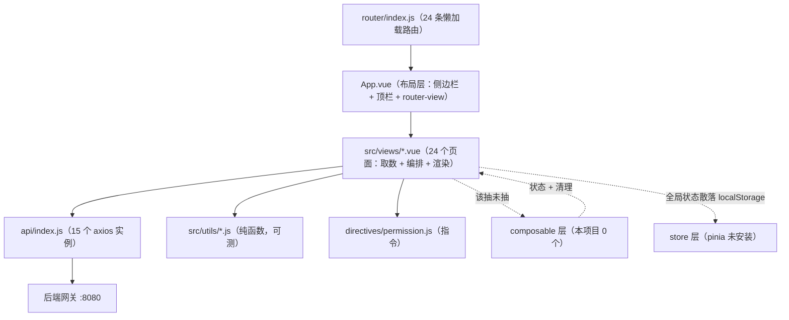
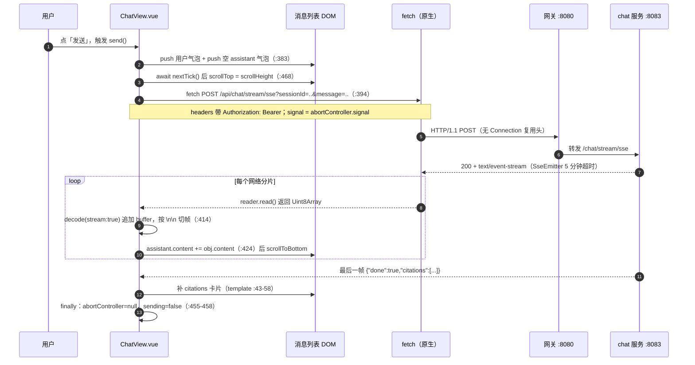

# Vue 3 进阶：组件设计与组合式函数

> **一句话结论**：Vue 3 真正的复用单位不是"文件"，而是**一段有状态、有副作用、有清理动作的生命周期逻辑**——只有这种逻辑才值得包装成 composable；纯计算该做成普通函数模块（如 `ai-cs-frontend/src/utils/format.js`）。本仓库恰好反过来：纯函数抽了（`src/utils/sse.js`、`src/views/agentRequest.js` 都有测试），**有状态的那部分全堆在组件里**（`ai-cs-frontend/src/views/ChatView.vue` 549 行、script 段 343 行），于是同一个 SSE 分帧循环被抄了三份、WebSocket 连上就没人关。
> **阅读前置**：[04-Vue3核心基础](./04-Vue3核心基础.md) 的 `ref`/`computed`/`onMounted` 必须能不看笔记写出来；[06-路由守卫与Axios请求封装](./06-路由守卫与Axios请求封装.md) 的 `src/api/index.js` 拦截器要知道长什么样；[07-Pinia状态管理实战](./07-Pinia状态管理实战.md) 只读"store 能做什么"——本仓库**没装 pinia**，本篇会讲清没有它时状态是怎么"假装"管住的。
> **证据基线**：B 级 = `ai-cs-frontend/`（Vue 3.5 + Vite 8 + Element Plus）与 `ai-cs-frontend-react/` 的真实文件与行号，行号以 `Select-String` 校过一次；C 级 = 本机 node 24 直接跑仓库里的纯 JS 模块（不装依赖、不联网、不构建），输出原样贴出。**未在本机启动浏览器实测的部分一律标注"未本机实测"**。预计阅读 45~60 分钟。

---

## 0. 先看现象

### 现场一：同一段 40 行 SSE 分帧代码，仓库里存在三份

`ai-cs-frontend/src/utils/sse.js:16` 有 `createSseParser(onEvent)`，`ai-cs-frontend/src/utils/sseStream.js:20` 有 `streamSse(url, options, deps)`，两个文件加起来 106 行、带 2 个测试文件（`sse.test.js` 77 行、`sseStream.test.js` 112 行）。但用 pwsh 查一遍引用：

```powershell
cd D:\Projects\Persion\ai-customer-service\ai-cs-frontend
(Select-String -Path src\views\*.vue -Pattern "utils/sse|sseStream|createSseParser" | Measure-Object).Count
```

```text
0
```

**零个 `.vue` 引用它。** 那组件里在干什么？两处手写副本：

- `ai-cs-frontend/src/views/ChatView.vue:401`（`resp.body.getReader()`）到 `:424`（`assistant.content += obj.content`）
- `ai-cs-frontend/src/views/AgentView.vue:135`（同样的 `getReader()`）到 `:157`（`assistant.steps.push(...)`）

两份都是 `while(true) → reader.read() → buffer.indexOf('\n\n')` 的同一套循环，只有最后 4 行业务分支不同（一个收 `content`，一个收 `step`）。更致命的差别是**收尾**：

```js
// src/utils/sse.js:65-76（抽出来的那份，有 flush）
/** 流结束（reader done / 用户点"停止生成"）时调用：
 *  服务端有时来不及补最后一个空行，留下半帧也要派发，否则会丢最后一段回答。*/
flush() {
  const rest = buffer.trim()
  buffer = ''
  if (!rest) return 0
  dispatch(rest)
  return 1
}
```

组件里的副本循环结束后直接 `if (streamError) throw`，**没有 flush**。也就是说：服务端如果没在最后一个 `data:` 后面补那个空行，最后一段回答就留在 `buffer` 里被丢掉。这个 bug 在抽出来的版本里被修过，在组件里的两个副本里还在。

### 现场二：通知页的 WebSocket 连上之后，路由切走就没人关

`ai-cs-frontend/src/views/NotifyView.vue:114`：

```js
ws = new WebSocket('ws://localhost:8085/ws/notify')
```

两处问题同时存在：

1. **端口写错**。8085 是 message 服务，notify 服务在 8086（端口表见 §1）。这条 WS 会被发到错误的进程上。
2. **没有清理**。全文件搜 `onUnmounted` / `onBeforeUnmount`，一个都没有；`disconnectWs()`（`:131`）只在用户手点"断开"按钮时才执行 `ws.close()`。路由切到别的页面，组件卸载了，连接和 `onmessage` 回调还活着，`addLog` 继续往已经卸载的 `ref` 里 `unshift`。

对比一下仓库里**清理写对了**的文件（`Select-String` 全量扫描的真实结果）：

```text
ChatDashboardView.vue:38: import { ref, nextTick, onBeforeUnmount } from 'vue'
ChatDashboardView.vue:100: onBeforeUnmount(() => {
Dashboard.vue:94: import { ref, computed, onMounted, onUnmounted } from 'vue'
Dashboard.vue:168: onUnmounted(() => {
MockCashierView.vue:61: import { ref, computed, onMounted, onUnmounted } from 'vue'
MockCashierView.vue:104: onUnmounted(() => {
```

25 个组件里只有 3 个写了卸载钩子，而"有副作用需要清理"的地方至少有 4 处（3 个定时器 + 1 个 WebSocket + 1 个 ECharts 实例）。**这说明清理不是能力问题，是"没有统一入口"的问题**——三处定时器各写各的 `let timer = null` + `if (timer) clearInterval(timer)`，第四处（WebSocket）作者就忘了。

### 现场三：一个 549 行的组件，光 `<script setup>` 就 343 行

```powershell
cd D:\Projects\Persion\ai-customer-service\ai-cs-frontend
$vue = Get-ChildItem src -Recurse -Filter *.vue
"组件(.vue)文件数: " + $vue.Count
"总行数: " + (($vue | Get-Content | Measure-Object -Line).Lines)
```

```text
组件(.vue)文件数: 25
总行数: 4644
```

排名前五（`Get-Content | Measure-Object -Line`，真实输出）：

```text
src\views\ChatView.vue            549
src\views\ProductView.vue         357
src\views\MqView.vue              335
src\views\MockCashierView.vue     249
src\views\AgentView.vue           223
```

`ChatView.vue` 的切分点：`1-169` 是 template，`171-514` 是 `<script setup>`（343 行），`516+` 是 style。一个文件里同时装着：会话列表 CRUD、消息数组的会话级隔离（`:195` 的 `const sessionMessages = ref({})`）、SSE 分帧、停止生成、引用卡片渲染（template `:43-58`）、点赞点踩反馈、图片上传、RAG 模式切换、自动滚底（`:468`）。这就是"容器/展示/业务逻辑"三层焊死在一个文件里的样子。

> **这些现象指向同一件事**：这个仓库**没有组件契约也没有 composable**——`defineProps` / `defineEmits` / `defineModel` / `defineExpose` / `<slot` / `provide` / `inject` 在 `src` 下的命中数全是 0。所有 24 个页面组件都是"自取数 + 自渲染 + 自管副作用"的孤岛，所以逻辑只能复制，副作用只能靠记性清理，组件只能越写越长。

---

## 1. 整体地图

一句话先给结论：**这个前端只有两层是真的（`App.vue` 布局层 + `src/views/` 页面层），中间缺了"展示组件层"和"composable 层"两层，而缺掉的那两层正是复用发生的地方。**



> **读图说明**：实线是现在真的存在的调用链，虚线是**本仓库缺失的通道**——`V -. 该抽未抽 .-> C` 是全文主线：三份 SSE 分帧、三份定时器清理、一份无人关闭的 WebSocket，全都堆在 `V` 里，本来应该沉到 `C`。最容易看错的一根箭头是 `V --> U`：`src/utils/` 里放的是**无状态的纯函数**（`formatSize`、`createSseParser`），它和 composable 长得像但地位完全不同——纯函数不需要组件实例，composable 需要（要用 `onScopeDispose`、要 `ref`）。把 `utils` 当 composable 理解，就会得出"我们已经在复用了"的错误结论。另一根容易看错的是 `V -. 全局状态散落 localStorage .-> S`：`S` 在图上是个框，但 `ai-cs-frontend` 的 `package.json` 里**没有 pinia 依赖**，这里没有任何 store 实现。

### 组件四层：责任与边界

| 层 | 责任 | 允许做什么 | 禁止做什么 | 本仓库实例 | 数量 |
|---|---|---|---|---|---|
| 布局组件 | 外壳、导航、全局容器 | 调 `router`、读当前用户、摆 `<router-view>` | 调业务接口取数 | `ai-cs-frontend/src/App.vue` | 1（215 行） |
| 容器组件（页面） | 取数、编排、把数据交给下层 | 调 `src/api/index.js`、持有页面级状态 | 写死的可复用渲染结构 | `src/views/` 下 24 个 | 24 |
| 展示组件 | 只吃 props、只吐事件 | 纯渲染 + 本地 UI 状态（展开/悬停） | 直接 `fetch`/`axios`、读 `localStorage` | **无**（`src/components/` 目录不存在） | 0 |
| 业务组件 | 封装一条业务规则（如"金额格式化 + 币种 + 折扣展示"） | 组合 composable + 展示组件 | 自己发请求拿数据 | **无** | 0 |
| 横切：composable | 封装有状态的生命周期逻辑 | 用 `ref`/`watch`/`onScopeDispose` | 直接产出 DOM 结构 | **无**（`src/composables/` 不存在） | 0 |
| 横切：utils | 纯计算 | 纯函数、可被 node 直接 import | 触碰组件实例、`window` 之外的外部状态 | `utils/format.js`、`utils/sse.js`、`utils/auth.js` | 5 个 js |

### 参与方：一条"发一句话给 AI"的链路上都有谁

| 参与方 | 在链路里的角色 | 关键文件 / 端口 | 证据 |
|---|---|---|---|
| 路由 | 决定挂载哪个页面组件，并做登录守卫 | `ai-cs-frontend/src/router/index.js:1-46` | 24 条 `() => import(...)` 全量懒加载 |
| 布局 | 提供侧边栏与顶栏，`<router-view />` 出口 | `ai-cs-frontend/src/App.vue:19-62` | 11 个硬编码 `el-menu-item` |
| 页面容器 | 组装输入框、消息列表、引用卡片 | `ai-cs-frontend/src/views/ChatView.vue:1-169` | template 169 行 |
| SSE 客户端 | `fetch` + `ReadableStream` 手动分帧 | `ChatView.vue:394-438`（手写）、`utils/sseStream.js:20`（抽好但没人用） | 两份实现 |
| API 层 | 统一 `Authorization` 与 401 跳登录 | `ai-cs-frontend/src/api/index.js:1-146` | `createClient(baseURL)` 造 15 个实例 |
| 网关 | 路由转发、鉴权 | 端口 8080（`docker-compose` 里服务名 `api-gateway`） | `ai-cs-frontend/nginx.conf:8-12` |
| chat 服务 | 产出 SSE 帧 | 端口 8083，`/chat/stream/sse` | 服务端 `SseEmitter` 超时 5 分钟 |
| notify 服务 | WebSocket 推送 | 端口 **8086**（`NotifyView.vue:114` 写的是 8085 ⚠️） | 见 §0 现场二 |

> 端口表（用于核对"连错服务"这类问题）：gateway 8080 / user 8081 / knowledge 8082 / chat 8083 / search 8084 / **message 8085** / **notify 8086** / order 8087 / product 8088 / pay 8089 / mq 8090。前端 dev 端口 5173（`ai-cs-frontend/vite.config.js` 的 `server.port`）。`8085` 和 `8086` 只差一位，是这类 bug 的高发区。

---

## 2. 关键概念与关键类/关键 API

### 2.1 模块级 API 速查（附本仓库命中数）

| 名称 | 位置 | 角色 | 关键点 |
|---|---|---|---|
| `defineProps` | 编译器宏，无需 import | 声明组件**输入**契约 | 编译期擦除，运行时拿不到；`props` 对象只读，改它会在 dev 警告 |
| `defineEmits` | 同上 | 声明组件**输出**事件 | 必须显式声明，否则父组件的 `@xxx` 监听器会作为 `$attrs` 透传到根节点（"点了没反应"的根源之一） |
| `defineModel` | Vue 3.4+ 宏 | 一条语句搞定 `v-model` | 返回 `ref`，内部自动 emit `update:modelValue`；`defineModel('keyword')` = `v-model:keyword` |
| `defineExpose` | 宏 | 暴露方法给父组件 `ref` 调用 | **本项目 0 命中**；它是"最后手段"，用了就意味着父子耦合到了命令式调用 |
| `<slot>` / 作用域插槽 | 模板语法 | 父组件向子组件注入**渲染逻辑** | 作用域插槽能反向把 `{ row }` 交回父组件，是通用表格的唯一正解 |
| `provide` / `inject` | 组合式 API | 跨层注入，作用域限定在组件子树 | key 用 `Symbol` 防撞；注入源在代码里"看不见"，属于隐式依赖 |
| `composable` | 约定（`useXxx`） | 封装有状态逻辑的普通函数 | 必须在 `setup` 或另一个 composable 里调用；清理用 `onScopeDispose` |
| `shallowRef` / `markRaw` | 响应式 API | 关掉深层代理 | 第三方实例（ECharts、monaco）必须 `markRaw` 或干脆用普通变量 |
| `v-memo` | 模板指令（3.2+） | 记忆整棵子树，跳过 diff | 必须配稳定 `key`，且依赖数组要写全，否则"该更新不更新" |
| `defineAsyncComponent` | API | 组件级按需加载 | 本仓库用它没必要——24 条路由已经是 `() => import()` 级懒加载 |
| `onScopeDispose` | 生命周期 | 在当前**副作用作用域**销毁时执行 | composable 里的正确清理钩子，比 `onUnmounted` 适用范围大 |

**关于"命中数 0"这件事要如实读**：`grep` 全 `src`（25 个 `.vue` + 全部 `.js`）的结果是 `defineProps = 0`、`defineEmits = 0`、`defineModel = 0`、`defineExpose = 0`、`<slot = 0`、`provide( = 0`、`inject( = 0`。这不是"本项目风格更简洁"，是**这 25 个组件之间没有任何组合关系**：每个页面都直接接在路由上，页面之间互不引用。所以本篇后面讲的所有组件通信机制，在本仓库都是"该会但没落地"的能力——我会明确标出哪些是现状、哪些是改法。

### 2.2 最容易混的五个东西

| 名称 | 是什么 | 有没有状态 | 需要组件实例 | 能清理副作用 | 本项目对应 |
|---|---|---|---|---|---|
| 纯工具函数 | `formatSize(1536) → "1.5 KB"` | 无 | 不需要 | 不涉及 | `src/utils/format.js:13` |
| composable | 一段带 `ref` + `watch` + 清理的逻辑 | 有（每次调用一份独立状态） | 需要（`setup` 内） | 需要 | **无** |
| store | 全局单例状态 | 有（全局一份） | 不需要 | 自己管 | **无**（pinia 未装） |
| mixin（Vue 2） | 把选项对象混进组件 | 有（隐式合并） | 需要 | 隐式 | 已废弃，勿用 |
| 指令 directive | 操作 DOM 的横切逻辑 | 无（或挂在 `el` 上） | 不需要 | `unmounted` 钩子 | `src/directives/permission.js:16` |

判断口诀：**"这段逻辑在不挂载组件的情况下能不能跑完？"** 能跑完 → 纯函数；需要 `ref` 但不需要全局共享 → composable；需要跨路由共享 → store；只改 DOM 属性 → 指令。

---

## 3. 原理与证据逐段精读

### 3.1 四层组件：`views/` 全包是"缺了下面三层"，不是"页面写得大"

**在干什么。** 现在每个 `.vue` 文件同时承担四件事：取数（`api.get('/sessions')`）、编排（把 SSE 帧拼成消息数组）、渲染（会话列表 + 气泡 + 引用卡片）、副作用（`setInterval`、`WebSocket`、ECharts）。`ChatView.vue` 的 343 行 script 里，`loadSessions`/`newSession`/`switchSession`/`handleDeleteSession`/`send`/`stopGenerating`/`scrollToBottom`/反馈提交/图片上传全在一个作用域里。

**为什么这么设计。** 这不是设计，是最短路径：新建一个页面就 `src/views/XxxView.vue`，写完能跑，路由里加一行就上线。在没有第二个消费者之前，拆组件是纯粹的负债（多一个文件、多一层 props 传递）。本仓库 24 个页面确实没有第二个消费者——**这正是"展示组件层为空"的合理解释，也是它开始出问题的原因**：`ChatView` 和 `AgentView` 的流式渲染结构已经 90% 相同了。

**换写法会怎样。** 把 `ChatView` 里的"消息气泡 + 引用卡片"抽成 `src/components/MessageBubble.vue`（props：`msg`；emits：`retry`、`feedback`），受益方不止 Chat 页：

| 抽出来的东西 | 谁受益 | 收益是具体的什么 |
|---|---|---|
| `MessageBubble.vue` | Chat 页 | 气泡渲染从 template `35-90` 行缩成 1 行 `<MessageBubble :msg="m" />` |
| `StepTimeline.vue` | Agent 页 | `AgentView` 的步骤点亮逻辑（`steps` 数组渲染）与气泡分离，Agent 页可复用气泡 |
| `useSseStream()` | Chat 页 + Agent 页 | 40 行分帧循环 + flush + abort 只写一次（见 3.5） |
| `usePolling()` | Dashboard、MockCashier | 定时器 + 清理只写一次 |
| `useWebSocket()` | Notify 页 | 连接、重连、卸载关闭统一（见 §0 现场二） |

**常见坑。** 把"抽组件"理解成"按行数切文件"：切出来的组件仍然自己 `import api` 取数，那不是展示组件，只是把容器复制了一份，`props` 一层没少、耦合一层没减。判断标准只有一条：**展示组件的 `props` 里能不能只出现数据和回调，不出现 `sessionId` 这种"取数凭据"？**

### 3.2 props 设计：受控与不受控，与"本项目连契约都没有"

**在干什么。** props 是父到子的唯一合法通道，`emits` 是子到父的唯一合法通道——`v-model` 是这两条通道的语法糖。`defineProps` 把这个契约写在组件顶部，dev 模式下 Vue 会校验类型、缺必填 prop 时给警告。

**为什么这么设计。** 单向数据流解决的是"谁改了数据"的归因问题：子组件不能改 `props`（运行时会警告 `Set operation on key "xxx" failed: target is readonly`），想改只能 `emit` 请求父组件改。类比后端：**受控组件 = 方法接收参数并返回结果（无副作用）；不受控组件 = 方法内部持有状态，调用方只能通过返回值/回调感知**。

两种写法的取舍：

| 模式 | 数据住在哪 | 父组件能否覆盖 | 典型用途 | 风险 |
|---|---|---|---|---|
| 受控（`v-model` / `:value` + `@update:value`） | 父组件 | 随时 | 表单、搜索框、分页器 | 父组件要写一堆 `ref` 和一个 handler |
| 不受控（内部 `ref(props.defaultValue)` 之后不再跟随） | 子组件 | 只在初始化时 | 弹窗内部草稿、编辑器 | 父组件想重置时没法重置（要靠 `:key` 强制重建） |

多值 `v-model`（Vue 3.4+）：

```vue
<!-- 子组件 -->
<script setup>
const keyword = defineModel('keyword', { type: String, default: '' })
const page = defineModel('page', { type: Number, default: 1 })
</script>

<!-- 父组件：v-model:keyword + v-model:page 两个独立双向绑定 -->
<SearchBar v-model:keyword="kw" v-model:page="page" />
```

`emits` 命名三条硬规则：① 声明用 camelCase、监听用 kebab-case（`@update-done` 对应 `'updateDone'`，Vue 会自动转换，但写成全小写会对不上）；② 不要和原生事件同名（`click`、`change`）——同名会让 `$attrs` 透传失效；③ 事件名描述"发生了什么"，不描述"请做什么"：`submitted` 优于 `handleSubmit`。

**换写法会怎样。** 本仓库现在是"零契约"：页面组件之间不通信，所以不需要 props。代价在跨页面复制时一次性付清——`ChatView` 与 `AgentView` 里各有一份 `scroll()`：

```js
// src/views/ChatView.vue:468        // src/views/AgentView.vue:106
async function scrollToBottom() {     async function scroll() {
  await nextTick()                      await nextTick()
  if (messagesRef.value) {              if (msgRef.value) msgRef.value.scrollTop =
    messagesRef.value.scrollTop =         msgRef.value.scrollHeight
      messagesRef.value.scrollHeight    }
}                                     }
```

同一个"等 DOM 更新完再滚到底"的逻辑，两个名字、两个 ref 名。抽成 `useScrollToBottom(targetRef)` 之后两处都变成一行。

**常见坑。** ① 直接解构 props：`const { title } = defineProps()` 在 Vue 3.5 之前会丢响应性（3.5 起编译器对 `defineProps` 解构做了响应式支持，但只在 `<script setup>` 的 props 解构场景，别拿它当通用写法）；② 用 props 当初始值再 `watch` 同步——两边都能改同一份数据，必然出现"输入框打字跳光标"；③ `defineEmits` 里漏声明的事件会被当成原生事件绑到根节点，表现为"点了没反应但没有报错"。

### 3.3 插槽：作用域插槽是唯一能"父组件决定单元格长什么样"的机制

**在干什么。** 普通插槽让父组件往子组件的固定位置塞内容；**作用域插槽**在塞内容的同时，把子组件的数据（`{ row, index }`）反向交给父组件——渲染模板在父组件、数据在子组件，两侧各自持有自己该持有的东西。

**为什么这么设计。** 通用表格如果靠 `props` 传"渲染函数"，就得在父组件里写 `h()` 渲染函数（JSX 味道的字符串）；如果靠"每列一个 props"（`prop`/`formatter`），表达力立刻到顶（`formatter(row) => string` 只能出字符串，出不了按钮）。作用域插槽用模板解决了这个表达力问题，相当于后端**模板方法模式**：父类定骨架（`<table>` 的结构与分页），子类填钩子（单元格）。

真实用途清单（都能在本仓库找到"该用而未用"的对应物）：

| 用途 | 为什么只能靠作用域插槽 | 本仓库现状 |
|---|---|---|
| 表格自定义列（状态标签、操作按钮） | 列内容形态无法用 `formatter` 表达 | `ProductView.vue`、`MqView.vue` 里 `<el-table-column>` 内联 `#default="scope"` 直接用，**没有封装成自己的通用表格** |
| 列表项的右边插槽 | 同一列表在不同页面尾巴不同 | 各页面各写一遍 `v-for` |
| 下拉选项 / 树节点自定义 | 选项结构随业务变 | 未封装 |

注意：Element Plus 的 `<el-table-column>` + `#default="scope"` 本身就是标准作用域插槽用法，本仓库已在消费它；缺的是**自己成为提供方**。

**换写法会怎样。** 不抽通用表格，代价是每加一个业务列表就复制一次 `<el-table>` + 分页 + loading + 空态。`ProductView.vue` 357 行、`MqView.vue` 335 行，其中相当一部分是这类重复骨架。

**常见坑。** ① 具名插槽写成 `v-slot:header` 和 `#header` 混用没问题，但 `#header="props"` 里解构得到的是子组件传上来的**插槽 props**，不是组件 props——初学者最常在这混；② 插槽内容在**父组件的作用域**里编译，所以子组件的局部变量在插槽里不可见（想用就得从插槽 props 传出去）；③ 插槽里的 `v-for` 拿不到子组件的 `key` 策略，列表复用容易出现"切换行后插槽内容错位"。

### 3.4 provide/inject：能省掉"props 钻透"，但换来一个隐式依赖

**在干什么。** 祖先组件 `provide(key, value)`，任意深度的后代 `inject(key, fallback)` 直接拿到，中间层不用传。值可以是 `ref`，此时后代拿到的是响应式的（`inject` 不会解包 ref，要 `.value`）。

**为什么这么设计。** "props 钻透（prop drilling）"在层级深时会污染中间层：中间组件明明不关心主题/权限，却必须声明并透传。provide/inject 相当于**限定作用域的依赖注入容器**——类比 Spring：`provide ≈ 注册 Bean`、`inject ≈ @Autowired`，区别是容器范围是组件子树，随组件销毁而销毁。

取舍表：

| 场景 | 用 provide/inject | 用 props | 用 store |
|---|---|---|---|
| 主题、i18n、权限标识（横切、全树共享） | ✅ 首选 | ❌ 中间层被污染 | ⚠️ 也可，但引入全局单例 |
| 一个表单容器 → 若干表单控件（Element Plus 的 `el-form` 就是这么做的） | ✅ 首选 | ❌ 控件 props 会爆炸 | ❌ 过度 |
| 父子两层之间传一个列表 | ❌ 隐式、看不出依赖 | ✅ | ❌ |
| 跨路由共享登录用户 | ⚠️ 只在子树内有效 | ❌ | ✅ |

**换写法会怎样。** 本仓库没用 provide/inject，登录用户走了另一条路：`src/utils/auth.js` 从 `localStorage` 读。`localStorage` **不是响应式的**，于是必须有代码手动同步——`ai-cs-frontend/src/App.vue:107-112`：

```js
// 路由变化时重新读取登录信息（登录/退出后 localStorage 已更新）
watch(
  () => route.path,
  () => {
    currentUser.value = getUser() || {}
  }
)
```

这个 `watch` 就是"非响应式全局状态"的税：登录、退出、换账号的后 UI 都不会自己更新，只能靠"路由变了就重读一次"来兜。改用 `provide` 一个 `ref` 用户对象（或 pinia）后，这个 watch 可以整段删掉。

**常见坑。** ① key 用字符串撞车：用 `Symbol('user')` 并导出，别在两边各写一遍 `'user'`；② `inject` 的默认值只在"没提供"时生效，`inject('x', ref(0))` 拿到的还是 ref，忘了 `.value` 就会渲染成 `[object Object]`；③ 在 `inject` 里传函数并在子组件长期持有（事件订阅），组件卸载时要解绑，否则等于制造了隐式内存泄漏。

### 3.5 composable 的三条写法规范：返回值、清理、响应式入参

**在干什么。** composable 就是一个**以 `use` 开头、在 `setup` 内被调用的普通函数**，内部用 `ref` 建状态、用 `watch` 建联动、用 `onScopeDispose` 建清理，最后 `return` 一个对象给调用方。它没有任何框架魔法，全部机制来自"`ref` 被创建在哪个作用域里"。

**为什么这么设计。** Vue 3 的响应式与生命周期是**按当前活动的副作用作用域**归属的：`onMounted`/`onScopeDispose` 之所以能"注册到组件上"，是因为调用时存在一个 active effect scope。composable 只是把这段逻辑搬到函数里，作用域依然是调用它的那个组件——**所以每次调用得到一份独立状态，卸载时自动清理**。这也解释了它为什么替代 mixin：mixin 是隐式合并（命名冲突、来源不明），composable 是显式 import + 显式解构。

三条规范，逐条给反例：

**规范一：返回值用普通对象，里面放 `ref`，不要把整个返回值 `reactive()` 掉。**

```js
// ✅ 推荐
export function useCounter() {
  const count = ref(0)
  const double = computed(() => count.value * 2)
  function inc() { count.value++ }
  return { count, double, inc }        // 解构后 count 仍是 ref，响应性不丢
}

// ❌ 反例：reactive 包装后解构会丢响应性
export function useCounterBad() {
  return reactive({ count: 0, inc() { this.count++ } })   // const { count } = useCounterBad() 得到的是数字快照
}
```

**规范二：清理副作用要用 `onScopeDispose`，而不是 `onUnmounted`。**

```js
export function usePolling(fetcher, intervalMs = 15000) {
  const data = ref(null)
  const loading = ref(false)
  let timer = null

  async function run() { /* ... 调用 fetcher，写 data ... */ }

  onMounted(() => {
    run()
    timer = setInterval(run, intervalMs)
  })
  // ✅ 作用域销毁就清：组件卸载、或外层 effectScope.stop() 都会触发
  onScopeDispose(() => { if (timer) clearInterval(timer) })

  return { data, loading, refresh: run }
}
```

为什么不用 `onUnmounted`：composable 可能被另一个 composable 或 store 调用，那里没有"组件实例"，`onUnmounted` 会因为找不到活动实例而失效（dev 下 Vue 会告警 `onUnmounted is called when there is no active component instance`）。`onScopeDispose` 绑定的是副作用作用域，两种情况都成立。

**规范三：入参要接受"可能是 ref、可能是值"，内部统一 `toValue`。**

```js
import { toValue, watch } from 'vue'

// url 既可以传字符串，也可以传 ref；内部永远用 toValue 取当前值
export function useFetchText(url) {
  const text = ref('')
  watch(() => toValue(url), async (u) => { /* ... u 永远是最新值 ... */ }, { immediate: true })
  return { text }
}
```

反例是 `export function useFetchText(url) { fetch(url) }`：调用方传 `ref` 进来，`fetch(ref对象)` 得到 `[object Object]`。这是 composable 最常见的"用了但没生效"的原因。

**换写法会怎样：把你仓库里的两份副本改成一个 composable。** 现状是 `ChatView.vue:401-438` 和 `AgentView.vue:135-164` 各写了一遍分帧循环，而且都缺 flush。改法（新文件，**当前不存在，属建议落地**）：

```js
// src/composables/useSseStream.js（建议新增）
import { ref } from 'vue'
import { streamSse } from '../utils/sseStream'

export function useSseStream() {
  const streaming = ref(false)
  let controller = null

  async function start(url, { method = 'POST', headers, body, onEvent }) {
    controller = new AbortController()
    streaming.value = true
    try {
      // 直接复用已抽好、已测试的纯函数：分帧 + flush + abort 全在里面
      return await streamSse(url, { method, headers, body, signal: controller.signal, onEvent })
    } finally {
      streaming.value = false
      controller = null
    }
  }

  function stop() { controller?.abort() }
  return { streaming, start, stop }
}
```

调用方从 40 行降到 6 行：`const { streaming, start, stop } = useSseStream()`。**受益方是两个组件 + 未来的任何一个流式页面**，而 `streamSse` 已经有 `sseStream.test.js`（112 行）守着，`useSseStream` 只是加了一层"组件生命周期友好"的壳——这正是 composable 与纯函数的分工：**纯函数负责算法，composable 负责状态与生命周期**。

**常见坑。** ① 在 composable 顶层 `await`（`<script setup>` 里是顶层 await，但普通 composable 函数若声明为 `async`，返回值变成 Promise，调用方解构拿到 `undefined`）；② composable 里调用 `useRoute()`/`useStore()` 是合法的，但那些函数同样只能在 `setup` 上下文调用——所以 composable 的调用位置不能随便放（放进 `setTimeout` 里就会失效）；③ 把"只是拼字符串"的函数也包装成 `useXxx`——见 3.9。

### 3.6 composable 与 store 的分工：状态活多久，决定放哪

**在干什么。** composable 每次调用创建**一份新状态**，随宿主销毁而消失；store 是**模块级单例**，跨路由、跨组件共享，生命周期跟应用一致。

**为什么这么设计。** 两者的差别只有一个维度——**这份状态该活多久、该被几个人看见**。组件内状态（输入框、加载中、当前会话消息）如果放进 store，会带来两个后果：组件卸载后状态还在（下次进来看到上次的残留），以及多个页面同时打开时互相污染。

判断表：

| 状态 | 生命周期 | 该放哪 | 本仓库现状 |
|---|---|---|---|
| 输入框内容、loading、当前页签 | 组件实例 | 组件内 `ref` / composable | 组件内 `ref` ✅ |
| 会话消息 `sessionMessages` | 页面实例 | 组件内（页面不切走就不丢） | `ChatView.vue:195` 组件内 ✅ |
| 登录 token / 用户信息 | 整个应用 | store（或 `provide` 的响应式对象） | `localStorage` + 手动 watch ⚠️ |
| 主题、语言 | 整个应用 | store | 无 |
| 一次 SSE 的 AbortController | 一次请求 | composable 私有变量 | 组件内 `let abortController`（`ChatView.vue:203` 附近）✅ 但不可复用 |

`ai-cs-frontend` 的 `package.json` 里没有 pinia，所以本仓库的"全局状态"只有两个 `localStorage` key（`src/utils/auth.js:4-5`）。这也解释了 §3.4 里那个 `watch(route.path)`。

**换写法会怎样。** 如果把 `sessionMessages` 直接搬进 store（很多人第一反应），会得到一个更难查的 bug：`ChatView` 卸载后消息还在，但"正在流式的那条消息"被中断了，下次进来那条消息永远停在半句。**正确切法是按"活多久"切，不是按"大不大"切**。

**常见坑。** ① 在 composable 里调用 store 并修改它——composable 变成了"有副作用的 store 操作器"，两个组件同时用就开始互相打架；② 把 store 当 composable 用（一个页面一个 store 实例）——那不如直接 `ref`；③ 用 `provide/inject` 冒充全局 store（只在子树内有效，跨路由拿不到）。

### 3.7 递归组件与动态组件：能力很便宜，但本仓库用不到

**在干什么。** 递归组件 = 组件在自己的模板里引用自己（生成树形结构）；动态组件 = `<component :is="comp">` 在运行时决定渲染哪个组件，常配 `<KeepAlive>`。

**为什么这么设计。** 树形数据（菜单、评论、知识库目录）的深度不定，递归是唯一自然表达；而"同一个位置渲染不同组件"（Tab 页、节点详情）用一个占位符比 `v-if` 链干净。

```vue
<!-- 递归组件的两个必要条件：名字 + 终止条件 -->
<script setup>
defineOptions({ name: 'TreeNode' })   // 显式命名，允许模板里 <TreeNode> 自引用
const props = defineProps({ node: { type: Object, required: true } })
</script>

<template>
  <div class="tree-node">
    <span>{{ props.node.label }}</span>
    <!-- 终止条件：children 为空就不再往下递归 -->
    <TreeNode v-for="child in props.node.children || []" :key="child.id" :node="child" />
  </div>
</template>
```

**换写法会怎样。** 本仓库的树形/图数据（`GraphView.vue` 160 行、`TraceView.vue` 189 行）都是**扁平列表 + 缩进**渲染，没有做递归组件。这不一定是错：数据只有两层时（trace 的 span 列表），扁平 `v-for` + 计算缩进样式更短。递归组件真正的价值出现在"深度未知且每层渲染不同"的场景。

关于动态组件：本仓库 24 条路由全是 `() => import(...)`（`ai-cs-frontend/src/router/index.js`），**代码分割已经在路由层做完了**，页面内再上 `defineAsyncComponent` 只是多一层 loading 状态，没有收益。

**常见坑。** ① 忘了终止条件 → `RangeError: Maximum call stack size exceeded`；② `<script setup>` 里递归调用要保证组件能被模板解析（文件名自引用或 `defineOptions({ name })`），名字写错的表现是"渲染成一个空的自定义标签"；③ `<component :is>` 传字符串会去找**全局注册**的组件，传组件对象才是局部组件——本仓库 `src/main.js:14-16` 把 Element Plus 图标全量全局注册了，所以传字符串能"碰巧"生效，换个图标库立刻失效。

### 3.8 性能：先关掉无用的深度响应，再谈 `v-memo`

**在干什么。** `ref(大对象)` 会给整个对象套一层深度 Proxy（访问时才建，惰性），任何嵌套属性的读都会走 `get` 陷阱并参与依赖收集；`shallowRef` 只代理 `.value` 的替换；`markRaw` 让某个对象永不被代理；`v-memo` 让整棵子树在依赖不变时跳过 diff。

**为什么这么设计。** 深度响应式的成本不在"创建"，而在"读取时建立依赖 + Proxy 陷阱开销"。本机实测（node 24，直接读 `node_modules/vue`，不构建、不联网）：

```powershell
cd D:\Projects\Persion\ai-customer-service\ai-cs-frontend
node --input-type=module -e @"
const { ref, shallowRef } = await import('vue')
const big = Array.from({ length: 20000 }, (_, i) => ({ id: i, text: 'msg-' + i, meta: { tag: 't' + i } }))
const deep = ref(big); const shallow = shallowRef(big)
function readAll(list) { let n = 0; for (const it of list) n += it.meta.tag.length; return n }
readAll(deep.value); readAll(shallow.value)   // 预热
let t0 = performance.now(); readAll(deep.value); let t1 = performance.now()
let t2 = performance.now(); readAll(shallow.value); let t3 = performance.now()
console.log('ref 代理读 20000 条嵌套属性 ms =', (t1 - t0).toFixed(2))
console.log('shallowRef 读 20000 条嵌套属性 ms =', (t3 - t2).toFixed(2))
"@
```

真实输出（本机单次测量，仅供量级参考）：

```text
ref 代理读 20000 条嵌套属性 ms = 10.62
shallowRef 读 20000 条嵌套属性 ms = 0.37
```

**怎么读这个数**：这是**纯读**（在 `effect` 之外，所以只体现 Proxy `get` 开销；放进组件 render 里还要叠加依赖收集与 diff）。结论不是"ref 慢 28 倍所以都别用"，而是：**每次渲染都要遍历的大数组，用 `shallowRef` 能省掉整层代理**；而 20000 条这种规模本来也该上虚拟滚动（本仓库未落地，Element Plus 的 `el-table-v2` 未使用）。

顺带一个反直觉的实测（同一环境下 `ref` vs `shallowRef` 的**建包装**耗时是 0.04ms vs 0.00ms，属噪声量级）——说明"创建 `ref(大对象)` 很慢"是个错误直觉，成本在访问侧。

本仓库真实的两个例子：

| 位置 | 现状 | 问题 | 改法 |
|---|---|---|---|
| `ai-cs-frontend/src/views/ChatView.vue:195` | `const sessionMessages = ref({})`，key 是 sessionId、value 是消息数组，**所有会话的全部消息都被深度代理** | 100 个会话 × 50 条消息 = 5000 个被代理对象，只有"当前会话"会被渲染 | 分两步：`sessionMessages` 用 `shallowRef` + 整体替换；"当前会话消息"单独用一个 `ref([])` 供渲染 |
| `ai-cs-frontend/src/views/ChatDashboardView.vue:48` | `let chartInstance = null`（普通变量，注释"ECharts 实例需手动管理生命周期"） | 写法正确，但靠人记着 `:100` 的 `onBeforeUnmount` 清理 | 抽 `useEcharts(elRef)`，清理逻辑进 `onScopeDispose`；若一定要放进响应式，用 `shallowRef` + `markRaw` |

**为什么流式追加必须用深代理。** `ChatView.vue:424` 是 `assistant.content += obj.content`——`assistant` 是从 `currentMessages` 数组里取出的元素，逐 token 修改它的属性要触发重渲染，就依赖深代理。所以"改用 `shallowRef`"不能无脑套：正确姿势是把**正在流式的那一条消息**提升成独立 `ref`（浅层即可），而不是让整个消息仓库承担代理成本。`ChatView.vue:383` 的注释就是这个道理的另一半：「需持响应式代理引用，逐 token 追加才会触发视图更新」。

**常见坑。** ① `v-memo` 依赖数组漏项 → 该更新的不更新，且极难查（表现为"数据变了但界面不动"）；② `shallowRef` 里的对象整体替换才触发更新，`shallowRef.arr.push()` 不触发，需要 `triggerRef`；③ `markRaw` 后再改它内部属性也不会更新——ECharts/monaco 这类实例本来就该自己 `setOption`，不该指望响应式。

### 3.9 可测试性：能测的前提是"不挂载组件也能跑"

**在干什么。** 把逻辑从 `.vue` 里搬到 `.js` 里，测试就从"必须 mount 组件 + 造 DOM + mock 网络"降级成"import 一个函数 + 断言返回值"。

**为什么这么设计。** 组件测试的成本结构很陡：`mount()` 要装依赖（Element Plus 全量注册）、要 mock `fetch`、要处理 `nextTick`、要断言 DOM 结构。而纯函数测试只有一个 `expect`。本仓库已经有一条**做对了**的证据：

```js
// src/views/agentRequest.js:1-13（整个文件 13 行，无 Vue 依赖）
export function buildAgentRequest(sessionId, input, runId) {
  const request = { sessionId, input }
  if (runId) request.runId = runId
  return request
}
```

配套的 `src/views/agentRequest.test.js`（29 行，4 个 `it`）里有一条很有意思的契约断言：

```js
it('新对话不携带 runId 字段', () => {
  const request = buildAgentRequest(1787387874147, '我要申请退款', null)
  expect(request).toEqual({ sessionId: 1787387874147, input: '我要申请退款' })
  expect('runId' in request).toBe(false)     // 不是 undefined，是"这个字段不能存在"
})
```

为什么要单独断言"字段不存在"：后端 Agent 用 `runId != null` 判断"是新一轮还是继续上一轮"，传 `runId: undefined` 经过 JSON 序列化会消失（安全），但如果哪天有人改成 `runId: null` 或者空串，语义就错了。这类契约只有把请求体构造函数抽出来才测得到。

`src/utils/sseStream.js:22` 的 `deps.fetchImpl ?? fetch` 是另一种可测性手法：**把外部依赖作为参数注入**，测试里传一个假的 `fetch` 返回可控的 `ReadableStream`，就能在 node/jsdom 里跑完整的流式流程（`sseStream.test.js` 112 行就是干这个的）。类比后端：`Clock` 注入 vs `System.currentTimeMillis()`。

**换写法会怎样。** 反例就是那两份组件内副本：要测 `ChatView.vue:401-438` 的分帧逻辑，必须 `mount(ChatView)` + mock 全局 `fetch` + 构造分段到达的 `ReadableStream` + 等若干 `nextTick`。也许写得出来，但"改一行就重跑一次组件测试"的反馈速度会让人干脆不写。这就是"三份实现里只有抽出来的那份有测试"的因果。

**常见坑。** ① 抽出来的函数仍然 `import { ref } from 'vue'` 并用组件生命周期 → 测试里必须 `mount`，等于没抽；② 用 `vi.mock('../api')` 去 mock 模块，但组件里写的是 `import { chatApi } from '../api'`（对象解构导入），mock 边界取决于导出形态，容易 mock 了却没生效；③ 只断言"没抛异常"，不断言"发了什么请求、字段对不对"——`'runId' in request` 这种断言才是真的在守契约。

---

## 4. 一次完整执行时序：从点"发送"到气泡里出现字

场景取自 `ai-cs-frontend/src/views/ChatView.vue` 的真实代码路径（行号已核）。



> **读图说明**：整条链的关键在 **第 6~7 步那个 `loop`**——它不是一个"请求-响应"，而是"响应头先到、body 分很多片陆续到"。所以第 8~10 步的每一次 `reader.read()` 都可能在**任何字节位置**切断一帧（`data: {"cont` + `ent":"你好"}` 分两个 TCP 包到达），这就是为什么必须有 `buffer` 累积与 `\n\n` 边界查找；把 `loop` 看成"循环解析每个完整事件"是**最常见的误解**，会得出"服务端保证一次一个完整事件"的错误结论。另一处容易看错的是第 3 步：空 assistant 气泡是**先插入再填充**的，如果这一步用了不保留代理引用的写法（例如 `currentMessages.value.push({...})` 之后又去取 `currentMessages.value.at(-1)` 的副本），第 9 步的 `+=` 就不会触发视图更新——症状是"接口有返回，界面一片空白"。

### 各步失败分别报什么

| 失败点 | 触发条件 | 用户看到什么 | 代码里的处理 |
|---|---|---|---|
| 第 4 步 fetch 抛异常 | 网关没起、CORS、断网 | `❌ 错误: Failed to fetch` + 红色提示「对话连接中断，请重试」 | `:451` 用 `e?.message?.includes('Failed to fetch')` 专门识别 |
| 第 5 步非 2xx | 401（token 过期）、502（chat 服务挂） | `❌ 错误: HTTP 401` | `:400` `if (!resp.ok || !resp.body) throw new Error('HTTP ' + resp.status)` |
| 响应体为空 | 网关把 SSE 缓冲成普通响应 | `❌ 错误: HTTP 200`（因为 `!resp.body`） | 同上；根因在 nginx `proxy_buffering off`（`ai-cs-frontend/nginx.conf:58`）没配 |
| 第 9 步 JSON.parse 失败 | 半帧被当成完整帧（不该发生） | 静默跳过，表现为"少一句话" | `:422` `try { obj = JSON.parse(data) } catch { continue }` |
| 流内业务错误 | 后端在帧里塞 `{"error":"..."}` | `❌ 错误: <后端原文>` | `:432` 记 `streamError`，循环结束后 `:440` 抛出 |
| 用户点停止 | `abortController.abort()` | 气泡末尾追加 `_（已停止生成）_`，**不弹错误** | `:445` 判 `stopRequested` 或 `AbortError` |
| 服务端没补最后空行 | 最后一帧没有 `\n\n` 结尾 | **无报错**，最后一段回答消失 | ⚠️ 组件内副本无 flush；`utils/sse.js:70` 的抽出版本才有 |

最后一行就是"为什么不抽 composable 会真的丢数据"的答案：这不是代码风格问题，是一个**只在特定时序下出现的静默数据丢失**。

---

## 5. 设计取舍

| 决策点 | 本仓库现状 | 备选写法 | 什么时候该换 | 备注 |
|---|---|---|---|---|
| 页面组件是否拆展示层 | 不拆，24 个页面自渲染 | 抽 `components/` | 出现第二个消费者时（`ChatView`/`AgentView` 已经相同到只差 4 行） | 拆早了是负债，拆晚了是复制 |
| 逻辑放组件还是 composable | 全在组件 | 抽 `composables/` | 有副作用需要清理，或同一逻辑出现第 2 份 | 三份 SSE、三份定时器清理 |
| 全局状态 | `localStorage` + 手动 `watch` | pinia / `provide` 一个响应式对象 | 需要跨路由实时同步时 | `App.vue:107` 那个 watch 就是税 |
| 组件通信 | 无（组件间不引用） | props/emits、provide/inject | 拆出展示组件后立刻需要 | 先有组件才有通信 |
| 大对象响应式 | `ref({})` 深代理 | `shallowRef` + 整体替换 | 遍历型渲染（消息仓库、表格数据） | 实测 10.62ms vs 0.37ms（§3.8） |
| 第三方实例管理 | 普通 `let` 变量 | `shallowRef` + `markRaw` | 实例要参与模板判断（如 `v-if="chart"`） | `ChatDashboardView.vue:48` 现在的写法是安全的 |
| 流式请求 | 组件内手写 `fetch` + 分帧 | `utils/sse.js` + `useSseStream` | 现在就该换（工具已就绪、有测试） | 见 §3.5 改法 |
| 权限控制 | `v-permission` 指令 | 组件内部 `v-if="hasRole()"` | 指令更好：集中一处、连"DOM 都不渲染" | `directives/permission.js:16` 设计正确 |

**可扩展点清单（按"改了谁受益"排序）**：

1. `src/composables/useSseStream.js`（新增）——收编 `ChatView.vue:401-438` 与 `AgentView.vue:135-164`，顺带补上 flush。
2. `src/composables/useWebSocket.js`（新增）——`NotifyView.vue:112-134` 的连接/重连/卸载关闭；顺手修 8085→8086 与硬编码 `localhost`（生产同源应走 `wss://<当前域名>/ws/notify` 或经 nginx 代理路径）。
3. `src/composables/usePolling.js`（新增）——收编 `Dashboard.vue:156-171` 与 `MockCashierView.vue:104-126`。
4. `src/composables/useEcharts.js`（新增）——`ChatDashboardView.vue:48-103` 的 init/dispose 生命周期。
5. `src/components/MessageBubble.vue`（新增）——`ChatView.vue` template `35-90` 的气泡 + 引用卡片，Agent 页可直接复用。
6. `src/components/DataTable.vue`（新增）——作用域插槽版通用表格，`ProductView`/`MqView` 共用。
7. 把 `App.vue:19-62` 的 11 个 `el-menu-item` 与 `:130-145` 的 `titleMap` 合并成一个 `MENU_ITEMS` 常量——React 版已经这么做了（`ai-cs-frontend-react` 的 `src/layouts/MainLayout.jsx:22-51`），Vue 版还是两份硬编码。

最后一条是**跨语言对照的现成证据**：同一个仓库里，React 版把布局抽成了 `MainLayout.jsx`（122 行），`App.jsx` 只剩 90 行；Vue 版的 `App.vue` 215 行背了同样的活。这不是"Vue 做不到"，是"Vue 版没抽"。

---

## 6. 踩坑与调试手法

**坑 1：改了组件，测试还是全绿——因为测试根本没覆盖它。**
`ai-cs-frontend` 的 `package.json` 的 `test` 脚本是 `vitest run`，`vitest.config.js` 的 `include` 是 `src/**/*.test.js`。仓库里 6 个测试文件测的都是 `.js`（`utils/format`、`utils/sse`、`utils/sseStream`、`utils/auth`、`directives/permission`、`views/agentRequest`），**没有一个测 `.vue`**。所以你改 `ChatView.vue` 的流解析，`npm test` 会诚实地告诉你"全绿"，而它压根没看那个文件。定位手法：`Get-ChildItem src -Recurse -Filter *.test.js | Select-Object FullName`，对着你改的文件看有没有同名测试。

**坑 2（真调试手法）：用 DevTools 的 Network → WS 面板抓"组件卸载了、连接还活着"。**
复现步骤：打开应用 → 进通知中心 → 点"连接"（或组件里 `onMounted` 自动连）→ 切到别的菜单 → 回 Network 面板看 WS 那一行。**正确的实现应该看到连接在切走后变成 `closed`/`101` 结束**；本仓库 `NotifyView.vue` 没有卸载钩子，会看到连接一直 `Pending`/`101 Switching Protocols` 挂着；再切回来又建一条，于是越切越多。判读要点：WS 面板只显示"握手成功"的连接，不会告诉你 `onmessage` 回调是否还在往已卸载组件里写数据——那部分要看 Console 有没有 Vue 的 `Unhandled error during execution of scheduler flush` 之类告警，或者干脆在 `addLog` 里打一行 `console.trace()`。

**坑 3（真调试手法）：在 `assistant.content += obj.content` 那行打断点，看"是不是每个 token 都进来了"。**
`ChatView.vue:424` 设置行断点（DevTools Sources 面板里打开 webpack/vite 的 `src/views/ChatView.vue`，Vite dev 下源码是原样映射的）。然后发一句话，观察：① 命中次数 = token 数（命中 1 次就结束 = 帧没被切出来，问题在 `\n\n` 边界或服务端没发空行）；② 命中但界面不动 = 响应性断了（`assistant` 不是代理引用，或 `msg.content` 被别的对象覆盖）；③ 一次都不命中但接口 200 = 走了 `catch`，看 Console 的 `HTTP xxx`。**这个断点的价值在于把"三类完全不同的故障"分开**：分帧问题、响应性问题、请求问题，症状都是"界面没字"。

**坑 4（真调试手法）：Network → 该请求 → Response 标签页看 `EventStream`，判断 nginx 有没有缓冲。**
Chrome 对 `text/event-stream` 响应会多出一个 **EventStream** 子标签，逐帧显示到达时间。如果所有帧的时间戳几乎相同（末尾一次性冒出），说明中间某层做了缓冲——按 `ai-cs-frontend/nginx.conf:56-58` 的注释，需要 `proxy_set_header Connection ""` + `proxy_buffering off`。如果时间戳均匀铺开，说明流是通的，问题在前端解析。这个判读方法能一刀切开"后端/网关侧缓冲"和"前端解析"两类问题，是本篇最省时间的一招。**（未本机实测：本机没有 Docker 与运行中的 nginx，这里给的是判读方法，不是实测截图。）**

**坑 5：`v-for` 用 index 当 key，消息列表会出现"内容错位"。**
`ChatView.vue:35` 是 `v-for="(msg, i) in currentMessages" :key="i"`。在"只追加、不删除"的聊天场景下它**恰好能用**；一旦支持删除单条消息、或在列表中间插入（比如重试某条），index 复用会把旧 DOM 的组件状态（输入框、展开状态）搬到新数据上。改成 `:key="msg.id ?? msg.ts"` 这类稳定 id。判断"该不该用 index"的标准：**这个列表会不会重排/删除**。会 → 必须稳定 id。

**坑 6：WebSocket 地址硬编码 `localhost`，本地能连、线上必挂。**
`NotifyView.vue:114`。本地的 `localhost:8085` 恰好可能是别的服务在监听，所以"看起来连上了"；线上页面是从 nginx 同源提供的，浏览器去连用户自己机器的 8085，必然失败（Console 会显示连接被拒）。改法与 `src/utils/runtime.js` 里 `resolveGateway` 的思路一致：**不要拼死地址，走同源相对路径**，由 nginx 反代（`ai-cs-frontend/nginx.conf` 的 `/api` 段是同样思路，但 WS 还需要一段 `/ws` 的 upgrade 配置——这一项目前**未落地**）。

**坑 7：`watch` 深度监听了整个大对象。**
`watch(bigObj, cb)` 默认只在引用替换时触发；加了 `{ deep: true }` 之后，Vue 会遍历整棵对象建立依赖 —— 对一个 5000 条消息的仓库做 deep watch，等于每次变更都全量遍历。本仓库幸而没有 deep watch（4 处 `watch` 都是 `() => route.path` 这类 getter 形式），但这是最容易被"顺手加上"的写法。改写：watch 具体的 getter（`() => state.list.length`），或在数据源处（composable 的 `run()` 回调里）直接通知。

---

## 7. 版本差异

### 7.1 本篇旧稿里三处与仓库不符的写法（旧文档曾这样写，现在是…）

| 旧稿写法（原 `08` 篇） | 旧稿位置 | 现在的事实 | 迁移动作 |
|---|---|---|---|
| 把 `src/composables/useRequest.js` 当"实战代码"整篇贴出 | 旧稿 4.2 节 | 仓库**没有** `composables/` 目录，该文件不存在 | 改为"建议落地 + 目标代码"，并说明本项目现状；本篇 §3.5/§5 已按此写 |
| 把 `src/composables/useWebSocket.js`（含重连、心跳）当"实战二" | 旧稿 4.3 节 | 同上，且真实代码是 `NotifyView.vue:114` 的裸 `new WebSocket`，**无重连、无心跳、无清理** | 先修现状（端口 8085→8086、加卸载关闭），再谈 composable |
| 说"`components/` 里的组件只吃 props 吐事件" | 旧稿 1.2 节 | `src/components/` 目录不存在；`defineProps` 全仓库 0 命中 | 改为"该有的层 + 本仓库为空"，本篇 §1/§3.2 已修正 |

这三处是同一类错误：**把"教科书上的标准结构"当成"本仓库的结构"**。判断一段文档有没有犯这个错，只用一个动作——把文档里的路径复制到 PowerShell 里 `Test-Path`。

### 7.2 API 层面的版本差异（与本仓库基线对照）

| 主题 | 旧写法 | 当前基线 | 变化点 | 迁移动作 |
|---|---|---|---|---|
| 组件 props 声明 | Options API `props: {}` | `<script setup>` + `defineProps`（编译期，无需 import） | 宏擦除、类型推导更好 | 新组件一律 script setup |
| 双向绑定 | `props.modelValue` + `emit('update:modelValue')` 两处写 | `defineModel()`（Vue **3.4+**） | 自动生成 prop + emit，可写 `defineModel('x')` 多值 | 3.4+ 项目直接换；本仓库 vue `^3.5.39` 满足 |
| 逻辑复用 | `mixins: []`（Vue 2） | composable（`useXxx` 函数） | 显式来源、无命名冲突、可组合 | Vue 3 项目不要再写 mixin |
| 卸载清理 | `beforeDestroy` / `destroyed` | `onBeforeUnmount` / `onUnmounted` + **`onScopeDispose`**（composable 场景） | 作用域概念引入，composable 必须用 `onScopeDispose` | 抽 composable 时清理钩子要换 |
| 性能记忆 | `v-once` | `v-memo`（Vue **3.2+**）+ `shallowRef` | `v-memo` 可按依赖数组局部记忆 | 大列表 + 局部更新场景才用 |
| SSR 友好清理 | `onUnmounted` | `onScopeDispose` / `onServerPrefetch` | 无 DOM 环境不触发 mount 系列 | 同左 |
| 路由懒加载 | `import X from './X'` 静态导入 | `() => import('./X.vue')` | 每路由一个 chunk | 本仓库 24 条已全部懒加载 |
| 构建配置 `manualChunks` | 对象形式 `{ charts: [...] }` | Vite 8（rolldown）要求**函数形式** | 写成对象构建直接失败：`Invalid type: Expected Function but received Object` | `ai-cs-frontend/vite.config.js` 已是函数形式 |

### 7.3 版本号基线（只列仓库里真实存在的声明）

`ai-cs-frontend` 的 `package.json`：`vue ^3.5.39`、`vue-router ^4.6.4`、`element-plus ^2.14.3`、`vite ^8.1.1`、`vitest ^5.1.1`、`@vue/test-utils ^2.6.0`、`jsdom ^31.0.1`；`ai-cs-frontend-react` 的 `package.json`：`react ^18.3.1`、`antd ^5.22.5`、`react-router-dom ^6.28.1`、`vite ^5.4.11`。**未实测**任何构建耗时、包体积、Lighthouse 分数——这些数字需要真跑构建与审计，本篇不提供。

---

## 8. 面试高频问与答

（按主题分组，只列问题；答案请先自己写，再回本篇对应小节核对。）

1. 什么时候该把逻辑抽成 composable，什么时候它只是"给纯函数套了个 `use` 前缀"？判断标准是什么？
2. composable 里为什么推荐 `onScopeDispose` 而不是 `onUnmounted`？如果这个 composable 被另一个 composable 调用，两者行为差异是什么？
3. 你的 composable 返回值被 `const { data } = useXxx()` 解构后响应性丢了，可能的原因有哪几种？
4. `reactive` 和 `ref` 在"作为 composable 返回值"这件事上，哪个更安全，为什么？
5. 受控组件和非受控组件的边界在哪？`v-model` 在多值场景怎么写？`defineModel` 相比手写 `update:modelValue` 省了什么？
6. `defineEmits` 里漏声明一个事件，运行时会发生什么？为什么"点了没反应"而不是报错？
7. 作用域插槽为什么是通用表格的唯一正解？用 `formatter` 函数传列渲染有什么表达力上的天花板？
8. `provide/inject` 和"props 钻透"、"全局 store"三种方案，各适合什么场景？`inject` 的默认值会不会绕过响应性？
9. 组件状态该放组件内、composable、还是 store？请用"生命周期"这一个维度回答。
10. `shallowRef` 和 `ref(大对象)` 的性能差异发生在创建时还是访问时？为什么？流式追加 token 的场景为什么反而需要深代理？
11. `v-memo` 的依赖数组漏写会有什么症状？为什么它必须配稳定 `key`？
12. 递归组件的两个必要条件是什么？漏了终止条件的报错是什么？
13. `<component :is>` 传字符串和传组件对象有什么区别？为什么全量全局注册的图标库会让这个问题"看起来没问题"？
14. 一个 500 行的页面组件，你会按什么顺序拆？先拆 template 还是先拆 script？为什么？
15. 为什么"抽了 composable"往往能顺带把单测写上，而"逻辑留在组件里"就很难？测试成本差在哪一层？

---

## 9. 动手练习

练习 1（必做，接本篇主线）：把 `ai-cs-frontend/src/views/ChatView.vue:401-438` 与 `ai-cs-frontend/src/views/AgentView.vue:135-164` 的分帧循环，替换成对 `src/utils/sseStream.js` 的调用，并新增 `src/composables/useSseStream.js` 封装 `streaming`/`stop`。
**验收标准**：① 两个 `.vue` 里不再出现 `getReader()` 与 `indexOf('\n\n')`（`Select-String` 命中数为 0）；② 流末尾没补空行时最后一段回答仍能显示（手工用后端或 `streamSse` 的假 fetch 造一个"半帧结尾"的流验证）；③ 点"停止生成"仍能中断，且气泡末尾出现 `_（已停止生成）_`；④ `npm test` 全绿。

练习 2：新增 `src/composables/useWebSocket.js`，用它替换 `NotifyView.vue:112-134`，并修两处缺陷（端口 8085→8086；不要硬编码 `ws://localhost`，改同源地址推导）。
**验收标准**：① 组件里出现 `onScopeDispose`/组件卸载后 `ws.readyState === WebSocket.CLOSED`；② 切走路由再回来，DevTools Network → WS 面板里**旧连接已关闭**、只剩一条新连接；③ 端口使用常量或从配置读，文件里不再出现字面量 `8085`。

练习 3：抽出 `src/composables/usePolling.js`，收编 `Dashboard.vue:156-171` 与 `MockCashierView.vue:104-126` 的定时器。
**验收标准**：① 两个组件都不再自己写 `let timer` 与 `clearInterval`；② 用 `vi.useFakeTimers()` 写一个测试，断言"启动后 15 秒调用一次 fetcher"和"卸载后不再调用"；③ `MockCashierView` 的"到点自清"行为不回归（倒计时归零后不再有定时器在跑）。

练习 4：给 `ChatView.vue` 抽一个 `src/components/MessageBubble.vue`（props：`msg`；emits：`retry`、`feedback`），把气泡 + 引用卡片（template `35-90`）搬进去。
**验收标准**：① `MessageBubble` 内部不出现 `import { chatApi }` 与任何 `fetch`；② `ChatView.vue` 行数下降、template 里只剩一行 `<MessageBubble ... />`；③ 引用卡片、图片消息、`（已停止生成）` 三种形态渲染正常；④ 给 `MessageBubble` 写一个 `mount` 测试，断言"有 `citations` 时渲染出 N 个卡片"。

练习 5：用作用域插槽写一个通用表格 `src/components/DataTable.vue`（props：`columns`、`data`、`loading`；作用域插槽：`#cell-<prop>`），在 `ProductView.vue` 里先试用。
**验收标准**：① 表格结构（`el-table` + 分页 + loading + 空态）只在 `DataTable` 里出现一次；② `ProductView` 通过插槽自定义"状态列"和"操作列"，不再写 `<el-table-column>` 的 `#default`；③ 空数据时展示 `el-empty`，加载中展示骨架/`v-loading`。

练习 6：把 `App.vue:19-62` 的菜单与 `:130-145` 的 `titleMap` 合并成单个 `MENU_ITEMS` 常量（参照 `ai-cs-frontend-react` 的 `src/layouts/MainLayout.jsx:22-51` 的写法），并从常量派生 `activeMenu`、`currentPageTitle`。
**验收标准**：① 菜单文案只出现一次（`Select-String '首页总览'` 命中 1 处）；② 新增一个页面时只改常量 + 路由表两处；③ `App.vue` 行数减少且 `titleMap` 变量消失。

练习 7（性能）：把 `ChatView.vue:195` 的 `sessionMessages` 改成 `shallowRef` + 整体替换，并把"当前会话消息"提升为独立 `ref([])`。
**验收标准**：① 切换会话、发消息、流式追加三种操作都正常；② 用 `performance.now()` 在 `send()` 前后打点，比较改造前后的帧率/耗时（**自己测、自己记录，不要引用网上数字**）；③ 说得出"为什么流式追加的那条消息仍需要深代理"。

---

## 小结

- **复用单位是"有状态的生命周期逻辑"，不是文件。** 纯计算做成 `.js` 模块（`src/utils/format.js:13`），有 `ref`/副作用/清理的才做 composable，跨路由共享的才做 store。
- **本仓库的现状是"反着的"**：纯函数抽了且都有测试（`utils/sse.js`、`utils/sseStream.js`、`views/agentRequest.js`），有状态的逻辑全堆在组件里（25 个 `.vue` / 4644 行，最大 549 行）——于是同一段 SSE 分帧被抄三份，且两个组件副本都缺 `flush`。
- **组件四层里本仓库只有两层**：布局（`App.vue`）+ 页面容器（`src/views/` 24 个）；`components/`、`composables/`、`stores/` 三个目录都不存在，`defineProps` 等七个组件通信 API 命中数为 0。
- **清理靠统一入口，不靠记性**：25 个组件里只有 3 个有卸载钩子；`NotifyView.vue:114` 的 WebSocket 既没关也没连对端口（8085 应为 8086）。
- **性能问题是"访问侧"不是"创建侧"**：本机实测 20000 条嵌套读，`ref` 代理 10.62ms vs `shallowRef` 0.37ms；所以规则是"遍历型大数组用浅层引用"，但流式追加 token 的那一条消息必须深代理。
- **可测性是抽出来的副产品**：`agentRequest.test.js` 能断言 `expect('runId' in request).toBe(false)` 这种契约，前提是请求体构造函数躺在 `.js` 里；组件内副本只能靠 mount + mock 流。
- **判断"要不要抽"的一句话标准**：这段逻辑出现第二份了吗？出现第二份就抽；只有一份但**有副作用**，也抽（因为清理逻辑需要一个唯一入口）。
- **下一步动作（可操作）**：先做练习 1——把 `ChatView`/`AgentView` 的分帧循环换成 `streamSse` + 新增 `src/composables/useSseStream.js`。它一次解决三个问题：删掉 40 行重复、补上丢尾帧的 flush、让流式逻辑第一次变得可测。

---

## 自测题

<details>
<summary>1. 为什么说"把 `formatSize` 包装成 `useFormatSize()` 是错的"？</summary>

参考答案：`use` 前缀的约定含义是"这个函数依赖 Vue 响应式/生命周期上下文"。`formatSize` 是纯函数：不建 `ref`、不注册钩子、不需要组件实例，包装成 composable 只会让它在 node 里无法直接 import（连带无法用最便宜的纯函数测试），并给读者传递"这里有状态"的错误信号。判断标准：**不挂载组件能不能跑完？** 能 → 纯函数（`src/utils/format.js:13` 就是正确形态）。
</details>

<details>
<summary>2. composable 里为什么推荐 `onScopeDispose` 而不是 `onUnmounted`？</summary>

参考答案：`onUnmounted` 需要一个**活动组件实例**才能注册；当 composable 被另一个 composable 或 store 调用（没有组件实例）时会失效，dev 下会告警。`onScopeDispose` 绑定的是**副作用作用域**：组件卸载会停掉它的 scope，外层 `effectScope.stop()` 也会，两种情况都能触发清理。所以 composable 里清理定时器、监听器、连接，一律用 `onScopeDispose`。
</details>

<details>
<summary>3. `const { data, loading } = useList()` 之后界面不更新，列出至少三种原因。</summary>

参考答案：① composable 返回的是 `reactive({...})` 而不是含 `ref` 的普通对象，解构得到的是快照；② 内部用了 `shallowRef` 但通过 `data.arr.push()` 这种嵌套变更改数据，浅层代理不追踪；③ 解构后调用的是内部函数的副本，而函数里闭包引用的是另一份状态（返回前被重建）；④ 组件模板里用了 `data.value`（解构后 `data` 已是 ref，模板自动解包，写了 `.value` 反而错）。排查顺序：先看返回值形态，再看是 `.value` 整体替换还是嵌套变更。
</details>

<details>
<summary>4. 受控组件和不受控组件各适合什么？举一个"该用不受控却写成受控"的典型坏味道。</summary>

参考答案：受控 = 数据在父组件、子组件只发"我要改"的请求（`v-model`）；不受控 = 子组件内部持有状态，props 只在初始化时作为默认值。适合：表单/搜索/分页用受控（父组件要读、要重置、要做联动）；弹窗内部草稿、富文本编辑器用不受控（父组件不关心中间态）。坏味道：给"弹窗里的多步表单"每一步都往父组件暴露一个 `v-model`，父组件变成状态仓库，子组件无法自己"下一步/上一步"。
</details>

<details>
<summary>5. `defineEmits` 漏声明 `submit`，父组件写 `@submit="onSubmit"` 会发生什么？</summary>

参考答案：`@submit` 不会被当成组件事件，而是作为**原生事件监听器落到 `$attrs`**，再透传到子组件根元素上；根元素（如 `<div>`）上并没有 `submit` 事件，于是监听器挂着但永远不触发——表现为"点了没反应、也没有任何报错"。修法：`defineEmits(['submit'])` 显式声明；同时避免事件名与原生事件同名（`click`/`change`/`submit` 都是雷区）。
</details>

<details>
<summary>6. 作用域插槽为什么能做到"父组件决定单元格内容"，而 props 做不到？</summary>

参考答案：props 只能传**值**（含函数），父组件传 `formatter(row) => string` 时表达力被限制在"返回字符串"，出不了按钮、标签、二次交互。作用域插槽把**编译期的模板片段**传进去，父组件在自己的作用域里写任意模板，子组件只在渲染时把 `{ row, index }` 交出去。本质是控制反转：子组件持有数据与结构，父组件持有渲染逻辑（模板方法模式）。
</details>

<details>
<summary>7. `provide/inject` 最大的代价是什么？怎么减轻？</summary>

参考答案：代价是**隐式依赖**——看子组件代码不知道数据从哪来，重构（改中间层级、删掉提供者）时编译器不会帮你。减轻手段：① key 用导出的 `Symbol`（`export const UserKey = Symbol('user')`）而不是裸字符串；② `inject` 提供有意义的默认值或缺失时告警；③ 在组件顶部集中写 `const user = inject(UserKey)`，不要在模板里散着 `inject`；④ 不用于业务数据，只用于主题/权限/i18n 这类横切配置。
</details>

<details>
<summary>8. 本仓库 `App.vue:107-112` 那个 `watch(() => route.path, ...)` 为什么存在？它证明了什么？</summary>

参考答案：因为登录用户存在 `localStorage` 里，而 `localStorage` **不是响应式**的：登录/退出后没有任何机制通知视图，所以只能在"路由变化"这个总是会发生的时机手动重读一次 `getUser()`。它证明了"非响应式全局状态"的代价——本来由响应式系统自动完成的同步，退化成了靠人挑一个时机去补。改用 pinia 或 `provide` 一个 `ref` 用户对象后，这段可以整段删除。
</details>

<details>
<summary>9. 为什么 20000 条数据的 `ref` 读取比 `shallowRef` 慢一个数量级，但"创建"却几乎一样快？</summary>

参考答案：Vue 3 的深层代理是**惰性**的：创建 `ref(obj)` 只记下原始对象，读 `.value` 时才按需包 Proxy，读嵌套属性时才建立依赖。所以成本集中在访问侧（每个 `get` 陷阱 + 依赖追踪 + 数组迭代器包装）。本机实测：20000 条嵌套属性纯读 10.62ms（ref）vs 0.37ms（shallowRef），创建耗时 0.04ms vs 0.00ms（噪声量级）。实践结论：遍历型渲染的大数组用浅层引用；创建时的所谓"深拷贝开销"是伪问题。
</details>

<details>
<summary>10. `ChatView.vue` 里流式追加 token 为什么必须依赖深代理？能不能直接换 `shallowRef`？</summary>

参考答案：`assistant.content += obj.content`（`ChatView.vue:424`）是**改嵌套属性**，浅层代理不会追踪，界面就不动。所以不能把整个消息仓库无脑换成 `shallowRef`。正确切法：把"正在流式的那一条消息"提升成独立 `ref`（它自身的 `.content` 是直接属性，浅层即可响应），历史消息数组保持 `shallowRef` + 整体替换。`:383` 的注释"需持响应式代理引用"说的正是这件事。
</details>

<details>
<summary>11. 手写的 SSE 分帧循环漏了 `flush()` 会导致什么？为什么这个 bug 很难被发现？</summary>

参考答案：服务端如果没在最后一帧后补空行（`\n\n`），残留的半个事件会留在 `buffer` 里，循环结束后被丢弃 → **最后一段回答静默消失**。难发现的原因：① 没有任何报错，`catch` 也不触发；② 只在"服务端没补尾空行"这个时序下出现，大多数请求正常；③ 流式输出越长越明显，但用户会归因为"AI 没说完"。修法就是 `src/utils/sse.js:70` 的 `flush()`：把残留内容也派发一次。
</details>

<details>
<summary>12. 递归组件的两个必要条件是什么？漏了会怎样？</summary>

参考答案：① 组件能被模板解析成一个可用标签（`<script setup>` 中靠文件名自引用，或 `defineOptions({ name: 'TreeNode' })`）；② **终止条件**（递归只对 `children` 非空的节点展开）。漏了终止条件会无限递归，报 `RangeError: Maximum call stack size exceeded`；漏了名字则渲染成一个空的自定义元素，控制台只有一行"Failed to resolve component"警告，容易被忽略。
</details>

<details>
<summary>13. 为什么本仓库"组件通信 API 命中数全为 0"是个问题，而不是"代码简洁"？</summary>

参考答案：0 命中意味着 25 个组件之间**没有任何组合关系**：每个页面都直接挂在路由上，谁也不引用谁。后果是逻辑无法下沉——`ChatView.vue` 与 `AgentView.vue` 出现了相同的分帧循环、相同的 `scroll()`，只能靠复制；同时"没有展示组件"意味着任何渲染复用都无处安放。它不是风格问题，是**复用通道缺失**的度量证据。
</details>

<details>
<summary>14. 你会怎么排查"接口返回了内容，但聊天界面一片空白"？</summary>

参考答案：按层切：① Network → 该请求 → EventStream 子标签，看帧有没有到达、到达时间是否均匀（不均匀 = 中间层缓冲，查 `nginx.conf` 的 `proxy_buffering off`）；② 若帧到了，在 `ChatView.vue:424` 打断点看是否命中（不命中 = 分帧/JSON 解析问题；命中但界面不动 = 响应性断了，检查 `assistant` 是否为代理引用）；③ 若请求本身失败（401/502），看 Console 里 `❌ 错误: HTTP xxx` 与 `:451` 的 `Failed to fetch` 分支；④ 最后确认 `finally` 里的 `scrollToBottom()` 没把视图滚到看不出来内容的位置。
</details>

<details>
<summary>15. 如果只能做一件事来改善这个前端工程的可维护性，你选什么？为什么？</summary>

参考答案：引入 `src/composables/` 并先落 `useSseStream`。理由：① 它同时命中三个真实缺陷（三份重复实现、缺 flush 丢尾帧、流式逻辑不可测）；② 所需零件已就绪且已有测试（`utils/sse.js`、`utils/sseStream.js`），改造成本最低；③ 它是"有状态逻辑"的第一个落脚点，能顺带确立本项目 composable 的写法范式（返回值形态、`onScopeDispose`、`toValue` 入参），后续 `useWebSocket`、`usePolling`、`useEcharts` 都能照着抄。
</details>
