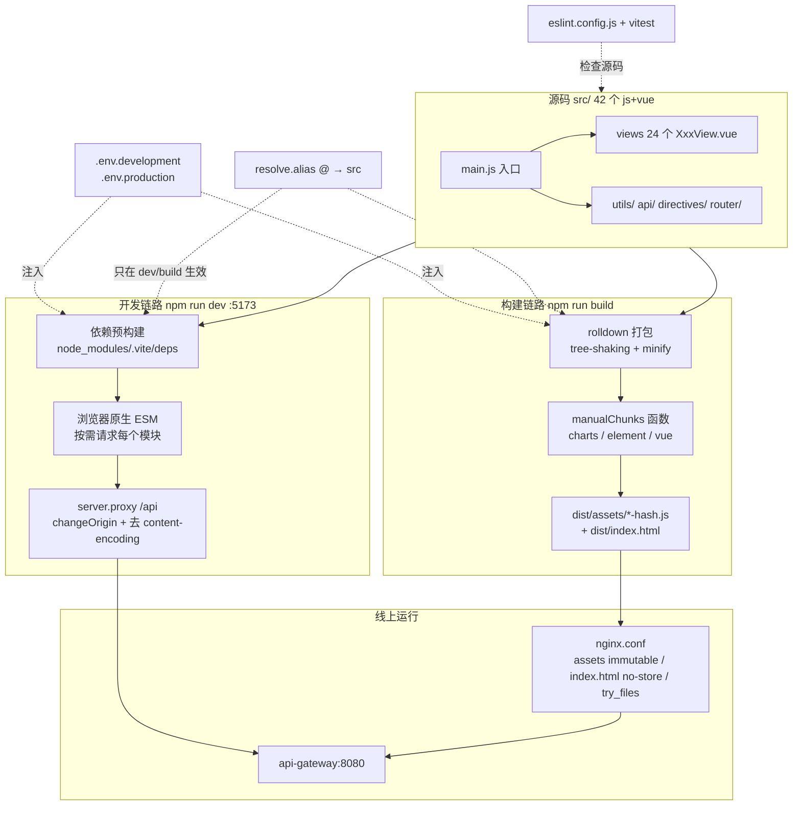
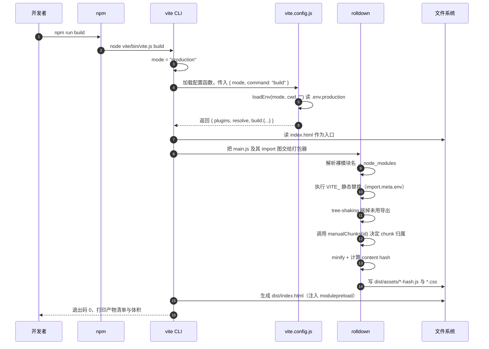

# 前端工程化：Vite 构建与规范

> **一句话结论**：工程化要同时满足三件互相打架的事——**开发时快**（改一行立刻看到效果，最好什么都别算）、**构建后小**（用户下载的字节越少越好，要拼命算）、**团队里一致**（谁写的代码都长一个样，要处处设卡）；Vite 用"dev 期不打包、build 期才打包"把前两者拆成两条链路，第三者只能靠 ESLint + 约定 + 门禁补，而本仓库在第三者上只落了一半：**有脚本、没有提交钩子、没有 CI**。
> **阅读前置**：[00-前端技术全景介绍](./00-前端技术全景介绍.md) 的生态对照表、[02-JavaScript核心基础](./02-JavaScript核心基础.md) 的 ES Module 一节、[06-路由守卫与Axios请求封装](./06-路由守卫与Axios请求封装.md)（本篇要解释它的 `baseURL` 到底从哪来）。有 Maven 的"依赖 + 生命周期 + 插件"心智模型会读得更快。
> **证据基线**：`ai-cs-frontend`，本机 node v24.16.0 / npm 11.13.0，实测已安装 vite 8.2.1（底层打包器 rolldown 1.2.3）、vue 3.5.41、element-plus 2.14.4、eslint 10.15.0、vitest 5.1.1。**本篇没有执行 `npm install`、没有执行 `npm run build`**：所有体积数字来自仓库里既有的 `dist/`（上一次构建的残留物）与 `node_modules/` 的现场读数，每条命令都可原样复现。预计阅读 30~35 分钟。

---

## 0. 先看现象

工程化的问题从来不是"报错"，而是"没人报错，但东西不对"。先看本仓库三个能当场复现的现场。

### 现场一：一个第三方库 chunk 就 1.1 MB，而且首屏被强制预拉

```powershell
# 在 ai-cs-frontend 下，统计 dist/assets 里每个 js/css 的原始大小与 gzip 后大小
node -e "const fs=require('fs'),p=require('path'),z=require('zlib');const d='dist/assets';const r=fs.readdirSync(d).filter(n=>/\.(js|css)$/.test(n)).map(n=>{const b=fs.readFileSync(p.join(d,n));return{n,raw:b.length,gz:z.gzipSync(b,{level:9}).length}});r.sort((a,b)=>b.raw-a.raw);r.slice(0,8).forEach(x=>console.log(x.n.padEnd(34)+' raw='+x.raw+'  gzip='+x.gz));console.log('total='+r.length+'  over100KB='+r.filter(x=>x.raw>102400).length)"
```

真实输出（节选）：

```text
element-bl3CF7UA.js                raw=1119291  gzip=347370
charts-DTbrIw2f.js                 raw=1027047  gzip=332692
element-DM8opQMk.css               raw=356555  gzip=47358
api-D8G56eA8.js                    raw=49001  gzip=18578
MockCashierView-Bzo_Z3ro.js        raw=29609  gzip=11616
vue-fycMrBjY.js                    raw=24751  gzip=9458
index-CwSiBJWG.js                  raw=11868  gzip=4378
MqView-CqEQBJXo.js                 raw=11440  gzip=3699
total=53  over100KB=3
```

再看 `dist/index.html` 里这几行（上一次构建真实产物）：

```html
<script type="module" crossorigin src="/assets/index-CwSiBJWG.js"></script>
<link rel="modulepreload" crossorigin href="/assets/rolldown-runtime-hePW80VL.js">
<link rel="modulepreload" crossorigin href="/assets/element-bl3CF7UA.js">
<link rel="modulepreload" crossorigin href="/assets/vue-fycMrBjY.js">
<link rel="stylesheet" crossorigin href="/assets/element-DM8opQMk.css">
```

`element`（1.1 MB）和 `vue` 出现在 `modulepreload` 里，意味着**浏览器一进首页就必须下载它们**；而 `charts`（1.0 MB）没在 preload 里，因为只有懒加载的图表页用到它。原因很直白：`ai-cs-frontend/src/main.js` 第 2 行 `import ElementPlus from 'element-plus'` 是静态全量引入，第 14~16 行还把**所有图标**循环注册进全局。

顺带一个细节：`ai-cs-frontend/vite.config.js` 第 49 行把 `chunkSizeWarningLimit` 抬到了 `800`（Vite 默认 500 kB）。**"把警告阈值抬高"这个动作本身就是证据——曾经有大 chunk 触发过警告**，抬阈值只是让它闭嘴，没让产物变小。

### 现场二：`@` 别名配得漂漂亮亮，`src` 里 0 处使用

```powershell
# 统计 src 下"用 ../ 相对路径引入"和"用 @/ 别名引入"的文件数
node -e "const fs=require('fs'),p=require('path');const w=(d,o=[])=>{for(const e of fs.readdirSync(d,{withFileTypes:true})){const f=p.join(d,e.name);e.isDirectory()?w(f,o):o.push(f)}return o};const s=w('src');console.log('用相对路径的文件='+s.filter(f=>/from\s+['\"]\.\.?\//.test(fs.readFileSync(f,'utf8'))).length);console.log('用 @/ 别名的文件='+s.filter(f=>/from\s+['\"]@\//.test(fs.readFileSync(f,'utf8'))).length)"
```

真实输出：

```text
用相对路径的文件=37
用 @/ 别名的文件=0
```

`ai-cs-frontend/vite.config.js` 第 17~22 行郑重其事地声明了 `'@': fileURLToPath(new URL('./src', import.meta.url))`，注释还写着"避免 `../../../views` 这种相对路径（重构移动目录时尤其疼）"——但 37 个文件的 import 全是 `../`。**配置存在、约定缺失、没人执行**：这是"团队里一致"这条目标最典型的失败形态。

### 现场三：lint 脚本是补上的，但门禁没补

`ai-cs-frontend/eslint.config.js` 前 8 行的注释自己交代了历史：

```js
// ESLint 9+ 的 flat config（ESLint 10 已完全移除 .eslintrc 支持）。
// 之前前端没有任何 lint 脚本，`npm run build` 是唯一的前端门禁，
// 语法错误能拦住、但未使用变量 / v-for 缺 key / 模板里误用 this 这类问题拦不住
```

现在 `package.json` 第 12~14 行有了 `lint` / `lint:fix` / `check`。但把"有没有自动触发"查一遍：

```powershell
cd D:\Projects\Persion\ai-customer-service
Test-Path .\ai-cs-frontend\.husky            # 提交钩子目录
Get-ChildItem .\.github\workflows -File | Select-Object Name
```

真实输出：

```text
False
python-learning-validate.yml
```

结论：**没有 husky、没有 lint-staged、前端没有任何 CI workflow**。`npm run check`（lint + test + build）是一道完整的本地门禁，但它只在你"想起来"的时候跑。

> **这些现象指向同一件事**：本项目的工程化是"**配置写完就算完成**"——`manualChunks` 写了但没治住 element 全量引入；`@` 别名写了但没人用；`lint`/`check` 脚本写了但没有任何钩子强制执行。三个目标里，"开发时快"靠 Vite 白送，"构建后小"只做了 vendor 分包这一个动作，"团队里一致"停在纸面。下面逐层拆开这三件事各自是怎么实现的、在哪一步断的。

---

## 1. 整体地图



| 组件 | 责任 | 关键文件 | 本仓库证据（行号已核对） |
|---|---|---|---|
| Vite CLI | 提供 `dev` / `build` / `preview` 三个子命令，读配置、开服务器或打包 | `ai-cs-frontend` 的 `package.json` | 第 7~9 行 `"dev": "vite"`、`"build": "vite build"`、`"preview": "vite preview"` |
| 配置文件 | 别名、dev server、proxy、build 产物策略 | `ai-cs-frontend/vite.config.js` | 66 行，函数式 `defineConfig(({ mode }) => …)` 在第 6 行 |
| 依赖预构建 | 把 `node_modules` 里的模块预编译成单文件 ESM，减少浏览器请求数、处理 CJS 互操作 | `node_modules/.vite/deps/` | `_metadata.json` 里 `optimized` 恰好 8 项，`qrcode` 的 `needsInterop: true` |
| 打包器 | build 期把模块图打平、摇树、压缩、切 chunk | rolldown（vite 8 内置） | 产物名 `rolldown-runtime-hePW80VL.js`；`node_modules` 下无 `rollup`/`esbuild` 目录 |
| 环境变量层 | 按 mode 加载 `.env*`，只把 `VITE_` 前缀注入前端 | `ai-cs-frontend/.env.production` | 第 6 行 `VITE_GATEWAY=`（故意留空） |
| 运行时取值 | 把注入值加工成 axios 的 baseURL | `ai-cs-frontend/src/utils/runtime.js` | 第 14~18 行 `resolveGateway`，第 21/24 行导出 `GATEWAY` / `API_BASE` |
| 反向代理 | 线上把 `/api` 转给网关，且**不重写前缀** | `ai-cs-frontend/nginx.conf` | 第 49~62 行 `location /api/`；第 47~48 行注释明说不要 rewrite |
| 静态资源缓存策略 | 带 hash 的资源长缓存、入口 HTML 不缓存 | `ai-cs-frontend/nginx.conf` | 第 33~37 行 `immutable`；第 41~44 行 `no-store` |
| 代码检查 | 抓未使用变量、`v-html` 等真 bug | `ai-cs-frontend/eslint.config.js` | 85 行；第 47~54 行是"真拦"的规则 |
| 测试 | 纯逻辑单测（utils / directives） | `ai-cs-frontend/vitest.config.js` | 23 行；第 7~9 行显式调用函数式配置 |

> **读图说明**：图中最关键的是 `SRC` 分叉出的两条路。①**上分支（dev）里没有"打包"这个框**——浏览器直接请求源码文件，`node_modules` 里的依赖由"预构建"提前压成单文件；这就是 dev 秒开的技术前提，也是"dev 正常、build 报错"这类事故的来源（dev 不做 tree-shaking、不做压缩、不做 chunk 切分，很多问题只有走到下分支才暴露）。②**下分支（build）里出现两个额外节点**：`rolldown` 和 `manualChunks`——产物大小完全由这两个节点决定，`element` 之所以 1.1 MB，是因为第 2 行静态引入让 `element-plus` 整包进入模块图，`manualChunks` 只是把它单独切出来、并没有让它变小。③**虚线（`.env` 注入）同时连到两处，但语义不同**：dev 期 `loadEnv` 的值只给 proxy 用、不打进产物；build 期只有 `VITE_` 前缀的变量会被**文本替换**进 JS 里。把这两者混为一谈，就会出现"本地地址被写进生产包"的经典事故。看错任何一条，后面所有排查都会跑偏。

---

## 2. 关键概念与关键类/关键 API

| 名称 | 位置 | 角色 | 关键点 |
|---|---|---|---|
| `defineConfig()` | `vite.config.js` 第 2 行导入 | 配置工厂 | 传函数 `({ mode, command }) => ({…})` 才能按 `dev`/`build`/自定义 mode 分支；本项目正是函数式 |
| `loadEnv(mode, cwd, prefix)` | `vite.config.js` 第 9 行 | **Node 侧**读 `.env*` | 第三参 `''` = 加载所有前缀（默认只加载 `VITE_`）；结果只在配置文件里可用，**不会**自动进入浏览器 |
| `import.meta.env` | `src/utils/runtime.js` 第 21 行 | **浏览器侧**读注入值 | 构建时被静态替换成字面量；只有 `VITE_` 前缀 + 内置 `MODE`/`BASE_URL`/`DEV`/`PROD` |
| `VITE_` 前缀 | `.env.development` 第 3 行注释 | 暴露开关 | 前缀 = "允许打进产物、允许人人可见"，所以密钥绝不能加这个前缀 |
| 依赖预构建（dep optimization） | `node_modules/.vite/deps/` | dev 提速 | 把上百个依赖内部模块压成 8 个单文件；顺带把 CJS 转 ESM |
| `_metadata.json` | `node_modules/.vite/deps/_metadata.json` | 预构建缓存账本 | 含 `hash` / `configHash` / `lockfileHash` / `browserHash` 四个指纹，任一变化就重新预构建 |
| `needsInterop` | 同上，`optimized.qrcode.needsInterop` | CJS 互操作标记 | `true` 表示该包是 CommonJS，预构建时被包了一层 `default` 导出 |
| rolldown | `node_modules/@rolldown` | Vite 8 的打包器 | Rust 实现，替代 Vite 5 时代的 rollup；产物里会出现 `rolldown-runtime-*.js` |
| `build.rollupOptions.output.manualChunks` | `vite.config.js` 第 56 行 | 手工分包 | rolldown 只接受**函数**形式；返回 `undefined` 表示交给默认策略 |
| `chunkSizeWarningLimit` | `vite.config.js` 第 49 行 | 体积告警阈值 | 单位 kB，本项目从默认 500 抬到 800——抬阈值治不了体积 |
| content hash | `dist/assets/element-bl3CF7UA.js` | 缓存键 | 内容变→文件名变，才能安全地用 `immutable` 长缓存 |
| `modulepreload` | `dist/index.html` | 首屏抢跑 | Vite 自动为入口的**静态**依赖注入，等于告诉浏览器"这些马上要用" |
| `try_files $uri $uri/ /index.html` | `nginx.conf` 第 69 行 | SPA 兜底 | 前端路由刷新 404 的标准解法；hash 路由则不需要 |
| flat config | `eslint.config.js` | ESLint 9+ 唯一配置格式 | 就是一个导出数组的 ESM 文件；ESLint 10 已删除 `.eslintrc` 支持 |
| semver + lockfile | `package.json` / `package-lock.json` | 版本约束 + 精确还原 | `^8.1.1` 允许装到 8.x 最新；`lockfileVersion: 3` 的锁文件才能 `npm ci` 逐字节还原 |

---

## 3. 原理与证据逐段精读

### 3.1 dev 链路：依赖预构建与它的缓存失效

**在干什么。** `npm run dev` 启动后，Vite 不做打包：浏览器请求 `index.html`，发现 `<script type="module" src="/src/main.js">`，于是**按 ES Module 语义逐个请求模块**。问题是 `main.js` 里 `import ElementPlus from 'element-plus'` 展开后有上千个内部文件，浏览器要发上千个请求，还要处理 `node_modules` 里那些 CommonJS 包——所以 Vite 先跑一遍"依赖预构建"，把每个依赖压成一两个 ESM 单文件，落在 `node_modules/.vite/deps/`。

本仓库现场（真实读数）：

```powershell
Get-ChildItem ai-cs-frontend\node_modules\.vite\deps -File | Select-Object Name,Length
```

```text
element-plus.js                              2060064
echarts.js                                   2398400
vue.runtime.esm-bundler-DL1C_9PI.js           329179
axios.js                                      123924
vue-router.js                                 105243
qrcode.js                                      71080
@element-plus_icons_vue.js                    223777
element-plus_es_locale_lang_zh-cn.js            4792
rolldown-runtime-DC62tzP2.js                    1445
_metadata.json                                  1764
package.json                                      23
```

`package.json` 的内容就一行 `{"type": "module"}`——它的作用是告诉浏览器"这个目录里的 `.js` 都是 ESM"，否则浏览器对 `deps/*.js` 的解析规则会和源码目录不同。

**为什么这么设计。** 三条理由：①**请求数**：上千个 HTTP 请求即使 HTTP/2 也扛不住；压成 8 个文件后首屏依赖请求数直接降到个位数。②**格式统一**：`node_modules` 里大量包仍是 CJS（`qrcode` 就是），浏览器不支持 `require`，预构建顺手转成 ESM 并加互操作包装。③**编译一次、反复受益**：预构建结果落盘缓存，第二次启动直接复用，这正是"冷启动几秒、热启动几百毫秒"的来源。

**换写法会怎样。** 如果关掉预构建（`optimizeDeps.disabled`），页面不会白屏但会慢到不可用，而且 CJS 包会直接抛 `does not provide an export named 'default'` 这类模块解析错误。反过来，如果**什么都塞进预构建**（把业务源码也加进去），每次改代码都要等预构建，dev 反而变慢——所以 Vite 只预构建 `dependencies` 里的包，`src/` 永远走即时转换。

**常见坑（本仓库站位）。** 预构建缓存的失效靠 `_metadata.json` 里四个指纹，实测值：

```json
{
  "hash": "42cf7f1e",
  "configHash": "e766abe6",
  "lockfileHash": "d8573a2d",
  "browserHash": "ed3333af",
  "optimized": { "@element-plus/icons-vue": {}, "axios": {}, "echarts": {},
                 "element-plus": {}, "element-plus/es/locale/lang/zh-cn": {},
                 "qrcode": { "needsInterop": true }, "vue-router": {}, "vue": {} }
}
```

- `lockfileHash` 变（`package.json`/锁文件改了）→ 重新预构建；
- `configHash` 变（改了 `vite.config.js` 里的 `optimizeDeps`/`resolve` 等）→ 重新预构建；
- 但**你改了 `src/` 里的代码，这四个指纹都不变**，这是正确的（源码本来就不进缓存）。
- 真正的坑是"缓存把旧的错误结果留下来"：升级依赖后页面仍报旧错、`needsInterop` 判断错了导致 `qrcode` 拿不到默认导出——标准动作是删掉整个 `node_modules/.vite` 再重启（`Remove-Item -Recurse -Force ai-cs-frontend\node_modules\.vite`）。注意 `dist/` 与它是两套缓存，删错地方没用。

### 3.2 build 链路：rolldown 打包、tree-shaking 与手工分包

**在干什么。** `vite build` 走的是完全不同的路：入口仍是 `index.html`，但这次把整张模块图**打平**——解析所有 `import`、摇掉没被用到的导出、压缩标识符、按 `manualChunks` 切成若干文件、给文件名加上内容 hash，最后生成 `dist/index.html` 并把入口的静态依赖写成 `modulepreload`。

分包逻辑就在 `ai-cs-frontend/vite.config.js` 第 56~61 行：

```js
manualChunks(id) {
  if (!id.includes('node_modules')) return
  if (id.includes('echarts') || id.includes('zrender')) return 'charts'
  if (id.includes('element-plus') || id.includes('@element-plus')) return 'element'
  if (/[\\/]node_modules[\\/](vue|vue-router|@vue)[\\/]/.test(id)) return 'vue'
}
```

**为什么这么设计。** 三个关键词的分工是：**业务代码天天变、第三方库一个月才动一次、运行时框架几乎不动**。把后两者切成独立 chunk 后，发一次版本只会让业务 chunk 换 hash（`index-CwSiBJWG.js` 只有 11 KB），而 `element`/`vue` chunk 的 hash 不变，用户浏览器继续命中 `immutable` 长缓存——**省下的不是首屏字节，是回头客的流量**。这就是为什么 `dist/` 里 24 个 view 各有独立文件，而 element 始终只有一个。

**换写法会怎样。** 三种替代方案各有代价：①**不切**（删掉 `manualChunks`）→ 所有东西进一个包，任何一行业务改动都会让老用户重下 1.1 MB 的 element；②**写成对象形式**（Vite 5 的老写法 `manualChunks: { element: ['element-plus'] }`）→ 在 Vite 8 下**直接构建失败**，本仓库第 54~55 行注释留了原始报错：`Invalid type: Expected Function but received Object`；③**按路由切**（`() => import()`）→ 本项目已经全做了（见 3.5），两者不冲突，一个切"库"，一个切"页面"。

**常见坑（本仓库站位）。** 分包解决"缓存复用"，**不解决"下载量"**。实测 `element-bl3CF7UA.js` 仍是 raw 1119291 B / gzip 347370 B，因为它装的是**完整** element-plus + 全部图标（`ai-cs-frontend/src/main.js` 第 2、5、14~16 行）。真正让它变小要靠按需引入（`unplugin-vue-components` + `unplugin-auto-import`，或手写 `import { ElButton } from 'element-plus'`），这在本仓库**尚未落地**。另一个坑是正则里 `[\\/]` 和 `(vue|vue-router|@vue)` 前后的分隔符：漏写分隔符会把 `vue-router` 误判成 `vue`，也会让 `@vue/shared` 之外的相似名（如 `vuex`）漏进 `vue` chunk——看起来能构建成功，只有看产物清单才发现分错了。

### 3.3 环境变量：`.env*` 的加载顺序、`VITE_` 前缀，以及"为什么密钥不能放前端"

**在干什么。** 一套代码要在"本机 5173 打 8080"和"线上同域 80 打 nginx"两种环境跑，靠 `.env` 文件区分。本仓库三个文件（真实内容）：

```text
# ai-cs-frontend/.env.development
VITE_GATEWAY=http://localhost:8080
VITE_PROXY_TARGET=http://localhost:8080

# ai-cs-frontend/.env.production  （第 3~6 行）
# 关键：留空 => 前端请求相对路径 /api/...，由同域的 Nginx 反代到网关。
VITE_GATEWAY=

# ai-cs-frontend/.env.example  （第 1 行）
# 复制为 .env.local 后按需修改（.env.local 已被 .gitignore 的 *.local 忽略）
```

仓库里其实**没有** `.env` 和 `.env.local`（`Get-ChildItem . -Force -Filter ".env*"` 只列出上面三个）。

**为什么这么设计。** 三层机制叠加才有意义：①**加载顺序**（后者覆盖前者）：`.env` < `.env.local` < `.env.[mode]` < `.env.[mode].local` < 进程环境变量，所以 `npm run build --mode staging` 会自动叠加 `.env.staging`；②**前缀过滤**：只有 `VITE_` 开头的变量会被注入浏览器，"不给前缀就进不了产物"是刻意设计的安全边界；③**注入方式**：不是运行时读文件，而是**构建时把 `import.meta.env.VITE_X` 文本替换成字符串字面量**。这一点直接决定了 ③ 的后果——**任何进入产物的值都是明文**。

**换写法会怎样。** 有人会想"那我把 API Key 放进 `.env.local` 不上 git 就行了"——**没用**：只要它以 `VITE_` 开头，构建后就会以明文字符串躺在 `dist/assets/index-*.js` 里，用户按 F12 就能看到，`strings` 命令也能扫出来；不带 `VITE_` 前缀则前端根本读不到，只能给 Node 侧的 `vite.config.js` 用。正确的做法是把密钥留在后端（本例是 `api-gateway:8080`），前端只拿短期 token。

**常见坑（本仓库站位）。** 本项目踩过并留了痕：`ai-cs-frontend/src/utils/runtime.js` 第 8~9 行注释写着**"不能写成 `env.VITE_GATEWAY || 'http://localhost:8080'`：空串是 falsy，会导致生产构建回落到 localhost"**。因为 `.env.production` 第 6 行是**故意留空的 `VITE_GATEWAY=`**（空串而不是 undefined），用 `||` 就会把空串当"没配"、回落到 localhost，线上直接白屏。`resolveGateway`（第 14~18 行）用 `typeof raw !== 'string'` 判断才是对的。第二个坑是**死配置**：`.env.production` 第 9 行声明了 `VITE_APP_VERSION=1.0.0`，但全库搜 `VITE_APP_VERSION` 在 `src/` 下 **0 处引用**——它既没显示在任何页脚，也没进任何上报字段，属于纯粹的装饰。

### 3.4 路径别名：`resolve.alias` 与编辑器/tsconfig 的"双写"约定

**在干什么。** 别名让 `import CartView from '../../views/CartView.vue'` 变成 `import CartView from '@/views/CartView.vue'`。本仓库配置在 `ai-cs-frontend/vite.config.js` 第 17~22 行：

```js
resolve: {
  alias: {
    '@': fileURLToPath(new URL('./src', import.meta.url)),
  },
},
```

**为什么这么设计。** 相对路径的唯一优点是"不用配置就能跑"，代价是**目录搬家时全断**：把一个 view 从 `src/views/` 移到 `src/views/order/`，所有 `./` 都要改；别名把"从谁出发"变成"从 src 出发"，与文件的物理位置解耦。用 `fileURLToPath(new URL('./src', import.meta.url))` 而不是 `path.resolve(__dirname, 'src')`，是因为本项目 `package.json` 第 5 行声明了 `"type": "module"`，ESM 里没有 `__dirname`。

**换写法会怎样。** 别名有个隐藏成本：**它只对 Vite 生效**。TypeScript 的路径解析、部分编辑器跳转、Jest/Vitest 各自有独立配置，得**同一套别名写多份**：TS 项目要在 `tsconfig.json` 的 `compilerOptions.paths` 里写一份（纯 JS 项目则写 `jsconfig.json`，只为编辑器体验），Vitest 要么 `mergeConfig(viteConfig, …)` 复用、要么再写一遍 `resolve.alias`。本仓库 `ai-cs-frontend/vitest.config.js` 第 3 行就是 `import viteConfig from './vite.config.js'` + 第 11 行 `mergeConfig`，正是为了避免"两份别名不一致"。此外**没有** `tsconfig.json` 也没有 `jsconfig.json`（`Get-ChildItem -Filter "*config*.json"` 只有 `package.json`/`package-lock.json`），所以编辑器里 `@/` 无法被静态识别。

**常见坑（本仓库站位）。** 配了不用等于没配——现场二的实测是 `用 @/ 别名的文件=0`、`用相对路径的文件=37`。这不是笔误：24 个 view 里绝大多数用 `../components/`、`../utils/`。真正把别名变成习惯需要门禁配合（ESLint 的 `no-restricted-imports` 或 `import/no-relative-parent-imports` 规则禁止 `../`），而本仓库 `eslint.config.js` 里没有这类规则。另一个坑是**别名只在 dev/build 生效，浏览器不认**：产物里 `@/` 早已被解析成相对路径，所以看 `dist` 是查不出别名问题的，必须看源码。

### 3.5 代码分割与懒加载：路由级分割在本仓库已经做全了

**在干什么。** 懒加载把"首屏不需要的页面"从主包里摘出去，改成"用到时才下载"。本项目 `ai-cs-frontend/src/router/index.js` 里 **25 条路由全部**使用动态导入：

```js
const routes = [
  { path: '/login', component: () => import('../views/LoginView.vue'), meta: { public: true } },
  { path: '/chat',  component: () => import('../views/ChatView.vue') },
  // …共 25 条，写法一致
  { path: '/feedback', component: () => import('../views/ChatView.vue') },
]
```

产物侧可以直接验证：`dist/assets` 下有 24 个 `XxxView-*.js`（`ChatView` 因为 `/chat` 与 `/feedback` 共用而只产出一份），而 `charts` chunk 没有出现在 `index.html` 的 `modulepreload` 里——**只有请求走进 `/dashboard/chat`（引用 echarts 的 `ChatDashboardView.vue`）时，浏览器才会去下载 1.0 MB 的 charts chunk**。

**为什么这么设计。** 这与后端"懒加载 = 延迟初始化 Bean"是同一思想：不是所有能力都要在启动时准备。首屏只需要登录页或对话页，把 24 个 view 一次性打进去会让首屏体积再涨几千行。动态导入还有一个副作用是好的：**每个 chunk 变成独立的缓存单元**，改 A 页面不影响 B 页面的 hash。

**换写法会怎样。** 对照本仓库的另一个前端 `ai-cs-frontend-react`：它的 `src/App.jsx` 是**全部静态 import**（没有 `lazy` / `Suspense`），其 `dist/assets` 只有 4 个文件，主包 `index-BVaP81P_.js` 达 2415939 B（约 2.3 MB，未 gzip）——同一套业务、两种写法，产物结构差别就是这么直接。反过来，**过度分割**也有代价：每个 chunk 都要一次请求，把 5 KB 的工具函数拆成 20 个文件，收益为负。经验边界是"按路由 / 按重依赖（图表、编辑器、PDF）切"，不按组件切。

**常见坑（本仓库站位）。** ①**懒加载被"静态 import"悄悄抵消**：只要主包里有任何一处 `import Chart from 'echarts'`，整个 echarts 就回主包或进 preload，动态导入白做。②`/chat` 与 `/feedback` 共享同一个 chunk 是**好事**（少下一次），但如果两个页面 meta 里的权限不同，要注意守卫逻辑别被复用绕过——本项目守卫（`router/index.js` 第 38~48 行）只判断 `meta.public` + `isAuthenticated()`。③**异步 chunk 里的失败没人管**：断网时动态导入 reject，会得到 `Failed to fetch dynamically imported module`，需要路由级 `onError` 或全局兜底，本项目未做。

### 3.6 产物分析：raw / gzip / hash 与 nginx 缓存策略的三方配合

**在干什么。** 产物优化的判据不是"文件多大"，而是"**首屏要下载的 gzip 后字节数**"。现场一的实测：`dist/assets` 下 53 个 js+css，raw 合计 2768016 B（2.64 MiB），gzip(level 9) 合计 832507 B（0.79 MiB），压缩比 0.301；`raw > 100 KB` 的只有 3 个（`element.js` / `charts.js` / `element.css`）。

**为什么这么设计。** 三个数字各有用途，不能混：**raw** 决定解析与执行成本（JS 要解析，1 MB 的 element 在主线程上就是几十毫秒起）；**gzip** 决定网络传输时间（JS/CSS 文本压缩比通常 0.3 左右，实测 element 31.0%、element.css 13.3%）；**hash** 决定缓存策略能不能激进。三者配合的成品在 `ai-cs-frontend/nginx.conf`：

```nginx
# 第 33~37 行：带 hash 的资源，允许缓存一年且不再回源校验
location /assets/ {
    expires 1y;
    add_header Cache-Control "public, immutable";
    access_log off;
}
# 第 41~44 行：入口 HTML 必须每次校验，否则用户永远拿不到新版本
location = /index.html {
    add_header Cache-Control "no-store, no-cache, must-revalidate";
    expires -1;
}
```

**换写法会怎样。** 这两条是**成对**的，单独存在都会出事：只给 assets 加 `immutable` 而 HTML 也被缓存 → 用户一年内拿不到新版本（因为 HTML 里的 hash 文件名一直是旧的）；只给 HTML `no-store` 而 assets 不加长缓存 → 每次刷新重下 0.79 MB。另外 gzip 已在 nginx 层开启（第 23~28 行 `gzip on` / `gzip_types` 含 `application/javascript` / `gzip_comp_level 5`），所以**不需要**在构建期再产 `.gz` 文件；如果再加 brotli 或静态预压缩，要小心与 `gzip_static` 的顺序。

**常见坑（本仓库站位）。** ①**`public/` 里的文件没有 hash**：`ai-cs-frontend/public/test-earphone.png` 实测 1018263 B（约 1 MB），会被原样拷进 `dist`，文件名不变 → 它既不能进 `/assets/` 的 `immutable` 分支，又占了近三分之一的总体积。放 `public/` 的判据应该是"必须保留固定名字"（`favicon.svg`、`robots.txt`），**不是"图片"**。②`element-DM8opQMk.css` 356555 B 也是首屏阻塞资源（在 `<link rel="stylesheet">` 里），它和 `element.js` 是同源问题：全量引入。③**别用 raw 总量对外报数**：2.64 MiB 里 1.04 MiB 是首屏根本用不到的 charts chunk。

### 3.7 ESLint 与 Prettier 的定位差异（为什么本项目只接了一半）

**在干什么。** 两者的分工经常被搞混：**ESLint 是 linter，判断"这段代码可能有问题"，输出的是"错误/警告"，能自动修的只有一小部分；Prettier 是 formatter，只判断"排版应该长什么样"，输出的是"重排后的整个文件"，不判断对错。** 一个抓 bug，一个抓 diff 噪音。

本仓库 `ai-cs-frontend/eslint.config.js` 是 flat config（85 行，导出数组），关键决策在第 28~55 行：

```js
rules: {
  // 纯排版规则（换行位置、引号风格、自闭合写法）一律关掉：
  // 本项目没有接 Prettier，这些规则只会把已有文件重排一遍、制造几百行无关 diff
  'vue/html-self-closing': 'off',
  'vue/multiline-html-element-content-newline': 'off',
  'vue/html-quotes': 'off',
  // 但这些要真拦：
  'vue/no-unused-vars': 'error',
  'vue/no-v-html': 'error',
  'no-unused-vars': ['error', { argsIgnorePattern: '^_', caughtErrors: 'none' }],
  'no-debugger': 'error',
}
```

**为什么这么设计。** 上面的关与开是一套自洽的取舍：既然没接 Prettier，就**不要**让 ESLint 兼职排版——否则 `--fix` 会把整个文件重排，一次 PR 里塞进几百行纯格式 diff，code review 彻底失效。留下的是**真能抓 bug** 的规则：`vue/no-v-html: error` 直接把 XSS 入口封死（这在客服系统里尤其重要，消息内容大量来自用户输入），`no-debugger` 防上线残留，`no-unused-vars` 抓重构残留。

**换写法会怎样。** 标准做法是"关掉 ESLint 所有格式类规则 + 用 `eslint-config-prettier` 兜底 + Prettier 管排版 + `prettier --check` 进 CI"。收益是格式争议归零、diff 干净；代价是**必须先一次性格式化全库**（本项目 42 个源文件、6444 行，会产生一个巨大的"纯格式"提交），所以正确的顺序是：先提交功能代码 → 单独一个 commit 只做格式化 → 再把 `--check` 加进流水线。现在不做，是为了避免那个大 commit 干扰正在进行的业务分支。这条路径 `eslint.config.js` 第 39 行注释里已经写下了（"格式化交给后续引入 Prettier 时一次性处理"）。

**常见坑（本仓库站位）。** ①**ESLint 通过 ≠ 代码没问题**：实测 `node node_modules/eslint/bin/eslint.js .` 的输出是**空**、退出码 0，`-f json` 统计为 `files scanned=45, errors=0 warnings=0`——但这只说明这 45 个文件没触发这十几条规则，不说明它们没有 bug。②**ESLint 10 已完全移除 `.eslintrc`**，网上大量"`.eslintrc.js` 怎么写"的答案在这个基线里直接无效。③测试文件需要单独一块配置注入 `describe/it/expect/vi` 全局（第 58~76 行），否则 `no-undef` 会报一片——这是 flat config 相对 eslintrc 最反直觉的一处。

### 3.8 提交钩子与门禁：三层防线，本项目只建了第一层

**在干什么。** "团队里一致"靠三层递进的拦截，越靠前越便宜：

| 层 | 工具 | 拦住什么 | 本项目状态 |
|---|---|---|---|
| 编辑器内 | ESLint 插件 / Prettier 插件 | 边写边提示 | 无配置（`.vscode` 未纳入） |
| 提交前 | husky + lint-staged | 只检查**改动的文件**，几十毫秒~几秒 | **未接**（无 `.husky`） |
| 合并前 | CI | 全量 lint + test + build | **未接**（无前端 workflow） |
| 想要就手动 | `npm run check` | 全都要跑一遍 | **已存在**（`package.json` 第 14 行） |

`check` 脚本的内容是 `"npm run lint && npm run test && npm run build"`——注意它连 `build` 都跑了：build 是最贵的一步（要完整打包），放在提交钩子里会让每次 commit 卡十几秒到几十秒，所以即使以后接 husky，也建议钩子只跑 `lint` + `test`（快），`build` 留给 CI。

**为什么这么设计。** 因为**人会忘**。如果门禁需要在 wiki 里写"提交前请自行运行 npm run check"，那么它一定会被执行成"想起来才跑"。钩子与 CI 的价值不在于发现新问题，而在于把"是否记得"从人的责任变成机器的责任。

**换写法会怎样。** 常见的三种落地形态：①`lint-staged` + `pre-commit`（快，只查暂存文件，但 `--no-verify` 能绕过）；②CI 全量（权威，但反馈慢 5~10 分钟）；③两者叠加（业界主流）。本项目现状等价于"零"，因为 `.github/workflows/` 下只有 `python-learning-validate.yml`（这是文档仓库自己的校验，与前端无关）。

**常见坑（本仓库站位）。** ①**钩子与 lockfile 的关系**：husky 需要 `prepare` 脚本安装钩子，而 `npm ci --omit=dev` 的环境（比如 Dockerfile 的构建阶段）不该跑 `prepare`，否则构建会因为找不到 husky 而失败——本项目 `Dockerfile` 第 22 行用的是 `npm ci`，未来接 husky 时要确认没被拖累。②**lint-staged 只查改动文件**意味着"历史遗留问题"永远不会被清，所以首次接入常配一次全量清理。③**别把 `build` 放进 pre-commit**：打包耗时随项目线性增长，最后所有人都会加 `--no-verify`，门禁形同虚设。

### 3.9 命名与目录约定：约定要有机器守

**在干什么。** 本仓库 `src/` 的物理结构（实测 25 个 `.vue` + 17 个 `.js`，其中 7 个 `.test.js`）：

```text
src/
├─ main.js                入口：装 ElementPlus、路由、权限指令
├─ App.vue
├─ api/index.js           所有 HTTP 接口，按 SERVICES 前缀分组
├─ router/index.js        25 条路由 + 全局守卫
├─ utils/                 runtime.js（网关地址）、auth.js、sse.js、format.js
├─ directives/            permission.js（v-permission 按钮级权限）
├─ components/            可复用组件
└─ views/                 24 个 XxxView.vue（页面）
```

命名规则是"**页面 = `XxxView.vue`，组件 = 业务名词**"。`eslint.config.js` 第 30~31 行把 `vue/multi-word-component-names` 关掉了，注释理由是"组件名用单词是允许的（views 下都是 XxxView，够清晰）"——这是**有意识的例外**：Vue 官方规则要求组件名多词是为了避免与 HTML 原生标签冲突，而 `XxxView` 这个后缀本身已经保证了唯一性。

**为什么这么设计。** 目录按"技术角色"切（api / router / utils / views / components）而不是按"业务域"切，在 24 个页面的规模下够用；`api/index.js` 用 `SERVICES` 常量集中管理 15 组接口前缀（user / chat / knowledge / message / notify / search / order / cart / product / pay / mq / rag / observability / prompts / agent），好处是"后端加了一个服务"只需要改一处。但要注意：**这 15 个前缀是字符串常量，不是类型，写错不会被编译器发现**。

**换写法会怎样。** 当页面数过百时，"按技术角色切"会退化成"所有业务都堆在 `views/` 下"，届时应改为按域切（`src/modules/order/`、`src/modules/chat/`），每个域内部再分 `api/components/views`。这是 Vue/React 项目共同的演进路径，不是本项目独有的问题。

**常见坑（本仓库站位）。** 约定最怕"机器不守、靠人记"，本项目有一个真实事故可以作为例证：通知页 `ai-cs-frontend/src/views/NotifyView.vue` 第 114 行附近连接的端口是 **8085（message 服务）**，而通知服务在 **8086（notify）**。因为 `api/index.js` 里的前缀是裸字符串、端口又只出现在少数字面量里，这类错误既不报错也不 lint，只表现为"页面上没有通知"。**这正是"约定必须有机器守"的论据**：如果 15 个服务前缀被收敛成唯一的常量表（甚至由后端 OpenAPI 生成），这个 bug 根本不可能出现。

### 3.10 多环境构建与灰度发布

**在干什么。** 环境差异全部压缩进 `.env.[mode]` + `--mode` 参数：

```powershell
npm run dev                                  # mode=development，加载 .env.development
npm run build                                # mode=production，加载 .env.production
npm run build -- --mode staging              # 自定义 mode，叠加 .env.staging（本仓库尚未创建）
npm run build -- --sourcemap                 # 临时开 sourcemap（vite.config.js 第 47 行注释给的写法）
```

注意 `vite.config.js` 第 48 行 `sourcemap: false` 是**刻意**的：生产 sourcemap 会同时增加体积和泄露源码；只有排查线上白屏时才临时打开。

**为什么这么设计。** 因为"同一份产物在不同环境跑"是个伪需求：VITE 变量是**构建时替换**的，产物一旦生成就已经固化了后端地址。所以多环境 = **多次构建、多个镜像**，而不是"一个包配不同配置"。这也解释了 `.env.production` 第 6 行为什么要把 `VITE_GATEWAY` 留空：留空后前端请求 `/api/...`，由同域 nginx 反代，产物里**不含任何域名**——同一份产物放到测试集群、生产集群、K8s 的任何 namespace 都能跑，这才是真正的"环境无关"。

**换写法会怎样。** 如果按环境注入绝对地址（`VITE_GATEWAY=https://api.prod.example.com`），产物就和环境绑死，必须每个环境单独构建一次，CI 时间成倍增加，而且**灰度时无法让两个版本共用同一份静态资源**。灰度本身通常靠两层：①**入口层**——nginx/K8s Ingress 按权重把流量分给不同镜像 tag；②**前后端解耦**——由于 `/api` 是相对路径，新旧前端可以同时指向同一个网关，不会出现"老前端调新接口域名"的错配。`nginx.conf` 第 8~12 行 `upstream aics_gateway { server api-gateway:8080; }` 的注释也说明"k8s 用 ConfigMap 覆盖"，即 upstream 名字稳定、地址由部署层注入。

**常见坑（本仓库站位）。** ①**`--mode` 没有 `.env.[mode]` 文件时不会报错**，只会静默地少加载一层，导致"以为配了 staging 实际用的是 production 的值"，排查时要打印 `import.meta.env.MODE` 确认。②**灰度期间 `immutable` 缓存会让人看到旧页面**：老用户浏览器里 index.html 可能是缓存的（虽然配了 `no-store`，但要确认 CDN 层没覆盖），表现为"灰度只对一半用户生效"。③`Dockerfile` 第 20~22 行 `COPY package.json package-lock.json ./` + `RUN npm ci` 的层缓存策略依赖**锁文件不变**；一旦你为了灰度在构建时传 `--build-arg`，要确保它不影响 `COPY` 顺序，否则缓存全废。

### 3.11 升级与锁版本：`^` 不是"随便"、"锁文件"才是真相

**在干什么。** `package.json` 里 `"vite": "^8.1.1"` 的含义是"≥8.1.1 且 <9.0.0"；而 `package-lock.json` 记录了**实际装到的精确版本**。实测本机：

```text
package.json 声明：vite ^8.1.1、vue ^3.5.39、element-plus ^2.14.3
node_modules 实装：vite 8.2.1、vue 3.5.41、element-plus 2.14.4
lockfileVersion=3   packages=288
```

三个版本号三个值，正好演示了 semver 的作用：`^` 允许 patch/minor 自动升级，锁文件固化结果。

**为什么这么设计。** semver 的前提是"**minor 版本不会破坏兼容**"，而现实中第三方库并不总守规矩；锁文件把"我们测过的组合"写死，`npm ci` 则严格按锁文件安装（`npm install` 会尝试更新）。`lockfileVersion: 3` 是 npm 7+ 的格式，`npm ci` 依赖它做逐字节还原——这也是 `Dockerfile` 用 `npm ci` 的原因：**CI 里要的是可复现，不是最新**。

**换写法会怎样。** ①用 `npm install` 代替 `npm ci`：构建机可能装上与开发机不同的 minor 版本，"本地好的线上坏"就出现了；②不用锁文件（删掉 `package-lock.json`）：等于每次构建都在赌博；③`~` 代替 `^`（只允许 patch）：牺牲安全补丁，换取更小的变动面，适合对稳定性极端敏感的场景。

**常见坑（本仓库站位）。** **最值得看的一条是 Vite 大版本升级的真实代价**：从 Vite 5 到 Vite 8，底层打包器从"esbuild + rollup"换成了 rolldown。实测对比两个前端工程：

```powershell
node -e "console.log(require('./ai-cs-frontend/node_modules/vite/package.json').dependencies)"
node -e "console.log(require('./ai-cs-frontend-react/node_modules/vite/package.json').dependencies)"
```

```text
ai-cs-frontend      vite 8.2.1 → {"lightningcss":"^1.33.0","picomatch":"^4.0.5","postcss":"^8.5.25","rolldown":"~1.2.1","tinyglobby":"^0.2.17"}
ai-cs-frontend-react vite 5.4.21 → {"esbuild":"^0.21.3","postcss":"^8.4.43","rollup":"^4.20.0"}
```

后果是**配置 API 的不兼容**：`manualChunks` 只接受函数（3.2 已述）、esbuild 从"内置依赖"降级为可选 peer（`node_modules` 下已无 `esbuild` 目录）。另外本项目还有 4 处**版本约束缺失**：`package.json` 没有 `engines` 字段、没有 `.nvmrc`，所以"本机 node 24 能跑"不代表"CI 上的 node 20 也能跑"；`Dockerfile` 第 16 行用 `node:22-alpine` 是当前唯一一处 Node 版本声明——**三处（本机 24 / Dockerfile 22 / 无 engines）不一致**是潜在隐患。

---

## 4. 一次完整执行时序（`npm run build`）



> **读图说明**：这张图要盯住三个位置。①**第 5~7 步是"配置求值"阶段**，`vite.config.js` 的函数体在这一步执行完毕（`loadEnv` 也在这一步被调用）——所以配置里 `console.log` 会在构建最开始打印一次，而不是每打包一个文件打印一次；也意味着 `loadEnv` 读到的变量**只属于 Node 侧**，与第 11 步的 `import.meta.env` 替换是两条不同的通道。②**第 12~14 步是产物体积的唯一决定段**：`tree-shaking` 决定"要不要"，`manualChunks` 决定"放哪个文件"，`minify` 决定"压多紧"——`element` 1.1 MB 的命运在第 12 步就已经注定（`main.js` 第 2 行静态引入使它整包进入图），第 13 步只是把它单独装箱。③**第 15~16 步的顺序不能反**：必须先把带 hash 的 assets 写完，才能生成引用它们的 `index.html`；`dist/` 目录在构建开始前会被清空（`emptyOutDir` 默认 true），所以**不要把手工维护的文件放进 `dist/`**。

各步骤失败时的典型报错：

| 步骤 | 失败原因 | 现象 / 报错 |
|---|---|---|
| 3~4 配置求值 | 配置里语法错误或 API 用错 | `Invalid type: Expected Function but received Object`（`manualChunks` 写成对象时的真实报错） |
| 3~4 配置求值 | 别名路径写错 | `Failed to resolve alias` / 找不到 `@` 起点目录 |
| 8 读入口 | `index.html` 被删或路径不对 | `Could not resolve entry module "index.html"` |
| 9 解析裸模块 | 依赖没装（`node_modules` 缺失） | `Rollup failed to resolve import "element-plus" from "src/main.js"` |
| 11 静态替换 | 在配置里误用 `import.meta.env` | 值为 `undefined`，产物中出现 `undefined/api` 这类地址 |
| 12 语法 | 源码语法错误 | `[vite:vue] … Unexpected token`（build 会拦，dev 也会拦） |
| 13 分包 | chunk 超过阈值 | `Some chunks are larger than 800 kB after minification`（警告，不失败） |
| 15 写盘 | 文件被占用（Windows 常见） | `EPERM: operation not permitted, unlink …dist\...` → 先关掉 `vite preview` 再构建 |

---

## 5. 设计取舍

| 取舍点 | 本项目选择 | 换一边的代价 | 判断依据 |
|---|---|---|---|
| dev 是否打包 | **不打包**（预构建 + 原生 ESM） | dev 打包 → 启动慢但行为与线上一致 | 项目规模（42 文件）下 dev 体验优先；代价是"dev 好、build 坏"的问题要靠 CI 兜 |
| 分包策略 | vendor 手工切 3 组（charts/element/vue） | 完全自动 → 更少配置，但库更新时全量换 hash | 库变动频率远低于业务代码 |
| element-plus 引入 | **全量**（现状） | 按需引入 → 首屏减约 700 KB gzip，但要配 `unplugin-*` + 注意样式丢失 | 现状是"能跑"优先；**这是本项目最值得优化的一处** |
| 环境变量 | 生产留空走同源相对路径 | 注入绝对地址 → 免 nginx 反代，但产物绑环境 | 同源避免 CORS、便于灰度（3.10） |
| 别名 | 配了 `@` 但未推广 | 全用相对路径 → 零配置，但目录搬家成本高 | 目前 37:0，别名收益未兑现 |
| 格式化 | **不接 Prettier**，关掉 ESLint 格式规则 | 接入 → diff 干净，但需要一次全量格式化的大提交 | 有意延后，注释已记录（3.7） |
| 门禁强度 | 有 `check` 脚本，无钩子无 CI | 接 husky+CI → 一致性有保障，但每次提交变慢 | **当前最大缺口** |
| sourcemap | 生产关闭 | 开启 → 线上排错容易，但体积涨、源码泄露 | 临时用 `--sourcemap` 覆盖 |

**可扩展点清单**（按投入产出排序，均为"本仓库当前未做"）：

1. **element-plus 按需引入**（`unplugin-vue-components` + `unplugin-auto-import`），预期把 `element` chunk 从 1.1 MB 砍到百 KB 级——**先用 `npm run build` 记一次基线再改**，否则无法证明有效。
2. **图标按需引入**：删掉 `src/main.js` 第 14~16 行的全量循环注册，改成显式 import 用到的十几个图标。
3. **接 husky + lint-staged**：`pre-commit` 只跑 `eslint --fix` + `vitest related`（快），`build` 留给 CI。
4. **补前端 CI workflow**：`.github/workflows/frontend.yml`，跑 `npm ci && npm run lint && npm run test && npm run build`，产物用 `actions/upload-artifact` 存档。
5. **引入 Prettier**：一次性格式化 + `eslint-config-prettier` + `prettier --check` 进 CI（见 3.7 的推行顺序）。
6. **统一 Node 版本**：`package.json` 加 `"engines": { "node": ">=22" }`，加 `.nvmrc`，与 `Dockerfile` 对齐。
7. **`public/test-earphone.png` 迁出 `public/`**：改成 `import img from '@/assets/x.png'`，让它进入 hash 流程。
8. **禁用相对父级导入**：ESLint `no-restricted-imports` 禁止 `../`，强制 `@/`（否则别名永远 0 使用）。
9. **产物体积预算**：CI 里加一步"`dist/assets` gzip 总量超过阈值则失败"，把 3.6 的统计脚本固化。
10. **修 `NotifyView.vue` 的 8085/8086 端口错**，并把 15 个服务前缀收敛成单一常量表（或由后端 OpenAPI 生成）。

---

## 6. 踩坑与调试手法

### 坑 1：`env.VITE_X || '默认值'` 让空串配置失效

`.env.production` 第 6 行 `VITE_GATEWAY=`（故意留空）配合 `||` 会回落到 localhost，生产白屏。`src/utils/runtime.js` 第 14~18 行用 `typeof raw !== 'string'` 判断才正确。**通用原则**：判断"有没有配"要用类型判断或 `??`，不要用 `||`——空串、`0`、`false` 都是合法配置值。

### 坑 2：`manualChunks` 写成对象，Vite 8 直接构建失败

Vite 5 时代 `manualChunks: { element: ['element-plus'] }` 是合法的，Vite 8 换成 rolldown 后只接受函数，报错 `Invalid type: Expected Function but received Object`（`vite.config.js` 第 54~55 行留了原文）。升级前先查底层打包器，别照抄旧教程。

### 坑 3：`import.meta.env` 在 `vite.config.js` 里是 `undefined`

配置文件跑在 Node 里，`import.meta.env` 是**浏览器侧**的注入对象。要在配置里读环境变量必须 `loadEnv(mode, process.cwd(), '')`。本项目第 9 行的第三参 `''` 是为了连非 `VITE_` 前缀也读（只用于 proxy），但**只有 `VITE_` 前缀的值才会进产物**——这两个概念必须分清，否则会误以为"配置文件里能读到的变量前端也能读到"。

### 坑 4：dev 期实际没走 proxy，请求直连 8080

按 `.env.development` 第 4 行现值，`VITE_GATEWAY=http://localhost:8080` → `API_BASE` 是**带域名的绝对地址**（`src/utils/runtime.js` 第 24 行 `${GATEWAY}/api`）。而 Vite 的 `server.proxy` 只接管**指向 dev server 自身（5173）的 `/api` 请求**，绝对地址请求会直接打到 8080，成为跨域请求——之所以还能通，是因为网关 `ai-cs-gateway/src/main/java/com/aics/gateway/config/CorsConfig.java` 第 20 行 `setAllowedOriginPatterns(List.of("*"))` 放行了所有来源。**后果**：nginx 的 `/api` 反代行为在本地永远不会被验证到，"本地好、上线 404"的风险被隐藏。验证方法见下方手法 1。

### 坑 5：删错缓存目录，问题依旧

`node_modules/.vite`（dev 预构建缓存）、`node_modules/.cache`、`dist/`（构建产物）、`.eslintcache` 是四套独立缓存。改完 `vite.config.js` 的 alias 后页面仍报旧路径，清理目标应是 `node_modules/.vite`；改完 lint 规则后仍是老结果，要删 `.eslintcache`。本项目目前**没有** `.eslintcache`（没开 `--cache`），所以 lint 永远全量跑——45 个文件尚可接受，文件多了要开。

### 坑 6：`dist/` 里的旧文件让人误判体积

构建会清空 `dist/`，但如果只跑过 `vite preview` 之后又手工改过配置，看到的可能是**上一版**产物。判断"这份 dist 是不是当前的"最简单的方法：看 `dist/index.html` 引用的入口 hash 是否与 `dist/assets` 里的文件名一致，以及文件名是否带 `rolldown-runtime-*`（Vite 8 特征）。

### 调试手法 1：DevTools 判读"请求到底打到哪个 host"

打开 F12 → Network → 过滤 `Fetch/XHR`，点任意一个接口请求，看三处：**Request URL 的 host**（`localhost:5173` 说明走了 dev proxy；`localhost:8080` 说明是绝对地址直连，即坑 4）、**Request Headers 里有没有 `Origin`**（有 `Origin` 就是跨域请求，会触发预检）、**Response Headers 里的 `access-control-allow-origin`**（应该来自网关 `CorsConfig`）。再看 **Size 列的 `transferred`**：如果是接口 200 但页面空白，切到 Response 页签看是不是 HTML（说明打到了 SPA 兜底 `/index.html`，典型的前缀不匹配）。

### 调试手法 2：用 `-f json` 让 ESLint 给出可统计的结论

`npm run lint` 无输出、退出码 0，只能证明"没报错"，不能证明"检查到了文件"。要确认覆盖面：

```powershell
cd ai-cs-frontend
$r = node node_modules/eslint/bin/eslint.js . -f json | ConvertFrom-Json
"files scanned=$($r.Count)  errors=$(($r | Measure-Object -Property errorCount -Sum).Sum)  warnings=$(($r | Measure-Object -Property warningCount -Sum).Sum)"
```

真实输出：`files scanned=45  errors=0  warnings=0`。**怎么读**：45 与 `src/` 下 42 个源文件 + 3 个根配置文件的规模吻合；如果这个数字明显偏小（比如变成 3），说明 `ignores` 或 `files` 配错了，lint 一直是"假绿"。

### 调试手法 3：单测失败时先看"环境 vs 用例"

`node node_modules/vitest/vitest.mjs run` 的真实输出末尾是：

```text
 Test Files  7 passed (7)
      Tests  42 passed (42)
   Duration  6.00s (environment 96%, import 2%, tests 1%, transform 1%)
```

注意 `environment 96%`——6 秒里有 5.7 秒花在**搭建 jsdom 环境**上，而不是跑断言（用例本身合计只有毫秒级）。所以"测试慢"要优化的是 environment（`environment: 'node'` 只给纯逻辑用、或复用 environment），不是改写断言。7 个测试文件的分布也说明了本项目的测试边界：`utils/`（runtime/auth/format/sse/sseStream）与 `directives/` 有单测，**24 个 view 组件没有组件测试**。

### 调试手法 4：给生产构建临时开 sourcemap 定位白屏

线上白屏但控制台只有压缩后的 `index-CwSiBJWG.js:1:2345` 时，用 `npm run build -- --sourcemap`（`vite.config.js` 第 47 行注释给的写法）重新构建一个带 `.map` 的版本，部署到测试环境复现，DevTools 里就能看到原始文件与行号。**排查完必须把 sourcemap 版本撤掉**，不要发布到生产。

---

## 7. 版本差异

| 维度 | 旧写法（更早的基线 / 常见教程） | 当前基线（本仓库实测） | 变化点 | 迁移动作 |
|---|---|---|---|---|
| 打包器 | Vite 5：dev 用 esbuild 转换 + 预构建，build 用 rollup | Vite 8.2.1：rolldown 1.2.3 统一承担，`node_modules` 下已无 `esbuild`/`rollup` 目录 | 底层引擎换代，配置 API 不再 100% 兼容 | 升级前先 `node -e "console.log(require('vite/package.json').dependencies)"` 确认引擎 |
| `manualChunks` | 对象形式 `{ vendor: ['vue'] }` | **只接受函数**，返回 chunk 名或 `undefined` | 对象形式直接构建失败 | 改成 `manualChunks(id) { … }` |
| ESLint 配置 | `.eslintrc.js` / `.eslintrc.json`（eslintrc 体系） | `eslint.config.js` 85 行 flat config；ESLint 10 **已移除** eslintrc | 配置格式整体重写，`overrides` → 数组条目 + `files` | 用 `@eslint/migrate-config` 迁移，测试文件全局要显式声明 |
| 图标引入 | 按需 `import { Search } from '@element-plus/icons-vue'` | `main.js` 第 14~16 行**循环注册全部图标** | 现在是最省事但最费的写法 | 改成显式 import（可扩展点 2） |
| 路由加载 | 静态 `component: Home` | 25 条路由**全部** `() => import(...)` | 已达标；对照 React 版仍全静态 | 无（Vue 版无需动作） |
| 环境变量读取 | `const base = import.meta.env.VITE_GATEWAY \|\| 'http://localhost:8080'` | `src/utils/runtime.js` 的 `resolveGateway()` 显式判类型 | 空串配置不再被 `\|\|` 吞掉 | 任何"读环境变量给默认值"的地方都改用 `??` 或类型判断 |
| Node 镜像 | `node:20-alpine` | `Dockerfile` 第 16 行 `node:22-alpine`；本机 node 24 | 三处版本互不一致（无 `engines`、无 `.nvmrc`） | 补 `engines` + `.nvmrc`，与镜像对齐 |
| 前端门禁 | "只有 `npm run build`"（`eslint.config.js` 第 6 行注释原话） | 有 `lint`/`lint:fix`/`check` 脚本 + vitest 7 文件 42 用例 | 脚本补齐了，**钩子与 CI 仍缺** | 接 husky+lint-staged，加前端 workflow |

---

## 8. 面试高频问与答

> 按"工程化"这条线从浅到深，共 15 问。只列问题，答案自己先讲一遍再对照本章各节。

1. Vite 为什么比 webpack 启动快？它真的"不打包"吗？
2. 依赖预构建（dep optimization）解决的是哪两个问题？产物放在哪、什么时候失效？
3. `node_modules/.vite/deps/_metadata.json` 里那几个 hash 分别代表什么？改了业务代码会触发重新预构建吗？
4. dev 环境和 build 环境的模块解析有什么本质区别？为什么会出现"dev 正常、build 报错"？
5. `manualChunks` 应该切成什么粒度？切太细有什么问题？
6. tree-shaking 生效的前提条件是什么？为什么 `import ElementPlus from 'element-plus'` 摇不掉？
7. Vite 的 `.env` 文件加载优先级是怎样的？`--mode` 与 `NODE_ENV` 是什么关系？
8. 为什么 `VITE_` 前缀的变量不能放密钥？如果一定要放，会通过哪几种途径泄露？
9. `resolve.alias` 配好了，为什么还是有人写 `../../`？怎么用工具强制？
10. 代码分割有哪些层次（路由级 / 组件级 / 依赖级）？懒加载失败怎么兜底？
11. 生产产物怎么做缓存？为什么入口 HTML 必须 `no-store` 而 assets 可以 `immutable`？
12. ESLint 和 Prettier 的职责边界在哪？只上一个行不行？
13. 提交门禁为什么不能把 `npm run build` 放进去？`--no-verify` 怎么防？
14. `package.json` 的 `^`、`~`、精确版本各适用什么场景？`npm ci` 与 `npm install` 的本质区别？
15. 多环境部署为什么推荐"相对路径 + 同源反代"而不是"每个环境构建一次"？灰度怎么配合？

---

## 9. 动手练习

> 每条都给"验收标准"——能观察到什么才算做到。不要跳步，先记基线再改。

### 练习 1：给当前产物建一份体积基线

在 `ai-cs-frontend` 下统计 `dist/assets` 的 raw 与 gzip 总量、`> 100 KB` 的文件数。
**验收标准**：能报出"53 个文件、raw 2768016 B、gzip 832507 B、压缩比 0.301、超 100 KB 的有 3 个"这一组数（允许设备差异，但数量级一致），并能指出这 3 个文件分别是哪个 chunk。

### 练习 2：确认 dev 请求实际打到哪个 host

启动 `npm run dev`，打开首页，用 DevTools Network 查看第一个 `/api` 请求。
**验收标准**：能说出 Request URL 的 host 是 `5173` 还是 `8080`、有没有 `Origin` 请求头；再把 `.env.development` 的 `VITE_GATEWAY` 改成空值重启，观察请求 host 是否变成 `5173`（走 proxy）。两次结果都要能解释原因。

### 练习 3：让 `@` 别名真正被用起来

把 3 个 view 里的 `../utils/...` 改成 `@/utils/...`，然后跑 lint + 单测。
**验收标准**：`npm run lint` 退出码 0；`vitest run` 仍 42 用例全过；再用练习基线里那条"用 `@/` 别名的文件数"统计，数字从 0 变成 ≥3。

### 练习 4：验证预构建缓存失效

记录 `node_modules/.vite/deps/_metadata.json` 的 `lockfileHash` 与 `optimized` 键数（应为 8），然后执行 `npm install` 阶段之外能做的最小变更——改 `vite.config.js` 里的 `chunkSizeWarningLimit`，重启 dev。
**验收标准**：能观察到 `configHash` 是否变化（改了不相关的字段通常不变），并能解释 `lockfileHash`、`configHash`、`browserHash` 各自对应哪类改动；最后说出"要强制重建该删哪个目录"。

### 练习 5：读 `index.html` 判断哪些 chunk 在首屏

打开 `dist/index.html`，列出所有 `modulepreload` 与 `stylesheet`。
**验收标准**：能指出 `element` 与 `vue` 在 preload 里、`charts` 不在；并解释这个差异是 `src/main.js` 的静态引入与 `ChatDashboardView.vue` 的懒加载造成的。

### 练习 6：给 lint 加一条"真能抓 bug"的规则

在 `eslint.config.js` 里对 `**/*.vue` 加 `no-restricted-imports`（禁止 `../` 父级导入），跑一次全量 lint 看它报多少。
**验收标准**：报错文件数与"用相对路径的文件=37"这一实测值同一量级；能说明这条规则为什么属于"约定类"而不是"排版类"，以及它与练习 3 的先后关系。

### 练习 7：写一个体积预算检查脚本

用 node 遍历 `dist/assets`，gzip 总量超过某个阈值（自定，比如 1 MB）时 `process.exit(1)`。
**验收标准**：在当前产物上跑通（应通过还是失败？先说出预期再验证）；把它写成 `package.json` 的一个 script，并说明为什么它应该进 CI 而不是进 `pre-commit`。

### 练习 8：对比两个前端工程的分包效果

分别统计 `ai-cs-frontend` 与 `ai-cs-frontend-react` 的 `dist/assets` 文件数与最大单文件体积。
**验收标准**：能报出"Vue 版 53 个 js+css、最大单文件约 1.1 MB（element）；React 版仅 4 个文件、单包约 2.4 MB"这个对比，并解释差异分别来自"路由懒加载 + manualChunks"与"全静态引入 + 无分包配置"。

---

## 小结

- **三条链路要分清**：`npm run dev` 走"预构建 + 原生 ESM"，`npm run build` 走"rolldown 打包 + manualChunks"，`nginx` 决定产物怎么被缓存。三者的报错现场完全不同，排查前先确定自己在哪条链路上。
- **dev 快是因为不打包**——代价是 dev 不做 tree-shaking、不压缩、不切 chunk，所以"本地好、线上坏"是结构性问题，只能靠 CI 的 `build` 兜住。
- **产物大小由模块图决定，不由分包决定**：`element` 1.1 MB 的根因是 `main.js` 第 2 行的静态全量引入；`manualChunks` 只改变"装进哪个文件"，不减少一个字节。要变小必须按需引入。
- **环境变量的两个通道别混**：`loadEnv()` 给 Node 侧（配置/proxy），`import.meta.env` 是构建时文本替换进产物；只有 `VITE_` 前缀能过河，过了河就是明文，密钥永远留在后端。
- **缓存策略必须成对**：`/assets/` `immutable` + `index.html` `no-store`；只做一半就会出现"一年拿不到新版本"或"每次重下 0.79 MB"。
- **linter 抓 bug、formatter 抓 diff**：本项目有意不接 Prettier（避免几百行格式 diff），但 ESLint 保留的是 `no-v-html`、`no-unused-vars`、`no-debugger` 这类真规则；接入 Prettier 的正确顺序是"先全量格式化、再把 `--check` 进 CI"。
- **工程化的第三条目标（团队里一致）在本项目只落了一半**：`@` 别名 0 使用、无 husky、无前端 CI、`VITE_APP_VERSION` 死配置、`NotifyView.vue` 端口错——全部是"配置写了但没被机器守住"的同一类问题。
- **下一步动作（按投入产出）**：先做 element 按需引入把首屏砍下来（练习 1 的基线是唯一判据），再接 husky + lint-staged + 前端 CI 把一致性焊死；顺序不能反——没有基线，你无法证明优化有效。

---

## 自测题

### 题 1：Vite 在 dev 期到底"打包"了吗？请用两个词概括它的做法。

<details>
<summary>参考答案</summary>

没有打成一个 bundle。它做两件事：**按需转换**（浏览器请求哪个模块就编译哪个模块，靠原生 ESM 让浏览器自己发请求）和**依赖预构建**（把 `node_modules` 里的包压成少量 ESM 单文件，解决请求数过多和 CJS 互操作）。本仓库 `node_modules/.vite/deps/` 下的 8 个产物就是这个预构建的结果。

</details>

### 题 2：`_metadata.json` 里的 `lockfileHash` 变了、`configHash` 没变，说明什么？要不要清缓存？

<details>
<summary>参考答案</summary>

说明 `package.json`/`package-lock.json` 变了（装了/升了依赖），而 Vite 配置里与预构建相关的部分没变。Vite 会依据 hash 自动重新预构建，**不需要手工清理**。要手工清理的场合是"缓存留下了旧的错误结果"（比如升级后仍报旧错），此时删整个 `node_modules/.vite`。

</details>

### 题 3：为什么 `main.js` 里 `import ElementPlus from 'element-plus'` 摇不掉？

<details>
<summary>参考答案</summary>

tree-shaking 的前提是**静态可分析 + 没有副作用**。默认导入拿到的是整包默认导出对象，Vite/rolldown 无法证明哪些组件没用；而且 element-plus 的入口做了插件安装（`app.use(ElementPlus)`），本身就带副作用。改成 `import { ElButton } from 'element-plus'` 才能只保留用到的组件（还需注意样式得单独引）。

</details>

### 题 4：`dist/index.html` 里为什么 `element` 出现在 `modulepreload`，`charts` 没有？

<details>
<summary>参考答案</summary>

`modulepreload` 由 Vite 为**入口的静态依赖**自动注入。`element-plus` 通过 `main.js` 静态引入，属于首屏必需；`echarts` 只被 `ChatDashboardView.vue` 引用，而该页面通过 `() => import()` 懒加载，属于异步 chunk，构建时不会进 preload。

</details>

### 题 5：`.env.production` 里 `VITE_GATEWAY=` 故意留空，`resolveGateway` 为什么不能用 `||` 判断？

<details>
<summary>参考答案</summary>

因为空串是 falsy。写成 `env.VITE_GATEWAY || 'http://localhost:8080'`，留空（也就是"我要走同源相对路径"这个正确配置）会被判成"没配"，回落到 localhost，生产直接白屏。`src/utils/runtime.js` 第 14~18 行用 `typeof raw !== 'string'` 判断，只有"确实不是字符串"才返回空串。

</details>

### 题 6：`loadEnv(mode, cwd, '')` 第三个参数传空字符串是什么效果？为什么这不等于"前端能读到所有变量"？

<details>
<summary>参考答案</summary>

传 `''` 表示加载**所有前缀**的变量（默认只加载 `VITE_`），但这是 **Node 侧**的行为，只在 `vite.config.js` 里可用，本仓库用它给 dev proxy 取 `VITE_PROXY_TARGET`。进入浏览器产物的仍然只有 `VITE_` 前缀的变量，且是在构建时被文本替换进 JS。

</details>

### 题 7：为什么给 `VITE_` 前缀的变量放密钥等于公开？列举至少两条泄露途径。

<details>
<summary>参考答案</summary>

构建时是**文本替换**，值以明文字面量进入 `dist/assets/*.js`。泄露途径：①浏览器 DevTools 直接看源码/搜索字符串；②`strings`/`grep` 扫产物文件；③如果开了 sourcemap，连原始变量名和上下文都在；④产物被 CDN、日志、错误上报平台二次留存。正确做法是密钥留在后端（本例网关），前端只持有短期 token。

</details>

### 题 8：`vite.config.js` 里 `manualChunks` 写成对象为什么会失败？这反映了什么工程原则？

<details>
<summary>参考答案</summary>

Vite 8 底层换成 rolldown，其 `manualChunks` 只接受函数签名，对象形式会抛 `Invalid type: Expected Function but received Object`（本仓库第 54~55 行注释留了原始报错）。原则是：**做大版本升级前先确认底层引擎与其配置契约**，不要照抄旧教程；配置文件的 API 也是 semver 的一部分。

</details>

### 题 9：Vite 的 `.env` 文件加载优先级从低到高是什么？`--mode staging` 会加载哪些文件？

<details>
<summary>参考答案</summary>

`.env` < `.env.local` < `.env.[mode]` < `.env.[mode].local` < 进程环境变量（后者覆盖前者）。`--mode staging` 会加载 `.env`、`.env.local`、`.env.staging`、`.env.staging.local`，并让 `import.meta.env.MODE` 变成 `staging`。本仓库目前只有 `.env.development` / `.env.production` / `.env.example`，没有 `.env.staging`。

</details>

### 题 10：为什么 `nginx.conf` 里 `/assets/` 用 `immutable` 而 `index.html` 用 `no-store`？两者能只留一个吗？

<details>
<summary>参考答案</summary>

不能。`assets` 文件名带内容 hash，内容变则名字变，所以可以放心"一年不回源校验"。而 `index.html` 是**唯一引用这些 hash 的入口**，它一旦被缓存，用户就永远看到旧文件名、拿不到新版本。反过来只让 HTML 不缓存、assets 不长缓存，则每次刷新重下 0.79 MB。两者是配合关系（本仓库 `nginx.conf` 第 33~37 行与第 41~44 行）。

</details>

### 题 11：ESLint 和 Prettier 各自的输出是什么？本项目为什么把一堆 `vue/html-*` 规则关掉了？

<details>
<summary>参考答案</summary>

ESLint 输出"错误/警告"（含少量可自动修复项），Prettier 输出"重排后的整个文件"。因为本项目**没有接 Prettier**，如果让 ESLint 兼职排版，`--fix` 会把已有文件整体重排，一次提交里塞进几百行纯格式 diff，code review 失效。关掉的都是换行/引号/自闭合这类排版规则，保留的是 `no-v-html`、`no-unused-vars`、`no-debugger` 等能抓 bug 的规则。

</details>

### 题 12：`npm ci` 和 `npm install` 在 CI 里该用哪个？为什么？

<details>
<summary>参考答案</summary>

用 `npm ci`：它严格按 `package-lock.json` 安装、不修改锁文件、安装前清空 `node_modules`，结果可复现；`npm install` 会尝试更新依赖版本，可能导致 CI 与开发机装到不同的 minor 版本，出现"本地好、线上坏"。本仓库 `Dockerfile` 第 22 行用的就是 `npm ci`，并且 `COPY package.json package-lock.json ./` 在 `COPY . .` 之前，为的是锁文件不变时命中 Docker 层缓存。

</details>

### 题 13：为什么"生产留空 `VITE_GATEWAY` + 同源 nginx 反代"比"每个环境注入绝对地址"更好？

<details>
<summary>参考答案</summary>

因为 `VITE_` 变量是构建时替换的，注入绝对地址会把产物与环境绑死，每个环境都要单独构建一次，且无法让新旧前端在灰度期间共用同一批静态资源。留空后前端请求相对路径 `/api/...`，由同域 nginx 反代（`nginx.conf` 第 49~62 行，且注释明确**不要 rewrite 掉 `/api` 前缀**），产物里不含任何域名，同一份镜像可部署到任何环境，同时天然规避 CORS。

</details>

### 题 14：怎么用一条命令确认"dev 期请求没走 proxy"？

<details>
<summary>参考答案</summary>

开 DevTools → Network → Fetch/XHR，点任意接口看 **Request URL 的 host**：`localhost:5173` 表示走了 dev proxy；`localhost:8080` 表示绝对地址直连（跨域，靠网关 `CorsConfig` 第 20 行的 `allowedOriginPatterns("*")` 放行）。根因在 `.env.development` 第 4 行给了 `VITE_GATEWAY` 值，使 `src/utils/runtime.js` 拼出绝对 `API_BASE`。
</details>
