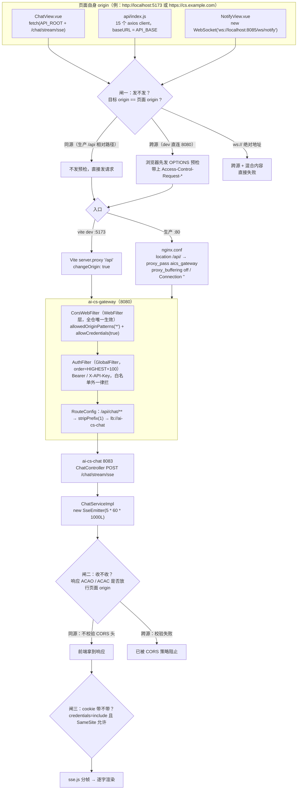
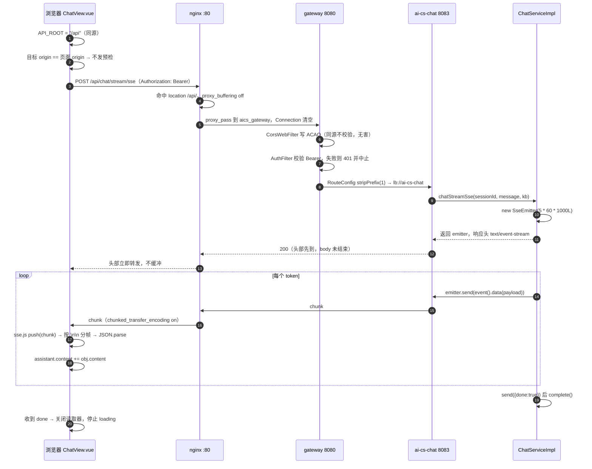

# 浏览器原理与 HTTP 跨域：同源策略的三道闸

> **一句话结论**：跨域不是「后端加个 `Access-Control-Allow-Origin` 头」就完事——浏览器在三个位置分别判定：**请求发不发**（同源检查与预检 OPTIONS）、**响应收不收**（`Access-Control-Allow-Origin` / `Allow-Credentials` 回显校验）、**cookie 带不带**（`credentials` + `SameSite`）。只改其中一处，另外两处照样拦你。本项目前端在开发和线上都不出跨域，根本原因是**浏览器压根没发出过跨源请求**：开发走 Vite 代理、生产走 nginx 同源反代（`/api` → 网关），网关那份 CORS 配置反而是"备用安全带"。
> **阅读前置**：知道 HTTP 请求/响应长什么样；能读懂 `axios` 的一行封装和 nginx 的 `location` 段；Vue 3 组件里 `fetch` 见过即可。不需要协议栈功底。
> **证据基线**：B 级证据全部读自本仓库真实文件（`ai-cs-frontend` 的 `nginx.conf`/`vite.config.js`/`src/utils/runtime.js` 等、`ai-cs-gateway` 与 `ai-cs-chat` 的 CORS 配置），行号可核对；C 级证据为 node 24 本机实跑输出（命令与真实 stdout 一并给出）。**未实测的都显式标注**。预计阅读 40~55 分钟。

## 0. 先看现象

三个现象，分别对应三道闸中的一道。注意它们长得完全不像同一个问题。

### 现象 1：打包上线后，所有接口打到 `localhost`

控制台（Chrome，Network → XHR，状态 `(failed)`）：

```text
GET http://localhost:8080/api/user/login net::ERR_CONNECTION_REFUSED
```

本地跑着 `vite dev` 时一切正常，`npm run build` 之后打开 `dist/index.html` 就全挂。原因不是跨域，而是**网关地址被兜底回了 localhost**：`ai-cs-frontend/src/utils/runtime.js` 第 8~9 行的注释把这段历史写得很直白——旧代码写的是 `env.VITE_GATEWAY || 'http://localhost:8080'`，而 `.env.production` 里 `VITE_GATEWAY=` 是**空串**，空串是 falsy，于是生产构建仍然回落到 localhost。

### 现象 2：通知页在 https 站点下连不上，且连的是错的服务

控制台（Chrome Console）：

```text
Mixed Content: The page at 'https://cs.example.com/' was loaded over HTTPS,
but attempted to connect to the insecure WebSocket endpoint
'ws://localhost:8085/ws/notify'. This request has been blocked.
```

对应 `ai-cs-frontend/src/views/NotifyView.vue` 第 114 行：`ws = new WebSocket('ws://localhost:8085/ws/notify')`。这一行同时犯了三个错：**协议写死 `ws://`**（https 页面下被混合内容策略拦截）、**主机写死 `localhost`**（线上用户浏览器里的 localhost 是他们自己的机器）、**端口 8085 是 message 服务**，而通知服务是 8086（这是本仓库一个真实已知缺陷，不是笔误演示）。

### 现象 3：上线后浏览器抱怨"响应头有多个值"和"预检没有 ok 状态"

典型控制台原文（浏览器对 CORS 失败的标准文案）：

```text
Access to XMLHttpRequest at 'https://cs.example.com/api/chat/stream/sse' from origin
'https://cs.example.com' has been blocked by CORS policy:
The 'Access-Control-Allow-Origin' header contains multiple values 'https://cs.example.com, https://cs.example.com',
but only one is allowed.
```

```text
Access to fetch at '...' from origin '...' has been blocked by CORS policy:
Response to preflight request doesn't pass access control check:
It does not have HTTP ok status.
```

第一种不是"没配 CORS"，而是**配了两遍**。本仓库 `ai-cs-chat/src/main/java/com/aics/chat/config/CorsConfig.java` 第 14 行留着事故现场注释：`// @Configuration  // CORS 统一由网关处理，避免重复响应头导致浏览器 Network Error（2026-08-07）`。第二种是预检请求（OPTIONS）没被放过——看 `ai-cs-gateway/src/main/java/com/aics/gateway/filter/AuthFilter.java`，它的鉴权逻辑里**没有任何 OPTIONS 直接放行的分支**，预检能通过完全依赖 `CorsWebFilter` 在它之前把 OPTIONS 应答掉。

> 这些现象指向同一件事：**跨域是浏览器在三个不同位置的三次独立判定——发不发、收不收、带不带凭证——每一次都可能单独失败，且失败时浏览器只告诉你"被 CORS 拦了"，不会告诉你拦在哪一道闸。**

## 1. 整体地图



**读图说明**：最值得盯的是 `闸一` 那个菱形。图上它有三条出边，而本仓库真正跑的是**最上面那条（同源）**——`P2`（axios 封装，15 个实例、被 24 个视图组件共用同一份 baseURL）和 `P1`（流式 fetch）都只从 `runtime.js` 拿地址，生产构建下 `API_BASE` 是 `"/api"`，是相对路径，浏览器按页面自己的 origin 补全，于是 `/api` 和页面同源，**不发预检、不校验响应头**。第二条边（dev 直连 8080）在这套代码里也不成立：`.env.development` 里虽然有 `VITE_GATEWAY=http://localhost:8080`，但 `vite.config.js` 同时把 `/api` 代理回 8080，页面里请求的是相对路径，仍然同源。**唯一真的走到跨源分支的是 `P3`**，所以图上 `J --> WSX` 那条边才是本仓库唯一活跃的跨域路径，也是唯一下不了线的缺陷。

| 组件 | 责任 | 关键类 / 配置 | 谁调用它 | 本仓库证据 |
| --- | --- | --- | --- | --- |
| 浏览器同源策略 | 判定"发不发/收不收/带不带"，先拦再说 | origin = scheme + host + port | 所有页面请求 | C 级实跑（见 3.5） |
| `runtime.js` | 网关地址的**唯一出口** | `resolveGateway` / `GATEWAY` / `API_BASE` | 所有 axios 与 fetch 调用方 | `ai-cs-frontend/src/utils/runtime.js` L14-L24 |
| Vite dev 代理 | 开发期把 `/api` 转给 8080，制造同源 | `server.proxy['/api']` | `npm run dev` | `ai-cs-frontend/vite.config.js` L24-L42 |
| nginx | 生产期把 `/api` 反代到网关，制造同源；管缓存与 gzip | `location /api/`、`proxy_buffering off` | 浏览器直连 :80 | `ai-cs-frontend/nginx.conf` L49-L62 |
| 网关 CORS | 万一真跨源时，回写放行头并应答预检 | `CorsWebFilter` + `UrlBasedCorsConfigurationSource` | Spring WebFlux 过滤器链 | `ai-cs-gateway/src/main/java/com/aics/gateway/config/CorsConfig.java` L17-L29 |
| 网关鉴权 | 拦未带凭证的请求 | `AuthFilter implements GlobalFilter, Ordered` | 网关过滤器链 | `ai-cs-gateway/src/main/java/com/aics/gateway/filter/AuthFilter.java` L43、L172-L173 |
| 服务侧 CORS | **已禁用**，避免重复头 | `CorsFilter`（无 `@Configuration`） | 无人调用 | `ai-cs-chat/src/main/java/com/aics/chat/config/CorsConfig.java` L14 |
| 流式通道 | SSE 长响应，必须绕过代理缓冲 | `SseEmitter` + `text/event-stream` | 聊天/Agent/视觉三个接口 | `ai-cs-chat/src/main/java/com/aics/chat/controller/ChatController.java` L167-L168 |

参与方与端口（跨域判定的尺子就是"端口变没变"，所以先把端口摆清楚）：

| 参与方 | 端口 | 核对状态 |
| --- | --- | --- |
| Vite dev server | 5173 | ✅ `vite.config.js` L24-L42 的 `server.port` |
| nginx（生产入口） | 80 | ✅ `nginx.conf` L15-L18 的 `listen 80` |
| 网关 `ai-cs-gateway` | 8080 | ✅ `ai-cs-gateway/src/main/resources/application.yml` 的 `server.port` |
| `ai-cs-chat` | 8083 | ✅ 同型 application.yml 核对 |
| `ai-cs-message` | 8085 | ✅ 同上（**NotifyView.vue L114 错连的就是这个**） |
| `ai-cs-notify` | 8086 | ✅ 同上（WS handler 真正注册在这里） |
| user / knowledge / search / order / product / pay / mq | 8081 / 8082 / 8084 / 8087 / 8088 / 8089 / 8090 | ⚠️ 未逐个打开配置文件核对，取自项目约定端口表；引用前请自行 `Select-String -Path ai-cs-*/src/main/resources/application.yml -Pattern "port:"` 复核 |

**落地面速查（本篇结论能不能在本仓库核对，一句话版）**：

| 结论 | 能否核对 | 核对方式 |
| --- | --- | --- |
| 生产 `API_BASE` 为空串 → 相对 `/api` → 同源 | ✅ 可核对 | 读 `runtime.js` L14-L24 + node 实跑（3.7 有真实输出） |
| 网关是唯一生效的 CORS | ✅ 可核对 | 全仓 grep `CorsWebFilter` 只有一处；chat 侧 `@Configuration` 已注释 |
| nginx 未配 WebSocket `Upgrade` 转发 | ✅ 可核对 | `nginx.conf` 只有 `/assets/`、`/index.html`、`/api/`、`/` 四个 location |
| WS 服务端默认只允许 `http://localhost:5173` | ✅ 可核对 | `ai-cs-notify/src/main/java/com/aics/notify/config/WebSocketConfig.java` L28-L32 |
| 前端未引入 Pinia | ✅ 可核对 | `package.json` 依赖清单 + 全仓无 `defineStore` |
| 预检 OPTIONS 是否真能过网关 | ⚠️ 未本机实测 | 需 `curl -i -X OPTIONS`（6.2 给命令与判读） |
| `proxy_buffering off` 对流式的实际效果 | ⚠️ 未本机实测 | 需起 nginx 容器后 `curl -N` 观察到达节奏 |
| HTTP/2 / HTTP/3 是否启用 | ❌ 未落地 | `nginx.conf` 只有 `listen 80`，无 `http2`；`proxy_http_version 1.1` 指 upstream 侧 |

## 2. 关键概念与关键类/关键 API

| 名称 | 位置 | 角色 | 关键点 |
| --- | --- | --- | --- |
| 同源（origin） | 浏览器规则 | 跨域的判定基准 | scheme + host + port 三者全等；`http`→`https`、`:5173`→`:8080` 都算跨源 |
| 简单请求 | CORS 规范 | 免预检的窄门槛 | 方法仅 GET/HEAD/POST；`Content-Type` 仅三种表单类型；无自定义头 |
| 预检（preflight） | 浏览器自动发出 | 跨源且"不简单"时的探路 OPTIONS | 带 `Access-Control-Request-Method` / `-Headers`；必须 2xx 且带放行头 |
| 凭证请求 | CORS 规范 | 让 cookie/证书参与跨源 | `Access-Control-Allow-Origin` 必须**精确回显** Origin，禁止 `*` |
| `Vary: Origin` | 响应头 | 告诉各级缓存"这个响应随 Origin 变" | 动态回显 Origin 时必须加，否则 CDN 缓存会串味 |
| 强缓存 | `Cache-Control: max-age` / `Expires` | 时间窗内不问服务器 | 本项目 `/assets/` 用 `public, immutable` + 一年 |
| 协商缓存 | `ETag`/`If-None-Match`、`Last-Modified` | 每次问、命中返 304 | 省带宽不省 RTT；入口 HTML 用 `no-store` 一票否决 |
| `SseEmitter` | Spring MVC | 服务端挂住一个响应逐条写 | 有超时值；本项目 5 分钟，Agent 流 120 秒 |
| `CorsWebFilter` | Spring WebFlux / Gateway | WebFilter 层统一处理 CORS 与预检 | 在 `GlobalFilter` 之前执行，故能先应答 OPTIONS |
| `proxy_buffering` | nginx | 是否攒够 buffer 再回客户端 | SSE 必须 `off`，否则"逐字"变成"最后一把梭" |
| `Connection ""` | nginx | 清空该请求头 | 与 `proxy_http_version 1.1` 配合启用 upstream 长连接 |

关键类 / 关键 API 逐个点名：

| 名称 | 位置 | 角色 | 关键点 |
| --- | --- | --- | --- |
| `resolveGateway(env)` | `ai-cs-frontend/src/utils/runtime.js` L14-L18 | 把环境变量收敛成 base | 非字符串一律当空串；末尾斜杠剥掉；**不用 `\|\|` 兜底** |
| `API_BASE` | 同文件 L24 | 全站地址前缀 | 值为 `` `${GATEWAY}/api` ``，生产即 `"/api"` |
| `createClient(baseURL)` | `ai-cs-frontend/src/api/index.js` L37-L63 | 造 axios 实例 | `timeout: 30000`；请求拦截器注入 `Authorization: Bearer`；401 统一登出 |
| `createSseParser(onEvent)` | `ai-cs-frontend/src/utils/sse.js` L16 | 自己实现的事件流解析 | 按 `\n\n` 分帧、忽略 `:` 注释帧、`flush()` 补半帧 |
| `AuthFilter` | `ai-cs-gateway/src/main/java/com/aics/gateway/filter/AuthFilter.java` | 网关注入/校验 token | `getOrder()` 返 `HIGHEST_PRECEDENCE + 100`；**无 OPTIONS 放行分支** |
| `CorsWebFilter` | `ai-cs-gateway/src/main/java/com/aics/gateway/config/CorsConfig.java` L17-L29 | 统一 CORS | `setAllowedOriginPatterns(List.of("*"))` + `setAllowCredentials(true)` + `setMaxAge(3600L)` |

三组最容易混的概念，摆在一起看：

| 别混 | 区别一句话 | 本仓库怎么用 |
| --- | --- | --- |
| 强缓存 vs 协商缓存 | 强缓存**不发请求**；协商缓存**发请求拿 304** | 入口 HTML `no-store`，`/assets/` 一年 `immutable` |
| `allowCredentials` vs `SameSite` | 前者是 CORS 侧的"允许带 cookie"；后者是浏览器侧的"自动带不带 cookie" | 网关开了 `allowCredentials(true)`，但前端用 Bearer，实际没有 cookie 参与 |
| SSE vs WebSocket | SSE 是普通 HTTP 响应（单向、可被代理缓冲）；WebSocket 是 `Upgrade` 后的双向帧 | 对话用 SSE（`fetch` + 自写解析器）；通知页用 WebSocket，且绕过反代 |

## 3. 原理与证据逐段精读

### 3.1 从输入 URL 到首屏：这条链上每一环都可能让你"以为在调接口"

**在干什么**：一次页面加载依次经过 DNS 解析（域名→IP）→ TCP 三次握手 → TLS 握手（https）→ 发 HTTP 请求 → 收 HTML → 解析 HTML 建 DOM、解析 CSS 建 CSSOM → 两者合成渲染树 → 布局（Layout）→ 绘制（Paint）→ 合成（Composite）。途中 `script` 会**阻塞 HTML 解析**（除非 `defer`/`async`），`link[rel=stylesheet]` 会**阻塞渲染**（因为渲染必须等 CSSOM）。

**为什么这么设计**：JS 可能 `document.write`、可能读 DOM 结构，浏览器无法预判，只好停下来先执行；CSS 影响布局结果，先渲染再改等于白画一遍。这是一笔"用首屏时间换正确性"的交易。`defer` 表示"解析完再按顺序执行"，`async` 表示"下载完就插队执行"，两者都不阻塞解析。

**换写法会怎样**：把首屏必需的路由组件全部静态 `import`，Vite 打包后首包变大、首次可交互更晚；改成动态 `import()` 后，代码分割成多个 chunk，首屏只下载当前路由需要的那个。代价是多一次网络往返，而且**一旦 chunk 文件名对不上（旧 index.html 引用了新构建已删掉的 hash），就会在 Network 里出现 404 + 控制台 `Failed to fetch dynamically imported module`**——这是"缓存没治理好"最典型的症状。

**常见坑**：① 把 `await` 的初始化逻辑直接写在 `<script setup>` 顶层，阻塞首屏渲染；② 用 `async` 加载了有依赖顺序的几个脚本，执行顺序错乱；③ 把接口请求放在 `<head>` 里的同步脚本，白屏时间等于接口耗时。本项目 `index.html` 只有一个 `div#app` 加一个入口模块，属于标准 SPA 形态，路由懒加载由 vue-router 负责。

### 3.2 重排、重绘与合成：为什么 `offsetWidth` 一多就卡

**在干什么**：改 DOM 的几何属性（宽高、位置、字号、删除节点）会触发**重排（reflow / layout）**：浏览器重新算每个盒子的位置；只改颜色、背景、可见性会触发**重绘（repaint）**：位置不变只重画像素；而 `transform`、`opacity` 这类属性可以只做**合成（composite）**：在 GPU 上把已有图层挪一挪/淡一淡，跳过布局和绘制。

**为什么这么设计**：重排是 O(受影响节点数) 的一次全量或局部布局计算，重绘要重新栅格化像素，合成只改图层变换矩阵——三档成本差着数量级，所以浏览器把"能只合成"的属性单独拎出来优化。

**换写法会怎样**：把动画从 `left: 0 → left: 100px` 改成 `transform: translateX(100px)`，每帧从"重排+重绘+合成"降到"只合成"，CPU 占用显著下降（帧率提升幅度随设备与图层数变化，**未本机实测，勿引用具体数字**）。反过来，给大量元素各加一层 `will-change: transform`，图层爆炸，显存吃紧反而更卡。

**常见坑**：**读写交替**造成强制同步布局。`el.offsetWidth` 是读，读之前浏览器必须先把待处理的样式变更落地，于是把本该批量的写操作切成"写→读→写→读"，每次都强制一次布局：

```javascript
// 反例：每次循环里读一次写一次，触发 N 次强制同步布局
for (const el of items) {
  el.style.width = el.offsetWidth + 10 + 'px'
}

// 正例：先批量读，再批量写
const widths = items.map((el) => el.offsetWidth)
items.forEach((el, i) => {
  el.style.width = widths[i] + 10 + 'px'
})
```

上面两段语义不同（第一段会自我叠加，第二段基于同一快照），但工程意义一致：**读操作会强制浏览器把队列里的写操作结算掉**。实际性能差多少要用 DevTools Performance 面板录一段、看 `Layout` 紫色块出现的次数，别凭感觉。第二类坑是用 `table` 做布局改一个单元格全表重排；第三类是在 `requestAnimationFrame` 之外用 `setTimeout` 驱动动画，掉帧且与合成器不同步。

### 3.3 缓存四级：从浏览器内存到 CDN，再到"每次问一句"

**在干什么**：一次请求的缓存判定从近到远分四层：① **浏览器强缓存**（内存/磁盘，`Cache-Control: max-age` 内直接用，DevTools 里显示 `(from memory cache)` / `(from disk cache)`，不发请求）；② **CDN/代理层**（边缘节点存一份，命中就不回源）；③ **协商缓存**（过期后带 `If-None-Match` / `If-Modified-Since` 问服务器，命中返 `304`，省响应体不省往返）；④ **前端内存**（组件内的 `ref`、模块级单例、`sessionStorage` 之类，连 HTTP 都不发——顺带说清一件事：本仓库**没有引入 Pinia**，`ai-cs-frontend` 工程根目录的 `package.json` 依赖里没有 `pinia`，全仓也搜不到 `defineStore`，状态就是组件内响应式变量 + `localStorage` 里的登录态）。

**为什么这么设计**：静态资源内容不变但会变版本，用"文件名带内容哈希 + 一年强缓存"把重复下载降到零；入口 HTML 必须每次拿最新的，否则新版本永远发不出去，于是给它最强的"不许缓存"。这就是经典组合拳：**入口文件永缓存不生效，资源文件永不失效**。

**换写法会怎样**：把 `index.html` 也设成一年强缓存，用户升级后仍拿到旧 HTML，里面引用的旧 hash 资源早已删除 → 白屏/404，只能让用户强刷。反过来，把 `/assets/*.js` 设成 `no-store`，每次访问都全量下载，带宽与首屏时间双输。

本仓库的落地分界点很清楚，`ai-cs-frontend/nginx.conf`：

```nginx
# L33-L37：带内容哈希的静态资源，一年强缓存 + immutable
location /assets/ {
    expires 1y;
    add_header Cache-Control "public, immutable";
    access_log off;
}

# L41-L44：入口 HTML 一票否决
location = /index.html {
    add_header Cache-Control "no-store, no-cache, must-revalidate";
    expires -1;
}
```

第一段 `immutable` 的意思是"即使用户按 F5 也别回来问"，这正是 hash 文件名的前提——文件名变了就是新 URL。第二段用了 `location =`（精确匹配），优先级高于后面的 `location /`，否则 SPA 的 `try_files` 兜底会让 `/index.html` 落到另一个 location 上、加上错的头。三行合起来还藏着一个坑：`expires -1` 在 nginx 里会**额外**输出一条 `Cache-Control: no-cache` 和一条过去的 `Expires`，与 `add_header` 那条并存，最终响应可能带两个 `Cache-Control` 行。浏览器对多个 `Cache-Control` 通常取最严格的那条，行为不变，但**这是静态推断，需 `curl -I` 实测确认**（判读方法见 6.3）。

### 3.4 HTTP 版本演进：队头阻塞到底堵在哪一层

**在干什么**：HTTP/1.1 允许 keep-alive 复用 TCP 连接，但同一连接上请求是**串行**的：前一个响应没发完，后一个响应的字节就排队——这就是**应用层队头阻塞**。浏览器因此对同域开 6 条左右并行连接规避（具体并发数随浏览器与协议变化，别背数字）。HTTP/2 把一条 TCP 连接切成多个**流（stream）**，帧交织发送，应用层队头阻塞消失，还能 HPACK 压缩头部；但所有流共用一个 TCP 连接，一旦丢包，内核要等重传把队头补上，**TCP 层队头阻塞**依旧。HTTP/3 改跑在 QUIC 上（基于 UDP 的用户态可靠传输），丢包只影响单个流，还支持 0-RTT 与连接迁移。

**为什么这么设计**：1.1 的串行是为了实现简单（响应边界靠 `Content-Length`/chunked 标识）；2 用二进制分帧把"连接复用"推到极致；3 发现瓶颈已经不在 HTTP 而在 TCP，只好自己重造传输层。

**换写法会怎样**：本项目 nginx 是 `listen 80`（明文 HTTP/1.1），浏览器到 nginx 这一段没有 h2/h3 收益；`proxy_http_version 1.1` **只管 upstream 那一段**，让 nginx 与网关之间用 1.1 从而支持长连接与 chunked——SSE 必须靠它。若把 `proxy_http_version` 留成默认的 1.0，upstream 连接不能 keep-alive、`Connection ""` 也白写，长连接流式响应会在代理层反复重建。

**常见坑**：① 以为"上了 HTTP/2 就没有队头阻塞"——丢包时依然有；② 把 h2 用来承载 SSE 时配错（h2 不支持某些 1.1 的 `Connection` 语义），导致头被拒；③ 在 nginx 里 `gzip on` 又把 `text/event-stream` 加进 `gzip_types`，压缩器攒块导致"流"变成"分段爆发"——本项目 `nginx.conf` L26 的 `gzip_types` 里**没有** `text/event-stream`，等于规避了这个坑（这条可以从配置直接读出，行为效果未实测）。

### 3.5 同源策略：三要素全等，且基准永远是"页面自己的 origin"

**在干什么**：浏览器把 origin 定义为 `scheme + host + port` 三元组，任一不同即跨源。页面发出的 `fetch`/`XHR`/`WebSocket` 请求，浏览器先拿"目标 URL 的 origin"和"文档的 origin"比较；不同就进入 CORS 流程（带凭证的还多一道限制）。

**为什么这么设计**：同源策略是浏览器给用户的保护：你在 `bank.com` 的登录态不该被 `evil.com` 的脚本读取响应内容。注意它限制的是**读取响应**和**部分写入**，不是"请求一定不发出"——简单请求其实是发出去的，只是响应被拦下不给 JS 看。这个细节解释了为什么"跨域请求把服务器数据改了"是可能的（所以才有 CSRF）。

**换写法会怎样**：C 级证据——用 node 24 直接算 origin，把"到底谁跟谁比"钉死：

```powershell
cd D:\Projects\Persion\ai-customer-service
node -e "const p=new URL('http://localhost:5173/chat').origin; for (const u of ['http://localhost:8080/api/user/login','http://localhost:5173/api/user/login','https://cs.example.com/api/user/login','ws://localhost:8085/ws/notify']) console.log(u.padEnd(42), new URL(u).origin.padEnd(24), new URL(u).origin===p?'同源':'跨源')"
```

真实输出（本机 node 24 实跑）：

```text
http://localhost:8080/api/user/login      http://localhost:8080  跨源
http://localhost:5173/api/user/login      http://localhost:5173  同源
https://cs.example.com/api/user/login     https://cs.example.com 跨源
ws://localhost:8085/ws/notify             ws://localhost:8085     跨源
```

第三行最能说明问题：`https://cs.example.com/api/...` 与 `http://localhost:5173/chat` 相比是"跨源"，因为**基准是页面自己的 origin**。拿 5173 当基准去判线上是错的；正确的心智模型是"页面在哪个 origin，就用哪个 origin 当尺子"。第四行说明 `ws://` 也走同源判定，且协议不同（`ws` vs `http`）就已经不同源——所以现象 2 里那行硬编码 WebSocket 在 https 站点上必挂。

**常见坑**：① 以为 `localhost` 与 `127.0.0.1` 同源（不同 host，跨源）；② 以为 `http://a.com` 与 `https://a.com` 同源（scheme 不同）；③ 以为"端口不同也算同源"；④ 在 https 页面里写 `ws://`（混合内容，直接被拦，连 CORS 都不给你报）。

### 3.6 CORS：预检的边界在哪，凭证请求为什么不能用星号

**在干什么**：跨源时浏览器按"请求简不简单"分两条路。**简单请求**（方法 ∈ {GET, HEAD, POST}，头只含 CORS 安全头，`Content-Type` 只允许 `application/x-www-form-urlencoded`、`multipart/form-data`、`text/plain`）直接发出，响应回来时校验 `Access-Control-Allow-Origin`。**不简单**的（PUT/DELETE/PATCH、`application/json`、带 `Authorization` 等自定义头）先发 `OPTIONS` 预检，服务器必须以 2xx 应答并回 `Access-Control-Allow-Methods` / `-Headers` / `-Max-Age`，浏览器才发真实请求。

**为什么这么设计**：预检是为了在"造成副作用之前"先问一句"你允许这个源用这个方法、带这些头吗"。`Authorization` 和 `Content-Type: application/json` 都不在简单请求白名单里，因为前者能携带凭证、后者会让服务端走 JSON 反序列化（老式表单攻击面不同）。

据此可以立刻得出本项目的结论：**`ai-cs-frontend/src/api/index.js` 的每个 axios 实例都注入了 `Authorization: Bearer`（L41-L47），而 `createClient` 里 `Content-Type` 走 JSON，所以只要真跨源，每个业务请求都是预检请求。** 这也让"预检必须被放过"从理论变成刚需。

**换写法会怎样**：后端只加 `Access-Control-Allow-Origin: *` 而前端开 `withCredentials`，浏览器直接拒——凭证模式下 ACAO 必须**精确回显**具体 Origin 并附 `Access-Control-Allow-Credentials: true`。Spring 里如果写 `setAllowedOrigins(List.of("*"))` 再配 `allowCredentials(true)`，会被框架拒绝或产生不可用组合；本仓库走的是 `setAllowedOriginPatterns(List.of("*"))`（`ai-cs-gateway/src/main/java/com/aics/gateway/config/CorsConfig.java` L20、L23），由框架在运行时把 `*` 模式的匹配结果**回显成具体 Origin**。

**常见坑**：① 预检失败了却只看业务接口日志——预检根本没打到 Controller；② 忘记 `Vary: Origin`，前面挂了 CDN 时第一个源的响应被缓存给第二个源；③ 只放行 `GET,POST` 却让前端发 `PUT`；④ 只放行 `Content-Type` 却没放行 `Authorization`（很多 401/预检失败都死在这）；⑤ 把 `maxAge=3600` 以后改了 CORS 配置却发现一小时内浏览器还在用旧预检结果。

### 3.7 本项目为什么前端不出跨域问题：三处证据串起来

**在干什么**：让"页面 origin"和"接口 origin"变成同一个。生产靠 nginx 同源反代，开发靠 Vite 代理，两边都不产生跨源请求。

**为什么这么设计**：同源方案有三重好处——① 不依赖 CORS 配置正确性（少一类线上事故）；② 没有预检的额外往返（每个跨源非简单请求多一次 RTT）；③ 前端产物里的地址是相对路径，**部署到任何域名都不用改配置**。

**证据一，生产地址是空的**。`ai-cs-frontend/.env.production` L1-L5 注释写明"留空 => 相对路径 `/api/...`，由同域 Nginx 反代，同源不需要 CORS"，L6 就是 `VITE_GATEWAY=`。

**证据二，地址解析只有一个出口且不兜底**。`ai-cs-frontend/src/utils/runtime.js` L14-L24：

```javascript
export function resolveGateway(env) {
  const raw = env?.VITE_GATEWAY
  if (typeof raw !== 'string') return ''
  return raw.trim().replace(/\/+$/, '')
}
export const GATEWAY = resolveGateway(import.meta.env)
export const API_BASE = `${GATEWAY}/api`
```

`typeof raw !== 'string'` 这一句是全部要害：空串是**字符串**，所以返回空串而不是兜底 localhost；变量根本不存在（`undefined`）也返回空串。末尾 `replace(/\/+$/, '')` 防住 `https://a.com/` 拼出 `https://a.com//api` 这种双斜杠。第三行把 `import.meta.env` 传进去，全仓仅此一处读环境变量（C 级统计：`import.meta.env` 只出现在 `runtime.js` L21，其余文件全部 `import { API_BASE }`）。

**证据三，node 实跑对比"新旧两种写法"**。用真实模块跑（`resolveGateway` 是纯函数，可直接 import）：

```powershell
cd D:\Projects\Persion\ai-customer-service\ai-cs-frontend
node -e "import('./src/utils/runtime.js').then(({resolveGateway})=>{for(const env of [{VITE_GATEWAY:''},{VITE_GATEWAY:'http://localhost:8080'},{VITE_GATEWAY:'https://api.example.com/'},{}]){const r=resolveGateway(env);console.log(JSON.stringify(env).padEnd(42),'resolveGateway='+JSON.stringify(r).padEnd(30),'旧写法='+JSON.stringify(env.VITE_GATEWAY||'http://localhost:8080'))}})"
```

真实输出（本机实跑）：

```text
{"VITE_GATEWAY":""}                        resolveGateway=""      旧写法="http://localhost:8080"
{"VITE_GATEWAY":"http://localhost:8080"}   resolveGateway="http://localhost:8080"  旧写法="http://localhost:8080"
{"VITE_GATEWAY":"https://api.example.com/"} resolveGateway="https://api.example.com" 旧写法="https://api.example.com/"
{}                                         resolveGateway=""      旧写法="http://localhost:8080"
```

第一行就是现象 1 的根因：生产环境 `VITE_GATEWAY` 是空串，`resolveGateway` 给 `""`（于是 `API_BASE === "/api"`，同源），旧写法给 `localhost:8080`（于是线上请求全打自己机器）。第三行还暴露旧写法的另一个小毛病：末尾斜杠不剥，拼出来是 `https://api.example.com//api/...`。

**常见坑**：① 用 `if (env.VITE_GATEWAY)` 判断"有没有配"，空串被当成没配；② 在业务代码里再写一次 `import.meta.env.VITE_GATEWAY`，多出口必然漂移；③ 以为 `.env.development` 里的 `VITE_GATEWAY=http://localhost:8080` 会被打包用上（它只在 dev 生效，且生产构建读的是 `.env.production`）；④ 把密钥写进 `VITE_` 变量——`ai-cs-frontend/.env.development` L3 注释已经提醒"VITE_ 前缀会被打进前端产物，人人可见"。

### 3.8 网关那份 CORS 配置：唯一、宽放、以及它的三个坑

**在干什么**：`ai-cs-gateway/src/main/java/com/aics/gateway/config/CorsConfig.java` 注册了一个 `CorsWebFilter`，对 `/**` 应用：允许任意 origin 模式、六种方法、任意请求头，允许凭证，预检结果缓存 3600 秒。

```java
@Bean
public CorsWebFilter corsWebFilter() {
    CorsConfiguration config = new CorsConfiguration();
    config.setAllowedOriginPatterns(List.of("*"));      // L20 模式匹配，不是固定值
    config.setAllowedMethods(List.of("GET", "POST", "PUT", "DELETE", "OPTIONS", "PATCH")); // L21
    config.setAllowedHeaders(List.of("*"));              // L22
    config.setAllowCredentials(true);                    // L23 允许带凭证
    config.setMaxAge(3600L);                             // L24 预检缓存 1 小时
    UrlBasedCorsConfigurationSource source = new UrlBasedCorsConfigurationSource();
    source.registerCorsConfiguration("/**", config);     // L27
    return new CorsWebFilter(source);
}
```

**为什么这么设计**：微服务 8 个以上，逐个服务配 CORS 必然漂移；网关是唯一入口，配一处最省事。`OriginPatterns` 而不是 `Origins`，是因为要配合 `allowCredentials(true)`——固定值列表里写 `*` 会被框架判定为非法组合，而模式匹配可以在运行时回显具体 Origin。

**换写法会怎样**：如果哪天有人"顺手"在某个业务服务上重新启用 `@CrossOrigin` 或 `CorsFilter`（`ai-cs-chat/src/main/java/com/aics/chat/config/CorsConfig.java` L33-L51 那段代码还完整留着，只是类上没有 `@Configuration`），网关加一次头、服务再加一次，浏览器就看到**两个 ACAO 值**，于是回放现象 3 的第一段报错。这正是该文件 L14 注释记录的事故（2026-08-07），也是"为什么不能两边都配"的第一手证据。

**常见坑**：① 生产是同源（nginx 反代），网关照样会往响应里写 ACAO——**同源场景浏览器不校验，所以无害**，但如果你在 nginx 或 CDN 上"再补一个 CORS 头"，就变成重复值；② `allowedOriginPatterns("*")` + `allowCredentials(true)` 等于"任何网站都能带凭证访问你的 API"，一旦以后改成 cookie 会话就是数据泄露面（当前前端用 Bearer 头 + localStorage，风险面小一些，但不是没有）；③ 预检通过依赖 `CorsWebFilter` 排在 `AuthFilter` 之前——`AuthFilter` 里没有 OPTIONS 放行分支（它的 `isWhiteListed` 白名单里也没有 `/*` 的 OPTIONS 规则），**一旦过滤器顺序被改动，预检就会 401**，浏览器报的却是"preflight doesn't pass access control check"；④ 网关自己还有一处**按控制器的 CORS 注解**：`ai-cs-gateway/src/main/java/com/aics/gateway/controller/HealthController.java` L21 写着 `@CrossOrigin(origins = "*")`（对应 `/api/health`，首页 Dashboard 就是调它），它和 `CorsWebFilter` 是两套来源——同源场景下无害，但这正是"重复响应头"最容易复发的地方，改动前建议先确认响应里只有一组 ACAO；⑤ `maxAge=3600` 是浏览器侧的缓存，改了 CORS 配置后一小时内旧预检结果仍然生效，别把"改了没生效"误判成配置没写对。

### 3.9 Cookie 与存储：容量、共享范围、以及为什么本项目的 JWT 在 localStorage

**在干什么**：四种存储各有边界。`cookie` 约 4KB/条、随请求自动发送、受 `Domain`/`Path`/`Expires`/`Secure`/`SameSite` 控制；`localStorage` 通常每个源 5MB 量级、永久、**不随请求发送**；`sessionStorage` 同量级但只在当前标签页存活（同源 iframe 会复制一份初值）；`IndexedDB` 是异步的键值/对象库，容量随磁盘配额动态扩张（各浏览器策略不同，**具体数字随版本变化，不要背**）。

**为什么这么设计**：cookie 是 HTTP 协议层的东西（要放进请求头），所以必须小；localStorage 是 Web 存储规范，同步 API、天生简单；IndexedDB 为结构化大数据而生（离线缓存、附件），所以异步。

**换写法会怎样**：把 JWT 放 cookie（`HttpOnly; Secure; SameSite=Lax`）能挡 XSS 读取，但要处理 CSRF；放 localStorage 免 CSRF（跨站脚本无法凭空给请求加 `Authorization` 头，加自定义头会触发预检而被拦），但一旦 XSS 就直读 token。本项目选的是后者，证据在 `ai-cs-frontend/src/utils/auth.js` L4-L12：`TOKEN_KEY = 'aics_token'`，`localStorage.setItem/getItem`。

**常见坑**：① 以为 `sessionStorage` 能跨标签页共享（不能，这正是它和 localStorage 的唯一实质差别）；② 把 token 放 localStorage 却不做 XSS 防护（任何 `v-html` 都是风险）；③ 敏感信息塞 cookie 却忘了 `Secure`/`SameSite`，被 `http://` 明文带走；④ 依赖 cookie 会话却把 `SameSite=None` 又不带 `Secure`，被浏览器直接丢弃；⑤ 用 localStorage 做主数据存储，用户清缓存即丢单。

顺带把 CSRF 这条线收掉：**CSRF 的前提是"浏览器会自动带上凭证"**，也就是 cookie（或 HTTP Basic）。Bearer 头不会自动带，所以本项目当前这套（Bearer + localStorage + 同源反代）在 CSRF 上是相对安全的；一旦换成 cookie 会话，就必须同时补 `SameSite`（Lax/Strict）与 CSRF token（双提交或同步器令牌），否则网关那份 `allowCredentials(true)` 会把门开得很大。

### 3.10 SSE 与 WebSocket 在代理下的差异：`proxy_buffering off` 到底在关什么

**在干什么**：SSE 是"一个不结束的 HTTP 响应"，`Content-Type: text/event-stream`，服务端逐条写 `data: ...\n\n`，浏览器逐条触发；WebSocket 是握手时用 `Upgrade: websocket` 把连接从 HTTP 升级成双向帧协议。两者在 nginx 下的要求完全不同：

| 需求 | SSE | WebSocket |
| --- | --- | --- |
| 协议版本 | `proxy_http_version 1.1`（chunked/长连接） | `proxy_http_version 1.1` |
| 关键头 | `Connection ""`（清空，避免 close） | `Upgrade $http_upgrade` + `Connection "upgrade"` |
| 缓冲 | **必须 `proxy_buffering off`** | 不涉及 HTTP 缓冲 |
| 超时 | `proxy_read_timeout` 要大于"最长静默间隔" | 需调大 `proxy_read_timeout`（空闲不断开） |
| 压缩 | 不能让 gzip 攒块 | 不涉及 |

**为什么这么设计**：nginx 默认把 upstream 的响应攒进缓冲区，够一块才发给客户端——对普通接口是吞吐优化，对"逐 token 推送"是灾难：用户会觉得"等了 5 秒突然刷出一整段"。本项目为此在 `ai-cs-frontend/nginx.conf` L49-L62 里写了完整一套：

```nginx
location /api/ {
    proxy_pass http://aics_gateway;          # L50
    proxy_http_version 1.1;                  # L51
    proxy_set_header Host $host;
    proxy_set_header X-Real-IP $remote_addr;
    proxy_set_header X-Forwarded-For $proxy_add_x_forwarded_for;
    proxy_set_header X-Forwarded-Proto $scheme;
    proxy_set_header Connection "";          # L56 清空，交给 upstream 长连接
    proxy_buffering off;                     # L57 SSE 不缓冲
    proxy_cache off;                         # L58
    proxy_read_timeout 300s;                 # L60 大模型首 token 可能很慢
    chunked_transfer_encoding on;            # L61
}
```

`proxy_pass http://aics_gateway;` 后面**没有 URI 部分**，这是关键：一旦写成 `proxy_pass http://aics_gateway/;`（多个斜杠），nginx 会把 `/api` 前缀吃掉，网关路由表全带 `/api`（`ai-cs-gateway/src/main/java/com/aics/gateway/config/RouteConfig.java` 里 `/api/user/**`、`/api/chat/**` 等）就会全 404。这也是 L47-L48 注释在强调的事。

**换写法会怎样**：把 `/api` 的响应也加 `add_header Cache-Control` 或 `expires`，流式响应会被中间层缓存/复用，可能拿到别人会话的内容——所以这个 location 里**故意不加任何缓存头**（可以逐行核对：整份 `nginx.conf` 的缓存指令只出现在 `/assets/` 和 `/index.html` 两个 location 里）。

**常见坑**：① 只关 `proxy_buffering` 忘了 `proxy_cache off`；② `proxy_read_timeout` 用默认 60s，模型思考超过 60 秒就 504（L60 注释就是为了这个）；③ 以为 WebSocket 也能走这段配置——**本项目 nginx 没有 `Upgrade` 段，线上 WebSocket 反代是未落地能力**；④ 开发期以为是"后端慢"，实际是 Vite 代理层加了压缩/缓冲，所以 `ai-cs-frontend/vite.config.js` L34-L37 在 `proxyRes` 上强制把 `cache-control` 改成 `no-cache, no-transform` 并删掉 `content-encoding`，属于给开发代理打的补丁。

### 3.11 WebSocket 的"跨域"不是 CORS，而是服务端自己校验 Origin

**在干什么**：WebSocket 握手本质上是一条 HTTP `GET`，带 `Upgrade: websocket` 与 `Origin` 头。它**不走 CORS 预检**，浏览器也不会因为跨源就掐掉握手——放不放行由服务端读了 `Origin` 之后自己决定（Spring 里就是 `setAllowedOriginPatterns` 白名单），不匹配就直接返回 `403`。

**为什么这么设计**：握手之后跑的是二进制帧，不是 HTTP 响应，没有 `Access-Control-Allow-Origin` 这个"事后放行"的位置可放；而长连接一旦建立就是双向通道，服务端必须在握手那一瞬间一次性判定。

**本仓库证据**：通知服务的两个 WS 入口都写成**显式白名单，默认只允许 `http://localhost:5173`**，并且注释点明了为什么禁用 `*`（跨站连接可携带伪造 `userId` 查询参数）：

```java
// ai-cs-notify/src/main/java/com/aics/notify/config/WebSocketConfig.java L28-L32
registry.addHandler(new NotifyWebSocketHandler(), "/ws/notify")
        .setAllowedOriginPatterns("${AICS_ALLOWED_ORIGINS:http://localhost:5173}");

// ai-cs-notify/src/main/java/com/aics/notify/config/StompWebSocketConfig.java L30-L32
registry.addEndpoint("/ws-stomp")
        .setAllowedOriginPatterns("${AICS_ALLOWED_ORIGINS:http://localhost:5173}");
```

`${AICS_ALLOWED_ORIGINS:...}` 是"环境变量优先、缺省 localhost"的写法：**不改环境变量，线上域名一定被拒**。这跟网关那份 `allowedOriginPatterns("*")` 是两种哲学——网关宽到兜底，WS 端窄到默认拒绝，因为 WS 长连接能被动推送数据、还能携带查询参数冒充用户。

**换写法会怎样 / 常见坑**：① 线上页面 origin 是 `https://cs.example.com`，而这里默认值只有 `http://localhost:5173`，握手被拒，控制台原文是 `WebSocket connection to 'ws://localhost:8085/ws/notify' failed: Error during WebSocket handshake: Unexpected response code: 403`——**这个 403 不是 CORS 报错，浏览器也不会提示"跨域"**，新手很容易往网关找；② 前端 `ai-cs-frontend/src/views/NotifyView.vue` L114 连的是 **8085**，而 WS handler 注册在 **8086**（`ai-cs-notify/src/main/resources/application.yml` 的 `port: 8086`、message 服务是 `8085`，两者已核对），所以即使 origin 对了也打在没有这个 handler 的服务上；③ 协议与主机都写死成 `ws://localhost`，https 页面下先被混合内容拦掉，连握手都发不出；④ 要走 nginx 反代还得补 `Upgrade`/`Connection` 转发（见 3.10），否则表现为 400/426。

### 3.12 把三道闸串成一张排查表

**在干什么**：把本章所有结论压成一张"现象 → 闸位"的对照表，遇事先定位是哪一道闸，再去对应的层看证据。

| 你看到的现象 | 最可能卡在哪道闸 | 下一步验证 |
| --- | --- | --- |
| `preflight request doesn't pass access control check` / OPTIONS 返 401 | 闸一（预检没被放行） | `curl -i -X OPTIONS` 看那条 OPTIONS 的状态码，而不是看业务接口日志 |
| `No 'Access-Control-Allow-Origin' header is present` | 闸二（响应没写或写在了错误的层） | `curl -i` 直接看响应头原件，排除浏览器扣响应 |
| `header contains multiple values` | 闸二（两处同时写，如网关 + `@CrossOrigin`） | DevTools Response Headers 找重复行 |
| 凭证请求返回 `*` 或缺 `Allow-Credentials` | 闸三（凭证模式限制） | 看 ACAO 是否为具体 Origin、ACAC 是否为 `true` |
| `Mixed Content ... ws://` 或 `net::ERR_CONNECTION_REFUSED` 指向 localhost | 闸外的安全策略与地址解析 | Console 混合内容警告 / 确认 `API_BASE` 实际取值（见 3.7） |
| 前端"卡几秒后一次性刷出整段" | 都不是——代理缓冲 | Network → EventStream 看每条 `data` 到达时间戳 |
| 接口 404 且响应体是 HTML | 都不是——路由前缀被吃掉 | 查 `proxy_pass` 是否带多余斜杠、网关路由是否带 `/api` |
| 请求 Status `(failed)`、Response 页签空白 | 闸二（响应被浏览器扣下） | `curl` 重放同一请求（6.2 手法 B） |
| 换域名/换 CDN 后才偶发失败 | 闸二 + 缓存串味 | 检查响应是否有 `Vary: Origin` |

## 4. 一次完整执行时序（生产环境，同源 SSE 对话）



**读图说明**：盯两处。第一处是第 2 步——**"目标 origin == 页面 origin"这步判定在浏览器内部完成，不走网络**，所以本地和生产都看不到 OPTIONS；只有把 `VITE_GATEWAY` 配成绝对地址（真跨源）时，图上第 3 步前会多出一个 `OPTIONS /api/chat/stream/sse` 往返，并且 `AuthFilter` 那次校验**不会执行**（预检由 `CorsWebFilter` 直接应答）。第二处是第 13 步之后的 `loop`：响应的**头部**很早就回来了（200 + `text/event-stream`），body 是持续写的，所以 DevTools 里这个请求会长时间处于 `Pending`，不能按"请求耗时"理解它。

失败在哪一步、报什么：

| 失败步骤 | 现象 / 报错 | 判读要点 |
| --- | --- | --- |
| 第 1 步（地址错） | `ERR_CONNECTION_REFUSED` 指向 `localhost:8080` | 生产构建读到了兜底值，见 3.7 |
| 第 3 步（真跨源且预检失败） | `Response to preflight request doesn't pass access control check` | 看预检请求的**状态码**与响应头，不是看业务接口 |
| 第 7 步（鉴权） | 401 + `{"code":401,...}` | `AuthFilter` 白名单外无 token 即拦；调 `/api/user/login` 不受影响 |
| 第 8 步（路由） | 404，或返回 `text/html` 的 `index.html` | 路由前缀必须带 `/api`；返回 HTML 说明打到了前端而不是网关 |
| 第 9 步（服务不可用） | 503 或网关 fallback 响应 | 看 Nacos 是否注册、`lb://` 是否解析出实例 |
| 第 12~13 步（代理缓冲） | 前端"卡住几秒后一次性刷出全部" | `proxy_buffering` / 中间层 gzip 未关 |
| 第 15 步（超时） | 500 或流中途静默结束 | `SseEmitter` 5 分钟超时、nginx `proxy_read_timeout 300s`、前端 `AbortController` 主动中止 |
| 第 17 步（解析） | `Unexpected end of JSON input` | 半帧未 flush，或响应被 gzip/代理改写 |

## 5. 设计取舍

| 决策点 | 本仓库的选择 | 被放弃的方案 | 代价 / 触发条件 |
| --- | --- | --- | --- |
| 前端怎么连后端 | 同源反代：dev 走 Vite proxy，生产走 nginx `/api` | 前端直连网关绝对地址 + 靠 CORS 放行 | 少一类线上事故，但**部署必须带 nginx**；纯静态托管（如对象存储直出）就立刻退化成跨域场景 |
| CORS 配在哪 | 只在网关一处（`CorsWebFilter`） | 每个服务各配一份 | 单一职责清晰，但**任何服务侧残留配置都会造成重复头**；改动需跨模块纪律 |
| allowCredentials | `true` + `originPatterns("*")` | `false` + 精确白名单 | 灵活但过宽；当前靠 Bearer 头而非 cookie 撑着，换 cookie 会话前必须收紧 |
| token 存哪 | localStorage（`aics_token`） | HttpOnly cookie | 免 CSRF、实现简单；XSS 可直读，必须配套 CSP/禁 `v-html` |
| 流式客户端 | `fetch` + `ReadableStream` + 自写解析器 | `EventSource` | 支持 POST + JSON body + 自定义头；代价是自己处理分帧/半帧/中断（`sse.js` 78 行都是这个代价） |
| 静态资源缓存 | 入口 `no-store`，`/assets/` 一年 `immutable` | 全站短缓存 | 首屏最快、发版即时；但**旧 HTML + 已删 chunk** 会 404，必须保证 `index.html` 严格不缓存 |
| 通知通道 | WebSocket（当前实现绕过反代） | SSE 或轮询 | 真双向；但 nginx 未配 `Upgrade`、前端又写死 `ws://localhost:8085`，**属于未落地/带缺陷状态** |

可扩展点清单（按改动成本从低到高）：

1. `ai-cs-frontend/src/views/NotifyView.vue` L114：把硬编码改成本源相对路径（`new WebSocket((location.protocol === 'https:' ? 'wss://' : 'ws://') + location.host + '/api/ws/notify')`），并在 `RouteConfig` 加 `/api/ws/**` 路由。
2. `ai-cs-frontend/nginx.conf`：为 WebSocket 增一个 location，补 `proxy_set_header Upgrade $http_upgrade;` 与 `Connection "upgrade"`。
3. `CorsConfig` 把 `originPatterns` 收成白名单（从配置中心读），并显式加 `Vary: Origin`。
4. `nginx.conf` 的 `listen 80` 增加 TLS 与 `http2`（需证书），观察 h2 下的多路复用收益。
5. `runtime.js` 增加"白名单校验"：非空 `VITE_GATEWAY` 若不以 `http` 开头就直接抛错，防止把路径配成网关地址。
6. `/api` location 增加 `limit_req` 与 `proxy_request_buffering off`（大文件上传流式化）。

## 6. 踩坑与调试手法

| # | 坑 | 症状 | 定位手法 |
| --- | --- | --- | --- |
| 1 | `VITE_GATEWAY` 空串被 `\|\|` 兜底成 localhost | 生产接口全 `ERR_CONNECTION_REFUSED` | 用 node 直接跑 `resolveGateway`（见练习 1），对比新旧两种写法的输出 |
| 2 | 两处同时配 CORS | `header contains multiple values` | **DevTools → Network → 该请求 → Response Headers**，找是否出现两行 `access-control-allow-origin` |
| 3 | 预检被鉴权拦 | `preflight ... doesn't have HTTP ok status` | **Network 面板筛 `Fetch/XHR`，看有没有一条 `OPTIONS`，Status 是 401 还是 200** |
| 4 | SSE 被缓冲 | 首 token 迟迟不来，然后整段刷出 | **Network → 该请求 → Timing / EventStream 面板**，看消息到达时间戳是否均匀；用 `curl -N` 对照 |
| 5 | 硬编码 `ws://localhost:8085` | 混合内容拦截 / 连到错误服务 | **Console 看 Mixed Content 警告** + Network → WS 面板看握手 URL 与 Frames |
| 6 | 发版后旧 HTML 引用已删 chunk | 白屏 + `Failed to fetch dynamically imported module` | Network 里那个 chunk 是 404；清缓存后正常，说明入口 HTML 缓存策略有漏 |
| 7 | `manualChunks` 写成对象 | 构建直接失败：`Invalid type: Expected Function but received Object` | 读编译报错栈最后一个业务文件行号，回 `ai-cs-frontend/vite.config.js` L54-L61 改回函数式 |
| 8 | 响应头里 CORS 放行了但请求仍失败 | 实际是业务 4xx/5xx 被误当跨域 | 看 Network 的 Status，CORS 失败时 Status 通常是 `(failed)` 且响应体不可见 |
| 9 | WS 握手 403，其实是 Origin 白名单不符 | `Error during WebSocket handshake: Unexpected response code: 403`，**控制台不会说"跨域"** | Network → WS 面板看握手 URL 与 `Origin` 头，再对照 notify 的 `AICS_ALLOWED_ORIGINS` 默认值；顺带确认端口是 8086 而非 8085 |

两条真正"动手"的调试手法，展开写：

**手法 A：用 `curl` 把预检单独拎出来测（本机未实测，给命令与判读）。** 浏览器把预检和业务请求混在一起报错，最省事的办法是跳过浏览器，直接手工发一条 OPTIONS，看服务器到底怎么答：

```powershell
# 手工模拟浏览器预检：注意 Origin 和 Access-Control-Request-Headers 是浏览器自动加的，这里手动补
curl.exe -i -X OPTIONS "http://localhost:8080/api/chat/stream/sse" `
  -H "Origin: http://localhost:5173" `
  -H "Access-Control-Request-Method: POST" `
  -H "Access-Control-Request-Headers: authorization,content-type"
```

判读方法（三看）：**一看状态码**——2xx 才算通过，401/403/404 一律失败；**二看三个头**——`Access-Control-Allow-Origin` 是否回显了 `http://localhost:5173`（不是 `*`，因为要凭证）、`Access-Control-Allow-Headers` 是否包含 `authorization`、`Access-Control-Allow-Credentials` 是否为 `true`；**三看有没有重复**——如果同一个头出现两行（网关 + 服务各一次），浏览器会判失败，必须删掉其中一处。若本地 `curl` 拿到 200 而浏览器仍报预检失败，问题就在"多套 CORS 叠加"或"中间还有一层代理又加了一组头"。

**手法 B：DevTools 三件套定位 CORS 与流式问题。** ① **Network 面板**：勾 `Preserve log`（避免跳转/刷新清空记录），勾 `Disable cache`（排除强缓存干扰），按 `Fetch/XHR` 过滤，找那条 `OPTIONS` 和那条 `POST`；CORS 失败的请求 Status 显示 `(failed)`、Response 页签是空的——这就是"浏览器把响应扣下了"的铁证。② **右键请求 → Copy → Copy as cURL**，粘到 pwsh 里重放（去掉 `--compressed` 更直观），能立刻区分"服务器的问题"和"浏览器策略的问题"。③ **EventStream 面板**（Chrome 对 `text/event-stream` 有专门的页签）：能看到每条 `data` 到达的时间戳，如果几百毫秒一条就是没被缓冲，如果是"最后一秒涌出几十条"，就是 `proxy_buffering` 或压缩层在攒块。

断点类手法补充两点：在 **Sources → XHR/fetch Breakpoints** 里加 `stream/sse` 作为关键字，可以在发请求前停住，检查 `API_ROOT` 的实际取值（比 `console.log` 更早、更准）；在 `ai-cs-frontend/src/api/index.js` 的请求拦截器里打条件断点（条件写 `!config.headers.Authorization`），专门抓"某些请求没带 token"的问题。

## 7. 版本差异

| 主题 | 旧写法 | 当前基线 | 变化点 | 迁移动作 |
| --- | --- | --- | --- | --- |
| 网关地址解析 | `import.meta.env.VITE_GATEWAY \|\| 'http://localhost:8080'` | `resolveGateway()` 返回空串即同源 | 空串语义从"没配"变成"同源" | 业务代码只 `import { API_BASE }`，别自己读 env |
| CORS 归属 | 各服务 `@CrossOrigin` / `CorsFilter` 各配一份 | 只有网关 `CorsWebFilter` 生效 | 避免重复响应头 | 服务侧配置保持注释状态；新增服务不要再加 |
| 凭证 + 星号 | `setAllowedOrigins(List.of("*"))` + `allowCredentials(true)` | `setAllowedOriginPatterns(List.of("*"))` | 固定值不允许与凭证共存，模式匹配可回显 | 升级为模式匹配或精确白名单 |
| 流式客户端 | `new EventSource(url)`（只支持 GET、不能带头） | `fetch` + `response.body.getReader()` + `sse.js` 分帧 | 支持 POST/JSON/`Authorization`/`AbortController` | 需要中止能力就上 `AbortController`，别用 `EventSource.close` |
| 入口 HTML 缓存 | `Cache-Control: no-cache` | `no-store, no-cache, must-revalidate` + `expires -1` | 连"存一份但不直接用"都不允许 | 保持 `location = /index.html` 精确匹配，别被 `location /` 覆盖 |
| 静态资源缓存 | `expires 7d` 之类的时间窗 | `expires 1y` + `public, immutable` | 依赖文件名 hash 才敢说 immutable | 构建产物必须带 hash（Vite 默认） |
| 构建分包 | `manualChunks` 写对象 | `manualChunks` 必须写函数 | Vite 8 底层换 rolldown，对象形式直接报错 | 见 `vite.config.js` L54-L61 的注释与函数实现 |
| SSE 超时 | `new SseEmitter(0L)`（永不超时） | `new SseEmitter(5 * 60 * 1000L)` | 防止连接泄漏 | 超时值必须小于 nginx `proxy_read_timeout` 的同量级认知 |
| HTTP 版本 | 全链路 HTTP/1.1 | 浏览器侧仍 1.1（`listen 80`），upstream 显式 1.1 | h2/h3 未启用 | 若要上 h2，需证书 + `listen 443 ssl http2`，并回归验证流式行为 |

## 8. 面试高频问与答

1. 同源策略到底限制了什么？为什么"跨域请求能改数据但不能读响应"？
2. 简单请求和预检请求的边界怎么划？为什么 `Content-Type: application/json` 一定会触发预检？
3. 为什么带 `Authorization` 头的请求在跨域场景一定先发 OPTIONS？预检缓存靠什么头？
4. `Access-Control-Allow-Origin: *` 与 `allowCredentials: true` 为什么不能同时用？Spring 里怎么绕过这个限制？
5. 什么情况下浏览器报 CORS 错误，但服务器日志里连请求都没有？
6. `Access-Control-Allow-Origin` 出现两个值，是谁的锅？怎么定位？
7. 强缓存、协商缓存、CDN 缓存、Service Worker 缓存，谁先命中？
8. 为什么入口 `index.html` 要 `no-store`，而 `app.[hash].js` 可以一年 `immutable`？
9. HTTP/2 解决了队头阻塞吗？HTTP/3 为什么改用 UDP？
10. SSE 和 WebSocket 在 nginx 下分别要配什么？为什么 SSE 必须关 `proxy_buffering`？
11. 为什么不能直接用 `EventSource` 对接需要鉴权的流式接口？
12. JWT 放 localStorage 和放 HttpOnly Cookie，各自的攻击面是什么？CSRF 与 XSS 各防哪个？
13. `SameSite=Lax` / `Strict` / `None` 的差别，以及 `None` 为什么必须配 `Secure`？
14. `proxy_pass http://backend;` 与 `proxy_pass http://backend/;` 差在哪，为什么这决定了你的接口 404 还是 200？

## 9. 动手练习

**练习 1：复现"空串被兜底"这个 bug。**
写一段 node 脚本，`import` 真实的 `ai-cs-frontend/src/utils/runtime.js`，分别传入 `{ VITE_GATEWAY: '' }`、`{ VITE_GATEWAY: 'https://api.example.com/' }`、`{}`，同时打印 `resolveGateway(env)` 和 `env.VITE_GATEWAY || 'http://localhost:8080'` 的结果。
*验收标准*：能说出为什么第一组两者不同（`""` vs `http://localhost:8080`），并解释 `typeof raw !== 'string'` 这一句的作用；`API_BASE` 在空串情况下等于 `"/api"`。

**练习 2：手工发一次预检并判读。**
用 `curl.exe -i -X OPTIONS` 对 `/api/user/login` 和 `/api/chat/stream/sse` 各发一次，带 `Origin`、`Access-Control-Request-Method: POST`、`Access-Control-Request-Headers: authorization,content-type`。
*验收标准*：能读出状态码是否 2xx、`Access-Control-Allow-Origin` 是回显具体 origin 还是 `*`、`Allow-Headers` 里有没有 `authorization`；能解释"为什么浏览器预检能过而业务请求却 401"。

**练习 3：在 DevTools 里证明 SSE 没有被缓冲。**
打开对话页发一条消息，在 Network 里找到那条 `stream/sse` 请求，看 EventStream 页签的时间戳；然后用 `curl -N` 复跑一次对比。
*验收标准*：能贴出"每条 data 的到达间隔"证据，并说明若间隔中出现数秒空白、随后批量涌出，应该去查哪三个配置项（`proxy_buffering`、中间层 gzip、`Content-Encoding` 处理）。

**练习 4：给 WebSocket 补一条最小可用的反代。**
读 `ai-cs-frontend/nginx.conf`，写出新增 location 的配置（含 `Upgrade`、`Connection "upgrade"`、`proxy_read_timeout`），并同时改 `NotifyView.vue` L114 那行为同源相对地址。
*验收标准*：配置能通过 `nginx -t`（本机无 nginx 时，逐条对照官方指令语法自查即可）；能说明为什么不能沿用 `/api/` 那段配置；能指出 8085→8086 的端口错误。

**练习 5：给入口 HTML 的缓存头做一次回归。**
端口沿用 `ai-cs-frontend/Dockerfile` L8-L13 注释里的示例（注释写的是 `localhost:8081`，那是宿主机映射端口，与后端 user 服务的 8081 只是数字巧合；**本机未装 Docker，这条未实测**）。起好容器后用 `curl.exe -I http://localhost:8081/index.html` 与 `curl.exe -I http://localhost:8081/assets/<构建产物里某个真实文件名>` 各取一次响应头。
*验收标准*：能指出两条响应里 `Cache-Control` 分别是 `no-store, no-cache, must-revalidate` 与 `public, immutable`；若 `index.html` 出现两个 `Cache-Control` 行，能解释是 `expires -1` 与 `add_header` 叠加所致。

**练习 6：算清一次请求的 origin。**
用 node 的 `new URL(x).origin` 计算：`http://localhost:5173`、`http://localhost:8080`、`https://cs.example.com`、`wss://cs.example.com/ws`，判断哪些与页面 `https://cs.example.com/chat` 同源。
*验收标准*：能说明 `ws`/`wss` 与 `http`/`https` 在 origin 比较中的关系，并解释 `localhost` 与 `127.0.0.1` 为什么不算同源。

## 小结

- 跨域是**三道独立的闸**：发不发（同源判定 + 预检）、收不收（ACAO/ACAC 校验）、带不带凭证（credentials + SameSite）。后端加一个头只能解第二道。
- 本项目的正确姿势是**根本不让请求跨源**：生产 `.env.production` 的 `VITE_GATEWAY` 留空 → `API_BASE === "/api"` → 页面同源 → nginx `location /api/` 反代到网关；开发期由 `vite.config.js` 的 `proxy['/api']` 顶替同一角色。
- 地址只有**一个出口**：`runtime.js` 的 `resolveGateway`，且**不能用 `||` 兜底**——空串是合法值（表示同源），这是历史事故的根因。
- 网关那份 `CorsWebFilter` 是"备用安全带"：模式星号 + 允许凭证，宽到能兜住一切，但也意味着**任何服务侧残留的 CORS 配置都会造成重复响应头**（`ai-cs-chat` 那份已注释）。
- 缓存的杀招是**入口与资源分离**：`index.html` 一律 `no-store`，`/assets/` 一年 `immutable`；反过来配就是永久白屏。
- 流式的要诀是**代理不缓冲**：`proxy_buffering off` + `proxy_cache off` + `proxy_http_version 1.1` + `Connection ""` + 够长的 `proxy_read_timeout`；gzip 别碰 `text/event-stream`。
- 存储选型决定安全模型：JWT 在 localStorage（`aics_token`）→ 免 CSRF、怕 XSS；换 HttpOnly cookie 就必须补 `SameSite` 与 CSRF token。
- **可操作归纳**：动前端网络层之前，先做三件事——① `grep -r "import.meta.env" ai-cs-frontend/src` 确认没有第二个出口；② 打开 DevTools 确认关键请求**没有 OPTIONS**（有就说明真跨源了）；③ 读一遍 `nginx.conf` 里 `/api` 段的十行，确认 `proxy_buffering off` 和 `proxy_pass` 后面没有多余斜杠。

## 自测题

<details>
<summary>1. 同源的三要素是什么？`http://localhost:5173` 与 `http://localhost:8080` 同源吗？</summary>

**参考答案**：scheme + host + port，三者全等才同源。这两个只差端口（5173 vs 8080），属于跨源。同理 `http`→`https` 跨源，`localhost`→`127.0.0.1` 也跨源（host 字面不同）。判定基准永远是**页面（文档）自身的 origin**，不是开发机端口。
</details>

<details>
<summary>2. 什么是简单请求？为什么带 `Authorization` 头的请求一定不是简单请求？</summary>

**参考答案**：简单请求 = 方法 ∈ {GET, HEAD, POST}，且请求头只含 CORS 安全头（`Accept`、`Accept-Language`、`Content-Language`、`Content-Type` 且值仅为三种表单类型等）。`Authorization` 是自定义头，不在白名单里，所以一定触发预检。本仓库 `ai-cs-frontend/src/api/index.js` L41-L47 给每个实例都注入了 `Authorization: Bearer`，因此一旦真跨源，每个业务请求都先走 OPTIONS。
</details>

<details>
<summary>3. 预检请求长什么样？服务器要怎么答才算通过？</summary>

**参考答案**：预检是浏览器自动发出的 `OPTIONS`，带 `Origin`、`Access-Control-Request-Method`、`Access-Control-Request-Headers`。服务器须以 2xx 应答，并回 `Access-Control-Allow-Origin`（凭证模式下必须精确回显 Origin）、`Access-Control-Allow-Methods`（含实际方法）、`Access-Control-Allow-Headers`（含实际头，如 `authorization`）、`Access-Control-Max-Age`（缓存时长）。任何非 2xx 或缺少相应头，浏览器就报 `preflight request doesn't pass access control check`。
</details>

<details>
<summary>4. 为什么 `Access-Control-Allow-Origin: *` 不能和"带凭证"一起用？Spring 里怎么办？</summary>

**参考答案**：凭证模式下浏览器要求 ACAO 是**具体 Origin**并同时有 `Access-Control-Allow-Credentials: true`；`*` 无法表达"我允许这个具体站点"，所以被拒。Spring 的解法是用 `setAllowedOriginPatterns(List.of("*"))` 做模式匹配，框架在运行时把匹配结果回显成具体 Origin（`ai-cs-gateway/src/main/java/com/aics/gateway/config/CorsConfig.java` L20 + L23 就是这么配的）。
</details>

<details>
<summary>5. 响应头里出现两个 `Access-Control-Allow-Origin` 值，是什么原因？怎么排查？</summary>

**参考答案**：有多层同时加了 CORS 头，例如网关 `CorsWebFilter` 加了一次、业务服务上的 `CorsFilter` / `@CrossOrigin` 又加一次，或 nginx/CDN 也补了一次。浏览器只接受一个值，报 `contains multiple values`。排查：DevTools → Network → 该请求 → Response Headers 看是否有两行；`curl.exe -i` 重放同样的请求，把中间层逐层关掉定位。本仓库的 `ai-cs-chat/src/main/java/com/aics/chat/config/CorsConfig.java` L14 注释就是这起事故的记录，该类已去掉 `@Configuration`。
</details>

<details>
<summary>6. 本项目生产环境为什么"不需要"CORS？给出三条证据。</summary>

**参考答案**：① `.env.production` 的 `VITE_GATEWAY=` 是空串，注释明写"留空 => 相对路径 `/api`，由同域 Nginx 反代，同源不需要 CORS"；② `runtime.js` 的 `resolveGateway` 把空串照原样返回空串，`API_BASE` 因此是 `"/api"`（相对路径，浏览器按页面 origin 补全）；③ `nginx.conf` 的 `location /api/` 用 `proxy_pass http://aics_gateway;`（不带 URI 覆写）把请求转给网关，页面 origin 与接口 origin 一致。三者合起来，浏览器从头到尾没发出过跨源请求，所以不发预检、也不校验 ACAO。
</details>

<details>
<summary>7. 强缓存和协商缓存分别靠什么头？为什么入口 HTML 用 `no-store` 而 `/assets/` 用一年 `immutable`？</summary>

**参考答案**：强缓存靠 `Cache-Control: max-age` / `Expires`，命中时**不发请求**；协商缓存靠 `ETag`+`If-None-Match`、`Last-Modified`+`If-Modified-Since`，命中返 304（发请求但不传 body）。资源文件名带内容 hash，内容变则 URL 变，可以放心 `immutable`；而 `index.html` 是"发现新资源的入口"，一旦被缓存，用户永远拿不到新的 hash 引用，所以必须 `no-store`。
</details>

<details>
<summary>8. HTTP/2 解决了哪个队头阻塞？HTTP/3 又为什么改用 UDP？</summary>

**参考答案**：HTTP/2 用二进制分帧 + 多流复用解决了 **HTTP/1.1 的应用层队头阻塞**（一条连接上请求串行排队）；但所有流仍共用一个 TCP 连接，丢包时内核要等重传补齐，**TCP 层队头阻塞**依旧。HTTP/3 跑在 QUIC（基于 UDP 的用户态可靠传输）之上，每个流独立重传，丢包只影响该流，还支持 0-RTT 连接建立与连接迁移。
</details>

<details>
<summary>9. 为什么 SSE 在 nginx 后面必须 `proxy_buffering off`？还差哪几个配置？</summary>

**参考答案**：nginx 默认把 upstream 响应攒进缓冲区够一块再转发，逐 token 推送会被攒成"最后一次性涌出"，前端的逐字效果消失。除 `proxy_buffering off` 外还要 `proxy_cache off`（否则可能缓存流式响应）、`proxy_http_version 1.1`（chunked/长连接）、`proxy_set_header Connection ""`（清空以免被当短连接）、足够长的 `proxy_read_timeout`（本项目 300s，因大模型首 token 慢）。另外别把 `text/event-stream` 加进 `gzip_types`，压缩器会攒块。
</details>

<details>
<summary>10. WebSocket 走 nginx 需要什么配置？本仓库现在能做到吗？</summary>

**参考答案**：需要 `proxy_http_version 1.1;`、`proxy_set_header Upgrade $http_upgrade;`、`proxy_set_header Connection "upgrade";`（以及够长的 `proxy_read_timeout`）。本仓库**做不到**：`ai-cs-frontend/nginx.conf` 只有 `/assets/`、`/index.html`、`/api/`、`/` 四个 location，没有任何 `Upgrade` 转发；而 `NotifyView.vue` L114 又直接写死 `ws://localhost:8085/ws/notify` 绕过了反代，且端口指向 message 服务而非 notify（8086）。这是明确的未落地能力 + 已知缺陷。
</details>

<details>
<summary>11. 为什么本项目不用 `EventSource` 而自己写 SSE 解析器？</summary>

**参考答案**：流式接口是 `POST` + JSON body + `Authorization` 头（`ai-cs-chat/src/main/java/com/aics/chat/controller/ChatController.java` L167-L168 就是 `@PostMapping(value="/stream/sse", produces=text/event-stream)`），而 `EventSource` 只支持 GET、无法自定义请求头。所以用 `fetch` + `response.body.getReader()` 读增量（`ai-cs-frontend/src/utils/sseStream.js` L34），再用 `ai-cs-frontend/src/utils/sse.js` 按 `\n\n` 分帧、忽略 `:` 注释帧、`flush()` 补发残余半帧；中止用 `AbortController`（`ChatView.vue` L462-L466）。
</details>

<details>
<summary>12. JWT 放 localStorage 与放 HttpOnly Cookie，各自的风险和防护重点是什么？</summary>

**参考答案**：localStorage：不随请求自动发送 → 天然免 CSRF（攻击者跨站也给请求加不了 `Authorization` 头，加了就触发预检被拦），但任何 XSS 都能直接读走 token → 必须防 XSS（禁 `v-html`、CSP）。HttpOnly Cookie：脚本读不到 → 抗 XSS 窃取，但浏览器自动携带 → 必须防 CSRF（`SameSite=Lax/Strict` 或 CSRF token 双提交）。本项目用前者（`ai-cs-frontend/src/utils/auth.js` L4-L12，`aics_token` 存 localStorage），网关的 `allowCredentials(true)` 目前属于"开了但没用上"的宽配置。
</details>

<details>
<summary>13. `proxy_pass http://backend;` 与 `proxy_pass http://backend/;` 有什么区别？为什么本项目的 `/api` 只能用前者？</summary>

**参考答案**：`proxy_pass` 后带 URI（含结尾 `/`）时，nginx 会用该 URI **替换**匹配到的 location 前缀；不带 URI 时则把**原始请求 URI 原样**转发。本项目网关路由表本身带 `/api` 前缀（`ai-cs-gateway/src/main/java/com/aics/gateway/config/RouteConfig.java` 的 `/api/user/**`、`/api/chat/**` 等），若写成 `proxy_pass http://aics_gateway/;` 会把 `/api` 剥掉，网关匹配不到路由 → 404（或落到前端 `try_files` 返回 index.html）。`nginx.conf` L47-L48 的注释就是在提醒这一点。
</details>

<details>
<summary>15. WebSocket 跨域和 CORS 是什么关系？为什么本仓库的 WS 默认只允许 `http://localhost:5173`？</summary>

**参考答案**：WebSocket 握手是一条带 `Upgrade: websocket` 和 `Origin` 的 HTTP GET，**不走 CORS 预检**，也没有"事后用 ACAO 放行"的位置——放不放行由服务端读 `Origin` 后自行判定，不匹配直接 403。本仓库 `ai-cs-notify/src/main/java/com/aics/notify/config/WebSocketConfig.java` L28-L32 与 `StompWebSocketConfig.java` L30-L32 都写成 `${AICS_ALLOWED_ORIGINS:http://localhost:5173}`：默认只信本地开发页，因为 WS 长连接能被动推数据、还能带 `userId` 查询参数冒充用户，注释明写"禁用 `*`，生产须显式白名单"。线上要么设环境变量，要么把前端改成同源反代。
</details>

<details>
<summary>16. DevTools 里一个 CORS 失败的请求，Status 和 Response 分别长什么样？为什么服务器日志却"一切正常"？</summary>

**参考答案**：Status 显示 `(failed)`（红色），Response 页签空白，Headers 里能看到请求头但看不到响应头——因为浏览器收到响应后在交给 JS 之前就因 CORS 校验失败把内容扣下了（预检失败则更早：业务请求根本没发出）。服务器侧如果是简单请求，日志里会有正常记录、数据甚至已改；如果是预检失败，服务器只看到一条 OPTIONS。所以"服务器日志正常 + 浏览器报 CORS"完全不矛盾，要用 `curl` 重放（去掉浏览器策略）来分离问题。
</details>


<details>
<summary>14. 一次 `fetch` 请求在 CORS 失败时，服务器日志里能看到什么？这说明什么？</summary>

**参考答案**：简单请求时服务器**能看到并处理**该请求（浏览器先发出去了，只是把响应扣住不给 JS），所以日志里有记录、数据可能已被修改；预检失败时服务器只看到那条 `OPTIONS`，业务接口一次都没到。这解释了"为什么跨域请求能造成副作用"（CSRF 的前提），也解释了排查时"看服务器日志一切正常、浏览器却报 CORS"的矛盾——要去 DevTools 的 Network 看那条请求的 Status 是否为 `(failed)`、Response 是否为空。
</details>
