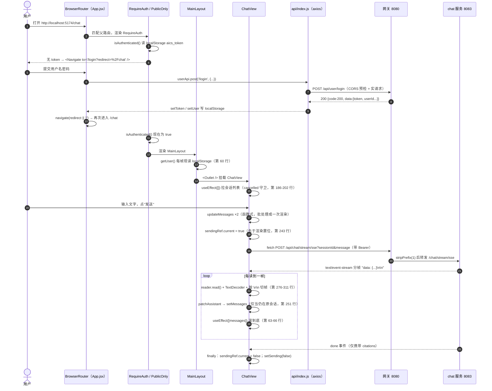

# React 快速上手：UI = f(state)，每次渲染都是一次快照

> **一句话结论**：React 没有"响应式依赖追踪"，只有两条规则——**重新调用组件函数** + **用 `Object.is` 判等决定要不要提交**。本篇列出的所有坑（依赖数组、闭包过期、`set` 不叠加、`memo` 失效、非受控取值）都是这两条规则的推论，而不是"要背的七条注意事项"。
> **阅读前置**：请先读 [04-Vue3核心基础](./04-Vue3核心基础.md)（会写 `<script setup>` 与 `ref`/`computed`/`watch`）与 [06-路由守卫与Axios请求封装](./06-路由守卫与Axios请求封装.md)（知道 Vue 版守卫与 axios 封装长什么样）。本篇的对照全部建立在"你已有一份 Vue 心智"之上。
> **证据基线**：`ai-cs-frontend-react`（React 18.3.1 + Vite 5 + antd 5，24 个页面、src 共 6077 行）当次逐行核对；Vue 主工程 `ai-cs-frontend` 作对照；C 级实测在本机 node v24.16.0 上跑出真实输出。预计阅读 45~60 分钟。

---

## 0. 先看现象

### 现场一：定时器里的数字永远停在第一帧

这是一个 32 行的纯 JS 脚本（放在本机临时目录，与仓库无关，只复刻 React 的调度规则：一次"渲染" = 调用一次组件函数，函数体里读到的 state 是这一帧的常量）：

```javascript
// snapshot-closure.mjs：复刻 useEffect(fn, []) 的闭包语义
let snapshots = []
let renders = 0

function renderFrame(count) {
  renders++
  snapshots.push(count)
  if (renders === 1) {
    // 只在第 1 帧注册，闭包捕获第 1 帧的 count
    const t = setInterval(() => console.log('[effect] 定时器读到的 count =', count), 300)
    setTimeout(() => clearInterval(t), 1000)
  }
}

renderFrame(0)
setTimeout(() => renderFrame(1), 100)
setTimeout(() => renderFrame(2), 200)
setTimeout(() => console.log('一共渲染了', renders, '帧，快照序列 =', snapshots), 350)
```

真机输出（`node snapshot-closure.mjs`）：

```text
[effect] 定时器读到的 count = 0
一共渲染了 3 帧，快照序列 = [ 0, 1, 2 ]
[effect] 定时器读到的 count = 0
[effect] 定时器读到的 count = 0
```

一共渲染了 3 帧、`count` 明确从 0 走到 2，但定时器三次都打印 0。这就是 `useEffect(fn, [])` 里读 `count` 的后果：回调闭包锁死在"注册它的那一帧"。

### 现场二：连点两次，只加了一次；数组改了却不重渲染

同样的手法，复刻 React 18 的"快照 + `Object.is` 判等 + 批量提交"（`node batch-objectis.mjs`）：

```text
场景1：连续两次 set(count + 1)
  [渲染 #1] count = 0
  [渲染 #2] count = 1
场景2：连续两次 set(c => c + 1)
  [渲染 #3] count = 1
  [渲染 #4] count = 3
场景3：原地 push 后 set 同一个数组引用
  Object.is(新值, 旧值) = true → 提交后不重渲染，但 list 已经变成 [ 1 ]
场景4：造新数组 setList([...list, 2])
  Object.is(新值, 旧值) = false → 会重渲染，长度 2
```

场景 1 里两次 `set(count + 1)` 都基于同一份快照 `count = 0`，算出来都是 1，`Object.is` 判等后只剩一次变更；场景 2 换成函数式更新，入参是"提交时的最新 state"，所以能叠加成 3。场景 3、4 说明判等是**引用判等**：同一个数组引用改内容，React 认为"没变"。

### 现场三：点"连接 WebSocket"，状态永远显示未连接

`ai-cs-frontend-react/src/views` 下的 `NotifyView.jsx` 第 61-64 行：

```javascript
function connectWs() {
  try {
    const ws = new WebSocket('ws://localhost:8085/ws/notify')
```

8085 是**消息服务**的端口（`ai-cs-message/src/main/resources/application.yml` 第 3 行 `port: 8085`），通知服务监听的是 8086（`ai-cs-notify/src/main/resources/application.yml` 第 3 行 `port: 8086`）。Vue 主工程里同一处也是错的：`ai-cs-frontend/src/views/NotifyView.vue` 第 114 行同样写死 8085——这不是 React 的锅，是"1:1 迁移时把缺陷一起搬过来了"。

浏览器上的表现（**本机未实测，未起前端 dev server**；判读方法：F12 → Network → 过滤器选 `WS` → 点"连接"，那条 `ws://localhost:8085/ws/notify` 会以失败收尾，Chrome 典型文案是 `WebSocket connection to 'ws://localhost:8085/ws/notify' failed`，同时页面日志区收到的是 `WebSocket 已断开`）。同一现象在 Vue 版必然复现——两份代码这一行完全一致。

> **这些现象指向同一件事**：React 的 state 不是"可被框架追踪的属性"，而是某一帧函数调用里的**常量**。把 Vue 的"响应式变量随时读到最新值"心智搬过来，必然在闭包、批处理、引用判等三处连续翻车。

---

## 1. 整体地图

```mermaid
flowchart TB
  subgraph B["浏览器 · Vite dev 5174"]
    M["main.jsx<br/>createRoot + ConfigProvider + BrowserRouter"]
    A["App.jsx<br/>Routes / Route（24 条业务路由）"]
    G1["RequireAuth（未登录 → Navigate /login）"]
    GM["MainLayout（antd Layout + Outlet）"]
    V["24 个页面组件 views/*"]
    ST["组件内 useState / useRef<br/>state 是本帧快照"]
    API["api/index.js<br/>15 个 axios 实例"]
    M --> A --> G1 --> GM --> V
    V --> ST
    V --> API
  end
  API -->|"绝对地址 http://localhost:8080/api/**"| GW["网关 8080（CORS 允许任意来源）"]
  GW --> SVC["user 8081 · chat 8083 · notify 8086 · message 8085 …"]
  V -.->|"SSE：fetch + ReadableStream（不上 axios）"| CHAT["chat 服务 /api/chat/stream/sse"]
```



> **读图说明**：三条线要分清。(1) `main.jsx → App.jsx → RequireAuth → MainLayout → 页面` 是**渲染链**，它决定"哪个组件函数被调用"；React 里没有"响应式依赖"这条线，`state` 变化只是**再跑一遍这条链**（从变化 state 所在组件往下），所以第 5 行箭头画的是"页面读 state"，不是"state 推页面"。(2) `api/index.js` 用的是**绝对地址直连网关**（`VITE_GATEWAY || 'http://localhost:8080'`），这是本 React 工程的特色，与本仓库 Vue 版的"相对路径 + nginx 同源反代"不同，能跨域跑通全靠 `ai-cs-gateway/src/main/java/com/aics/gateway/config/CorsConfig.java` 第 20 行的 `setAllowedOriginPatterns(List.of("*"))`。(3) 第三条虚线是 SSE 专用通道——它绕开了 axios，用 `fetch` + `reader.read()`，看错这条线会得出"axios 能接流式"的错误结论。

| 组件/文件 | 责任 | 关键 API | 谁调用它 | 本仓库证据 |
|---|---|---|---|---|
| `ai-cs-frontend-react/src` 下的 `main.jsx`（50 行） | 创建根、装主题与路由容器 | `ReactDOM.createRoot().render()`、`ConfigProvider`、`BrowserRouter` | 浏览器加载 `index.html` 后执行 | 第 42-50 行；**没有 `StrictMode`** |
| 同上目录的 `App.jsx`（95 行） | 路由表 + 两级守卫 | `Routes`/`Route`/`Navigate`/`useLocation` | `main.jsx` | 第 31-46 行两个包裹组件，第 67-91 行 24 条业务路由 |
| `ai-cs-frontend-react/src/layouts` 下的 `MainLayout.jsx`（132 行） | 侧边菜单 + 顶栏 + 内容区 | antd `Layout`/`Menu`、`Outlet`、`useNavigate` | 作为父路由 `element` | 第 127 行 `<Outlet />`，第 60 行 `getUser()` |
| `ai-cs-frontend-react/src/views` 下 24 个页面（合计 6077 行含 api/utils） | 业务界面 | `useState`/`useEffect`/`useRef` | 路由 | `ChatView.jsx` 622 行、`MqView.jsx` 507 行、`ProductView.jsx` 508 行 |
| `ai-cs-frontend-react/src/api/index.js`（166 行） | 15 个 axios 实例 + 拦截器 | `axios.create`、`interceptors` | 各页面 | 第 7-8 行 拼 `BASE_URL`，第 40-59 行两个拦截器 |
| `ai-cs-frontend-react/src/utils` 下的 `auth.js`（37 行） | token/用户信息存取 | `localStorage` | 拦截器、布局、守卫 | 第 4-5 行两个 key，第 27-29 行 `isAuthenticated` |
| `ai-cs-frontend-react/vite.config.js`（11 行） | dev server | `@vitejs/plugin-react` | npm scripts | 只配了 `server.port = 5174`，**无 proxy、无 alias** |
| `ai-cs-gateway`（8080） | 鉴权、路由转发、CORS | `RouteConfig`、`CorsConfig` | 前端 axios | `ai-cs-gateway/src/main/java/com/aics/gateway/config/RouteConfig.java` 第 67-68 行 |

**这个 React 工程处在什么成熟度**：24 个页面全部落地、路由/守卫/拦截器/SSE 都是真代码，**功能上是可用的第二实现**；但工程化基本为零——`package.json` 只有 `dev`/`build`/`preview` 三个脚本，没有 TypeScript、没有 ESLint、没有 vitest、没有 nginx.conf、没有 Dockerfile、没有 `.env*` 文件（上面这些全部用 `Test-Path` 逐项确认为 False）。一句话：**它是演示工程，不是生产工程**。

两个工程的"体检表"（同一次核对，数字都是本机实测，不是估计）：

| 维度 | `ai-cs-frontend`（Vue 主工程） | `ai-cs-frontend-react`（React 版） | 结论 |
|---|---|---|---|
| 页面数 | 24 个 `.vue` | 24 个 `.jsx` | 迁移是 1:1 的，页面没缺 |
| src 代码量 | 5466 行（vue+js） | 6077 行（jsx+js） | React 侧略多，主要多在 JSX 与手写 SSE 上 |
| 脚本 | `dev`/`build`/`preview`/`test`/`test:watch`/`lint`/`lint:fix`/`check` | 只有 `dev`/`build`/`preview` | 缺测试与规范门禁 |
| 路由加载 | `component: () => import(...)` 逐页懒加载 | 全部静态 import | 决定了两者产物形态（见 §5） |
| 构建配置 | 66 行（alias、proxy 关缓冲、`manualChunks` 三包） | 11 行（只有端口） | 无 alias、无代理、无拆包 |
| 部署产物 | `nginx.conf`（62 行）+ `Dockerfile` | 无 | 上线路径未落地 |
| 环境变量 | `.env.development`/`.env.example`/`.env.production` | 无 `.env*`，只有代码里的兜底默认值 | 换环境要改源码 |
| 质量工具 | `eslint.config.js`（3315 B）+ `vitest.config.js` | 无 | `react-hooks` 规则只以注释形式存在 |

---

## 2. 关键概念与关键 API

先统一术语，后面全篇复用：

- **快照（snapshot）**：组件函数被调用的那一次，函数体内所有 `state`/`props` 都是那一刻的常量；本次执行期间它们不会变。
- **批处理（batching）**：同一个事件回调里多次 `setX` 不会各触发一次渲染，React 把更新排进队列，回调结束后合并执行一次。
- **闭包（closure）**：函数记住定义时所在作用域的变量。React 的函数组件每次渲染产生一套新闭包，事件回调/定时器若引用了"旧那一套"，读到的就是旧值。
- **协调（reconciliation）**：拿到新的元素树后与新树比对、最小化 DOM 操作的过程；`key` 是比对时的身份标识。
- **受控组件**：表单值由 state 驱动（`value` + `onChange`）；**非受控**：值由 DOM 自己管（`defaultValue` + `ref` 读）。

| 名称 | 位置 | 角色 | 关键点 |
|---|---|---|---|
| JSX | 全工程 `.jsx` | 编译成 `React.createElement` 的"元素描述" | 不是模板字符串，每次渲染都新建对象；`className` 而非 `class` |
| `createRoot` | `ai-cs-frontend-react/src` 下的 `main.jsx` 第 42 行 | React 18 的挂载入口 | 替代 React 17 的 `ReactDOM.render` |
| `useState` | 196 次（28 个 jsx 内统计） | 声明一份"可变但需要快照"的数据 | 返回值是数组；惰性初始化传函数只算一次（`AgentView.jsx` 第 19 行 `useState(() => Date.now())`） |
| `useEffect` | 41 次 | 提交后执行副作用 | 依赖数组决定"要不要重跑"，返回函数是清理 |
| `useRef` | 16 次 | 存"不触发渲染、跨帧稳定"的值/节点 | `.current` 改动不引起渲染；`ChatView.jsx` 用 5 个 ref 存最新会话态（第 52-56 行） |
| `useCallback` | 4 次（1 次 import + `Dashboard.jsx` 第 118/133/143 行） | 缓存函数引用 | 只有"依赖它做判等的下游"（effect 依赖、`React.memo` 子组件）才值钱 |
| `useMemo` | **0 次** | 缓存计算结果 | 本工程一次没用——因为没有昂贵计算，也没有 `memo` 子组件 |
| `React.memo` | **0 次** | 跳过 props 未变的子组件渲染 | 与 `useMemo`/`useCallback` 配套才有意义 |
| `key` | 列表渲染 | 协调时的身份 | 稳定业务 id 优于数组下标（`ChatView.jsx` 第 401 行对、第 430 行用下标） |
| `children` | `App.jsx` 第 31、41 行 | 组合的载体 | `RequireAuth({ children })` 是"包装组件"最简形态 |
| `BrowserRouter`/`Routes`/`Route`/`Navigate`/`Outlet` | `main.jsx`、`App.jsx`、`MainLayout.jsx` | React Router 6 的五个核心 | v6 用 `element` 传 JSX，不再有 `component`/`render` |
| `useNavigate`/`useLocation`/`useSearchParams` | `LoginView.jsx` 第 9-10 行、`App.jsx` 第 32 行 | 命令式导航 / 读当前地址 / 读查询串 | `useSearchParams` 用来取 `?redirect=` |
| `ConfigProvider` + `AntdApp` | `main.jsx` 第 43-48 行 | antd 5 的主题与上下文 | 主题走 `theme.token`（CSS-in-JS），不是 less 变量 |
| `axios.create` | `api/index.js` 第 36-62 行 | 每服务一个实例 | 实例间共享同一套拦截器逻辑（`createClient` 工厂） |
| `Fragment`/`<>...</>` | 各处 JSX | 不额外产生 DOM 的包裹层 | 需要 `key` 时只能用 `<Fragment key>`，不能用短语法 |
| `useReducer` | **0 次** | `useState` 的组合替代 | 状态机式更新（多字段联动）才值得换 |
| `React.lazy` / `Suspense` | **0 次** | 路由级代码分割 | 一次没用 → `dist` 只有单 chunk（§5） |
| `message` / `Modal.confirm` | `LoginView.jsx` 第 47 行、`MainLayout.jsx` 第 70 行 | 命令式反馈与确认框 | 必须挂在 `AntdApp`/`ConfigProvider` 之下才能拿到主题；`utils/dialog.jsx` 把它们包成 Promise |
| `TextDecoder` + `ReadableStream` | `ChatView.jsx` 第 276-311 行 | 手写 SSE 解析 | 不是 React API，但在本工程承担了"流式"的全部脏活 |
| `URLSearchParams` | `ChatView.jsx` 第 264 行 | 拼查询串 | 避免手工 `encodeURIComponent`，与本文件第 34 行守卫拼 `redirect` 的做法互为对照 |

---

## 3. 原理与证据逐段精读

### 3.1 JSX：返回的是"元素描述"，不是 DOM

**在干什么。** 组件函数返回一棵由 `React.createElement(type, props, children)` 组成的普通对象树，React 拿它去和上一棵树比对，再把差异写到真实 DOM。`ChatView.jsx` 第 224-326 行的 `sendMessage` 里没有任何 DOM 操作，它只做两件事：`updateMessages(...)` 改 state、`fetch` 拿流。

**为什么这么设计。** 把"描述 UI"和"操作 DOM"解耦，才能让同一份描述渲染到浏览器、原生、字符串（SSR）。也正因为返回的是普通对象，`if`/`map`/`&&` 这些 JS 表达式可以直接参与"造 UI"，不需要模板语法。

**换写法会怎样。** 若改成像 Vue 那样写模板（`v-if`/`v-for`），编译产物是"带响应式依赖收集的渲染函数"，它能做到"只有依赖变了才重跑"，而 JSX 的代价是**父组件重渲染时子组件函数也会被调用**（除非 `memo`）。这就是本工程"没有 `memo`、没有 `useMemo` 也跑得动"的原因：24 个页面都是叶子级页面组件，父级只有 `MainLayout`，重渲染成本被路由切分吸收了。

**常见坑。** `className` 写成 `class` 会静默失效（React 19 之前只警告）；`onClick={sendMessage()}` 会在渲染时立刻执行——必须传函数。`ChatView.jsx` 第 403 行 `onClick={() => switchSession(s.id)}` 是正确写法。

### 3.2 渲染快照：函数体里读到的 state 是本帧常量

**在干什么。** `ChatView.jsx` 第 42-49 行声明 8 个 `useState`，第 237-247 行连续两次 `updateMessages(...)`。每一次渲染，`messages` 都是一个新的常量数组；函数体后面所有代码读到的都是这一份。

**为什么这么设计。** 快照让渲染成为**纯函数**：给定同样的 props/state，输出同样的 UI。这带来可测试性、可中断的并发渲染（React 18 的 `useTransition` 就依赖它），也让"两帧之间状态被偷偷改掉"这类幽灵 bug 不可能发生。

**换写法会怎样。** 若像 Vue 那样用可变对象（`reactive`），`setTimeout` 里读 `state.count` 永远是最新值——那是另一种取舍：Vue 换取"随手读到最新"，代价是"你无法把某一帧的 UI 当成一个可回放的值"。本篇 §0 现场一就是这条取舍的账单。

**常见坑。** 在 `async` 函数里 `await` 之后继续读 state：`ChatView.jsx` 第 236 行先把 `currentSessionRef.current` 存进 `targetSession`，第 251 行再拿它和"当前"比较——如果直接读 `currentSession`，SSE 跑几秒后读到的还是发送那一刻的快照，切了会话也发现不了。

### 3.3 `useState` 的批处理与函数式更新

**在干什么。** 同一次事件回调里的多次 `setX` 会被合并。`ChatView.jsx` 第 237-247 行连续调用两次 `updateMessages`（先追加用户消息、再追加空助手气泡），最终只产生一次渲染，且两条消息都在——因为它俩都是**函数式更新**（`setMessages(prev => ...)`，见第 69-77 行）。

**为什么这么设计。** 批处理避免"一次点击渲染 N 次"；函数式更新的入参由 React 在提交时注入"上一笔更新后的最新值"，所以多次更新能叠加。这正好补上快照带来的"读不到新值"问题：**要基于新值计算，就别读 state，拿 `prev`**。

**换写法会怎样。** 换成 `setMessages([...messages, a])` 再 `setMessages([...messages, b])`，两次都基于同一份快照，第二条覆盖第一条，界面上只剩一条消息——这就是 §0 现场二的形状（场景 1 vs 场景 2）。同理 `NotifyView.jsx` 第 29 行 `setNotifyForm((prev) => ({ ...prev, message: '' }))` 也是为了避免把 `userId` 覆盖掉。

**常见坑。** 一是"惰性初始化写成调用"：`useState(Date.now())` 每帧都算（虽然结果一样，但昂贵初始化会每帧重跑），本工程 `AgentView.jsx` 第 19 行写的是 `useState(() => Date.now())`，只算一次。二是把 `prev` 当可变对象用（`prev.push(...)` 后 `return prev`），引用没变 → 不渲染（见 3.4）。

### 3.4 `Object.is` 判等与不可变更新

**在干什么。** 提交阶段 React 用 `Object.is(新值, 旧值)` 决定是否跳过这次更新。因此 state 是数组/对象时，"改内容"必须同时"换引用"。`ChatView.jsx` 第 252-257 行 `const next = prev.slice(); next[i] = {...}; return next` 与 `AgentView.jsx` 第 44-49 行 `prev.slice()` 都是这个套路。

**为什么这么设计。** 深比较在真实应用里太贵，浅判等 O(1) 且可预测；把"要不要重渲染"的控制权交给"你是否造了新引用"，也让 `memo`/`useMemo` 有统一的判据。

**换写法会怎样。** 用 `push` 后 `setList(list)`，界面不更新但数据已变——最坏情况是"刷新一下才正常"（§0 现场二场景 3）。反过来，每次渲染都造新对象（`value={{ a: 1 }}` 直接写在 JSX 里）会让依赖它的 effect 每帧重跑。

**常见坑。** 嵌套更新漏层：`{...prev, list: prev.list}` 只换了外层引用，`list` 内部改了照样不渲染。`ChatView.jsx` 第 73-74 行把新数组同时写进 `sessionMessagesRef` 缓存，就是在"引用变了"之外额外维护一份非渲染数据——这是必要的手工补偿，React 不会帮你同步。

### 3.5 `useEffect`：依赖、清理、执行时机

**在干什么。** `useEffect(fn, deps)` 在**提交之后**执行；`deps` 数组逐项 `Object.is` 比较，只要有一项变了就"先跑上一次返回的清理函数，再跑新的 `fn`"。`Dashboard.jsx` 第 153-165 行的写法是全工程最标准的一处：挂载时立刻拉三份数据、装一个 15 秒定时器，清理函数 `clearInterval`。

**为什么这么设计。** 渲染必须是纯的，副作用（请求、订阅、定时器、DOM 操作）不能混在里面；"副作用只描述一次，重跑由依赖控制"能把"何时该重做"从人脑挪到声明里。清理函数的存在则保证"同一条副作用同一时刻只有一个存活实例"。

**换写法会怎样。** `Dashboard.jsx` 第 118/133/143 行三个加载函数用 `useCallback(fn, [])` 固定引用，第 165 行的依赖数组才有意义——若去掉 `useCallback`，`loadHealth` 每帧都是新函数 → effect 每帧重跑 → 每帧 `clearInterval` 再 `setInterval`，15 秒轮询退化成"永远等不到第一次触发"。这是本工程里"`useCallback` 真的有收益"的**唯一**场景。

**常见坑。** (1) 依赖写 `[messages]` 但函数里还用了 `currentSession`（漏项），本工程 `ChatView.jsx` 第 186 行和第 22 行直接写了 `// eslint-disable-next-line react-hooks/exhaustive-deps`——作者知道有这条规则，但因为**本工程没装 ESLint**，注释只是注释，没人会真的报警。(2) 清理函数漏写导致定时器/WS 泄漏，`NotifyView.jsx` 第 16-21 行关了 WS 但没关任何轮询。(3) 在 effect 里 `setState` 且依赖里含该 state → 无限循环。

### 3.6 StrictMode 双调用：为什么本工程看不到

**在干什么。** React 18 的 `StrictMode` 在**开发模式**下会把组件函数调用两次、把 effect"挂载→卸载→再挂载"，用来暴露"副作用没有清理干净"。而本工程 `main.jsx` 第 42-50 行的挂载树是 `ConfigProvider → AntdApp → BrowserRouter → App`，**全工程 grep `StrictMode` 命中 0 次**，所以本地 dev 看不到双调用。

**为什么这么设计。** 双调用是"体检"，不是"bug"：它在故意制造"组件被提前卸载"的场景，逼你写出幂等的 effect。生产构建不会双调用。

**换写法会怎样。** 一旦把 `<App />` 用 `<StrictMode>` 包起来，`Dashboard.jsx` 那个 effect 会在挂载期跑两轮（两次拉 3 个接口、两次 `setInterval`），但因为清理函数写全了（第 162-164 行），最终状态依然正确；而 `ChatView.jsx` 第 186-202 行的初始化请求因为有 `let cancelled = false` 守卫，重复请求不会写回过期数据。相反，`NotifyView.jsx` 若再加一个只在挂载时 `new WebSocket()` 且清理写漏的 effect，就会看到"两个 WS 连接"。**本机未实测**（未启动 React dev server）：验证方法是把 `main.jsx` 的 `<App />` 外层包 `<StrictMode>`，F12 → Network 过滤 `Fetch/XHR` 数请求次数，再数 `WS` 连接数。

**常见坑。** 把"双调用"当成框架 bug 去 `useRef` 硬防抖，掩盖了真正的"副作用不幂等"；或者在生产构建里也去 `StrictMode` 双调用（不会发生，生产恒单次），于是本地修了、线上没验证。

### 3.7 闭包陷阱：`ref` 是逃生舱

**在干什么。** `ChatView.jsx` 第 51-56 行的注释写得很直白："流式期间需读最新值，用 ref 避免闭包过期"。它用 5 个 ref（当前会话、会话消息缓存、会话列表、发送中标记、滚动容器）承载"SSE 回调里要读的最新状态"，并在第 58-60 行用 `useEffect` 把 `sessions` 同步进 `sessionsRef.current`。

**为什么这么设计。** `useRef` 返回的对象地址恒定，`.current` 是普通可写字段，读它不走快照——这正好补上"异步回调需要最新值"的缺口，且改它不触发渲染（不会造成额外循环）。

**换写法会怎样。** 若把 `sendingRef` 换回 `sending`：第 230 行 `if (sendingRef.current) return` 变成 `if (sending) return`，两次快速回车会读到同一帧的 `sending = false`，两次请求都发出去，界面上出现两条助手气泡。这就是 §0 现场一同一个病：**回调读的是注册那一刻的闭包**。

**常见坑。** 把 ref 当 state 用——改了 `.current` 却在等界面更新；或者在渲染期间写 ref（`ChatView.jsx` 第 73 行是在 `setMessages` 的 updater 里写，属于"提交阶段"，可以，但在函数体顶层直接写会在 StrictMode 下出现双写）。

### 3.8 `useMemo` / `useCallback`：真实收益与误用

**在干什么。** 两者都只是"缓存"：`useMemo(fn, deps)` 缓存返回值，`useCallback(fn, deps)` 缓存函数本身（等价于 `useMemo(() => fn, deps)`）。本工程统计：`useMemo` **0 次**、`React.memo` **0 次**、`useCallback` **4 次**（3 个定义全在 `Dashboard.jsx`）。

**为什么这么设计。** 缓存只在"下游拿它做判等"时才有价值：effect 的依赖数组、`React.memo` 子组件的 props、别的 hook 的依赖。没有下游判等，包一层只是让代码更长、内存多占一点。

**换写法会怎样。** `Dashboard.jsx` 的 `useCallback` 是必要的（见 3.5）；而在 `NotifyView.jsx` 里给 `sendNotify` 包 `useCallback` 毫无收益——它没被任何 effect 或 `memo` 子组件依赖。同理本工程没有 `useMemo` 也没性能问题：页面里最重的计算是 `services.filter(...)`（`Dashboard.jsx` 第 167 行），24 条数据的过滤远不值得缓存。

**常见坑。** (1) 依赖数组里塞对象字面量，`useMemo` 永不命中；(2) 用 `useMemo` 包一个"每帧都必须重算"的值（如 `Date.now()`），等于自欺；(3) 认为 `useCallback` 能减少子组件渲染——只有子组件被 `memo` 包裹才成立，而本工程 0 处 `memo`。

### 3.9 受控与非受控组件

**在干什么。** 受控：值的唯一真相是 state，`value` + `onChange` 成对出现。`NotifyView.jsx` 第 95-99 行（用户 ID）、第 103-104 行（消息内容）、第 122-124 行（广播内容）都是标准受控写法。非受控：值由 DOM 自己维护，只给 `defaultValue`，需要时用 `ref` 或事件读——`ai-cs-frontend-react/src/utils` 下的 `dialog.jsx` 第 40-56 行是典型反例：

```javascript
return new Promise((resolve, reject) => {
  let value = initialValue                    // 闭包变量，不是 state
  Modal.confirm({
    content: (
      <Input.TextArea
        defaultValue={initialValue}           // 非受控
        onChange={(e) => { value = e.target.value }}   // 手工捕获
      />
    ),
    onOk: () => resolve(value),
```

**为什么这么设计。** 受控把"数据流"变成单向：输入 → `onChange` → state → 重渲染，因此能做校验、格式化、联动、撤销。非受控更省事（antd 内部要支持"命令式弹窗"，拿不到外层 state，只能这么写），代价是放弃一切"由 state 驱动"的能力。

**换写法会怎样。** 把 `promptDialog` 改成受控，需要给弹窗内部造一个组件（用 `useState` 承接输入），`onOk` 时再回调出去；`Modal.confirm` 的 `content` 是纯 JSX，写不出 hook，所以要么包一个 `<PromptContent onReady={...}/>`，要么换成 `<Modal open>` 受控弹窗。本工程选了"闭包变量"这条路：能用，但**一按取消就丢**，且无法在 `onOk` 里做非空校验（`value` 是裸字符串，没有渲染驱动，输入框不会提示错误）。

**常见坑。** 同时给 `value` 和 `defaultValue`（React 会告警并且行为跟你想的不一样）；受控却没写 `onChange`（输入框变只读）；把 `value` 写成 `undefined` 后在受控/非受控之间反复横跳。

### 3.10 列表 key

**在干什么。** `key` 是协调时的身份标识：同一 `key` 的元素被视为"同一个东西"，React 复用它、只更新内容。`ChatView.jsx` 第 399-417 行会话列表用 `key={s.id}`（对），第 429-430 行消息列表用 `key={i}`（下标，有风险），`AgentView.jsx` 第 194 行同样用 `key={i}`。

**为什么这么设计。** 没有 `key`，React 只能按位置比对：在列表头部插入一项，后面所有项都被判定为"内容变了"，DOM 全量重建——输入框焦点、滚动位置、CSS 动画全部丢失。

**换写法会怎样。** 对"只追加、不重排"的列表（聊天消息就是），用下标当 key 其实无害：老消息位置不变。对会**重排/插入/删除**的列表（会话列表、商品列表），必须用稳定 id，否则会出现"删了第一条，第二条的输入框内容错位过来"。

**常见坑。** 用 `Math.random()` 当 key（每次渲染都变，等于没有 key）；用后端可能重复的字段当 key；把 `key` 往组件内部传（`key` 不是 props，`props.key` 永远是 `undefined`）。`CheckoutView.jsx` 第 97 行 `rowKey={(r, i) => r.productName ?? i}` 是 antd Table 的同类问题：用可重复的业务字段兜底下标，一旦有两行同名商品，行选中会串。

### 3.11 条件渲染与 early return

**在干什么。** 组件的返回值可以提前 `return`。`App.jsx` 第 31-38 行是最标准的 early return：

```javascript
function RequireAuth({ children }) {
  const location = useLocation()
  if (!isAuthenticated()) {
    const redirect = encodeURIComponent(location.pathname + location.search)
    return <Navigate to={`/login?redirect=${redirect}`} replace />
  }
  return children
}
```

**为什么这么设计。** 组件就是一个函数，"要不要渲染真实内容"完全可以用普通 `if` 表达；`<Navigate>` 是"渲染出来的重定向指令"，把"跳转"这件事也纳进了 `UI = f(state)`。

**换写法会怎样。** 若学 Vue 在路由层配 `beforeEach` 守卫，就得把"当前地址 → 目标地址"的逻辑写在组件树外面，代价是"守卫里拿不到组件上下文、也做不了 loading 态"。React 版的做法副作用是：**未登录访问任意页，表现是重定向到 `/login?redirect=...`，而不是 403 页面**——没有权限不足的中间态。

**常见坑。** `{count && <Badge/>}` 在 `count === 0` 时会把 `0` 渲染出来（0 是合法子节点）。本工程 `ChatView.jsx` 第 418 行写的是 `{sessions.length === 0 && (...)}`，用了比较表达式，天然避开了这个坑——这是好习惯。另外 `if` 必须放在所有 hook 调用之后，否则 hook 顺序错乱会直接崩：`React has detected a change in the order of Hooks`。

### 3.12 组件组合：children / render props / HOC / hooks

**在干什么。** 本工程真实的组合只有两处：`App.jsx` 第 31、41 行的 `RequireAuth({ children })` 与 `PublicOnly({ children })`——把一个组件包起来、决定"是否渲染它"。另外 `MainLayout.jsx` 第 127 行用 `<Outlet />` 让路由内容插进布局，这是 React Router 版的"插槽"。

**为什么这么设计。** `children` 是"调用方决定内容、被调方决定位置"，比 Vue 的具名插槽更原始但更灵活（插槽内容就是任意 JSX，可以带自己的 state）。HOC（高阶组件：接收组件返回组件）和 render props（把"渲染什么"作为函数 prop 传进去）是 `children` 的两种变体，都能被 hooks 替代掉大部分场景——hooks 的好处是不增加组件树层级。

**换写法会怎样。** 全工程 grep `{ children }` 只有 2 处、`props.` 只有这 2 处，说明它**没有抽出任何业务子组件**（也**没有 `components/` 目录**，24 个页面各自 200~600 行）。同一个通知卡片、同一个状态标签在 `NotifyView.jsx`、`MessageView.jsx` 各写一遍。这是本工程的真实短板，也是练习 4 让你动手改的地方。

| 复用手段 | 解决什么 | 本仓库落地情况 | 代价 |
|---|---|---|---|
| `children` 包装 | 横切逻辑（鉴权、布局、权限） | **已落地**：`App.jsx` 第 31-46 行、`MainLayout.jsx` 第 127 行 | 包装层增加一级树，props 需透传 |
| 自定义 hook | 状态逻辑复用（请求、轮询、SSE） | **未落地**：无 `hooks/` 目录，SSE 解析写在 `ChatView.jsx` 内部 | 逻辑复用但不产出 UI |
| render props | 把渲染权交回调用方 | **未落地** | 嵌套回调地狱 |
| HOC | 注入 props 增强组件 | **半落地**：`RequireAuth`/`PublicOnly` 形态上就是 HOC | 组件树变深、`ref` 与静态属性要手工透传 |
| Context | 跨层传值 | **未落地**：`createContext`/`useContext` 命中 0 次，用户信息靠每帧读 `localStorage`（`MainLayout.jsx` 第 60 行） | 有 provider 与重渲染粒度问题 |

### 3.13 与 Vue 3 逐项对照

同一批页面，两个工程各写一遍（24 个 `.vue` ↔ 24 个 `.jsx`），因此这张表全部有真码可对照：

| 关注点 | Vue 3（`ai-cs-frontend`） | React 18（`ai-cs-frontend-react`） | 本质差异 | 本仓库证据 |
|---|---|---|---|---|
| 数据变化如何到达 UI | 响应式代理自动收集依赖 | 重新调用组件函数 + `Object.is` 判等 | **追踪 vs 快照** | 全场 |
| 基本单元 | `ref()` / `reactive()`（全工程 371 / 8 处） | `useState`（196 处） | `ref` 需 `.value`，`useState` 是 `[值, 设置函数]` | 计数来自两个工程 src 全量统计 |
| 派生值 | `computed()`（22 处） | `useMemo`（**0 处**） | Vue 自动缓存+"按需失效"，React 要手工声明依赖 | — |
| 副作用 | `watch`（7 处）/ `watchEffect`（0 处）/ `onMounted`（26 处） | `useEffect`（41 处） | Vue 可分"监听哪个源"，React 只有"依赖数组" | — |
| 拿最新值 | 直接读 `ref.value`，永远最新 | 需要 `useRef` 逃生舱或函数式更新 | 快照的直接后果 | `ChatView.jsx` 第 51-56 行 5 个 ref |
| 父传子 | `defineProps`（本工程 0 处） | props 解构（`App.jsx` 第 31 行） | 都是单向数据流 | 两工程都没有子组件抽象 |
| 子传父 | `defineEmits` | 回调 props（`<RequireAuth>` 由父给 `children`） | React 把"事件"也当普通 prop | — |
| 双向绑定 | `v-model` | `value` + `onChange`（`NotifyView.jsx` 第 95-99 行） | React 无语法糖，受控是唯一正统 | — |
| 条件渲染 | `v-if` / `v-else` | `&&` / 三元 / early return（`App.jsx` 第 33-36 行） | React 是 JS 表达式 | — |
| 列表 | `v-for` + `:key` | `map` + `key`（`ChatView.jsx` 第 399-417 行） | 一样要求 key 稳定 | — |
| 插槽 | `<slot>` | `children` / `Outlet`（`MainLayout.jsx` 第 127 行） | 同构 | — |
| 跨层注入 | `provide/inject`（本工程 0 处） | `createContext` + `useContext`（**0 处**） | 两工程都靠 localStorage 直读 | `MainLayout.jsx` 第 60 行 |
| 表单 | Element Plus `el-form` + `rules` | antd `Form.useForm()` + `validateFields()`（`LoginView.jsx` 第 15、26 行） | 思路相同，API 不同 | — |
| 路由 | `createRouter` + `router.beforeEach`，`component: () => import(...)` 懒加载 | `createBrowserRouter` 不用，改 `Routes/Route` + 包裹组件守卫，**全部静态 import** | Vue 用钩子拦截，React 用"渲染重定向" | `ai-cs-frontend/src/router/index.js` 第 5-14 行 vs `App.jsx` 第 5-28 行 |
| 组件库 | Element Plus 2.14 | antd 5.22 | 都是"组件随意引、样式全局覆盖" | 两侧 `package.json` |
| 全局状态 | 无（未装 pinia） | 无（未装 Redux/Zustand/Jotai） | **两个工程都缺状态层**，靠 localStorage 传登录态 | 依赖清单实测 |

> **一句话记这张表**：Vue 那边"变量是活的、框架帮你算谁该更新"；React 这边"变量是死的、你自己决定造不造新值"。`computed → useMemo`、`watch → useEffect` 看着像一一对应，但 `useMemo` 不写依赖就不会重算、`useEffect` 不写清理就会泄漏——Vue 替你做的事，React 全部还给你了。

### 3.14 React 生态：Router、状态管理、CSS 方案

**在干什么。** React 本身只是"渲染库"，路由、状态、样式、数据请求全在生态里选。本工程的选择非常保守：路由用 React Router 6，状态管理**一个都不装**，CSS 用 antd 5 的 token + 一个全局样式表，数据请求手写 `axios` + `useState` + `useEffect`。

**为什么这么设计。** 因为它要"1:1 迁移一个已经能跑的 Vue 页面集"，迁移成本最低的路径就是"只换渲染层与组件库，其余照抄"——所以 Vue 版有 `vue-router`，这边就有 `react-router-dom`；Vue 版没有 pinia，这边也不装状态库；Vue 版有一个全局 `style.css`，这边也搬了一份（1368 行）。

**换写法会怎样。** 四种常见替代各自的代价：

| 生态位 | 本仓库现状 | 常见替代 | 换过去的收益 / 代价 |
|---|---|---|---|
| 路由 | `react-router-dom ^6.28.1`，用 `<Routes>/<Route element>`（`App.jsx` 第 50-93 行） | `createBrowserRouter` 数据路由（loader/action）、TanStack Router | 收益：数据预取、错误边界、按路由拆分；代价：要重写路由表与守卫形态（守卫得改成 loader 里的 `redirect`） |
| 状态 | **无**（`createContext`/`useReducer` 命中 0，依赖里没有 Redux/Zustand/Jotai/MobX） | Context + `useReducer`；Zustand；Redux Toolkit | 收益：登录态、跨页缓存不再靠 `localStorage` 直读（`MainLayout.jsx` 第 60 行的每帧读取就是缺状态的症状）；代价：多一层 provider，重渲染粒度要自己控制 |
| 数据请求 | 手写 `axios` + `useState` + `useEffect` + `cancelled` 守卫（`ChatView.jsx` 第 186-202 行） | TanStack Query / SWR | 收益：缓存、去重、重试、`loading/error` 三态标准化；代价：本工程 15 个 axios 实例要改成 query 函数，流式那条路仍得自己写 `fetch` |
| CSS | antd 5 `theme.token`（`main.jsx` 第 11-40 行）+ 全局 `style.css` | CSS Modules；vanilla-extract；Tailwind；styled-components | 收益：类名隔离（现在 `.session-item`、`.msg-row` 这类名字全靠前缀避冲突）；代价：要先动构建配置，而本工程 `vite.config.js` 只有 11 行、连 alias 都没有 |
| 类型 | 无 TypeScript（无 `tsconfig.json`） | TS + `@types/react` | 收益：props/接口结构可校验（`agentRequest.js` 这类纯函数最受益）；代价：24 个页面要逐个补类型 |
| 测试 | 无框架，只有 `node --test` 能跑纯函数（`agentRequest.test.js`） | vitest + React Testing Library | 收益：能测组件渲染与交互；代价：需先有 `components/` 抽象，否则只能测整页 |

**常见坑。** 生态选择最大的坑是"教程默认你全都有"：网上任何一篇 React 教程都会出现 Redux / styled-components / TanStack Query，而本仓库一个都没有——**照教程改代码会引入一整套装不上的依赖**。判断依据永远先看 `ai-cs-frontend-react` 根目录的 `package.json` 里 `dependencies` 到底有什么（React 18.3.1、react-dom、react-router-dom 6、antd 5、@ant-design/icons、axios、echarts、qrcode，就这些），再看 `devDependencies`（只有 `@vitejs/plugin-react` 与 `vite`）。

### 3.15 把一页 Vue 改写成 React 的对照清单

**在干什么。** 本仓库恰好有一对同源页面（Vue 版与 React 版的 `NotifyView`），可当迁移样本。下面这张表是"逐句翻译规则"，照着走能避开 90% 的心智模型事故。

| Vue 3 写法 | React 对应写法 | 迁移时必须注意 |
|---|---|---|
| `const list = ref([])` | `const [list, setList] = useState([])` | 读取处去掉 `.value`；**永远不要 `list.push(x)`**，要 `setList([...list, x])` 或 `setList(prev => [...prev, x])` |
| `const total = computed(() => list.length)` | 直接在 JSX 里 `list.length` | 只有确实昂贵的计算才上 `useMemo`；本工程 `computed` 22 处、`useMemo` 0 处，正说明大部分 `computed` 不需要对等物 |
| `onMounted(() => load())` | `useEffect(() => { load() }, [])` | 一起把竞态守卫搬过来：`let cancelled = false` + 返回 `() => { cancelled = true }`（`ChatView.jsx` 第 186-202 行的写法） |
| `watch(sessionId, () => reload())` | `useEffect(() => { reload() }, [sessionId])` | Vue 的 `watch` 默认不在首次执行，`useEffect` **首次一定执行**——需要"变化时才跑"要在体内加 prev 比较 |
| `watchEffect(() => …)` | 没有直接对应 | 依赖靠手写数组，`watchEffect` 的自动追踪能力在 React 侧不存在（本工程 `watchEffect` 也是 0） |
| `v-model="form.msg"` | `value={form.msg} onChange={e => setForm(prev => ({...prev, msg: e.target.value}))}` | 即受控组件；漏写 `value` 就退化成非受控（`utils/dialog.jsx` 第 47-55 行就是这么写的） |
| `v-for="s in sessions" :key="s.id"` | `sessions.map(s => <div key={s.id}>…)` | Vue 里 `:key` 可省（有兜底），React 里 key 缺失会退化成按索引 diff（`ChatView.jsx` 第 429-430 行消息列表就是 `key={i}`） |
| `router.push('/order/1')` | `const nav = useNavigate(); nav('/order/1')` | 守卫从 `router.beforeEach` 变成 `<RequireAuth>` 包裹 + `<Navigate replace/>`（`App.jsx` 第 31-38 行） |
| `route.params.orderNo` | `const { orderNo } = useParams()` | 查询串用 `useSearchParams()`（`LoginView.jsx` 第 10 行取 `redirect`） |
| `defineExpose` / 模板 ref | `const elRef = useRef(null)` + `<div ref={elRef}>` | React 的 `ref` 是"可变单元格"，跨渲染保持同一对象（`ChatView.jsx` 第 52-56 行用它绕闭包） |

**为什么这么设计。** 因为两边对"状态"的定义不同：Vue 的 `ref` 返回一个**响应式代理**，改它就是通知框架；React 的 `useState` 返回的是**某个快照里的常量**，改它必须走 setter 并造新值。所以迁移的动作不是"换函数名"，而是"把每一处原地修改翻译成新值构造"。

**换写法会怎样。** 如果偷懒用 `const list = []` + `list.push()` + 一个 `useState(0)` 当刷新计数器（Vue 时代常见的土办法），React 里会渲染出空列表且控制台无任何报错——因为计数器变了但 `list` 引用没变，`Object.is` 判定"值没变"（§3.4 的实测就是这个场景）。

**常见坑。** 迁移中最容易出错的是"`useEffect` 被当成 `onMounted` 用"，然后依赖数组一律写 `[]`——这会把第一帧的所有 state 永久冻进闭包里（§0 现场一）。第二个坑是把 `v-if` 直接翻成 `style={{display:'none'}}`：Vue 的 `v-if` 是销毁重建，React 的隐藏只是不显示，副作用与定时器仍在跑。

---

---

## 4. 一次完整执行时序

以"未登录用户访问 `/chat` → 登录 → 发一条消息并看到流式回复"为主线：



> **读图说明**：重点看三个"回路"。第一，第 4-5 步是**渲染期就完成的判断**——`RequireAuth` 不是异步守卫，它在同一帧里 `return <Navigate>`，所以不会出现"先白屏再跳走"；第二，第 22-23 步"置 ref 再 setState"是刻意顺序：`sendingRef` 立刻生效（防重入），`sending` 要走完这一帧才变，两者分工不同；第三，第 28-30 步是**流式三件套**（`getReader` / `TextDecoder` / 按空行切帧），这一路完全不经过 axios 拦截器，所以 401 在这里不会自动跳登录页——`ChatView.jsx` 第 274 行只是 `throw new Error('HTTP ' + resp.status)`。

**每一步失败会长什么样**（都是"要么在控制台、要么在 Network、要么在页面 toast"三处之一）：

| 失败点 | 触发条件 | 观察到什么 | 根因定位 |
|---|---|---|---|
| 第 5 步 | 无 token 或 token 过期 | 地址栏变成 `/login?redirect=%2Fchat`，无报错 | 正常行为，不是 bug |
| 第 8 步 | 账号密码错 | antd `message.error`（`LoginView.jsx` 第 47 行） | 后端 `code !== 200` |
| 第 8 步 | 网关没起 | axios 报 `Network Error`，Network 面板显示 `(failed)` / `ERR_CONNECTION_REFUSED` | `http://localhost:8080` 未监听 |
| 第 8 步 | 网关起了但没放 CORS | 控制台 `blocked by CORS policy`，Network 里预检 `OPTIONS` 返回非 2xx | 应为 `CorsConfig` 的第 20 行（本仓库允许 `*`，一般不踩） |
| 任意 axios 步 | token 过期（服务端 401） | `api/index.js` 第 52-56 行：`logout()` + 警告 + `window.location.href='/login'` | 拦截器统一处理 |
| 第 22 步 | 网关通但 chat 未起 | `throw new Error('HTTP 503')`，页面出现错误气泡 | 网关的熔断/负载均衡返回 503 |
| 第 28 步 | 后端不是流式（网关缓冲） | 整段回复"憋"很久后一次性出现 | 代理层没关 `proxy_buffering`（Vue 版 nginx.conf 显式关过，React 版没有代理层） |
| 第 29 步 | 用户在流式期间切换会话 | 回复只写进 `sessionMessagesRef` 缓存，不串到新会话 | 第 251 行的 `targetSession` 守卫 |
| 第 24 步 | 重复点发送（快连两下回车） | 第二条请求不会发出，按钮 loading 也不会闪 | 第 230 行 `sendingRef.current` 是同步置位的，`sending` 要等下一帧 |
| 第 31 步 | SSE 帧被拆坏（粘包/半包） | 助手气泡里出现半截 JSON 或重复文字 | `buffer` 按 `\n\n` 切、残片留在 `buffer` 里继续拼（第 287-289 行） |
| 收尾阶段 | 组件已卸载但流还在跑 | 控制台出现对已卸载组件的更新告警 | 缺"卸载时 abort 请求"，本工程仅靠 `cancelled` 守卫拦初始化请求（第 186-202 行），流式请求没有 `AbortController` |

---

## 5. 设计取舍

React 版是"1:1 迁移"的产物，因此它的取舍几乎都是"照抄 Vue 版 / 或者省掉 Vue 版的工程化"。读这张表比读 24 个页面更快理解它：

| 维度 | 本仓库 React 版的选择 | 更常见的做法 | 代价 / 收益 |
|---|---|---|---|
| 接口地址 | 绝对地址 `http://localhost:8080`（`api/index.js` 第 7-8 行） | 相对路径 `/api` + dev `proxy` + nginx 同源反代（Vue 版 `vite.config.js` 与 `.env.production` 留空） | 收益：dev 不用配 proxy；代价：依赖网关 CORS，且上线要改 env，跨域预检多一轮 |
| 代码分割 | 24 个页面**全部静态 import**（`App.jsx` 第 5-28 行），`dist` 里只有一个 2,415,939 字节的 js | 路由懒加载 `lazy(() => import(...))` + `Suspense`（Vue 版 `router/index.js` 每页一个 chunk） | 代价：首屏要下载全部页面代码，改一行业务代码整包缓存失效 |
| 状态层 | 无 Context、无状态库，登录态走 `localStorage` + 每帧直读 | `Context` + `useReducer`，或 Zustand/Redux Toolkit | 代价：登录/退出后正在显示的用户名要等下次导航才刷新（`MainLayout.jsx` 第 59 行注释承认这点） |
| 请求层 | 15 个 axios 实例（每服务一个），共享一套拦截器 | 单实例 + URL 前缀分派；或 TanStack Query 管缓存与重试 | 收益：前缀清晰、401 处理集中；代价：15 份 `interceptors` 对象、无请求缓存/去重 |
| 样式 | antd 5 `ConfigProvider` 的 `theme.token`（`main.jsx` 第 11-40 行）+ 一个 1368 行的全局 `style.css` | CSS Modules / CSS-in-JS / Tailwind | 代价：全局类名无隔离（`.session-item` 这种命名混用），靠人肉避免冲突 |
| 组件抽象 | 页面级"巨组件"（最长 622 行），无 `components/` 目录 | 抽 5~15 个业务组件 + 自定义 hooks | 代价：改动互相牵制，测试无从下手 |
| 质量门禁 | 无 ESLint / 无 TS / 无测试脚本 | Vue 版有 `lint` + `test` + `check`（`package.json` 实测输出见 §7） | 代价：`react-hooks/exhaustive-deps` 只以注释形式存在（`ChatView.jsx` 第 186 行） |
| 部署 | 无 nginx.conf、无 Dockerfile、无 `.env*` | 同 Vue 版（62 行 nginx.conf + nginx:1.27-alpine） | 代价：只能 `npm run build` 后手工托管 dist |

**可扩展点清单**（按"投入产出"排序，后三条明确未落地）：

1. 路由懒加载 + 按页拆包——把 2.3 MB 单 chunk 拆成 24 份（改动只在 `App.jsx` 的 import 方式）。
2. 抽 `hooks/useSseStream.js`——把 `ChatView.jsx` 第 276-311 行的解析逻辑搬出去，`AgentView.jsx` 复用。
3. 给 `MainLayout.jsx` 第 60 行的 `getUser()` 换成 `Context` + `useState`，解决"登录后头像不刷新"。
4. 引入 ESLint + `eslint-plugin-react-hooks`，把两处 `eslint-disable` 注释变成真的门禁。
5. 修 `NotifyView.jsx` 第 63 行的 8085 → 8086（**未落地**，两个工程都有此缺陷）。
6. 抽 `components/StatusTag.jsx` 等业务组件（**未落地**，当前 0 个组件目录）。
7. 加 `vitest` + `@testing-library/react`（**未落地**；现有的 `agentRequest.test.js` 用的是 `node:test`，只能测纯函数）。

---

## 6. 踩坑与调试手法

先说结论：这个 React 版的坑分两类——**React 语义坑**（第 1~6 条，通用）和**本仓库工程化坑**（第 7~9 条，别人踩了你也会踩）。

| # | 现象 | 根因 | 验证手段（真调试） | 解法 |
|---|---|---|---|---|
| 1 | 定时器/回调里读到的 state 永远是初始值 | 闭包锁死在注册那一帧 | DevTools → Sources 在该回调打断点，看 Scope 面板里 `count` 的值；或临时在回调里 `console.log`，再在组件体首行 `console.count('render')` 确认渲染了多次 | 函数式更新、把最新值同步进 `useRef`（`ChatView.jsx` 第 52-60 行），或把依赖写全让 effect 重跑 |
| 2 | 一次事件里连点/连调，只有最后一次生效 | 同帧快照 + 批处理 | 用 `node` 跑 §0 现场二的模型脚本，观察 `set(count+1)` 与 `set(c=>c+1)` 差别 | 一律函数式：`setMessages(prev => ...)` |
| 3 | 数据改了界面不变，刷新后才对 | 原地修改，引用没变，`Object.is` 判真 | React DevTools → Profiler 勾 "Highlight updates"；或组件体首行 `console.count`：改动后计数不增就是没渲染 | 造新引用：`{...prev}` / `[...prev]` |
| 4 | effect 每次渲染都跑 / 定时器永不触发 | 依赖数组里是每帧新建的函数或对象 | 在 effect 首行打印依赖值，看是否每帧都变；DevTools Profile 看提交次数爆炸 | `useCallback`/`useMemo` 稳住引用（`Dashboard.jsx` 第 118-165 行），必要时把对象 dep 提成原始类型 |
| 5 | 卸载后再 `setState`，控制台警告"memory leak"或行为诡异 | 异步回调没做"已卸载"守卫 | Sources 断点看调用栈是否来自早已卸载的组件 | `let cancelled = false` + 清理函数里置 true（`ChatView.jsx` 第 186-202 行） |
| 6 | 弹窗里输入的值取不到 / 按取消后丢值 | 非受控 + 闭包变量 | React DevTools → Components 选中 `Input.TextArea`，看 `value` 是否随输入变化（非受控时不会变） | 改受控（§3.9），或让弹窗内容自成一个组件用自己的 `useState` |
| 7 | 点"连接"后 WS 状态永远 false | 端口写死 8085，通知服务在 8086 | F12 → Network → 过滤器选 **WS**，点连接后看这条连接的目标端口与状态码；再用 `curl.exe -i http://localhost:8086/actuator/health`（**本机未实测**）确认 8086 在监听 | 改成 8086，并把地址抽成 `VITE_WS_BASE` |
| 8 | 页面首屏慢、`dist` 只有一个大文件 | 24 个页面静态 import，无 `lazy` | `dist` 目录看文件名与字节数（现存产物 `index-BVaP81P_.js` = 2,415,939 字节）；F12 → Network 看首屏只有 1 个 js 请求 | `React.lazy` + `Suspense`，或先按菜单分组拆包 |
| 9 | 改了代码但本地不报"依赖写漏" | 没有 ESLint，`eslint-disable` 注释形同虚设 | `npm pkg get scripts`（真实输出见 §7）确认只有 `dev`/`build`/`preview` | 装 `eslint` + `eslint-plugin-react-hooks`，把 `react-hooks/*` 设成 error |
| 10 | 登录/退出后右上角用户名不变 | 没有状态层：`getUser()` 每帧现读 `localStorage`，而"用户变了"这件事没有任何信号能触发重渲染 | React DevTools → Components 选中 `MainLayout`，看它的 props/state 里根本没有用户信息；退出后 `localStorage` 已空而界面照旧 | 用 `Context` 提供 user（练习 5） |
| 11 | `message.success` 提示的字体/圆角与页面不一致 | antd 5 的静态方法 `message` 渲染在 React 树之外，读不到 `ConfigProvider` 的 `theme.token` | 对比 `main.jsx` 第 44 行的 `<AntdApp>`：需要 `App.useApp()` 才能拿到上下文内的 `message`；本工程各处都是 `import { message } from 'antd'`（`NotifyView.jsx` 第 2 行、`LoginView.jsx` 第 2 行） | 改用 `App.useApp()` 或 `<App>` 内的 `message` 实例 |

**三条可复用的调试手法（真操作，不是"多看看文档"）**：

1. **DevTools Network 面板是 React 异步问题的第一现场。** 过滤 `Fetch/XHR` 数请求次数（StrictMode 双调用问题、effect 重跑问题一眼可见）；过滤 `WS` 看 WebSocket 目标端口与握手状态（本条直接定位第 7 号坑）；对 SSE 请求点开该请求 → **Messages / EventStream 标签**，能看到每一帧 `data:` 的内容——如果这里长时间空白然后一次性刷出全部，就是代理层缓冲（Vue 版 nginx.conf 用 `proxy_buffering off` 解决，React 版因为没有代理层反而不会踩）。
2. **Sources 断点 + Scope 面板看闭包，而不是靠猜。** 在 `ChatView.jsx` 第 251 行的 `patchAssistant` 内打断点，Scope 里能同时看到 `targetSession`（发送时的快照）和 `currentSessionRef.current`（最新值）——这正是"为什么需要 ref"的可视化解释。React 组件是普通函数，断点停下的那一帧就是该帧快照，看得见摸得着。
3. **编译/运行报错定位到文件行号。** Vite 的 dev 报错会把栈直接指到 `src/views/xxx.jsx:行号`（例如把 hook 写在 `if` 后面，会提示 hook 顺序变化）；`npm pkg get scripts` / `node --test 单文件` 可以在不装任何东西的前提下把"工程缺什么"和"纯函数逻辑对不对"当场验掉——本工程就是这么验的：`node --test src/views/agentRequest.test.js` 输出 `ℹ tests 4 / pass 4 / fail 0`（真实输出，见 §7）。

> **旧文档曾这样写**：把 Pinia 当成两个工程都在用的状态方案（"Pinia ↔ Zustand/RTK"）。**现在实际是**：`ai-cs-frontend` 的 `package.json` 依赖里没有 `pinia`，`ai-cs-frontend-react` 也没有任何状态库（依赖清单实测见 §7 表格），两边都靠 `localStorage` + 组件内 state。旧文档的这张"概念映射表"本身没错，但它把"教程里常见的搭配"写成了"本仓库的现状"。

---

## 7. 版本差异

**先看两个工程的脚本，这决定了你能做什么验证**（`npm pkg get scripts` 的真实输出，离线可跑）：

```text
# ai-cs-frontend-react（本机实测）
{ "dev": "vite", "build": "vite build", "preview": "vite preview" }

# ai-cs-frontend（本机实测）
{ "dev": "vite", "build": "vite build", "preview": "vite preview",
  "test": "vitest run", "test:watch": "vitest",
  "lint": "eslint .", "lint:fix": "eslint . --fix",
  "check": "npm run lint && npm run test && npm run build" }
```

React 版连 `test` / `lint` 都没有，所以它唯一的自动化测试只能手工跑：`node --test src/views/agentRequest.test.js` → `ℹ tests 4 / pass 4 / fail 0 / duration_ms 143.612`（本机 node v24.16.0 实测）。这个文件测的是 `agentRequest.js` 里三个纯函数（请求体拼装、runId 续接、确认请求），**正是"把逻辑从组件里拿出来"才可测的示范**。

| 主题 | 旧写法（教程/旧文档常见） | 当前基线（本仓库实际） | 变化点 | 迁移动作 |
|---|---|---|---|---|
| 挂载 | `ReactDOM.render(<App/>, el)` | `createRoot(el).render(...)`（`main.jsx` 第 42 行） | React 18 并发渲染入口 | 换 API，并去掉 `unmountComponentAtNode` |
| 严格模式 | 默认 `StrictMode` 包裹 | **没有包**（grep 命中 0） | 双调用体检缺失 | 包上并补齐 effect 清理 |
| 路由 | v5 `Switch` + `component` + `useHistory` | v6 `Routes`/`Route element` + `useNavigate`（`App.jsx` 第 50-93 行） | v6 全面函数式，`element` 传 JSX | `component={X}` → `element={<X/>}`；`useHistory` → `useNavigate` |
| 路由守卫 | v5 在 `<Route render>` 里判权限 | 包裹组件 + `<Navigate>`（`App.jsx` 第 31-46 行） | 守卫变成渲染决策 | 抽出 `RequireAuth`/`PublicOnly` |
| 组件形态 | class + `this.setState` + 生命周期 | 函数组件 + hooks（24 个页面全是函数） | 逻辑聚合在函数体里 | `componentDidMount` → `useEffect(fn, [])` |
| UI 库主题 | antd 4 的 less 变量 `modifyVars` | antd 5 `ConfigProvider theme.token`（`main.jsx` 第 11-40 行） | 运行时 CSS-in-JS | 换 token 名，去掉 less 编译链 |
| 构建 | CRA（webpack + `react-scripts`） | Vite 5（`ai-cs-frontend-react/vite.config.js`，11 行） | dev 秒起、ESM 原生 | 换 `@vitejs/plugin-react`，`index.html` 里手写 `<script type="module">` |
| 构建（对照） | — | Vue 主工程已是 Vite 8 + rolldown | rolldown 下 `manualChunks` 只接受函数形式，写对象会构建失败：`Invalid type: Expected Function but received Object` | React 版目前无 `build.rollupOptions`，加拆包时要写函数 |
| 状态管理 | 旧文档写"Pinia ↔ Zustand/RTK" | **两个工程都没有状态库** | 现状是"没有状态层" | 若要补，先选 Context 再考虑库 |
| 环境变量 | 写死地址 | React 版支持 `VITE_GATEWAY` 覆盖，但仓库里没有 `.env*` 文件 | 配置能力有、配置文件缺 | 补 `.env.development`/`.env.production` |

---

## 8. 面试高频问与答

（只列问题，答案自己在 §3 找；每题都能用本仓库的一处代码回答。）

1. 为什么说"每次渲染都是一次快照"？它和 Vue 的响应式在什么场景下表现完全不同？
2. `setCount(count + 1)` 连写两次为什么只加一次？函数式更新为什么能修好？
3. `Object.is` 判等对数组/对象 state 意味着什么？为什么"不可变更新"不是风格而是硬要求？
4. `useEffect` 的依赖数组到底在比什么？漏写依赖会怎样、写多了会怎样？
5. `useEffect` 的清理函数在什么时候执行？为什么它能防止"WS 连接泄漏"和"定时器堆积"？
6. `StrictMode` 为什么要在开发模式把 effect 跑两遍？它能帮你发现哪类 bug？
7. 闭包陷阱的三种典型场景（定时器、事件监听、异步请求），分别怎么解？
8. `useMemo`/`useCallback` 什么时候真的有用？什么情况下加了反而更糟？
9. `React.memo` 与 `useCallback` 的配合关系是什么？只加 `useMemo` 不加 `memo` 有用吗？
10. 受控组件与非受控组件各自的适用场景？为什么"命令式弹窗里取输入值"容易出错？
11. 列表 `key` 用数组下标什么时候安全、什么时候会出事故？
12. `{count && <X/>}` 在 `count === 0` 时渲染出什么？为什么？
13. `children`、render props、HOC、自定义 hook 四种复用方式的取舍？
14. 一个页面为什么不能把 hook 写在 `if` 里？React 靠什么识别"第几个 hook"？
15. 用本仓库 `ai-cs-frontend-react` 举例：一个"能跑但不像生产工程"的 React 项目通常缺哪几样东西？

---

## 9. 动手练习

| # | 任务 | 验收标准 |
|---|---|---|
| 1 | 复现快照与批处理：把 §0 两个脚本抄到本地跑一遍，再把场景 1 改成函数式更新 | 能指出输出里哪几行证明"两次 set 只生效一次"；改完后场景 1 的 `count` 从 0 变成 2 |
| 2 | 把 `ChatView.jsx` 的 SSE 解析（第 276-311 行）抽成 `hooks/useSseStream.js`，返回 `{ text, done, error }` | `ChatView.jsx` 里不再出现 `getReader`/`TextDecoder`；`AgentView.jsx` 能复用同一 hook；`node --test` 对新的纯函数（切帧逻辑）全绿 |
| 3 | 修 `NotifyView.jsx` 第 63 行的端口：改成从 `import.meta.env.VITE_WS_BASE` 读取，默认 8086 | 代码里搜不到 `8085`；F12 → Network → WS 里目标端口是 8086；断线后重连有日志 |
| 4 | 给会话列表加"未读红点"：在 `ChatView.jsx` 第 399-417 行列表项里加一个计数，并抽成独立组件 `components/SessionItem.jsx` | 新增 1 个组件文件；父组件只用 props 传 `title`/`unread`/`onClick`；父组件行数下降；`onClick` 是回调 prop 而不是子组件内部调接口 |
| 5 | 把 `MainLayout.jsx` 第 60 行的 `getUser()` 换成 `Context`：新建 `UserContext`，`main.jsx` 或布局层 provide | 登录成功、退出登录后**不导航也能**看到右上角名字变化；全工程 `localStorage.getItem(USER_KEY)` 只出现在 `auth.js` 里 |
| 6 | 给 `App.jsx` 的路由加懒加载：`React.lazy` + `Suspense`，fallback 用 antd `Spin` | `npm run build` 后 `dist` 出现多个 chunk（未实测，验收看产物文件数 > 5）；首屏 Network 只加载当前页 chunk |
| 7 | 写一个 `useNow(interval)` 自定义 hook：返回每秒更新的时间字符串，并证明组件卸载后定时器被清掉 | 卸载后 `console.count('tick')` 不再增长；StrictMode 下不会出现两个定时器（把 `main.jsx` 包上 `StrictMode` 验一遍） |
| 8 | 用 `node --test` 给 `agentRequest.js` 再加一个用例：`runId` 为空时确认请求应抛错或返回 `null` | 新用例能在 `node --test src/views/agentRequest.test.js` 下单独跑到；`pass` 数从 4 变 5；不引入任何新依赖 |

---

## 小结

- React 只有两条底层规则：**重新调用组件函数** + **`Object.is` 判等决定是否提交**；本篇所有坑都是推论，不是清单。
- `useState` 的返回值是某一帧的**常量**，所以"基于新值计算"必须用 `setX(prev => ...)`，不能读 state。
- `useEffect` 的依赖数组是"要不要重跑"的唯一开关，返回函数是"上一轮怎么收尾"；两者缺一就会得到 §0 现场一和"定时器堆积"。
- `useRef` 是异步回调读最新值的逃生舱——`ChatView.jsx` 用 5 个 ref 撑起整套流式对话，注释第 51 行已经把理由写在代码里。
- `useMemo`/`useCallback` 是**下游判等**的工具，本工程 `useMemo` 0 处、`memo` 0 处、`useCallback` 只服务于 `Dashboard.jsx` 那个 15 秒定时器——不要为了"看起来优化过"而加。
- Vue ↔ React 的对照可以压缩成一句：Vue 帮你追踪依赖并复用计算结果，React 把这两件事都还给你（`computed → useMemo`、`watch → useEffect`），所以"迁移时最该搬的不是语法，是判等与依赖的心智"。
- 落地差距要正视：这个 React 版能跑通 24 个页面、路由守卫、SSE 与 15 个服务前缀，但**没有 TS/ESLint/测试脚本/nginx/Dockerfile/状态层，且产物是单 2.3 MB chunk**，与 Vue 主工程的工程化能力不在一个量级。
- **可操作的一条**：下次遇到"值不对/不更新/只生效一次"，先问三个问题——这一帧的 state 是多少？我造新引用了吗？这个回调是第几帧注册的？三个问题答完，坑基本就定位了。

---

## 自测题

### 1. `setCount(count + 1)` 连写两次，为什么只加一次？

<details><summary>参考答案</summary>

因为同一个事件回调里 `count` 是本次渲染的快照常量，两次表达式都基于同一个值算出相同结果，提交阶段 `Object.is` 判等后只剩一次变更。改成 `setCount(c => c + 1)` 两次，入参由 React 注入"上一笔更新后的最新值"，因此能叠加成 2。本仓库对应的正确写法是 `ChatView.jsx` 第 237-247 行的两次 `updateMessages`（内部走 `setMessages(prev => ...)`）。

</details>

### 2. 数组 state 里 `push` 了一个元素再 `setList(list)`，界面为什么不动？

<details><summary>参考答案</summary>

因为提交时用 `Object.is(新值, 旧值)` 判等，同一个引用被判为"没变"，React 直接跳过渲染，但数组内容其实已经被改掉（§0 现场二场景 3 的真实输出就是这个现象）。正确做法是造新引用：`setList([...list, item])`，仓库里 `ChatView.jsx` 第 252-257 行用 `prev.slice()` 后替换下标，也是同一个套路。

</details>

### 3. `useEffect(fn, [])` 里的 `count` 为什么永远是最初的值？

<details><summary>参考答案</summary>

`[]` 意味着这条副作用只在挂载时注册一次，`fn` 形成的闭包捕获了注册那一帧的 `count`；后续渲染产生的是新闭包，但定时器里跑的仍是旧闭包。仓库里 `ChatView.jsx` 第 51-56 行就是为此准备 5 个 `useRef`，第 58-60 行再用 `useEffect([sessions])` 把最新值同步进 ref。

</details>

### 4. `Dashboard.jsx` 的 `useCallback` 是"没必要的优化"吗？

<details><summary>参考答案</summary>

不是。`Dashboard.jsx` 第 118/133/143 行三个加载函数被第 153-165 行的 effect 当作依赖；若不固定引用，effect 每帧重跑，会不停 `clearInterval` + `setInterval`，15 秒轮询永远触发不了。这里的 `useCallback(fn, [])` 有明确的下游判等，属于"真有收益"。

</details>

### 5. 本工程的 React 版为什么看不到严格模式的双调用？

<details><summary>参考答案</summary>

因为 `main.jsx` 第 42-50 行的挂载树是 `ConfigProvider → AntdApp → BrowserRouter → App`，没有 `<StrictMode>`，全工程 grep `StrictMode` 命中 0 次。把 `<App />` 包上 `StrictMode` 后，开发模式会双调用组件函数、effect 会"挂载→卸载→再挂载"，用来暴露没写清理函数的副作用。

</details>

### 6. `NotifyView.jsx` 连不上通知服务的根因是什么？怎么一眼看出来？

<details><summary>参考答案</summary>

第 63 行写死了 `ws://localhost:8085/ws/notify`，而 8085 是消息服务（`ai-cs-message/src/main/resources/application.yml` 第 3 行）、通知服务在 8086（`ai-cs-notify/src/main/resources/application.yml` 第 3 行）。修法是改成 8086 并把地址抽到环境变量。判断手法：F12 → Network 过滤 `WS`，看连接的目标端口与失败状态。

</details>

### 7. `dialog.jsx` 的 `promptDialog` 属于受控还是非受控？有什么后果？

<details><summary>参考答案</summary>

非受控：它给 `Input.TextArea` 传的是 `defaultValue`，值靠第 40 行的闭包变量 `let value` 在 `onChange` 里手工捕获，`onOk` 时 `resolve(value)`。后果是没有渲染驱动——不能在弹窗内做校验/联动，取消即丢值，也无法在 React DevTools 里看到受控的 `value` 变化。

</details>

### 8. 列表 `key` 用下标什么时候会出错？

<details><summary>参考答案</summary>

当列表会插入、删除或重排时：React 按 `key`（此时等于位置）复用元素，导致"内容错位、输入框焦点跳到别的行"。仓库里 `ChatView.jsx` 第 401 行会话列表用 `key={s.id}` 是对的，第 430 行消息列表用 `key={i}` 因为只追加所以暂时安全；`CheckoutView.jsx` 第 97 行用 `productName ?? i` 兜底则可能因商品重名而串行。

</details>

### 9. 为什么 hook 不能写在 `if` 里？

<details><summary>参考答案</summary>

React 不靠名字识别 hook，而是靠**调用顺序**：每个函数组件内部维护一个按顺序存放的 hook 状态数组，条件分支一旦让某次渲染少调或多调一个 hook，后面所有 hook 的槽位就整体错位，运行时报 hook 顺序变化错误。所以 early return 必须放在所有 hook 之后，`App.jsx` 第 31-38 行的 `RequireAuth` 里没有任何 hook 依赖分支，是安全写法。

</details>

### 10. `useMemo` 和 Vue 的 `computed` 差别在哪？

<details><summary>参考答案</summary>

`computed` 由框架追踪依赖、依赖不变就复用、依赖变了自己失效；`useMemo` 的依赖是你手写的数组，漏写就会拿到旧值，写多了会白算。本仓库 Vue 侧 `computed` 用了 22 处、React 侧 `useMemo` 0 处——差别不在能力，在于 React 侧根本没有"昂贵计算"和"`memo` 子组件"，所以不需要这一层缓存。

</details>

### 11. 这个 React 工程被判定为"演示工程"，依据是什么？

<details><summary>参考答案</summary>

依据是可核对的工程事实而不是印象：`package.json` 只有 `dev`/`build`/`preview` 三个脚本（`npm pkg get scripts` 实测），没有 TypeScript、ESLint、vitest、nginx.conf、Dockerfile、`.env*`（逐项 `Test-Path` 为 False）；`vite.config.js` 只有 11 行、无 proxy/alias/拆包配置；`dist` 里 `index-BVaP81P_.js` 是 2,415,939 字节的单个 chunk。功能覆盖上它并不弱（24 个页面、路由守卫、SSE、15 个服务前缀），缺的是质量门禁与部署产物。

</details>

### 12. 为什么 React 版的接口地址能写绝对地址 `http://localhost:8080`，Vue 版却要留空走同源？

<details><summary>参考答案</summary>

因为网关放开了跨域：`ai-cs-gateway/src/main/java/com/aics/gateway/config/CorsConfig.java` 第 20 行 `setAllowedOriginPatterns(List.of("*"))`，所以 5174 直连 8080 的预检能过。Vue 版走的是另一条路：`.env.production` 的 `VITE_GATEWAY=` 留空 → 请求相对路径 `/api/...` → 由同域 nginx 反代到网关，生产环境连预检都省了。两者都能跑，取舍是"dev 省事"对"上线更稳"。

</details>
