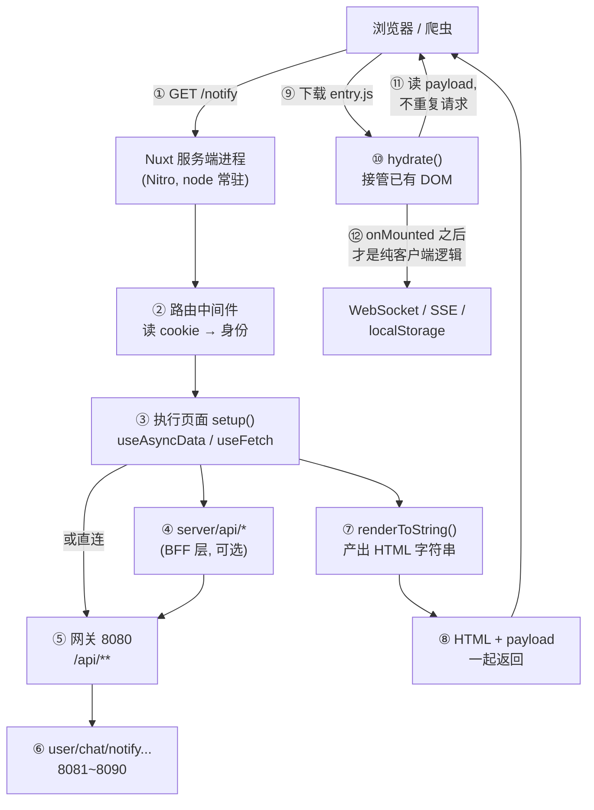
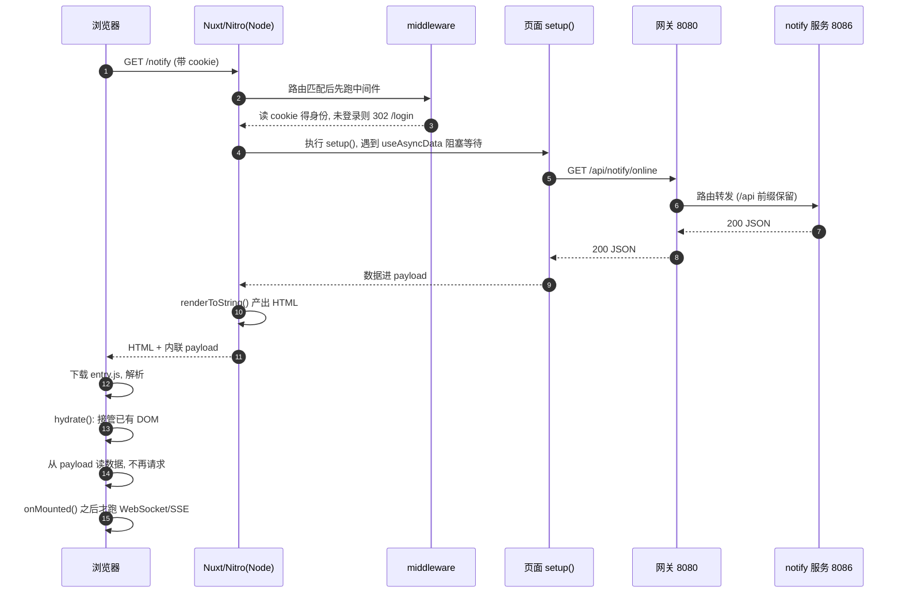

# Nuxt 与 SSR 入门：换的是首屏与 SEO，代价是同一份代码要在服务端和客户端各跑一次

> **一句话结论**：SSR 不是"更快的渲染方式"，而是一次**执行环境迁移**——同一份组件代码先在 Node 里跑一遍产出 HTML 字符串，再在浏览器里跑一遍接管交互；凡是依赖 `window` / `document` / `localStorage` 的写法，都会在服务端那一遍直接断掉。本项目是纯 CSR（全仓 857 个源文件里 `nuxt` / `useFetch` / `hydration` 命中 **0**），对中后台这个选择是对的，本篇讲清它为什么对、代价是什么、什么条件下才该引入 SSR。
> **阅读前置**：Vue 3 组件与 `createApp` 挂载流程（[04-Vue3核心基础](./04-Vue3核心基础.md)）、路由守卫与 Axios 封装（[06-路由守卫与Axios请求封装](./06-路由守卫与Axios请求封装.md)）、Vite 构建产物结构（[09-前端工程化：Vite构建与规范](./09-前端工程化：Vite构建与规范.md)）、同源与跨域（[10-浏览器原理与HTTP跨域](./10-浏览器原理与HTTP跨域.md)）。
> **证据基线**：B 级 = 本仓库 `ai-cs-frontend` / `ai-cs-frontend-react` 真实文件（路径与行号已逐一 read 核对）+ 网关配置；C 级 = 本机 node v24.16.0 实测命令输出与静态统计脚本读数。**本仓库未安装 Nuxt**，凡涉及 Nuxt 框架内部行为的描述均标注"未本机实测"，只给命令与判读方法。预计阅读 45 分钟。

## 0. 先看现象

### 现象一：服务端返回的 HTML 就是一个空壳

本仓库上一次构建残留的产物文件，打开就能看到问题（真实读数）：

```text
# ai-cs-frontend/dist/index.html  第 14~19 行
  </head>
  <body>
    <div id="app"></div>

  </body>
</html>
```

`<body>` 里只有一个空 `<div id="app"></div>`，所有可见内容都在 `<head>` 里那 5 个 `/assets/*.js|*.css` 引用后面——浏览器必须**先下载并执行 JS，才能把页面"变出来"**。源码侧同样如此（`ai-cs-frontend/index.html#L9-L12`）：

```html
<body>
  <div id="app"></div>
  <script type="module" src="/src/main.js"></script>
</body>
```

复活这个现象的读法（本机没起容器，命令给到，判读方法写在括号里）：

```bash
curl -s http://localhost:8080/ | Select-String 'app'   # 只看到 <div id="app"></div>，正文为空
```

对用户来说这不是错误，只是**白屏一段时间**；对搜索引擎爬虫来说，第一次请求拿到的就是这份没有正文的 HTML——这就是 CSR 在 SEO 上的硬伤。

### 现象二：把"浏览器里才有的东西"搬到服务端，直接 ReferenceError

`ai-cs-frontend/src/App.vue#L105` 是这么写的：

```js
const currentUser = ref(getUser() || {})
```

而 `getUser()` 内部读的是 `localStorage`（`ai-cs-frontend/src/utils/auth.js#L15-L21`）。这段代码在浏览器里永远正确，但一旦它被放进服务端渲染流程执行，本机实测输出是：

```text
$ node -e "const t = localStorage.getItem('aics_token'); console.log(t)"
[eval]:1
const t = localStorage.getItem('aics_token'); console.log(t)
          ^
ReferenceError: localStorage is not defined
    at [eval]:1:11
Node.js v24.16.0
```

顺带把"服务端到底有什么"测清楚（后面 3.2 要用）：

```text
$ node -e "console.log(typeof window, typeof document, typeof localStorage, typeof WebSocket)"
undefined undefined undefined function
```

注意最后那个 `function`：node 24 **有**全局 `WebSocket`、也有 `fetch`，但**没有** DOM 和 `localStorage`。这个不等式是后面一串坑的根源。

### 现象三：同一份代码跑两次，结果不一致 → 水合失配

服务端渲染出的 HTML 和客户端重新算出来的 DOM 必须**逐节点一致**，否则 Vue 只能推倒重来。用 30 行等价模型（`learning-docs/tools/tmp-ssr-demo.mjs`，非 Nuxt 源码）演示"渲染结果依赖当前时间"会发生什么，本机实测输出：

```text
A) 服务端 HTML : <span>2026-11-27T04:39:14.495Z</span>
A) 客户端重渲染: <span>2026-11-27T04:39:14.519Z</span>
A) 是否一致    : false
```

两个时间戳差 24 毫秒，于是服务端产出的 DOM 和客户端认为的 DOM 对不上——这就是 **hydration mismatch（水合失配）**。同一份模型还顺手测了"数据只取一次"的契约：

```text
B) 服务端请求次数: 1
B) 客户端读到 payload: [{"id":1,"name":"键盘"}]
B) 客户端是否重新请求: 否
B) 无 payload 时: need-refetch → 总请求数 2
```

**这些现象指向同一件事：SSR 把"一段代码在一个环境里跑一次"，变成了"同一段代码在两个环境里各跑一次，并且两次结果必须对得上"。** 现象一是它的收益（服务端先算好 HTML）、现象二是它的成本（服务端没有浏览器 API）、现象三是它新增的失败模式（两端结果不一致）。理解了这三点，Nuxt 的目录约定、`useFetch`、`server/api` 全都是为缓解这三件事而长出来的。

## 1. 整体地图



> **读图说明**：图里有一条"之分界线"——①~⑧ 全在服务端进程里执行，⑨~⑫ 才在浏览器里执行。**同一份组件代码跨越了 ⑧ 和 ⑩ 两个箭头**：它在 ③ 里跑一次（此时没有 `window`），在 ⑩ 里又跑一次（此时有 `window`）。图中 ④ 的 BFF（Backend For Frontend，面向前端的后端聚合层）是可选的，本仓库没有这一层，前端直接打 ⑤ 网关；⑫ 强调 `onMounted` 之后才是安全区——`ai-cs-frontend/src/views/NotifyView.vue#L114` 的 WebSocket 和 `ai-cs-frontend/src/api/index.js#L30-L35` 的 `window.location.href` 都属于⑫区，一旦被搬到⑪之前就会像现象二那样炸掉。

| 组件 | 责任 | 参与方 | 本仓库现状 |
|------|------|--------|-----------|
| 渲染入口 | 决定"在哪跑"：`createApp` 只挂载，`createSSRApp` 可先渲染成字符串 | 浏览器 / Node | `ai-cs-frontend/src/main.js#L11` 是 `createApp(App)`，纯 CSR |
| 路由 | 决定"谁先匹配"：CSR 靠浏览器 JS 匹配，SSR 靠服务端先匹配一次 | 浏览器 / Node | `ai-cs-frontend/src/router/index.js#L33` `createWebHistory()`，服务端无此概念 |
| 数据层 | 服务端取数并序列化进 HTML（payload），客户端复用 | Node → 浏览器 | 无 SDK，全在 `onMounted` / 事件里调 axios |
| 鉴权 | SSR 下 token 必须随首个 HTML 请求就到（cookie），不能等 JS | 浏览器 cookie / 服务端中间件 | token 存 `localStorage`（`src/utils/auth.js#L4-L9`），首屏拿不到 |
| 传输层 | 长连接（WebSocket/SSE）天然是客户端能力 | 浏览器 | `src/utils/sseStream.js` 依赖 `fetch` + `ReadableStream` |
| 边缘/静态 | 只有 HTML+JS 产物、没有 Node 进程时的托管方式 | nginx / CDN | `ai-cs-frontend/Dockerfile#L31` 用 `nginx:1.27-alpine` 托管静态 |

## 2. 关键概念与关键类/关键 API

先把四个模式说清。**CSR**（Client Side Rendering）= 服务端只发空壳，渲染全在浏览器；**SSR**（Server Side Rendering）= 每次请求由服务端现渲染一份 HTML 返回；**SSG**（Static Site Generation）= 构建时就渲染好静态 HTML 文件；**ISR**（Incremental Static Regeneration）= 静态产物 + 到期后由服务端在后台重新生成（Nuxt 里对应 `routeRules` 的 `isr` / `swr` 语义）。

| 模式 | 首屏可见时间 | SEO | 服务端成本 | 缓存策略 |
|------|-------------|-----|-----------|---------|
| CSR | 最慢：等 JS 下载+执行完才有内容 | 差：首包无正文（见现象一） | 几乎为 0（只管发文件） | HTML 可长缓存，但内容随 JS 版本变，实际靠文件名 hash |
| SSR | 快：首包就有正文，无需等 JS | 好 | 高：**每个请求**都要跑一遍渲染 + 可能取数 | 难缓存：同 URL 不同用户内容可能不同，默认不缓存 |
| SSG | 最快：命中静态文件即返回 | 最好 | 构建时一次性 | 最好缓存：可 CDN 长缓存 + 版本化 |
| ISR | 接近 SSG | 好 | 低：过期时后台重建一次 | 可缓存 + 设 `revalidate` 时长，容忍短时旧数据 |

| 名称 | 位置（Nuxt 项目内） | 角色 | 关键点 |
|------|-------------------|------|--------|
| `createSSRApp` | 应用入口 | 创建可被服务端渲染的 app 实例 | 与 `createApp` 的差别只在"允不允许先渲染成字符串"；本仓库用的是 `createApp`（`src/main.js#L11`） |
| `app.mount('#app')` | 应用入口 | 把组件树挂到空壳上 | 纯 CSR 下这是**唯一**的渲染动作；SSR 下它前一步是服务端 `renderToString` |
| `hydrate()`（水合） | 浏览器端 | 复用服务端 HTML 的 DOM 节点，只补事件监听 | 水合的输入是"服务端 DOM + 客户端虚拟树"，两者不一致就 mismatch |
| payload | 内嵌在 HTML 里的 `<script>` | 传递服务端取数结果的 JSON | 客户端靠它跳过重复请求；无 payload 就退化成现象三的"总请求数 2" |
| `useAsyncData` / `useFetch` | 页面/组件 `setup` | 让取数在**服务端等待完成**、结果进 payload | `useFetch` 是 `useAsyncData` + `$fetch` 的语法糖；本仓库对应物是 `onMounted(() => api.get())` |
| `server/api/*` | 项目根 `server/` | BFF：服务端提供接口给页面用 | 本仓库没有 BFF，前端直接访问 `ai-cs-gateway/src/main/java/com/aics/gateway/config/RouteConfig.java` 里那套 `/api/**` 路由 |
| `defineNuxtRouteMiddleware` | `middleware/` | 服务端先行拦截（如未登录直接 302） | 对应本仓库 `ai-cs-frontend/src/router/index.js#L38-L48` 的 `router.beforeEach`，但那个只在浏览器跑 |
| `@/utils/runtime.js`（本仓库自造） | `src/utils/` | 解析 `VITE_GATEWAY`，产出 `API_BASE` | 本仓库巧点：这个模块**不碰任何浏览器 API**，能直接 import 进 node（C 级实测过） |
| `import.meta.env` | 任意模块 | 构建期注入的环境变量 | SSR 下它读的是**构建机/服务端进程**的环境，不是用户浏览器的 |

## 3. 原理与证据逐段精读

### 3.1 入口：`createApp` 与 `createSSRApp` 只差一件事

**在干什么**：本仓库入口 `ai-cs-frontend/src/main.js`（22 行）做四件事——建 app、注册图标、装插件、挂载：

```js
// ai-cs-frontend/src/main.js  第 11~21 行（节选）
const app = createApp(App)
// …L14-L16 循环注册全部 Element Plus 图标组件
app.use(ElementPlus, { locale: zhCn })
app.use(router)
app.use(permission)
app.mount('#app')
```

`createApp(App)` 返回的实例只能"挂到 DOM 上"。SSR 入口则要用 `createSSRApp(App)`，并且挂载前多一步 `renderToString(app)`——这就是现象一里那份空 HTML 的由来：**本仓库从来没有"渲染成字符串"这一步**。

**为什么这么设计**：`createSSRApp` 的标记会让 Vue 走"可被水合"的编译/运行分支（比如给节点打上 SSR 上下文），而 `createApp` 走"从零创建 DOM"的分支。两者的组件写法完全相同，差别在运行时行为，这是"同一份代码两处跑"在 API 层的体现。

**换写法会怎样**：如果 SSR 项目里误用 `createApp`，页面不会报错，而是**客户端重新创建整棵 DOM**，服务端 HTML 被丢弃——首屏还是白屏，SEO 也拿不到，等于白搭了服务端那一次渲染。

**常见坑**：把 `main.js` 当成"唯一入口"来理解。SSR 下必须有**两个入口**（服务端入口负责渲染、客户端入口负责水合），Nuxt 帮你生成了这两份，所以你在 Nuxt 项目里找不到 `main.js`——这不是 Nuxt "藏东西"，而是它替你拆成了两个文件。

### 3.2 环境差异：服务端没有 window / document / localStorage，但有 WebSocket

**在干什么**：C 级实测（node v24.16.0）给出了环境的真面目：

```text
$ node -e "console.log(typeof window, typeof document, typeof localStorage, typeof WebSocket)"
undefined undefined undefined function
```

而本仓库有 14 处 `localStorage`、3 处 `window.`、1 处 `document.`（静态统计脚本读数，`src/utils/auth.js` 独占 7 处）。这些点在纯 CSR 下零成本，在 SSR 下每一个都是潜在的崩溃点。典型三处：

- `ai-cs-frontend/src/App.vue#L105`：`const currentUser = ref(getUser() || {})`，`setup` **顶层**同步取 localStorage → 现象二那个 `ReferenceError`。
- `ai-cs-frontend/src/api/index.js#L30-L35`：401 时 `window.location.href = '/login'`，服务端没有 `window`。
- `ai-cs-frontend/src/views/NotifyView.vue#L140`：`fetchOnlineCount()` 直接写在 `<script setup>` 顶层（不在 `onMounted` 里）。SSR 下这行会在服务端**先发一次请求**，请求结果又被丢掉（服务端渲染完就扔），客户端还得再发一次——正是现象三 B 组"总请求数 2"的干法。

反过来，`ai-cs-frontend/src/utils/runtime.js` 是**环境中立**的反面教材的反面：它只用 `import.meta.env` 和字符串处理，所以能被 node 直接 import 并跑出正确结果（C 级实测）：

```text
$ node --input-type=module -e "import { API_BASE, GATEWAY } from './ai-cs-frontend/src/utils/runtime.js'"
GATEWAY="" API_BASE="/api"
{"VITE_GATEWAY":""} -> ""                      # 空串保持空串（同源）
{"VITE_GATEWAY":"https://api.example.com/"} -> "https://api.example.com"   # 去尾斜杠
{} -> ""                                       # 未定义也退化为同源
```

**为什么这么设计**：服务端进程是 Node，Node 只有 JS 语言标准库 + 少量 Web 标准（`fetch`、`WebSocket`、`URL`、`TextDecoder`），没有 DOM、没有 `Storage`。Nuxt 不可能把这套 API 都实现一遍（实现了也不是真浏览器），所以策略是"**让你自己把浏览器专属逻辑放到安全的位置**"。

**换写法会怎样**：把 token 从 `localStorage` 换成 **cookie**（`document.cookie` 也是浏览器 API，但 cookie 会**随请求自动发出**），服务端这次请求就能直接读到——这就是 3.6 讲的鉴权迁移路径，也是 SSR 项目里登录态几乎必然从 `localStorage` 迁到 cookie 的原因。

**常见坑**：最阴的一类不是 `localStorage`（它至少报错），而是 **WebSocket 不报错**。node 24 里 `typeof WebSocket === 'function'`，所以 `NotifyView.vue#L114` 那行 `new WebSocket('ws://localhost:8085/ws/notify')` 在服务端**能成功执行**：连接真的建立了、握手真的走了、然后服务端渲染结束连接被丢弃，客户端再连一次。**报错能查，静默连两次只能靠日志和网络面板发现**。

### 3.3 数据获取：`useAsyncData` / `useFetch` 的本质是"服务端等完 + 结果进 payload"

**在干什么**：CSR 里的取数逻辑通常长这样（本仓库主流写法）：

```js
// 等价形态示意：本仓库大量页面用 onMounted + xxxApi.get(...)
onMounted(async () => {
  list.value = await knowledgeApi.get('/list')   // 只有在浏览器里才会执行
})
```

`onMounted` 在服务端渲染时**根本不会触发**，所以 SSR 项目必须换一个"服务端也会等"的入口：`useAsyncData(key, handler)` / `useFetch(url)`。它的三件事是：① 在服务端 `await` 完 handler；② 把返回值序列化进 HTML 的 payload；③ 客户端水合时按 `key` 读 payload，**命中就不发请求**。

**为什么这么设计**：如果服务端不 await，HTML 里就是"加载中"骨架，首屏数据仍然要客户端再取一次——首屏有了壳没有内容，SEO 收益减半。所以 SSR 的取数必须是**阻塞式**的，这也是它慢、贵的直接原因：一个页面的首屏时间 = 最慢那个服务端请求的时间。

**换写法会怎样**：C 级实测的 B 组量化了这件事——服务端请求 1 次、客户端读到 payload `[{"id":1,"name":"键盘"}]` 后**不再请求**；若 payload 缺失（比如用了 `onMounted` 取数），客户端标记为 `need-refetch`，总请求数变成 **2**。多出来的这一次，就是 SSR 写错取数方式时最常见的性能反噬：**服务端白跑一趟，客户端再跑一趟**。

**常见坑**：`key` 冲突。`useAsyncData` 的 `key` 是 payload 里的索引，两个组件用同一个 `key` 就会互相覆盖缓存，表现为"列表页显示了详情数据"这种诡异现象；第二个坑是把非序列化对象（Date、class 实例、函数）塞进 payload——它们在 HTML 里只能变成字符串或直接丢失。这正是 serialize 环节需要 `devalue` 之类方案的原因（Nuxt 内部实现，**未本机实测**）。

### 3.4 水合（hydration）：两端 DOM 必须逐节点对得上的契约

**在干什么**：水合不是"重新渲染"，而是**给已经存在的 DOM 补事件监听、补齐响应式绑定**。Vue 会拿客户端的虚拟节点树去比对服务端 HTML 的节点树，一致就复用（快），不一致就警告并重来（慢，且可能闪一下）。

**为什么这么设计**：如果客户端完全重建 DOM，服务端渲染的收益（用户已经看到内容）会被一次 DOM 重建抹掉——画面闪、滚动位置丢、首屏可见时间反而更差。所以水合的前提被定为一条硬契约：**同一份 props 与同一份 state，必须渲染出同一棵结构**。

**换写法会怎样**：破坏契约的三个经典来源，正好都在本仓库有对应物：

1. **渲染依赖当前时间/随机数**：现象三 A 组，两端差 24ms 就对不上。
2. **渲染依赖浏览器专属状态**：`App.vue#L105` 的 `getUser()`——服务端拿到的是"未登录"（或直接崩），客户端拿到的是"已登录"，两边渲染出的导航栏必然不同。
3. **渲染依赖服务端/客户端不同的数据**：服务端用内网地址取了 A 数据，客户端水合后又用外网地址取了 B 数据。

**常见坑**：mismatch 在很多情况下**不会抛错**，只在控制台打一条形如 `[Vue warn]: Hydration ... mismatch` 的警告（Vue 3 运行时文案，**本机未装 Nuxt 复现**），页面看起来"能用"，只是偶尔闪一下或某个 `input` 的值被清空。所以 SSR 项目的验收清单里必须有一条：**开发环境控制台不允许出现 hydration 警告**。

### 3.5 目录约定与自动导入：省掉的是"手写清单"

**在干什么**：Nuxt 的核心体验是"文件即配置"：`pages/` 下的文件自动成为路由、`components/` 下的组件自动可 import、`composables/` 下的函数自动可用、`server/api/` 下的文件自动成为接口。先确认本仓库到底有没有这套东西——C 级实测，两个工程的依赖清单里 nuxt 命中 **0**：

```text
$ Select-String -Path .\ai-cs-frontend\package.json,.\ai-cs-frontend-react\package.json -Pattern 'nuxt'
(无输出)

$ node -e "读取两个 package.json，输出 dependencies / devDependencies 条目数"   # 命令体见下方说明
ai-cs-frontend deps 7 devDeps 10
ai-cs-frontend-react deps 8 devDeps 2
```

两个工程合计 27 个依赖条目里没有一个与 Nuxt/SSR 相关（Vue 版的 7 个运行时依赖就是 vue、vue-router、element-plus、@element-plus/icons-vue、axios、echarts、qrcode；React 版同理换成 react/antd 家族）。第二段命令的完整形态是读文件后 `Object.keys(j.dependencies||{}).length` 与 `Object.keys(j.devDependencies||{}).length`，可自行复现。本仓库走的是**手写清单**路线，规模同样可以量化（node 静态解析 `ai-cs-frontend/src/router/index.js`）：

```text
routes 条目数: 25
meta.public === true 的路由数: 1   （/login）
带路径参数的路由: /order/:orderNo
src/views/*.vue 文件数: 24
  其中 ChatView.vue 被挂了两条路由（/chat 与 /feedback），无孤儿视图
```

**为什么这么设计**：约定优于配置（Convention over Configuration）能消掉三类样板代码——路由表、import 语句、接口注册。代价是**隐式性**：出问题时"它是从哪来的"需要靠框架知识回答。Nuxt 用 `.nuxt/` 下生成的类型声明（`#imports`、`.nuxt/types`）来缓解这一点。

**换写法会怎样**：把本仓库 25 条手写路由迁到 `pages/` 约定，等于把"路由表"这个显式契约换成"目录结构"这个隐式契约。中后台项目里路由还承载了 `meta.public`、权限码（`ai-cs-frontend/src/directives/permission.js`）、菜单标题等元信息，全靠目录结构表达会**更别扭**——这也是中后台偏爱显式路由表的原因之一。

**常见坑**：`pages/` 目录一旦存在，Nuxt 就接管路由，此时再手写 `router.options` 很容易和自动路由打架；另一个坑是自动导入让"删了一个 composable 却没删引用"这类问题从编译错误退化为运行时 `undefined`。

### 3.6 鉴权：SSR 下 localStorage 里的 token 在首屏那一刻等于不存在

**在干什么**：本仓库鉴权链路的现状（三处证据）：

```js
// ai-cs-frontend/src/utils/auth.js#L7-L9
export function getToken() { return localStorage.getItem(TOKEN_KEY) }   // TOKEN_KEY='aics_token'

// ai-cs-frontend/src/router/index.js#L38-L48（节选）
router.beforeEach((to) => {
  const isPublic = to.meta?.public === true
  if (!isPublic && !isAuthenticated()) {
    return { path: '/login', query: { redirect: to.fullPath } }
  }
  if (to.path === '/login' && isAuthenticated()) return { path: '/' }
})

// ai-cs-frontend/src/api/index.js#L37-L63（节选）：请求拦截器
config.headers.Authorization = `Bearer ${getToken()}`
```

**为什么这么设计**：CSR 下这套完全成立——浏览器里 `localStorage` 永远可读，守卫和拦截器都在同一个环境里跑。SSR 下链路被切断：服务端渲染首屏时**读不到** `localStorage`，于是它渲染出的 HTML 必然是"未登录态"；等 JS 跑起来客户端读到 token 又要变"已登录态"——**必然 hydration mismatch**，而且用户会看到"闪一下登录前的界面"。

**换写法会怎样**：SSR 项目的标准做法是把 token 放进 **cookie**（可 `HttpOnly`），配两件事：① 服务端中间件（`middleware/auth.ts`）在渲染前读 cookie，未登录直接 302 到 `/login`，连渲染都省了；② 服务端取数时把 cookie 透传给后端。这一步在本仓库的代价可以量化：`auth.js` 里 7 处 `localStorage` 要改、`api/index.js` 的拦截器要区分服务端/客户端、路由守卫要再写一份服务端版本——**这就是"上 SSR"最容易被低估的成本**。

**常见坑**：只迁了读、没迁写。`logout()`（`auth.js#L56-L59`）清了 `localStorage` 但没清 cookie，服务端仍然认为已登录，表现为"退出登录后刷新页面又进去了"。第二个坑是 CORS 与 `credentials`：跨域带 cookie 需要 `withCredentials` + 后端 `allowCredentials`（网关侧见 3.7）。

### 3.7 与后端对接：同源反代 vs 直接跨域，两版前端各选了一条

**在干什么**：本仓库两个前端在这一点上是**恰好相反的两种示范**。

Vue 版走同源反代（浏览器视角只有一个源）：

```js
// ai-cs-frontend/src/utils/runtime.js#L14-L24
export function resolveGateway(env) {
  const raw = env?.VITE_GATEWAY
  if (typeof raw !== 'string') return ''
  return raw.trim().replace(/\/+$/, '')
}
export const GATEWAY = resolveGateway(import.meta.env)
export const API_BASE = `${GATEWAY}/api`
```

生产环境 `.env.production` 里 `VITE_GATEWAY=` 留空 → `API_BASE` 就是相对路径 `/api` → 交给 nginx 反代：

```nginx
# ai-cs-frontend/nginx.conf#L49-L62（节选）
location /api/ {
    proxy_pass http://aics_gateway;          # upstream 指向 api-gateway:8080
    proxy_set_header Connection "";
    proxy_buffering off;                     # SSE 必须关缓冲
    proxy_read_timeout 300s;
    chunked_transfer_encoding on;
}
```

React 版走直接跨域（浏览器视角是两个源）：

```js
// ai-cs-frontend-react/src/api/index.js#L7-L8
const GATEWAY = import.meta.env.VITE_GATEWAY || 'http://localhost:8080'
const BASE_URL = `${GATEWAY}/api`
```

而 `ai-cs-frontend-react/vite.config.js`（11 行）里**没有任何 proxy 配置**，只有 `server: { port: 5174 }`；对应的跨域能力由网关提供——`ai-cs-gateway/src/main/java/com/aics/gateway/config/CorsConfig.java#L20-L23`：`setAllowedOriginPatterns(List.of("*"))` + `setAllowCredentials(true)`。

**为什么这么设计**：同源反代的收益是"浏览器层面没有跨域"，于是没有预检、cookie 天然同源、SSE 只需处理代理缓冲；代价是多一段 nginx 配置要维护，且**不能 rewrite 掉 `/api` 前缀**——因为网关路由本身带 `/api`（`ai-cs-gateway/src/main/java/com/aics/gateway/config/RouteConfig.java#L66-L69` 的 `r.path("/api/user/**")`，还有 `#L87-L94` 处注释明确写着"直接透传不去前缀"）。跨域的收益是配置最简（Vite 一条 proxy 都不用写），代价是每个请求多一次预检（`maxAge 3600` 缓解）、cookie 需 `SameSite=None; Secure`、且 `allowedOriginPatterns("*")` + `allowCredentials(true)` 等于**允许任意站点带凭据访问**，安全上不可接受。

**换写法会怎样**：这一节和 SSR 直接相关——**引入 SSR 就自动获得了"同源反代"**：首屏请求由 Node 进程发出（没有跨域概念），而 `server/api` 这一层 BFF 天然就是反代。所以"要不要 BFF"和"要不要 SSR"常常是同一个决策。

**常见坑**：SSE 经反代变"一次性吐完"。`nginx.conf#L56-L61` 的 `proxy_buffering off` / `proxy_cache off` 就是为这个写的；开发侧同问题在 `ai-cs-frontend/vite.config.js#L26-L37` 解决（`configure` 里设 `cache-control: no-cache, no-transform` 并 `delete proxyRes.headers['content-encoding']`）。SSR 下多一跳 Node，**这个坑会再复现一次**：Node 侧的 HTTP 客户端或中间件如果默认缓冲，流式同样会断。

### 3.8 部署形态：Node 常驻进程 vs 静态文件 + 边缘

**在干什么**：本仓库当前是纯静态部署，两个阶段写在一个 Dockerfile 里（`ai-cs-frontend/Dockerfile`，43 行）：L16 `FROM node:22-alpine AS build`，L20-L22 `npm ci`，L28 `npm run build`；L31 `FROM nginx:1.27-alpine`，L34-L35 把 `nginx.conf` 和 `dist/` 塞进去；L40-L41 是健康检查：

```dockerfile
# ai-cs-frontend/Dockerfile#L40-L41
HEALTHCHECK --interval=30s --timeout=3s --start-period=5s --retries=3 \
  CMD wget -q --spider http://127.0.0.1/index.html || exit 1
```

SSR 的部署形态则完全不同：产物是 `.output/server/index.mjs` 这样一个**常驻 Node 进程**（配 `.output/public/` 静态目录），前面再挂 nginx 反代。差别不止"换个命令"：

| 维度 | 静态（本仓库现状） | SSR Node 进程 |
|------|------------------|--------------|
| 进程模型 | 无状态文件服务，可任意水平扩容 | 有进程、要守护（重启策略、优雅退出） |
| 健康检查 | 探 `/index.html`（Dockerfile#L40） | 必须探业务路径，因为"进程活着"≠"渲染能用" |
| 缓存 | `assets` 长缓存 immutable（nginx.conf#L33-L37）、`index.html` `no-store`（#L41-L44） | 首页不可长缓存（内容随用户/时间变），只能缓存 BFF 接口 |
| 故障面 | nginx 挂了就 502，问题面窄 | Node 渲染超时会成为新的失败源，需要超时与降级 |
| 边缘/CDN | 直接扔 CDN，几乎零成本 | 只有支持 Node 运行的边缘环境才能跑 |

**为什么这么设计**：静态产物的价值在于"没有运行时"，一旦引入 Node 渲染，就同时引入了**内存泄漏、渲染超时、单点故障**三个新故障面。这也是"中后台不该上 SSR"的核心论据之一：收益（首屏/SEO）在中后台几乎为 0，成本却全是新的运维故障面。

**换写法会怎样**：若只想要"HTML 里有点内容"，也可以选 SSG/ISR（构建期或后台生成），产物仍是静态文件——但中后台是登录后页面，**每个用户数据都不同**，构建期生成毫无意义，这是第 5 节"什么条件下才该引入 SSR"那条结论的落点。

**常见坑**：把旧稿里的 `FROM node:20-alpine`（本文档上一版写的）抄进仓库。本仓库 Dockerfile 实际是 `node:22-alpine`（#L16），两者混用会在 CI 里出现"本地能装、镜像里装不上"的依赖差异。另外 Dockerfile 文件头已注明：**本机没装 Docker，未实跑验证**——这类配置只能静态核对，别当成已验证事实。

## 4. 一次完整执行时序

以"用户带 cookie 请求 `/notify` 页面"为例，把服务端与客户端各跑一遍的过程摊平：



> **读图说明**：①~⑨ 是"服务端那一遍"，⑩~⑬ 是"客户端那一遍"。关键在两处：**⑦ 之前服务端一直在等**，这就是 SSR 首屏的耗时来源（最慢请求决定首屏）；**⑫ 之所以能"不再请求"**，完全依赖 ⑧ 里 payload 被正确内联——若取数写在 `onMounted`（本仓库 `NotifyView.vue#L140` 的写法），payload 为空，⑫ 就退化成再发一次请求（现象三 B 组实测：总请求数从 1 变 2）。⑬ 是安全区：`NotifyView.vue#L114` 的 `new WebSocket(...)` 只能在 ⑬ 之后跑。

各步失败时的表现（前 4 条为本仓库可静态推导的因果，后 3 条涉及 Nuxt 运行时，**未本机实测**）：

| 失败在哪一步 | 现象 | 报错/日志形态 |
|-------------|------|--------------|
| ② 中间件 | 直接跳登录页，页面不渲染 | HTTP 302 + `Location: /login` |
| ③ setup 里用了 `localStorage` | 页面 500，整页不可用 | `ReferenceError: localStorage is not defined`（现象二原文） |
| ④ 取数超时 | 首屏一直等到超时 | 服务端请求超时（本仓库 axios 层 `timeout: 30000`，见 `src/api/index.js`） |
| ⑦~⑧ 数据不可序列化 | 客户端拿到 `undefined` 或字符串 | 无报错，只是数据"变形" |
| ⑩ 水合不一致 | 页面闪一下 / 值被重置 | `[Vue warn]: Hydration ... mismatch`（Vue 运行时文案） |
| ⑨ Node 进程不可用 | 整站 502 | 反代层返回 502 Bad Gateway |
| ⑬ 之前访问 `window` | 页面 500 或静默错误 | `window is not defined` / `document is not defined` |

## 5. 设计取舍

| 方案 | 收益 | 代价 | 本项目结论（附证据） |
|------|------|------|---------------------|
| 纯 CSR（现状） | 部署最简单：一个 nginx + 静态文件；开发心智负担最低 | 首屏白屏、SEO 差（`dist/index.html#L15-L18` 空壳） | **选它**。理由见下：25 条路由里 24 条要登录，SEO 无意义 |
| SSR | 首屏有内容、SEO 好、天然同源 | 服务端渲染成本 + 双环境 API 约束 + Node 运维 | **不选**。迁移成本清单见 3.6（7 处 localStorage、守卫/拦截器要写两份） |
| SSG | 最省成本的"有内容的 HTML" | 构建期就要有数据；登录后页面无法生成 | **不适用**。中后台数据属于用户，不是构建期常量 |
| ISR | 静态 + 自动刷新 | 需要 Node 运行时做后台重建；一致性窗口 | **不适用**。同上，且引入 Node 就丢了"无运行时"的收益 |
| BFF（`server/api`） | 聚合多服务、隐藏网关、天然同源 | 多一层代码要维护；流式要自己处理 | **暂不需要**。前端已有 `SERVICES` 15 个前缀直连网关（`src/api/index.js#L12-L28`），加一层只增加跳数 |
| 边缘托管静态 | CDN 缓存、全球就近 | 需要把 `index.html` 设为不可长缓存（已做：nginx.conf#L41-L44） | **可选增强**，不改变渲染模式 |

**为什么本项目"纯 CSR 是对的"**——不是懒，而是四条收益全部落空：

1. **SEO**：`ai-cs-frontend/src/router/index.js` 里 25 条路由只有 1 条 `meta.public === true`（`/login`）。其余 24 条未登录直接跳转，爬虫拿到的永远是登录页——**SEO 收益为零**。
2. **首屏**：首屏内容就是"登录后的数据面板"，服务端渲染它必须先拿到用户 cookie 和数据，收益是"省掉一次请求往返"，代价是"多一个 Node 常驻进程"，对内部系统不划算。
3. **交互密度**：`src/utils/sseStream.js` 依赖 `fetch` + `ReadableStream` 做流式对话、`NotifyView.vue#L114` 依赖 `WebSocket` 做通知推送——这两件事**天生只能客户端做**，SSR 只能渲染它们的"空壳"。
4. **复杂度预算**：SSR 会把"任何一处 `localStorage`/`window` 都是定时炸弹"变成常态约束。本仓库当前有 14 处 `localStorage`、3 处 `window.`，把它们全部改造（并保证后续新代码不退化）的收益，抵不上一个内部系统省下的几百毫秒。

**什么条件下才该引入 SSR**（任一条成立就值得重新评估）：

- 出现**面向公网、需要被检索**的页面（营销页、商品详情、知识库公开文章）。
- 首屏时间成为**业务指标**（比如移动端弱网用户占比高，白屏直接影响转化）。
- 需要把**多服务聚合**收敛到前端专用的一层（BFF），顺带获得同源。
- 需要**按请求做服务端级权限/灰度**（在 HTML 生成前就决定渲染什么）。

**可扩展点清单**（现有代码里已经预留了的位置）：

1. `src/utils/runtime.js` 的 `resolveGateway(env)` 是纯函数，加 BFF 前缀只需改这里。
2. `src/utils/auth.js` 把 token 的读写全部收在 4 个函数里（`getToken/setToken/logout/isAuthenticated`），换 cookie 实现只动这一个文件。
3. `src/router/index.js` 的 `meta.public` 是"公开页白名单"，天然就是"哪些页面未来值得 SSG"的清单。
4. `nginx.conf` 的 `location /api/` 块已具备反代 + 关缓冲 + 长超时，加 SSR 时这套配置可原样复用。
5. `ai-cs-frontend/src/api/index.js` 的 `createClient(prefix)` 工厂，让"加一个服务"是 1 行，未来接 BFF 可整体替换 `BASE_URL`。

## 6. 踩坑与调试手法

**坑 1：`setup` 顶层碰 `localStorage`（最典型，也最容易漏）。**
`App.vue#L105` 的 `ref(getUser() || {})` 在 CSR 下完全正确。判断一段代码"能不能上服务端"，最快的手法不是读框架文档，而是——**直接用 node import 它**（真调试手法）：

```bash
node --input-type=module -e "import('./src/utils/auth.js').then(m => console.log(m.getToken()))"
```

跑得通 = 环境中立（如 `runtime.js`）；`ReferenceError: localStorage is not defined` = 这段代码只能待在客户端。这比"上 Nuxt 跑一遍看崩不崩"快两个数量级。

**坑 2：水合失配只看得到"闪一下"。**
真调试手法：**DevTools → Settings → Debugger → 勾选 Disable JavaScript，刷新页面**。此时你看到的完全是服务端返回的 HTML——它就是"水合前的世界"。再取消勾选刷新，两者不一致的地方就是失配点（典型是登录态区域、时间、随机数）。配合 Elements 面板比对"服务端 HTML"与"水合后 DOM"的 diff，比读警告快得多。

**坑 3：以为取数只发了一次，其实发了两次。**
真调试手法：**Network 面板按 `XHR` 过滤 + 勾选 Preserve log，再看首个 `document` 请求的 Response**。判读方法：① 响应 HTML 里有没有 payload 内联数据（有 → 客户端应跳过请求）；② 客户端有没有跟着发同名请求（发了 → `useAsyncData` 的 key 或 await 有问题）。本仓库可对照的现状是 `NotifyView.vue#L140` 把 `fetchOnlineCount()` 写在顶层，等价于"服务端跑一次丢掉 + 客户端再跑一次"。

**坑 4：SSE 经过反代变成"一次性吐完"。**
流式对话在本仓库是 `/chat/stream/sse`（`src/views/ChatView.vue#L393`）。一旦多一跳代理且未关缓冲，token 会攒到最后一次性到达。定位手法：**Network 面板看该请求的 `EventStream`/`Response` 时间轴**——正常应是一段段到达，异常是一条直线后突然全部出现。已落地的两处对策：`nginx.conf#L56-L61`（`proxy_buffering off`、`proxy_cache off`）与 `vite.config.js#L26-L37`（去掉 `content-encoding`、加 `no-transform`）。加 SSR 后要**再检查一遍 Node 侧**是否也缓冲。

**坑 5：硬编码地址在服务端/容器里必然连不上。**
`NotifyView.vue#L114` 写死 `ws://localhost:8085/ws/notify`——注意这里 8085 是 **message 服务**，而通知服务是 8086，这是本仓库一个**真实已知缺陷**；同时 `localhost` 在容器里指向容器自己。这类问题的定位手法是全局 grep（真调试手法）：

```bash
Select-String -Path ai-cs-frontend/src -Pattern 'localhost:\d+' -Recurse
```

**坑 6：`import.meta.env` 的值在服务端不是你以为的那个。**
CSR 下 `VITE_GATEWAY` 在构建时被替换成字符串；SSR 下同一个模块在服务端也会执行，读到的是**构建/运行机**的环境。本仓库的 `runtime.js` 用 `typeof raw !== 'string'` 而不是 `||` 兜底，正是为了避免"空串是 falsy 导致生产回落到 localhost"——这个坑的判读方法是直接跑 3.2 那组 node 用例，四种输入四种输出，一眼看清。

**坑 7：版本差异引起的构建失败被误判成"配置写错了"。**
`vite.config.js#L41-L57` 的 `manualChunks` 必须是函数（注释记录：Vite 8 底层换成 rolldown，写成对象会报 `Invalid type: Expected Function but received Object`）。**定位编译报错的手法**：先看报错里被点名的配置文件与类型（`Expected Function but received Object` 已经明确说是类型问题），再回读官方迁移说明的 breaking change 段落，不要先怀疑业务代码。

**坑 8：退出登录只清了 `localStorage`。**
`auth.js#L56-L59` 的 `logout()` 清两个 key。一旦引入 cookie 鉴权，服务端仍持有会话，表现为"退出后刷新又进去了"。定位手法：Network 面板看退出后的首个 `document` 请求 Request Headers 里还有没有 `Cookie`。

## 7. 版本差异

| 旧写法 | 当前基线 | 变化点 | 迁移动作 |
|--------|---------|--------|---------|
| Nuxt 2：`asyncData` / `fetch` 选项式钩子 | Nuxt 3 起的 `useAsyncData` / `useFetch`（组合式） | 取数从"页面选项"变成"setup 里可组合的调用" | 把 `asyncData(){ return { list } }` 改写成 `const { data } = await useAsyncData('list', () => $fetch('/api/list'))` |
| Nuxt 2：`mode: 'universal' \| 'spa'`、`target: 'static'` | `ssr: true/false` + `nitro.preset` / `nuxi generate` | 部署形态由 `nitro` 的 preset 决定，不再是顶层开关 | 删 `mode`/`target`，按部署目标设 `nitro.preset`（Node 用 node-server，静态用 static） |
| Nuxt 2：`@nuxtjs/axios` + `@nuxtjs/proxy` 模块 | 内置 `$fetch`（基于 ofetch） | 不再需要装 axios 才能服务端取数 | 服务端取数换 `$fetch`；浏览器侧已有 axios 封装（`src/api/index.js`）可保留 |
| Nuxt 2：`static/` 目录 | `public/` 目录 | 静态资源目录改名 | 目录迁移 + 引用路径检查 |
| Nuxt 2：`context.ssrContext` / `req.res` | `useRequestHeaders`、`useRequestEvent` | 服务端请求对象通过组合式函数拿 | 把 `context.req.headers.cookie` 改成 `useRequestHeaders(['cookie'])` |
| 本文档上一版：`FROM node:20-alpine` | 本仓库实际 `FROM node:22-alpine`（`ai-cs-frontend/Dockerfile#L16`） | 基础镜像大版本不一致 | 统一到仓库实际值，别照抄文档 |
| 本文档上一版：把 `vite.config.ts` 当本仓库配置 | 实际是 `ai-cs-frontend/vite.config.js` | 扩展名不同，抄错会找不到文件 | 以仓库实际文件为准 |

> 说明：Nuxt 的具体小版本号本仓库未安装，不做锁定；上表只列 API 家族级别的差异。**以上迁移动作均为未本机实测的建议**，落地前应在独立分支用 `npx nuxi init` 建最小试验工程验证。

## 8. 面试高频问与答

（只列问题，答案见"自测题"折叠区与各小节）

1. SSR 到底解决了什么问题？又新增了什么成本？
2. 什么是水合（hydration）？为什么水合要求两端 DOM 一致？
3. 说出三种必然导致 hydration mismatch 的写法。
4. `useAsyncData` 和 `useFetch` 的区别是什么？`key` 有什么用？
5. SSR 下的取数为什么要 await？不 await 会怎样？
6. 为什么 SSR 项目里 token 通常放在 cookie 而不是 localStorage？
7. SSR、SSG、ISR 各自适合什么页面？给出判断依据。
8. BFF 是什么？它和 SSR 是同一件事吗？
9. 一个中后台系统，你会主动引入 SSR 吗？给出理由和反例条件。
10. SSR 部署相比静态部署多了哪些运维风险？
11. `window is not defined` 报错在 SSR 项目里怎么定位和修复？
12. 同源反代和直接跨域各有什么代价？为什么 nginx 反代时不能 rewrite 掉 `/api`？
13. 为什么"服务端渲染的首屏"不等于"页面可交互"？
14. Nuxt 的 `pages/` 目录约定相比手写路由表，好处和坏处分别是什么？
15. 如果让你把本仓库前端改成 SSR，列出改造清单并按风险排序。

## 9. 动手练习

**练习 1：用 node 判定"这段代码能不能上服务端"。**
写一个脚本，import `src/utils/runtime.js` 与 `src/utils/auth.js`，分别打印结果与异常。
*验收标准*：`runtime.js` 能正常输出 `API_BASE="/api"`；`auth.js` 抛 `ReferenceError: localStorage is not defined`；你能用一句话解释为什么两者不同（是否触碰浏览器 API）。

**练习 2：统计本仓库的"SSR 障碍密度"。**
用 pwsh 统计 `ai-cs-frontend/src` 下 `localStorage` / `window.` / `document.` / `sessionStorage` 的出现次数与所在文件，按次数排序。
*验收标准*：给出总数与 top 3 文件（参考答案：`localStorage` 14 处，`src/utils/auth.js` 7 处居首）；并指出其中哪些出现在 `setup` 顶层（这些是必崩点）。

**练习 3：复现一次 hydration mismatch。**
用纯 node 写 20~30 行等价模型：一个"服务端渲染"函数与一个"客户端重渲染"函数，分别把 `new Date().toISOString()` 放进同一段 HTML，比对是否相等；再把它换成固定字符串，观察结果。
*验收标准*：第一次输出"是否一致: false"；换成固定字符串后输出 `true`；能说出"随机数/时间/浏览器状态"是三类失配源。

**练习 4：量化"取数两次"的浪费。**
扩展练习 3 的模型：模拟"有 payload"和"无 payload"两种客户端，统计总请求数。
*验收标准*：有 payload 时总请求数 1，无 payload 时 2；能对应到真实代码里的两种写法（`useAsyncData` vs 顶层 `onMounted`/顶层直接调用，如 `NotifyView.vue#L140`）。

**练习 5：读 nginx 配置判断反代是否可用。**
逐行读 `ai-cs-frontend/nginx.conf`，列出与 SSR/BFF 相关的四行配置并解释作用。
*验收标准*：能指出 `proxy_pass http://aics_gateway`（upstream 指向 8080）、`proxy_buffering off`（SSE 必需）、`proxy_read_timeout 300s`（长连接）、以及**没有 rewrite**（因为网关路由自带 `/api`，见 `RouteConfig.java#L66-L69`）。

**练习 6：写一份"要不要上 SSR"的技术决策备忘录。**
针对本仓库，用 300 字给出结论、四条论据（必须引用真实文件与行号）、以及触发重新评估的四个条件。
*验收标准*：结论为"不引入"；四条论据至少覆盖"路由 public 仅 1 条""sseStream 依赖 fetch/ReadableStream""auth 用 localStorage""静态部署无运行时"；四条触发条件与第 5 节的可扩展点清单口径一致。

**练习 7（进阶，需自建工程）：实测一次最小 Nuxt 项目。**
在仓库外新建目录执行 `npx nuxi@latest init demo`，建一个页面同时用 `useFetch` 和一个 `onMounted` 取数，观察 Network 里请求次数差异。
*验收标准*：能贴出两种写法的请求次数对比；**若没有网络或时间不允许，允许只写预期结果并标注"未实测"**（本仓库不提供 Nuxt 依赖，禁止直接改 `package.json`）。

## 小结

- SSR 换的是**首屏与 SEO**，代价是"同一份代码在服务端和客户端各跑一次，且两次结果必须一致"。
- 三种现象是同一条因果链：**首包 HTML 空壳（收益的来源）→ 服务端没有浏览器 API（迁移成本）→ 两端结果不一致（新增失败模式）**。
- 判据不是"SSR 更先进"，而是**四条收益里你能拿到几条**：SEO、首屏指标、BFF 聚合、服务端级权限。本项目四条全落空。
- 本仓库铁证：全仓 857 个源文件里 `nuxt` / `useFetch` / `hydration` 命中 **0**；`dist/index.html#L15-L18` 只有 `<div id="app"></div>`；路由 25 条中 `meta.public` 仅 1 条。
- 迁移成本可量化：14 处 `localStorage`、3 处 `window.`、`auth.js` 一个文件 7 处，外加"守卫 + 拦截器要写服务端版本"。
- 反过来，SSR 也自带好处：首屏请求由 Node 发出，天然同源，`server/api` 就是 BFF——所以"上 BFF"和"上 SSR"往往是同一个决策。
- 部署形态的差异比渲染模式更值得先想清楚：静态是"无运行时"，Node 渲染会新增内存、超时、单点三个故障面。
- 可操作归纳：**做新页面时先问一句"这个页面需要被搜索引擎看到、或必须弱网秒开吗"**——答"否"就继续用现在的 CSR 链路（`runtime.js` → axios → 网关），答"是"就单独用 SSG 出一个静态站，别为几个页面把整站拖进 SSR。

## 自测题

<details>
<summary>1. SSR 具体解决了什么问题？</summary>

**参考答案**：解决"首个 HTML 响应里没有正文"的问题。CSR 下服务端只返回空壳（本仓库 `ai-cs-frontend/dist/index.html#L15-L18` 只有 `<div id="app"></div>`），必须等 JS 下载执行完才有内容；SSR 在服务端就把组件渲染成 HTML 字符串一起返回，用户和爬虫首次请求就能拿到正文，因此改善首屏可见时间与 SEO。
</details>

<details>
<summary>2. SSR 新增了哪三类成本？</summary>

**参考答案**：① 服务端运行时成本——每个请求都要跑一次渲染（+可能取数），首屏时间等于最慢请求；② 双环境约束——代码会在没有 `window/document/localStorage` 的 Node 里执行；③ 新的失败模式——hydration mismatch、Node 进程故障（内存/超时/单点）。运维上还多一个常驻进程要守护。
</details>

<details>
<summary>3. 什么是水合？为什么两端 DOM 必须一致？</summary>

**参考答案**：水合（hydration）是客户端复用服务端已生成的 DOM 节点、只补事件监听与响应式绑定的过程。必须一致是因为：若不一致，Vue 只能丢弃服务端 DOM 重建，用户会看到闪烁、滚动位置丢失，服务端渲染的收益被抵消。所以契约是"同一份 props/state 必须渲染出同一棵结构"。
</details>

<details>
<summary>4. 举出三种必然导致 hydration mismatch 的写法，并在本仓库找到对应物。</summary>

**参考答案**：① 渲染依赖当前时间/随机数（`new Date()`、`Math.random()`）——C 级实测两端差 24ms 即失配；② 渲染依赖浏览器专属状态，如 `App.vue#L105` 的 `ref(getUser() || {})` 直接读 `localStorage`，服务端拿不到 → 两端登录态不同；③ 服务端与客户端取到不同数据（不同 baseURL/不同环境变量）。此外"服务端渲染 A 用户数据、客户端读本地缓存渲染 B"也属此类。
</details>

<details>
<summary>5. `useAsyncData` 和 `useFetch` 的区别？`key` 的作用？</summary>

**参考答案**：`useFetch(url)` 是 `useAsyncData` + `$fetch` 的语法糖，适合"直接请求一个 URL"；需要自定义请求逻辑（多接口聚合、错误处理）时用 `useAsyncData(key, handler)`。`key` 是结果在 payload 里的索引：服务端把结果存进 payload，客户端按同一个 `key` 读取，命中即跳过请求（C 级实测：有 payload 时总请求数 1，无 payload 时 2）。`key` 冲突会让不同组件互相覆盖缓存。
</details>

<details>
<summary>6. SSR 下取数为什么必须 await？不 await 会怎样？</summary>

**参考答案**：因为服务端渲染是一次性同步产出 HTML 字符串的过程，如果不 await，`renderToString` 执行时数据还没回来，HTML 里只有"加载中"，客户端仍要再请求一次——首屏有壳无内容，SEO 收益减半，且总请求数从 1 变 2（与 `onMounted` 取数的后果一致，如 `ai-cs-frontend/src/views/NotifyView.vue#L140` 顶层调用导致的重复请求）。
</details>

<details>
<summary>7. 为什么 SSR 项目常把 token 放到 cookie 而不是 localStorage？</summary>

**参考答案**：cookie 会随首个 HTML 请求自动发送，服务端渲染前就能读到身份，从而渲染"已登录"的 HTML 并直接做 302 守卫；`localStorage` 只有 JS 可读，服务端那一遍必然拿不到，导致"服务端渲染未登录态 → 客户端变已登录态"的必然失配与闪烁。代价是 cookie 要处理 `HttpOnly`、`SameSite`、跨域 `withCredentials` 等问题，且 `logout()` 必须同时清 cookie（本仓库 `auth.js#L56-L59` 目前只清 localStorage）。
</details>

<details>
<summary>8. CSR / SSR / SSG / ISR 各自适合什么页面？</summary>

**参考答案**：CSR 适合登录后、交互密集、无需 SEO 的应用（本仓库中后台，25 条路由仅 1 条 public）；SSR 适合内容随请求变化且需要 SEO/首屏的页面（商品详情、搜索结果的个性化首屏）；SSG 适合构建期就确定的内容（文档、营销页）；ISR 适合"内容变化不频繁但要新鲜"的静态大规模页面（新闻列表）。判断依据先看两条：是否需要被检索、首屏是否能用构建期数据算出来。
</details>

<details>
<summary>9. BFF 是什么？它和 SSR 是同一件事吗？</summary>

**参考答案**：BFF（Backend For Frontend）是专为某个前端形态服务的后端聚合层；在 Nuxt 里就是 `server/api/*` 这些服务端路由。它和 SSR 不是同一件事：BFF 可以独立存在（纯 CSR + 独立网关聚合层），SSR 也可以不用 BFF（服务端直接调后端）。但两者天然协同——SSR 的渲染进程顺手就能当 BFF，并且因为请求由 Node 发出而天然同源。本仓库目前没有 BFF，前端直连网关（`src/api/index.js#L12-L28` 的 15 个服务前缀）。
</details>

<details>
<summary>10. 中后台系统你会主动引入 SSR 吗？说出反例条件。</summary>

**参考答案**：不会。理由：① SEO 收益为零——本仓库 25 条路由只有 `/login` 是 `meta.public`，其余未登录直接跳转，爬虫只能看到登录页；② 首屏内容依赖用户数据，服务端渲染收益仅为省一次往返，却要多一个常驻 Node 进程；③ 交互密集能力（`sseStream.js` 的 `fetch`+`ReadableStream`、`NotifyView.vue#L114` 的 `WebSocket`）天生只在客户端；④ 迁移成本可量化（14 处 `localStorage`、守卫与拦截器要写两份）。反例条件：出现公网可检索页面、首屏成为业务指标、需要 BFF 聚合、需要渲染前做服务端级权限/灰度——任一条成立就重新评估，且优先考虑只对少数页面用 SSG 而不是整站 SSR。
</details>

<details>
<summary>11. SSR 部署相比静态部署多了哪些运维风险？</summary>

**参考答案**：① 进程成为故障源：内存泄漏、渲染卡死、崩溃重启需要守护与优雅退出；② 健康检查必须探业务路径，"进程活着"不等于"渲染可用"（静态侧只需探 `/index.html`，见 `ai-cs-frontend/Dockerfile#L40-L41`）；③ 缓存策略变复杂：首页不能再长缓存（内容随用户/时间变），只能缓存接口；④ 边缘/CDN 受限：只有支持 Node 的运行时才能跑；⑤ 多一跳带来的超时/缓冲问题会把 SSE 流式搞坏（静态侧已用 `nginx.conf#L56-L61` 处理过一次）。
</details>

<details>
<summary>12. `window is not defined` 怎么定位和修复？</summary>

**参考答案**：定位：先用 node 直接 import 可疑模块（`node --input-type=module -e "import('./src/utils/auth.js')"`），能复现就说明该模块触碰了浏览器 API；再看报错堆栈里的服务端 chunk 路径定位到具体文件。修复：① 把浏览器专属逻辑移进 `onMounted` / 事件回调（如 `NotifyView.vue#L140` 的取数应移入 `onMounted`）；② 用 `import.meta.client`（或 `process.client`）做分支；③ 需要随请求到达的状态改用 cookie（服务端可读）。原则：**setup 顶层只写两端都能跑的代码**。
</details>

<details>
<summary>13. 同源反代和直接跨域各有什么代价？为什么 nginx 反代不能 rewrite 掉 `/api`？</summary>

**参考答案**：同源反代的代价是多一段 nginx 配置要维护、多一跳；收益是无预检、cookie 天然同源、SSE 只需处理缓冲（`nginx.conf#L49-L62`）。直接跨域的代价是每次预检（`maxAge 3600` 缓解）、cookie 需 `SameSite=None; Secure`、以及必须放开 `allowedOriginPatterns`（本仓库 `CorsConfig.java#L20-L23` 设为 `"*"` 且 `allowCredentials(true)`，等于允许任意站点带凭据访问，安全上应收紧）。不能 rewrite 是因为**网关路由本身带 `/api`**（`RouteConfig.java#L66-L69` 的 `r.path("/api/user/**")`，`#L87-L94` 处还注明 observability/prompts 直接透传不去前缀），rewrite 掉前缀会导致网关匹配不到路由，全部 404。
</details>

<details>
<summary>14. "服务端渲染的首屏"为什么不等于"页面可交互"？</summary>

**参考答案**：首屏 HTML 只是静态结构，事件监听、响应式更新、路由跳转都要等客户端 bundle 下载 + 执行 + 水合完成才生效。这段时间里用户能看但点不动（输入框无响应、按钮无反应）。所以评价指标要分开：首屏内容时间（服务端渲染决定）与可交互时间（JS 体积与执行决定）——这也是为什么 `vite.config.js#L41-L57` 要把 echarts/element-plus/vue 拆成独立 `manualChunks`：不减少总量，但让关键 JS 更早可用。
</details>

<details>
<summary>15. Nuxt 的目录约定相比手写路由表，好处和坏处是什么？</summary>

**参考答案**：好处：消掉样板——`pages/` 即路由、`components/` 即自动导入、`composables/` 即自动可用、`server/api/` 即接口；新增页面不需要改任何注册表。坏处：隐式性——"这个函数/组件从哪来的"要靠框架知识回答，删文件后残留引用会退化成运行时 `undefined`；另外元信息（权限码、菜单标题、`meta.public`）挂到目录结构上很别扭。本仓库选了显式路线：`src/router/index.js` 25 条手写路由 + `meta.public` + `src/directives/permission.js` 权限指令。
</details>

<details>
<summary>16. 如果要把本仓库改成 SSR，改造清单怎么排？</summary>

**参考答案**：按"必崩 → 会错 → 体验"排序：① 环境隔离——把 `setup` 顶层的 `localStorage`/`window` 调用全部下沉到 `onMounted` 或抽成组合式函数（起点 `App.vue#L105`、`NotifyView.vue#L140`）；② 鉴权迁移——token 从 `localStorage` 换 cookie，写服务端中间件，路由守卫与服务端守卫保持同一套判定（`router/index.js#L38-L48` 的逻辑要能跑在服务端）；③ 取数改造——页面首屏数据改用 `useAsyncData`/`useFetch` 以保证进 payload，其余保持客户端取数；④ 传输层——WebSocket/SSE 确保只在 `onMounted` 之后建立，并检查 Node 侧是否有缓冲（`nginx.conf#L56-L61` 那套配置要复用）；⑤ 部署——新增 Node 服务镜像 + 健康检查探业务路径 + 进程守护，静态产物仍走 CDN。
</details>
