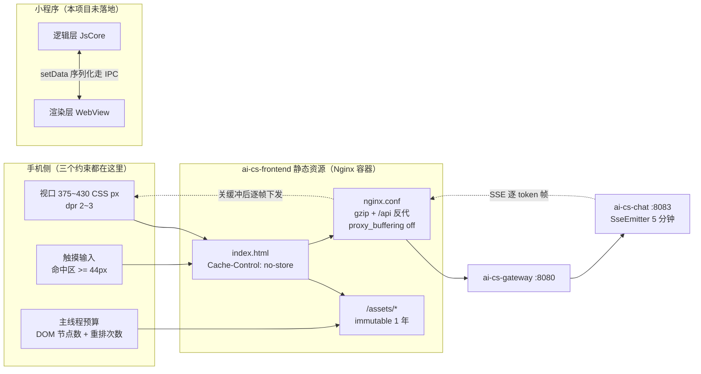
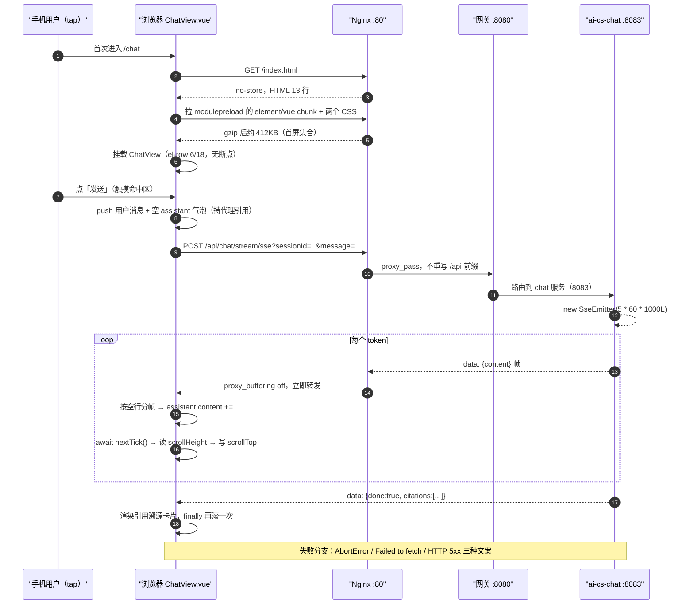

# 13-移动端与小程序开发：网络差、内存小、手指粗

> **一句话结论**：移动端的真正难点不是屏幕小——屏幕小只是"排版不好看"；网络差会让你白屏、内存小（准确说是主线程预算小）会让你滚到卡顿、手指粗会让你 12px 的按钮点不中。本篇把这三件事分别落到首屏体积、DOM/重排预算、触摸命中区上，再回头看小程序的双线程模型为什么必须长成那样。
> **阅读前置**：[05-ElementPlus与前后端联调](./05-ElementPlus与前后端联调.md)（本项目的 UI 与联调套路）、[17-流式对话前端实战](./17-流式对话前端实战.md)（SSE 逐 token 渲染，本篇第 3.6 节直接接着它讲）、[10-浏览器原理与HTTP跨域](./10-浏览器原理与HTTP跨域.md)（视口、重排、HTTP 缓存）。
> **证据基线**：B 级 = `ai-cs-frontend/` 与 `ai-cs-frontend-react/` 的真实文件（每条都带路径与行号，可在编辑器里直接跳过去核对）；C 级 = 本机 `node 24` / `pwsh` 现跑的命令与真实输出；本篇没有 A 级源码锚点（`assets/source/` 是 Java 摘录，与移动端主题无关，不硬引）。**未本机实测**的部分（真机、弱网、iOS 键盘行为）在正文里逐处标注。预计阅读 40 分钟。

---

## 0. 先看现象

**现场一：手机上打开聊天页，左边"会话列表"只剩一条竖缝。**

`ai-cs-frontend/src/App.vue` 第 6 行把侧边栏宽度写死成 220px：

```text
App.vue:6  :: <el-aside width="220px" class="app-aside">
App.vue:233-237 :: .app-main { background-color: #f0f2f5; padding: 20px; overflow-y: auto; }
```

再叠加 `ai-cs-frontend/src/views/ChatView.vue` 第 5 行与第 32 行的固定栅格：

```html
<el-col :span="6">    <!-- 左侧会话列表 -->
<el-col :span="18">   <!-- 右侧聊天区 -->
```

按 CSS 精确值推算（不是截图，是算术）：375px 宽的视口 −220px 侧栏 −40px `el-main` 左右内边距 = 115px 可用宽度，`span=6` 拿到其中 6/24，约 **29px**。一个 29px 宽的卡片里塞着会话标题、图标和删除按钮，结果是标题被 `text-overflow: ellipsis` 压成一个点。

**现场二：4G 上首屏白屏，Network 面板里一个 chunk 1.1MB。**

本机 `dist/`（现存构建产物，构建时间 2026/11/19 14:29）里 index.html 直接引用的资源，用 node 读出来的真实字节数：

```text
dist/assets/rolldown-runtime-hePW80VL.js           716 gzip:     428
dist/assets/element-bl3CF7UA.js                1119291 gzip:  348001
dist/assets/vue-fycMrBjY.js                      24751 gzip:    9461
dist/assets/element-DM8opQMk.css                356555 gzip:   47792
dist/assets/index-BDeApAtd.css                    5267 gzip:    1825
dist/assets/index-CwSiBJWG.js                    11868 gzip:    4377
TOTAL                                          1518448 gzip:  411884
```

（C 级，命令与读法见 3.5；文件名里的 hash 每次构建都会变，**只比总量不要比 hash**。）

**现场三：真机点"连接 WebSocket"必失败。**

`ai-cs-frontend/src/views/NotifyView.vue` 第 114 行：

```js
ws = new WebSocket('ws://localhost:8085/ws/notify')
```

三层错叠在一起：`ws://` 不是 `wss://`（HTTPS 页面下混合内容直接被拦）、`localhost` 在手机上指向**手机自己**而不是你的电脑、8085 是 message 服务的端口而不是 notify 的（`ai-cs-notify/src/main/resources/application.yml` 里是 `port: 8086`，`ai-cs-message/src/main/resources/application.yml` 里是 `port: 8085`）。同一个 bug 在桌面上可能一直"看起来没问题"，因为桌面浏览器的 localhost 恰好指向开发机。

真机上浏览器会打出的报错是 Chrome 对该 URL 的标准文案（**本机无真机，未实测**，这里只给判读方法）：

```text
WebSocket connection to 'ws://localhost:8085/ws/notify' failed:
Error in connection establishment: net::ERR_CONNECTION_REFUSED
```

**现场四：地铁进隧道，气泡里出现一行免责声明。**

这不是猜测，是代码里写死的真实字符串，`ai-cs-frontend/src/views/ChatView.vue` 第 451-452 行：

```js
const aborted = e?.message?.includes('Failed to fetch')
assistant.content = aborted ? '⚠️ 连接中断，回复未完成，请重试。' : ('❌ 错误: ' + (e.message || '请求失败'))
```

`Failed to fetch` 是浏览器在底层连接被掐断（切网、锁屏、断流）时抛出的通用文案——它不给状态码、不给原因，前端只能猜。

这些现象指向同一件事：**这套前端是按"桌面 + 好用网络 + 鼠标"的假设写的，移动端的三个约束（网络差、内存小、手指粗）一条都没有被显式处理。** 后面每一节，都是把这三条约束拆成可执行的具体检查项。

---

## 1. 整体地图

一句话结论：移动端的链路上有四个"变量"是桌面没有的——视口尺寸、设备像素比 dpr（device pixel ratio，一个 CSS 像素对应几个物理像素）、触摸输入、以及随时会断的网络；其余环节与桌面完全一样，所以优化的着力点只有前四个。



> **读图说明**：第一条要盯的箭头是 `IDX --> AST`——首屏体积全部在这里产生，`index.html` 自己只有 13 行，但它通过 `modulepreload` 拉进的 element chunk 就有 1.1MB（见 3.5）；第二条是 `CHAT -.-> NG` 这条虚线，SSE 是**服务端主动逐帧下发**，所以 Nginx 必须 `proxy_buffering off`，否则 token 会被攒成一坨（`ai-cs-frontend/nginx.conf` 第 40-52 行）；第三条是右下角 `L <--> R` 这条双向线，小程序把"逻辑"和"渲染"物理隔在两个线程里，跨线程必须序列化，这就是 `setData` 慢的根因，也是它跟 H5 最大的结构差异。左边三个框不是组件，是**约束**：它们不产生请求，但决定了同一份代码在手机上能不能用。

各组件在本仓库里的实际站位：

| 组件 | 责任 | 参与方 | 本仓库证据 |
|---|---|---|---|
| 移动端视口声明 | 决定 CSS 像素与物理像素的换算基准 | 浏览器 / 前端 | `ai-cs-frontend/index.html` 第 6 行，只有 `width=device-width, initial-scale=1.0` |
| 首屏资源编排 | 决定白屏时长 | Vite 构建 / Nginx | `ai-cs-frontend/src/main.js`（全量注册图标）、`vite.config.js` 的 `manualChunks` |
| 响应式布局 | 决定"能不能看" | Vue 组件 / CSS | 全仓 `@media` 命中 10 处，全在 `ai-cs-frontend/src/style.css`，`.vue` 文件 0 处（C 级，见 3.2） |
| 流式渲染与滚动 | 决定"打字机"是否卡 | ChatView / SSE 解析器 | `ai-cs-frontend/src/views/ChatView.vue` 第 406-437 行、`ai-cs-frontend/src/utils/sse.js` |
| 传输层缓冲策略 | 决定 token 是"一次到"还是"逐个到" | Nginx / 网关 | `ai-cs-frontend/nginx.conf` 第 40-52 行，`proxy_buffering off` |
| 服务端流结束条件 | 决定长回答会不会被掐断 | ai-cs-chat | `ai-cs-chat/src/main/java/com/aics/chat/service/impl/ChatServiceImpl.java` 第 156 行 `5 * 60 * 1000L` |
| 小程序容器 | 决定"能不能直接复用 H5" | 微信客户端（本项目无） | 全仓无 uniapp / taro / mp-weixin 目录（C 级，见 3.9） |

---

## 2. 关键概念与关键类/关键 API

| 名称 | 位置 | 角色 | 关键点 |
|---|---|---|---|
| 布局视口 / 视觉视口 / 理想视口 | 浏览器内核概念 | 三个不同宽度的"视口" | 布局视口默认约 980px（老移动浏览器为了显示桌面页），`width=device-width` 把它拉成理想视口 |
| `dpr`（设备像素比） | `window.devicePixelRatio` | CSS px → 物理 px 的倍率 | iPhone 常见 3，安卓 2~3.5；1px 边框、图片清晰度、canvas 尺寸全受它支配 |
| `viewport` meta | `ai-cs-frontend/index.html` 第 6 行 | 声明视口策略 | 只有 `width=device-width, initial-scale=1.0`；缺 `viewport-fit=cover` 会让 `env(safe-area-inset-*)` 恒为 0 |
| `env(safe-area-inset-*)` | CSS 环境变量 | 让内容避开刘海/圆角/底部小横条 | 必须配合 `viewport-fit=cover` 才有非 0 值 |
| `100dvh` | CSS 长度单位 | 动态视口高度 | `100vh` 在移动浏览器里按"工具栏收起时"算，键盘/地址栏弹出会把底部顶出屏幕 |
| `touch-action: manipulation` | CSS 属性 | 关掉双击缩放，顺带消掉 300ms | 比引入 FastClick 便宜，是当前基线做法 |
| `passive: true` | `addEventListener` 选项 | 承诺监听器不 `preventDefault` | 滚动性能关键；触摸/滚轮监听不声明就会被主线程阻塞 |
| IntersectionObserver | 浏览器 API | 元素进入视口时回调 | 图片懒加载、长列表分段渲染、埋点曝光的统一底座 |
| `loading="lazy"` | `` 原生属性 | 原生懒加载 | 零 JS 成本，但必须给 `width`/`height` 才能避免布局抖动 |
| WebP / AVIF | 图片编码 | 同画质体积更小 | 用 `<picture>` + `type` 回退；`ai-cs-frontend/src/views/ChatView.vue` 第 143 行上传已允许 webp |
| 虚拟滚动 | 前端渲染策略 | 只渲染可视区 ±N 行 | 把 O(总条数) 的 DOM 变成 O(可视条数)，长列表唯一解 |
| 骨架屏 | UI 占位 | 用灰块替代 spinner | 让"等待"有结构感；本仓只有 `MockCashierView.vue` 第 29 行一处 `el-skeleton` |
| SSE 分帧器 | `ai-cs-frontend/src/utils/sse.js` | 把字节流切成事件 | 手写 `\n\n` / `\r\n\r\n` 双分隔符，比 EventSource 灵活（能带 Authorization 头） |
| axios 实例超时 | `ai-cs-frontend/src/api/index.js` 第 38 行 | 请求级超时 | `timeout: 30000`，对弱网是硬上限；流式请求走 `fetch` 不受它管 |
| gzip / immutable | `ai-cs-frontend/nginx.conf` 第 20-38 行 | 传输压缩 + 强缓存 | 首屏体积要按 **gzip 后** 算，1.5MB 原始 ≈ 412KB gzip |
| 双线程 + `setData` | 小程序运行时模型 | 逻辑层与渲染层隔离 | `setData` 是跨线程序列化通信，不是改内存，频率与体积都要控 |
| 分包 | 小程序构建概念 | 主包 + 若干子包 | 主包有体积上限，超了直接传不上去；`subPackages` 按需下载 |
| vConsole / Eruda | 页面内调试面板 | 手机上看 console | 没有 USB 调试时的唯一手段；生产包务必按环境变量剔除 |
| uni-app / Taro / RN / Flutter | 跨端框架 | 一套代码多端产出 | 差别在"渲染到哪"与"运行时是谁"，取舍见第 5 节 |

---

## 3. 原理与证据逐段精读

### 3.1 视口三件套：为什么"屏幕小"其实是个假问题

**在干什么。** `viewport` meta 把浏览器默认的"布局视口"从约 980px 改成设备宽度，让 1 个 CSS 像素对应 1 个"逻辑像素"，页面从此不需要用户双指放大就能看全。本仓库的声明在 `ai-cs-frontend/index.html` 第 6 行：

```text
index.html:6  :: <meta name="viewport" content="width=device-width, initial-scale=1.0" />
```

**为什么这么设计。** 早年移动浏览器为了让没做过适配的桌面网站能看，故意把布局视口设成 980px 再整体缩小——代价是字小如蚁。`width=device-width` 是网站主动放弃这层"自动缩放"，换来精确控制。注意它同时**顺带移除了 300ms 点击延迟**（见 3.4），所以这一行是整个移动适配里性价比最高的一行。

**换写法会怎样。** 删掉这行，iPhone 上会退化成 980px 布局视口，页面整体缩小到 0.38 倍左右，`.msg-bubble` 的 `font-size: 14px` 视觉上变成约 5px；加上 `user-scalable=no`（禁止缩放）则是老做法，现代浏览器（iOS 10+）已忽略它，无障碍也不好，不该再写。

**常见坑。** 第一，缺 `viewport-fit=cover`，于是 `env(safe-area-inset-bottom)` 永远是 0，底部输入框在小横条机型上被压住——本仓库正是这种情况（全仓 `safe-area` 零命中，C 级见 3.3）。第二，`index.html` 第 2 行是 `<html lang="en">`，中文站点写成 en，影响朗读器与字体回退，属于同一处"模板没人管"的痕迹。第三，`initial-scale=1.0` 与 `width=device-width` 同时写并不冲突，但**只写 `initial-scale` 不写 `width`** 在某些安卓 WebView 上仍走 980 布局，两个都要写。

### 3.2 适配单位：rem / vw / px，以及本仓库的真实选择

**在干什么。** 三套主流方案：①`rem`——根字号随视口变化（典型 `amfe-flexible` + `postcss-pxtorem`，把 750 设计稿的 px 换算成 rem）；②`vw`——`1vw = 视口宽度/100`，`postcss-px-to-viewport` 直接把 px 编译成 vw；③纯 px + 断点——不做等比缩放，只在特定宽度换布局。本项目选了第三种，而且是**最朴素的那种**：全部硬编码 px。

C 级实测（命令见本节末）：

```powershell
Get-ChildItem ai-cs-frontend\src -Recurse -Include *.vue,*.css | Select-String -Pattern '@media' | ForEach-Object { $_.Filename + ":" + $_.LineNumber }
```

```text
style.css:30 :: @media (max-width: 1024px) {
style.css:35 :: @media (prefers-color-scheme: dark) {
style.css:70 :: @media (max-width: 1024px) {
style.css:80 :: @media (max-width: 1024px) {
style.css:181 :: @media (max-width: 1024px) {
style.css:195 :: @media (max-width: 1024px) {
style.css:206 :: @media (max-width: 1024px) {
style.css:215 :: @media (max-width: 1024px) {
style.css:253 :: @media (max-width: 1024px) {
style.css:273 :: @media (max-width: 1024px) {
命中总数 = 10
其中 .vue 文件命中 = 0
```

怎么读：10 处命中里有 9 处是同一个断点 `max-width: 1024px`（来自 Vite 脚手架残留样式），1 处是深色模式；**没有任何 ≤768px / ≤480px 的手机断点，`.vue` 组件里一处都没有**。也就是说：`ChatView.vue`、`App.vue` 这些真正在手机上跑的组件，压根没参与响应式。

**为什么这么设计。** 纯 px + 断点方案对中后台最省心：设计给的是 px，代码写 px，不用装 PostCSS 插件、不用和 `node_modules` 里的 px 转 vw 白名单搏斗。它在 375~430 这个手机宽度区间内"能用"，只是没有专门为手机换过布局。

**换写法会怎样。** 上 `postcss-px-to-viewport` 可以做到"设计稿等比缩放"，但会把 `element-plus` 内部的 px 一并转掉（需要 `exclude` 白名单），而且字体会跟着视口线性缩放——大屏手机上字过大、小屏上过小，反而不如断点可控。行业现状是：**移动端专属页用 vw/rem，中后台 + 营销页用 px + 断点**。

**常见坑。** 换算关键字用 grep 找会误命中——本仓库实测 `dpr` 命中 5 个 `loadProducts()`（`loa`+`dPr`+`oducts`，大小写不敏感），见 6.5。加 `\b` 边界并区分大小写后，`safe-area|dpr|rem|vw` 在 `ai-cs-frontend/src` 内是 **0 命中**。

```powershell
Get-ChildItem ai-cs-frontend\src -Recurse -Include *.vue,*.css,*.js | Select-String -Pattern 'safe-area|\bdpr\b|\brem\b|[0-9]vw\b'
```

```text
（无输出：0 命中）
```

### 3.3 1px 边框、dpr 与安全区：三个"手机专属"的细节

**在干什么。** 三件事常被一起讲，因为它们都由 dpr 与"屏幕物理形状"引起：①**1px 边框**——CSS 的 1px 在 dpr=3 的屏幕上占 3 个物理像素，看起来比设计稿的"细线"粗；②**图片清晰度**——位图要按 `CSS 宽 × dpr` 准备，否则 2 倍屏发虚；③**安全区**——刘海、圆角、底部小横条会挡住内容，要用 `env(safe-area-inset-*)` 让出。

**为什么这么设计。** 1px 问题的经典解法是 `transform: scaleY(0.5)` 伪元素方案（画 1px 再缩一半），因为它能在不支持小数的渲染环境里稳定生效；现在更好的做法是直接接受"1px 就是 1 CSS px"（现代浏览器对 `0.5px` 支持已好转），或者用 `box-shadow: inset 0 -1px 0` 的画法避免布局参与。

**换写法会怎样。** 本仓库的边框全是 1px 实线（如 `ai-cs-frontend/src/views/ChatView.vue` 第 559 行 `.chat-input { border-top: 1px solid #ebeef5 }`），在 3 倍屏上偏粗，但属于观感问题，不影响功能；真正影响功能的是安全区——聊天页的输入区固定在底部，一旦机型有小横条又没 `viewport-fit=cover`，`padding-bottom` 不会自动让位，最后一行输入框会被压在横条下面。

**常见坑。** ①`env()` 和 `constant()` 要写两遍兜底（`constant()` 是 iOS 11.0~11.2 的旧语法），顺序是先 `constant` 后 `env`；②`env()` 只在 `viewport-fit=cover` 下有效，很多人加了 `env()` 却没加 `viewport-fit`，以为是"CSS 不生效"；③安卓 Chrome 的地址栏高度会变，用 `100vh` 的容器在滚动时会跳，改用 `100dvh`（本项目 4 处 `100vh`，见 3.7）。

### 3.4 触摸事件与 300ms 点击延迟：它为什么出现，又为什么消失

**在干什么。** 移动浏览器把触摸映射成鼠标事件：`touchstart → touchend → (300ms) → mousedown → mouseup → click`。那 300ms 是浏览器在等"你是不是要双击缩放"。

**为什么这么设计。** 双指/双击缩放是移动浏览器的基本能力，浏览器无法预知第一次 tap 之后会不会来第二次，只能等。**它被移除的条件不是"用了新框架"，而是页面声明了 `width=device-width`**（不缩放了，就不必等）；再叠加 `touch-action: manipulation` 就能显式关掉双击缩放判定。

**换写法会怎样。** 老项目用 FastClick 监听 `touchend` 后手动派发 `click`，代价是所有输入框、下拉框都要打补丁，还会偶发"点一次触发两次"。今天正确做法只有两步：确认有 `width=device-width`，需要的地方加 `touch-action: manipulation`。本项目 `index.html` 第 6 行满足第一步，但全仓 **零 `touchstart`/`touchmove` 监听**（C 级 grep 命中为 0），也就是说所有滚动与点击完全交给浏览器的原生处理——这恰恰是"没有 bug 的懒办法"，也意味着**任何自定义手势都会立刻和原生滚动打架**。

**常见坑。** ①手势与滚动冲突的根因是 `touchmove` 里 `preventDefault()` 与原生滚动抢控制权；现代做法是 `touch-action: pan-y`（只允许竖向滚动）+ `passive: true` 监听，让浏览器在合成线程上先滚，JS 事后补逻辑。②`click` 有 300ms 的"穿透"变体：遮罩层 `touchend` 后立刻消失，同一位置的按钮会在 300ms 后的 `click` 里被点中，解法是遮罩消失后短暂 `pointer-events: none`。③不要在 `touchend` 里读 `scrollTop` 再改它——那正好落在滚动惯性期间，会互相拉扯。

### 3.5 首屏体积：从 22 行 main.js 到 1.5MB 首屏集合

**在干什么。** `ai-cs-frontend/src/main.js` 只有 22 行，第 4 行和第 13-16 行做了两件"体积上很贵"的事：

```js
import 'element-plus/dist/index.css'
// 注册所有 Element Plus 图标
for (const [key, component] of Object.entries(ElementPlusIconsVue)) {
  app.component(key, component)
}
```

全量引入 Element Plus 的 CSS（约 356KB 未压缩）+ 把**所有**图标组件注册成全局组件（图标被打进 JS chunk），这是首屏体积的直接来源。

**为什么这么设计。** 这是"先跑起来"的写法：不用配 `unplugin-vue-components`、不用管某个模板里用的图标有没有 import，全局注册 + 全量 CSS 保证"随便写都能显示"。代价被推迟到上线后才显现。

**换写法会怎样。** 按需引入（`unplugin-vue-components` + `ElementPlusResolver`）通常能把 element 那个 1.1MB 的 chunk 砍掉大头；图标改为"用到才 import"。但要注意：本项目 `ai-cs-frontend/src/api/index.js` 第 2 行在 api 层直接 `import { ElMessage } from 'element-plus'`，15 个 axios 实例又是 eager 创建，所以 element-plus **不可能被拆成"只在某些页面加载"**——它是首屏刚性依赖。

**常见坑。** ①把"骨架屏"当成性能优化——它只改善感知，不减少字节；②以为 `manualChunks` 拆包就等于变小，其实拆包只影响**并发下载数和缓存复用**，不改变总字节。本仓库的 `ai-cs-frontend/vite.config.js` 用函数形式 `manualChunks` 把 `echarts/zrender` 拆成 `charts` chunk（约 1.0MB），这是有效收益：`charts` 只在图表页才拉，**不进首屏**。③看到 `chunkSizeWarningLimit: 800` 就以为"阈值调大了就没问题"——它只是关掉了警告。

C 级实测（先看总量，再看构成）：

```powershell
cd ai-cs-frontend
node -e "const fs=require('fs'),zlib=require('zlib'),p=require('path');const html=fs.readFileSync('dist/index.html','utf8');const refs=[...new Set([...html.matchAll(/\/assets\/[A-Za-z0-9._-]+/g)].map(m=>m[0]))];let t=0,g=0;for(const r of refs){const b=fs.readFileSync(p.join('dist',r.slice(1)));const z=zlib.gzipSync(b,{level:6}).length;t+=b.length;g+=z;console.log(r.padEnd(40),String(b.length).padStart(8),'gzip',String(z).padStart(7));}console.log('TOTAL'.padEnd(40),String(t).padStart(8),'gzip',String(g).padStart(7));"
```

```text
dist/assets/rolldown-runtime-hePW80VL.js           716 gzip:     428
dist/assets/element-bl3CF7UA.js                1119291 gzip:  348001
dist/assets/vue-fycMrBjY.js                      24751 gzip:    9461
dist/assets/element-DM8opQMk.css                356555 gzip:   47792
dist/assets/index-BDeApAtd.css                    5267 gzip:    1825
dist/assets/index-CwSiBJWG.js                    11868 gzip:    4377
TOTAL                                          1518448 gzip:  411884
```

怎么读：脚本从 `dist/index.html` 里抓出所有 `/assets/...` 引用（即 `<link rel="modulepreload">`、`<link rel="stylesheet">`、`<script type="module">` 三处共 6 个文件），逐个 `readFileSync` 取原始字节、`zlib.gzipSync` 取压缩后字节。真实构成是：**element 的 JS+CSS 合计 1,475,846 B 原始 / 395,793 B gzip —— 按 gzip 口径占首屏 96%（原始字节口径 97%）**。这就是"网络差"约束下的第一个出血点：412KB 在 Slow 3G 这类约几百 kbps 的档位上按带宽算就是秒级等待，而浏览器解析 1.1MB JS 还要额外时间（**未本机实测耗时，不引用任何跑分**）。`api-D8G56eA8.js`（49,001 B / gzip 18,588 B）不在这个集合里——它由视图 chunk 动态拉起，登录后才加载；entry chunk 里其余引用全是 24 个视图 chunk 的动态 `import()`，同样不占首屏。

复现命令（任选其一，都在 30 秒内完成，不需要联网、不需要 install）：

```powershell
# 只看元素 chunk 有多大
Get-ChildItem ai-cs-frontend\dist\assets -Filter *.js | Sort-Object Length -Descending | Select-Object -First 5 Name,Length
```

```text
Name                        Length
----                        ------
element-bl3CF7UA.js        1119291
charts-DTbrIw2f.js         1027047
api-D8G56eA8.js              49001
vue-fycMrBjY.js              24751
index-CwSiBJWG.js            11868
```

（`charts` 虽大但不在首屏引用集合里——这正是拆包的意义：**大 ≠ 首屏慢，关键看 index.html 引不引它**。）

### 3.6 流式渲染与滚动：每个 token 一次强制同步布局

**在干什么。** `ai-cs-frontend/src/views/ChatView.vue` 第 406-437 行是流式主循环，其中最贵的一段在第 423-427 行：

```js
if (obj.content && !obj.done) {
  assistant.content += obj.content
  assistant.citations = assistant.citations || []
  await scrollToBottom()
}
```

而 `scrollToBottom` 在第 468-473 行：

```js
async function scrollToBottom() {
  await nextTick()
  if (messagesRef.value) {
    messagesRef.value.scrollTop = messagesRef.value.scrollHeight
  }
}
```

`nextTick()` 等 Vue 把本次修改刷到 DOM，然后**读 `scrollHeight`**（这会强制浏览器立刻完成布局计算，业内叫"强制同步布局"/layout thrashing），再写 `scrollTop`。

**为什么这么设计。** 为了"自动跟到底部"：不这样做，用户看到的是回答在下方悄悄生长、视口不动。`assistant` 在第 384 行被取下标引用（`const assistant = currentMessages.value[currentMessages.value.length - 1]`），必须持有响应式代理引用，否则 `+=` 改的是快照，视图不更新——这是原作者特意留的注释：「需持响应式代理引用，逐 token 追加才会触发视图更新」。

**换写法会怎样。** 每 token 一次"改状态 + 等渲染 + 量高度 + 滚动"，在桌面上没感觉，在手机上就是主线程被高频占用：token 密集时（例如一次返回 200 个字符，按 1~3 字/帧下发）等于 100 次布局。标准改法是合并到 `requestAnimationFrame`：

```js
// 示意改法（未在本仓库落地，仅说明思路）
let pending = false
function scheduleScroll() {
  if (pending) return
  pending = true
  requestAnimationFrame(() => {
    pending = false
    const el = messagesRef.value
    if (el) el.scrollTop = el.scrollHeight
  })
}
```

这样一帧最多滚一次，与 token 频率解耦。另一条路是"只在用户本来就贴着底部时才自动滚"（判断 `scrollHeight - scrollTop - clientHeight < 阈值`），否则不打扰用户上翻——这是微信/Claude 一类产品的默认行为。

**常见坑。** ①`.msg-bubble` 用了 `white-space: pre-wrap; word-break: break-word`（第 545-548 行），长英文串会触发断行重算，越长的回答每次 `+=` 越贵；②`el-avatar`、`el-card`、引用溯源卡片全在同一列表里，DOM 数量随对话轮数线性增长，没有虚拟滚动（见 3.8）；③`ChatView.vue` 的 `<style scoped>` 里 **0 个 `@media`**，`.msg-bubble { max-width: 65% }` 在 375px 屏上等于 200px 左右，配 `padding: 12px 16px` 后正文每行约 12~14 个汉字，长回答会拉得极长。

### 3.7 弱网：失败分类、超时上限与"用户看得见"

**在干什么。** 弱网下只有三类结局，`ai-cs-frontend/src/views/ChatView.vue` 第 441-458 行把它们分开处理了，这是全仓库对"网络差"最认真的一段代码：

| 触发条件 | 代码依据 | 用户看到 |
|---|---|---|
| 用户主动点「停止生成」 | 第 444 行 `stopRequested.value \|\| e?.name === 'AbortError'` | 气泡末尾追加 `_（已停止生成）_`，不弹红条 |
| 连接被浏览器掐断 | 第 451 行 `e?.message?.includes('Failed to fetch')` | 「⚠️ 连接中断，回复未完成，请重试。」 |
| 服务端返回错误状态 | 第 399 行 `throw new Error('HTTP ' + resp.status)` | 「❌ 错误: HTTP 502」+ `ElMessage.error` |

**为什么这么设计。** 弱网里最常见的失败是"没失败但也没数据"（连接挂着不动），此时**不能报错也不能假装成功**——保留已收到的内容 + 明确告知"未完成"，是唯一不欺骗用户的选项。把"用户自己点的停止"从错误分支里摘出来，也是刻意的：注释写着「弹红色报错会让用户以为自己操作错了，其实这是预期行为」。

**换写法会怎样。** 三种超时上限互不相同，必须放在一起看：浏览器 `fetch` 对流式响应**默认无总超时**；axios 那条 30s 超时（`ai-cs-frontend/src/api/index.js` 第 38 行 `timeout: 30000`）只管非流式接口；服务端 `SseEmitter` 是 5 分钟（`ChatServiceImpl.java` 第 156 行 `SSE_EMITTER_TIMEOUT = 5 * 60 * 1000L`），Agent 流是 120 秒（`AgentController.java` 第 117 行 `AGENT_STREAM_TIMEOUT = 120_000L`）；Nginx 的 `proxy_read_timeout 300s` 与 5 分钟基本对齐。所以"卡住"的真实体验是：**用户可能等满 5 分钟**，中间没有任何进度提示——因为前端没有心跳/超时提示逻辑（`utils/sse.js` 第 11 行明确把 `:` 开头的注释帧（心跳）直接丢弃，这在协议上是正确的，但也没利用它做"服务端还活着"的信号）。

**常见改法与坑。** ①请求合并：本仓库没有任何批量/去重封装（15 个 axios 实例各自直发），页面并行请求时没有 `Promise.all` 聚合；②重试：全仓 **0 处重试逻辑**，失败即终态；③缓存：只有 Nginx 的静态资源强缓存（`nginx.conf` 第 33-38 行 `immutable`），业务数据零缓存、零 Service Worker、零离线页；④骨架屏：全仓仅 `MockCashierView.vue` 第 29 行一处 `el-skeleton`，聊天首屏是空白 + `el-empty`；⑤重试要先判"幂等"——SSE 对话不是幂等的（每条消息都会写历史），盲目自动重试会重复入库。

### 3.8 长列表与重排预算：一段对话滚到 200 轮会发生什么

**在干什么。** `ChatView.vue` 第 35 行用 `v-for="(msg, i) in currentMessages" :key="i"` 全量渲染所有消息；每条消息里还有头像、气泡、引用卡片（`v-for` 套 `v-for`）、反馈工具条。没有任何虚拟滚动、没有分页、没有 `v-memo`。

**为什么这么设计。** 客服场景单次会话通常几十轮，全量渲染最省事且"搜索/复制"天然可用。虚拟滚动会让 `Ctrl+F` 失效、消息高度不定时定位困难——不是免费的。

**换写法会怎样。** 判据是 DOM 节点数：按每轮约 8~15 个节点估，200 轮就是 1600~3000 个；上到 10^4 量级后，滚动时每帧的样式重算与合成开销会明显掉帧（**未本机实测帧率，不引用 FPS 数字**）。此时该上虚拟滚动（如 `vue-virtual-scroller`）或"只保留最近 N 轮 + 上翻加载"。

**减少重排的具体手法（都能在本仓库立刻验证）。** ①动画只用 `transform`/`opacity`（合成层属性），不要动 `top/height/margin`；②批量改 DOM 前后用 `requestAnimationFrame` 包一层，避免一帧内多次读写交替（这正是 3.6 的问题）；③图片必须有 `width/height` 或 `aspect-ratio`，否则加载完成会撑开列表——本仓库 `ChatView.vue` 第 40 行的 `` **既没有 `loading="lazy"`，也没有宽高属性**，只有 CSS 的 `max-width/max-height: 200px`，图片按原始尺寸解析后突然撑高，正在自动滚动的列表会跳一下；④长列表容器加 `contain: content` 或 `content-visibility: auto`，把重排影响圈在容器内。

### 3.9 小程序的模型：为什么它必须"双线程 + setData"

**在干什么。** 小程序不是网页，是"用 WebView 画界面 + 用独立 JS 引擎跑逻辑"的混合体：**渲染层**（WebView，负责 wxml/wxss）和**逻辑层**（JsCore/V8 沙箱，跑你的 `App/Page` 代码）是两个线程，中间的通信只能靠官方桥接。逻辑层改了数据，必须调 `this.setData({...})`，把**一份可序列化的数据**跨线程送到渲染层，渲染层再 diff 后更新视图。

**为什么这么设计。** 三个目的：①安全——逻辑层没有 DOM/BOM，拿不到 `window`、不能动态插入脚本，恶意代码改不了宿主环境；②可控——渲染层能被平台约束（不能随意跳转、不能绕过审核加页面）；③多端一致——同一份逻辑层代码可以跑在 iOS/Android/PC 的不同渲染实现上。代价就是**`setData` 变成了 RPC 调用**：一次调用 = 序列化 + 跨线程 + 渲染层 diff。

**换写法会怎样。** 直接把 H5 的思维方式搬过去（大对象整体 `setData`、高频 `setData`）会立刻撞墙：官方文档给的经验是单次 `setData` 数据量控制在几十 KB 内、避免把 `setData` 放进 `requestAnimationFrame`/定时器循环。正确做法是 `this.setData({ 'list[3].name': 'x' })` 只改路径、只传增量。另外包体积是硬限制（主包约 2MB 级、整包约 20MB 级，以后台当前规则为准），超了直接**无法上传**，只能拆 `subPackages`。

**常见坑。** ①把"页面生命周期"当 Vue 生命周期用：`onLoad`（一次）≈ `created`、`onShow`（每次可见）≈ `activated`、`onReady`（首帧渲染完）≈ `mounted`、`onHide` ≈ `deactivated`、`onUnload` ≈ `unmounted`；弱网下 `onShow` 会被反复触发（切后台回来、扫码回来），在这里发请求必须自己去重。②`app.js` 的 `onLaunch` 里做异步初始化，页面 `onLoad` 时数据可能还没好——要用 `getApp().globalData.readyPromise` 之类显式等待，不能靠"应该先执行完了"。③`setData` 传了 `undefined` 的字段会被忽略（不是设成空），要显式 `null` 或空串。

**本仓库现状（必须说清）：这套能力一处都没落地。** C 级实测：

```powershell
Get-ChildItem -Recurse -Directory -Depth 3 -Include uniapp,uni-app,taro,mp-weixin,miniprogram -ErrorAction SilentlyContinue |
  Where-Object { $_.FullName -notmatch 'node_modules' }
```

```text
（无输出：仓库内不存在 uniapp / taro / mp-weixin / miniprogram 目录）
```

`ai-cs-frontend` 工程根目录 `package.json` 的 `dependencies` 一共 7 个包（`@element-plus/icons-vue`、`axios`、`echarts`、`element-plus`、`qrcode`、`vue`、`vue-router`），没有任何跨端编译器。所以第 5、8、9 节里讲的小程序/跨端内容属于**知识储备与选型判断**，不是本仓库已实现的能力。

---

## 4. 一次完整执行时序

一句话结论：手机上一次"发送并看到回答"，跨了十几个环节，其中**第 5、9、16 步**是移动端特有的失败高发点（首屏字节、`fetch` 中断、每个 token 一次布局）。



> **读图说明**：重点看三处。①第 4-5 步：`index.html` 自己是 `no-store`（不缓存），而 `/assets/*` 是 `immutable` 一年——所以"发版后用户看到旧页面"几乎不会发生，但**首屏字节每次冷启动都要重下**；②第 12-14 步：`SseEmitter` 的超时是 5 分钟，意味着第 13 步的循环可能在"没有任何数据"的状态下空转到 300 秒才结束，前端这一侧没有计时器去提示用户；③第 15-17 步每转一圈就是一次完整的"改状态→等渲染→量高度→滚动"，手机主线程的预算（每帧约 16.7ms）就是被这里吃掉的。

各步失败会报什么（判读表）：

| 失败点 | 现象 / 报错原文 | 根因与判读 |
|---|---|---|
| 第 2 步 | 直接 404 / 打开是空白页 | 静态服务没配 SPA 回退；本项目靠 `ai-cs-frontend/nginx.conf` 第 56 行 `try_files $uri $uri/ /index.html` 兜住 |
| 第 5 步 | Network 里 element chunk `(canceled)` 或长时间 pending | 弱网 + 1.1MB 单文件；给 gzip 已开（第 20-30 行），仍慢就要按需引入 |
| 第 9 步 | `Failed to fetch`（无状态码） | 底层连接被掐：切网、锁屏、证书错、混合内容拦截 |
| 第 10 步 | `HTTP 401` + 自动跳 `/login?redirect=` | `ai-cs-frontend/src/api/index.js` 第 50-60 行拦截器，但**流式 fetch 不走 axios**，401 只会进 `throw new Error('HTTP 401')` 分支 |
| 第 11 步 | `502 Bad Gateway` | Nginx 反代目标 `api-gateway:8080` 不在线（`nginx.conf` 第 4-6 行 upstream） |
| 第 13 步 | 5 分钟后连接正常结束但没内容 | `SseEmitter` 超时；对应 `ChatServiceImpl.java` 第 156 行 |
| 第 15 步 | token 一次性全出现（没有打字机效果） | 中间有代理缓冲（漏了 `proxy_buffering off` 或 `X-Accel-Buffering`） |
| 第 16 步 | 气泡内容重复 / 错行 | 分帧写错（本项目 `utils/sse.js` 同时支持 `\n\n` 与 `\r\n\r\n`，见第 46-52 行） |
| 任意步 | `WebSocket ... ERR_CONNECTION_REFUSED` | 只在通知页出现，`NotifyView.vue` 第 114 行硬编码 `ws://localhost:8085`（见 0 节现场三） |

---

## 5. 设计取舍

| 决策点 | 当前做法（可核对） | 得到什么 | 付出什么 | 何时该换 |
|---|---|---|---|---|
| 移动适配 | 纯 px + 一个 1024px 断点（`style.css` 10 处 `@media`） | 零插件、零心智负担、桌面观感稳定 | 手机上布局是"挤"出来的，不是设计出来的 | 出现"手机端是主要入口"的需求时，加 ≤768/≤480 断点或上 vw |
| Element Plus 引入 | 全量 CSS + 全量图标注册（`main.js` 第 4、13-16 行） | 任何模板都能直接用图标 | 首屏 element chunk 1.1MB / gzip 348KB | 首屏预算吃紧时改按需引入 |
| 流式实现 | `fetch` + `ReadableStream` + 手写分帧（`utils/sse.js`） | 能带 Authorization 头、能 POST、能 abort | 要自己处理半帧、心跳、错误帧 | 已经比 EventSource 优，不必换 |
| 自动滚动策略 | 每 token `nextTick` + 读写 `scrollHeight`（`ChatView.vue` 第 423-427、468-473 行） | 永远跟到底，实现简单 | 高频强制同步布局，弱机掉帧 | 有卡顿反馈时改 rAF 合帧 + "贴底才滚" |
| 长列表 | 全量 `v-for`，无虚拟滚动、无分页 | 可全文查找、可复制 | DOM 随轮数线性增长 | 单会话过百轮时上虚拟滚动 |
| 图片加载 | `` 无 `loading`/无宽高（`ChatView.vue` 第 40 行） | 代码最短 | 布局抖动 + 非可视区也下载 | 立刻可改：加 `loading="lazy"` 与 `aspect-ratio` |
| 弱网体验 | 三类失败分支 + 明确文案（第 441-458 行） | 不骗用户 | 无重试、无缓存、无骨架屏、5 分钟静默等待 | 客服移动端上线前必须补骨架屏与超时提示 |
| 通知通道 | WebSocket 硬编码 `ws://localhost:8085`（`NotifyView.vue` 第 114 行） | 桌面开发机能连 | 真机必挂、HTTPS 下被拦、端口还指错服务 | 必改：走 `API_BASE` 同源 + `wss:` + 8086 或 STOMP `/ws-stomp` |
| 跨端形态 | 只做 H5（Vue + React 两套） | 一套技能复用、发布快 | 没有小程序入口、没有原生能力 | 真要小程序时优先 uni-app（复用 Vue 语法） |
| 高度单位 | 4 处 `100vh`（`App.vue` 155、`ChatView.vue` 517、`LoginView.vue` 143、`AgentView.vue` 224） | 桌面正好满屏 | 移动浏览器工具栏遮挡底部 | 改 `100dvh`（保留 `100vh` 作回退） |

**可扩展点清单（全部未落地，写在这里是为了让"能不能加"有明确答案）：**

1. **移动端断点**：`ChatView.vue` 的 6/18 栅格改 `:xs="24" :sm="8"`，小屏时把会话列表收进抽屉（未落地）。
2. **按需引入 Element Plus**：加 `unplugin-vue-components`，图标改局部 import（未落地）。
3. **图片懒加载 + WebP**：`msg-image` 加 `loading="lazy"` 与宽高；服务端 `FileStorageService` 输出多尺寸（未落地）。
4. **rAF 合帧滚动 + 贴底才滚**（未落地，见 3.6 示意代码）。
5. **骨架屏**：聊天首屏、列表首屏接 `el-skeleton`（本仓只有收银台一处用了，未落地到聊天页）。
6. **SSE 心跳可见化**：`utils/sse.js` 已丢弃 `:` 注释帧，可改成"收到心跳就重置本地超时计时器"，从而在 5 分钟内提前告知用户（未落地）。
7. **通知通道修正**：`NotifyView.vue` 改走 `API_BASE` + `wss`/同源代理（未落地，属已知缺陷）。
8. **小程序端**：需先引入 uni-app 或 Taro 编译器并重排目录（未落地，当前无任何跨端配置）。

---

## 6. 踩坑与调试手法

### 6.1 用 DevTools 设备模式 + Network 节流，把"穷"复现出来

真机上排查慢，最有效的第一步不是猜，是在桌面把网络调快慢。DevTools → 设备工具栏（`Ctrl+Shift+M`）→ 选 iPhone SE（375×667）→ Network 面板 Throttling 选 `Slow 4G` / 自定义，然后硬刷新（`Ctrl+Shift+R`）。看三个数：`DOMContentLoaded` 时刻、`element` chunk 的传输耗时、以及 `index.html` 是否 `no-store`。本项目预期看到的是：6 个首屏资源里 element 一个就吃掉绝大部分传输时间（对应 3.5 的字节表）。

### 6.2 在 Network 里看 SSE 的"逐帧"，判断是不是被缓冲了

点开 `/api/chat/stream/sse` 那条请求 → 看 `EventStream` 标签（旧版 Chrome 显示为 `Response`）里的增量。判据非常干脆：**打字机效果正常 = 帧在陆续到达；一坨一次性出现 = 中间某层开了缓冲**。要查的层按顺序是：Nginx（`proxy_buffering off`，`nginx.conf` 第 45 行）、网关、以及浏览器扩展。Vite dev 阶段这一层由 `vite.config.js` 的 `proxyRes` 钩子处理（把 `content-encoding` 删掉并设 `no-cache, no-transform`），生产阶段由 Nginx 处理——**两套配置都要对，否则本地好看线上不流**。

### 6.3 断点打在分帧循环里，看 buffer 与引用

流式问题最难的是"内容错位/重复/丢尾"。在 `ChatView.vue` 第 413 行 `while ((sep = buffer.indexOf('\n\n')) >= 0)` 下条件断点，或在 `utils/sse.js` 第 60 行 `dispatch(...)` 前打点，观察：`buffer` 里有没有残留跨 chunk 的半帧（服务端把一个 `data:` 行拆成两个 TCP 包发送时必然出现）、`assistant.content` 是否指向同一个响应式对象。丢最后一帧的经典原因就是没调 `flush()`（`utils/sse.js` 第 70-76 行专门为此而写）。

### 6.4 真机调试：局域网 IP + `--host` + chrome://inspect

`npm run dev` 默认只监听 `localhost`（`vite.config.js` 里 `server.port: 5173`，未配 `host`），手机访问不到。两条路：①临时 `npm run dev -- --host`，手机与电脑同 Wi-Fi，访问 `http://<电脑内网IP>:5173`（这一步还会顺便暴露 0 节现场三的 `localhost` bug）；②安卓 USB 调试后，电脑 Chrome 打开 `chrome://inspect`，直接对手机 WebView 做真实 DevTools（含 Network 与断点）。iOS 需 Safari → 开发 → 选设备 → 检查器。

### 6.5 grep 找关键字会被大小写与子串骗：`dpr` 命中 `loadProducts`

本仓库真实踩到的：想统计"有没有做 dpr 适配"，用 `Select-String -Pattern 'dpr'` 得到 10 处命中，逐条打印才发现全是 `loadProducts()`（`loa` + `dPr` + `oducts`），PowerShell 的 `Select-String` 默认大小写不敏感。修正为 `-Pattern 'safe-area|\bdpr\b|\brem\b|[0-9]vw\b'` 后 0 命中。

```powershell
Get-ChildItem ai-cs-frontend\src -Recurse -Include *.vue,*.css,*.js | Select-String -Pattern 'dpr' | Select-Object -First 3
```

```text
ProductView.vue:220 :: loadProducts()
ProductView.vue:234 :: loadProducts()
ProductView.vue:305 :: loadProducts()
```

教训：**统计类结论必须回读命中行**，否则"有 10 处 dpr 适配"这种结论会一路错到文档里。

### 6.6 `100vh` 在手机上不是"屏幕高度"

`App.vue` 第 155 行 `.app-container { height: 100vh }`、`ChatView.vue` 第 517 行 `.chat-view { height: calc(100vh - 140px) }`。移动浏览器的 `vh` 按"工具栏收起/地址栏隐藏时"算，于是：工具栏可见时容器比可视区高，底部输入框被推出屏幕；滚动引起工具栏收放时，`100vh` 会跟着变，正在输入的用户会看到整页抖动。改 `height: 100dvh`（`d` = dynamic，随可视区动态变化），旧浏览器保留 `100vh` 一行在前作回退。

### 6.7 iOS 输入框"点一下整页放大"

`ChatView.vue` 的输入框用 `el-input type="textarea"`，字号继承 `.msg-bubble` 之外的主题值（约 14px）。iOS Safari 的规则是：**聚焦的输入控件 `font-size < 16px` 时自动放大页面**，且放大后不会自动还原，用户得手动缩小。修法：给输入区单独写 `font-size: 16px`（或用 `@supports (-webkit-touch-callout: none)` 只对 iOS 生效）。

### 6.8 没有 USB 调试时用 vConsole / Eruda

公司内测机、客户手机、微信内打开——都可能接不上电脑。在 `index.html` 里按环境注入 vConsole（或 Eruda 的 CDN 版），页面上就会出现一个悬浮按钮，能看 console、Network、甚至元素。（本项目 `index.html` 目前**没有**注入任何调试面板；如果要加，务必只在非生产环境注入，`vite.config.js` 已经有 `loadEnv` 可按模式判断。）

---

## 7. 版本差异

| 主题 | 旧写法 | 当前基线 | 变化点 | 迁移动作 |
|---|---|---|---|---|
| 视口声明 | 不写 meta，靠浏览器缩放到 980 | `width=device-width, initial-scale=1.0` | 布局视口 = 理想视口，顺带移除 300ms | 本项目已有；再补 `viewport-fit=cover` 才能用安全区 |
| 安全区 | 无（iOS 11 起才有 `constant()`） | `env(safe-area-inset-*)` + `viewport-fit=cover` | 两个都要写，先 `constant` 后 `env` | 未做 |
| 适配单位 | `rem` + `amfe-flexible`（JS 改根字号） | `vw`（`postcss-px-to-viewport`）或 px + 断点 | 少一层 JS；构建期替换，无运行时开销 | 本项目为 px+断点，属"当前基线"的一种 |
| 1px 边框 | 伪元素 `transform: scaleY(0.5)` | 直接 1px，或 `0.5px`（现代浏览器支持好转） | 高清屏普及后视觉差变小 | 不必专门迁 |
| 300ms 延迟 | 引入 FastClick | `width=device-width` + `touch-action: manipulation` | FastClick 已停止维护，且与新版浏览器冲突 | 本项目零 FastClick（正确） |
| 高度单位 | `100vh` | `100dvh` / `svh` / `lvh` | 应对移动端工具栏动态收放 | 4 处待改 |
| 图片 | `` 裸写 | `loading="lazy"` + `width/height` + `<picture>` 给 WebP/AVIF | 原生能力替代 lazyload 库 | 聊天图片待改 |
| 长列表 | 分页 | 虚拟滚动（`vue-virtual-scroller` 等） | 数据量变大，分页体验差 | 本项目仍为全量 `v-for` |
| 流式传输 | `EventSource`（只能 GET、不能加头） | `fetch` + `ReadableStream` 手写分帧 | 能 POST、能带 Authorization、能 abort | 本项目已迁移（`utils/sse.js` 第 4-6 行注释写明原因） |
| 小程序包体积 | 单包上传 | 主包 + 分包（`subPackages`）、独立分包、按需注入 | 平台规则收紧，主包上限更严 | 本项目无小程序端 |
| 跨端方案 | 每端一套原生 / Hybrid | uni-app / Taro（编译式）、RN / Flutter（自绘或原生桥） | 编译式适合"H5 已有、要小程序"，自绘式适合"要一致的高交互" | 本项目未引入任何跨端框架 |

---

## 8. 面试高频问与答

1. 移动端真正的难点是什么？为什么说"屏幕小"是个伪问题？
2. 什么是布局视口、视觉视口、理想视口？`width=device-width` 到底改了什么？
3. `dpr` 是什么？1px 边框为什么会变粗，有几种主流解法？
4. `env(safe-area-inset-bottom)` 为什么不生效？和 `viewport-fit` 是什么关系？
5. `rem` 方案和 `vw` 方案分别怎么实现？各自的缺点是什么？为什么现在多了"直接用 px + 断点"这一派？
6. 300ms 点击延迟是怎么产生的？现在还需要 FastClick 吗？为什么？
7. 手势和页面滚动冲突怎么解决？`touch-action`、`passive` 分别起什么作用？
8. `100vh` 在移动浏览器上有什么坑？`dvh` / `svh` / `lvh` 有什么区别？
9. 首屏体积怎么优化？按需引入、拆包、预加载各自的边界在哪？拆包能减少总字节吗？
10. 图片懒加载有几种实现？`loading="lazy"` 和 IntersectionObserver 怎么选？为什么要给宽高？
11. 长列表为什么需要虚拟滚动？虚拟滚动会牺牲什么？不定高列表怎么做？
12. 弱网下前端要做哪些事？请求合并、重试、缓存、骨架屏分别解决哪个问题？重试为什么必须先判断幂等？
13. 小程序为什么是双线程？`setData` 的性能代价具体在哪几层？怎么优化 `setData`？
14. 小程序包体积限制怎么破？分包、独立分包、按需注入分别适用于什么场景？
15. 小程序的 `onLoad`/`onShow`/`onReady` 与 Vue 的 `created`/`mounted`/`activated` 怎么对应？`onShow` 反复触发会带来什么问题？
16. uni-app、Taro、React Native、Flutter 的技术路线有什么本质区别？如果要给一个已有的 Vue H5 加小程序入口，你选哪个，为什么？
17. H5 与小程序在能力上有哪些硬差异（登录态、支付、推送、文件、跨域、DOM 操作）？
18. 真机调试你有哪些手段？没有 USB 调试权限时怎么办？
19. 你怎么度量"移动端优化"是否有效？会看哪些指标、用什么工具？
20. 一个移动端页面在老安卓机上滚动掉帧，你的排查顺序是什么？

---

## 9. 动手练习

**练习 1：给聊天页加一个移动断点。**
把 `ai-cs-frontend/src/views/ChatView.vue` 第 5、32 行的 `:span="6"/"18"` 改成带响应式的写法（小屏时合并成一列，会话列表收进抽屉），并在 `App.vue` 里给 `el-aside` 加折叠。
*验收标准*：DevTools 切到 375px，页面无横向滚动条；会话列表可展开/收起；1200px 下与现在视觉一致。

**练习 2：量出首屏体积并解释构成。**
用 node 脚本读 `ai-cs-frontend/dist/index.html` 引用的资源，输出每个文件的原始字节与 gzip 字节，算出"element 占首屏百分比"。
*验收标准*：能在解释里指出 element JS+CSS 合计约 1.48MB 原始 / 约 396KB gzip、约占首屏 96%；并说明 `charts` 为什么不算进首屏。

**练习 3：把每 token 滚动改成 rAF 合帧。**
按 3.6 的示意改法改 `scrollToBottom` 的调用点，并加"用户上翻时不自动滚"的判断（阈值自定）。
*验收标准*：流式输出期间用 DevTools Performance 录 5 秒，`Layout` 次数明显下降（前后各录一次对比即可，不要求具体帧数）；手动上翻后新 token 不再把视口拽回底部。

**练习 4：修好通知页的 WebSocket 地址。**
把 `ai-cs-frontend/src/views/NotifyView.vue` 第 114 行的硬编码改成"同源 + 协议自适应 + 可配置"，并说明为什么不能连 8085。
*验收标准*：本地 `http://localhost:5173` 下能连上（`ws://` 同源反代到 8086 或直连 `/ws-stomp`）；代码里不再出现 `localhost` 字面量；能一句话说清 "8085 是 message、8086 才是 notify"。

**练习 5：给聊天首屏加骨架屏。**
参考 `ai-cs-frontend/src/views/MockCashierView.vue` 第 29 行的 `el-skeleton` 用法，为 `ChatView` 的会话列表与消息区各加一个骨架态。
*验收标准*：Throttling 设为 Slow 4G 时，首帧到数据到达之间显示骨架而不是空白；数据到达后骨架正确消失，不出现布局跳动（用 Performance 面板确认无大位移）。

**练习 6：写一份"移动端上线自检清单"。**
基于本篇文章，产出 12 条可在仓库里逐条核对的清单（例如"viewport 是否含 viewport-fit=cover"、"是否还存在 `100vh`"、"chat 图片是否有宽高"）。
*验收标准*：每条都给出"怎么查"的具体命令或文件位置，并能在当前仓库里判出 yes/no；至少 3 条当前是 no（本仓库确实存在的缺口）。

---

## 小结

- 移动端的三条约束是**网络差、内存小（主线程预算小）、手指粗**；屏幕小只是表象，`viewport` 一行就能解决"看得见"，解决不了"用得动"。
- `width=device-width` 是性价比最高的一行：它同时给到理想视口并移除 300ms 点击延迟；但安全区还需要 `viewport-fit=cover` 才有 `env()` 值。
- 首屏体积要按 gzip 后算，也要按"index.html 到底引了谁"算：本仓库 element chunk 1.1MB（gzip 348KB）是首屏 96% 的来源，而 1.0MB 的 `charts` 因为不进首屏，反而不是问题。
- 移动端的卡顿大多来自"高频强制同步布局"，本项目最典型的一处是 `ChatView.vue` 第 423-427 行每个 token 都 `nextTick` + 读 `scrollHeight`；合帧到 rAF 是标准解。
- 弱网体验的核心不是"更快"，而是"不欺骗"：本项目把"用户停止/连接中断/HTTP 错误"分成三类文案是正确做法，但缺骨架屏、缺重试、缺超时提示，用户可能在无反馈状态下等满 5 分钟（`SseEmitter` 超时）。
- 小程序的结构性差异只有一句：**逻辑层与渲染层分属两个线程，`setData` 是序列化 RPC**；由此推出"传增量、降频率、控包体积、生命周期要自己去重"这一整套约束。本项目**没有**小程序端，这些属于知识储备。
- 下一步最值得做的三件事（都可核对、都便宜）：给 `ChatView.vue` 图片加 `loading="lazy"` 与宽高、把 4 处 `100vh` 改 `100dvh`、修掉 `NotifyView.vue` 第 114 行的 `ws://localhost:8085`。

---

## 自测题

**1. 为什么说"移动端难点不是屏幕小"？三条真正的约束是什么？**

<details>
<summary>参考答案</summary>

屏幕小只影响排版，`viewport` + 少量 CSS 就能让内容"看得见"。真正的约束是：①网络差——首屏字节、弱网失败、SSE 缓冲都会在这里出问题；②内存小（准确说是主线程与渲染预算小）——DOM 数量、强制同步布局、长列表重算会直接掉帧；③交互手指粗——命中区要够大（约 44px 起）、有 300ms 延迟与滚动冲突问题、还有键盘遮挡。三者都要单独设计，不能靠"缩小字号"解决。
</details>

**2. `width=device-width` 这一个声明同时解决了哪两件事？**

<details>
<summary>参考答案</summary>

①把布局视口（默认约 980px）改成理想视口（设备宽度），页面不再被整体缩小；②因为页面声明"不缩放"，浏览器不必再等 300ms 判断双击缩放，点击延迟随之消失。所以它既解决"看得全"，也顺手解决"点得动"。
</details>

**3. 本项目的 viewport 声明缺了什么？会导致什么具体后果？**

<details>
<summary>参考答案</summary>

`ai-cs-frontend/index.html` 第 6 行只有 `width=device-width, initial-scale=1.0`，缺 `viewport-fit=cover`。后果是 `env(safe-area-inset-*)` 恒为 0，底部固定输入区（聊天页 `.chat-input`）在有刘海/小横条的机型上会被遮住。修法是 `content="width=device-width, initial-scale=1.0, viewport-fit=cover"` 并在样式里用 `env()` 让位（先 `constant()` 后 `env()` 兜底）。
</details>

**4. 1px 边框为什么会"变粗"？给出两种解法并说明取舍。**

<details>
<summary>参考答案</summary>

CSS 的 1px 在 dpr=3 的屏幕上渲染成 3 个物理像素，比设计稿的"发丝线"粗。解法一：伪元素画 1px 后用 `transform: scaleY(0.5)` 缩放，兼容性好但要额外一层 DOM；解法二：直接用 `0.5px` 或 `box-shadow: inset 0 -1px 0`，实现简单，依赖浏览器对小数的支持。取舍：视觉要求极严选一，一般后台选二甚至不处理。
</details>

**5. 300ms 点击延迟的成因？为什么今天不再需要 FastClick？**

<details>
<summary>参考答案</summary>

成因是浏览器要等 300ms 判断这次 tap 是否构成双击缩放。当页面用 `width=device-width` 声明不需要缩放后，这个等待就失去意义，延迟被移除；再配合 `touch-action: manipulation` 可显式关掉双击缩放。FastClick 是"在 touchend 里手动派发 click"的补丁方案，已停止维护，且与新版浏览器的原生行为重复，可能造成一次点击触发两次事件。
</details>

**6. 手势与原生滚动冲突的根因是什么？`touch-action` 和 `passive` 分别怎么帮上忙？**

<details>
<summary>参考答案</summary>

根因是 `touchmove` 中调用 `preventDefault()` 会阻止浏览器默认滚动，于是"JS 逻辑"和"合成线程上的原生滚动"抢同一份控制权。`touch-action: pan-y` 预声明"只允许纵向滚动"，浏览器即可在合成线程上先滚、JS 事后补逻辑；`passive: true` 是向浏览器承诺监听器不会 `preventDefault`，让滚动不必等主线程。两者合起来，才能既做手势又不掉帧。
</details>

**7. `100vh` 在移动浏览器上有什么坑？正确写法是什么？**

<details>
<summary>参考答案</summary>

移动浏览器的 `vh` 按"工具栏收起后"的尺寸计算，工具栏可见时容器比可视区高，底部内容被推出屏幕；工具栏随滚动收放时 `100vh` 会变化，导致整页抖动。正确写法是 `100dvh`（dynamic viewport height，随可视区动态变化），旧浏览器保留一行 `height: 100vh` 作回退。本项目有 4 处 `100vh`（`App.vue` 155、`ChatView.vue` 517、`LoginView.vue` 143、`AgentView.vue` 224）。
</details>

**8. 首屏体积该怎么量？为什么说"拆包不等于变小"？**

<details>
<summary>参考答案</summary>

量法：解析 `dist/index.html` 里 `modulepreload`/`stylesheet`/`script` 引用的文件集合，对每个文件取原始字节与 `gzip` 后字节求和——本项目该集合为 1,518,448 B / gzip 411,884 B。拆包（`manualChunks`）只改变"分几个文件下载、能否缓存复用、能否延后加载"，不减少总字节；它的真实价值在于让某些 chunk **不进首屏**，例如 echarts 被拆成 `charts`（约 1.0MB）后只有图表页才拉。
</details>

**9. 图片懒加载为什么必须配宽高？不配会发生什么？**

<details>
<summary>参考答案</summary>

浏览器要先知道占位尺寸才能预留空间。不配宽高时图片按 0 高度占位，下载完成后突然撑开，正在自动滚动的聊天列表会被顶一下，用户看到"跳"；如果列表本身在滚动到底部，还可能触发滚动位置错乱。原生 `loading="lazy"` 只负责"延后下载"，不管布局稳定，所以宽高（或 `aspect-ratio`）必须一起给。本项目 `ChatView.vue` 第 40 行的图片既没 `loading` 也没宽高。
</details>

**10. 长列表虚拟滚动的原理和代价是什么？**

<details>
<summary>参考答案</summary>

原理：只渲染可视区及上下缓冲区的若干条，用占位高度撑出总滚动高度，滚动时按 `scrollTop` 计算该显示哪几条。代价：①`Ctrl+F`/页内查找失效；②不定高列表要测量并缓存高度，实现复杂；③列表项内部状态（展开、输入中）需要额外保存。判据是 DOM 节点数量级——本项目全量 `v-for`，单会话过百轮后节点数上千，是待优化项。
</details>

**11. 弱网下"请求重试"为什么不能无脑加？怎么判断能不能重试？**

<details>
<summary>参考答案</summary>

重试的前提是接口**幂等**：GET、查询类可以安全重试；POST 写入类重试会产生重复数据。本项目的流式对话不是幂等的——每条消息都会写会话历史（`ai-cs-chat` 侧落库），自动重试会导致同一问题重复入库、甚至生成两条回答。正确做法：只对只读接口（如 `/chat/history`、`/knowledge` 查询）加带指数退避的重试；写接口用"幂等键 + 服务端去重"或者交给用户手动点"重试"。
</details>

**12. 本项目把弱网失败分成三类处理，这三类分别是什么、为什么这么分？**

<details>
<summary>参考答案</summary>

①用户主动停止（`AbortError` 或 `stopRequested`）——不是错误，保留已收内容并追加 `_（已停止生成）_`，不弹红条；②连接被浏览器掐断（`Failed to fetch`）——保留内容并提示"回复未完成，请重试"；③服务端返回错误状态（`HTTP 5xx`）——直接显示错误码。这么分的意义是"不欺骗用户"：第①类弹红条会让用户以为自己操作错了；第②类如果假装成功，用户会以为回答就这样了，从而拿到半截答案。
</details>

**13. 小程序为什么必须"双线程"？由此推出的最大性能约束是什么？**

<details>
<summary>参考答案</summary>

双线程是为了安全与可控：逻辑层跑在 JsCore/V8 沙箱里，没有 DOM/BOM，拿不到 `window`，改不了宿主环境；渲染层在 WebView 里只认 wxml/wxss。代价是两层之间只能通信，不能共享内存，于是 `setData` 变成"序列化 + 跨线程 + diff"的 RPC。最大性能约束就是**`setData` 的频率与体积都要控制**：只传增量路径（`'list[3].name'`）、不要在高频循环里调用、不要整体传大对象。
</details>

**14. 小程序包体积超限有哪些解法？**

<details>
<summary>参考答案</summary>

①分包（`subPackages`）：把非首屏页面放进子包，进入时才下载；②独立分包：可脱离主包独立运行（如分享落地页），但拿不到主包的公共代码；③分包预下载（`preloadRule`）：在空闲时提前下载可能用到的分包；④按需注入 / 移除未使用组件与插件；⑤图片等静态资源移到 CDN。限制是硬性的——超限直接无法上传，不是"警告"。
</details>

**15. 小程序生命周期与 Vue 生命周期怎么对应？`onShow` 反复触发会带来什么隐患？**

<details>
<summary>参考答案</summary>

`onLoad`（页面创建，一次）≈ `created`；`onShow`（每次可见）≈ `activated`；`onReady`（首帧渲染完成）≈ `mounted`；`onHide` ≈ `deactivated`；`onUnload` ≈ `unmounted`。隐患是 `onShow` 会在切后台回来、扫码回来、返回本页等场景反复触发：若在里面直接发请求，会出现重复请求、重复计数、重复埋点；必须自己加"是否已初始化/去重"判断，或把一次性逻辑放 `onLoad`。
</details>

**16. H5 与小程序在能力上有哪些硬差异？**

<details>
<summary>参考答案</summary>

①运行环境：H5 有完整 DOM/BOM，小程序逻辑层没有；②登录态：H5 用 Cookie/Token，小程序用 `wx.login` 换 code → 后端 `jscode2session` 换 `openid`；③支付：小程序只能用平台支付通道，H5 需走各自的 H5 支付；④推送：小程序有订阅消息，H5 只有 Web Push（iOS 支持受限）；⑤网络：小程序只能请求**已备案并加入白名单**的 HTTPS 域名，H5 受 CORS 约束；⑥包体积：小程序有硬上限，H5 没有；⑦更新：小程序需审核发版，H5 发完即生效。所以"用 WebView 套壳"和"用小程序"在运营节奏上是两种产品。
</details>

**17. 真机调试你有哪些手段？按"有没有 USB 权限"分开说。**

<details>
<summary>参考答案</summary>

有 USB 权限：安卓用 `chrome://inspect` 直接接管 WebView 的 DevTools（Network/断点/Performance 全可用），iOS 用 Safari 的"开发 → 检查器"。没有 USB 权限：①在页面里注入 vConsole 或 Eruda，得到页内的 console/Network 面板；②把关键日志通过请求打到后端或第三方日志服务；③用同一局域网的电脑开代理抓包；④远程真机云（BrowserStack、各厂商云测）跑兼容性用例。本项目目前没有注入任何页内调试面板，`index.html` 只有 13 行。
</details>

**18. 如果现在要把这套 Vue H5 加一个小程序入口，你选哪个方案，为什么？**

<details>
<summary>参考答案</summary>

优先 uni-app 或 Taro 这类**编译式**方案：uni-app 直接复用 Vue 3 语法与大部分组件写法，迁移成本最低；Taro 适合团队更熟 React 的情况。理由是现有资产是 H5 页面（`ai-cs-frontend/src/views/*.vue`，24 个视图）与 axios 封装，编译式方案能保留大部分业务代码，只需替换请求层（`uni.request`）、路由（`pages.json`）与交互组件。RN/Flutter 属于"自绘 + 原生桥"路线，适合交互复杂、要求多端一致的独立 App，不适合"H5 已有、想多一个小程序入口"。本项目当前无任何跨端配置，属于未落地规划。
</details>

**19. 你怎么验证"移动端优化"是否真的有效？**

<details>
<summary>参考答案</summary>

分三层：①字节层——首屏引用集合的原始/gzip 字节（可用 node 脚本对 `dist` 静态统计，完全可复现）；②渲染层——DevTools Performance 录制的 `Layout`/`Recount Style` 次数、长任务数量，改动前后各录一次对比；③真实用户层——接入 RUM（真实用户监控）看 LCP/INP 等分布。注意不要在同一台开发机上比较"优化前后"而不控制网络与设备条件，也不要用单次 Lighthouse 分数当结论。
</details>

**20. 老安卓机上聊天页滚动掉帧，你的排查顺序是什么？**

<details>
<summary>参考答案</summary>

①先确认是不是"每帧都在做布局"——本项目 `ChatView.vue` 每 token 都 `nextTick` + 读 `scrollHeight`，是首要嫌疑；②看消息数量与 DOM 节点数，判断是否该上虚拟滚动；③看气泡样式里有没有触发重排的属性（`white-space: pre-wrap` + 长文本换行重算）；④看图片有没有宽高，加载完成是否引起撑开；⑤看有没有在高频事件里做 `getBoundingClientRect`/`offsetHeight` 这类强制同步布局的读；⑥最后才怀疑 CSS 动画（应只用 `transform`/`opacity`）。每一步都应该能在 Performance 面板里找到对应证据，而不是凭感觉改。
</details>
