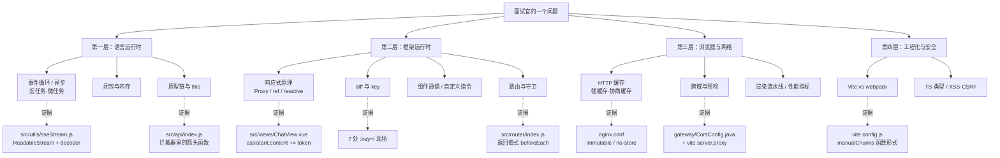
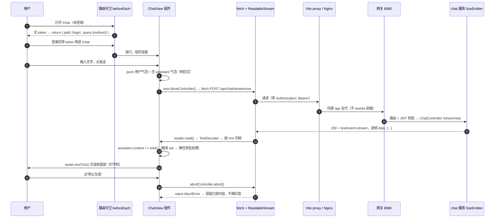

# 前端面试题精选：能不能讲清浏览器与框架的真实行为

> **一句话结论**：这套题集不练"背了多少 API"，只练一件事——把一段代码在浏览器/框架里**实际走哪条路径、失败时卡在哪一步、怎么用证据证明**讲清楚；本项目的 axios 封装、手写 SSE 解析器、nginx 缓存三件套就是现成的答题素材。
> **阅读前置**：读完 [01-HTML与CSS基础](./01-HTML与CSS基础.md) ~ [13-移动端与小程序开发](./13-移动端与小程序开发.md) 中的 Vue3、工程化、浏览器网络三块；至少能手写 `axios.create` 与 `Promise.then`。不需要提前背题。
> **证据基线**：ai-cs-frontend（Vue ^3.5.39 / vue-router ^4.6.4 / vite ^8.1.1 / element-plus ^2.14.3，见 `ai-cs-frontend` 的 `package.json:16-24`）与 ai-cs-frontend-react（React ^18.3.1 / vite ^5.4.11）；本机 Node v24.16.0 的实测输出；所有代码引用均在 2026-11 逐个文件核对过行号。预计阅读 45~60 分钟。

---

## 0. 先看现象

三个面试现场的真实卡壳形态。它们不是"知识点没背"，而是"一句话答对了、下一句就空"。

**现场一：说"打字机用了 EventSource"，被问 POST 与 Authorization 就卡住。**

面试官看到简历写"AI 流式对话"，第一问"怎么实现的"，答"SSE，用 EventSource"。第二问："你们消息是 POST 带 JSON body，EventSource 只能 GET，你怎么发的？"——卡住。第三问更狠："你说用了 EventSource，那代码里 `new EventSource` 在哪？"

本仓库的真相在文件注释里（这两段注释就是最好的答案）：

- `ai-cs-frontend/src/utils/sse.js:4-6`：*"为什么不用 EventSource：本项目的流式接口是 POST + JSON body + Authorization 头，EventSource 只支持 GET 且无法自定义请求头，所以统一走 fetch + ReadableStream"*
- `ai-cs-frontend/src/utils/sseStream.js:6-9`：同样理由，并补了一句"axios 浏览器端基于 XHR 拿不到增量 body"

现场形态：界面不报错、气泡一直是空的、Network 面板里那条请求状态是 `200` 且 `Content-Type: text/event-stream` —— 请求成功但代码没读到任何东西。**这类"成功但空白"的现场，十有八九是流式/异步链路断在"读"这一侧，而不是断在"发"。**

**现场二：背出"Proxy 比 defineProperty 好，能监听新增属性"，被追问"那你自己验过吗"。**

本机 Node v24.16.0 直接跑一段对照实验（`learning-docs/tools/tmp/proxy.mjs`，可复现）：

```js
const a = observeVue2({ x: 1 })
a.x = 2          // 被拦截
a.y = 3          // 新增属性：完全没有日志 —— 这就是 $set 存在的原因
```

```text
[defineProperty] 拦截到 set x = 2
新增属性后 a.y = 3 但 setter 没被触发
数组下标/length 修改后 list = [99,2,null,null,null] （setter 无日志）
[Proxy] 拦截到 set x = 2
[Proxy] 拦截到 set y = 3
[Proxy] 拦截到 delete y
[Proxy] 数组拦截到 set 0 = 99
[Proxy] 拦截到 set length = 5
[Proxy] 数组拦截到 set 5 = 7
[Proxy] 拦截到 set length = 6
```

怎么读：前 3 行是 Vue 2 的 `Object.defineProperty` 路线，**只有初始化时已存在的 `x` 被拦住**，`y` 静默丢失、数组下标与 `length` 也静默丢失（`[99,2,null,null,null]` 说明越界写入不会触发任何 setter）。后 6 行是 `Proxy` 路线：新增、删除、下标、`length`、甚至 `push` 内部的 `set 5 = 7` 全都走代理。有了这 9 行输出，"Proxy 好在哪"就变成可复述的事实，而不是复读文档。

**现场三：答"跨域配 CORS 就行"，被追问"那你们生产怎么还配 nginx 反代、CORS 有没有必要"。**

本仓库同时存在三件事，缺一个就说不圆：

- `ai-cs-frontend/.env.production:6` 是 `VITE_GATEWAY=`（**空值**，故意留空）→ 生产产物里所有请求都是同源相对路径 `/api/...`；
- `ai-cs-frontend/nginx.conf:49-62` 把 `/api/` 反代到 `upstream aics_gateway`，且**不 rewrite 掉 `/api` 前缀**（注释：网关路由表就带 `/api`）；
- `ai-cs-gateway/src/main/java/com/aics/gateway/config/CorsConfig.java:20-24` 却又配了 `allowedOriginPatterns("*") + allowCredentials(true) + maxAge(3600)`。

于是正确答法是分层：**生产同源 → 根本不进跨域判定，CORS 只是开发期兜底**（`localhost:5173` 直连 8080 时用）；预检结果被 `maxAge(3600)` 缓存 1 小时；而 `Authorization` 头本身就是非简单请求的触发条件，所以迟早会撞上 OPTIONS。只会背"三种跨域方案"的候选人，到这里会被一句"那你配两种不冲突吗"打回原形。

这些现象指向同一件事：**面试考的是链路——请求发出去之后，浏览器、框架、服务器各自做了什么；答得出链路才答得出追问，答不出链路就只能背名词。**

---

## 1. 整体地图

把 12 类考点按"它其实在考哪一层"归成四层，每层挂一个本仓库可核对的文件作为证据锚点。



> **读图说明**：竖向四条`L*`是"考点属于哪一层"，不是四个独立话题——面试官几乎总从第二层起手、往第三层追问（"你说 Vue 异步更新，那浏览器什么时候真的画出来？"）。虚线箭头是关键：**每类考点都必须挂一个本仓库文件**，说不出文件名就说明只是背过。看错的地方是把 `C1→E1` 理解成"事件循环只在 SSE 里出现"——它其实贯穿 axios 拦截器、`nextTick`、`AbortController` 三处；如果你只会在 SSE 场景讲事件循环，遇到"`nextTick` 为什么是微任务"就答不上。

| 考点 | 主要考察层级 | 一句话判据（能过/不能过） | 本仓库证据锚点 |
| --- | --- | --- | --- |
| 事件循环与异步 | 记忆 → 理解 | 能否在一段混排代码上现场口算顺序并解释原因 | `ai-cs-frontend/src/utils/sseStream.js` |
| 闭包与内存 | 理解 → 迁移 | 能否指出"谁持有谁导致不释放" | `ai-cs-frontend/src/views/ChatView.vue:202`（`abortController`） |
| 原型与 this | 理解 | 能否说清"调用点决定 this"并给出改写 | `ai-cs-frontend/src/api/index.js:41-47` |
| 响应式原理 | 理解 → 迁移 | 能否解释 `+=` 为什么触发视图更新 | `ai-cs-frontend/src/views/ChatView.vue:383-384` |
| diff 与 key | 迁移 → 调试 | 能否说出用 index 当 key 的具体事故形态 | 7 处 `:key="i"`（见 §3.5） |
| 路由与守卫 | 记忆 → 调试 | 能否画出"未登录访问 /chat"的判定顺序 | `ai-cs-frontend/src/router/index.js:38-48` |
| 性能优化 | 迁移 → 量化 | 能否说出**用什么指标、怎么采** | 见 §3.10（命令给全，未本机实测） |
| HTTP 缓存 | 理解 → 调试 | 能否解释发版白屏的根因链 | `ai-cs-frontend/nginx.conf:33-44` |
| 跨域与预检 | 理解 → 调试 | 能否说清 OPTIONS 由什么触发、为什么生产不需要 | `ai-cs-gateway/src/main/java/com/aics/gateway/config/CorsConfig.java` |
| 浏览器渲染 | 理解 | 能否把 DOM/CSSOM/布局/绘制/合成串起来 | 见 §3.10 |
| Vite vs webpack | 理解 → 迁移 | 能否解释"为什么启动快、产物还要 Rollup" | `ai-cs-frontend/vite.config.js:44-64` |
| TS、安全 | 记忆 → 迁移 | 能否给出可执行的防御清单而不是口号 | 本项目**无 TS**（见 §3.11）+ 无 `v-html`（见 §3.12） |

---

## 2. 关键概念与关键类/关键 API

术语首现解释，全部落在本仓库的真实位置上。

| 名称 | 位置 | 角色 | 关键点 |
| --- | --- | --- | --- |
| 宏任务 / 微任务（Task / Microtask） | 浏览器事件循环 | 决定 `then`、`await`、`setTimeout` 谁先执行 | **一个宏任务执行完就清空整队微任务**，再取下一个宏任务 |
| `ReadableStream` + `TextDecoder` | `ai-cs-frontend/src/utils/sseStream.js:34-42` | 手写 SSE 消费端 | `decode(value, { stream: true })` 才能处理被 TCP 切开的 UTF-8 多字节字符 |
| SSE 分帧（`\n\n` / `\r\n\r\n`） | `ai-cs-frontend/src/utils/sse.js:46-52` | 把字节流还原成事件 | 两种换行都要认；`:` 开头是心跳注释，必须丢 |
| `AbortController` | `ai-cs-frontend/src/views/ChatView.vue:379,465` | 中断进行中的 fetch 流 | `abort()` 后 fetch reject，`catch` 里要区分"用户主动停"与真异常 |
| `createSseParser(onEvent)` | `ai-cs-frontend/src/utils/sse.js:16` | 纯函数式解析器（可单测） | 闭包持有 `buffer`，`push`/`flush` 两个出口 |
| `ref` / `reactive` | Vue 3 组合式 API | 响应式容器 | `ref` 用 `.value`；`reactive` 解构会丢响应式 |
| Proxy 守卫 `set/get/deleteProperty` | `learning-docs/tools/tmp/proxy.mjs`（实测脚本） | Vue 3 响应式的底层机制 | 能拦新增/删除/下标/`length`，不能 polyfill 到 IE |
| VNode key | 模板 `v-for` | diff 时判断"能否复用同一节点" | 用 index 当 key 时，插入/删除会让状态错位 |
| `router.beforeEach` 返回值式守卫 | `ai-cs-frontend/src/router/index.js:38-48` | 全局登录态校验 | Vue Router 4 可以 `return { path }`，不必再写 `next()` |
| `try_files $uri $uri/ /index.html` | `ai-cs-frontend/nginx.conf:68-70` | SPA history 模式兜底 | 少了这行，刷新任何子路由都 404 |
| `Cache-Control: immutable` + hash 文件名 | `ai-cs-frontend/nginx.conf:33-37` | 静态资源永久缓存 | 前提是文件名随内容变（Vite 默认如此） |
| `Cache-Control: no-store` | `ai-cs-frontend/nginx.conf:41-44` | index.html 禁缓存 | 它是"引用表"，被缓存就会去请求已删除的旧 chunk |
| 预检（Preflight, OPTIONS） | 浏览器同源策略 | 非简单请求前的探测 | `Authorization` 头、`Content-Type: application/json` 都会触发 |
| `manualChunks`（函数形式） | `ai-cs-frontend/vite.config.js:56-61` | 手动分包 | **Vite 8 = rolldown，只接受函数**，写对象直接构建失败 |
| `unknown` vs `any` vs `never` | TypeScript | 类型安全的三种"空" | `unknown` 用前必须收窄；`never` 用于穷举兜底 |

---

## 3. 原理与证据逐段精讲

每题固定四段：**问题 → 30 秒答案骨架 → 为什么这么设计（含深挖追问）→ 换写法会怎样 / 常见错误答案**。

### 3.1 事件循环：为什么输出是 A E C B D

**问题**：这段代码的输出顺序？为什么 D 排在 B 后面？

**30 秒答案骨架**：

1. 同步代码先跑完（A、E），期间只做"入队"：`setTimeout(B)`→宏任务队列，`then(C)`→微任务队列；
2. 同步代码结束后**清空整个微任务队列**（C）；
3. 再取下一个宏任务（B）执行，执行完再清微任务（此时空）；
4. 第二个 `setTimeout` 的回调里才注册 `then(D)`，所以 D 只能在 T2 内部、T2 结束后立刻执行。

**为什么这么设计**：微任务是"同一次渲染机会内必须结算完的活"，宏任务是"下次再说的活"。浏览器规定每个宏任务后清空微任务，是为了保证一次任务里产生的状态变更不会拖到下一个任务——否则 `Promise` 的 chain 会被 `setTimeout` 插队，语义不可预期。

本机实测（Node v24.16.0，`learning-docs/tools/tmp/el.mjs`）：

```js
console.log('A')
setTimeout(() => console.log('B'), 0)
Promise.resolve().then(() => console.log('C'))
setTimeout(() => { Promise.resolve().then(() => console.log('D')) }, 0)
console.log('E')
async function f() { console.log('f1'); await null; console.log('f2') }
f()
console.log('g')
```

```text
A
E
f1
g
C
f2
B
D
```

怎么读：`f1` 在 `f()` 被调用的那一刻同步打印，`await null` 之后的 `f2` 被挂进微任务队列，所以它排在 `C` 之后、`B` 之前。**这就是"`await` 之后的代码等价于 `then` 回调"的可验证版本**——面试时说出这 8 行输出，比背"微任务优先"有效得多。

**深挖追问**：
- *"`await` 和 `then` 有区别吗？"* 有：`await` 会让出当前函数，但恢复了 async 函数的执行上下文；`then` 只是排队。执行顺序上二者都进微任务队列，先注册先执行。
- *"`setTimeout(fn, 0)` 真的 0 毫秒吗？"* 不是。浏览器有 4ms 最小钳制（嵌套超过 5 层后生效），且要等前面任务清空。
- *"和本项目有什么关系？"* `ai-cs-frontend/src/views/ChatView.vue:401-437` 的 `while (true) { await reader.read() }` 就是"每读一片就 `await` 一次"，让出主线程给渲染；如果写成同步忙等，页面会直接卡死。

**常见错误答案**：把微任务说成"优先级更高的宏任务"；认为 `Promise.resolve().then` 会在 `console.log('E')` 之前执行（把"入队"和"出队"混为一谈）；不知道 `await` 也是微任务。

### 3.2 闭包与内存：谁在持有谁

**问题**：闭包为什么会内存泄漏？说一个你项目里的例子。

**30 秒答案骨架**：闭包 = 函数 + 它记住的词法环境；只要函数还被引用，环境里的变量就不回收。泄漏不是闭包本身，而是"**长生命周期的引用链**"：定时器没清、事件监听没解、请求没中断、全局数组只 push 不清。

**为什么这么设计**：词法作用域是 JS 的基础语义，闭包是它的自然结果。Vue 的 `setup` 里每个 `ref` 都被渲染函数与事件处理器闭包持有，所以"组件卸载"必须把外部引用一并断开——这也是 `onUnmounted` 存在的理由。

本仓库两个真实例子：

```js
// ai-cs-frontend/src/views/ChatView.vue:202（声明）与 :379 / :465（使用）
let abortController = null          // 故意不加 ref：它不参与渲染，只是句柄
const stopRequested = ref(false)
abortController = new AbortController()
// stopGenerating()
stopRequested.value = true
abortController.abort()            // 断掉 fetch 流，否则 reader 一直挂着
```

```js
// ai-cs-frontend/src/views/NotifyView.vue:81,131-133
let ws = null
function disconnectWs() { if (ws) { ws.close(); ws = null } }
```

`abortController`/`ws` 这种"句柄变量"刻意不是响应式的（写成 `ref` 会让 Proxy 包一层，且没人需要它触发渲染）——这是本仓库一致的写法取舍。风险点同样真实：`NotifyView.vue` 只有手动点"断开"才 `close()`，**没有 `onUnmounted` 兜底、也没有 `onclose` 重连**，用户直接切路由走掉时连接就留在那里。

**深挖追问**：
- *"怎么证明泄漏？"* Chrome DevTools → Memory → 拍两次 Heap Snapshot，对比 Detached DOM 与对象数量；或 Performance monitor 看 JS heap 是否只涨不落。**未本机实测**（需要浏览器 + 后端同时在线），但面板路径与判读方法如上。
- *"`let` 和 `var` 在闭包里有区别吗？"* 有：`for (var i…)` 里三个回调共享同一个 `i`；`let` 每次迭代生成独立绑定。

**换写法会怎样**：如果把 `await scrollToBottom()` 换成 `setTimeout(scrollToBottom, 0)`，流的读取节奏就变了（每片多排一个宏任务），在快速 token 流下会明显滞后；如果去掉 `abortController`，用户点"停止生成"后服务端仍会推理到 SSE 超时（`ChatServiceImpl` 里 `SSE_EMITTER_TIMEOUT = 5 * 60 * 1000L`，见 `ai-cs-chat/src/main/java/com/aics/chat/service/impl/ChatServiceImpl.java:156`）。

**常见错误答案**：把"闭包"等同于"泄漏"；说"GC 会自己处理"而不讲引用链；举不出项目里的具体句柄。

### 3.3 原型与 this：调用点决定一切

**问题**：`this` 的指向怎么判断？拦截器里为什么都用箭头函数？

**30 秒答案骨架**：看**调用点**，不看定义点，四条规则按优先级 new > 显式(`call/apply/bind`) > 隐式(`obj.fn()`) > 默认（严格模式 `undefined`）。箭头函数没有自己的 `this`，取定义处外层的 `this`，且不能被 `bind` 改写。

**为什么这么设计**：`this` 是"运行时调用上下文"，这种动态绑定让方法可以在不同对象上复用（`arr.push.call`）；箭头函数则是为了解决回调里 `this` 丢失这个历史痛点。

本仓库的落地证据（`ai-cs-frontend/src/api/index.js:37-63`）：

```js
function createClient(baseURL) {
  const client = axios.create({ baseURL, timeout: 30000 })
  client.interceptors.request.use((config) => {          // 箭头函数：不需要自己的 this
    const token = getToken()
    if (token) config.headers.Authorization = `Bearer ${token}`
    return config
  })
  client.interceptors.response.use(
    (response) => response,
    (error) => {
      if (error.response && error.response.status === 401) {
        logout()
        ElMessage.warning(error.response.data?.message || '登录已过期，请重新登录')
        redirectToLogin()
      }
      return Promise.reject(error)
    }
  )
  return client
}
```

工厂函数返回 15 个实例（`index.js:65-79`，`userApi` … `agentApi`），每个都共享同一套拦截器逻辑——这是"用一个函数产 N 个对象"，而不是继承。若把拦截器改成 `function (config) { this.xxx }`，`this` 会指向 axios 内部上下文，与模块作用域无关，调试时极易误判。

**深挖追问**：
- *"原型链上找属性的终点是什么？"* `Object.prototype.__proto__ === null`；`instanceof` 是沿着原型链比对 `B.prototype`，跨 iframe 会失效（`Array.isArray` 不受影响）。
- *"`ref` 和 `reactive` 与原型有关系吗？"* 有：`Proxy` 的 `get` 陷阱里如果对嵌套对象返回原始值，就丢掉了代理；Vue 3 用 `reactive` 缓存（`WeakMap`）保证"同一对象永远拿到同一个代理"，这也是为什么 `ref(obj)` 内部会转成 `reactive`。

**换写法会怎样**：把 `createClient` 改成 `class ApiClient { constructor(baseURL) {...} }`，`this` 就变成实例，`this.client` 可被外部篡改；用工厂 + 闭包，`client` 是私有变量，这是有意的封装取舍。

**常见错误答案**：说"this 指向定义它的对象"；说"箭头函数可以用 `call` 改 this"；讲不出隐式绑定丢失的经典场景（`const f = obj.method; f()`）。

### 3.4 Vue 响应式：`+=` 为什么能触发视图更新

**问题**：Vue 3 的响应式原理？为什么 `assistant.content += obj.content` 视图会变？

**30 秒答案骨架**：

1. `ref('')` 返回一个带 `get/set` 的对象，模板渲染时读了 `.value` → 触发 `get` → 当前渲染副作用被收集为依赖；
2. 逐 token 写入 `.value` → 触发 `set` → 通知依赖 → 调度器把更新放进微任务队列；
3. 同一个 tick 内多次写入被**批处理合并**，只在微任务里渲染一次；
4. 想立刻读 DOM 用 `await nextTick()`。

**为什么这么设计**：DOM 操作昂贵，一次 tick 内 20 个 token 就该只渲染一次；而 Vue 2 用 `Object.defineProperty` 只能拦已存在的属性（新增/删除/数组下标全都漏），Vue 3 换 `Proxy` 才能拦全（§0 现场二已实测）。

本仓库证据（`ai-cs-frontend/src/views/ChatView.vue:382-427`）：

```js
// 预置空回复气泡，流式填充（需持响应式代理引用，逐 token 追加才会触发视图更新）
currentMessages.value.push({ role: 'assistant', content: '' })
const assistant = currentMessages.value[currentMessages.value.length - 1]
// …在读取循环里
if (obj.content && !obj.done) {
  assistant.content += obj.content      // 写的是代理对象的属性 → 触发 set
  assistant.citations = assistant.citations || []
  await scrollToBottom()                // 内部 await nextTick() 再读 scrollHeight
}
```

注释里那句"需持响应式代理引用"是踩过坑才会写的：若写成 `const assistant = { role:'assistant', content:'' }` 再 push，后续 `assistant.content += …` 改的是**原始对象**，视图不会更新。

**深挖追问**：
- *"本项目为什么没有 Pinia？"* 事实：`ai-cs-frontend/src` 与 `package.json` 里 grep `pinia|defineStore` **零命中**。登录态存在 `localStorage`（`ai-cs-frontend/src/utils/auth.js:7-29`，键名 `aics_token` / `aics_user`），角色由 `getRoles()` 从 `getUser()?.role` 逗号切分。**答题时不能把"Pinia 持久化"说成已落地**，只能说"本项目用 localStorage + 组合式 API 替代，若引入 Pinia 会把 token 放 store + `pinia-plugin-persistedstate`"。
- *"`ref` 和 `reactive` 怎么选？"* 默认 `ref`（心智统一、解构不丢响应式），`reactive` 适合聚合状态，但导出要给 `toRefs`。

**换写法会怎样**：把 `currentMessages` 换成非响应式的普通数组，流式 token 全部写进内存却不渲染，界面表现为"发送后一直空白、Network 面板里流正常"，也就是 §0 现场一那种"成功但无内容"。**这两种故障的表象一样、根因相反**（一个卡在读，一个卡在写），是面试里区分"真调过"的分水岭。

**常见错误答案**：说"Vue 3 用 `Proxy` 代理 `data` 里的每个属性"（错：是代理整个对象）；说"`nextTick` 是宏任务"（错：微任务，`Promise.then`）。

### 3.5 diff 与 key：7 处 `:key="i"` 的现场

**问题**：`v-for` 的 key 有什么用？用 index 会出什么事故？

**30 秒答案骨架**：key 是 VNode 的身份标识，diff 同层比较时靠它判断"这个旧节点能不能复用、要不要移动"。用 index 当 key，列表一旦**插入/删除/排序**，同一个 index 会指向不同数据 → Vue 复用旧组件实例、只 patch 内容 → 组件内部状态（输入框未受控值、展开状态、动画、子组件 `onMounted` 时机）全部错位。

**为什么这么设计**：diff 的复杂度被限制在 O(n)——只做同层比较，靠 key 建立映射。没有稳定 key 时最稳妥的策略就是"就地复用"，代价是状态串台。

本仓库实测统计（`Select-String -Pattern ':key="(i|index|ci|idx)"'` 的结果）：

```text
AgentView.vue:15   <div v-for="(m, i) in messages" :key="i" ...>
ChatView.vue:35    <div v-for="(msg, i) in currentMessages" :key="i" ...>
ChatView.vue:50    :key="ci"                                  （citations 列表）
NotifyView.vue:59  <div v-for="(log, i) in notifyLogs" :key="i" ...>
SearchView.vue:16  <div v-for="(item, i) in results" :key="i" ...>
TraceView.vue:55   <div v-for="(s, i) in spans" :key="i" ...>
VectorKbView.vue:92<div v-for="(r, i) in searchResults" :key="i" ...>
```

共 **7 处 index 当 key**，另有 16 处用业务 id（如 `ChatView.vue:16` 的 `:key="s.id"`）。怎么读：**同一个文件里两种写法并存**，说明作者知道 key 该用 id，但在"列表只追加不重排"的场景（聊天消息、日志流）妥协用了 index。这正是答题时的加分点：说清"哪些 index key 是可接受的、哪些是隐患"，比背"永远不要用 index"更可信——`ChatView.vue:35` 的消息列表只 push 不重排，风险低；但 `TraceView.vue:55` 的 spans 若按耗时排序过，就会串行。

**深挖追问**：
- *"Vue 3 的编译优化怎么减少 diff？"* 静态提升（hoistStatic）、`patchFlag`（标记"只有文本会变"）、Block Tree；React 侧则是运行时 Fiber 调度，没有等价编译期标记。
- *"`v-if` 和 `v-for` 同元素能用吗？"* 不推荐；Vue 3 里 `v-if` 优先级更高，会先求值条件（拿不到 `v-for` 的迭代变量）。

**换写法会怎样**：把 7 处都改成业务 id，代价是"必须保证 id 稳定唯一"——本仓库 `notifyLogs` 是本地 `unshift` 的对象数组，没有 id，需要生成（如 `crypto.randomUUID()`）。这不是免费的重构，取舍见 §5。

**常见错误答案**：说"不用 key 性能更好"（恰恰相反，会走就地复用 + 更多 patch）；说"key 只影响动画"；答不出具体事故形态。

### 3.6 自定义指令与按钮级权限：`removeChild` 而不是 `display:none`

**问题**：前端按钮级权限怎么做？为什么不能只隐藏？

**30 秒答案骨架**：自定义指令在 `mounted` 里读角色 → 无权**移除节点**（不是改样式）→ 但真正的安全底线在后端接口鉴权，因为前端产物人人可改。

**为什么这么设计**：`display:none` 的按钮在 DevTools 里改一行样式就能点；`removeChild` 让"可见即可操作"这条边界更干净。但仍要强调：前端移除只解决"误点/误导"，越权拦截必须在网关 JWT + 方法级鉴权。

本仓库证据（`ai-cs-frontend/src/directives/permission.js:17-35`）：

```js
mounted(el, binding) {
  const required = binding.value
  if (!required) return
  const list = Array.isArray(required) ? required : [required]
  if (list.some((role) => hasRole(role))) return          // 有任一角色即放行
  if (el.parentNode) { el.parentNode.removeChild(el); return }
  // 兜底：指令挂在组件根节点时还没有父节点，不能悄悄放过
  el.style.display = 'none'
  el.setAttribute('data-permission-denied', list.join(','))
}
```

注册在 `ai-cs-frontend/src/main.js:20`（`app.use(permission)`）。**诚实的事实**：`src/views/*.vue` 与 `App.vue` 里 grep `v-permission` **零命中**——指令已实现、有单测（`ai-cs-frontend/src/directives/permission.test.js`）、有注册，但页面里暂无使用点。答题时要说"项目提供了这套机制，页面级权限目前只有路由守卫挡着，没有 `meta.roles` 二维校验"，不能吹成"三层权限体系已落地"。

**深挖追问**：
- *"指令只在 `mounted` 判断够吗？"* 够——前提是角色在登录时一次性写入 `localStorage`（`auth.js:24`），切换角色必然重新登录。若将来支持权限热更新，必须补 `updated` 钩子。
- *"角色串是什么格式？"* 后端 `LoginVO.role` 是逗号分隔串，`auth.js:36-43` 按 `,` 切分并 `toLowerCase()`，`hasRole` 大小写不敏感。

**换写法会怎样**：改成 `v-if="hasRole('admin')"` 也能实现，但每个页面都要手写判断并引入 `hasRole`，重复且易漏；指令把策略收敛到一处。相反，如果做"权限码 + 菜单树"的完整方案，就该引入 `meta.roles` + `addRoute` 动态注册——**本仓库没有这么做**（`router/index.js:4-30` 是静态数组），只能作为"可以怎么做"的建议。

**常见错误答案**：把"前端隐藏"当安全措施；说不出兜底分支为什么存在；把 `removeChild` 与 `v-if` 混为一谈（前者发生在 DOM 上，生命周期钩子照常执行）。

### 3.7 路由与守卫：未登录访问 `/chat` 之后发生了什么

**问题**：路由守卫的执行顺序？鉴权放哪一层？

**30 秒答案骨架**：全局 `beforeEach` → 路由独享 `beforeEnter` → 组件内 `beforeRouteEnter` → 全局 `beforeResolve` → 导航确认 → 全局 `afterEach`。鉴权放全局 `beforeEach`（覆盖所有路由、单一入口），页面级权限用 `meta` + `beforeEnter`，组件内守卫只做"离开前未保存提示"。

**为什么这么设计**：`beforeEach` 是唯一的全局 choke point，登录态校验放这里不会漏；返回值式 API（Vue Router 4）比 `next()` 更不容易出现"忘了调 next 导致导航挂起"。

本仓库证据（`ai-cs-frontend/src/router/index.js:38-48`，全文 50 行）：

```js
router.beforeEach((to) => {
  const isPublic = to.meta?.public === true
  if (!isPublic && !isAuthenticated()) {
    return { path: '/login', query: { redirect: to.fullPath } }   // 记住来路
  }
  if (to.path === '/login' && isAuthenticated()) {
    return { path: '/' }                                          // 已登录别回登录页
  }
  return true                                                     // 放行
})
```

配套事实：25 条路由**全部**是 `component: () => import(...)` 懒加载（`index.js:5-29`）；`createWebHistory()`（`:33`）→ 依赖服务端 `try_files` 兜底；`isAuthenticated()` 只看 token 是否存在（`auth.js:29` 附近），**没有过期时间判断、没有 refresh token**，所以 token 过期时是 401 拦截器（`api/index.js:53-56`）兜底跳登录，而不是守卫。

**深挖追问**：
- *"`redirect` 参数怎么用？"* 登录成功后按 `route.query.redirect || '/'` 跳回——这是"登录后回到原页面"的标准做法；本仓库 `LoginView.vue` 消费该参数。
- *"history 模式上线要注意什么？"* 三道：nginx `try_files`（`nginx.conf:68-70`）、`index.html` 不缓存（`:41-44`）、`assets` 永久缓存（`:33-37`）。缺任何一条都会在"刷新子页面/发版"时炸。

**换写法会怎样**：改成 `hash` 模式（`createWebHashHistory`）就不需要 `try_files`，代价是 URL 带 `#`、对 SEO 与分享不友好；改成"守卫里 `next('/login')` 并 `return`"也能跑，但 Vue Router 4 里混用 `next` 与返回值会触发警告甚至双跳。

**常见错误答案**：把守卫顺序背反（以为组件内守卫先于全局）；说"动态 `addRoute` 注册有权限路由"却拿不出代码（本仓库没有）；说"token 存 Pinia"（本仓库是 localStorage）。

### 3.8 HTTP 缓存：发版白屏的完整根因链

**问题**：强缓存与协商缓存怎么配？发版后用户白屏是什么原因？

**30 秒答案骨架**：强缓存（`Cache-Control: max-age` / `immutable`）不发请求、DevTools 显示 `from disk cache`；协商缓存（`ETag` / `If-None-Match`）发请求拿 `304` 空 body。**正确组合**：带 content hash 的静态资源永久缓存，`index.html` 禁缓存。白屏根因链：`index.html` 被缓存 → 用户拿到旧 HTML → 里面引用的旧 hash chunk 已被新版本删除 → 404 → 白屏。

**为什么这么设计**：hash 文件名让"内容变 ⇒ 文件名变"，从而实现"永久缓存 + 无需失效"。而 `index.html` 是唯一的"引用表"，它一变所有引用都变，所以它必须每次都拿最新。

本仓库证据（`ai-cs-frontend/nginx.conf:33-44`）：

```nginx
location /assets/ {
    expires 1y;
    add_header Cache-Control "public, immutable";   # Vite 产物文件名带 hash，可永久缓存
    access_log off;
}
location = /index.html {
    add_header Cache-Control "no-store, no-cache, must-revalidate";
    expires -1;                                     # 引用表绝对不能缓存
}
```

配合 `ai-cs-frontend/.env.production:9` 的 `VITE_APP_VERSION=1.0.0`——构建时注入版本号，专门用来排查"用户看到的是不是最新版本"。

**深挖追问**：
- *"`no-store` 和 `no-cache` 的区别？"* `no-store` 完全不落盘；`no-cache` 允许存但每次必须回源校验（走协商）。这里两个都写是双保险。
- *"`immutable` 有什么用？"* 告诉浏览器"这个 URL 的内容永不改变"，用户在地址栏按回车/刷新时**跳过重新校验**，省掉一次 304 往返。
- *"发版还要做什么？"* 保留上一版本的静态文件（滚动发布/灰度期间旧页面仍在跑），否则正在浏览的用户切路由时请求旧 chunk 直接 404。

**换写法会怎样**：把 `index.html` 也 `expires 1y` → 发版即白屏，且用户"清缓存才好"（这是最经典的上线事故）。把 `/assets/` 改成 `no-cache` → 每次访问都多一轮 304，首屏变慢但不会白屏——**这是安全但慢的退化选择**，取舍见 §5。

**常见错误答案**：说"`304` 是服务器返回了缓存"（是"没变，用你的"）；把 `Expires` 与 `Cache-Control` 的优先级说反（后者优先）；不知道 hash 文件名与永久缓存是配套的。

### 3.9 跨域与预检：为什么生产不需要 CORS

**问题**：跨域怎么解决？什么时候触发 OPTIONS？

**30 秒答案骨架**：跨域是浏览器同源策略（协议+域名+端口任一不同）对**响应读取**的限制，请求其实发出去了。三种解法：CORS 响应头（标准）、开发期 dev proxy（把请求变成同源）、生产期 Nginx 同域反代（最省事）。预检触发条件三选一：非简单方法（PUT/DELETE…）、`Content-Type` 非常规三值之一（`application/json` 就中招）、带自定义头（`Authorization` 就中招）。

**为什么这么设计**：同源策略保护的是"用户的 Cookie/凭证不被任意站点读取"，所以它拦响应不拦请求；预检是让服务端有机会拒绝"可能有害"的跨域请求。

本仓库三处证据形成闭环：

```text
ai-cs-frontend/.env.production:6      VITE_GATEWAY=          ← 空值：产物里走 /api 相对路径
ai-cs-frontend/nginx.conf:49-62       location /api/ { proxy_pass http://aics_gateway; ... }
ai-cs-gateway 的 `src/main/java/com/aics/gateway/config/CorsConfig.java:20`  config.setAllowedOriginPatterns(List.of("*"))
                                      config.setAllowCredentials(true); setMaxAge(3600L)
```

怎么读：生产链路是"浏览器 → 同源 Nginx → 网关"，浏览器眼里**根本没有第三方源**，所以不进跨域判定、不会有预检；`CorsConfig` 是给"开发期 `localhost:5173` 直连 8080"和"其他客户端（如 React 版、Postman 之外的浏览器页）"用的兜底。`maxAge(3600)` 让预检结果缓存 1 小时，避免每个请求都先飞一次 OPTIONS。

对照：`ai-cs-frontend-react/src/api/index.js:7` 写的是 `import.meta.env.VITE_GATEWAY || 'http://localhost:8080'`——这正是 Vue 版刻意避免的写法（见 `ai-cs-frontend/src/utils/runtime.js:8-9` 注释：**空串是 falsy，会让生产构建回落到 localhost**）。

**深挖追问**：
- *"为什么 `Authorization` 一定触发预检？"* 它不在 safelisted 头里；`Content-Type: application/json` 同理（只有 `application/x-www-form-urlencoded`、`multipart/form-data`、`text/plain` 免预检）。
- *"nginx 反代时要注意什么？"* **不要 rewrite 掉 `/api` 前缀**（网关路由表就带 `/api`）；SSE 还要 `proxy_http_version 1.1` + `proxy_buffering off`（`nginx.conf:56-61`）。
- *"Postman 为什么没有跨域？"* 它不执行同源策略，只有浏览器才拦。

**换写法会怎样**：让前端直接请求 `http://api.example.com` 而不做反代，就必须同时处理：预检、`allowedOriginPatterns` 不能是 `*` 配 `allowCredentials`（要显式列源）、以及 SSE 的 CORS 头——三件事任一漏掉就报 `blocked by CORS policy`。

**常见错误答案**：说"跨域是后端拒绝请求"；说"OPTIONS 是前端发的"（是浏览器自动发的）；不知道 `allowCredentials(true)` 与 `*` 的组合限制。

### 3.10 性能优化：说不出指标就等于没做过

**问题**：首屏怎么优化？怎么证明优化有效？

**30 秒答案骨架**：先给**指标**（FCP 首次内容绘制、LCP 最大内容绘制、CLS 布局偏移、INP 交互延迟），再给**手段**（路由懒加载 → 分包 → gzip → 缓存 → 图片 → 骨架屏 → 异步组件 → SSR），最后说**怎么量**（PerformanceObserver + 上报）。没有指标的手段清单是"背书"，有指标才是"做事"。

**为什么这么设计**：用户感知的不是"总加载时间"，而是"什么时候看到东西（FCP/LCP）"、"点下去多久有反应（INP）"、"内容会不会乱跳（CLS）"。三者对应不同的优化手段。

本仓库可核对的手段（只列已落地的）：

| 手段 | 落地位置 | 说明 |
| --- | --- | --- |
| 路由懒加载 | `ai-cs-frontend/src/router/index.js:5-29` | 25 条路由全是 `() => import(...)` |
| 手动分包 | `ai-cs-frontend/vite.config.js:56-61` | `charts` / `element` / `vue` 三个 vendor chunk |
| gzip | `ai-cs-frontend/nginx.conf:23-28` | `comp_level 5`、`min_length 1k`、`gzip_vary on` |
| 静态资源永久缓存 | `ai-cs-frontend/nginx.conf:33-37` | `immutable` 一年 |
| 多阶段构建瘦身 | `ai-cs-frontend/Dockerfile:16-43` | build 阶段带 node_modules，运行阶段只有 nginx + dist |

量化手段（**未本机实测**，给出命令与判读方法）：

```js
// 在页面 DevTools Console 里跑：采 LCP / CLS / FCP
new PerformanceObserver((l) => {
  for (const e of l.getEntries()) console.log('LCP', e.startTime.toFixed(0), 'ms', e.element?.tagName)
}).observe({ type: 'largest-contentful-paint', buffered: true })
new PerformanceObserver((l) => {
  for (const e of l.getEntries()) if (!e.hadRecentInput) console.log('CLS', e.value.toFixed(3))
}).observe({ type: 'layout-shift', buffered: true })
performance.getEntriesByType('paint').forEach((e) => console.log(e.name, e.startTime.toFixed(0), 'ms'))
```

怎么读：`LCP` 给的是"最大内容元素出现的时间"，若它远大于首屏 JS 的 `responseEnd`，说明瓶颈在渲染而不是网络；`CLS > 0.1` 说明有图片/字体没有预留尺寸。**面试时把这三行脚本写出来，比列 9 条优化清单更有说服力。**

**深挖追问**：
- *"`vite.config.js` 里 `manualChunks` 为什么必须是函数？"* 因为 Vite 8 底层换成了 rolldown，对象形式直接构建失败：`Invalid type: Expected Function but received Object`（注释就写在 `vite.config.js:54-55`）。
- *"`chunkSizeWarningLimit: 800` 意味着什么？"* 只是把警告阈值从默认 500KB 抬到 800KB，**不是"包变小了"**——这是面试里常见的自我美化点，要老实说。

**换写法会怎样**：不做分包（去掉 `manualChunks`）→ 业务代码一改，vendor 的 hash 也跟着变，用户缓存全废，发版后首屏集体变慢；改成"全部同步 import"（React 版就是这样：`ai-cs-frontend-react` 的 `src/App.jsx:5-28` 全部静态 import，`React.lazy` 实测 0 处）→ 首屏必须等所有 view 的代码下载完。

**常见错误答案**：只报"用了 CDN/骨架屏"却给不出任何数字；把 Lighthouse 分数当唯一指标（分数随环境波动，且不等于真实用户体感）；把"配置 `chunkSizeWarningLimit`"当成优化。

### 3.11 工程化：Vite 为什么快，产物为什么还要打包

**问题**：Vite 比 webpack 快在哪？生产还用 Rollup 吗？

**30 秒答案骨架**：开发期 Vite 只做两件事——用 esbuild **预构建依赖**（把 CJS 转 ESM、把 100 个小文件合成 1 个），业务源码走**原生 ESM 按需编译**（浏览器请求哪个模块才转译哪个），所以启动时间与项目规模解耦；生产期必须打包（Rollup，新版 Vite 8 是 rolldown），因为要 tree-shaking、压缩、分包、生成 hash 文件名。

**为什么这么设计**：开发期追求"秒起 + 精确 HMR"，浏览器已经支持 ESM，没必要先打包；生产期追求"少请求 + 小体积 + 可缓存"，必须打包。

本仓库证据（`ai-cs-frontend/vite.config.js:24-42` 与 `:44-64`）：开发期 `/api` 走 `server.proxy`，并给 SSE 单独关缓冲；构建期三个 `manualChunks` 分组。对照 React 版（`ai-cs-frontend-react/vite.config.js` 全文 11 行）：只有 `plugins` 和 `port: 5174`——**没有 proxy、没有分包、没有 alias**，所以它只能靠 `VITE_GATEWAY` 绝对地址直连网关。同一后端两套前端，工程化成熟度差距一目了然，这是很好的对比素材。

**深挖追问**：
- *"tree-shaking 什么时候失效？"* CJS 模块、`import _ from 'lodash'`（整体引入）、顶层有副作用（改原型/polyfill）、动态 `import()` 拼接变量路径时。
- *"预构建缓存放哪？"* `node_modules/.vite`；依赖或配置变化才重建。
- *"Element Plus 怎么按需引入？"* `unplugin-vue-components` + `unplugin-auto-import`；**本仓库没装**（`package.json` 里 grep `unplugin` 零命中），`main.js:14-16` 是把 `@element-plus/icons-vue` 的**全部图标**用 `app.component()` 全量注册——这是已知的体积取舍点。

**换写法会怎样**：把所有图标改成按需 `import { ChatDotRound } from '@element-plus/icons-vue'`，产物会小，但每个组件都要维护 import 列表；用 unplugin 自动引入可以两者兼得，代价是多两个 devDependency 和一层"看不见的编译期魔法"（新人排查"这个组件哪来的"会变难）。

**常见错误答案**：说"Vite 生产也不用打包，直接 ESM 上线"（会变成几百个请求）；说"Vite 用 esbuild 打包生产"（esbuild 只做预构建/转译，打包是 Rollup/rolldown）；把 HMR 快等同于生产构建快。

### 3.12 类型与安全：能给清单，别喊口号

**问题**：`any` / `unknown` / `never` 怎么选？XSS/CSRF 怎么防？

**30 秒答案骨架**：`any` 放弃检查（传染源）；`unknown` 是"安全的 any"，用前必须收窄（`typeof` / `instanceof` / 自定义守卫）；`never` 表示"不可能发生"，用于穷举兜底。XSS 靠"输出转义 + CSP + HttpOnly"；CSRF 靠"SameSite + CSRF Token + 不用 Cookie 承载凭证"。

**为什么这么设计**：TS 的价值是"把运行时错误前移到编译期"，`unknown` 强制你在边界（接口返回、`JSON.parse`、`catch`）做校验；安全同理——边界处不假设输入可信。

本仓库的**诚实现状**：

- **没有 TypeScript**：`ai-cs-frontend` 的 `package.json` 里无 `typescript`、无 `vue-tsc`，`src` 下 0 个 `.ts` 文件（`Get-ChildItem src -Recurse -Include *.ts` 为空）。所以答题时不能说"我们用 TS 做了类型收窄"，只能说"这套 JS 工程里所有接口返回都靠 `?.` / `??` 防御，见 `ChatView.vue:226` 的 `resp.data && resp.data.code === 200`"。
- **没有 `v-html`**：`src` 下 grep `v-html|innerHTML` 零命中，AI 回复用纯文本插值渲染（`ChatView.vue:41` 的 `{{ msg.content }}`）。这意味着**当前没有 XSS 注入面**，一旦引入 Markdown 渲染（`marked` + `v-html`）就必须配 DOMPurify——这句话是加分项，因为它同时说清了"现状"与"引入风险"。
- **token 在 localStorage**：`auth.js:8-12`。localStorage 的读取不受 `HttpOnly` 保护，任何 XSS 都能读走 token；CSRF 反而不受影响（localStorage 不会随请求自动携带）。这是一组必须一起讲的权衡。

**深挖追问**：
- *"为什么 Cookie 方案要 `SameSite`？"* 因为 Cookie 会自动随跨站请求发送，`SameSite=Lax/Strict` 是浏览器层的 CSRF 缓解；本项目用 `Authorization` 头，天然不吃 CSRF。
- *"`satisfies` 和 `as` 的区别？"* `as` 是断言（可能骗过编译器），`satisfies` 只校验不拓宽类型——用它既保留字面量类型又能确保结构正确。

**换写法会怎样**：把 `api/index.js` 的响应拦截器改成"统一解包 `res.data.data`"，业务代码就能少写一层 `?.`，但会破坏"需要拿 `code`/`message` 做分支"的场景——所以本项目**故意不做统一解包**（`api/index.js:50-58` 只处理 401）。

**常见错误答案**：说"`unknown` 就是 `any`"；说"前端做了 XSS 过滤所以安全"（后端才是底线）；把 CSRF 说成"XSS 的一种"。

---

### 3.13 浏览器渲染：为什么 `transform` 动画不回流

**问题**：从 HTML 到屏幕像素经历哪几步？为什么用 `transform` 做动画比改 `top/left` 流畅？

**30 秒答案骨架**：解析 HTML→DOM、解析 CSS→CSSOM、合成渲染树→布局（Layout，算几何）→绘制（Paint，填像素）→合成（Composite，图层合并上屏）。改 `top/left/width` 会触发 **Layout + Paint**；改 `transform`/`opacity` 只触发合成（走 GPU 图层），跳过最贵的两步。读写分离（不要"读 `offsetWidth` → 改样式"交替）能避免强制同步布局。

**为什么这么设计**：布局是全局计算（一个元素变宽可能牵动整页），绘制是区域填充，合成只是图层叠放。浏览器把"能不提面的动画"尽量丢给合成线程，主线程被 JS 占住时动画仍能跑——这正是"流畅"的来源。

与本仓库的关系（可核对的现状）：

- 全部样式都是普通 CSS，写在 `ai-cs-frontend/src/App.vue:151-238` 与 `ai-cs-frontend/src/style.css`（260 行）里，**没用 CSS 动画引擎、没引 GSAP**，所以渲染层不存在复杂图层问题；
- 真正吃主线程的是**流式 token 的逐片渲染**：`ai-cs-frontend/src/views/ChatView.vue:426` 每收到一片就 `await scrollToBottom()`（内部 `await nextTick()` + 改 `scrollTop`），这是"每片一次布局"的写法——token 密集时可以用 `requestAnimationFrame` 合并，或用 CSS `scroll-behavior: smooth` 交给浏览器。

**深挖追问**：
- *"`nextTick` 之后 DOM 一定已经画到屏幕上了吗？"* 不一定。`nextTick` 只保证"DOM 已更新"，真正上屏要等浏览器下一次渲染帧；要在"画完之后"做事得用 `requestAnimationFrame` 甚至双层 `rAF`。
- *"`will-change` 能随便加吗？"* 不能，它会让元素提前升层，滥用会爆显存、反而更卡。

**换写法会怎样**：把 `scrollTop = scrollHeight` 换成 `scrollTo({ top, behavior:'smooth' })`，浏览器会自己做插值，主线程压力小，但高频写入时"平滑"会互相打断；把逐 token 渲染改成"每 50ms 批量 flush 一次"，视觉上仍是打字机，主线程负担明显下降。

**常见错误答案**：说"重绘一定伴随回流"（反了：回流必然重绘，重绘不一定回流）；把 `requestAnimationFrame` 当微任务；认为"用 `transform` 就永远不布局"（改 `scale` 影响的是合成层内的变换，但会影响子元素的命中测试与布局读取结果）。

---

## 4. 一次完整执行时序

以"用户在 `/chat` 输入一句话、看到打字机效果、中途点停止"为例，把四层考点串成一条链。



> **读图说明**：看三处箭头。①第 2 步的 `R-->>U` 是**虚线返回**：守卫不是"拦截请求"，而是在导航确认前返回一个新地址，浏览器不刷新页面；②第 9 步 `F->>C` 之后才是本仓库手写的分帧逻辑（`sse.js` 的 `push/flush`），**从 S 到 F 之间没有任何前端代码**，所以"网络慢"与"解析错"必须分开判断；③第 14 步 `abortController.abort()` 之后是 `F-->>C` 的 reject，而不是服务端主动通知——这意味着**前端停止了，服务端的推理可能还在跑**（直到 `SSE_EMITTER_TIMEOUT`）。看错第 9 步会得出"axios 也能做流式"的错误结论；看错第 14 步会以为"点停止 = 省了算力"。

每一步失败时的表现：

| 步骤 | 失败条件 | 前端可见现象 | 判读特征 | 本仓库证据 |
| --- | --- | --- | --- | --- |
| 2 | 无 token / token 过期 | 直接被送回 `/login?redirect=/chat` | 地址栏出现 `redirect` | `router/index.js:41` |
| 3 | 守卫返回 `false` 或抛错 | 白屏、地址不变 | Vue Router 警告 "Redirected…" | `router/index.js:38-48` |
| 5 | `currentMessages` 不是响应式引用 | 气泡出现但永不更新 | Network 里有流、页面无字 | `ChatView.vue:382-384` 注释 |
| 7 | 少了 `Authorization` 头 | 401 → 拦截器清 token 跳登录 | 控制台 `登录已过期` 提示 | `api/index.js:53-56` |
| 8 | nginx 少了 `location /api/` | 404（打到静态目录） | 响应体是 index.html | `nginx.conf:49-62` |
| 8 | nginx rewrite 掉 `/api` | 网关 404（路由不匹配） | 后端日志 `No RoutePredicateHandlerMapping` | `nginx.conf:47-48` 注释 |
| 9 | 返代缓冲开着 | 首 token 迟迟不来、最后一坨出 | 响应头缺 `Transfer-Encoding: chunked` | `nginx.conf:57-61` |
| 9 | Vite dev 未关 `content-encoding` | 本地无法打字机，线上正常 | `dev proxy` 配置差异 | `vite.config.js:34-39` |
| 10 | 只认 `\n\n` 不认 `\r\n\r\n` | 事件粘连、JSON 解析失败被静默跳过 | 事件数量少于预期 | `sse.js:46-52` |
| 11 | 用 `await resp.text()` | 等全部返回才一次渲染 | 首字延迟 ≈ 总时长 | `sseStream.js` 注释 |
| 13 | 未区分 `AbortError` | 用户点停止却弹红色报错 | `ElMessage.error` 误报 | `ChatView.vue:441-453` |
| — | 服务端 5 分钟到点 | 流结束、无 `done` 事件 | 后端日志 SseEmitter timeout | `ChatServiceImpl.java:156` |

---

## 5. 设计取舍

面试里"为什么这么选"比"怎么用"分值高，因为取舍能暴露是否真做过决策。

| 设计决策 | 收益 | 代价 | 本仓库现状 |
| --- | --- | --- | --- |
| SSE 用 `fetch + ReadableStream` 手写，不用 `EventSource` | 支持 POST、JSON body、`Authorization` 头、可 `abort()` | 自己实现分帧，`\r\n\r\n`、心跳注释、半帧都要处理 | `sse.js` + `sseStream.js`，各配单测 |
| 不用 axios 读流 | axios 浏览器端基于 XHR，拿不到增量 body | 需要两套请求栈（axios 普通接口 + fetch 流式） | 两套并存，`api/index.js` 与 `ChatView.vue` |
| 15 个 axios 实例（按服务分） | baseURL 直观、服务边界清晰、单服务可独立改造 | 每个实例都挂一套拦截器，逻辑分散风险；无法一处改全局 | `api/index.js:65-79` |
| 不做统一响应解包 | 调用方能拿 `code`/`message` 做分支 | 每个调用点都要写 `resp.data?.data` | `api/index.js:50-58` 只处理 401 |
| 登录态用 localStorage，不引 Pinia | 零依赖、刷新即恢复、实现简单 | 无响应式、多标签页不同步、XSS 可读 | `auth.js`；`package.json` 无 pinia |
| 路由表静态、用全局守卫鉴权 | 简单、可读、无异步注册时序问题 | 无法按角色下发路由；页面级权限缺失 | `router/index.js:4-30` 静态 25 条 |
| `history` 模式 + nginx `try_files` | URL 干净、可分享 | 必须正确配服务端，否则刷新 404 | `nginx.conf:68-70` |
| `index.html` no-store + `assets` immutable | 发版即生效、静态资源零校验 | 每次首屏都必须拉一次 HTML | `nginx.conf:33-44` |
| 生产 `.env.production` 留空走同源 | 无跨域、无预检、镜像与环境解耦 | 静态资源与网关必须同域（或同域反代） | `.env.production:6` |
| 图标全量注册 | 模板里随便用、无 import 负担 | 打包体积不可控 | `main.js:14-16` |
| 7 处 index 当 key | 少写代码、无需生成 id | 列表重排时状态串台风险 | 见 §3.5 |
| 5 个手动分包组 | vendor 缓存稳定 | 分组靠字符串匹配，改名即失效 | `vite.config.js:56-61` |

**可扩展点清单**（面试可说"我知道怎么做得更好"，但要标明"本仓库未落地"）：

1. **权限二维化**：`meta.roles` + `beforeEach` 里校验 + 侧边栏按权限过滤；动态 `addRoute` 需要处理"刷新后重注册"。
2. **`v-permission` 真正用起来**：指令已实现且有单测，但页面零使用点（§3.6）。
3. **按需引入 Element Plus**：接 `unplugin-vue-components` + `unplugin-auto-import`，去掉图标全量注册。
4. **WebSocket 生命周期治理**：`NotifyView.vue` 现在无 `onUnmounted` 关闭、无重连、端口硬编码 `8085`（notify 服务应为 8086）。
5. **引入 Pinia + 持久化插件**：把 token/用户信息从 localStorage 迁到 store，多标签页用 `storage` 事件同步。
6. **统一响应解包层**：在拦截器里把 `code !== 200` 转成 reject，业务层不再逐处判断。
7. **前端监控**：`window.onerror` + `unhandledrejection` + `PerformanceObserver` + `sendBeacon` 上报，带 `VITE_APP_VERSION` 便于定位发版。
8. **index key 治理**：给日志/消息项生成稳定 id，逐步替换 7 处 `:key="i"`。

---

## 6. 踩坑与调试手法

**坑 1：把 axios 当 SSE 客户端。**
症状：请求 200、`Content-Type: text/event-stream`，但 `resp.data` 是空字符串或只能在结束时拿到全部内容，打字机效果消失。根因：axios 浏览器端走 XHR，`onprogress` 拿不到增量文本。正确做法：`fetch` + `resp.body.getReader()`（`sseStream.js:34-42`）。

**坑 2：以为"没报错就是成功"。**
流式链路有四段（网络 → 分帧 → 解析 → 渲染），任何一段静默失败都表现为"界面空白"。`ChatView.vue:421` 的 `try { obj = JSON.parse(data) } catch { continue }` 会**吞掉坏帧**——这是有意的健壮性设计，但排查时必须临时打日志，否则永远不知道丢了几帧。

**坑 3：`env.VITE_GATEWAY || 'http://localhost:8080'`。**
`VITE_GATEWAY=`（空串）在 JS 里是 falsy，`||` 会回落到 `localhost:8080`，生产构建打出来的产物就去请求用户本机。本仓库用 `runtime.js:14-18` 的 `resolveGateway` 显式判断"是否字符串"，并有回归测试锁住这个行为（`runtime.test.js:12` 注释点名了旧写法）。

**坑 4：把 `/api` 前缀 rewrite 掉。**
nginx 里写 `proxy_pass http://aics_gateway/;`（末尾斜杠）会剥掉 `/api`，而网关路由表就带 `/api`，结果 404。正确写法见 `nginx.conf:50`（无末尾斜杠、不 rewrite）。

**坑 5：`index.html` 被强缓存导致发版白屏。**
用户拿到旧 HTML → 引用旧 hash chunk → 已被新版本删除 → 404。`nginx.conf:41-44` 的 `no-store` 就是防这个；配套还要"发版保留旧版本静态文件"。

**坑 6：端口错配。**
`NotifyView.vue:114` 是 `new WebSocket('ws://localhost:8085/ws/notify')` —— 8085 是 message 服务，notify 服务是 **8086**；且硬编码 `localhost` 绕过了网关和同源反代，上线必挂。诚实地说：这是本仓库的真实缺陷，面试时拿它讲"配置应来自构建期变量而不是字面量"比拿它吹功能更有价值。（React 版同一处 `NotifyView.jsx:63` 也一样。）

**调试手法 1：用 Network 面板区分"没发出去"和"没读进来"。**
看三列：`Status`（200 还是 304/404）、`Type`（`text/event-stream` 还是 `xhr`）、`Size`（`from disk cache` / `from memory cache` 表示强缓存命中）。对 SSE 请求，Chrome 还提供 **EventStream** 标签页逐帧看 `data:`——**未本机实测**（需要后端与浏览器同时在线），但判读路径固定：如果 EventStream 里有帧而页面无字，问题在前端分帧/渲染；如果 EventStream 无帧，问题在服务端或代理缓冲。

**调试手法 2：绕开浏览器，直接用 Node 跑真实模块（本机实测）。**
`ai-cs-frontend/src/utils/sse.js` 是纯函数、无 `import.meta.env`，可以直接 import 来做验证（`learning-docs/tools/tmp/sse-demo.mjs`）：

```js
import { createSseParser } from 'file:///D:/Projects/Persion/ai-customer-service/ai-cs-frontend/src/utils/sse.js'
const events = []
const parser = createSseParser((e) => events.push(e))
parser.push('data: {"content":"你"}\n\n: keep-alive\n\ndata: {"content":"好"')  // 第二帧被切断
parser.push('}\n\n')
parser.push('event: done\r\ndata: line1\r\ndata: line2\r\n\r\n')                  // CRLF 帧
parser.push('data: {"content":"尾巴"}')                                          // 半帧
console.log('事件数 =', events.length, '/ flush 派发 =', parser.flush())
for (const e of events) console.log(JSON.stringify(e))
```

```text
事件数 = 4 / flush 派发 = 1
{"data":"{\"content\":\"你\"}"}
{"data":"{\"content\":\"好\"}"}
{"data":"line1\nline2","event":"done"}
{"data":"{\"content\":\"尾巴\"}"}
```

怎么读：4 个事件说明"被 TCP 切开的帧能复原、CRLF 能识别、心跳注释被丢弃"；`flush 派发 = 1` 说明"服务端没补最后空行时，半帧也会被派发，不丢最后一段"。**这就是"我看过代码"与"我背过原理"的区别**：不用起服务、不用装依赖，5 行命令就能把行为钉死。

**调试手法 3：用 pwsh 做静态统计，给结论配数字（本机实测）。**

```powershell
cd ai-cs-frontend
(Select-String -Path src\router\index.js -Pattern "^\s*\{ path:").Count          # 25
(Select-String -Path src\router\index.js -Pattern "component: \(\) => import").Count  # 25
(Select-String -Path src\api\index.js -Pattern "axios.create").Count             # 1
(Select-String -Path src\views\*.vue -Pattern ':key="(i|index|ci|idx)"').Count   # 7
(Get-ChildItem src -Recurse -Filter *.vue).Count                                 # 25
```

怎么读：25/25 说明"路由全懒加载"不是印象而是事实；`axios.create` 只有 1 处说明"15 个实例来自同一个工厂"；index key 7 处（业务 id 16 处）说明"作者知道规范但做了局部妥协"——**面试里敢报出"7 处"，比说"我们很规范"可信一百倍**。

**调试手法 4：让构建报错替你定位（本机未复现，命令与判读给出）。**
Vite 8 的 `manualChunks` 写成对象会直接失败，报错原文就写在本仓库注释里（`vite.config.js:54-55`）：`Invalid type: Expected Function but received Object`。遇到这类"配置项类型不对"的报错，第一动作是查注释/文档确认 API 形态，而不是逐行删配置试。

---

## 7. 版本差异

同一道题，答案随版本变；答错版本是面试里最常见的"隐性扣分"。

| 维度 | 旧写法（教程/旧稿常见） | 当前基线 | 变化点 | 迁移动作 |
| --- | --- | --- | --- | --- |
| 响应式原理 | Vue 2：`Object.defineProperty` 逐属性劫持，新增/删除用 `$set`/`$delete` | Vue 3：`Proxy` 代理整对象（本项目 `vue ^3.5.39`） | 拦截范围从"已存在属性"扩到"整对象"；惰性代理降低初始化开销 | 删掉 `$set` 心智；注意 `reactive` 解构仍会丢响应式，要 `toRefs` |
| 路由守卫 | Vue Router 3：必须调 `next()`，否则导航挂起 | Vue Router 4：可 `return true / return { path }`（`router/index.js:38-48`） | 返回值式 API；`next` 仍可用但混用会告警 | 新代码统一用返回值；老代码逐步去 `next` |
| 路由模式 | `mode: 'hash'` 免服务端配置 | `createWebHistory()` + nginx `try_files`（`router/index.js:33`、`nginx.conf:68-70`） | URL 干净但强依赖服务端兜底 | 上线检查三件套：try_files / no-store / immutable |
| 构建工具 | webpack：先打包再起 dev server，启动随项目线性变慢 | Vite：`esbuild` 预构建依赖 + 原生 ESM 按需编译（`vite ^8.1.1`） | 开发/生产两条链路分工不同 | 别再答"Vite 用 esbuild 打包生产"；生产是 Rollup/rolldown |
| 分包配置 | webpack `splitChunks.cacheGroups`（对象） | Vite 8 `manualChunks` **必须是函数**（`vite.config.js:54-61`） | rolldown 的类型校验更严 | 对象形式直接报 `Invalid type: Expected Function but received Object` |
| 模块与异步 | ES5 回调 + `var` + IIFE 模块 | ESM + `async/await` + `let/const` | 作用域、加载时机、错误传播全变 | 答题提"事件循环"时要按 ESM/微任务语义讲，别用回调时代的心智 |
| 状态管理 | Vuex：`mutation` + `commit` 样板 | Pinia：去 mutation、TS 推断、扁平模块 | 官方推荐已迁到 Pinia | **本仓库未引入 Pinia**（`package.json` 零命中），答题只能说"若引入…" |
| 组件通信 | Vue 2：`$on/$emit` 事件总线 | Vue 3 移除 `$on`，需 `mitt`；推荐 `provide/inject` | 事件总线从框架能力变成第三方库 | 面试别再说"用 `$bus`" |
| React 渲染 | `React.lazy` + `Suspense` 拆分 | 本项目 React 版**未使用**（实测 0 处），25 个 view 全静态 import（`ai-cs-frontend-react` 的 `src/App.jsx:5-28`） | 版本不同（React ^18.3.1 / vite ^5.4.11）不代表用了新特性 | 讲 React 优化时先确认项目是否真做了懒加载 |
| 旧稿说法 | 旧稿称"Pinia 已成官方推荐并在项目中落地持久化"、"用 `addRoute` 动态注册有权限路由"、"配置在 `vite.config.ts`" | 现状：无 pinia、路由是静态数组、配置文件是 `vite.config.js` | 旧稿写作时按通用最佳实践写，未逐行核对本仓库 | 以当前代码为准；这类"教程式事实"必须核对后再写 |

---

## 8. 面试高频问与答

只列问题，答案骨架回 §3 对应小节。

1. 一段 `setTimeout` / `Promise` / `await` 混排代码，输出顺序是什么？为什么？
2. 微任务队列什么时候清空？和渲染帧是什么关系？
3. 什么是闭包？说一个你项目里"必须手动断开引用"的地方。
4. `this` 的四条绑定规则与优先级？箭头函数为什么不能被 `bind` 改写？
5. `instanceof` 的原理？为什么它跨 iframe 会失效？
6. Vue 3 为什么用 `Proxy` 替换 `Object.defineProperty`？代价是什么？
7. `ref` 和 `reactive` 怎么选？解构为什么会丢响应式？
8. Vue 的更新为什么是异步批处理的？`nextTick` 是宏任务还是微任务？
9. `v-for` 的 `key` 有什么用？用 index 当 key 的具体事故形态是什么？
10. `computed` 和 `watch` 的区别？`watchEffect` 什么时候更合适？
11. Vue 3 有哪几种组件通信方式？`provide/inject` 的适用边界在哪？
12. 路由守卫的执行顺序？登录鉴权应该放在哪一层？为什么？
13. `history` 模式上线必须配什么？少配了会怎样？
14. 强缓存与协商缓存的区别？发版白屏的根因链是什么？
15. 什么时候触发 OPTIONS 预检？为什么生产同源部署后就不需要 CORS 了？
16. 从输入 URL 到页面渲染，中间发生了什么？FCP / LCP 落在哪一步？
17. Vite 为什么比 webpack 启动快？生产为什么还要打包？
18. tree-shaking 在什么情况下失效？怎么判断一个库有没有副作用？
19. `any` / `unknown` / `never` 的区别？你在哪些边界会用 `unknown`？
20. XSS 与 CSRF 的区别？为什么"用 `Authorization` 头"能天然免疫 CSRF？
21. 前端做了按钮权限就安全了吗？说出你的底线声明。
22. 线上白屏你怎么排查？说出你的前三个动作。

---

## 9. 动手练习

练习都设计成"限时、可验收"，不依赖联网，单条命令都在 30 秒内。

**练习 1（限时口述，5 分钟）**：打开 `learning-docs/tools/tmp/el.mjs`，先遮住输出，口算 8 行结果，再 `node el.mjs` 对答案。
**验收标准**：能一口气按 `A E f1 g C f2 B D` 说对，并解释 `f1` 为什么在 `g` 之前、`f2` 为什么在 `C` 之后。

**练习 2（白板画图，8 分钟）**：不看本文，画出"用户在 `/chat` 发一句话 → 看到打字机 → 点停止"的时序图，至少包含：路由守卫、fetch、nginx、网关、SseEmitter、分帧、`nextTick`、`abort`。
**验收标准**：能标出"哪一段在前端代码里、哪一段不在"（即 `SseEmitter` 到 `fetch` 之间没有前端逻辑），并说出 `abort()` 之后服务端并不会立刻停止。

**练习 3（写最小 demo，10 分钟）**：改 `learning-docs/tools/tmp/proxy.mjs`，给 `Proxy` 加 `has` 陷阱，验证 `'y' in p` 是否被拦截；再改用 `Object.defineProperty` 实现同样效果，记录哪一步做不到。
**验收标准**：能贴出两段真实输出，并说明"为什么 `defineProperty` 版本无法拦截 `in`"。

**练习 4（限时重构，15 分钟）**：把 `TraceView.vue:55` 与 `SearchView.vue:16` 的 `:key="i"` 换成稳定 id（结果对象里若无 id，就用 `${name}-${index}` 之类的稳定组合并说明为何仍不安全）。
**验收标准**：`npm run lint` 不报错（**未本机执行**，命令给出即可），并能说清"哪一处换成 id 后真的消除了风险、哪一处只是看起来更规范"。

**练习 5（度量练习，10 分钟）**：在浏览器里对本地 5173 页面跑 §3.10 的三段 `PerformanceObserver` 脚本，记录 LCP 与 CLS。
**验收标准**：能给出两个数字并解释"若 LCP 远大于首屏 JS 的 `responseEnd`，瓶颈在渲染还是网络"。（**未本机实测**：需要前端 dev server 与网关同时在线。）

**练习 6（排查练习，10 分钟）**：把 `ai-cs-frontend/src/utils/runtime.js` 的 `resolveGateway` 临时改回 `env?.VITE_GATEWAY || 'http://localhost:8080'`，跑 `npx vitest run src/utils/runtime.test.js`。
**验收标准**：测试变红，并能用一句话解释"为什么空串会走到 `||` 的右边"。（**未本机执行**：`npx` 可能联网拉包，命令与预期结果给出，实际以本地 `node_modules` 为准。）

---

## 小结

- 面试的区分度不在 API 名词，而在**链路**：一段代码在浏览器/框架里走哪条路径、失败卡在哪一步、用什么证据证明。
- 事件循环只需记住一件事：**一个宏任务后清空整队微任务**；`await` 之后的代码就是微任务（`el.mjs` 实测 8 行可复现）。
- 响应式的关键差异是拦截范围：`defineProperty` 只拦已存在属性，`Proxy` 拦整对象（含新增/删除/下标/`length`），代价是放弃 IE。
- 流式对话的正确栈是 `fetch + ReadableStream + 手写分帧`，不是 axios、不是 EventSource；`abort()` 只停前端，服务端仍跑到 SseEmitter 超时。
- 缓存策略是一对：`index.html` 不缓存 + 带 hash 的 `assets` 永久缓存；发版白屏的根因链必须能一口气说完。
- 跨域要分层答：生产同源（nginx 反代）不需要 CORS，开发期 dev proxy 或 CORS 兜底；`Authorization` 头必触发预检。
- 性能优化必须带指标（FCP/LCP/CLS/INP）与采集方法，只列手段等于没做过。
- **下一步动作**：打开 `ai-cs-frontend/src/utils/sse.js`，遮住实现只看注释（第 8-12 行的分帧规则），然后凭记忆写出 `push` 与 `flush`，再与源码对照——这是本文 12 节里最容易在面试中被追问"你自己写过吗"的一处。

---

## 自测题

**1. 为什么 `setTimeout(fn, 0)` 的回调会排在一个 `Promise.then` 之后？**

<details><summary>参考答案</summary>

因为 `then` 的回调进微任务队列、`setTimeout` 的回调进宏任务队列；当前宏任务（同步代码）结束后，事件循环**先清空整个微任务队列**，才去取下一个宏任务。

</details>

**2. `await null` 之后的代码在什么时机执行？**

<details><summary>参考答案</summary>

微任务。`await` 会把后续代码"挂"到当前 async 函数对应的 promise 上，等价于 `then` 回调；本机实测 `f1 → g → C → f2` 就是证据（`f1` 同步、`f2` 排在先注册的 `C` 之后）。

</details>

**3. 闭包是否必然导致内存泄漏？说出一个真实需要手动断开的引用。**

<details><summary>参考答案</summary>

不是。闭包只是"函数 + 词法环境"，是否泄漏取决于是否存在长生命周期的外部引用。需要手动断开的典型：`setInterval` 句柄、事件监听、未 abort 的 fetch 流（`ChatView.vue:202` 的 `abortController`）、未 close 的 WebSocket（`NotifyView.vue:81` 的 `ws`——本项目恰好缺 `onUnmounted` 兜底）。

</details>

**4. 为什么拦截器里推荐用箭头函数？**

<details><summary>参考答案</summary>

箭头函数没有自己的 `this`，取定义处外层的 `this`，不会被 `bind` 改写；拦截器回调不依赖调用方上下文，用箭头函数避免 `this` 丢失与误判（`api/index.js:41-47`）。

</details>

**5. Proxy 相比 defineProperty，具体多拦了什么？**

<details><summary>参考答案</summary>

新增属性、删除属性、数组下标赋值、`length` 修改、`in` 判断、`push` 内部的下标写入等。本机实测输出里 `[Proxy] 拦截到 set y = 3`、`delete y`、`数组拦截到 set 0 = 99`、`set length = 5`、`set 5 = 7` 都是 defineProperty 版本拿不到的。

</details>

**6. 为什么 `assistant.content += token` 能触发视图更新，而 `const obj = {content:''}` 再改不能？**

<details><summary>参考答案</summary>

前者写的是**响应式代理对象**的属性（`ref` 数组里的对象已被 `reactive` 包裹），触发 `set` → 通知依赖 → 微任务批处理渲染；后者写的是原始对象，Proxy 完全不知道，视图不更新（`ChatView.vue:382-384` 的注释就是讲这个）。

</details>

**7. 用 index 当 key，最典型的线上事故是什么？**

<details><summary>参考答案</summary>

列表头部插入或中间删除后，同一 index 指向不同数据，Vue 复用旧组件实例只 patch 内容，导致输入框里的未提交内容、勾选状态、展开状态串到另一条数据上。本项目有 7 处 index key（如 `TraceView.vue:55`、`SearchView.vue:16`）。

</details>

**8. 未登录访问 `/chat`，Vue Router 里发生了什么？**

<details><summary>参考答案</summary>

全局 `beforeEach` 执行：`to.meta.public` 不是 `true` 且 `isAuthenticated()` 为假 → `return { path: '/login', query: { redirect: '/chat' } }`。导航被重定向（不刷新页面），登录后可按 `redirect` 跳回（`router/index.js:38-48`）。

</details>

**9. 为什么生产环境不需要 CORS？**

<details><summary>参考答案</summary>

因为生产把前端静态资源与 `/api` 放在同一个源的 Nginx 下（`.env.production:6` 留空 → 相对路径 `/api` → `nginx.conf:49-62` 反代到网关），浏览器眼里没有第三方源，不进同源判定、也无预检。网关的 `CorsConfig` 是给开发期直连 8080 兜底的。

</details>

**10. 什么请求会触发 OPTIONS 预检？**

<details><summary>参考答案</summary>

满足任一即触发：方法不是 GET/HEAD/POST；`Content-Type` 不是 `application/x-www-form-urlencoded`、`multipart/form-data`、`text/plain`；带了自定义头（如 `Authorization`）。本项目 JSON + `Authorization` 两条都占。

</details>

**11. 发版后白屏，你的前三个动作？**

<details><summary>参考答案</summary>

① 看 Console 第一行报错与 Network 里首屏 chunk 的状态码（常见 404：旧 hash 文件已被删）；② 检查 `index.html` 响应头是否为 `no-store`（被强缓存就会出现"清缓存才好"）；③ 确认部署是否保留了旧版本静态文件，必要时先回滚止血。

</details>

**12. Vite 开发快在生产用的是什么打包器？**

<details><summary>参考答案</summary>

生产用 Rollup；Vite 8 底层换成了 rolldown（所以 `manualChunks` 只接受函数形式，写对象报 `Invalid type: Expected Function but received Object`）。esbuild 负责开发期依赖预构建与转译（不做类型检查）。

</details>

**13. 说出三个"首屏优化"手段并各给一个量化判据。**

<details><summary>参考答案</summary>

① 路由懒加载（25 条路由全 `() => import`）→ 看首屏请求的 JS 数量与总体积；② 手动分包（`charts`/`element`/`vue`）→ 看发版后 vendor chunk 的 hash 是否保持不变；③ gzip（`nginx.conf:23-28`）→ 看响应头 `Content-Encoding: gzip` 与 `Size` 列的压缩前后对比。**具体数字未本机实测**，用 DevTools Network 的 Size 列自行度量。

</details>

**14. 前端做了按钮权限，为什么还不安全？**

<details><summary>参考答案</summary>

前端产物全部可被用户修改（`display:none` 一行样式就能点，接口也能手工调），所以前端控制只是"不给看/不误导"的体验层；**真正的越权拦截必须在后端**（网关 JWT + 方法级鉴权）。本仓库 `permission.js:12` 的注释就是这个立场。

</details>

**15. 本项目为什么不能把"Pinia 持久化 token"当成已实现来讲？**

<details><summary>参考答案</summary>

因为 `ai-cs-frontend` 的 `package.json` 与 `src` 里 grep `pinia|defineStore` 零命中，登录态实际存在 `localStorage`（`auth.js` 的 `aics_token` / `aics_user`）。只能说"若引入 Pinia，会把 token 放进 store 并配 `pinia-plugin-persistedstate`"，不能说已落地。

</details>
