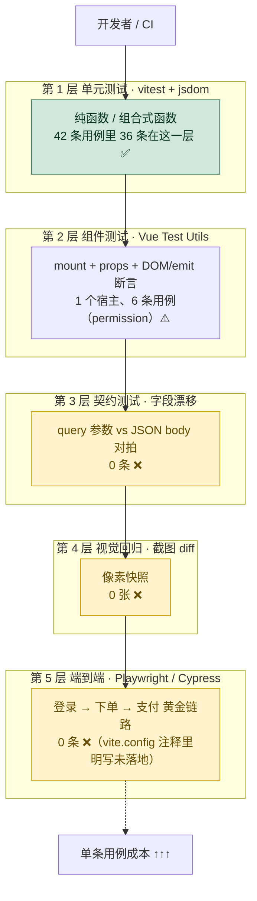
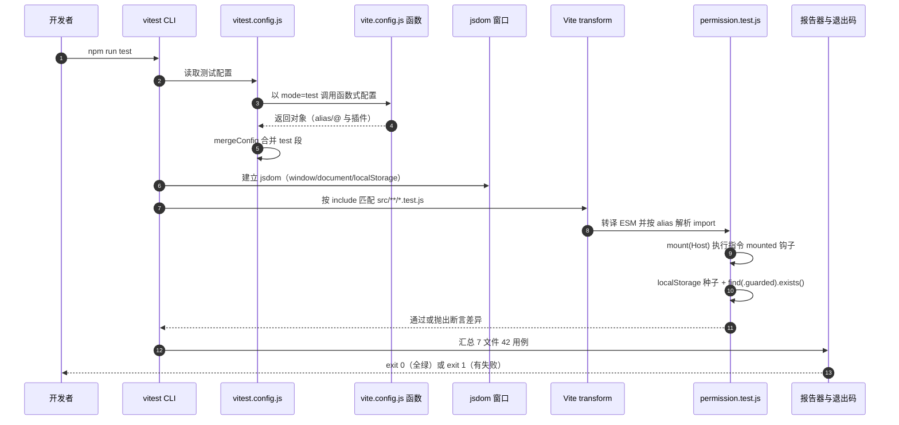

# 前端测试体系：从"点不到的地方"倒推可测性

> 一句话结论：前端测试的价值密度和编写成本都随"离用户更近"而上升——组件挂载一次就要同时绑定 DOM、路由、网络、定时器和存储，所以正确顺序是**先把逻辑抽成纯函数/composable 单测，再用极少量组件测试守边界，最后用个位数 E2E 守钱路径**；本仓库目前只做到第一层（7 个测试文件、42 条用例全绿，组件/E2E/视觉/契约/CI 五层全空）。
> 阅读前置：Vue 3 组合式 API、`async/await` 与 `Promise`、Node ESM 与 `package.json` scripts；建议先读 [08-Vue3进阶：组件设计与组合式函数.md](08-Vue3进阶：组件设计与组合式函数.md)（可测性的来源）和 [09-前端工程化：Vite构建与规范.md](09-前端工程化：Vite构建与规范.md)（测试要复用的那份构建配置）。
> 证据基线：B 级 = 本仓库当前工作区真实文件（行号为当次核对值，路径均已 `Test-Path` 验证）；C 级 = 本机 node v24.16.0 / npm 11.13.0 实跑输出，**未跑 `npm install`、未跑 `npm run build`、未联网**；A 级不适用（Java 侧摘录与前端测试无交集，本篇不硬引）。预计阅读 35 分钟。

## 0. 先看现象

**现象一：测试不是"跑失败"，而是"跑不起来"，报错指向报告器加载。**

```text
$ cd ai-cs-frontend
$ node node_modules\vitest\vitest.mjs run --reporter=basic
Startup Error
Error: Failed to load custom Reporter from basic
[cause]: Error: Failed to load url basic (resolved id: basic). Does the file exist?
code: 'ERR_LOAD_URL'
```

这条报错来自我实操时按旧习惯写了 `--reporter=basic`：vitest 5 已移除内置 `basic` 报告器，于是参数被当成"本地路径/自定义报告器模块"去 `import`，`ERR_LOAD_URL` 是模块解析失败而不是用例失败。**测试没跑，退出码非 0，CI 会红，但一行断言都没执行**——这是前端测试最常见的"假失败"。

**现象二：42 条用例全绿，页面上的实时通知却根本收不到。**

`ai-cs-frontend/src/views/NotifyView.vue:114` 里写死了 WebSocket 地址：

```js
ws = new WebSocket('ws://localhost:8085/ws/notify')
```

而 8085 是 message 服务（`ai-cs-message/src/main/resources/application.yml:3` 写着 `port: 8085`），WebSocket 端点注册在 notify 服务（8086）上——见 `ai-cs-notify/src/main/java/com/aics/notify/config/WebSocketConfig.java:29` 的 `registry.addHandler(new NotifyWebSocketHandler(), "/ws/notify")`。同一个 JSX/Vue 双版本都错了：React 版 `ai-cs-frontend-react` 的 `src/views/NotifyView.jsx:63` 同样是 `ws://localhost:8085/ws/notify`。

我**没有**在本机联调环境抓这条 WS 失败的原始控制台文本（需要同时启动 message 与 notify 两个服务），所以这里只给判读方法而不编造报错原文：DevTools → Network → **WS** 过滤器，看该帧是 `101 Switching Protocols`（成功）还是握手阶段就失败；若 message 服务在跑，通常是 HTTP 404 被当成握手响应，若没在跑则是连接被拒。

**现象三：被测试覆盖的模块，有一半在生产代码里没人 import。**

我用一个纯静态脚本（不联网、不装依赖）统计了"每个被测模块在生产代码中的引用方"，真实输出：

```text
被测模块 -> 生产代码里的引用点数
  permission         cases= 6  引用方=ai-cs-frontend/src/main.js
  auth               cases= 6  引用方=ai-cs-frontend/src/api/index.js, ai-cs-frontend/src/App.vue, ...（共 15 个）
  format             cases= 6  引用方=(无 —— 只被测试引用)
  runtime            cases= 3  引用方=ai-cs-frontend/src/api/index.js, AgentView.vue, ChatView.vue, Dashboard.vue, ProductView.vue
  sse                cases=10  引用方=ai-cs-frontend/src/utils/sseStream.js
  sseStream          cases= 7  引用方=(无 —— 只被测试引用)
  agentRequest       cases= 4  引用方=ai-cs-frontend/src/views/AgentView.vue
```

42 条用例的去向：**13 条打在产线路径上**（auth 6 + runtime 3 + agentRequest 4）、**23 条打在死链上**（format 6 + sse 10 + sseStream 7）、**6 条打在"注册了但模板 0 处使用"的指令上**（permission，`src/main.js:21` 有 `app.use(permission)`，但全 `src` 的 `.vue` 模板里 `v-permission` 出现 0 次）。

> 这些现象指向同一件事：**前端的测试成本几乎全部花在"把被测代码从环境里剥出来"上**。剥得干净的地方（纯函数）用例又便宜又稳，但可能没人调用；剥不干净的地方（`ChatView.vue` 里 L361-L437 那 70 多行内联 SSE 分帧）就一条测试都没有，于是"URL 写死成错误端口""分帧只认 `\n\n`"这类真实缺陷只能靠人肉点页面发现。

## 1. 整体地图



| 层 | 工具（本仓库实有/应有） | 责任：只该在这一层断言什么 | 参与方（谁写、谁守护） | 本项目证据 |
|----|--------------------------|------------------------------|--------------------------|------------|
| 单元 | vitest 5.1.1 + jsdom 31（`ai-cs-frontend` 的 `package.json` L34/L32） | 纯函数入参出参、分支边界、字符串/数字格式化、URL 拼接规则 | 写该 util 的人；review 时随代码一起过 | 36 条：auth 6 + format 6 + runtime 3 + sse 10 + sseStream 7 + agentRequest 4 |
| 组件 | `@vue/test-utils` 2.6（L28） | props→渲染结果、emit 是否发出、指令对 DOM 的增删 | 前端 owner；改模板的人必须同步 | 仅 `ai-cs-frontend/src/directives/permission.test.js` 一个文件 6 条 |
| 契约 | 无（应有：OpenAPI 对拍脚本） | 前端请求形状 == 后端入参注解 | 前后端共同；接口变更时同步 | 0（后端 `/stream/sse` 一个吃 `@RequestParam`、一个吃 `@RequestBody`，见 §3.7） |
| 视觉 | 无 | 像素级回归、暗色/窄屏 | 设计/前端 | 0 |
| 端到端 | 无（`ai-cs-frontend/vitest.config.js:17` 注释写"E2E 交给 Playwright…尚未落地 ⚠️"） | 登录态、跨页跳转、支付闭环 | QA/前端 | 0 |
| 门禁 | Jenkinsfile 169 行，只有 `mvn test -B`（L64） | 失败即阻断合并 | DevOps | 前端 0 命中（详见 §3.10） |

**读图说明。**
- 图中竖箭头 `L1 → L5` 表示的是**成本递增方向，不是执行顺序**。CI 里这五层是并列的 job，不存在"跑完单元才跑 E2E"的依赖关系；把它们读成流水线会得出"E2E 依赖单元结果"的错误结论。
- 绿色只标了第 1 层：`42 条全绿`这句话只对第 1 层成立，对真实用户路径成立度为 13/42。看错这一点（把"绿"理解成"功能可用"）是本章最容易犯的错。
- 黄色三层是**空白层**，不是"已规划待做"：仓库里没有对应依赖（`package.json` 无 cypress/playwright/jest/@testing-library，见 §7），也没有配置文件。
- 最右的 `COST` 虚线箭头是这张图的核心结论：越往下，一条用例要预置的环境越多（浏览器内核、后端、种子数据），所以**层数分配必须倾斜**，而不是五层均摊。

## 2. 关键概念与关键类/关键 API

| 名称 | 位置 | 角色 | 关键点 |
|------|------|------|--------|
| `vitest` | `ai-cs-frontend` 的 `package.json:34`（`^5.1.1`） | 测试运行器（runner + 断言 + mock） | 复用 Vite 的 transform 与 `resolve.alias`，所以 `@/xxx` 与 `.vue` 单文件组件可直接 import，无需 `moduleNameMapper` |
| `jsdom` | `ai-cs-frontend` 的 `package.json:32`（`^31.0.1`） | 假 DOM 环境 | 提供 `window`/`document`/`localStorage`/`URL`/`Event`，但**不提供布局引擎**（`getBoundingClientRect` 恒为 0）与真实网络 |
| `@vue/test-utils` 的 `mount` | `ai-cs-frontend/src/directives/permission.test.js:1`、L23 | 组件/指令宿主挂载 | 返回 `wrapper`，用 `find()/exists()/text()/emitted()` 断言；挂载会真实执行 `mounted` 生命周期 |
| `shallowMount`（未使用） | — | 桩掉子组件的挂载 | 子组件变成空壳，测不出真实布局；本仓库用它也没意义（`src` 下没有 `components/` 目录） |
| 指令对象 `permission.mounted` | `ai-cs-frontend/src/directives/permission.js` | 被测定对象 | 有权限直接 return；无权限 `el.parentNode.removeChild(el)`；无父节点退化成 `display:none` + `data-permission-denied` 标记 |
| `streamSse(url, options, deps)` | `ai-cs-frontend/src/utils/sseStream.js:22` | 流式请求封装 | `const doFetch = deps.fetchImpl ?? fetch` —— 这是全仓库唯一一处"依赖注入式可测性"设计 |
| 假 `Response`/`ReadableStream` | `ai-cs-frontend/src/utils/sseStream.test.js:6-21` | 受控网络输入 | 用 `new ReadableStream({start})` 精确控制"字节如何被切分"，比真实网络更能构造边界 |
| `vi.fn` / `vi.waitFor` | `ai-cs-frontend/src/utils/sseStream.test.js:25`、L104 | 桩函数与异步等待 | `vi.fn(async () => fakeResponse(...))` 替代 `fetch`；`vi.waitFor` 等"第一个事件落地"再触发 abort |
| 假定时器 `vi.useFakeTimers`（未使用） | 概念位置：vitest 的 `vi` 对象 | 控制 `setTimeout`/`setInterval`/`Date` | 本仓库 0 条用例使用（见 §3.6 实测统计），凡涉及重连退避、节流、超时的逻辑目前只能靠真等待 |
| 契约测试 | 概念位置：前端请求形状 vs 后端参数注解 | 防字段漂移 | 本项目已有现成靶子：`/chat/stream/sse` 用 `@RequestParam`，`/agent/stream/sse` 用 `@Valid @RequestBody`（§3.7） |
| 覆盖率 `coverage.include` | 未配置（`ai-cs-frontend/vitest.config.js` 无 `coverage` 段） | 决定"分母" | 默认只统计**被 import 过的文件**，死代码不计入分母 → 覆盖率虚高（§3.10） |
| ESLint flat config 的测试覆盖块 | `ai-cs-frontend/eslint.config.js` | 让 lint 也能检查测试文件 | 对 `files: ['**/*.test.js']` 单独声明 `describe/it/expect/vi/beforeEach/afterEach` 全局并放开 `no-console`；否则测试文件会被报 `no-undef` |
| `node:test` + `assert/strict` | `ai-cs-frontend-react/src/views/agentRequest.test.js` | 零依赖的 Node 内置断言 | 该文件存在但 React 工程没有 test 脚本，只能 `node --test <file>` 手动跑（实测 4 pass）；"有测试文件没有入口"是典型的隐性浪费 |
| Playwright / Cypress / `@testing-library` | 未安装（`package.json` 里 0 命中） | E2E 与 DOM 测试库 | 本章描述的做法属于**目标态**，不是本仓库现状；引用时须区分"能做"与"已做" |

## 3. 原理与证据逐段精读

### 3.1 为什么前端的金字塔必须"压扁"

**在干什么。** 把一个请求从前端发出去到用户看到结果，拆成四段：纯函数/组合式函数（无 DOM、无网络、无时间）→ 组件（DOM + props/emit）→ 页面（路由 + 网络 + 存储）→ 真实浏览器（像素 + 时序）。后端习惯的 7:2:1 在前端要改成大约 **5:3:1.5:0.5**，而且基数小一个数量级。

**为什么这么设计。** 后端的单元测试能覆盖几乎全部业务价值，因为 HTTP 边界很薄：Controller 只是把参数搬给 Service，测 Service 就等于测了业务。前端的"业务价值"有一半活在渲染与时序里（按钮该不该出现、消息该不该流式追加、失败该不该重连），这部分**天然在组件之上**；但每上一层，单条用例需要预置的环境就多一档，成本涨得比价值快，所以曲线被压扁。

**换写法会怎样。** 照后端比例硬做，会得到一堆"mock 了 8 个依赖、断言一个 DOM 文本"的脆测试：改一次样式、换一次组件库大版本，就删掉几十条用例。团队删过两次之后，测试目录就没人维护了——这比"没有测试"更糟，因为它持续消耗 review 注意力却不再提供保护。反过来，只做 E2E 也不行：一条 E2E 跑 30 秒（真实量级取决于环境，本机未实测），40 条就是 20 分钟，没人会在本地跑。

**常见坑。** ①把组件测试当集成测试用：在 `mount` 里配真实 `axios` 打后端，测试变成"后端是否在线"的探针；②在 E2E 里断言纯函数细节（例如校验金额格式化的中间结果），把最贵的层用来测最便宜的东西；③忘了"价值最高的层最难写"这一点，按用例数平均分配工时，最后得到 90% 的用例都在测 util。

### 3.2 引擎层：Vitest 靠"复用构建配置"换来零配置

**在干什么。** `npm run test`（`ai-cs-frontend` 的 `package.json:10`，命令就是 `vitest run`）→ 读 `vitest.config.js` → 把 `vite.config.js` 的解析结果并进来 → 按 `include` 找文件 → 每个测试文件在独立 worker 里跑 → 文件内的 `import` 走 **Vite 的 transform**，所以 `.vue`、`@` 别名、TS 全都和构建时一致。

```js
// ai-cs-frontend/vitest.config.js:7-22（节选，保留原有的注释意图）
const resolved =
  typeof viteConfig === 'function' ? viteConfig({ mode: 'test', command: 'serve' }) : viteConfig

export default mergeConfig(
  resolved,
  defineConfig({
    test: {
      environment: 'jsdom',            // L15：需要 window/document/localStorage
      include: ['src/**/*.test.js'],   // L16：只认 co-locate 的 *.test.js
      exclude: ['node_modules/**', 'dist/**'],
      restoreMocks: true,              // L19
      clearMocks: true,                // L20
    },
  })
)
```

**为什么这么设计。** 构建期与测试期必须共用同一套模块解析，否则会出现"构建能过、测试找不到模块"的双份真相。Jest 需要自己再实现一遍解析（`moduleNameMapper`）与转译（babel/ts-jest），而 Vitest 直接把 Vite 插件管道拿来用；`@` 别名只在 `ai-cs-frontend/vite.config.js` 里定义一次，测试自动继承。

**换写法会怎样。** 换回 Jest，第一件事就是补 `moduleNameMapper` 把 `@/` 映射到 `src/`，第二件事是给 `.vue` 配 `vue-jest`，第三件事是 ESM 包（`@vue/test-utils` 2.x 是纯 ESM）要么开 `--experimental-vm-modules` 要么降级。三件事都与业务无关，纯属配置摩擦。

**常见坑。** 这里有一个本仓库真实踩过并写进注释的坑：`vite.config.js` 用的是**函数式**配置 `export default defineConfig(({ mode }) => ({...}))`，而 `mergeConfig` 只吃对象，直接把回调丢进去会报 `Cannot merge config in form of callback`。所以 `vitest.config.js:7-9` 必须先手动调用一次那个函数拿到对象（并且要显式传 `mode: 'test'`，否则环境变量按 `production` 走）。第二个坑是 `include` 写窄了：写成 `['**/*.test.js']` 会连 `node_modules` 里别人的测试一起收，写了 `exclude` 也别省。

### 3.3 最便宜的一层：纯函数单测到底在测什么

**在干什么。** 以 `ai-cs-frontend/src/utils/auth.js` 为例：`getToken/setToken/getUser/setUser/isAuthenticated/getRoles/hasRole/logout` 全是 `localStorage` 的读写包装，6 条用例覆盖"正常读""坏 JSON 返回 null""逗号拆分角色并小写""未登录时 `hasRole` 返回 false"这些分支。同理 `runtime.js` 只有 3 条，但价值极高——它守的是"`VITE_GATEWAY` 为空串时必须返回空串（走同源），不能用 `||` 兜底成 `http://localhost:8080`"这条**部署级约定**：

```js
// ai-cs-frontend/src/utils/runtime.js:14-18
export function resolveGateway(env) {
  const raw = env?.VITE_GATEWAY
  if (typeof raw !== 'string') return ''
  return raw.trim().replace(/\/+$/, '')
}
```

**为什么这么设计。** 纯函数的用例不依赖任何环境，跑 12ms 一条（实测 `runtime.test.js` 3 tests / 12ms），失败信息直指入参出参。它们守的是"易变的规则"，而不是"易变的画面"。`resolveGateway` 这类函数之所以能被抽出来并测住，是因为它**不接受浏览器环境作为输入**——环境是参数。

`ai-cs-frontend/src/utils/auth.test.js` 的 6 条用例，逐条对应一条真实规则（原文均可在该文件核对）：

| 用例（文件里的 `it` 标题） | 守住的规则 | 破坏它会怎样 |
|------------|-----------|--------------|
| 未登录时 `getToken` 为 null 且 `isAuthenticated` 为 false | 二者必须同时表达"未登录" | 路由守卫与 `api` 拦截器各自用不同的判据，出现"守卫放行了但请求不带 token" |
| `setToken` 后 `isAuthenticated` 为 true，`logout` 后恢复未登录 | 写入/清除对称 | 半退出状态：刷新后又"登录上了" |
| `getUser` 遇到坏 JSON 返回 null 而不抛错 | 历史脏数据兜底 | 一个残留的非法 `localStorage` 值就能让首屏白屏 |
| `getRoles` 把逗号分隔串拆成小写数组 | `'admin,agent'` → `['admin','agent']` | 后端下发大小写混写时判权失真 |
| `getRoles` 无用户或空角色时返回 `[]` | 空态必须是数组而非 `null` | 调用方 `.includes()` 直接抛 `TypeError` |
| `hasRole` 大小写不敏感、多角色命中、空串为 false | `'ADMIN,agent'` 命中 `admin`/`AGENT`，`''` 不命中 | 权限放大（`hasRole('')` 返回 true 等于人人有权限） |

注意这些用例**没有**断言 `localStorage` 里的 key 字符串（`aics_token`/`aics_user`），所以最上面那条"key 名漂移"的风险仍然存在——`permission.js` 直接读 `aics_user`，一旦有人改 key，`auth.test.js` 仍会全绿而指令会误判。这是"测行为而非实现"与"测住跨模块契约"之间的取舍。

**换写法会怎样。** 如果把 `VITE_GATEWAY` 的判断写在 `api/index.js` 顶层（`const BASE = import.meta.env.VITE_GATEWAY || 'http://localhost:8080'`），那么它只能在"构建 + 浏览器"里被验证：写错一个 `||`，本地 `npm run dev` 完全正常（因为 `.env.development` 里有值），只有生产镜像里才会出现"请求打到 localhost:8080"的事故。抽成函数 + 3 条用例，就把它变成了启动即知的错误。

**常见坑。** ①`localStorage` 在用例间会串（jsdom 的 `window` 在同一文件内复用），必须在 `beforeEach` 里 `localStorage.clear()`——`permission.test.js:32-34` 就是这么做的，漏了它会出现"单跑绿、全跑红"的顺序依赖。②断言太贴实现（`expect(localStorage.getItem('aics_token'))`），一旦 key 改名就连带失败；应断 `getToken()` 的返回值。③忘了这条：**测了但没接线的纯函数保护不了任何东西**（现象三里的 `format.js`）。

### 3.4 组件层：一条用例要付多少"环境税"

**在干什么。** 本仓库唯一的组件级用例 `ai-cs-frontend/src/directives/permission.test.js` 用一个 6 行模板做宿主，把指令挂上去，然后断言 DOM 里那个按钮还在不在：

```js
// ai-cs-frontend/src/directives/permission.test.js:12-24（节选）
const Host = {
  directives: { permission },
  props: { role: { type: [String, Array], default: null } },
  template: `
    <div class="toolbar">
      <button v-permission="role" class="guarded">退款审批</button>
    </div>`,
}
function mountGuarded(role) {
  return mount(Host, { props: { role } })   // mount：真实执行 mounted 钩子
}
```

配套的断言是 `expect(wrapper.find('.guarded').exists()).toBe(false)`（无权限时元素被移除），以及一条"元素无父节点时退化成 `display:none` 并留 `data-permission-denied` 标记"的直接调用钩子用例（L74-84）。

三类断言的写法（组件测试里 90% 的断言就是这三种）：

```js
// ① DOM 结构：元素还在不在（permission.test.js:41、L49）
expect(wrapper.find('.guarded').exists()).toBe(true)      // 有权限：保留
expect(wrapper.find('.guarded').exists()).toBe(false)     // 无权限：移除（不是 display:none）

// ② 属性/样式：退化路径留下的可排查标记（permission.test.js:82-83）
expect(el.style.display).toBe('none')
expect(el.getAttribute('data-permission-denied')).toBe('admin')

// ③ 事件契约：本仓库 0 处使用（emitted 统计见 §3.6），补齐时这样写
await wrapper.find('form').trigger('submit')
expect(wrapper.emitted('submit')).toHaveLength(1)
expect(wrapper.emitted('submit')[0][0]).toEqual({ sessionId: 1 })
```

**为什么这么设计。** 这个宿主刻意做到"最小"：不引入路由、不引入 Element Plus、不引入网络。**环境税**是组件测试的成本主体：注册组件库全局组件、伪造 `createRouter(createMemoryHistory())`、准备 store、`await flushPromises()` 等异步、mock 网络——每加一项，用例的可读性和稳定性都下降。作者把宿主压到 6 行，正是为了让环境税接近 0，从而让 6 条用例能覆盖"有权限/无权限/数组任一命中/数组全不命中/未登录/无父节点"这 6 个分支。

**换写法会怎样。** 真实成本对比：如果改成"启动前后端、登录成 admin、打开退款审批页面、看按钮是否存在"，单条成本从毫秒级涨到分钟级，且依赖两个服务和一份种子数据；6 条这样的用例就足以让本地跑测试变成"要不要跑"的犹豫。反过来，如果**完全不写**组件层（本仓库的实际状态），模板里的字面量就彻底裸奔——`NotifyView.vue:114` 的 `ws://localhost:8085` 正是模板字面量，任何单测都碰不到它。

**常见坑。** ①断言整个 `wrapper.html()` 快照 → 改样式即红，维护成本爆炸；只断"关键节点存在/文本等于"。②忘记 `await flushPromises()` 就断言异步产生的 DOM/emit，拿到空数组（本仓库 0 条 emit 断言，见 §3.6 的统计口径，所以还没踩到，但一旦加组件测试就会踩）。③`mount` 与 `shallowMount` 混用：前者渲染子组件（慢但真），后者把子组件桩成空壳（快但假），用 `shallowMount` 测"下拉框展开后有几项"永远失败。④用 `mount` 却没 `unmount()`，多个用例的 DOM 事件监听器叠加，`document.body` 越跑越脏。

### 3.5 网络必须被控制：注入点比全局 mock 值钱

**在干什么。** `sseStream.js` 把 `fetch` 变成函数参数：

```js
// ai-cs-frontend/src/utils/sseStream.js:22（节选）
const doFetch = deps.fetchImpl ?? fetch
```

用例于是可以精确控制"字节怎么切"：`sseStream.test.js:6-21` 造了一个 `fakeResponse(chunks)`，用 `ReadableStream` 把字符串按给定切片吐出，模拟浏览器把一帧 SSE 拆在两块 TCP 包里；再配合 `vi.fn` 记录调用参数，断言 `init.method === 'POST'`、`init.headers.Authorization === 'Bearer jwt'`、`init.body === '{"sessionId":1}'`（L54-58）。

**为什么这么设计。** 三个理由：①控制点写在签名上，读代码就知道怎么测，不需要记住"某处偷偷 stub 了全局"；②同一个用例里可以让两个 URL 得到不同响应（全局 stub 做不到，除非记顺序）；③不需要引入 MSW/nock 这类额外依赖，`deps` 默认值是 `fetch`，生产路径零成本。

**换写法会怎样。** `vi.stubGlobal('fetch', ...)` 也能跑，但泄漏风险高：忘了 `afterEach(() => vi.unstubAllGlobals())` 就会污染后续文件；本仓库通过 `vitest.config.js:19-20` 的 `restoreMocks/clearMocks` 兜住了一半，但那只管 `vi.fn`，不管 stubGlobal。另一条路是 MSW（Service Worker 层拦截），更真实、能顺手做"离线/慢网"，代价是引入运行时与一份 handler 配置——对现在只有 7 个文件的规模属于过度设计。

**常见坑。** ①`ReadableStream`/`TextEncoder` 在 Node 18 之前不是全局，早期要手写 polyfill；Node 24 已有全局（本机 v24.16.0 实测该测试通过），所以**不要**再抄老文章的 polyfill 代码。②假响应的 `ok`/`status`/`body` 三件套要齐全：`sseStream.test.js:70` 专门测"`body: null`"（网关吞流）这条，如果假响应只给 `ok:true` 就永远测不到。③abort 语义要如实模拟：真实浏览器 abort 会让 `reader.read()` 抛 `AbortError`，用例里得在 `signal` 的 abort 事件上 `controller.error(error)` 并且**不 close**（L83-93），否则你测的只是"没人取消"的理想路径。

### 3.6 时间必须被控制，但本仓库一条都没控制

**在干什么。** 前端测试里最容易失控的三样东西是**网络、时间、随机**。时间的正确做法是 `vi.useFakeTimers()` + `vi.advanceTimersByTime(ms)`，让"3 秒后重连""200ms 防抖"这类逻辑在 0 毫秒内被验证；配 `vi.setSystemTime()` 固定 `Date.now()`。

我实测了本仓库的实际情况（C 级，`Get-ChildItem src -Recurse -Filter *.test.js | Select-String` 计数）：

```text
useFakeTimers        0
advanceTimersByTime  0
emitted\(            0
flushPromises        0
mount\(              1
vi\.mock             0
vi\.spyOn            0
vi\.fn               10
vi\.waitFor          1
```

**怎么读这组数。** ①`useFakeTimers=0`：没有任何用例控制时间，凡是带 `setTimeout` 的逻辑（重连退避、倒计时、防抖）目前都是测试盲区。②`emitted=0`：没有任何一条 emit 断言，组件测试只验证了"DOM 增删"，没验证"事件契约"。③`mount=1`：只挂载过一个 6 行宿主——组件层等于没有。④`vi.fn=10, vi.waitFor=1`：唯一在用的异步协调手段是"等真实事件落地"（`sseStream.test.js:104` 的 `await vi.waitFor(() => expect(events).toHaveLength(1))` 再 `controller.abort()`），这种写法在单机稳定但会在慢 CI 上偶发超时。

**换写法会怎样。** 用真实等待（`await new Promise(r => setTimeout(r, 3000))`）代替假定时器，用例耗时直接等于被测时长，且失败原因永远是"超时"而不是"第 3 次重连的间隔算错了"。反过来，假定时器用错也很有害：`vi.useFakeTimers()` 会同时接管 `queueMicrotask`/`Promise` 的调度（取决于版本配置），如果被测代码里有真实的 `await fetch()`，假时间会让它永远不 resolve——正确姿势是 `vi.useFakeTimers({ toFake: ['setTimeout', 'setInterval', 'Date'] })` 只伪造需要的部分。

**常见坑。** ①忘了 `afterEach(() => vi.useRealTimers())`，后续文件的真实定时逻辑全被冻住；②在假时间下 `await` 一个真实 Promise，用例挂死（用 `vi.advanceTimersByTimeAsync`）；③用 `new Date().toISOString()` 断言展示文案，跨时区/跨天必挂——要么固定系统时间，要么断言"格式符合 `^\d{4}-\d{2}-\d{2}`"。

### 3.7 契约测试：本项目有现成的、真实的靶子

**在干什么。** 契约测试不复述业务，只验证"前端发出的请求形状 == 后端接受的入参形状"。本项目两个流式端点的形状**故意不同**，这让契约测试的价值一眼可见：

| 端点 | 后端声明 | 前端实际发送 | 证据 |
|------|----------|--------------|------|
| `POST /chat/stream/sse` | `@RequestParam`（`sessionId`/`message` 带 `@NotBlank`，另有可选 `knowledgeBase`、`hybrid`、`rewrite` 默认 `false`，可选头 `X-User-Id`） | query string 拼在 URL 上，只带 `Authorization` 头 | `ai-cs-chat/src/main/java/com/aics/chat/controller/ChatController.java:167-173`；前端 `ai-cs-frontend/src/views/ChatView.vue:394` |
| `POST /agent/stream/sse` | `@Valid @RequestBody AgentRequestDTO`（JSON） | `Content-Type: application/json` + `JSON.stringify(buildAgentRequest(...))` | `ai-cs-chat/src/main/java/com/aics/chat/agent/AgentController.java:130-133`；前端 `ai-cs-frontend/src/views/AgentView.vue:125-165` |
| `POST /chat/vision/sse` | `@RequestParam`，`imageUrl` 必填 | 无前端调用点（仓库内 0 处） | `ChatController.java:248-255` |

**为什么这么设计。** 契约测试是"字段漂移"的唯一低成本防线：后端把 `@RequestParam` 改成 `@RequestBody`、或者把 `sessionId` 改名 `sessionID`，单元测试全绿、E2E 可能还没写，只有契约层能在几毫秒内报出"前端发的 query 里没有后端要的字段"。它的成本又极低：不需要浏览器、不需要后端启动，只需要一份"前端构造函数" + 一份"后端参数名单"的对拍表。

**换写法会怎样。** 完全不测（本仓库现状）：`agentRequest.js` 恰好是被测住的——它 4 条用例里有"uses the backend confirmation contract"这类针对字段的断言；但 `ChatView.vue` 的 query 构造是**内联**的，没有函数可测，字段名只能靠人眼对齐。一旦后端给 `sessionId` 加个 `@NotBlank` 的变体或改名，报错发生在运行时（`400 MissingServletRequestParameterException`），用户看到的是聊天框不回应。

**常见坑。** ①把契约测试写成"启动后端调真实接口"，那它就退化成集成测试，慢且依赖环境；②只对齐字段名不对齐**类型**（前端传 `"true"` 字符串、后端收 `boolean`，Spring 能转但 `"yes"` 不能）；③忘了对齐**错误形状**：本仓库后端统一响应体与前端 `api/index.js:50-60` 的 401 分支是有耦合的，字段漂移会让"登录过期自动跳转"失效。

### 3.8 端到端：最贵的一层，钱只能花在"只有真浏览器能发现的事"上

**在干什么。** 起一个真实浏览器内核（Playwright 用 CDP 直连 Chromium/WebKit/Firefox，Cypress 用自带 runner 驱动），访问真实页面、点真实按钮、断言真实网络与真实渲染。本项目值得 E2E 的只有三条"钱路径"：①登录（`/login` 的 `meta.public` 与守卫放行、JWT 落 `aics_token`）；②对话流式（发一句、看到内容逐步追加、点"停止生成"后不报错）；③下单到支付（跨 `ShopView`/`CartView`/`CheckoutView`/`MockCashierView` 四个页面，路由 25 条里最长的一条链）。

**为什么这么设计。** 有些缺陷只有"真浏览器 + 真部署形态"才能暴露：①URL 写死在组件里（`NotifyView.vue:114` 的 8085）；②反向代理没配（`ai-cs-frontend/nginx.conf` 里只有 `location /api/` 与 SPA `try_files`，**没有 `/ws` 的 location**，所以"同源 + Nginx 反代"这条路根本覆盖不到 WebSocket，只有真机 E2E 才会发现 WS 连不上）；③构建产物与源码不一致（源码改了、镜像里还是旧 dist）。这三类都不是"逻辑错"，任何单测/组件测试都表达不了。

**换写法会怎样（两家的取舍与真实成本）。**

| 维度 | Playwright | Cypress |
|------|-----------|---------|
| 浏览器覆盖 | Chromium / Firefox / WebKit 三内核，一份用例跨浏览器 | 主要 Chromium 系（WebKit 实验性） |
| 并行与隔离 | 原生多 worker，每个用例独立上下文（cookie/storage 天然隔离） | 需要 Cypress Cloud 或自建并行；早期版本同 runner 内共享状态 |
| 调试体验 | `trace viewer` 逐帧回放、`--ui` 模式 | 交互式 runner 强（时间旅行、DOM 快照），现场改断言即可 |
| 断言对象 | 多 tab、多 origin、iframe 支持好；可直接发 API 请求做数据准备 | 同 origin 内体验最好；跨 origin 需要 `cy.origin()` |
| 真实成本（**未本机实测**，只给构成项） | CI 镜像要装浏览器二进制并做缓存；单条用例量级为"秒到十几秒"，取决于后端与冷启动；失败需 retry + trace 归档 | 同上，另加 runner 自身的打包体积与 Electron 依赖；CI 无头运行需 `xvfb`（Linux） |

结论：本项目若上 E2E，选 **Playwright**——因为它同时覆盖"三内核"与"多 tab/多 origin"（支付回跳、消息窗口都可能开新上下文），且 trace 归档对"CI 里偶发失败"更有用。但这属于**未落地**状态：仓库里没有 `playwright` / `cypress` 依赖，也没有 `playwright.config.*`；`ai-cs-frontend/vitest.config.js:17` 的注释只写了"E2E 交给 Playwright（见 06/15 文档，尚未落地 ⚠️）"这句话。

**常见坑。** ①拿 E2E 测业务分支（金额计算、权限矩阵），把最贵的层用来测最便宜的东西；②选择器绑 CSS 类名，改样式即全红——应该用 `data-testid`；③不隔离数据，同一份库跑第二遍就脏；④只跑 Chromium 却宣称"跨浏览器已验证"；⑤把 E2E 塞进 `npm test`（本地就该跑几十秒的命令没人会跑），它应该单独一个 `npm run e2e` 并在 CI 独立 job。

### 3.9 视觉回归：价值在"意外的退化"，成本在"有意的改动"

**在干什么。** 把页面或组件渲染成图片，与入库的基线图做像素 diff，超过阈值就失败。Playwright 内置 `expect(page).toHaveScreenshot()`，不需要第三方服务；也可以只截单个组件（先把组件"装"进一个空页面再截）。

**为什么这么设计。** 前端有一类缺陷**没有任何断言能表达**：按钮被挤出行外、表格列宽塌陷、暗色主题下注释文字对比度不足、中文字体回退成宋体导致换行错位。这些情况下 DOM 结构完全正确、单元测试全绿、E2E 的"元素可见"断言也通过，只有像素会说话。视觉回归补的就是这个洞。

**换写法会怎样（三笔养护账）。** ①**基线入库**：每张基线图都是一份二进制资产，页面越多、视口越多（桌面/窄屏/暗色），仓库越重；②**有意改动也要红**：改一个间距、换一个图标，所有相关基线都要更新——而"更新基线"往往是一条命令（`--update-snapshots`），一旦被习惯性执行，这道防线就等于关掉了，这是它最常见的死法；③**渲染必须确定性**：字体（跨 OS 差异最大）、DPR（`deviceScaleFactor`）、动画与过渡、随机 ID、时间戳、字体加载时序，任一不稳定就 flaky，进而逼人关掉它。所以判断标准很朴素：**UI 频繁变动期上视觉回归是纯负债**，等布局稳定后再上。本项目 24 个视图仍在快速迭代（`views/` 下 24 个 `.vue`，`src` 共 46 个文件），当前阶段不上是合理的；但一旦进入维护期，"支付结果页/订单详情页"这类低频改动页应优先纳入。

**常见坑。** ①只截整页——任何局部改动都红，噪声掩盖真问题；应把范围压到最小（单组件、单区块）；②不关动画与过渡（`animations: 'disabled'`）；③不固定字体与视口（`deviceScaleFactor`、`locale`、`timezoneId` 都要显式传）；④把 `maxDiffPixelRatio` 调到 0.05 这种"永远过"的值，等于自己骗自己；⑤截图里带真实时间/订单号，永远不稳定（改为固定种子数据或遮盖动态区域）。

### 3.10 覆盖率与 CI：分母比分子更重要

**在干什么。** 覆盖率 = 被执行的代码行 / 被统计的代码行。分母由 `coverage.include` 决定，而 vitest 的默认行为是**只统计被 import 过的文件**。

**为什么这么设计。** 对库作者合理（用户没用到的入口不该算欠账），对应用作者危险：本仓库 `ai-cs-frontend/vitest.config.js` 里**没有 `coverage` 段**，所以一旦跑覆盖率，`format.js`（没人 import）和 `sseStream.js`（没人 import）根本不计入分母，而真正危险的大文件 `ChatView.vue`（L361-L437 那 70 多行内联 SSE 分帧）也同样被"跳过"。这时候覆盖率数字可能很好看，但它描述的是"我测过的那些东西测得很全"，不是"应用被覆盖了多少"。

**换写法会怎样。** 配 `coverage: { provider: 'v8', include: ['src/**/*.{js,vue}'], exclude: ['**/*.test.js', 'src/main.js'] }` 之后，分母变成"全部源码"，数字会骤降到很低——这不是退步，而是第一次看见真实基线。后端就是这么做的：CLAUDE.md 里的门禁是行 ≥40%、分支 ≥30%（JaCoCo 在 `mvn verify` 时检查），而前端连覆盖率插件都没装。

```js
// 目标态写法（当前 ai-cs-frontend/vitest.config.js 里没有这一段，属未落地）
test: {
  environment: 'jsdom',
  include: ['src/**/*.test.js'],
  coverage: {
    provider: 'v8',
    reporter: ['text', 'json-summary', 'html'],
    include: ['src/**/*.{js,vue}'],        // ← 关键：分母变成全部源码
    exclude: ['**/*.test.js', 'src/main.js'],
    thresholds: { lines: 0, branches: 0 }, // ← 先锁 0，再按"不许下降"逐步抬
  },
}
```

**常见坑。** ①把覆盖率当 KPI，团队会写出"只调一遍不 assert"的用例（覆盖率涨、保护力零）；②设一个和现状差太远的门禁（前端现状接近 0，直接设 60% 会逼人造假），正确做法是"锁定当前值 + 每次 PR 不许下降"；③忽略 `v8` 与 `istanbul` 的口径差异（`v8` 是字节级，虚高的分支数常见），换成 istanbul 会掉几个点，别以为代码退化了。

**CI 现状（B 级，逐个核过）。** 仓库根 `Jenkinsfile` 共 169 行，阶段为：拉取代码（L32）→ 环境检查（L39）→ **Maven 测试（L50，命令 `mvn test -B` 在 L64）** → 写 K8s Secret（L69）→ 部署基础设施（L89）→ 构建推送镜像（L104）→ 部署业务服务（L119）→ 部署验证（L134，`kubectl get nodes -o wide` 在 L143）。全文 `npm`/`vite`/`frontend` **0 命中**（L143 里的 "node" 是 kubectl 的输出列名，不是 Node.js）。`.github/workflows` 下只有一个 `python-learning-validate.yml`，其 `paths` 限定在 `learning-docs/22-Python速成` 与 `ai-cs-py-recommend` —— **改前端不会触发任何 CI**。对照后端：`*Test.java` 实测 143 个（chat 58、order 17、message 12、pay 11、notify 8、user 8、common 7、gateway 7、product 7、knowledge 3、search 3、mq 2），`learning-docs/08-测试/README.md` 自述"143 个测试类、654 个测试方法"。**两侧差距不是"多与少"，而是"有门禁与无门禁"。**

### 3.11 可测性设计：把逻辑从组件里抽出来

**在干什么。** 本仓库里同一件事有两种写法，恰好构成对照实验：

| 位置 | 写法 | 可测性 | 后果 |
|------|------|--------|------|
| `ai-cs-frontend/src/views/agentRequest.js` | 纯函数 `buildAgentRequest(sessionId, input, runId)`，被 `AgentView.vue:76` import | 高：4 条用例覆盖 | 唯一"被测且真在产线路径上"的纯函数 |
| `ai-cs-frontend/src/views/ChatView.vue:361-437` | 内联 `fetch` + `ReadableStream` 手写分帧（只按 `\n\n` 切、只认 `data:` 行、`JSON.parse` 失败 `continue`） | 低：0 条用例 | 同一套分帧逻辑在 `AgentView.vue:125-165` 又被抄了一遍 |
| `ai-cs-frontend/src/utils/sseStream.js` | 已抽好的流式封装（含 abort、无 body、非 2xx 分支） | 高：7 条用例 | 但**没人 import**，两个视图都在自己手写 |

**为什么这么设计。** 抽出来的函数有三个可测性特征：**无浏览器全局**（不碰 `window`）、**依赖作为参数**（`deps.fetchImpl`）、**IO 与决策分离**（解析在 `sse.js`、传输在 `sseStream.js`、组装请求在 `agentRequest.js`）。这三条其实就是"能不能在 node 里直接跑"的判据。

**换写法会怎样。** 如果当初 `ChatView.vue` 直接 `import { streamSse } from '../utils/sseStream'`，那么现在就有 7 条用例在保护产线路径，`sse.js` 的 10 条也顺带活了；而且"末帧无空行也要 flush""一个包里多个事件"这两个边界（`sse.js:56-64` 的切帧、L70-76 的 `flush`）就不会在视图里被重新实现成只按 `\n\n` 切的版本。**这就是本章的核心结论：可测性问题，90% 是设计问题的投影。**

**常见坑。** ①抽得太晚：先写完 500 行组件再想抽，抽出来的函数带着一堆 `ref` 和 DOM 引用，仍然测不了；②抽得不彻底：把 `document.querySelector` 留在函数里，测试照样得造 DOM；③抽完不复用（本仓库现状），出现"测试+死代码"的组合，比不抽还浪费。

## 4. 一次完整执行时序



**读图说明。**
- 关键在 **5→6→7 这三步**：配置合并（6）产出的对象里同时带着 `resolve.alias` 和 `test.environment`，后面第 8 步的 `import './permission'` 能解析、第 9 步能拿到 `document`，全靠它。看漏这条会误以为"测试和构建是两套配置"。
- 第 5 步是**函数式配置的显式求值**，这也是本项目两处坑的共同源头：漏了这步 → `Cannot merge config in form of callback`；传错 `mode` → 环境变量按 production 走，`VITE_GATEWAY` 取值和预期不同。
- 第 11 步是唯一"被测代码真正执行"的地方：`mount` 触发 `mounted` 钩子 → 指令读 `localStorage` → 决定删不删节点。前面九步都只是准备。
- 第 13 步的退出码才是 CI 唯一关心的东西；**报告器配置错也算 exit 1**（现象一的 `ERR_LOAD_URL`），此时第 10-12 步一次都没发生。

**哪一步失败报什么错（按上图编号）：**

| 失败步 | 真实/典型报错 | 判读与处置 |
|--------|---------------|------------|
| 1-2 | `Unknown file extension ".js"` / `ERR_REQUIRE_ESM` | 用 `node node_modules\vitest\vitest.mjs run` 绕开全局 vitest；本项目 Node 24 下用本地可执行文件即可 |
| 4 | `Cannot merge config in form of callback` | `vite.config.js` 是函数式，必须先调用拿到对象再 `mergeConfig` |
| 5 | `Failed to load url basic` / `ERR_LOAD_URL`（我在写本文时真实踩到） | 报告器名写错；vitest 5 无 `basic`，用 `default`/`verbose`/`json` 或删掉该参数 |
| 7 | `No test files found, exiting with code 1` | `include` 与目录不匹配；本项目是 `src/**/*.test.js`，co-locate 才被收 |
| 8 | `Failed to resolve import "@/utils/auth"` | alias 没并进来或 `mode` 传错 |
| 9 | `document is not defined` | `environment` 不是 `jsdom`（或用了 `node` 环境） |
| 10 | 断言差异 diff / `expected false to be true` | 真正的业务失败；先看 `localStorage` 是否被上个用例污染 |
| 13 | 全绿但功能仍坏（现象二/三） | 测试盲区，不是测试失败——需要补层，不是改代码 |

**这次运行的完整输出（C 级，本机实测，可直接复现）：**

```bash
cd D:\Projects\Persion\ai-customer-service\ai-cs-frontend
node node_modules\vitest\vitest.mjs run
```

```text
 ✓ src/utils/sse.test.js (10 tests) 28ms
 ✓ src/utils/sseStream.test.js (7 tests) 103ms
 ✓ src/utils/auth.test.js (6 tests) 22ms
 ✓ src/utils/format.test.js (6 tests) 14ms
 ✓ src/utils/runtime.test.js (3 tests) 12ms
 ✓ src/views/agentRequest.test.js (4 tests) 14ms
 ✓ src/directives/permission.test.js (6 tests) 76ms

 Test Files  7 passed (7)
      Tests  42 passed (42)
   Duration  3.83s (environment 95%, import 2%, tests 1%, worker 1%, transform 1%)
```

怎么读这段输出：①**用例自身的执行只占 1%**，而 `environment` 占 95%——这就是"jsdom 的启动税"，用例越少，这笔税的相对占比越高，所以"多写几条单测"在前端几乎不增加时长，真正贵的是"再开一个测试文件/环境"。②7 个文件里 5 个是解析/传输/格式化的纯工具，2 个是视图目录下的纯函数与指令——`views/` 下 24 个 `.vue` 组件**一个都没被加载**。③命令用 `node node_modules\vitest\vitest.mjs run` 而不是 `npx vitest`，是为了在这台没跑过 `npm install` 的机器上直接复用已有 `node_modules`，同时避开 PATH 上的全局 vitest 版本漂移。

## 5. 设计取舍

| 取舍点 | 选 A | 选 B | 本仓库现状与理由 | 代价 |
|--------|------|------|------------------|------|
| 运行器 | **Vitest**：复用 Vite 管道，零别名配置 | Jest：生态老、文档多，但要自建解析与转译 | 选 Vitest（`package.json:34`），因为项目已在 Vite 8 上，且只想维护一份 `resolve.alias` | Vitest 5 相对新，某些报告器/插件生态比 Jest 薄（`basic` 报告器已被删） |
| DOM 环境 | **jsdom**：API 全、`localStorage` 开箱可用 | happy-dom：更快，但个别 API 缺口 | 选 jsdom（L32），因为 `auth.js` 重度依赖 `localStorage` | 启动慢（实测 environment 占总时长 95%），无布局引擎 |
| 组件挂载 | **`mount`**：真实执行子组件与生命周期 | `shallowMount`：快，但子是空壳 | 唯一组件用例用 `mount`（`permission.test.js:23`），因为要验证指令对真实 DOM 的增删 | 慢，且需自行清理 `unmount` |
| 网络控制 | **构造函数注入**（`deps.fetchImpl`） | 全局 stub / MSW / nock | 选注入（`sseStream.js:22`），零依赖、控制点可见 | 仅覆盖按此模式写的代码；内联 `fetch` 的视图（`ChatView.vue`）享受不到 |
| 时间控制 | `vi.useFakeTimers` + `toFake` 白名单 | 真等待（`setTimeout`） | 现状是**两者都没用**（0 条），有异步只靠 `vi.waitFor` | 带定时逻辑的代码无覆盖；真等待在慢 CI 上偶发超时 |
| E2E | **Playwright**：多浏览器、trace 回放、API 稳 | Cypress：交互式调试体验好，单浏览器授权 | 未选（0 条），`vitest.config.js:17` 注释只写了"交给 Playwright"这句话，依赖与配置都没进来 | 0 覆盖；`NotifyView` 的 WS 错端口本可被一条 E2E 拦住 |
| 视觉回归 | 平台自带（Playwright `toHaveScreenshot`） | 第三方云服务（Percy/Chromatic） | 未选（0 张）；本项目 UI 仍在快速变动期，像素快照维护成本 > 收益 | 视觉退化无自动化防线 |
| 契约测试 | 手写对拍脚本（几十行 node） | Pact 全链路契约 | 未选（0 条），但靶子明确：两个流式端点形状不同（§3.7） | 字段漂移只能靠运行时 400 暴露 |
| 覆盖门禁 | 锁定当前值 + 不许下降 | 硬性阈值（后端式 ≥40%/≥30%） | 前端 0 门禁；直接抄后端阈值会逼人造假 | 无量化约束，只能靠 review |

**可扩展点清单（按性价比排序，均可独立落地）：**

1. `coverage` 段 + `@vitest/coverage-v8`：先量出真实基线（含 `ChatView.vue` 这类大文件），再加"不许下降"规则。
2. 把 `ChatView.vue:361-437` 与 `AgentView.vue:125-165` 的内联分帧换成 `import { streamSse } from '../utils/sseStream'` —— 一行改造让 17 条现有用例变成产线保护。
3. 给 `api/index.js` 的 `createClient` 注入 `axios` 实例（现在是模块级 `axios.create`），让 401 跳转与 `timeout` 可测。
4. 补 3 条组件测试：`NotifyView`（WS URL 正确）、`ChatView`（停止生成后 `aborted` 语义）、`LoginView`（表单校验 emit）。
5. 一条契约对拍脚本：读 `AgentRequestDTO` 字段名与 `buildAgentRequest()` 输出键名做 diff，进 CI。
6. Jenkinsfile 加一个 `Frontend 测试` stage：`cd ai-cs-frontend && npm ci && npm run lint && npm run test`（与后端 `mvn test -B` 对称）。
7. Playwright 只做 3 条黄金链路（登录→列表可读、对话流式有内容、下单到支付），跑在 `docker-compose` 起的环境上。

## 6. 踩坑与调试手法

1. **报告器名写错，测试根本没跑**（真调试手法：读 CLI 报错栈的 `code` 字段）。我在跑本文证据时用了 `--reporter=basic`，得到 `Startup Error … ERR_LOAD_URL`。判读要点：`ERR_LOAD_URL` 属于**模块加载阶段**失败（第 5 步），不是断言失败（第 12 步）——看到这个 code 就不要去读用例代码，先删掉可疑参数。

2. **WS 连错了端口，页面"静默不工作"**（真调试手法：DevTools → Network → **WS** 过滤器 + 看 `101`）。`NotifyView.vue:114` 连 8085，端点却在 8086（`ai-cs-notify` 的 `WebSocketConfig.java:29`）。定位顺序：先在 WS 面板确认这条连接根本没建立，再看 `Network → Headers` 里的 `Request URL` 端口，最后到后端 `application.yml` 的 `port` 对表。**不要**从"后端是不是没推消息"开始查——那会浪费几小时。

3. **配置合并报 `Cannot merge config in form of callback`**。`vite.config.js` 是函数式，`mergeConfig` 只吃对象。修法在 `vitest.config.js:7-9`：先 `typeof === 'function' ? viteConfig({ mode:'test', command:'serve' }) : viteConfig`。

4. **`document is not defined` / `localStorage is not defined`**。`environment` 没设或设成 `node`。本仓库 `vitest.config.js:15` 是 `jsdom`；如果只有个别文件需要 DOM，可在文件头加 `// @vitest-environment jsdom`，避免全局承担 jsdom 的启动开销（实测它占 95% 的环境耗时）。

5. **用例单跑绿、全跑红**。`localStorage`/`document.body` 在文件内跨用例共享。`permission.test.js:32-34` 的 `beforeEach(() => localStorage.clear())` 就是标准解；组件用例还要 `wrapper.unmount()`。

6. **覆盖率虚高骗了自己**。没配 `coverage.include` 时，vitest 只统计被 import 过的文件；本仓库 `format.js`/`sseStream.js` 无人 import、`ChatView.vue` 无人测，三者都不会进分母。**验证方法**：`node node_modules\vitest\vitest.mjs run --coverage` 后打开报告看文件清单，如果清单里没出现 `ChatView.vue`，那这个数字就与它无关。

7. **断点进测试**（真调试手法：Node inspector）。要单步看 `streamSse` 里 buffer 怎么切帧，用：
   ```bash
   cd ai-cs-frontend
   node --inspect-brk node_modules\vitest\vitest.mjs run src/utils/sse.test.js --no-file-parallelism
   ```
   `--no-file-parallelism` 让用例在子进程里跑但串行，配合 Chrome `chrome://inspect` 或 VS Code 的 "Attach" 即可断在 `push()`/`flush()` 上。若不加这个参数，断点常落在 worker 线程里看不到。**未本机实测**这条 attach 流程（需人工点开 DevTools），但参数与脚本路径均已核对存在。

8. **假定时器把 Promise 冻住**。`vi.useFakeTimers()` 默认接管较多调度，配 `toFake: ['setTimeout','setInterval','Date']` 缩小范围，并用 `vi.advanceTimersByTimeAsync()` 代替同步版。本仓库目前 0 处使用，属"将要踩"的坑。

9. **新增测试文件后 lint 报 `no-undef`（`describe`/`it`/`vi` 未定义）**。ESLint 的 flat config 默认不知道测试全局。本仓库的解在 `ai-cs-frontend/eslint.config.js`：单独一块 `files: ['**/*.test.js']` 声明这些全局变量并放开 `no-console`。**排查顺序**：先看 `npx eslint src/xxx.test.js` 的报错变量名，再去 flat config 里找对应的 `files` 块——如果没有，就是缺配置，而不是代码错。另外 `npm run check`（`package.json:14`）把 `lint && test && build` 串起来了，所以 lint 失败会让你看不到测试结果，直觉上像"测试挂了"。

10. **有测试文件，却没有测试入口**。`ai-cs-frontend-react` 的 `package.json` 只有 `dev`/`build`/`preview` 三个 script，但 `src/views/agentRequest.test.js` 用的是 Node 内置 `node:test`。验证方式：`node --test ai-cs-frontend-react/src/views/agentRequest.test.js`，实测输出 `tests 4 / pass 4 / fail 0 / duration_ms 107`。**判读**：文件能跑但 `npm test` 不存在 → CI 与协作者都不会执行它；要接线就得在 scripts 里加 `"test": "node --test src"`（未落地，属建议）。

## 7. 版本差异

| 旧写法 | 当前基线（本仓库实测） | 变化点 | 迁移动作 |
|--------|------------------------|--------|----------|
| Jest + `babel-jest` + `moduleNameMapper` | Vitest 5.1.1（`ai-cs-frontend` 的 `package.json:34`）复用 Vite 管道 | transform 与 alias 合成一份真相 | 删 `moduleNameMapper`，别名只在 `ai-cs-frontend/vite.config.js` 定义 |
| `testEnvironment: 'jsdom'`（jest-environment-jsdom 包） | `test.environment: 'jsdom'`（`ai-cs-frontend/vitest.config.js:15`）+ jsdom 31 | 环境声明从独立包变成配置项 | 删 `jest-environment-*` 依赖，改配置字段 |
| `@vue/test-utils` v1（`localVue`、`wrapper.destroy()`） | v2.6（`package.json:28`）：`global.plugins`、`wrapper.unmount()` | Vue 2→3 挂载 API 重命名，`propsData`→`props` | 全文替换 `localVue`→`global.plugins`、`destroy()`→`unmount()` |
| `.eslintrc.json` + `env: { jest: true }` | `eslint.config.js`（flat config），测试全局变量写在 `files: ['**/*.test.js']` 覆盖块里 | ESLint 9 起默认 flat config，测试全局不再靠 `env` | 删 `.eslintrc*`，在 flat config 里为测试文件单独声明 `describe/it/expect/vi` 全局 |
| Vite 7 及以前：`manualChunks` 可写对象 | Vite 8（底层 rolldown）要求 `manualChunks` 是函数 | 构建底座更换，配置类型收紧（`Invalid type: Expected Function but received Object`） | 改成函数；测试复用同一份 `vite.config.js` 时同样受影响 |
| Node 18：`fetch` 全局可用但 `ReadableStream` 需 polyfill | Node 24（本机 v24.16.0）：`ReadableStream`/`TextEncoder` 均为全局 | 假响应可以直接 `new ReadableStream(...)` | 删掉旧的 polyfill；`sseStream.test.js:8` 已直接用全局构造器 |
| 旧稿断言："Jenkinsfile 171 行" / "format.js 40 行" | 实测 Jenkinsfile **169 行**、`format.js` 35 行 | 数字随重构漂移 | 引用行数时写明"当次核对"，或改引行号不引总行数 |
| 旧稿/任务预设："本项目前端无测试" | **不成立**：7 个测试文件、42 条用例全绿（`node node_modules\vitest\vitest.mjs run` 实测） | 仓库已有单元层，缺的是组件/E2E/视觉/契约/CI | 表述统一为"只有单元层"；`ai-cs-frontend-react` 的 `package.json` 才是真"无测试运行器"（有 1 个 `node:test` 文件但无 test script） |

> ⚠️ 现状核对提醒：React 版本的 `ai-cs-frontend-react/src/views/agentRequest.test.js` 用的是 Node 内置 `node:test` + `assert/strict`，但 `ai-cs-frontend-react` 的 `package.json` 里的 `scripts` 只有 `dev`/`build`/`preview`，**没有任何测试命令与测试依赖**——这个文件只能手动 `node --test ai-cs-frontend-react/src/views/agentRequest.test.js` 跑（实测 4 pass / 107ms），CI 与 `npm test` 都碰不到它。这类"文件存在但没入口"的资产，是前端测试体系里最典型的隐性浪费。

## 8. 面试高频问与答

1. 前端的测试金字塔为什么和后端不一样？把 7:2:1 照搬到前端会发生什么？
2. Vitest 和 Jest 的核心差别在哪一层？为什么用了 Vite 的项目几乎一定选 Vitest？
3. `mergeConfig` 为什么不能直接吃 `defineConfig(({mode}) => ...)` 的返回值？
4. `environment: 'node'`、`'jsdom'`、`'happy-dom'` 分别什么时候用？为什么 jsdom 会占掉 95% 的测试时长？
5. `mount` 和 `shallowMount` 的差别，以及各自最容易踩的坑。
6. 组件测试里怎么断言"事件发出去了，且 payload 对不对"？如果 `emitted()` 是空数组，最可能的原因是什么？
7. 为什么说"全局 stub fetch"不如"构造函数注入 fetch"？各自的泄漏风险是什么？
8. `vi.useFakeTimers()` 有哪些连带副作用？`toFake` 和 `advanceTimersByTimeAsync` 解决什么问题？
9. 一条 SSE 消费逻辑要怎么设计才可测？请描述你会怎么把 500 行组件里的分帧逻辑剥出来。
10. 契约测试和 E2E 的边界在哪？一个"前端 query 参数 vs 后端 `@RequestBody`"的漂移，哪一层能最先拦住？
11. 视觉回归的维护成本主要在什么地方？什么样的项目阶段不该上像素快照？
12. 覆盖率的"分母陷阱"是什么？为什么 `coverage.include` 一配，数字会骤降？
13. 如果要给一个零测试的前端仓库排落地顺序，你的第 1、2、3 步分别是什么，每步的验收标准怎么写？
14. 前端测试怎么进 CI 才不会被绕过？如何避免"测试跑了但没人看结果"？

## 9. 动手练习

**练习 1（可测性重构，最高优先）。** 把 `ai-cs-frontend/src/views/ChatView.vue` L361-L437 的内联 fetch + 手写分帧换成 `import { streamSse } from '../utils/sseStream'`，保留原有的 `stopRequested` 区分逻辑。
验收标准：①`ChatView.vue` 里不再出现 `ReadableStream`/`getReader`；②`node node_modules\vitest\vitest.mjs run` 仍然 42 passed；③新增 2 条用例覆盖"用户点停止后 `aborted===true` 且已收到的内容不丢"；④手动跑 `npm run dev` 对话仍能流式输出（未实测项，需人工验证）。

**练习 2（补组件层）。** 为 `NotifyView.vue` 写 1 条组件测试，断言"构造 WebSocket 时用的 URL 里端口是 8086"。
验收标准：用 `vi.stubGlobal('WebSocket', SpyClass)` 或注入方式捕获 URL；**故意把 114 行改回 8085，用例必须变红**（这条反向验证是验收的核心）。

**练习 3（时间控制）。** 为 `ai-cs-frontend/src/utils/sse.js` 写 1 条用例：当两个事件挤在 `data: a\n\ndata: b\n\n` 一个 chunk 里时，`onEvent` 必须被调用 2 次。
验收标准：用例使用假定时器或 `ReadableStream` 精确切片；跑完 `--reporter=verbose` 能看到用例名；`sse.test.js` 现有 10 条不回归。

**练习 4（覆盖率基线）。** 装 `@vitest/coverage-v8` 并补齐 `coverage` 段（`include: ['src/**/*.{js,vue}']`，排除测试与 `main.js`），跑出基线。
验收标准：报告文件清单里**出现** `ChatView.vue` 与 `api/index.js`；记录三个数字（行/分支/函数），写进本文档 §7 的下一次修订。**注意**：这条需要 `npm i -D`，属于联网操作，本文未实测，给出的是配置与判读方法。

**练习 5（契约对拍）。** 写一个 30 行以内的 node 脚本：读 `ai-cs-frontend/src/views/agentRequest.js` 里 `buildAgentRequest` 返回对象的键名，与 `AgentController` 收到的 `AgentRequestDTO` 字段名做 diff。
验收标准：故意把 `sessionId` 拼成 `sessionID`，脚本必须打印差异并以非 0 退出；脚本不联网、不启动 Spring。

**练习 6（进 CI）。** 在 `Jenkinsfile` 的 `Maven 测试`（L50）之后加一个 `前端测试` stage：`cd ai-cs-frontend && npm ci && npm run lint && npm run test`。
验收标准：stage 名与后端对称；故意提交一条失败用例，流水线必须在**部署之前**变红（不允许"先部署后报警"）。

## 小结

- 前端测试的成本几乎全在"把被测代码从环境里剥出来"：网络、时间、DOM、路由每多一样，一条用例的维护成本就上一档。
- 所以顺序是"先抽逻辑、再写单测"：本仓库 42 条用例里 36 条在纯函数层，13 条打在产线路径上、23 条打在死链上、6 条打在没人用的指令上——**数量不能替代接线**。
- Vitest 的全部优势来自"复用 Vite 管道"：一份 alias、一份 transform。它的两个真实坑（函数式配置不能直接 `mergeConfig`、`--reporter=basic` 已被删除）都发生在"准备阶段"，看到 `ERR_LOAD_URL` 就别翻用例代码。
- 组件层的价值点是"模板字面量与事件契约"，本仓库唯一 1 次 `mount` 覆盖了指令的 6 个分支，却碰不到 `NotifyView.vue:114` 那个写死的 8085 端口——这正是"抽不出逻辑"的代价。
- 网络与时间必须被控制：`deps.fetchImpl` 是正面样板（7 条用例零依赖），而 `useFakeTimers` 全仓库 0 次、`emitted()` 全仓库 0 次，是两处明确的空白。
- 契约层在本项目有极佳靶子但 0 覆盖：`/chat/stream/sse` 吃 `@RequestParam`、`/agent/stream/sse` 吃 `@RequestBody`，一个字段改名就要靠运行时 400 才发现。
- CI 是最大的缺口：Jenkinsfile 169 行只有 `mvn test -B`，`npm` 0 命中，`.github/workflows` 的 path 过滤让前端改动不触发任何流水线——后端 143 个测试类与前端 0 门禁的差距，本质是"有没有人替你把门"。
- 下一步只做一件事就有回报：把 `ChatView.vue` 的内联分帧换成 `streamSse`，一行 import 让 17 条已存在用例（`sse` 10 + `sseStream` 7）从"死链"变成"产线守卫"。

## 自测题

<details>
<summary>1. 为什么说前端测试金字塔是"矮胖"的？</summary>

**参考答案**：因为前端的业务价值有相当一部分活在 DOM 与异步时序里，这部分只在组件层以上可见；而每往上一层，单条用例要预置的环境（DOM、路由、网络、定时器、浏览器内核）就多一档，成本涨得比价值快。于是实际分布被压成近似 5:3:1.5:0.5，且总量比后端小一个数量级。照搬后端的 7:2:1 会产生大量"mock 一堆依赖只断言一句话"的脆测试，团队删过两次后测试就废了。
</details>

<details>
<summary>2. Vitest 为什么不需要 `moduleNameMapper`？什么情况下还是会报 `Failed to resolve import '@/xxx'`？</summary>

**参考答案**：因为 Vitest 复用 Vite 的 `resolve.alias` 与插件管道，`@` 别名只在 `vite.config.js` 定义一次。仍会报错的情况：①`vitest.config.js` 没有把 `vite.config.js` 合并进来；②`vite.config.js` 是函数式配置，合并时没先调用它（或 `mode` 传错导致条件分支走了另一条 alias 表）；③别名只在 `defineConfig` 的对象里写、而测试配置里 `defineConfig` 覆盖了它。
</details>

<details>
<summary>3. `mergeConfig` 直接吃函数式配置会报什么错？本仓库怎么绕的？</summary>

**参考答案**：报 `Cannot merge config in form of callback`。绕法见 `ai-cs-frontend/vitest.config.js:7-9`：先判断 `typeof viteConfig === 'function'`，是则显式调用 `viteConfig({ mode: 'test', command: 'serve' })` 拿到对象，再 `mergeConfig(resolved, defineConfig({ test: {...} }))`。
</details>

<details>
<summary>4. `environment: 'jsdom'` 给了你什么、没给你什么？</summary>

**参考答案**：给了 `window`/`document`/`localStorage`/`Headers`/`Event` 等浏览器 API，让 `auth.js`、指令、组件挂载能跑。没给：布局引擎（`getBoundingClientRect()` 恒为 0）、真实网络、真实定时器精度、真实浏览器事件（如滚动、IME）。代价是启动开销大——本仓库实测 environment 占总时长约 95%。
</details>

<details>
<summary>5. 组件测试里 `emitted()` 返回空数组，列出至少三个可能原因。</summary>

**参考答案**：①断言时异步还没完成，缺 `await flushPromises()` 或 `await nextTick()`；②触发方式错，例如应该 `await wrapper.find('button').trigger('click')` 却直接改了 props；③事件名大小写/连字符不匹配（`myEvent` vs `my-event`）；④用了 `shallowMount`，事件发生在被桩掉的子组件里；⑤组件内 emit 走了 `defineEmits` 之外的方式（如 `$emit` 在 `setup` 外无法访问）。
</details>

<details>
<summary>6. 为什么 `deps.fetchImpl ?? fetch` 比 `vi.stubGlobal('fetch', ...)` 更好？</summary>

**参考答案**：①控制点写在函数签名上，读代码即知怎么测，不依赖"某处偷偷 stub"的记忆；②同一用例内可对不同 URL 返回不同响应，不依赖调用顺序；③无泄漏风险（`stubGlobal` 忘了 `unstubAllGlobals` 会污染后续文件）；④生产路径零成本（默认值就是全局 `fetch`）。缺点：只对被设计成这样的代码有效，`ChatView.vue` 里内联的 `fetch` 无法受益。
</details>

<details>
<summary>7. 假定时器有哪些连带副作用？怎么避免把 Promise 冻住？</summary>

**参考答案**：`vi.useFakeTimers()` 默认会接管 `setTimeout`/`setInterval`/`Date` 等（不同版本范围不同），导致真实 `await` 的微任务/IO 不再推进，用例挂死。避免方式：①用 `toFake: ['setTimeout','setInterval','Date']` 精确指定；②用 `vi.advanceTimersByTimeAsync()` 而非同步版；③`afterEach` 里 `vi.useRealTimers()` 还原。
</details>

<details>
<summary>8. 本仓库的测试在"网络/时间/组件/emit"上的实测空白分别是什么？</summary>

**参考答案**（C 级统计：`Get-ChildItem src -Recurse -Filter *.test.js | Select-String`）：`useFakeTimers`=0、`advanceTimersByTime`=0（时间零控制）；`emitted(`=0（无事件契约断言）；`mount(`=1（仅 `permission.test.js` 挂过一个 6 行宿主）；`vi.mock`=0、`vi.spyOn`=0（无模块级 mock）；`vi.fn`=10、`vi.waitFor`=1（唯一异步协调手段）。
</details>

<details>
<summary>9. 覆盖率可能"虚高"的机制是什么？本项目怎么验证自己被骗了？</summary>

**参考答案**：vitest 默认只统计**被 import 过的文件**，未被任何代码/测试引用的文件不进分母。本项目 `format.js`、`sseStream.js` 无人 import，`ChatView.vue`（内含 70 多行 SSE 分帧）无任何测试，三者都不进分母。验证方法：跑 `--coverage` 后打开文件清单，若 `ChatView.vue` 没出现，则该百分比与它无关；修法是配 `coverage.include: ['src/**/*.{js,vue}']`，然后接受数字骤降。
</details>

<details>
<summary>10. 本项目哪个流式端点用 query、哪个用 JSON body？这会怎么导致线上故障？</summary>

**参考答案**：`/chat/stream/sse` 用 `@RequestParam`（`ai-cs-chat/src/main/java/com/aics/chat/controller/ChatController.java:167-173`，`sessionId`/`message` 有 `@NotBlank`），前端 `ChatView.vue:394` 把参数拼在 URL 上；`/agent/stream/sse` 用 `@Valid @RequestBody AgentRequestDTO`（`AgentController.java:130-133`），前端 `AgentView.vue:125-165` 发 `Content-Type: application/json`。一旦后端把 query 端点改成 body（或字段改名），前端不会在构建/单测阶段报错，只在运行时得到 400/`MissingServletRequestParameterException`，表现为"聊天框不回应"。
</details>

<details>
<summary>11. 只做 E2E 或只做单测，各自的失败模式是什么？</summary>

**参考答案**：只做单测 → 模板字面量、路由、跨组件协作全裸奔（本项目 `NotifyView.vue:114` 的 8085 端口就是证明），功能坏但测试全绿。只做 E2E → 单条成本高、反馈慢、定位难（失败只说"某个按钮没出现"），本地没人跑，最后只有 CI 上几条"红线"被选择性忽略。正确做法是分层：逻辑在单测、契约在组件/契约层、闭环在极少数 E2E。
</details>

<details>
<summary>12. 给一个零测试的前端仓库排落地顺序，前三步和验收标准怎么写？</summary>

**参考答案**：①**先抽可测性**（把内联的解析/请求/分帧抽成纯函数或组合式函数，依赖作为参数）——验收：这些函数能在 node 里直接 import 并被调用，不依赖 `window`；②**补单元与契约**（纯函数单测 + 字段对拍脚本）——验收：故意改坏一个字段名，测试必须变红；③**进 CI 并阻断**（`npm ci && npm run lint && npm run test` 在部署之前）——验收：提交一条失败用例，流水线在部署阶段之前终止。E2E 与视觉回归放最后，且只覆盖"钱路径"，不要铺开。
</details>
