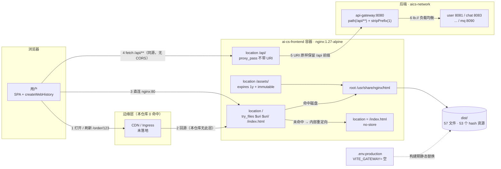
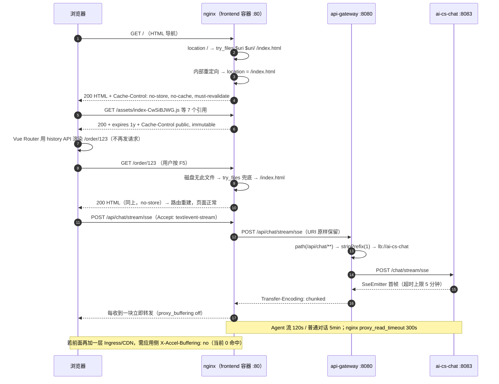

# 16. 前端上线实战：产物、路由、缓存、代理、回滚

> **一句话结论**：`npm run build` 只是产出一个 dist 目录；真正决定"能不能上线"的是五件事同时成立——产物形态（文件名带 content hash）、SPA 路由兜底（`try_files` 到 index.html）、缓存分层（index.html 不缓存 / 带 hash 资源长缓存）、同源反向代理（`/api` 到网关且不重写 URI）、可回滚（旧版本静态资源不被立即删除）。缺任何一件，用户看到的都不是"上线成功"，而是 404、白屏或对话卡死。
> **阅读前置**：读过 [09-前端工程化：Vite构建与规范.md](./09-前端工程化：Vite构建与规范.md)（知道 build 会切 chunk、带 hash）与 [10-浏览器原理与HTTP跨域.md](./10-浏览器原理与HTTP跨域.md)（知道 `Cache-Control`、同源策略、预检）；知道 nginx `location` 的基本写法。
> **证据基线**：B 级证据全部来自本仓库真实文件——`ai-cs-frontend/nginx.conf`（74 行，下称 nginx.conf）、`ai-cs-frontend/Dockerfile`（43 行）、`ai-cs-frontend/vite.config.js`（66 行）、`deploy/docker-compose/docker-compose-all.yml`、`ai-cs-gateway/src/main/java/com/aics/gateway/config/RouteConfig.java`（188 行）；C 级为本机 pwsh / node 24 实跑（dist 静态统计、gzip 压缩比、配置指令命中统计）。凡未在本机实跑的（Docker 构建、curl 抓真实响应头）都明确标注。预计阅读 25~30 分钟。

---

## 0. 先看现象

上线事故的报错往往长得很"前端"，根因却在构建产物与代理配置里。下面三个现场，报错原文都能在 DevTools 控制台/网络面板里逐字看到。

**症状一：刷新任意子路由就 404（首页点进去一切正常）**

```text
GET http://192.168.56.12/order/123 404 (Not Found)
```

页面正文是 nginx 默认错误页（nginx.conf 里 `server_tokens off;`，所以看不到版本号）。判读要点：请求路径 `/order/123` **既不是文件也不是目录**，静态服务器按"磁盘上找不到就 404"处理。首页能打开，只是因为 `/` 命中了 `index.html`；而 SPA 的路由（`createWebHistory()`，见 `ai-cs-frontend/src/router/index.js:33`）全部是浏览器本地渲染出来的假路径，磁盘上永远没有 `order/123` 这个文件。**这条在"直接用 `docker run -v dist:/usr/share/nginx/html` 或把 dist 丢进对象存储"的场景必现**：本仓库 nginx.conf 第 68~70 行有兜底，所以只有绕开这份配置时才会复发。

**症状二：发版之后，一部分用户白屏 + 控制台刷红**

```text
GET http://192.168.56.12/assets/AgentView-uJu70xXP.js 404 (Not Found)
Uncaught TypeError: Failed to fetch dynamically imported module:
    http://192.168.56.12/assets/AgentView-uJu70xXP.js
```

（报错文案是 Chrome/Blink 的原文，hash 段取自本机 `ai-cs-frontend/dist` 快照里的真实文件名。）机制是：用户浏览器里还留着**上一版**的 `index.html`，它引用的是一套旧 hash 的 chunk 文件名；新版本 dist 覆盖上线后，磁盘上只剩新 hash，旧文件名 404 → 动态 `import()` 失败 → 白屏。这不是"某个用户网络差"，而是缓存头没分层：入口 HTML 必须不缓存，带 hash 的资源必须长缓存，两者配错任意一半都会触发。

**症状三：AI 对话"憋"很久然后整段蹦出来，或者直接 504**

```text
POST http://192.168.56.12/api/chat/stream/sse 504 (Gateway Time-out)
net::ERR_INCOMPLETE_CHUNKED_ENCODING
```

DevTools → Network → 选中该请求 → **EventStream** 标签里，本应每几百毫秒一条的消息，时间戳挤在一起、最后一次性刷出。根因是中间层把 chunked 响应攒在缓冲区里，等后端流结束才一次性转发。本仓库 nginx.conf 第 58 行已写 `proxy_buffering off;`，`/api/` 段还有 `Connection ""`（第 57 行）与 `proxy_read_timeout 300s`（第 60 行）——但**全仓 `X-Accel-Buffering` 在 `ai-cs-*` 源码、`deploy/` 和 nginx.conf 里 0 命中**（C 级统计见 §3.5），也就是说这条能力只靠 nginx 侧撑着，一旦换成 Ingress / 云厂商 CDN / 另一台不带这份 conf 的 nginx，症状原样复发。

这些现象指向同一件事：**dist 产物、SPA 路由兜底、缓存头、同源反向代理、可回滚的旧产物——这五件事里任意一件没做对，用户看到的就是"系统坏了"，而构建日志一切正常。**

---

## 1. 整体地图

上线链路上有五个角色：构建器（Vite）、产物（dist）、静态服务器（nginx）、反代出口（同一个 nginx 的 `/api/` 段）、后端网关（8080）。本仓库把前四者塞进了一个镜像里。



> **读图说明**：先看两条纵向主干——**静态路径**（用户→`location /`→磁盘 dist）与**接口路径**（用户→`location /api/`→网关→微服务）。SPA 的"路由"并不是一条请求链路，而是第 3 步里的一次 `try_files` 兜底：只要能拿到 index.html，路由全部在浏览器里完成。第二看 `location /assets/` 与 `location = /index.html` 这两个旁支，它们只做一件事——给同一份 dist 里的不同文件打上相反的缓存头（一个长缓存、一个禁止缓存），这是"发版不白屏"的技术核心。第三看边缘层被画成虚线框并标注"0 命中"：这是本仓库当前的真实缺口，`deploy/` 里没有 frontend 服务、没有 Ingress、没有 CDN 配置（§3.8、§7 给出统计证据）。最后注意第 5 步的"原样保留"：`proxy_pass` 末尾有没有 `/` 决定请求到网关时还叫不叫 `/api/...`，网关路由全部以 `/api/**` 为断言（§3.4）。

组件与责任划分：

| 组件 | 在仓库里的位置 | 责任 | 参与方 | 现状 |
|---|---|---|---|---|
| Vite 构建器 | `ai-cs-frontend/vite.config.js`（66 行） | 切 chunk、生成 content hash 文件名、把 `import.meta.env.*` 静态替换进产物 | 前端开发 | 已落地：`outDir: 'dist'`、`sourcemap: false`、`manualChunks` 函数式 |
| 构建期环境变量 | `ai-cs-frontend/.env.production`（9 行） | 决定产物里写死哪个 API 域 | 前端开发 + 运维 | 已落地：`VITE_GATEWAY=` 留空 → 同源相对路径 |
| 运行时拼接 | `ai-cs-frontend/src/utils/runtime.js`（24 行） | 把空串识别为"同源"，拼出 `API_BASE` | 前端开发 | 已落地（`typeof` 判空，不用 `\|\|`） |
| 静态托管 | nginx.conf 第 14~18 行 `server` 块 | 监听 80、`root` 指向 dist 拷贝位置 | 前端开发 | 已落地 |
| 路由兜底 | nginx.conf 第 68~70 行 | 一切未命中磁盘的路径回 index.html | 前端开发 | 已落地 |
| 缓存策略 | nginx.conf 第 33~37、41~44 行 | 资源长缓存 / HTML 不缓存 | 前端开发 | 已落地（附一处双 `Cache-Control` 隐忧） |
| 压缩 | nginx.conf 第 23~28 行 | gzip 文本类响应 | 前端开发 | 已落地 gzip，brotli 全仓 0 |
| 反向代理 | nginx.conf 第 49~62 行 + 第 8~12 行 `upstream` | 同源转发 `/api`、关缓冲以支持 SSE | 前后端 + 运维 | 已落地，依赖 compose 服务名 |
| 镜像 | `ai-cs-frontend/Dockerfile`（43 行） | 两阶段：node 构建 → nginx 托管 | 前端开发 | 已落地，但**本机无 Docker，未实跑**（Dockerfile 第 8~13 行自述） |
| 健康检查 | Dockerfile 第 40~41 行 | 容器可用性判定 | 运维 | 已落地（探活 `index.html`，无专用 `/healthz`） |
| 编排 | `deploy/docker-compose/docker-compose-all.yml` | 起后端 7 个基础设施 + 7 个服务 | 运维 | **无 frontend 服务**（实测 0 命中） |
| K8s 清单 | `deploy/k8s/services/*.yaml`（8 份） | 服务级 Deployment/Service | 运维 | **无 frontend、无 Ingress** |
| 灰度/回滚 | —— | 旧 hash 资源保留、按版本切流 | 运维 | **完全未落地** |

---

## 2. 关键概念与关键类/关键 API

| 名称 | 位置 | 角色 | 关键点 |
|---|---|---|---|
| `try_files` | nginx.conf:69 | 磁盘优先、兜底 index.html | 最后一个参数是 URI 而非文件，触发**内部重定向**，会重新走一遍 location 匹配 |
| `location = /index.html` | nginx.conf:41 | 精确匹配兜底目标 | 只有用 `=` 才能保证兜底后的那次内部请求落在这段缓存头配置上 |
| `location /assets/` | nginx.conf:33 | 前缀匹配长缓存 | 结尾 `/` 不能省；`/images/`、`/favicon.svg` 不在此前缀下，因此**无长缓存** |
| `expires 1y` | nginx.conf:34 | 生成 `Expires` + `Cache-Control: max-age` | 与下一行的 `add_header Cache-Control` 语义重叠（§3.3 坑） |
| `add_header ... immutable` | nginx.conf:35 | 告诉浏览器"别发校验请求" | `immutable` 只对带 hash 的文件名安全 |
| `no-store` | nginx.conf:42 | 入口 HTML 禁止任何缓存 | 要与 `expires -1` 一起看：`-1` 让 `Expires` 变过去时间 |
| `gzip_min_length 1k` | nginx.conf:24 | 小于 1KB 不压 | 本仓库 `dist/index.html` 791 B，**实际不会被 gzip**（C 级实测） |
| `gzip_types` | nginx.conf:26 | 白名单式压缩 MIME | 默认不含 `text/html`——但 html 是 nginx 内置默认压缩对象 |
| `gzip_vary on` | nginx.conf:28 | 追加 `Vary: Accept-Encoding` | 缺它会让 CDN 把 gzip 版本发给不支持压缩的客户端 |
| `upstream aics_gateway` | nginx.conf:8~12 | 上游具名组 | 里面写死 `api-gateway:8080`（compose 服务名），换 K8s 要改 |
| `proxy_pass http://aics_gateway;` | nginx.conf:50 | 转发且**不重写 URI** | 末尾没有 `/`，请求 `/api/x` 到上游仍是 `/api/x` |
| `proxy_http_version 1.1` + `Connection ""` | nginx.conf:51、57 | 允许长连接与 chunked | SSE 走的正是 chunked 分块传输 |
| `proxy_buffering off` | nginx.conf:58 | 边收边发 | 前端流式的关键开关，与 `X-Accel-Buffering: no` 互为冗余 |
| `proxy_read_timeout 300s` | nginx.conf:60 | 两次读之间的最长间隔 | 必须 ≥ 后端 SseEmitter 超时（5 分钟） |
| `client_max_body_size 20m` | nginx.conf:21 | 请求体上限 | 超限时 nginx 直接回 413，**请求不进后端**，后端日志里查不到 |
| `server_tokens off` | nginx.conf:73 | 隐藏 nginx 版本 | 只影响错误页与 `Server` 头 |
| `import.meta.env.VITE_*` | `.env.production` + `runtime.js:21` | 构建期常量替换 | `VITE_` 前缀才会暴露给前端；替换后是**死值**，一个产物只对应一套环境 |
| `createWebHistory()` | `ai-cs-frontend/src/router/index.js:33` | history 模式路由 | 直接后果：必须服务端兜底，否则刷新 404 |
| content hash 文件名 | 产物 `dist/assets/*` | 内容指纹 | 53/53 个资源带 8 位 hash（C 级）；这是"长缓存 + 立即生效"能共存的前提 |
| `HEALTHCHECK` | Dockerfile:40~41 | 容器探活 | 用 `wget --spider`（busybox 镜像无 curl）；探的是 `index.html` |
| `manualChunks`（函数式） | `ai-cs-frontend/vite.config.js:54` 附近 | 拆包 | Vite 8 底层 rolldown 只接受函数，对象写法直接编译报错 |

---

## 3. 原理与证据逐段精读

### 3.1 产物长什么样：hash 文件名是一切的前提

**在干什么。** `vite build` 把源码打成 `dist/`：入口 `index.html` 里塞进 7 条引用（1 个 favicon、5 个 JS、1 个 CSS），其余页面按路由切成独立 chunk，每个文件名后缀 8 位内容 hash。

C 级实测（node 24 读 `ai-cs-frontend/dist` 快照）：

```text
OK   /favicon.svg                     9522 B
OK   /assets/index-CwSiBJWG.js       11868 B
OK   /assets/rolldown-runtime-hePW80VL.js   716 B
OK   /assets/element-bl3CF7UA.js   1119291 B
OK   /assets/vue-fycMrBjY.js         24751 B
OK   /assets/element-DM8opQMk.css   356555 B
OK   /assets/index-BDeApAtd.css       5267 B
---
引用文件数=7 缺失=0 首屏传输合计=1527970 B (1492.2 KiB)
dist/assets 文件数=53 带8位hash=53
```

怎么读：第一，`缺失=0` 说明 index.html 的引用表和磁盘完全一致——这是发布前的**最小自检**，任何一条 MISS 都意味着构建产物被手工动过或拷贝时漏了目录。第二，53/53 全部带 hash，说明"资源长缓存"没有例外，可以放心用 `immutable`。第三，首屏未压缩就有约 1.46 MiB，其中 `element-*.js`（1,119,291 B）一个文件占 73%——它决定了首屏优化和压缩策略的收益上限。

**为什么这么设计。** hash 文件名把"缓存"从时间维度（`max-age` 到期才更新）变成了内容维度（内容变了文件名就变）。用户浏览器可以永久缓存旧文件而无风险，因为新版本根本不会复用旧文件名。

**换写法会怎样。** 若关掉 hash（比如某些老构建工具默认 `chunk-[name].js`），同一个 URL 的内容会随发版变化。此时只有两条路：要么让浏览器每次都回源校验（等于放弃缓存），要么靠 `max-age` 赌用户多久能看到新版本。前者打满带宽，后者制造"我明明发了版用户还是旧页面"的经典工单。

**常见坑。** `dist/assets` 之外的静态文件不走 `location /assets/`，也就没有长缓存——本仓库 `dist/images/test-earphone.png`（1,018,263 B，来自 `public/` 原样拷贝）和根目录 `favicon.svg` 都属于此类。另外 `public/` 下的文件**不参与 hash**，一旦被替换，命中缓存的老用户会拿到新旧混杂的资源。

### 3.2 SPA 路由兜底：`try_files` 到底兜了什么

**在干什么。** nginx.conf 第 68~70 行：

```nginx
location / {
    try_files $uri $uri/ /index.html;
}
```

按顺序尝试：磁盘上有同名文件 → 直接返回；有同名目录 → 走目录索引；都没有 → 内部重定向到 `/index.html`，由第 41 行那个精确匹配段返回 HTML，浏览器拿到 HTML 后由 Vue Router 用 history API 渲染出 `/order/123` 页面。

**为什么这么设计。** `createWebHistory()` 走的是 HTML5 History API，前端 `router.push` 可以凭空造出 `/order/123` 而不发请求，但用户按 F5 或分享链接时浏览器会真的请求这个路径。服务端不认识它，就必须把它翻译回"入口 HTML"。

**换写法会怎样。** 三种常见替代，各有代价：① 改用 hash 路由（`createWebHashHistory`），URL 变 `/#/order/123`，刷新永远命中 `/`，但链接难看、且 SSR/分享场景不友好；② 用 `error_page 404 /index.html`，能兜底但会把**真正不存在的资源**也返回 200 HTML（`GET /assets/typo.js` 会拿到一坨 HTML，报错更难查）；③ 什么都不做，就是 §0 的症状一。

**常见坑。** `try_files` 最后一项是 **URI**，写成 `/index.html` 会触发内部重定向（会重新匹配 location，正好命中带 `no-store` 的精确段）；若写成文件绝对路径（`/usr/share/nginx/html/index.html`）则不会重定向，会把该段的缓存头绕过去。这是同一份 conf 里 41 行与 69 行必须配合的原因。

### 3.3 缓存三件套：同一份 dist，两套相反的缓存头

**在干什么。** nginx.conf 第 33~37 行给带 hash 的资源打长缓存：

```nginx
location /assets/ {
    expires 1y;
    add_header Cache-Control "public, immutable";
    access_log off;
}
```

第 41~44 行给入口 HTML 打"禁止缓存"：

```nginx
location = /index.html {
    add_header Cache-Control "no-store, no-cache, must-revalidate";
    expires -1;
}
```

**为什么这么设计。** 这是 hash 策略的另一半：HTML 是"版本指针"，它必须每次都是最新的，否则用户永远看不到新版本；资源是"被指针指向的内容"，它必须尽量不被重复下载。两者方向相反，所以必须用**两个 location 精确分割**——按路径前缀切（`/assets/` vs 其他）而不是按文件类型切。

**换写法会怎样。** 若只做长缓存不做 HTML 禁缓存：用户手上是旧 index.html，指向旧 hash，而旧文件已被新部署覆盖 → §0 症状二白屏。若只做 HTML 禁缓存、资源也没长缓存：每次打开都全量回源并 304 校验 53 个 chunk，首屏多几十个 RTT。若给 HTML 也上 `no-cache`（可缓存但需校验）而非 `no-store`：理论上能靠 304 省流量，但一旦中间有代理忽略校验，依然会拿到旧 HTML。

**常见坑（本条是本仓库的真实隐忧）。** `expires 1y` 自身就会生成 `Cache-Control: max-age=31536000`，再叠加 `add_header Cache-Control "public, immutable"`，按 nginx 的语义会输出**两条** `Cache-Control` 响应头。浏览器通常合并理解，但部分 CDN/中间层只取第一条，届时 `immutable` 丢失。**未实跑验证**，判读方法见 §9 练习 2（`curl -I` 数 `Cache-Control` 行数）。修正写法是二选一：要么只留 `add_header Cache-Control "public, max-age=31536000, immutable";`，要么用 `expires` 不加 `add_header`。

第二个坑：`location /assets/` 用前缀匹配，`/assetsfoo` 不会命中，但 `/assets/../index.html` 这类路径会被 nginx 规范化后重新匹配——不需要防御性写法，只要别用 `~ \.js$` 这类正则去匹配缓存，正则匹配优先级容易和 `location = /index.html` 打架。

### 3.4 反向代理与同源：`proxy_pass` 末尾那个 `/` 决定生死

**在干什么。** nginx.conf 第 8~12 行定义上游，第 49~62 行把 `/api/` 整体转给网关：

```nginx
upstream aics_gateway {
    server api-gateway:8080;   # compose 服务名；k8s 需 ConfigMap 覆盖
}

location /api/ {
    proxy_pass http://aics_gateway;      # 注意：末尾没有 "/"
    proxy_http_version 1.1;
    proxy_set_header Host $host;
    proxy_set_header X-Real-IP $remote_addr;
    proxy_set_header X-Forwarded-For $proxy_add_x_forwarded_for;
    proxy_set_header X-Forwarded-Proto $scheme;
    proxy_set_header Connection "";
    proxy_buffering off;
    proxy_cache off;
    proxy_read_timeout 300s;
    chunked_transfer_encoding on;
}
```

**为什么这么设计。** 网关的每一条路由都以 `/api/**` 作为路径断言，再 `stripPrefix(1)` 掉 `/api` 才转发给具体服务。`ai-cs-gateway/src/main/java/com/aics/gateway/config/RouteConfig.java:66` 就是典型：

```java
.route("ai-cs-user", r -> r.path("/api/user/**")
    .filters(f -> addResilience(f.stripPrefix(1), "cb-user", redisRateLimiter, userKeyResolver))
    .uri("lb://ai-cs-user"))
```

knowledge（:71）、rag（:76）、chat（:81）同款；agent 则用 `rewritePath`（:100~107）把 `/api/agent/xxx` 重写成 `/chat/agent/xxx`；`observability`（:87）、`prompt`（:93）、`message`（:114）、`notify`（:119）这几条反而**不剥前缀**。也就是说，`/api` 这个前缀在网关内部是有语义的，前端与网关之间必须原样传递。

**换写法会怎样。** 若把 `proxy_pass` 写成 `http://aics_gateway/;`（**带** URI 的 `/`），nginx 会用 location 匹配到的部分替换掉原路径——`/api/user/login` 到上游变成 `/user/login`，网关所有 `/api/**` 断言全部失配，直接 404/503。这是本仓库最容易踩、也最难从日志看出来的一处：nginx access.log 显示 200/404 正常，网关日志里压根没有这条请求的可读信息。反之，若前端把 `BASE_URL` 写成绝对地址 `http://gateway:8080/api`，同源立刻被破坏，浏览器开始发预检、Cookie 丢失、`Origin` 校验失败，问题会以 CORS 报错的形式暴露。

**常见坑。** ① `Connection ""` 是给 SSE 用的（清掉 `Connection: close`，允许 HTTP/1.1 keep-alive 长连接），漏写会让流在某些代理链路里被立刻掐断；② `upstream` 里写死 `api-gateway:8080` 是 compose 网络里的 DNS 名，K8s 里没有这个 Service 名（清单里叫 `api-gateway` 且 namespace 不同），必须用 ConfigMap 覆盖——nginx.conf 第 8~12 行的注释已经写明这一点；③ 缺 `proxy_set_header Upgrade`/`Connection "upgrade"` 的独立 location，WebSocket 无路可走（§3.7 的真实缺陷）。

### 3.5 SSE 与缓冲：为什么"关掉 buffering"还不够

**在干什么。** `proxy_buffering off;`（第 58 行）+ `chunked_transfer_encoding on;`（第 61 行）让 nginx 每收到一块后端数据就立刻转发；`proxy_read_timeout 300s`（第 60 行）给"两次读之间"留出 5 分钟空档。

**为什么这么设计。** 后端用的是 Spring 的 `SseEmitter`，超时基线与前端体验直接绑定：

- `ai-cs-chat/src/main/java/com/aics/chat/service/impl/ChatServiceImpl.java:156`：`SSE_EMITTER_TIMEOUT = 5 * 60 * 1000L`（5 分钟），:525 用它构造 `SseEmitter`；
- `ai-cs-chat/src/main/java/com/aics/chat/agent/AgentController.java:117`：`AGENT_STREAM_TIMEOUT = 120_000L`，:135 构造 `SseEmitter(AGENT_STREAM_TIMEOUT)`；
- `ai-cs-chat/src/main/java/com/aics/chat/service/impl/VisionChatServiceImpl.java:205`：多模态 `new SseEmitter(60_000L)`。

所以 nginx 侧的读超时必须 **≥ 300s**，否则后端还没超时，nginx 先把连接掐了，前端表现为"聊到一半断线"。

**换写法会怎样。** 若用默认 `proxy_buffering on`，nginx 会攒够缓冲（默认 4k/8k 级）才发——SSE 每帧很小，攒不满就一直在缓冲里，用户看到"转圈很久然后整段蹦出"（§0 症状三）。若把 `proxy_read_timeout` 设成默认 60s，Agent 场景（120s 上限）必然在中途断。

**常见坑（真实缺口）。** nginx 侧关缓冲区只对"这台 nginx"有效。应用侧从未声明 `X-Accel-Buffering: no`——C 级统计：全仓该字符串命中 7 处，**全部位于 learning-docs 文档**，`ai-cs-*` 源码、`deploy/`、nginx.conf 均为 0 命中。这意味着一旦前面加一层 Ingress 或云 CDN，流式体验立刻退化。第二个坑：不要为了省流量给 `text/event-stream` 加 gzip——本仓库 `gzip_types`（第 26 行）没有列它，是对的；如果哪天有人"顺手"写下 `gzip_types *`，流会被压缩缓冲二次攒批。

### 3.6 构建期注入：一个产物只能对应一套环境

**在干什么。** `ai-cs-frontend/.env.production` 只有两行有效配置：

```dotenv
VITE_GATEWAY=
VITE_APP_VERSION=1.0.0
```

`VITE_GATEWAY` 故意留空。运行时由 `ai-cs-frontend/src/utils/runtime.js:14` 处理：

```javascript
export function resolveGateway(env) {
  const raw = env?.VITE_GATEWAY;
  if (typeof raw !== 'string') return '';        // 不是字符串就算"没配"
  return raw.trim().replace(/\/+$/, '');          // 去掉结尾斜杠
}
```

留空 → 返回空串 → `API_BASE = '' + '/api' = '/api'`（:24），于是所有请求都是同源相对路径，正好落进 nginx 的 `location /api/`。

**为什么这么设计。** 生产环境前面有 nginx 做同源反代，前端**不需要**知道后端在哪个 host。多写一个绝对地址就多一处出错可能，也多一次 CORS 风险。而开发环境（`ai-cs-frontend/.env.development`）里 `VITE_GATEWAY=http://localhost:8080`、`VITE_PROXY_TARGET=http://localhost:8080`，靠 `vite.config.js:24~42` 的 dev proxy 抹平差异。

**换写法会怎样（C 级验证过的老坑）。** 老写法是 `env.VITE_GATEWAY || 'http://localhost:8080'`。跑一下：

```text
$ node -e "const e={VITE_GATEWAY:''}; console.log(JSON.stringify(e.VITE_GATEWAY || 'http://localhost:8080'))"
"http://localhost:8080"
```

空串是 falsy，`||` 直接把它当"没配"兜底成 localhost——生产产物里就会写死 `http://localhost:8080`，用户浏览器请求自己的机器，全线失败。改成 `typeof` 判空后返回 `""`，正确。这条 repo 里已经修好，`runtime.js` 的文件头注释也专门记了这件事。

**常见坑。** ① `import.meta.env.*` 是**构建期常量替换**，不是运行时读取：打出来的 `dist` 里 `VITE_GATEWAY` 的痕迹已经消失，换环境只能重新构建。想"一份产物多环境部署"必须改成运行时配置（例如入口前注入 `window.__APP_CONFIG__`，或启动时先 fetch `/config.json`）。② 验证注入是否生效的最快办法是搜产物：C 级实测 `Select-String dist\assets\*.js -Pattern 'localhost:8080'` → **0 命中**；源码里 localhost 只剩下注释、测试文件和 `NotifyView.vue:114`。③ `.env.local` 优先级高于 `.env.production`，本地构建时若存在会被悄悄带上；`.dockerignore`（28 行）排除了 `*.local` 与 `.env.local`，但**保留**了 `.env.production`（构建需要它），这一点必须保持。

### 3.7 压缩：gzip 已落地，brotli 是 0

**在干什么。** nginx.conf 第 23~28 行五条指令：`gzip on`、`gzip_min_length 1k`、`gzip_comp_level 5`、`gzip_types ...`、`gzip_vary on`。

C 级实测（node `zlib.gzipSync`，level 5，与 nginx 同一算法家族，量级可直接参考）：

| 文件 | 原始 | gzip 后 | 压缩率 |
|---|---|---|---|
| `element-bl3CF7UA.js` | 1,119,291 B | 349,686 B | 68.8% |
| `charts-DTbrIw2f.js` | 1,027,047 B | 336,006 B | 67.3% |
| `element-DM8opQMk.css` | 356,555 B | 48,971 B | 86.3% |
| `index-CwSiBJWG.js` | 11,868 B | 4,381 B | 63.1% |
| `index.html` | 791 B | 379 B | 52.1% |

怎么读：JS/CSS 能压掉 63%~86%；把这 7 个首屏引用整体压一遍，**1,527,970 B → 416,260 B（1.46 MiB → 0.40 MiB，降幅 72.8%）**——这是全篇性价比最高的一条配置。而最后一行的 `index.html` 只有 791 B，小于 `gzip_min_length 1k`，**实际不会被压缩**：791 B 的 HTML 压不压差别可以忽略，不必改阈值。

**为什么这么设计。** `gzip_comp_level 5` 是 CPU/收益的甜点区（1 快但收益低，9 慢但边际收益很小）；`gzip_vary on` 输出 `Vary: Accept-Encoding`，避免 CDN 把压缩版本发给不支持的客户端；`gzip_types` 只列文本类 MIME，图片（png/jpg）本身已压缩，再 gzip 纯浪费 CPU。

**换写法会怎样。** 若不压缩直接上线，1.46 MiB 首屏在弱网下多等数秒。若把 `gzip_comp_level` 拉到 9，每个请求多耗 CPU，收益通常不到 2 个百分点。

**常见坑。** brotli 比 gzip 再好 15%~20%，但**本仓库没有**：C 级统计 brotli 全仓仅 2 处命中（都在 learning-docs 文档里），nginx.conf 0 命中；而且官方 `nginx:1.27-alpine` 镜像不内置 `ngx_brotli` 模块，要上 brotli 得换 openresty 或自编译镜像——这不是改一行配置能解决的事，先不要在做不到的前提下把它写成"已支持"。第二个坑：`gzip_types` 里的 `application/x-javascript` 是历史遗留 MIME，现代构建产物用的是 `application/javascript`，两者都保留即可，别为了"清理"删掉前者。

### 3.8 Docker 化与健康检查：镜像能不能自证可用

**在干什么。** `ai-cs-frontend/Dockerfile`（43 行）两阶段：

```dockerfile
FROM node:22-alpine AS build
WORKDIR /app
COPY package.json package-lock.json ./
RUN npm ci
COPY . .
RUN npm run build

FROM nginx:1.27-alpine
COPY nginx.conf /etc/nginx/conf.d/default.conf
COPY --from=build /app/dist /usr/share/nginx/html
EXPOSE 80
HEALTHCHECK --interval=30s --timeout=3s --start-period=5s --retries=3 \
  CMD wget -q --spider http://127.0.0.1/index.html || exit 1
CMD ["nginx", "-g", "daemon off;"]
```

**为什么这么设计。** ① 两阶段让最终镜像不含 node_modules 与源码，体积只跟 nginx 基础镜像有关；② `COPY package*.json` 单独一层再 `npm ci`，利用层缓存——源码改动不会让依赖重装；③ `nginx.conf` 直接覆盖 `/etc/nginx/conf.d/default.conf`，避免官方镜像自带的默认 server 抢占 80 端口；④ `HEALTHCHECK` 用 `wget --spider` 而不是 `curl`，因为 nginx:alpine 基于 busybox，没有 curl；⑤ `daemon off;` 让 nginx 留在前台，容器的主进程才是 nginx，`docker stop` 才能收到信号优雅退出。

**换写法会怎样。** 如果只写 `FROM nginx` + `COPY dist`，构建期与运行期混在一起，每次发版都得在 CI 里先装 node 环境；如果 `COPY . .` 放在 `npm ci` 之前，任何一次源码改动都会作废依赖层缓存，构建时间成倍上涨；如果漏了 `COPY nginx.conf`，容器跑的是**官方默认配置**——没有 `try_files`、没有 `/api/` 反代，前端表现为"首页能开、刷新 404、所有接口 404"三件套同时出现。

**常见坑（真实缺口）。** ① 健康检查探的是 `/index.html`，只能证明"nginx 起来了且静态文件在"，不能证明 `/api/` 反代通；若网关挂了，容器依然 healthy。要真正判定可用性，得加一个 `location = /healthz` 自检段（或探一个能打通网关的端点）。② `Dockerfile` 第 8~13 行的注释写明"本机没有安装 Docker，未实跑"，并给了待跑命令（`docker build` → `docker run -p 8081:80` → `curl -I`）。**本文所有 Docker 相关结论都是读文件得出的，没有真实构建记录**，务必按 §9 练习自己在有 Docker 的机器上补跑。

### 3.9 编排与"根本没上线"：deploy 里没有 frontend

**在干什么（这是本篇最重要的一条证据）。** 翻 `deploy/docker-compose/docker-compose-all.yml`，服务清单是：`mysql`(:9)、`redis`(:33)、`nacos`(:52)、`elasticsearch`(:82)、`rocketmq-namesrv`(:107)、`rocketmq-broker`(:126)、`minio`(:144)、`api-gateway`(:166)、`user-service`(:183)、`knowledge-service`(:203)、`ai-chat-service`(:224)、`search-service`(:244)、`message-service`(:264)、`notify-service`(:285)。**没有 frontend，也没有 nginx。**

C 级统计：

```text
PS> Get-ChildItem deploy -Recurse -Include *.yml,*.yaml | Select-String 'frontend|nginx|Ingress'
（0 行输出）
PS> # 全仓 kind: Ingress（排除 node_modules/dist/learning-docs）→ 0
```

`deploy/k8s/services/` 下只有 8 份清单（ai-chat / api-gateway / knowledge / message / notify / product / search / user），同样没有前端。

**为什么这是个问题。** 也就是说：Dockerfile 和 nginx.conf 都写好了，但它们**没有任何编排入口去使用**。前端上线目前只有"手工 build 后拷 dist"这一条路径，而这条路径恰好绕过了 `try_files`、缓存头、`/api` 反代三个关键配置——于是前面所有精读都停留在"设计上正确"。

**换写法会怎样（对齐现有约定）。** 加 frontend 服务时照抄仓库里已有的清单风格即可。`deploy/k8s/services/user-service.yaml` 是现成模板：namespace `ai-customer-service`、Service ClusterIP 暴露命名端口 `http`、Deployment `replicas: 1`、`resources` requests 100m/256Mi + limits 500m/512Mi、liveness/readiness 分别用 `tcpSocket`。但**不要照抄它的镜像策略**：

```yaml
# deploy/k8s/services/user-service.yaml:46~48（现状）
image: 192.168.56.12:5000/aics/user-service:latest
imagePullPolicy: IfNotPresent
```

`latest` + `IfNotPresent` 的组合意味着：节点上已有同名 tag 就不会重新拉取，**发版和回滚都失效**（`kubectl set image` 改了 tag 才生效，改内容不生效）。前端要多一个坑：镜像里的静态资源是构建时固化进去的，`latest` 覆盖式发布还会顺手删掉上一版的 hash 文件，直接制造 §0 症状二。

**常见坑。** ① compose 里的 `upstream` 服务名依赖网络别名 `aics-network`（compose 第 302 行），若把 frontend 放进另一个 network，`api-gateway` 这个名字解析不到，容器启动即 `host not found in upstream`；② 前端不需要连 MySQL/Redis，但需要 `depends_on: api-gateway`（只保证启动顺序，不保证就绪）；③ 清单里没有任何 CDN 配置：C 级统计 `cdn` 全仓（排除 node_modules/dist/learning-docs）仅 2 处命中，都在 `ai-cs-frontend` 里的 `package-lock.json`（jsdelivr 之类的外链来源），属于依赖来源而非部署配置。

---

## 4. 一次完整执行时序

下面把"用户打开首页 → 刷新子路由 → 发一次流式对话"串成一条时间线，对应 nginx.conf 的每一段配置。



> **读图说明**：第 1~3 步是"静态路径"，关键在**第 3 步的内部重定向**——兜底不是把文件内容直接吐出去，而是重新走一遍 location 匹配，所以缓存头由 `location = /index.html` 决定（这也是为什么 `try_files` 的最后一项必须写 URI）。第 6~7 步是"刷新子路由"，它和第 1 步走的是同一段配置，区别只在于 `$uri` 一开始不存在。第 10 步是"接口路径"的起点，注意 nginx 侧没有做任何 rewrite，`/api` 前缀一路带到网关，直到网关自己 `stripPrefix(1)`。第 15 步是流式的分水岭：`proxy_buffering off` 决定浏览器能不能"打字机式"逐字看到回复。两个 Note 标注了整条链路上最容易被忽略的两个时间/头部约束。

各步失败的报错对照（哪里断，用户看到什么）：

| 断在哪一步 | 用户/控制台表现 | 定位手段 |
|---|---|---|
| 3（无 `try_files`） | `404 Not Found` + nginx 默认页 | `curl -I http://host/order/123` 看是否 200 |
| 5（HTML 被缓存） | 白屏、`Failed to fetch dynamically imported module` | DevTools 看 index.html 响应头的 `Cache-Control` |
| 6/7（资源被删） | `GET /assets/xxx-hash.js 404` | 比对 `dist/index.html` 引用表与实际文件 |
| 10（`proxy_pass` 带 `/`） | 接口 404/503，网关日志无请求 | `curl -s http://host/api/user/ping` 与直连网关对比 |
| 11（网关路由未匹配） | 网关返回 404，`X-Forwarded-*` 头可查 | 网关 access log 的 path 字段 |
| 13（后端超时） | 前端收到 `event: error` 或连接中断 | 后端日志 + nginx `error.log` 的 `upstream timed out` |
| 15（`proxy_buffering on`） | 长时间转圈后整段蹦出 | EventStream 面板时间戳挤在一起 |
| 上传超大文件（`client_max_body_size` 之前） | `413 Request Entity Too Large` | **后端无日志**，只有 nginx access.log 有记录 |
| 网关不可达 | `502 Bad Gateway` | `host not found in upstream` 会在 nginx 启动阶段就报 |

---

## 5. 设计取舍

| 决策点 | 本仓库选择 | 换来什么 | 付出什么 | 替代方案 |
|---|---|---|---|---|
| 静态托管方式 | 镜像内 nginx（`COPY --from=build`） | 与后端同一套编排、无额外组件 | 每次发版要重建镜像、无法秒级回滚 | 对象存储 + CDN（需额外缓存失效流程） |
| 前端与网关的关系 | nginx 同源反代 `/api/` | 零 CORS、无预检、Cookie 天然可用 | nginx 成为单点，需自己保证上游可达 | 直接跨域 + CORS 白名单（配置面更大） |
| 路由模式 | `createWebHistory` + `try_files` | URL 干净、可分享 | 依赖服务端兜底配置 | hash 路由（无需服务端配合，URL 变丑） |
| 缓存分层 | hash 资源 `immutable` + HTML `no-store` | 老用户立即拿到新版本且不重下资源 | 要求文件名必须带 hash | 全站 `no-cache`（每次全量校验） |
| 压缩 | 仅 gzip（level 5） | 零额外依赖、省 63%~86% | 比 brotli 差 15%~20% | 自编译 nginx + brotli / 上 CDN 自动压缩 |
| 流式实现 | nginx `proxy_buffering off` | 一行配置见效 | 换代理层即失效，缺应用侧 `X-Accel-Buffering` | 应用侧显式声明 + 代理侧双保险 |
| 环境变量 | 构建期注入（`.env.production`） | 零运行时开销、产物可静态托管 | 一份产物只能对应一套环境 | 运行时 `/config.json`（多环境复用同一镜像） |
| 健康检查 | `wget --spider /index.html` | 不引入额外依赖 | 只证明静态站点活着，不证明反代可用 | 专用 `/healthz` + 反代探测 |
| 发布策略 | 无（deploy 里没有 frontend） | —— | 发版=覆盖，回滚=再构建一次 | 版本目录 + 软链切换，或 Deployment 双版本 |

可扩展点清单（按"投入产出比"排序，前三条是当前最该补的）：

1. **把 frontend 纳入编排**：compose 加一个 `frontend` 服务（`build: ../ai-cs-frontend` + `ports: 80:80` + `depends_on: api-gateway` + `networks: aics-network`），或在 deploy/k8s/services 下补一份 frontend 的 Deployment + Service 清单（照抄 user-service.yaml 的结构，去掉所有后端 env）。
2. **版本化静态目录 + 软链**：`/usr/share/nginx/html` 变成指向 `/data/releases/20261127-a1b2c3` 的软链，容器内 `nginx -s reload` 即完成切换；旧目录保留 N 个版本 → 实现灰度与秒级回滚。
3. **加 `location = /healthz`**：`return 200 'ok';` 或探一个轻量接口，把 `HEALTHCHECK` 与 K8s `readinessProbe` 指过去。
4. **`X-Accel-Buffering: no` 落到代码**：在 SSE 端点响应头显式声明，摆脱对单台 nginx 配置的依赖。
5. **WebSocket 独立 location**：`location /ws/ { proxy_http_version 1.1; proxy_set_header Upgrade $http_upgrade; proxy_set_header Connection "upgrade"; proxy_pass http://aics_gateway; }`。
6. **brotli / HTTP/2 / TLS**：需换基础镜像或加证书，属结构性改动。
7. **CDN + 刷新流程**：接 CDN 后必须配套"发版 → 刷新 index.html 缓存"的自动化步骤。
8. **前端可用性监控**：接 [04-Prometheus可观测性.md](../07-运维部署/04-Prometheus可观测性.md) 的思路，把 `/healthz` 纳入探针，并上报前端运行时错误。
9. **`keepalive` 连接池**：`upstream` 里加 `keepalive 32;` + `proxy_set_header Connection ""`，减少与网关的 TCP 重建（当前 nginx.conf 无 keepalive）。

---

## 6. 踩坑与调试手法

先给一张速查表（现象 → 根因 → 验证），后面三条是具体操作手法。

| # | 现象 | 根因 | 一条命令/一个面板验证 |
|---|---|---|---|
| 1 | 刷新子路由 404 | 缺 `try_files` 或 `index` 未配 | `curl -I http://host/order/123` 看状态码 |
| 2 | 发版后白屏、动态 chunk 404 | index.html 被缓存 / 旧 hash 资源被删 | DevTools 看 index.html 的 `Cache-Control`；比对引用表 |
| 3 | 流式对话整段蹦出 | `proxy_buffering on` 或中间层缓冲 | EventStream 面板时间戳；`curl -N` |
| 4 | 上传大文件 413 | `client_max_body_size` 太小 | 后端日志**无记录**，只有 nginx access.log 有 |
| 5 | WebSocket 连不上（`ERR_CONNECTION_REFUSED`） | 前端硬编码 `ws://localhost:8085`，且 nginx 无 `/ws/` | DevTools → Network → WS 看握手 URL |
| 6 | 接口 404 但网关没日志 | `proxy_pass` 末尾多写了 `/` | 对比 `curl http://nginx/api/x` 与 `curl http://gateway:8080/api/x` |
| 7 | 换环境后请求打到 localhost | `.env` 未生效或 `\|\|` 兜底 | 搜产物：`Select-String dist\assets\*.js -Pattern 'localhost'` → 应为 0 |
| 8 | 容器启动即退出 | nginx 配置语法错 / upstream 域名解析不到 | `docker logs` 首屏 + `nginx -t` |

**手法一：用 DevTools Network 面板把"缓存"这件事变成可观测的。**

复现 §0 症状二的标准流程：① 打开 DevTools → Network，勾上 **Disable cache** 先正常访问一次；② 取消勾选，刷新，确认 `index.html` 的响应头里有 `Cache-Control: no-store`（若无，就是病因）；③ 勾上 **Preserve log**，然后在发版瞬间连点几次刷新，观察是否出现 `(disk cache)` 状态的旧文件与 404 交替出现。资源请求看 **Size** 列——`(disk cache)`/`(memory cache)` 表示没走网络，`304` 表示走了校验，`200` 表示重新下载。三者的分布直接告诉你缓存策略是"太松"还是"太紧"。

**手法二：用 EventStream 面板 + `curl -N` 判断是不是缓冲问题。**

DevTools → Network → 选中 SSE 请求 → **EventStream** 标签，正常表现是消息随时间逐条出现、间隔几百毫秒；异常表现是所有消息时间戳挤在末尾。要排除浏览器因素，用命令直连：

```bash
# 未在本机实测（需运行中的网关与已登录 token），给命令与判读方法
curl -N -H 'Accept: text/event-stream' -H 'Authorization: Bearer <token>' \
     http://localhost/api/chat/stream/sse
```

判读：`-N` 关掉 curl 自己的输出缓冲；若终端里逐条打印，说明链路没问题，问题在浏览器或 DevTools 显示；若终端也一次性刷出，就继续往上游查——把 `http://localhost/api/...` 换成直连 `http://localhost:8080/api/...` 再试，直连正常而经 nginx 阻塞，即可定位到 `proxy_buffering`（对应 nginx.conf 第 58 行）。

**手法三：用 `curl -I` 逐条核对缓存三件套。**

```bash
# 未在本机实测，需一个跑起来的 frontend 容器
curl -I http://localhost/assets/index-CwSiBJWG.js     # 期望 200 + Cache-Control 带 immutable + Expires 一年后
curl -I http://localhost/index.html                   # 期望 Cache-Control: no-store, no-cache, must-revalidate
curl -I http://localhost/order/123                    # 期望 200（内容是 HTML），不是 404
curl -I http://localhost/api/user/ping                # 期望不是 404（404 说明 /api 前缀被 rewrite 掉了）
```

怎么读：① 数 `Cache-Control` 出现几次——两次就是 §3.3 说的 `expires` + `add_header` 叠加，需要改配置；② 看 `/order/123` 的 `Content-Type` 是不是 `text/html`，如果返回 `application/json` 说明兜底落到了 `/api`；③ `/api/user/ping` 返回 502 是上游不可达（`upstream` 名字解析不到），返回 404 才是路径被改写。

**手法四：定位"配置到底生效没"——让 nginx 自己交代。**

```bash
docker exec <frontend容器> nginx -t          # 语法检查，改配置后必须先跑这条
docker exec <frontend容器> nginx -T | grep -nE 'try_files|proxy_pass|Cache-Control'
docker exec <frontend容器> nginx -s reload   # 热加载，不中断连接（SSE 长连接会被重置）
```

`nginx -T` 会打印**合并后的完整配置**，是排查"我明明改了 conf 怎么没生效"的终极手段——常见原因是：文件挂载的是 `conf.d/default.conf` 但官方镜像 `nginx.conf` 里 `include` 的目录不同，或覆盖了 `/etc/nginx/nginx.conf` 导致 `http {}` 块整个丢失。

**手法五：断点定位"环境变量到底在第几步失效"。**

`import.meta.env` 是构建期替换，运行时调试不了，所以断点要打在两个位置：① `ai-cs-frontend/vite.config.js:9` 的 `loadEnv(mode, process.cwd(), '')` 之后，看 `env.VITE_GATEWAY` 是什么；② `ai-cs-frontend/src/utils/runtime.js:21` 的 `export const GATEWAY = resolveGateway(import.meta.env)` 这一行，看生产包里的实际值（DevTools → Sources 里搜索 `resolveGateway`，或在控制台打印模块导出）。若两者都正确但请求仍打到错误地址，就去搜产物（手法见坑 7）。

---

## 7. 版本差异

| 旧写法 / 旧认知 | 当前基线（本仓库） | 变化点 | 迁移动作 |
|---|---|---|---|
| 旧稿称"package.json 有 145+ 个 devDependency" | `ai-cs-frontend` 里的 `package.json` 实际 **10 个** devDependencies、7 个 dependencies | 依赖数量被记错一个量级 | 看到"145+"这类数字先 `node -p` 数一遍再写进文档 |
| `env.VITE_GATEWAY \|\| 'http://localhost:8080'` | `runtime.js:14` 用 `typeof raw !== 'string'` 判空 | 空串是 falsy，`\|\|` 会把生产打回 localhost | 已修复；新增环境变量沿用 `typeof` 判空模式 |
| `manualChunks` 写成对象（`{ vue: ['vue'] }`） | `vite.config.js:54` 用函数形式 | Vite 8 底层换成 rolldown，对象写法报 `Invalid type: Expected Function but received Object` | 拆包规则一律写成 `(id) => ...` 函数 |
| 构建镜像用较老 node | `Dockerfile:16` `FROM node:22-alpine AS build`（本机 node 24） | 构建环境与开发环境大版本不同 | CI 与镜像尽量对齐同一 LTS；注意 `package-lock.json` 的 lockfileVersion 兼容性 |
| 只靠 `expires` 表达缓存 | 现在 `expires 1y` + `add_header Cache-Control "public, immutable"` 并存 | 两者语义重叠，可能输出两条 `Cache-Control` | 二选一；改完用 `curl -I` 数一遍（§9 练习 2） |
| 只写 gzip | 仍只写 gzip，brotli 全仓 0 命中 | 官方 `nginx:1.27-alpine` 不含 brotli 模块 | 想上 brotli 需换 openresty / 自编译，属结构性改动 |
| 认为"前端已 Docker 化即可上线" | `deploy/` 里 frontend 服务、Ingress **均为 0 命中** | Dockerfile 写好了但没人用 | 补 compose 服务或 k8s 清单（§5 扩展点 1） |
| React 版与 Vue 版视为等价 | `ai-cs-frontend-react/vite.config.js` 仅 11 行：无 `server.proxy`、无 `build` 配置、工程内**无 `.env*` 文件** | React 版没有同源代理与环境分层 | 直接上线会跨域；需补 `server.proxy` 与 `.env.production`，或复刻 nginx 方案 |
| WebSocket 直连写死端口 | `ai-cs-frontend/src/views/NotifyView.vue:114` 仍为 `new WebSocket('ws://localhost:8085/ws/notify')` | 生产必失败：localhost 指向用户本机，且 nginx 无 `/ws/` location | 改为同源相对路径 + 协议跟随（`wss`/`ws`）+ nginx 加 upgrade location（§5 扩展点 5） |
| SPA 兜底"知道要做" | nginx.conf:69 已落地 `try_files` | 旧稿讲了三年的 `try_files`，直到这份 conf 才真正写进仓库 | 别再假设"文档写了=工程做了"，以文件为准 |

---

## 8. 面试高频问与答

1. 前端项目 `npm run build` 之后的产物结构是什么？为什么文件名里要带 hash？
2. SPA 用 history 路由时，刷新子页面为什么会 404？服务端要做什么？`error_page 404` 方案有什么副作用？
3. `try_files $uri $uri/ /index.html` 三个参数分别是什么？最后一项为什么写 URI 而不是文件路径？
4. 为什么 `index.html` 要禁止缓存，而带 hash 的静态资源可以长缓存？两者配错任意一半会发生什么？
5. `Cache-Control: no-store` 与 `no-cache`、`max-age` 的区别是什么？`immutable` 解决什么问题？
6. `proxy_pass http://backend;` 与 `proxy_pass http://backend/;` 的行为差异是什么？在什么场景下会导致接口全部 404？
7. 前端与后端为什么优先走同源反向代理而不是直接跨域？同源能省掉哪些环节？
8. SSE 流式响应经过 nginx 时为什么会"攒成一批"？`proxy_buffering off` 和 `X-Accel-Buffering: no` 的关系是什么？
9. `import.meta.env.VITE_XXX` 是运行时变量还是构建期常量？同一份产物要部署到多个环境该怎么办？
10. 前端镜像用多阶段构建解决了什么问题？为什么 `HEALTHCHECK` 里用 `wget` 而不是 `curl`？
11. 前端发布的灰度与回滚怎么做？为什么说"旧版本的静态资源必须保留"？镜像 tag 用 `latest` 有什么坑？
12. 上线后用户报"页面白屏"，你的排查顺序是什么？会用哪些面板、哪些命令？
13. 前端也需要可用性监控吗？一个只探 `index.html` 的健康检查有哪些盲区？
14. gzip 和 brotli 的差异？为什么 `gzip_min_length` 设太小反而浪费 CPU？

---

## 9. 动手练习

**练习 1：静态统计你自己机器的 dist。**
在 `ai-cs-frontend` 下执行 `npm run build`（本文未跑，请自行执行），然后用 node 遍历 `dist`：统计文件总数、总字节数、`assets` 下带 8 位 hash 的文件比例、`dist/index.html` 引用的每个文件是否存在。
验收标准：输出"引用文件数 / 缺失数 / 首屏未压缩合计字节"三行；缺失数必须为 0；hash 比例应为 100%。

**练习 2：用 `curl -I` 核对缓存三件套。**
起一个 frontend 容器（`docker build -t aics/frontend:local .` → `docker run --rm -p 8081:80 aics/frontend:local`），对 `/assets/<任一hash文件>`、`/index.html`、`/order/123`、`/api/user/ping` 各发一次 `curl -I`。
验收标准：四个状态码分别符合 §6 手法三的期望；并且能回答"`/assets/` 响应里 `Cache-Control` 出现了几次"，若出现两次，写出你的修正方案（改 nginx.conf 哪一行、改成什么）。

**练习 3：亲手制造一次"白屏"，再修回来。**
把 `location = /index.html` 那段临时改成 `expires 1h`（即允许缓存 HTML），重新构建运行；先在浏览器里访问一次，然后改一个组件文案、重新部署，再刷新。
验收标准：能复现 `Failed to fetch dynamically imported module` 或"看到旧页面"两种现象之一，并在报告里写出：① 复现步骤；② DevTools 里哪一列证据指向缓存；③ 改回 `no-store` 后现象消失。

**练习 4：验证 `proxy_pass` 末尾斜杠的语义。**
把 nginx.conf 第 50 行改成 `proxy_pass http://aics_gateway/;`，reload 后访问任一带鉴权信息的 `/api/` 接口。
验收标准：记录改动前后的 `curl -i` 输出差异（状态码 + 响应体），并能解释为什么网关侧路由全部失配——请结合 `ai-cs-gateway/src/main/java/com/aics/gateway/config/RouteConfig.java:66` 的 `path("/api/user/**")` + `stripPrefix(1)` 说明。测完务必改回。

**练习 5：给 frontend 补一个健康检查端点并验证。**
在 nginx.conf 的 `server` 块里加 `location = /healthz { access_log off; return 200 'ok'; add_header Content-Type text/plain; }`，把 Dockerfile 的 `HEALTHCHECK` 改成探 `/healthz`。
验收标准：`curl -i http://localhost:8081/healthz` 返回 200 且体为 `ok`；`docker inspect --format '{{.State.Health.Status}}' <容器>` 为 `healthy`；并说明它与探 `/index.html` 相比多覆盖了什么、仍然漏掉了什么（提示：反代是否可用）。

**练习 6：设计一份"可回滚"的发布方案。**
不用真的部署，写一份方案：静态资源按版本目录存放（如 `/data/releases/<时间戳>-<sha>`），`/usr/share/nginx/html` 用软链指向当前版本，保留最近 N 个版本；给出发布、回滚、以及"回滚后老用户手上旧 index.html 仍能加载"的完整命令序列。
验收标准：方案里必须包含 ① 发布命令；② 回滚命令（含 `nginx -s reload`）；③ 旧版本保留策略与清理时机；④ 一句话解释为什么"删旧版本"会直接导致白屏。

---

## 小结

- 上线是**五件事同时成立**：带 hash 的产物、`try_files` 兜底、缓存分层、同源反代、可回滚的旧产物。构建成功不代表任何一件成立。
- 缓存必须分层：入口 HTML `no-store`，带 hash 的资源 `immutable`。两者方向相反，所以要用 `location = /index.html` 的**精确匹配**单独切割，并让 `try_files` 通过内部重定向落进这一段。
- `proxy_pass` 末尾的 `/` 是语义开关：不写 `/` 才会原样保留 `/api` 前缀，网关的 `path("/api/**") + stripPrefix(1)` 才匹配得上。
- 流式的两半：nginx 侧 `proxy_buffering off`（已落地）与应用侧 `X-Accel-Buffering: no`（**全仓 0 命中**）。只做一半，换代理层就复发。
- `import.meta.env.*` 是构建期常量替换，一份产物只对应一套环境；判空必须用 `typeof`，不能用 `||`（空串是 falsy，会把生产打回 localhost）。
- 本仓库最真实的三处缺口：`deploy/` 里没有 frontend 服务与 Ingress（0 命中）、没有 CDN 与 brotli 配置、`NotifyView.vue:114` 硬编码 `ws://localhost:8085` 且 nginx 无 `/ws/` location。
- 可操作归纳：下次上线前，按 §6 手法三的四条 `curl -I` 打一遍，再确认 `dist/index.html` 引用表零缺失、上一版静态目录还在磁盘上——这三步全绿，五件事才算同时成立。

---

## 自测题

<details>
<summary>1. 为什么 SPA 用 history 路由后，刷新 `/order/123` 会 404？</summary>

**参考答案**：`/order/123` 是前端路由在浏览器里渲染出来的路径，磁盘上没有对应文件。静态服务器按"找不到就 404"处理。需要服务端兜底：`try_files $uri $uri/ /index.html`，把未命中磁盘的路径内部重定向到入口 HTML，再由 Vue Router 渲染。
</details>

<details>
<summary>2. `try_files` 最后一项为什么写 `/index.html`（URI）而不是文件绝对路径？</summary>

**参考答案**：写 URI 会触发 nginx 的**内部重定向**，重新走一遍 location 匹配，从而命中 `location = /index.html` 那段（带 `no-store` 头的配置）。写文件绝对路径则直接把文件内容返回，绕过该段 location，缓存头丢失。
</details>

<details>
<summary>3. 如果只把 `error_page 404 /index.html` 当作兜底，会有什么副作用？</summary>

**参考答案**：所有 404 都被改写成 200 + HTML，包括真正不存在的静态资源（如拼错的 `/assets/typo.js`）。浏览器拿到 HTML 却按 JS 解析，报错信息变成 `Unexpected token '<'` 之类，排查成本大幅上升。`try_files` 只兜"路径不存在"这一种情况，语义更精确。
</details>

<details>
<summary>4. `no-store`、`no-cache`、`max-age=31536000, immutable` 三者的区别？</summary>

**参考答案**：`no-store` 完全不写缓存、每次都必须重新下载；`no-cache` 允许存但每次使用前必须回源校验（可返回 304）；`max-age` 在有效期内直接用缓存不发请求；`immutable` 进一步告诉浏览器"有效期内连校验都不要发"，只对带 hash 的文件名安全。
</details>

<details>
<summary>5. 本仓库 nginx.conf 里 `/assets/` 段的 `expires 1y` 和 `add_header Cache-Control "public, immutable"` 并存，可能有什么问题？</summary>

**参考答案**：`expires 1y` 自身会生成 `Cache-Control: max-age=31536000`，再叠加 `add_header` 会输出两条 `Cache-Control` 头。浏览器通常能合并理解，但部分 CDN/中间层只取第一条，导致 `immutable` 丢失。修正：二选一，只写 `add_header Cache-Control "public, max-age=31536000, immutable";`。是否真出现两条需用 `curl -I` 验证（本文未实测）。
</details>

<details>
<summary>6. 发版后部分用户白屏，控制台报 `Failed to fetch dynamically imported module`，机制是什么？</summary>

**参考答案**：用户浏览器缓存了**上一版** `index.html`，它引用的是旧 hash 的 chunk 文件名；新版本覆盖部署后磁盘上只剩新 hash，旧文件名 404，动态 `import()` 失败 → 白屏。根因是入口 HTML 被缓存了（应 `no-store`），叠加旧版本静态资源未保留。修法：HTML 不缓存 + 旧版本目录保留一段时间。
</details>

<details>
<summary>7. `proxy_pass http://aics_gateway;` 与 `proxy_pass http://aics_gateway/;` 的差别？</summary>

**参考答案**：不带 URI（末尾无 `/`）时，nginx 把原始请求 URI **原样**转给上游；带 URI 时，会用 location 匹配到的前缀被替换成该 URI，本例中 `/api/user/login` 会变成 `/user/login`。网关路由以 `/api/**` 为断言（`RouteConfig.java:66`），前缀被剥掉后全部失配 → 404/503。
</details>

<details>
<summary>8. 为什么 SSE 经过 nginx 需要 `proxy_buffering off`？它和 `X-Accel-Buffering: no` 是什么关系？</summary>

**参考答案**：`proxy_buffering` 默认开启，nginx 会先把上游响应攒进缓冲区再发给客户端；SSE 每帧很小，攒不满就长时间不发，用户看到"很久不动然后整段蹦出"。`proxy_buffering off` 让 nginx 边收边发。`X-Accel-Buffering: no` 是应用侧通过响应头等价的声明，不依赖某一台 nginx 的配置，换代理层仍生效——两者互为冗余，本仓库只有前者。
</details>

<details>
<summary>9. `proxy_read_timeout` 应该设成多少？依据是什么？</summary>

**参考答案**：必须 ≥ 后端流式响应的最长超时。本仓库 `ChatServiceImpl.java:156` 定义 `SSE_EMITTER_TIMEOUT = 5 * 60 * 1000L`（5 分钟），`AgentController.java:117` 定义 `AGENT_STREAM_TIMEOUT = 120_000L`（120 秒），nginx.conf 第 60 行设为 `300s`，正好覆盖 5 分钟基线。
</details>

<details>
<summary>10. `import.meta.env.VITE_GATEWAY` 在运行时能改吗？同一份 dist 要部署到两个环境怎么办？</summary>

**参考答案**：不能。它是构建期常量替换，产物里已经是死值。要一份产物多环境，需改成运行时配置：入口注入 `window.__APP_CONFIG__`，或应用启动时先 `fetch('/config.json')` 再初始化 axios/路由。代价是多一次请求和一段启动等待。
</details>

<details>
<summary>11. 为什么用 `typeof raw !== 'string'` 而不是 `raw || '默认值'` 判断环境变量？</summary>

**参考答案**：生产环境故意把 `VITE_GATEWAY` 留空（表示同源），而空串是 falsy，`||` 会把它当成"没配"并兜底成 `http://localhost:8080`，产物于是写死 localhost，用户浏览器请求自己机器 → 全线失败。本仓库 `runtime.js:14` 用 `typeof` 判空，空串被正确识别为"同源"。
</details>

<details>
<summary>12. Dockerfile 里 `COPY package.json package-lock.json ./` 单独一层再 `npm ci` 的目的是什么？</summary>

**参考答案**：利用 Docker 层缓存。依赖清单不变而源码变化时，`npm ci` 这一层可命中缓存直接复用，只有后面的 `COPY . .` 与 `npm run build` 重跑。若先 `COPY . .` 再 `npm ci`，任何一次源码改动都会作废依赖层，构建时间成倍增加。
</details>

<details>
<summary>13. 为什么 `HEALTHCHECK` 用 `wget --spider` 而不是 `curl -I`？它有哪些盲区？</summary>

**参考答案**：`nginx:1.27-alpine` 基于 busybox，镜像里没有 curl，只有 wget。`wget -q --spider` 只发 HEAD/GET 判状态，足够做存活探测。盲区是探的是 `/index.html`，只能证明 nginx 起来了且静态文件在；若网关不可达，容器依然 healthy——需要专用 `/healthz` 或探一个走 `/api/` 的端点。
</details>

<details>
<summary>14. 镜像 tag 用 `latest` + `imagePullPolicy: IfNotPresent` 会带来什么问题？</summary>

**参考答案**：节点上已有同名 tag 就不会重新拉取镜像，导致"发了版但线上还是老的"，回滚同样失效。应使用不可变 tag（版本号或 git sha），并把 `imagePullPolicy` 设为 `Always`（或配合 digest 引用）。前端额外受害：镜像覆盖会删掉上一版 hash 资源，直接触发白屏。
</details>

<details>
<summary>15. 你认为本仓库前端上线链路当前最大的未落地项是什么？依据是什么？</summary>

**参考答案**：编排缺失。`deploy/docker-compose/docker-compose-all.yml` 的服务清单里没有 frontend/nginx，`deploy/k8s/services/` 只有 8 份后端清单，全仓 `kind: Ingress` 与 `frontend|nginx` 在 deploy 下均为 0 命中。也就是说 `Dockerfile` 与 `nginx.conf` 虽已写好，却没有编排入口去使用，实际上线仍走手工拷 dist 的路径，绕过了 `try_files`、缓存头与 `/api` 反代三个关键配置。
</details>
