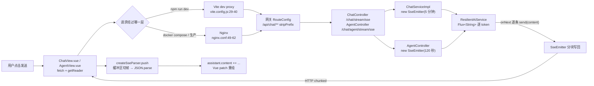
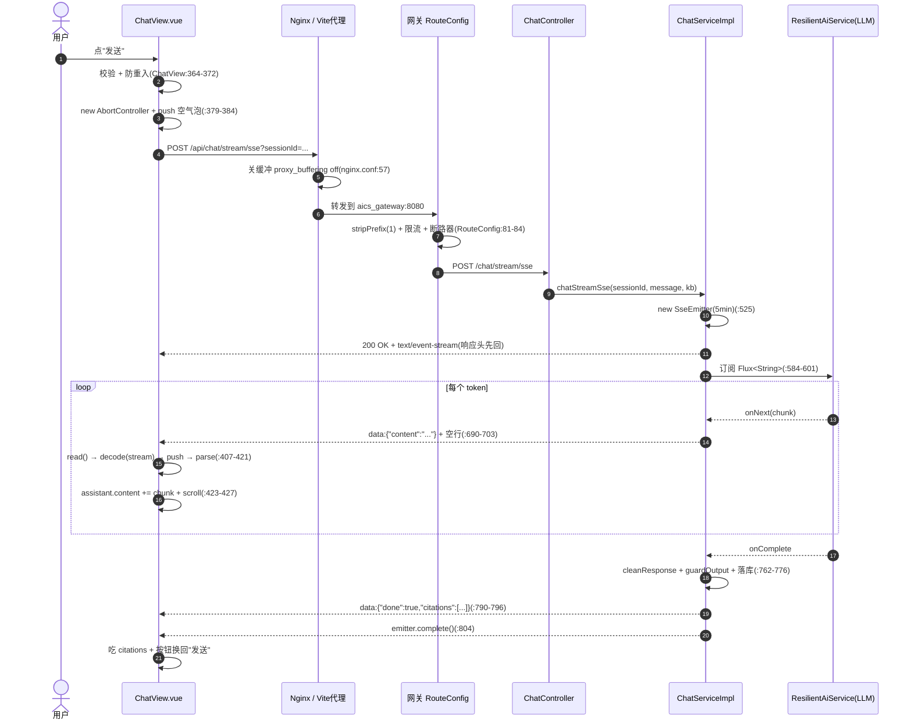

# 17-流式对话前端实战：代理缓冲、解析边界、状态机

> **一句话结论**：流式对话前端 90% 的"字一个个卡住""消息永远转圈"不是 LLM 慢，而是**三个可定位的工程问题**——代理把 token 攒成整包、分帧解析在边界上丢帧、UI 状态机缺"首 token"态。
> **阅读前置**：[10-浏览器原理与HTTP跨域](./10-浏览器原理与HTTP跨域.md)（HTTP 分块传输、SSE 与 WebSocket 区别）、[06-路由守卫与Axios请求封装](./06-路由守卫与Axios请求封装.md)（本项目 `axios` 封装与 30 秒超时）、[04-Vue3核心基础](./04-Vue3核心基础.md)（`ref`/响应式代理与 patch 时机）。
> **证据基线**：B 级 = `ai-cs-frontend`（Vue 3）与 `ai-cs-frontend-react`（React）真实源码逐行核对 + `ai-cs-chat` 后端 SSE 端点；C 级 = 本机 node 24 跑的分帧/解码实测 3 组（真实输出已贴）。未跑起来的浏览器/构建数据一律标注"未本机实测，给命令与判读方法"。**预计阅读 45~55 分钟。**

---

## 0. 先看现象

### 现场一：点发送后气泡空着，十几秒后整段话"啪"地一次性出现

Network 面板里这条请求的 **Response 是一次性到齐的**，不是逐段增长；`Content-Length` 甚至可能有值（真正的流式响应不该有）。

前端这边其实没毛病——`ai-cs-frontend/src/views/ChatView.vue:407-409` 就是逐 chunk 读的：

```javascript
while (true) {
  const { done, value } = await reader.read()
  if (done) break
  buffer += decoder.decode(value, { stream: true })
```

问题在中间那一跳。本仓库把这个坑明写在两处配置的注释里：

- `ai-cs-frontend/vite.config.js:32-33`："SSE 必须关闭缓冲，否则 token 会被攒成一坨再返回，打字机效果消失"。
- `ai-cs-frontend/nginx.conf:56-58`："SSE 必须走 HTTP/1.1 且关闭缓冲"，紧跟着 `proxy_buffering off;`。

也就是说：**同一份前端代码，换个代理就变样**——`npm run dev`（Vite proxy）正常、`docker compose` 起 Nginx 后攒包，那一定是代理层的事，不是解析层。

### 现场二：回答"少了最后一小段"，参考文献卡片永远不出现

用户看到的不是报错，只是**结尾断在半句**，而且回答下方的引用溯源卡片（`ChatView.vue:43-75`）一直空着。

代码层面的自证：`ChatView.vue:406-437` 的读取循环在 `done` 为真时直接 `break`，**没有把 `buffer` 里剩下的半帧处理掉**；而 `ChatView.vue:440` 只在整段为空时才兜底 `'(无回复)'`，所以"少一段"连兜底都不会触发，静默丢字。

本机实测（C 级，§3.4 有完整脚本与输出）显示：末帧 `done` 事件恰好停在缓冲区里没被派发，于是 `citations` 字段整条丢失——这就是"卡片不出现"的直接原因。

### 现场三：换了反向代理之后，一个字都不出来，最后显示"（无回复）"

`ChatView.vue:412-415` 用 `buffer.indexOf('\n\n')` 找事件边界。如果链路上的某一跳把 `\n` 规范成了 `\r\n`，SSE 的帧分隔变成 `\r\n\r\n`，`'\n\n'` **一次都不会命中**——整条流攒在 `buffer` 里，直到连接关闭，最后走 `ChatView.vue:440` 的兜底：

```text
气泡内容：（无回复）
```

本机实测同一条 220 字节的流，只把换行改成 CRLF，手写版解析出 **0 帧 / 0 事件，缓冲区残留 188 字符**（§3.5 有真实输出）。

### 现场四：Agent 页面点不动"停止"

`ChatView.vue:150-160` 生成中会把"发送"换成"停止生成"；但 `ai-cs-frontend/src/views/AgentView.vue:56-63` 只有 `:loading="sending"`，而 `AgentView.vue:125-132` 的 `fetch` **没有传 `signal`**。所以 Agent 流程一旦开跑，前端没有任何手段中断——用户只能刷新页面。

> **这些现象指向同一件事**：流式对话的体验由三段独立链路共同决定——**代理是否逐块转发**（缓冲）、**客户端是否在字节边界上正确切帧**（解析）、**UI 是否有完整的状态机表达"正在等第一个字/正在生成/已中断"**（状态）。任何一段写错，用户看到的都是同一句"卡住了"，但修的位置完全不同。本篇就按这三段拆开讲。

---

## 1. 整体地图



> **读图说明**：关键看两条箭头。① 从 `P` 分叉出来的两条路径——它说明**开发环境正常不代表生产正常**，两套代理是两份独立配置，排障时必须先确认走的是哪条（看 Network 里请求的 Host/端口：5173 是 Vite，80 或容器域名是 Nginx）。② 最后一段 `SVE → V` 标着 `HTTP chunked`——这一跳是"能不能逐字"的物理前提，它一旦被改成攒包，前端再怎么改解析都没用。**最容易看错的箭头**是 `G → CC`：网关这一层看起来"只是转发"，实际上它还叠了重试、断路器、限流三层过滤器（`RouteConfig.java:174-187`），其中断路器一旦打开会把 SSE 请求转去 `/gateway-fallback` 返回 JSON，前端会收到"没有 `data:` 行"的响应体，表现和现场三一模一样。

| 组件 | 责任 | 关键类/文件 | 谁调用它 | 本仓库证据 |
|---|---|---|---|---|
| 对话视图 | 建流、拼消息、管按钮状态 | `ai-cs-frontend/src/views/ChatView.vue` | 路由 `/chat`（`router/index.js:38-48` 守卫） | 587 行，`sendMessage()` 在 `:363-459` |
| Agent 视图 | 消费编排事件流（step/content/done） | `ai-cs-frontend/src/views/AgentView.vue` | 路由 `/agent` | 243 行，`send()` 在 `:111-189` |
| 可测分帧器 | 字节流 → 事件对象 | `ai-cs-frontend/src/utils/sse.js` | **目前无视图调用**（只有单测） | 78 行，`createSseParser` 在 `:16` |
| 可测传输层 | fetch + 读流 + 分帧 | `ai-cs-frontend/src/utils/sseStream.js` | **目前无视图调用** | 55 行，`streamSse` 在 `:20` |
| 网关路由 | 去前缀、限流、断路器、重试 | `ai-cs-gateway/src/main/java/com/aics/gateway/config/RouteConfig.java` | Spring Cloud Gateway | `/api/chat/**` 在 `:81-84` |
| 对话 SSE 端点 | 开一条 5 分钟上限的 SSE 连接 | `ai-cs-chat/src/main/java/com/aics/chat/controller/ChatController.java` | 网关 `lb://ai-cs-chat` | `@PostMapping("/stream/sse")` 在 `:167` |
| 对话流实现 | Flux → SseEmitter 桥接 | `ai-cs-chat/src/main/java/com/aics/chat/service/impl/ChatServiceImpl.java` | `ChatController` | 超时常量 `:156`，桥接代码 `:662-805` |
| Agent 流实现 | 编排步骤 + token 双通道推送 | `ai-cs-chat/src/main/java/com/aics/chat/agent/AgentController.java` | 网关 `/api/agent/**` 重写 | 超时常量 `:117`，异步提交 `:136-139` |
| 生产代理 | 反代 + 关缓冲 + SPA 兜底 | `ai-cs-frontend/nginx.conf` | `ai-cs-frontend/Dockerfile:34` 拷进 nginx 镜像 | `proxy_buffering off` 在 `:58` |

---

## 2. 关键概念与关键 API

先明确 SSE 到底是什么，否则后面全是猜。SSE（Server-Sent Events）是 W3C 规定的**单向**文本协议：服务端持续写、客户端只读，`Content-Type: text/event-stream`，靠 HTTP chunked 传输。它不吃新协议，所以能穿过普通代理、能被 CDN 缓存（也正因如此容易被缓冲坑到）。

一条事件在字节层面长这样（`\n\n` 是帧结束符，必不可少）：

```text
: keep-alive                 ← 冒号开头 = 注释帧，客户端必须丢弃（这是心跳）

data: {"content":"你好"}      ← data 字段的值，本项目的业务负载就是这行 JSON
id: 42                       ← 事件 id，浏览器会自动存成 Last-Event-ID
event: message               ← 事件类型，不给就是默认 message

data: {"done":true}          ← 下一帧，两帧之间的空行就是分隔符
```

| 名称 | 位置 | 角色 | 关键点 |
|---|---|---|---|
| `data` 字段 | SSE 协议 | 业务负载，本项目放 JSON | 一帧可有多行 `data:`，**必须按 `\n` 拼成一个字符串**再解析 |
| `event` 字段 | SSE 协议 | 事件类型名 | 本项目后端几乎不发（`SseEmitter.event().data(...)` 不带 name），所以前端靠 JSON 里的 `content/step/done/error` 自行分流 |
| `id` 字段 | SSE 协议 | 断线续传游标 | 浏览器 `EventSource` 会自动把最近一次 `id` 作为 `Last-Event-ID` 请求头发回；**fetch 流式不会，得自己存自己送** |
| `retry` 字段 | SSE 协议 | 重连间隔毫秒 | 只对 `EventSource` 内置重连有意义；`ai-cs-frontend/src/utils/sse.js:8-12` 的注释明确写了"只处理 data·event·id 三个字段（retry 对 fetch 流无意义）" |
| 双换行分帧 | SSE 协议 | 帧边界 | `\n\n` 与 `\r\n\r\n` 都合法，**两种都要认** |
| 注释心跳 | SSE 协议 | 保活/防代理超时 | 以 `:` 开头，整帧丢弃，但会重置代理的空闲计时 |
| `ReadableStream` / `getReader()` | 浏览器 Fetch 标准 | 拿到增量字节 | `response.body.getReader()` 每次 `read()` 给你"当前已到达的任意一段"，**长度没有任何保证** |
| `TextDecoder({stream:true})` | WHATWG Encoding | 字节→字符串 | 不加 `stream:true`，一个汉字被切成两半就会解出 `�` |
| `AbortController` / `signal` | DOM 标准 | 中断进行中的 fetch | `abort()` 让 `read()` 抛 `AbortError`，**和真断网抛的异常长得很像**，必须区分 |
| `SseEmitter` | Spring MVC（Servlet 栈） | 服务端 SSE 发射器 | 构造参数是超时毫秒；`complete()` 正常关、`completeWithError()` 异常关 |
| `proxy_buffering` | Nginx | 反向代理缓冲开关 | `on` 时 Nginx 攒满缓冲区才吐给客户端，SSE 必关 |
| `X-Accel-Buffering` | Nginx 响应头 | 按响应关缓冲 | 不改配置也能关：后端在响应里加 `X-Accel-Buffering: no`。**本仓库全仓 0 命中**（§3.10） |

### 为什么是 `fetch + ReadableStream` 而不是 `EventSource`

这是本篇第一个"换写法会怎样"的决定，本仓库把它写在了注释里（`ai-cs-frontend/src/utils/sse.js:4-5`）：

```text
为什么不用 EventSource：本项目的流式接口是 POST + JSON body + Authorization 头，
EventSource 只支持 GET 且无法自定义请求头，所以统一走 fetch + ReadableStream，
```

| 维度 | `EventSource` | `fetch` + `ReadableStream` |
|---|---|---|
| HTTP 方法 | 只有 GET | 任意（本项目 `POST`） |
| 自定义请求头 | **不支持**（无法带 `Authorization`） | 任意（本项目带 `Bearer`） |
| 请求体 | 不支持 | 任意 |
| 自动重连 | 内置（按 `retry`，自动带 `Last-Event-ID`） | 无，要自己写 |
| 分帧解析 | 浏览器代劳 | **自己写**（这就是 `sse.js` 存在的理由） |
| 本项目 | ❌ 认证接口全是 JWT + POST | ✅ 两套前端都用它 |

第二条硬理由藏在 HTTP 封装里：`ai-cs-frontend/src/api/index.js:38` 的 `axios.create({ baseURL, timeout: 30000 })`——**30 秒超时对任何 LLM 生成都是死刑**，而浏览器的 `axios` 走 XHR，本身也拿不到增量 body（`ai-cs-frontend/src/utils/sseStream.js:6-7` 的注释："axios 在浏览器端基于 XHR，拿不到增量 body"）。所以流式请求必须**绕过整个 axios 实例**，直接 `fetch`。

---

## 3. 原理与证据逐段精读

### 3.1 分帧：把一个字节流切成一帧帧事件

**在干什么。** `ai-cs-frontend/src/utils/sse.js` 全文 78 行只做一件事：喂给它任意长度的文本片段，它在内部维护 `buffer`，凑够一帧就回调一个 `{data, event?, id?}` 对象。核心三段：

`ai-cs-frontend/src/utils/sse.js:19-43`：

```javascript
function dispatch(rawEvent) {
  const dataLines = []
  let event
  let id

  for (const line of rawEvent.split(/\r?\n/)) {
    if (!line || line.startsWith(':')) continue
    const colon = line.indexOf(':')
    const field = colon === -1 ? line : line.slice(0, colon)
    let value = colon === -1 ? '' : line.slice(colon + 1)
    if (value.startsWith(' ')) value = value.slice(1)

    if (field === 'data') dataLines.push(value)
    else if (field === 'event') event = value
    else if (field === 'id') id = value
  }

  // 纯注释/纯空帧不产生事件
  if (dataLines.length === 0 && event === undefined && id === undefined) return

  const payload = { data: dataLines.join('\n') }
  if (event !== undefined) payload.event = event
  if (id !== undefined) payload.id = id
  onEvent(payload)
}
```

三行是重点：`:25` 的 `continue` 丢掉注释心跳、`:29` 去掉冒号后那**一个**空格（规范要求，多一个不多去）、`:39` 的 `dataLines.join('\n')` 把多行 data 拼成一个字符串——这三处手写版全都缺。

`ai-cs-frontend/src/utils/sse.js:46-52` 找边界：

```javascript
function nextBoundary() {
  const lf = buffer.indexOf('\n\n')
  const crlf = buffer.indexOf('\r\n\r\n')
  if (lf === -1 && crlf === -1) return null
  if (crlf === -1 || (lf !== -1 && lf < crlf)) return { index: lf, length: 2 }
  return { index: crlf, length: 4 }
}
```

**为什么这么设计。** 分帧器必须是**纯函数 + 可注入的接收器**，因为它要处理的是"字节边界"，而字节边界只有在测试里才能稳定构造。`ai-cs-frontend/src/utils/sse.test.js` 用 10 条用例把协议子集钉死，其中第 2 条（`:16`）是最有价值的一条：

```javascript
parser.push('data: {"content":"你')      // 半个 JSON 到达，断言此刻 0 个事件
parser.push('好"}\n\n')                  // 补完，断言恰好 1 个事件、content 是 "你好"
```

这条用例证明：**"跨包的半个 JSON 不丢"靠的不是 JSON 解析器的容错，而是缓冲区别提前切**。`buffer` 在 `ai-cs-frontend/src/utils/sse.js:17` 声明在闭包里（不是循环里的局部变量），才让它跨 chunk 存活。

**换写法会怎样。** 最直观的坏写法就是"每读到一段就 `split('\n\n')` 直接解析、解析失败就 continue"——这正是两个视图里的手写版（`ChatView.vue:416-421`、`AgentView.vue:155-156`）。它把两件事混在一起：切帧与解析。切帧错了（切在半个 JSON 上），解析只能静默丢弃，错误被吞掉。`ai-cs-frontend/src/utils/sse.js` 的做法是切帧与解析**分成两层**：切帧只认分隔符，不认识 JSON；认 JSON 的是调用方。这样"丢了一帧"和"帧里 JSON 坏了"是两种可区分的故障。

**常见坑。**
- 忘了 `\r\n\r\n`：`nextBoundary` 的两个 `indexOf` 必须都做，且要取**更早的那个**（`lf < crlf` 比较），否则 CRLF 流里混一个 LF 帧就会错位。
- 忽略"冒号后一个空格"：`data: {"a":1}` 与 `data:{"a":1}` 都合法，`value.startsWith(' ')` 那行是规范要求，去掉后有些服务端会把 JSON 前面的空格带进去（本项目的 `JSON.parse` 恰好容忍，但换成非 JSON 负载就炸）。
- 把注释帧也回调出去：`dispatch` 里 `:37` 的空帧检查就是为这个——`: keep-alive\n\n` 是心跳，不是业务事件。

### 3.2 传输层：fetch + reader + 解码，三个环节各有各的坑

**在干什么。** `ai-cs-frontend/src/utils/sseStream.js:34-54` 把"发请求 → 读流 → 解码 → 分帧 → 计数"串成一次调用，并返回本次到底是正常结束还是被中断：

```javascript
  const reader = response.body.getReader()
  const decoder = new TextDecoder()

  try {
    while (true) {
      const { done, value } = await reader.read()
      if (done) break
      parser.push(decoder.decode(value, { stream: true }))
    }
  } catch (error) {
    // 用户主动停止：把已缓冲的半帧交出去后正常返回，不算异常
    if (signal?.aborted) {
      dispatched += parser.flush()
      return { aborted: true, events: dispatched }
    }
    throw error
  }

  // 服务端未补最后一个空行就 close 时，残留半帧也要派发
  dispatched += parser.flush()
  return { aborted: signal?.aborted === true, events: dispatched }
```

**为什么这么设计。** 三个刻意为之的细节：

1. `deps.fetchImpl ?? fetch`（`ai-cs-frontend/src/utils/sseStream.js:22`）——把 `fetch` 做成可注入依赖。`ai-cs-frontend/src/utils/sseStream.test.js:8` 就用它注入一个 `new ReadableStream({start(c){ chunks.forEach(x => c.enqueue(enc.encode(x))); c.close() }})`，从而精确构造"3 个事件挤在一个 chunk""末帧无空行"这类网络时序。
2. `signal?.aborted` 优先于异常类型判断——`AbortError` 在部分浏览器里被包成 `TypeError`，靠 `signal.aborted` 这个**状态位**判断比猜异常名可靠。
3. 中断分支里仍然 `flush()`——用户点停止那一刻可能刚好有一帧到了缓冲区，丢掉它等于吞掉用户已经看到的最后一句。

**换写法会怎样。** 不用 `streamSse` 而手写在视图里，代价是本篇 §0 的现场二、三全都会重现——两个视图都各自手写了一遍，且 `ChatView.vue:406-437` 与 `AgentView.vue:141-163` 是**同构但互相独立**的两份代码。`ai-cs-frontend/src/utils/sseStream.test.js`（7 条）+ `sse.test.js`（10 条）共 17 条测试只保护 `utils/` 这一份；视图里的两份**一条测试都没有**。

**常见坑。**
- `decoder.decode(value, { stream: true })` 少了 `{stream:true}`：`ChatView.vue:409` 和 `AgentView.vue` 都写对了，但这是最容易漏的一个参数——§3.3 有实测。
- `if (!response.body)` 不判：`ai-cs-frontend/src/utils/sseStream.js:26` 显式抛 `'响应无 body，无法读取流'`，因为 GET 缓存命中或 304 时 `body` 可能是 `null`。
- 不判 `response.ok`：非 2xx 时 `body` 里是 JSON 错误体，把它当 SSE 解析会得到 0 帧然后静默"无回复"。`ai-cs-frontend/src/utils/sseStream.js:25` 直接抛 `` `HTTP ${response.status}` ``。

### 3.3 UTF-8 边界：中文场景特有的解码坑

**在干什么。** 一个汉字在 UTF-8 里占 3 字节。浏览器给你的 chunk 边界和字符边界毫无关系，所以"半个汉字"是常态，不是意外。

**为什么这么设计。** `TextDecoder` 的 `stream: true` 表示"后面还有字节，先别急着把不完整序列判成非法"。它内部会留一个 1~3 字节的尾巴等下一块。

**换写法会怎样。** 本机实测（C 级，node 24，同一份 `TextDecoder` 逻辑，只切 2 字节一片）：

```text
按 2 字节切「流式回答」(12 字节)：不带 stream → "����������"  (U+FFFD 个数=10)
                                     带 stream   → "流式回答"
```

10 个替换字符（U+FFFD）就是用户看到的"回答里莫名出现问号方块"。这个 bug 在英文语料里永远复现不了，是本仓库这类中文产品的高发区。

**常见坑。**
- 只在"看起来是乱码"时才去怀疑解码——实际上它也可能是**每来一个 chunk 就新建一个 `TextDecoder`**，效果和漏 `stream:true` 一样。
- 反过来，流结束后忘了 `decoder.decode()`（无参调用）把尾巴冲出来——`ai-cs-frontend/src/utils/sseStream.js` 的处理是不冲：因为最后一个 chunk 之后 `read()` 会返回 `done:true`，残留字节在绝大多数实现里已由 `stream:true` 语义保证不产生 FFFD；本项目在 C 级演示脚本里显式调了一次 `dec.decode()`（§3.4 脚本第 25 行），这是更稳的写法。

### 3.4 末帧 flush：为什么"最后一句总是少几个字"

**在干什么。** 服务端 `for (chunk : flux) emitter.send(...)` 然后 `complete()`——**最后一个事件后面很可能没有空行**，因为空行是前端用来分帧的，服务端不会主动补。

**为什么这么设计。** `flush()` 的语义是"流结束了，把缓冲区里剩下的当一帧处理"（`ai-cs-frontend/src/utils/sse.js:70-76`）：

```javascript
flush() {
  const rest = buffer.trim()
  buffer = ''
  if (!rest) return 0
  dispatch(rest)
  return 1
}
```

`trim()` 之后再判空，是为了处理"残留内容全是空白/换行"的情况，避免派发一个空帧；返回 1/0 让调用方能统计"最后一帧是 flush 补上的"。

**换写法会怎样。** 本机实测（C 级）。演示脚本 `demo1.mjs` 把真实 `ai-cs-frontend/src/utils/sse.js` 拷成 `sse-real.mjs` 后直接 `import`，构造 220 字节的流（含 2 个注释心跳、末帧无结尾空行），按 1/2/3/4/5/7/11/13/64/220 字节硬切：

```text
流共 178 字符 / 220 字节，含 2 个注释心跳帧，末帧无结尾空行

chunk字节  事件数  flush补发  拼出content长度  done事件  全部正确
1          4       1           21               true      true
2          4       1           21               true      true
3          4       1           21               true      true
4          4       1           21               true      true
5          4       1           21               true      true
7          4       1           21               true      true
11         4       1           21               true      true
13         4       1           21               true      true
64         4       1           21               true      true
220        4       1           21               true      true

真实解析器结论：所有切分方式下 4 个 data 事件一个不丢、content 完整拼回、末帧 done 靠 flush 补回
```

把同样 220 字节喂给**复刻视图手写版的解析器**（`demo2.mjs`，逐行照抄 `ChatView.vue:406-437` 的逻辑，只是不 `flush`）：

```text
== 对照组 A：LF 分帧、每 37 字节一片 ==
ChatView 手写版                       帧=5  事件=3  done=false  残留缓冲=63字符
                                   content="你好，我是智能客服。流式回答会一段段到达。"

== 对照组 B：同样内容，服务端/代理改写成 CRLF 分帧 ==
ChatView 手写版                       帧=0  事件=0  done=false  残留缓冲=188字符
                                   content=""
```

对照 A 就是现场二的数字证明：**正文 21 个字全到了，但 `done` 事件（63 字符）留在缓冲区里人间蒸发**，`done` 里带的 `citations` 一起没了——引用卡片空、`cacheHit` 标记丢，且**没有任何报错**。对照 B 是现场三：0 帧 0 事件。

**常见坑。**
- 以为"`JSON.parse` 失败就 continue"能兜住——它只能吞掉错误，吞不掉丢失。对照 A 里那 63 字符从头到尾没进过 `JSON.parse`。
- 只在 `done` 分支做兜底（`ChatView.vue:440` 的 `'(无回复)'`）：只在**全空**时触发，"少一段"根本不触发。

### 3.5 CRLF、多行 data 与"看起来一模一样的两种故障"

**在干什么。** 对照 B 暴露的问题在 `ChatView.vue:412-415`：只 `indexOf('\n\n')`，且 `rawEvent.split('\n')` 不处理行尾的 `\r`。`ai-cs-frontend/src/utils/sse.js` 的处理见 §3.1 的 `nextBoundary` 与 `split(/\r?\n/)`。

**为什么这么设计。** 因为 SSE 的换行在规范层面就允许三种（`\r\n`、`\n`、`\r`），链路上任何一跳（Servlet 容器、Nginx、某些 CDN、企业网关）都可能重写换行。分帧器不能假设"我们后端发的是 `\n` 所以永远 `\n`"——`ChatServiceImpl` 确实发 `\n`，但**请求经过的是三层代理，不是直连**。

**换写法会怎样。** 两种写法的故障现象**完全一样**（气泡空到结束），定位位置却相差三层：

| 现象 | 真实原因 | 怎么区分 |
|---|---|---|
| 气泡最终显示"（无回复）" | 客户端分帧器不认 CRLF（对照 B） | 用 §6 的 curl 直连后端：直连正常、过代理不正常 → 代理改了换行 |
| 气泡最终显示"（无回复）" | 网关断路器把请求转到 `/gateway-fallback` 返回 JSON | curl 直连正常、过网关返回的不是 `data:` 行 → 看网关日志与 fallback |

**常见坑。** 多行 `data:` 是另一个静默坑。规范里一帧可以有多行 `data:`，客户端要按 `\n` 拼成一个字符串再解析；手写版 `ChatView.vue:416-421` 对**每一行**独立 `JSON.parse`，遇到多行 data 会把一个 JSON 拆成两个非法片段，两个都 `catch` 掉。本项目后端目前不发多行 data（`SseEmitter.event().data(map)` 序列化后是单行），所以这是**潜在坑而非当前故障**——但它恰恰解释了为什么要用 `dataLines.join('\n')`（`ai-cs-frontend/src/utils/sse.js:39-42`），而不是"既然只有一行就 `slice(5)`"。

### 3.6 中断：`AbortController` 与"别把用户主动停当成断网"

**在干什么。** `ChatView.vue` 用三个状态做中断：一个非响应式的 controller、一个响应式标记位、一个按钮 `v-if` 二选一。

`ai-cs-frontend/src/views/ChatView.vue:202-203`：

```javascript
let abortController = null          // 不需要渲染，故意不做成 ref
const stopRequested = ref(false)    // 需要渲染/需要跨 await 读，做成 ref
```

`ai-cs-frontend/src/views/ChatView.vue:462-466`：

```javascript
function stopGenerating() {
  if (!sending.value || !abortController) return
  stopRequested.value = true
  abortController.abort()
}
```

**为什么这么设计。** `abort()` 之后 `reader.read()` 抛出的是 `AbortError`，而"网络真的断了"抛出的是 `TypeError: Failed to fetch`——两者在 `catch (e)` 里长得几乎一样。**如果只靠异常类型判断，用户点"停止"会看到一条红色"连接中断，请重试"**。所以必须一个**由 UI 写入、由 catch 读取**的意图标记 `stopRequested`。

`ai-cs-frontend/src/views/ChatView.vue:441-452` 的分流（节选，省去两行行内注释）：

```javascript
if (stopRequested.value || e?.name === 'AbortError') {
  assistant.content = assistant.content
    ? assistant.content + '\n\n_（已停止生成）_'
    : '（已停止生成）'
  return                                    // 不弹错误、不清空已收到的内容
}
const aborted = e?.message?.includes('Failed to fetch')
assistant.content = aborted ? '⚠️ 连接中断，回复未完成，请重试。' : ('❌ 错误: ' + (e.message || '请求失败'))
```

**换写法会怎样。** `AgentView.vue` 就是"没写"的版本：`AgentView.vue:125-132` 的 `fetch` 没有 `signal`，`AgentView.vue:56-63` 的按钮只有 `:loading`。于是 Agent 流程**物理上不可中断**——只能刷页面，而刷页面会丢 `runId`（`AgentView.vue:171` 的 `activeRunId` 是内存状态），用户得从头再走一遍"确认执行"。

**常见坑。**
- `abortController` 做成 `ref` 会导致 Vue 去代理一个 DOM 宿主对象——`ChatView.vue:202` 的注释风格（`let` 而非 `ref`）是对的。
- `finally` 里必须 `abortController = null`（`ChatView.vue:454-458`），否则下一次 `stopGenerating()` 会对一个已完成的 controller 发 `abort()`（无害但是脏状态），更麻烦的是无法区分"这一轮的 controller"和"上一轮的"。
- 切会话时只换 `currentMessages`、不 abort 旧的流（`ChatView.vue:195` 的 `sessionMessages` 是按 sessionId 隔离的，但 `abortController` 是单例）——切换会话后旧流还在跑，token 继续写进旧会话对象，用户回到旧会话会看到"回答在自己变长"。这是**已知缺口**，不是已实现能力。

### 3.7 重连与 `Last-Event-ID`：协议给了、本项目没用

**在干什么。** SSE 协议的重连语义是这样的：客户端断线后按 `retry` 毫秒重连，并把最近收到的事件 `id` 放进请求头 `Last-Event-ID`，服务端据此从该事件之后继续推。

**为什么本仓库没有。** 三层原因，都是硬约束而非疏漏：

1. **认证方式**：`Last-Event-ID` 是浏览器 `EventSource` 自动发的；本项目用 `fetch`（§2），协议层的自动重连根本不存在。
2. **请求语义**：本项目流式端点是 `POST /chat/stream/sse` + query 参数（`ChatView.vue:388-398`），重连意味着"再发一次同样的提问"——那会**重复落库、重复计费**，不是续传。
3. **服务端没有续传能力**：`ai-cs-chat` 侧只有 `SseEmitter`（一次性连接），没有"事件游标 + 回放"的存储。`ChatServiceImpl` 的缓存是**整段答案**缓存（`ChatServiceImpl.java:542-567` 命中即一次性推完），不是逐 token 回放。

C 级核实：在 1047 个代码/配置文件（排除 `node_modules`/`dist`/`target`/`.git`）里搜 `Last-Event-ID`：

```text
=== Last-Event-ID 命中 0 ===
```

`id` 字段虽然被解析（`ai-cs-frontend/src/utils/sse.js:31-33`、`:39-42`），但**全仓库没有任何一处读取它**——`createSseParser` 把它放进事件对象后就没人接了。所以准确的表述是：**协议字段已解析、能力未落地**。

**换写法会怎样。** 若要真做续传，最少要补三样：后端为每次流生成单调 `id` 并把已发事件存到 Redis（含 TTL）、端点接受 `Last-Event-ID` 并从该 id 之后回放、前端把 `id` 存进 sessionStorage 并在重连时放进请求头。这三样本仓库**一样都没有**，所以任何"本项目支持断点续传"的说法都是假的。

**常见坑。** 把"网络抖了一下但流没断"当成断线去重连——`fetch` 的 reader 在网络层抖动时通常只是 `read()` 迟迟不返回，不会抛错；如果这时擅自 abort 重发，就会触发上一段的重复落库问题。这类场景的正确做法是**服务端心跳**（`ChatServiceImpl` 目前不发注释心跳，全仓也没有 `: ping` 之类的定时 send）。

### 3.8 UI 状态机：六个状态，本项目只实现了四个半

**在干什么。** 流式对话的界面至少有六个可区分的状态，每个状态该显示什么、按钮该不该可点，是各自独立的决策：

| 状态 | 触发时机 | 应该显示 | 本项目现状（证据） |
|---|---|---|---|
| **① 等待（还没有字节）** | `fetch` 已发出，首个 chunk 未到 | 打字机前的"思考中"三点动画；**输入框必须锁** | ⚠️ 只有按钮 `v-if` 切到"停止生成"（`ChatView.vue:150-160`），**没有任何"思考中"提示**——用户面对一个空气泡 |
| **② 首 token（第一个 content）** | 第一个 `{"content":...}` 到达 | 立刻换成真正的回答气泡，动画撤掉 | ⚠️ 无显式状态；靠"空气泡被写入内容"隐式发生（`ChatView.vue:382-384` 先 push 空对象） |
| **③ 生成中** | 持续收 content | 逐字追加 + 跟随滚动 + 可中断 | ✅ `ChatView.vue:423-427`，含 `await scrollToBottom()`；Agent 侧不可中断（§3.6） |
| **④ 完成** | 收到 `{"done":true}` 或流自然结束 | 引用卡片、反馈条、按钮换回"发送" | ✅ 部分：`ChatView.vue:428-430` 吃 `citations`；`done` 分支本身是空的（`:432-434`） |
| **⑤ 失败** | 非 2xx / `{"error":...}` / 网络异常 | 气泡内保留错误文本（可回溯）+ toast（当场可见） | ✅ `ChatView.vue:451-453` 双写；⚠️ `AgentView.vue:182-184` 只有 toast，且不区分中断类型 |
| **⑥ 中断** | 用户点"停止生成" | 保留已生成内容 + 一行"（已停止生成）"标记 + **不弹错** | ✅ `ChatView.vue:444-447`；❌ Agent 无此状态 |

**为什么这么设计。** ①②③ 三态的区分是流式产品的体验核心：**40 秒的等待里，用户唯一需要的是"系统在动"的证据**。首 token 之前的等待（模型排队、RAG 检索、Guardrail 检查，`ChatServiceImpl.java:528-540` 的输入护栏、`:584-601` 的 `CompletableFuture<Flux>` + TimeLimiter）可能长达数秒到十几秒，这段时间里界面上任何变化都能安抚用户。本项目的现状是"空气泡 + 一个变红的按钮"，严格说只做了 ③④⑤⑥。

**换写法会怎样。** 只做"`sending` 一个布尔"的写法（Agent 侧就是这样）会丢三件事：不能区分"等待"与"生成中"（无法在首 token 后撤掉 loading）、不能区分"用户中断"与"失败"、不能区分"流结束"与"连接被对端关闭"。状态机做全的收益不是好看，而是**每种失败都能落到一句准确的提示**。

**常见坑。** 顺序错了会出一种很怪的 bug：如果在 `fetch` 之前就 push 空气泡（`ChatView.vue:382-384` 就是这么做的，在 `:394` 的 `fetch` 之前），那么 **`fetch` 本身失败**（网络不通、网关 502）时，空气泡已经存在于列表里了，`catch` 里必须往里写错误文本，不能只弹 toast——否则用户会留下一个永久空白的气泡。对照 `ChatView.vue:452`：它确实往 `assistant.content` 写，这条守住了。

### 3.9 流式 Markdown 增量渲染与节流：本篇最大的未落地项

**在干什么。** LLM 的回答几乎必然含 Markdown（列表、加粗、代码块）。流式渲染的难点不是"渲染 Markdown"，而是**半截 Markdown 也要能渲染**：`**加粗` 缺了收尾、```` ```java ```` 代码块没闭合，渲染器会把它当普通文本或吐出破损 HTML。

**本项目现状（诚实标注：未落地）。** `ai-cs-frontend/src/views/ChatView.vue:41` 是纯文本插值：

```html
<div>{{ msg.content }}</div>
```

配套样式在 `ChatView.vue:516-587`，`.msg-bubble` 用 `white-space: pre-wrap` 让换行显示——这解释了为什么"纯文本也能看出段落"，也解释了为什么用户会以为"Markdown 没生效但至少不难看"。

三条可核对的证据证明它不是"暂时关掉了"：

| 检查项 | 结论 | 证据 |
|---|---|---|
| 依赖 | 无任何 Markdown / 高亮 / 消毒库 | `ai-cs-frontend` 根目录的 `package.json`（37 行）依赖只有 vue/router/element-plus/echarts/axios/qrcode |
| 模板 | 纯文本插值，无 `v-html` | `ChatView.vue:41`、`AgentView.vue:26` |
| 闸门 | `v-html` 被 lint 拦死 | `ai-cs-frontend/eslint.config.js:48`：`'vue/no-v-html': 'error'` |

顺带纠一个旧说法：本仓库 `learning-docs/00-学习路线总览/05-技术缺口分析与补全计划.md` 里**并没有**"Markdown 渲染"这条立项（全文搜 `markdown` 0 命中，第 38 行是能力地图的 mermaid 块）。所以正确表述是"**未立项、未实现**"，而不是"已立项待做"。

**为什么这么设计（现状的合理性）。** `no-v-html: error` 是**有意为之的安全闸门**：要渲染 Markdown 就必须往 `v-html` 里塞字符串，必须在那一行显式 `eslint-disable` 并写清为什么安全（比如"已经过 DOMPurify"）。这个门禁让"顺手加个 Markdown"变成一件需要交代安全边界的事——对客服产品（回答里可能夹带用户输入的内容）这是对的取舍。

**换写法会怎样（落地方案，均为未落地建议）。**
1. 渲染器选型：`markdown-it` 关闭 `html: true`（不让原始 HTML 直通）；若要支持 HTML 则 `DOMPurify.sanitize()` 之后才 `v-html`。
2. 半截语法：给渲染加"闭合补全"——渲染前若 ``` 计数为奇数就补一个收尾围栏，`**` 同理。否则每次追加都会让整段重排闪烁。
3. 节流：不要每个 token 都重渲染 Markdown。**本项目连纯文本都是每 token 一次 `assistant.content += ...`**（`ChatView.vue:423-427`），而且里面还有 `await scrollToBottom()`——每个 token 都 `nextTick()` + 写 `scrollTop`。改成 rAF 合并（每帧最多渲染一次）或 30~50ms 时间片合并，是标准做法。

**常见坑。** Vue 3 的响应式更新是**微任务批处理**的：同一个 tick 内多次改 `content` 只触发一次 patch。所以"每个 token 改一次"真正贵的不是 patch 次数，而是**你 `await` 了什么**。`ChatView.vue:426` 的 `await scrollToBottom()` 把一个同步的"改数据"变成了一个跨 `nextTick` 的 await 链——每收一个 token 就停一次微任务队列，还顺带强制读 `scrollHeight`（触发一次布局计算）。这是本项目流式中最值得优化的一行，**未本机实测帧率**，判读方法见 §6 第 5 条。

### 3.10 后端配合：三层超时与"谁在缓冲"

前端再对，后端有三处会让它白费。逐一定位：

| 层 | 配置/代码 | 值 | 现状问题 |
|---|---|---|---|
| 对话流上限 | `ChatServiceImpl.java:156` `SSE_EMITTER_TIMEOUT` | `5 * 60 * 1000L`（5 分钟） | 5 分钟到点 `send()` 抛异常，被 `:690-703` 的 catch 吞成一行 warn 日志，前端表现为流突然停 |
| Agent 流上限 | `AgentController.java:117` `AGENT_STREAM_TIMEOUT` | `120_000L`（120 秒） | 注释写明"需覆盖编排总时长 + LLM 生成耗时"；超时后走 `sendEvent` 的 `catch (Exception ignore)`（`:184-190`），**静默** |
| 图片对话上限 | `ai-cs-chat/src/main/java/com/aics/chat/service/impl/VisionChatServiceImpl.java:205` | `60_000L`（60 秒） | 比对话短得多，长图片 + 长回答容易在这个值上翻车 |
| 生产代理缓冲 | `nginx.conf:57-58` | `proxy_buffering off; proxy_cache off;` | ✅ 已配；`:56` 注释点明"SSE 必须走 HTTP/1.1 且关闭缓冲"，`:55` 是 `proxy_set_header Connection ""` |
| 读超时 | `nginx.conf:59` | `proxy_read_timeout 300s` | ✅ 与后端 5 分钟对齐（`:60` 注释："大模型首 token 可能很慢，默认 60s 会 504"） |
| 开发代理 | `vite.config.js:29-40` | `proxy.on('proxyRes')` 里改写 `cache-control: no-cache, no-transform` 并 `delete content-encoding` | ✅ `:32-33` 注释说明为什么；`no-transform` 是防中间层压缩/改写的关键 |
| 响应头兜底 | `X-Accel-Buffering: no` | **全仓 0 命中** | ⚠️ 靠 `nginx.conf` 静态配置撑着。一旦哪天 `/api` 被 `gzip on` 覆盖，靠响应头兜底的路是断的 |
| 网关缓冲 | `RouteConfig.java:174-187` | 无缓冲相关配置 | ✅ 只加了 retry（仅 GET）、断路器、限流；**POST 不会被重试**，这点是对的 |
| 心跳 | — | 全仓无注释帧发送 | ⚠️ 长连接空闲时若中间层有 idle timeout，会被静默断开 |

`ChatServiceImpl` 侧最需要读者看懂的是 `onNext` 里那一小段（`ai-cs-chat/src/main/java/com/aics/chat/service/impl/ChatServiceImpl.java:690-703`）：

```java
try {
    emitter.send(SseEmitter.event().data(Map.of("content", chunk)));
} catch (Exception ex) {
    // 两种可能：1. 客户端已断开（浏览器关闭/刷新）2. SseEmitter 已超时（5min）
    // 不中断 Flux 订阅，让 onComplete 仍能落库
    log.warn("SSE发送失败: sessionId={}, err={}", sessionId, ex.getMessage());
}
```

**为什么这么设计。** 客户端断开后**必须继续消费 Flux 到 `onComplete`**——因为回答正文是在 `onComplete` 里落库的（`ChatServiceImpl.java:776` 的 `chatHistoryService.append`）。如果在这里 `cancel()` 订阅，用户关掉页面就丢掉整段回答，历史记录里只剩一个问号。这是一个**反直觉但正确**的取舍：牺牲一点带宽，换答案不丢。

**换写法会怎样。** 用 `emitter.completeWithError()` 一了百了（`ChatServiceImpl.java:723-737` 的 `onError` 就是这么收尾的），代价是那次回答不入库。注意 `completeWithError` 与 `complete` 的差别不只是"报不报错"：**响应此时已经以 chunked 提交过数据，HTTP 状态码无法再改**，所以异常只能靠事件体里的 `{"error":...}` 告诉前端，不能靠 5xx。

**常见坑。** 前端把 `{"error":...}` 当成"这一条消息的内容"而不是"整条流失败"：`ChatView.vue:431` 是 `if (obj.error) streamError = obj.error`，然后 `:439` 才 `throw`——顺序是对的（先收完再抛，已收到的正文留在气泡里）。Agent 侧 `AgentView.vue:159-160` 同理。反过来，如果中途就 `throw`，前面几十个 token 就白收了。

---

## 4. 一次完整执行时序



> **读图说明**：注意三个箭头。① 第 11 步 `S-->>V: 200 OK` 在**第一个 token 之前就发生了**——这决定了"HTTP 状态码"只在建连那一刻有效，之后所有错误只能靠事件体里的 `error` 字段传递（这是 §3.10 那条"不能靠 5xx"的根源）。② 循环里的 `data:... + 空行` 那个双向箭头是**唯一**能让用户看到字的路径，它被 §3.1~3.5 的任何一处解析 bug 掐断，表现都是"卡住"。③ 最后 `done` 事件与 `complete()` 是两步：`done` 是数据，`complete` 是连接关闭；本项目 `ChatView.vue:432-434` 对 `done` 的处理是空的，全靠 `reader.read()` 返回 `done:true` 来结束循环——**所以"末帧 flush 丢失"（§3.4）发生在这里时，循环已经退出了，什么都没做**。

哪一步失败会报什么错，对着一张表查比读代码快：

| 失败点 | 前端看到的原文 | 根因位置 |
|---|---|---|
| Nginx 缓冲没关 | 无报错，十几秒后整段出现 | `nginx.conf:57` |
| 网关限流超限 | `❌ 错误: HTTP 429` | `RouteConfig.java:181-185`（每用户 5 QPS，`application.yml:48-49`） |
| 网关断路器打开 | `❌ 错误: HTTP 200` 后气泡空，或直接"（无回复）" | `RouteConfig.java:179-180` 的 `forward:/gateway-fallback` 返回 JSON |
| 后端读超时/网关 504 | `❌ 错误: HTTP 504` | `nginx.conf:59` 的 `proxy_read_timeout` |
| 后端 5 分钟到点 | 流突然停在半句，无报错 | `ChatServiceImpl.java:156` + `:690-703` 的 warn |
| Agent 120 秒到点 | 停在半句，`sending` 复位但无提示 | `AgentController.java:117` + `:184-190` 的 `catch ignore` |
| 客户端解析 CRLF 失败 | `（无回复）` | `ChatView.vue:412-415`（§3.5 实测 0 帧） |
| 末帧 flush 丢失 | 少最后一句、`citations` 空 | `ChatView.vue:406-437`（§3.4 实测丢 63 字符） |
| 用户点停止 | `（已停止生成）`，无 toast | `ChatView.vue:444-447`（预期行为） |
| 网络真断 | `⚠️ 连接中断，回复未完成，请重试。` + toast | `ChatView.vue:451-453` |
| Token 过期 | 请求拦截器跳 `/login`（SSE 请求**不走**拦截器，故表现为 401 后气泡空） | `api/index.js:50-60` 只拦 axios，`fetch` 裸调绕过 |

最后一条值得单独说：**流式请求是裸 `fetch`，不经过 axios 拦截器**，所以 401 不会自动跳登录页——`ChatView.vue:399` 只会把它变成一个 `HTTP 401` 字符串显示在气泡里。这是"绕开 axios"的隐性代价。

---

## 5. 设计取舍

| 决策点 | 可选方案 | 本项目选择 | 代价 | 证据 |
|---|---|---|---|---|
| 传输机制 | 轮询 / `EventSource` / `fetch` 流 | `fetch` 流 | 分帧、重连、解码全得自己写 | `sse.js:4-5`、`sseStream.js:6-7` |
| 请求形态 | query 参数 / JSON body | Chat 用 query（`ChatView.vue:388-390`），Agent 用 JSON body（`AgentView.vue:125-132`） | 两套形态、两套错误处理 | 同左 |
| 分帧归属 | 视图内手写 / 抽成纯函数 | 两者**并存**：`utils/` 有可测实现，视图仍手写 | 17 条测试只保护未被使用的那份 | `sse.test.js` 10 条 + `sseStream.test.js` 7 条 |
| 分帧容错 | 严格规范 / 只认自家后端格式 | 视图只认 `\n\n` + 单行 data；`utils/` 认全 | 前者在代理改写换行时全线崩（§3.5 实测） | `sse.js:46-52` vs `ChatView.vue:412-421` |
| 中断 | 无 / `AbortController` | Chat 有、Agent 无 | Agent 流程不可停 | `ChatView.vue:462-466` vs `AgentView.vue:125-132` |
| 渲染 | 纯文本 / Markdown | 纯文本 + `pre-wrap` | 代码块、列表以原文呈现 | `ChatView.vue:41` |
| XSS 策略 | 允许 `v-html` / lint 拦截 | lint 拦截（`no-v-html: error`） | 想渲染 Markdown 必须先解这个闸 | `eslint.config.js:48` |
| 滚动 | 无条件到底 / 用户上翻时停 | 无条件到底 | 用户翻历史会被拽回底部 | `ChatView.vue:468-473` |
| 长列表 | 全量渲染 / 虚拟滚动 | 全量渲染 | 千条以上会话会累积 DOM | 全仓无 `virtual`/`recycle-scroller` 依赖 |
| 答案入库时机 | 每 token 落库 / `onComplete` 一次落库 | `onComplete` 一次落库 | 客户端断开也必须跑完 Flux | `ChatServiceImpl.java:690-703`、`:776` |

**可扩展点清单**（都是"改哪里"级别的具体位置，不是愿望）：

1. 视图接入 `streamSse`，删掉 `ChatView.vue:401-437` 与 `AgentView.vue:141-163` 两份手写分帧——顺带自动获得末帧 flush、CRLF、多行 data 三项修复。
2. `AgentView.vue:125` 加 `signal` + 停止按钮，复用 `ChatView.vue:462-466` 的 `stopRequested` 模式。
3. `abortController` 改成按 `sessionId` 的 `Map`，切会话时 abort 对应那个（修 §3.6 的最后一个坑）。
4. `ChatView.vue:426` 的每 token `await scrollToBottom()` 换成 rAF 合并；滚动前判断"用户是否在底部"（比较 `scrollTop + clientHeight` 与 `scrollHeight`）。
5. `ChatView.vue:41` 接 Markdown：`markdown-it({html:false})` + 半截语法补全 + 该行 `eslint-disable` 写清理由。
6. `AgentView.vue:56-63` 补"等待中/生成中"两态提示（§3.8 的 ①②）。
7. 后端加注释心跳帧（`emitter.send(SseEmitter.event().comment("ping"))`）防中间层 idle 断开。
8. 若要真续传：后端事件游标 + Redis 回放 + 端点支持 `Last-Event-ID`，缺一不可（§3.7）。

---

## 6. 踩坑与调试手法

**手法 1（DevTools Network 面板）：用"Response 是否逐段增长"一刀切开缓冲层与解析层。**
开 DevTools → Network → 点发送 → 选中那条 `stream/sse` 请求 → 看 Response 标签。逐段出现（能看到 `data:` 一行行长出来）= 链路没缓冲，问题在解析/状态机；**一次性整段出现** = 中间层缓冲（Nginx `proxy_buffering`、企业代理、或 `Content-Encoding` 被压缩）。再看 Headers：出现 `Content-Length` 基本可以断定不是真流式（chunked 响应不该有它）；`Content-Encoding: gzip` 说明有层在压缩 SSE——本项目 `nginx.conf:23-28` 的 `gzip_types` 里**没有** `text/event-stream`，所以默认不会压缩 SSE，一旦有人把它改成 `*` 就会立刻复现"攒包"。

**手法 2（curl 直连后端）：用一跳一跳的对比定位是哪一层。** 这是本项目最有效的排障路径，因为它把三层代理逐个剥掉：

```bash
# 一跳：直连 chat 服务（绕过网关与 Nginx）——正常说明后端没问题
curl -N -X POST "http://localhost:8083/chat/stream/sse?sessionId=debug-1&message=你好" \
  -H "Authorization: Bearer <token>"

# 两跳：过网关——不正常说明网关/config 有问题
curl -N -X POST "http://localhost:8080/api/chat/stream/sse?sessionId=debug-1&message=你好" \
  -H "Authorization: Bearer <token>"

# 三跳：过 Nginx——直连 OK、这条攒包 = nginx.conf 的 proxy_buffering 没生效
curl -N -X POST "http://localhost/api/chat/stream/sse?sessionId=debug-1&message=你好" \
  -H "Authorization: Bearer <token>"
```

`-N` 关掉 curl 自己的输出缓冲，否则你会以为是服务端攒包（**这是最常见的自欺**）。判读方法：`data:` 行是否**一行一行带时间间隔**地出现。注意这三条命令都要后端在跑，属**未本机实测**，只有命令与判读方法可给。

**手法 3（node 回放真实响应）：把"网络时序"变成可重复的测试用例。** 解析类 bug 靠手点几乎复现不出来。可行做法：DevTools 里右键该请求 → "Copy response" 存成文件，然后用真实 `ai-cs-frontend/src/utils/sse.js` 的解析器回放（本篇 §3.4 的 `demo1.mjs` / `demo2.mjs` 就是这个思路，两份脚本合计不到 80 行，且直接 `import` 生产解析器而不是抄一份）。回放时把同一段文本按 1/2/3/5/7…字节乱切，如果结果随切分方式变化，说明解析器有边界 bug；如果恒定，问题在别处。**这套手法能覆盖 `\r\n`、半个汉字、末帧无空行三类只在特定时序下出现的故障**。

**手法 4（断点打在 `dispatch` 里）：确认"帧到底有没有被切出来"。** `ai-cs-frontend/src/utils/sse.js:19` 的 `dispatch` 一行断点，比在视图里 `console.log` 强得多——因为它区分了两种完全不同的故障：**断点从不命中** = 切帧失败（看 `nextBoundary` 的两次 `indexOf`）；**命中但 `onEvent` 后界面没变** = 响应式或渲染问题（看 `assistant` 是不是响应式代理）。浏览器里可以在 Sources → Event Listener Breakpoints 之外，直接用 `debugger;` 语句临时插桩，改动前记得删。

**手法 5（Performance 面板量"节流值不值"）：不要靠感觉说"卡"。** §3.9 提到的每 token `await scrollToBottom()` 的代价，判读方法是：Performance 录制 10 秒生成过程 → 看 Main 线程火焰图里是否出现**密集的小块 Layout**（由 `scrollHeight` 读取强制触发的同步布局），以及 FPS 条是否有规律的掉帧。**本机未实测具体帧率**，不给数字；但如果火焰图里 Layout 块数量与 token 数同量级，就说明该加 rAF 合并了。

**手法 6（看 WS/网络面板查端口写错）：一个跨主题但同类的真实缺陷。** `ai-cs-frontend/src/views/NotifyView.vue:114` 连的是 `ws://localhost:8085/ws/notify`——**8085 是 message 服务，notify 是 8086**。这是全仓可见的真实缺陷，界面上表现为"WebSocket 一直连不上、在线人数 0"。手法：DevTools → Network → WS 标签看实际连接的 host:port，与后端服务端口表对一遍，比读代码快。它属于本篇同一类问题：**前端写死了一个地址，没有任何东西替你校验它是否指向正确的服务**——流式端点也一样，`runtime.js:24` 的 `API_BASE` 靠 `.env.production` 留空走同源，一旦有人在 `.env` 里填了个 IP，SSE 就跑到了另一个网络环境，缓冲行为也随之改变。

**手法 7（读 catch 分支的顺序）：`AbortError` 与 `Failed to fetch` 混判。** 症状是"点停止生成，界面弹红色错误"。定位方法：在 `ChatView.vue:441` 的 `catch` 首行打断点，点停止，看 `e?.name` 与 `stopRequested.value` 分别是什么。如果 `stopRequested` 为 true 却走了错误分支，说明判空顺序写反了（必须先看意图标记，再看异常类型）。

**手法 8（对照两份手写实现的差异）：同构代码的漂移。** `ChatView.vue:406-437` 与 `AgentView.vue:141-163` 是同构复制，修复时极容易只改一处。做法：把两段贴进 diff 工具，或者更彻底地——按 §5 扩展点 1 合并成一处。**这类"复制粘贴的同构代码"本身就是一类技术债**，它不会报错，只会在半年后表现为"Agent 页面偶发丢字但对话页面正常"。

---

## 7. 版本差异

| 关注点 | 旧写法 | 当前基线 | 变化点 | 迁移动作 |
|---|---|---|---|---|
| 浏览器端传输 | `EventSource`（GET + 自动重连） | `fetch` + `ReadableStream` | 认证方式变为 JWT 头 + POST，`EventSource` 无法承载 | 自己实现分帧、重连、解码（`sse.js` + `sseStream.js`） |
| 分帧实现 | 视图内手写一套 | `utils/sse.js` 可测实现 + 视图仍手写（两套并存） | 抽出可测纯函数，但**未接入** | 视图 import `streamSse`，删手写循环 |
| 末帧处理 | 读到 `done` 直接 `break` | `flush()` 补发残留半帧（`sse.js:70-76`） | 修复"少最后几个字" | 只要有手写循环就必须在循环后 flush |
| 换行兼容 | 只 `indexOf('\n\n')` | LF / CRLF 双判 + `split(/\r?\n/)`（`sse.js:46-52`） | 修复"过某些代理后 0 事件" | 同上 |
| 多行 data | 每行独立 `JSON.parse` | `dataLines.join('\n')`（`sse.js:39-42`） | 按规范拼接 | 同上 |
| `SseEmitter` 超时 | `0L`（永不超时，连接泄漏） | `5 * 60 * 1000L`（`ChatServiceImpl.java:156`，`:524` 注释"替代原来的 0L"） | 有上限，防泄漏 | 前端要有"到点静默截断"的兜底提示 |
| Agent 流超时 | 沿用默认 | `120_000L`（`AgentController.java:117`） | 需覆盖编排总时长 | 编排侧超时须小于 120s，否则前端先断 |
| 图片对话超时 | 对话同款 | `60_000L`（`VisionChatServiceImpl.java:205`） | 更短 | 长图 + 长回答要单独评估 |
| HTTP 封装 | 所有请求走 `axios` | 流式请求**绕过** axios（`api/index.js:38` 的 30s 超时） | 拦截器（401 跳登录）对流式请求失效 | 流式错误要自己处理 401 |
| 生产代理 | 无缓冲配置 | `proxy_buffering off` + `proxy_cache off` + `proxy_read_timeout 300s`（`nginx.conf:57-60`） | 打字机效果的前提 | 新环境（K8s/其他 LB）必须逐项复核 |
| 开发代理 | 纯 `changeOrigin` | `proxyRes` 里改 `cache-control: no-cache, no-transform`、删 `content-encoding`（`vite.config.js:29-40`） | 防 dev 阶段就被压缩/缓存 | 换 Vite 大版本后需回归（`manualChunks` 已因 rolldown 改过写法，见 `:54-55` 注释） |
| 响应头兜底 | — | `X-Accel-Buffering` **全仓 0 命中** | 无兜底 | 建议后端在建连响应里加 `no` |
| 中断能力 | 仅"发送中禁用" | Chat 有 `AbortController` + `stopRequested`；Agent 仍无 | 半程 | `AgentView.vue:125` 补 `signal` |
| Markdown | 纯文本 | 纯文本（**未实现、未立项**） | 无变化 | 需先解 `eslint.config.js:48` 的 `no-v-html` 闸门 |
| 断点续传 | 无 | 无（`Last-Event-ID` 全仓 0 命中） | 无变化 | 属能力缺口，见 §3.7 |
| React 版（对照） | — | `ai-cs-frontend-react` 的 `src/views/ChatView.jsx:269-311` | 与 Vue 版同构；`patchAssistant` 多一道"会话未切换才写回"的保护（`:250-258`），但同样无 flush / 无 CRLF / 无 `signal` | 两版要同步修，不要只改一版 |

> **旧稿行号已全部漂移**：旧稿引的 `ChatView.vue:394`、`ChatView.vue:401-437`、`AgentView.vue:136-163`、`sse.js:33` 在当前基线里对应的真实位置是 `:394-398`、`:401-437`（这一处恰好没漂）、`:141-163`、`:31-33`。另外旧稿"《05-技术缺口分析与补全计划.md:38》已立项 Markdown 渲染"经核实**不成立**（该文件搜 `markdown` 0 命中，第 38 行是 mermaid 围栏）。

---

## 8. 面试高频问与答

只列问题，答案见文末自测题——这些是会被追问的"下钻点"。

1. SSE 协议里一帧的边界由什么决定？`\n\n` 和 `\r\n\r\n` 你处理了几个？
2. 为什么这个项目不用 `EventSource`？说出两条互相独立的理由。
3. `EventSource` 的自动重连是怎么实现的？`Last-Event-ID` 是谁发、发给谁的？
4. 用 `fetch` 读流时，"一个 chunk"和"一个 SSE 事件"是什么关系？为什么不能假设 1:1？
5. `TextDecoder` 的 `{ stream: true }` 具体做了什么？去掉会发生什么？
6. 为什么读取循环结束后还要 `flush()`？
7. `AbortController.abort()` 之后，`reader.read()` 抛出什么？怎么和真断网区分？
8. `proxy_buffering off` 关掉的是什么？为什么它关掉后打字机效果才正常？
9. `X-Accel-Buffering: no` 和 `proxy_buffering off` 有什么区别？哪个更"防御性"？
10. 服务端 `SseEmitter` 超时到点后，客户端会收到什么？HTTP 状态码还能改吗？
11. 为什么客户端断开后服务端还要把 Flux 跑完？
12. 流式渲染 Markdown 有什么额外难点？为什么不能等流结束再渲染？
13. 每个 token 都 `await nextTick()` + 写 `scrollTop` 有什么代价？怎么优化？
14. 什么场景下虚拟滚动反而让流式对话变差？
15. 同一份前端代码在 dev 正常、生产攒包，你的排查顺序是什么？

---

## 9. 动手练习

**练习 1（分帧器边界穷举）。** 用 `ai-cs-frontend/src/utils/sse.js` 的 `createSseParser`，写脚本构造一段含注释心跳、中文、末帧无空行的 SSE 文本，按 1~20 字节逐一硬切喂进去。
**验收标准**：每种切法下事件数与 content 拼接结果完全一致；把 `flush()` 调用删掉后，最后一条事件稳定丢失（说明 flush 不是可选项）。

**练习 2（复现"CRLF 全线崩"）。** 把练习 1 的流 `\n` 全替换成 `\r\n`，先喂给真实解析器，再喂给手写版逻辑（`indexOf('\n\n')` + `split('\n')`）。
**验收标准**：真实解析器事件数不变；手写版事件数为 0 且缓冲区残留接近全长——并能用一句话解释为什么 `\r\n\r\n` 里找不到 `\n\n`。

**练习 3（解码边界）。** 用 `TextDecoder` 把一个 12 字节的中文串按 2 字节切，分别带/不带 `{stream:true}` 解码。
**验收标准**：不带的那组出现 U+FFFD，带的完全正确；能说出"为什么英文语料测不出这个 bug"。

**练习 4（给 Agent 加中断）。** 参照 `ChatView.vue:202-203`、`:379`、`:462-466`、`:441-447` 的模式，给 `AgentView.vue:111-189` 的 `send()` 补 `signal` + 停止按钮 + 中断分流。
**验收标准**：点停止后网络请求确实被取消（Network 里该请求状态变为 canceled）；已收到的 steps 与 content 保留；**不弹错误 toast**；`sending` 正确复位；`confirm()` 仍可用。

**练习 5（给流加节流）。** 把 `ChatView.vue:423-427` 的每 token 直写改成 rAF 合并：token 先累积到局部变量，`requestAnimationFrame` 里统一写一次 `assistant.content`。
**验收标准**：用 Performance 面板对比改动前后 10 秒生成过程的 Main 线程块数量；肉眼观感仍是"逐字"（每帧一次即约 60 次/秒，远快于人眼可辨）；不能出现"最后一段没渲染"（收尾时必须强制刷一次）。

**练习 6（代理层对照）。** 后端跑起来后，用 §6 手法 2 的三条 curl 命令分别打 8083 / 8080 / 80。
**验收标准**：能指出哪一跳开始攒包；能说出对应要改的配置项名字与文件行号。

**练习 7（状态机补全）。** 给 `ChatView.vue` 补 §3.8 的 ① 等待态：`fetch` 发出后到首个 `content` 到达之间显示"思考中"，首个 token 到达即撤掉。
**验收标准**：故意把后端接口改成一个延迟 5 秒才返回的假端点，能看到"思考中"出现 5 秒后消失；首 token 之后不再出现。

---

## 小结

- 流式对话的"卡住"有且只有三个落点：**代理在缓冲**、**客户端在丢帧**、**状态机在装死**。三者用户观感一致，定位手段完全不同。
- SSE 分帧的规格是 `data`/`event`/`id`/`retry` 四个字段 + 双换行分帧 + 冒号注释，且换行有 LF/CRLF 两种合法形式——**少认一种就是全线 0 事件**（C 级实测：0 帧 / 残留 188 字符）。
- `EventSource` 出局的根本原因是它只有 GET 且不能带 `Authorization`；附带原因是 `axios` 的 30 秒超时与浏览器 XHR 拿不到增量 body（`api/index.js:38`、`sseStream.js:6-7`）。
- 跨包半个 JSON 不丢，**靠的是"切帧与解析分两层"**——缓冲区不到分隔符就不切，而不是靠 `JSON.parse` 的 try/catch 兜（后者只会把丢帧伪装成正常）。
- 读取循环结束后必须 `flush()`：末帧往往没有结尾空行。实测同样 220 字节，不 flush 会稳定丢掉 63 字符的 `done` 事件，连带 `citations` 消失且**无任何报错**。
- `AbortController` 必须配一个 UI 写入的意图标记（`stopRequested`），否则"用户主动停"会被判成"网络故障"弹红条；Agent 侧目前连 `signal` 都没有，物理上不可中断。
- 后端有两个必须知道的数字：对话流 `SseEmitter` **5 分钟**（`ChatServiceImpl.java:156`）、Agent 流 **120 秒**（`AgentController.java:117`）；到点都是**静默截断**（`sendEvent` 的 `catch(ignore)`），前端只能靠状态机自己兜。
- 未落地的三件事要明确记住：**Markdown 渲染**（无依赖 + `no-v-html: error` 闸门）、**断点续传**（`Last-Event-ID` 全仓 0 命中）、**视图接入 `utils/sse.js`**（17 条测试保护着无人调用的代码）。任何"本项目已支持"的说法在这三项上都是假的。
- **可操作归纳**：下次遇到"字卡住了"，先 `curl -N` 直连后端确认服务端是否逐条发；再开 Network 看 Response 是否逐段增长（判断缓冲）；最后把响应用真实 `createSseParser` 按 1/3/7 字节乱切回放（判断分帧）。三步定位，不要一上来就怀疑 LLM 慢。

## 自测题

<details>
<summary>参考答案</summary>
**1. 一帧的边界由什么决定？** 由**空行**决定：`\n\n` 或 `\r\n\r\n`（规范还允许单独的 `\r`）。本项目 `ai-cs-frontend/src/utils/sse.js:46-52` 的 `nextBoundary()` 同时 `indexOf('\n\n')` 与 `indexOf('\r\n\r\n')`，取更早出现的那个并返回 2 或 4 字节的偏移。手写版 `ChatView.vue:412-415` 只认 `\n\n`，所以在 CRLF 流上永远切不出帧。
</details>

<details>
<summary>参考答案</summary>
**2. 为什么不用 `EventSource`？** 两条独立理由：① 协议能力——`EventSource` 只支持 GET、**无法自定义请求头**，而本项目流式端点需要 `Authorization: Bearer` 且是 POST（`ai-cs-frontend/src/utils/sse.js:4-5` 的注释写明了这一点）；② 传输层——浏览器里 `axios` 基于 XHR，拿不到增量 body，且本项目的 axios 实例写死 `timeout: 30000`（`ai-cs-frontend/src/api/index.js:38`），对 LLM 生成是死刑。所以只能 `fetch` + `ReadableStream`，代价是分帧/重连/解码都得自己写。
</details>

<details>
<summary>参考答案</summary>
**3. `EventSource` 的重连长什么样？** 断线后浏览器按服务端 `retry` 字段（毫秒）等待后自动重连，并把最近一次收到的 `id` 字段值放进请求头 **`Last-Event-ID`** 发给服务端，服务端据此续传。本项目用 `fetch`，这套机制完全不存在；且源码侧 `Last-Event-ID` **0 命中**（1047 个代码/配置文件扫描结果），`id` 虽被 `sse.js:31-33` 解析但无人使用。
</details>

<details>
<summary>参考答案</summary>
**4. 一个 chunk 和一个事件是什么关系？** 没有任何关系。TCP 是字节流，`reader.read()` 返回的是"此刻已到达的任意一段"，可能包含 3 个完整事件，也可能只是半个 JSON。所以必须用跨 chunk 存活的 `buffer`（`ai-cs-frontend/src/utils/sse.js:17`）累积，凑够分隔符才切。`sse.test.js:16` 那条用例就是把这个边界钉死：先 push 半个 JSON 断言 0 事件，补完后断言 1 事件。
</details>

<details>
<summary>参考答案</summary>
**5. `{ stream: true }` 做了什么？** 告诉 `TextDecoder`"后面还有字节，别把结尾不完整的 UTF-8 序列判成非法"，它会把不足一个字符的尾部字节留在内部等下一块。去掉后，一个 3 字节的汉字被 chunk 切开就会各解出一个 U+FFFD（`�`）。本机实测：`流式回答` 按 2 字节切，不带 `stream` 得到 10 个替换字符，带 `stream` 完全正确。
</details>

<details>
<summary>参考答案</summary>
**6. 为什么要 `flush()`？** 因为服务端 `complete()` 前**通常不会补最后一个空行**，最后一个事件会留在 `buffer` 里。`ai-cs-frontend/src/utils/sse.js:70-76` 的 `flush()` 把残留 `trim()` 后当一帧 `dispatch`，返回 1/0 表示是否补发。实测：220 字节的流里末帧是 63 字符的 `done` 事件，不 flush 就整条丢失，前端因此拿不到 `citations`，且不会报错。
</details>

<details>
<summary>参考答案</summary>
**7. `abort()` 之后抛什么？怎么区分？** `reader.read()` 会抛出 `AbortError`（部分浏览器包装成 `TypeError`），而真断网是 `TypeError: Failed to fetch`，两者在 `catch` 里难以靠类型区分。本项目的做法是一个**UI 写入、catch 读取**的意图标记 `stopRequested`（`ChatView.vue:203`，在 `:464` 置 true），catch 首行先判 `stopRequested.value || e?.name === 'AbortError'`（`:444`），命中就走"保留内容 + 加标记 + 不弹错"分支。
</details>

<details>
<summary>参考答案</summary>
**8. `proxy_buffering off` 关的是什么？** 关的是 Nginx 的**响应缓冲**：默认 `on` 时 Nginx 会把上游响应攒进内存/临时文件、攒够一批再发给客户端，于是 SSE 的逐 token 被合成一次吐完，打字机效果消失。本项目在 `ai-cs-frontend/nginx.conf:57-58` 配了 `proxy_buffering off; proxy_cache off;`，并在 `:56` 写明"SSE 必须走 HTTP/1.1 且关闭缓冲"（配套 `:55` 的 `proxy_set_header Connection ""`）。
</details>

<details>
<summary>参考答案</summary>
**9. 两者的区别？** `proxy_buffering off` 是**服务端配置**，作用于整个 location；`X-Accel-Buffering: no` 是**响应头**，由后端在响应里带上，Nginx 见到就对该响应关缓冲——好处是不依赖运维改配置，跟应用一起走。本项目**只做了前者**（`X-Accel-Buffering` 全仓 0 命中），所以一旦某个环境把 `/api` 纳进 `gzip on` 或换成别的代理，没有响应头这层兜底。
</details>

<details>
<summary>参考答案</summary>
**10. `SseEmitter` 超时到点，客户端收到什么？** 几乎什么也收不到——连接被关闭，前端 `reader.read()` 返回 `done:true`，循环正常退出，表现为"回答停在半句"。后端这边 `send()` 抛异常被 `ChatServiceImpl.java:690-703` 的 catch 吞成一行 `log.warn`。**HTTP 状态码此时无法修改**：响应早已以 chunked 开始提交，所以错误只能靠事件体里的 `{"error":...}` 传递（这也是 `onError` 用 `completeWithError` 而不是返回 5xx 的原因）。
</details>

<details>
<summary>参考答案</summary>
**11. 客户端断开后为什么还要跑完 Flux？** 因为回答正文是在 `onComplete` 里落库的（`ChatServiceImpl.java:776` 的 `chatHistoryService.append`）。如果在 `send()` 失败时 `cancel()` 订阅，用户只是关了个页面/刷新了一下，整段回答就永久丢失。所以 `:690-703` 的 catch 只记 warn 不中断订阅——牺牲一点带宽换答案不丢。
</details>

<details>
<summary>参考答案</summary>
**12. 流式渲染 Markdown 的难点？** 不在"渲染"，在**半截语法**：`**加粗` 缺收尾、```` ``` ```` 代码块没闭合，渲染器会吐出破损结构，且每次 token 追加都会让整段重排闪烁。因此需要"渲染前补全未闭合语法 + 合并重渲染频率"。本项目连 Markdown 都没落地：`ChatView.vue:41` 是纯文本插值，`package.json` 无任何 Markdown/高亮/消毒依赖，`eslint.config.js:48` 的 `'vue/no-v-html': 'error'` 把 `v-html` 这条路也堵着。
</details>

<details>
<summary>参考答案</summary>
**13. 每 token `await nextTick()` 的代价？** Vue 3 的响应式更新本身是微任务批处理的（同 tick 多次改只 patch 一次），所以真正贵的是 `ChatView.vue:426` 那句 `await scrollToBottom()`——它把每个 token 变成一次跨 `nextTick` 的 await，并在 `:471` 读 `scrollHeight` **强制同步布局**。优化方式是 rAF 合并（每帧最多写一次）并在收尾强制刷一次，滚动前先判断用户是否已在底部。
</details>

<details>
<summary>参考答案</summary>
**14. 什么场景下虚拟滚动反而更差？** 当"正在生成的那一条"本身高度持续增长时：虚拟滚动依赖稳定的 item 高度来估算滚动位置，最后一条每帧都在变高会让位置估算反复失效、出现跳动或截断。本项目选择**全量渲染**（`ChatView.vue:34` 一个普通滚动容器，无虚拟列表依赖），代价是长会话累积 DOM——这是取舍而非缺陷。
</details>

<details>
<summary>参考答案</summary>
**15. dev 正常、生产攒包的排查顺序？** ① 先确认走的是哪条代理：Network 里看请求 Host（5173 = Vite `vite.config.js:29-40`，80/容器域名 = Nginx）；② 用 `curl -N` 一跳一跳打（8083 直连 → 8080 网关 → 80 Nginx），看 `data:` 是否带时间间隔出现；③ 检查该跳的缓冲配置（`proxy_buffering`、`Content-Encoding`、`Content-Length`）。`-N` 必须加，否则 curl 自己会缓冲，把服务端正常的流看成攒包。
</details>
