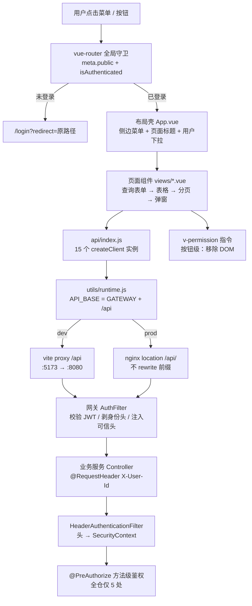
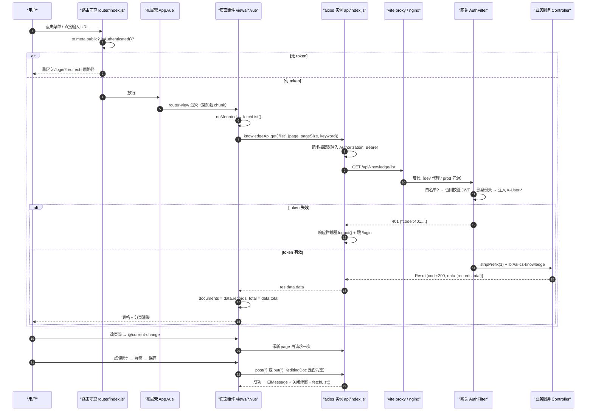

# 18-中后台硬技能：把「增删改查 + 权限 + 表单 + 大数据」做成骨架

> 一句话结论：中后台前端的能力不是"会用 el-table"，而是把**列表页的标准骨架（查询表单 + 分页 + 三态 + 批量操作 + 列设置）、权限三层（菜单/按钮/数据）、表单与弹窗复用、大数据交互**这四件事固化成模板，让第 20 个页面和第 1 个页面长得一样；**前端权限只负责体验，安全必须在后端**——本仓库网关 `AuthFilter` 会剥掉前端伪造的身份头，这条链路决定了"前端能做什么"的边界。
>
> 阅读前置：会 Vue 3 `<script setup>`、用过 Element Plus 的表格/表单即可，不需要读过本仓库源码——本篇每条结论都带 `路径#L行号` 锚点，可原地核对；后端只用到网关鉴权与一个 Controller 签名，读到时会给出完整上下文。
>
> 证据基线：`ai-cs-frontend`（vue ^3.5.39 / vue-router ^4.6.4 / element-plus ^2.14.3 / axios ^1.18.1 / vite ^8.1.1）+ `ai-cs-frontend-react`（antd ^5.22.5 / react ^18.3.1 / vite ^5.4.11），依赖清单取自两个工程根目录的 package.json；后端涉及网关与 user / order / notify 三个服务。B 级证据为仓库内真实文件与行号；C 级为 §6 及全篇 pwsh 普查命令的本机真实输出（node 24，未执行 npm install / build，未联网）。预计阅读 35 分钟。

## 0. 先看现象

### 现象 1：菜单里有"用户管理"，点进去没有任何列表

侧边栏第 4 项写着"用户管理"（`ai-cs-frontend/src/App.vue#L31-L34`），但它指向的页面里没有表格、没有分页、没有查询条件：

```vue
<!-- ai-cs-frontend/src/views/UserView.vue#L7-L23（节选） -->
<el-card shadow="hover">
  <template #header><span style="font-weight: 600">用户注册（调试）</span></template>
  <el-form label-width="90px">
    <el-form-item label="用户名">
      <el-input v-model="regForm.username" placeholder="用户名" />
    </el-form-item>
    ...
```

整页只有三张"接口调试卡"（注册 / 登录 / 查询单个用户），登录卡里还写着"全站登录请用右上角用户菜单，此处仅作接口调试"（`ai-cs-frontend/src/views/UserView.vue#L42`）。**菜单名承诺的是 CRUD 列表，实现给的是三个 Postman。**

这不是孤例。C 级普查（命令与完整输出见 §6 手法 1）在 24 个 `views/*.vue` 里数到 **19 张 `<el-table>`、109 个 `<el-table-column>`，却只有 2 处分页**（`KnowledgeView.vue#L42`、`ShopView.vue#L67`）。

### 现象 2："通知中心"的 WebSocket 面板永远连不上，而且不报错

页面提供了"连接 / 断开"按钮和日志面板，点连接后日志只多一行"WebSocket 已断开"，那个 `ElMessage.error('WebSocket 连接失败')` 永远不会弹出来：

```js
// ai-cs-frontend/src/views/NotifyView.vue#L112-L128
function connectWs() {
  try {
    ws = new WebSocket('ws://localhost:8085/ws/notify')
    ws.onopen = () => { wsConnected.value = true; addLog('WebSocket 已连接') }
    ws.onmessage = (e) => { addLog('收到通知: ' + e.data) }
    ws.onclose = () => { wsConnected.value = false; addLog('WebSocket 已断开') }
  } catch (e) {
    ElMessage.error('WebSocket 连接失败')
  }
}
```

两个独立的错误叠在一起：**端口写错**（`8085` 是 message 服务；通知服务的 `/ws/notify` 端点在 `8086`，见 `ai-cs-notify/src/main/java/com/aics/notify/config/WebSocketConfig.java#L26-L31`），以及**错误处理位置错**（`new WebSocket()` 是异步建连，握手失败不抛异常，只触发 `onclose`/`onerror`，所以同步 `catch` 是死代码）。

### 现象 3：订单页把"我是谁"写在请求头里，而这颗头在网关会被删掉

```js
// ai-cs-frontend/src/views/OrderView.vue#L42-L49
const userId = ref(getUser()?.userId || localStorage.getItem('userId') || '')
...
const { data } = await orderApi.get('/list', { headers: { 'X-User-Id': userId.value } })
```

后端确实读这个头：`ai-cs-order/src/main/java/com/aics/order/controller/OrderController.java#L35-L36` 的签名就是 `Result<List<OrderVO>> listOrders(@RequestHeader("X-User-Id") Long userId)`。但网关于是在**转发前先删掉客户端传来的同名头**，再注入 JWT 解析出的可信值（`ai-cs-gateway/src/main/java/com/aics/gateway/filter/AuthFilter.java#L155-L163`）。所以前端这一行在线上是**无效代码**——它既没有增强安全，也没有改变结果。

这些现象指向同一件事：**中后台缺的不是组件用法，而是一套骨架。** 没有骨架，每一页都会各自漏掉同一批细节——分页、三态、校验、权限、连接生命周期——而漏掉的部分恰好都在 UI 上"看起来正常"。骨架一旦立起来，这些细节就从"每页都要记得写"变成"默认就在那里"。

## 1. 整体地图

一句话结论：一个中后台请求从点到表格一共穿过 **7 层**，每层都有明确的"能做什么 / 不能做什么"边界；权限判断只发生在第 2、3 层（体验），真正的拦截发生在第 6 层（安全）。



> **读图说明**：① 上半段（B→C→D）是**体验层**，它决定"用户看见什么"，全部基于浏览器本地状态（`localStorage` 里的 token 与 role），改一行 JS 就能绕过，所以只能算"不给看"，不算安全。② 下半段（E→K）是**安全层**，唯一可信的身份来源是网关用 JWT 解出来再注入的头；前端自己往请求里塞的 `X-User-Id` 会在 H 处被删除。③ 图右下角那条 `v-permission → 移除 DOM` 是"旁路"：它不参与请求链路，只在渲染时把按钮从 DOM 里摘掉，因此对已打开的 DevTools 无效（§3.3 会解释为什么这仍是正确取舍）。

| 组件 | 责任 | 关键文件（本仓库真实路径） | 谁调用它 | 本仓库现状 |
|---|---|---|---|---|
| 路由守卫 | 登录态兜底，未登录跳登录页 | `ai-cs-frontend/src/router/index.js` | vue-router（每次跳转） | 只判 `meta.public` + token，无角色、无 403 页 |
| 布局壳 | 侧边菜单 / 页面标题 / 用户信息 | `ai-cs-frontend/src/App.vue` | `App.vue` 自身根组件 | 菜单项写死在模板，与路由表是两份真相 |
| 页面组件 | 查询、表格、分页、弹窗 | `ai-cs-frontend/src/views/*.vue`（24 个） | 路由懒加载 | 13 个含表格页，骨架完整度差异极大 |
| API 客户端 | 统一 baseURL、超时、注入 token、401 兜底 | `ai-cs-frontend/src/api/index.js` | 各页面 `import { xxxApi }` | 15 个服务实例，401 处理齐全，其余错误交给页面 |
| 地址解析 | 生产同源 `/api`、开发走代理 | `ai-cs-frontend/src/utils/runtime.js` | `api/index.js` | 空串安全处理（不能用 `\|\|`） |
| 按钮权限 | 无权限移除按钮 DOM | `ai-cs-frontend/src/directives/permission.js` | `main.js` 注册为 `v-permission` | 指令有实现 + 单测，但页面里命中 **0** 次 |
| 网关鉴权 | JWT 校验、身份头清洗与注入 | `ai-cs-gateway/src/main/java/com/aics/gateway/filter/AuthFilter.java` | Spring Cloud Gateway | 白名单分支也会先删身份头 |
| 服务侧身份适配 | `X-User-*` → `SecurityContext` | `ai-cs-user/src/main/java/com/aics/user/security/HeaderAuthenticationFilter.java` | 各服务 Servlet 过滤链 | 显式声明"不校验 JWT，直连服务端口必须禁止" |

## 2. 关键概念与关键类/关键 API

| 名称 | 位置 | 角色 | 关键点 |
|---|---|---|---|
| `meta.public` | `ai-cs-frontend/src/router/index.js#L5` | 路由元信息：公开页标记 | 全表 25 条路由只有登录页带它 |
| `router.beforeEach` | `ai-cs-frontend/src/router/index.js#L38-L48` | 全局前置守卫 | Vue Router 4 用**返回值**控制跳转，不再调 `next()` |
| `v-permission` | `ai-cs-frontend/src/directives/permission.js#L16-L35` | 按钮级权限指令 | 无权限时 `removeChild`，兜底 `display:none` + `data-permission-denied` |
| `hasRole(role)` | `ai-cs-frontend/src/utils/auth.js#L48-L51` | 角色判断 | 大小写不敏感，数据来自 `localStorage` |
| `getRoles()` | `ai-cs-frontend/src/utils/auth.js#L36-L43` | 解析多角色 | 与后端一致：逗号拆 → trim → 小写 |
| `createClient(baseURL)` | `ai-cs-frontend/src/api/index.js#L37-L63` | axios 实例工厂 | 15 个服务 = 15 个实例，共用拦截器逻辑 |
| `API_BASE` | `ai-cs-frontend/src/utils/runtime.js#L24` | `GATEWAY + '/api'` | 生产 `VITE_GATEWAY` 留空 → 相对路径 `/api` |
| `X-User-Id` / `X-User-Roles` | 网关注入，见 `AuthFilter.java#L160-L162` | 服务间可信身份头 | 客户端同名头在 `#L155-L159` 被删除 |
| `@PreAuthorize` | `ai-cs-user/src/main/java/com/aics/user/controller/UserController.java#L43`、`#L50` | 方法级授权 | 全仓仅 **5 处**，其余服务接口靠"能连上=有权限" |
| `el-table` / `el-table-column` | 各页面 | 列表渲染 | 19 张表全部未设 `height`，长表格靠整页滚动 |
| `el-pagination` | `KnowledgeView.vue#L42-L48`、`ShopView.vue#L67-L76` | 服务端分页 | 两种写法：`v-model` 版 vs `:current-page` + 事件版 |
| `el-form` + `:rules` + `prop` | `LoginView.vue#L13-L18` | 表单校验三件套 | **缺 `prop` 时 `rules` 静默失效**（全仓 91 个 `el-form-item` 只有 5 个带 `prop`） |
| `el-popconfirm` | `KnowledgeView.vue#L32-L36` | 二次确认 | 比 `ElMessageBox.confirm` 少一层 Promise |
| `ElMessage` / `ElMessageBox` | 全仓 160 / 16 处 | 轻提示 / 阻塞确认 | 不能替代行内错误态与页面级错误边界 |

概念辨析（这几个词最容易被混着说）：

| 说法 | 实际含义 | 在本仓库哪里 |
|---|---|---|
| 菜单级权限 | 侧边栏是否**显示**入口 | 没有实现：11 个菜单项对所有人可见（`App.vue#L19-L62`） |
| 路由级权限 | 直接输入 URL 是否**进得去** | 只判登录态（`router/index.js#L38-L48`），不判角色 |
| 按钮级权限 | 操作按钮是否**渲染** | 有指令无使用（`v-permission` 命中 0 次） |
| 数据级权限 | 这条记录**该不该**被这个用户看到 | 后端 `@RequestHeader` + `@PreAuthorize`，前端零参与 |
| 加载态 / 骨架屏 / 空态 | 请求中 / 首屏结构占位 / 结果为空 | `v-loading` 6 处、`el-skeleton` 1 处、`el-empty` 22 处 |

## 3. 原理与证据逐段精读

### 3.1 布局壳：一个壳管三件事，但它把导航写死了

**在干什么。** `App.vue` 是整个中后台唯一的"壳"：登录页直接裸渲染路由视图，其余页面套上 `el-aside` + `el-menu` + `el-header` + `el-main`。

```vue
<!-- ai-cs-frontend/src/App.vue#L1-L18（节选） -->
<template>
  <!-- 登录页：全屏展示，不带侧边栏 -->
  <router-view v-if="isLoginPage" />

  <el-container v-else class="app-container">
    <el-aside width="220px" class="app-aside">
      <div class="logo-area">
        <el-icon :size="28" color="#409eff"><ChatDotRound /></el-icon>
        <span class="logo-text">AI 客服平台</span>
      </div>
      <el-menu
        :default-active="activeMenu"
        router
        ...
```

```js
// ai-cs-frontend/src/App.vue#L130-L148
const titleMap = {
  '/': '首页总览',
  '/chat': 'AI 对话',
  ...  // 共 15 条
}
const activeMenu = computed(() => route.path.startsWith('/order') ? '/order' : route.path)
const currentPageTitle = computed(() => titleMap[route.path] || 'AI 客服平台')
```

**为什么这么设计。** 中后台的壳承担三件互相独立的事：**导航**（我能去哪）、**定位**（我在哪）、**身份**（我是谁）。把它们放在同一个根组件里，页面组件就只需要关心自己的内容区，不必每个页面重复写头部和侧边栏。`el-menu` 加 `router` 属性后，菜单项的 `index` 直接当路径用，省掉一次手写 `router.push`。

**换写法会怎样。** 更工程化的做法是"单一真相"：路由表里给每条路由加 `meta: { title, icon, roles }`，菜单和标题都由路由表生成（`el-menu-item` 用 `v-for` 渲染 `router.getRoutes()`）。这样新增页面只改一处。本仓库是**三份真相**：`router/index.js` 25 条路由、`App.vue#L19-L62` 11 个菜单项、`App.vue#L130-L145` 15 条标题映射。三者对不齐的后果是具体的：13 条路由没有菜单入口（`/cart`、`/order`、`/trace`、`/prompts`…），而 `/order` 进去了侧边栏也不高亮——因为 `activeMenu` 算出 `'/order'`，而菜单里没有 `index="/order"` 的项（`App.vue#L142-L143` 的标题映射里有它，菜单里没有）。

**常见坑。** ① `titleMap` 漏一条路径不会报错，只会让页面标题退化成"AI 客服平台"（`App.vue#L148` 的 `||` 兜底把问题藏起来了）。② 详情页 `/order/:orderNo` 必须被归一化到列表页的菜单项上，否则详情页侧边栏无高亮——`activeMenu` 那一行正是在补这个洞，一旦有第二个详情页（如 `/product/:id`）就会漏。③ 壳里 `watch(() => route.path)` 重读用户信息（`App.vue#L107-L112`），登录后如果不改路径，用户信息不会刷新。

### 3.2 权限第一层：路由守卫只回答"有没有登录"

**在干什么。** 每次跳转前跑一遍守卫：公开页放行，未登录跳登录页并带上 `redirect`，已登录再访问登录页则踢回首页。

```js
// ai-cs-frontend/src/router/index.js#L37-L48
// 全局路由守卫：未登录用户只能访问公开页面（登录页），其余一律跳转登录页
router.beforeEach((to) => {
  const isPublic = to.meta?.public === true
  if (!isPublic && !isAuthenticated()) {
    return { path: '/login', query: { redirect: to.fullPath } }
  }
  // 已登录访问登录页，直接进首页
  if (to.path === '/login' && isAuthenticated()) {
    return { path: '/' }
  }
  return true
})
```

**为什么这么设计。** 守卫的职责被刻意压到最小：**只判断"有没有票"，不判断"票能不能坐这节车厢"**。原因是第二件事在前端做不牢——角色存在 `localStorage`（`ai-cs-frontend/src/utils/auth.js#L27-L29` 的 `isAuthenticated()` 就是 `!!getToken()`），用户在 DevTools 里改一个字符串就能"升级成管理员"。所以正确姿势是：前端角色判断只用于**少显示几个按钮**，越权拦截交给后端。本仓库 `isAuthenticated()` 连 token 是否过期都不判——过期后由 `api/index.js` 的 401 拦截器统一收拾（`#L50-L60`），这也是一种职责分配：**入口宽松，出口严格**。

**换写法会怎样。** 常见替代是"动态路由"：登录后拉 `/user/menus`，拿到权限清单再 `router.addRoute()` 注入，菜单也从同一份数据生成。好处是菜单级权限天然生效、无权限的页面连路由都不存在；代价是路由表变成异步的，刷新页面要等权限接口回来才能 `app.mount`，否则会先命中 404；另外 `addRoute` 必须在登出时 `removeRoute`，否则切换账号后旧权限还在。本仓库角色只有 `user`/`admin` 两种且菜单对所有人可见，所以不做动态路由是合理的简化——**但要在文档里写清这是简化，不是能力**。

**常见坑。** ① 守卫返回对象才跳转，`return true` 表示放行；从 Vue Router 3 迁过来的人常写成 `next('/login')`，在 4 里会触发 `next is not a function`。② 守卫里不能做重活：任何 `await` 都会拖慢首屏，且并发跳转时可能被后来的跳转覆盖。③ 401 时不走守卫而是 `window.location.href = '/login'`（`api/index.js#L30-L35`），因为 axios 拦截器里拿不到 router 实例——硬跳转会丢 SPA 状态，这是有意为之的取舍。

### 3.3 权限第二层：按钮级指令，以及"移除 DOM 而不是隐藏"的原因

**在干什么。** `v-permission="'admin'"` 挂在按钮上，渲染时若当前用户没有该角色，就把元素从 DOM 里摘掉。

```js
// ai-cs-frontend/src/directives/permission.js#L16-L35
export const permission = {
  mounted(el, binding) {
    const required = binding.value
    if (!required) return

    const list = Array.isArray(required) ? required : [required]
    const allowed = list.some((role) => hasRole(role))
    if (allowed) return

    if (el.parentNode) {
      el.parentNode.removeChild(el)
      return
    }

    // 兜底：指令直接挂在组件根节点上时还没有父节点，removeChild 无从下手。
    // 不能悄悄放过（否则按钮可见 = 越权入口），退化为隐藏 + 标记原因，方便排查：
    //   控制台查询 document.querySelectorAll('[data-permission-denied]')
    el.style.display = 'none'
    el.setAttribute('data-permission-denied', list.join(','))
  },
}
```

**为什么这么设计。** 三个决定都有明确理由，源码注释里也写了：① **移除而不是 `display:none`**——隐藏的按钮在 DevTools 里删掉一行样式就能点，而"不存在"至少挡住了顺手一试；② **只实现 `mounted`，不做 `updated`**——本项目角色在登录时一次性写进 `localStorage`，切角色必然重新登录，所以不需要响应式更新（注释里也说明了将来支持权限热更新要补 `updated`）；③ **兜底保留 `display:none`**——指令挂在组件根节点时 `el.parentNode` 可能为 `null`，此时"静默放行"等于把按钮白送给无权限用户，宁可降级为隐藏并打标记，方便日后用 `document.querySelectorAll('[data-permission-denied]')` 在控制台反查漏配。

**换写法会怎样。** 更彻底的做法是把权限判断挪到**组件层**：封装 `<AuthButton role="admin">`，无权限直接 `v-if` 不渲染，语义比指令更清楚，也天然支持动态权限更新（`v-if` 是响应式的）。代价是模板里要额外包一层组件，且 IDE 对自定义组件的属性提示不如原生按钮直观。另一种是"统一入口 + 后端返回按钮清单"（`permissions: ['order:refund']`），前端只管 `has('order:refund')`——粒度从"角色"换成"权限点"，更适合角色会无限增长的系统。

**常见坑。** ① **指令写了但没人用**：C 级普查 `v-permission` 在全仓 `.vue` 文件里命中 **0 次**——指令、单测（`ai-cs-frontend/src/directives/permission.test.js`）都在，页面里一个也没挂，等于能力未落地；`main.js#L20-L21` 的注册注释还写着"用法见 06/18"，很容易让人误以为已经用上了。② 指令只能作用于**单元素**，挂在 `<template>` 上无效。③ 依赖 `el.parentNode` 就意味着渲染时机敏感：`v-if` 切换、异步组件、`<Teleport>` 里都可能拿到 `null` 而落到兜底分支。

### 3.4 权限第三层：数据级权限为什么前端只能"提示"

**在干什么。** 数据级权限回答的是"这条订单是不是我的"。前端能做的是不把 ID 拼进别人能改的地方；真正判断由后端做。

前端确实往请求里塞了身份头：

```js
// ai-cs-frontend/src/views/OrderView.vue#L47-L58
async function fetchOrders() {
  try {
    const { data } = await orderApi.get('/list', { headers: { 'X-User-Id': userId.value } })
    if (data.code === 200) {
      orders.value = data.data || []
    } else {
      ElMessage.error(data.message)
    }
  } catch (e) {
    ElMessage.error('获取订单列表失败')
  }
}
```

后端也确实只认这个头：

```java
// ai-cs-order/src/main/java/com/aics/order/controller/OrderController.java#L35-L38
@GetMapping("/list")
public Result<java.util.List<OrderVO>> listOrders(@RequestHeader("X-User-Id") Long userId) {
    ...
}
```

**为什么这么设计。** 因为这条链路上有两个不同来源的 `X-User-Id`，网关做了取舍：**只信自己算出来的那个**。

```java
// ai-cs-gateway/src/main/java/com/aics/gateway/filter/AuthFilter.java#L147-L163（节选）
String userId = JwtUtil.getSubject(token);
String role = claims.getOrDefault("role", "USER").toString();
String normalizedRole = role.startsWith("ROLE_") ? role : "ROLE_" + role.toUpperCase();
// 移除客户端可能伪造的身份头，避免越权
ServerHttpRequest mutated = request.mutate()
        .headers(h -> {
            h.remove("X-User-Id");
            h.remove("X-User-Name");
            h.remove("X-User-Roles");
            h.set("X-User-Id", userId);
            h.set("X-User-Name", username);
            h.set("X-User-Roles", normalizedRole);
        })
        .build();
```

**换写法会怎样。** 如果网关"只在头缺失时才补"，那客户端只要自己带一个 `X-User-Id: 1` 就能读别人的订单——这是经典越权漏洞（IDOR）。本仓库选择"先删后设"，并且白名单分支也走同样清理（`AuthFilter.java#L112-L121`），所以前端那行 `headers: { 'X-User-Id': ... }` **在经网关的路径上是无效代码**：删掉它，线上行为不变；留着它，反而误导后来者以为身份由前端负责。真正生效的场景只有一种——直连服务端口（`8087`），而这正是 `HeaderAuthenticationFilter` 类注释明令禁止的部署方式。

数据级权限在服务侧还有第二道闸：方法级 `@PreAuthorize`。本仓库只在 user 服务的两个接口上有：

```java
// ai-cs-user/src/main/java/com/aics/user/controller/UserController.java#L42-L50（节选）
@GetMapping("/{id}")
@PreAuthorize("authentication.name == #p0.toString() or hasRole('ADMIN')")
public Result<User> getUser(@PathVariable Long id) { ... }

@PutMapping
@PreAuthorize("authentication.name == #p0.id?.toString() or hasRole('ADMIN')")
public Result<Void> updateUser(@Validated(UserValidationGroups.Update.class) @RequestBody User user) { ... }
```

**常见坑。** ① 全仓 `@PreAuthorize` 只有 **5 处**（C 级实测，排除 `target/`）——也就是说大部分接口的"数据级权限"目前等于"能连上服务就有权限"，这正是"前端按钮隐藏 ≠ 安全"的硬证据，也是面试里最容易被追问的点。② `authentication.name` 能对上路径参数，前提是 `HeaderAuthenticationFilter` 把 `userId` 作为 principal 放进了 `SecurityContext`（`ai-cs-user/src/main/java/com/aics/user/security/HeaderAuthenticationFilter.java#L45-L48`），且 `finally` 里 `clearContext()`（`#L52-L55`）——漏掉清理会在 Tomcat 线程复用时把 A 的身份串给 B。③ 前端做"数据级过滤"（比如列表里 `filter(o => o.userId === me)`）只能当兜底展示，不能当权限。

### 3.5 表格页标准骨架：拿最完整的一页逐段对照

**在干什么。** 一个合格的中后台列表页有固定顺序：**页头（标题 + 主操作）→ 查询区 → 表格 → 分页 → 弹窗（新增/编辑/详情）**。本仓库里唯一接近完整的是知识库页面。

```vue
<!-- ai-cs-frontend/src/views/KnowledgeView.vue#L11-L48（节选） -->
<!-- 搜索栏 -->
<div style="margin-bottom: 16px; display: flex; gap: 10px">
  <el-input v-model="keyword" placeholder="搜索文档..." clearable @clear="fetchList" style="width: 300px" />
  <el-button type="primary" @click="fetchList" :icon="Search">搜索</el-button>
</div>

<!-- 文档表格 -->
<el-table :data="documents" border stripe style="width: 100%">
  <el-table-column prop="id" label="ID" width="80" />
  <el-table-column prop="title" label="标题" />
  <el-table-column prop="status" label="状态" width="100">
    <template #default="{ row }">
      <el-tag :type="row.status === 1 ? 'success' : 'info'" size="small">{{ row.status === 1 ? '启用' : '禁用' }}</el-tag>
    </template>
  </el-table-column>
  <el-table-column label="操作" width="180" fixed="right">
    <template #default="{ row }">
      <el-button size="small" @click="viewDoc(row)" :icon="View" circle />
      <el-button size="small" type="primary" @click="editDoc(row)" :icon="Edit" circle />
      <el-popconfirm title="确认删除?" @confirm="deleteDoc(row.id)">...</el-popconfirm>
    </template>
  </el-table-column>
</el-table>

<div style="margin-top: 16px; display: flex; justify-content: flex-end">
  <el-pagination
    v-model:current-page="page"
    v-model:page-size="pageSize"
    :total="total"
    layout="total, prev, pager, next"
    @current-change="fetchList"
  />
</div>
```

```js
// ai-cs-frontend/src/views/KnowledgeView.vue#L103-L112
async function fetchList() {
  try {
    const res = await knowledgeApi.get('/list', { params: { page: page.value, pageSize: pageSize.value, keyword: keyword.value || undefined } })
    const data = res.data?.data
    documents.value = data?.records || data || []
    total.value = data?.total || documents.value.length
  } catch (e) {
    ElMessage.error('加载文档列表失败: ' + (e.response?.data?.message || e.message))
  }
}
```

**为什么这么设计。** 每一块都在解决一类反复出现的问题：查询区放**受控输入 + 显式搜索按钮**，避免每敲一个字就发请求（本项目全仓 0 处防抖，靠按钮兜住）；表格用 `border stripe` 提高可读性、操作列 `fixed="right"` 让滚动时按钮不被挤走；删除用 `el-popconfirm` 做行内二次确认，比 `ElMessageBox` 少一层 Promise；分页用 `v-model:current-page` + `v-model:page-size` 双向绑定，`@current-change` 只负责重新取数。`data?.records || data || []` 这一行是**兼容两种后端返回结构**（MyBatis-Plus 的 `IPage` 带 `records`，裸数组则直接是数组）的务实写法。

**换写法会怎样。** 更健壮的骨架会把"取数"抽成一个 `useTable(fetcher)` 组合式函数，统一管理 `loading / data / page / pageSize / total / error`，并内置：请求竞态取消（`AbortController`，避免旧请求覆盖新结果）、失败时保留旧数据 + 显示错误条、`pageSize` 变化自动回到第 1 页。这样 13 个列表页的骨架代码从"每页 40 行"压到"每页 5 行 + 列定义"。另外 `total.value = data?.total || documents.value.length`（`#L108`）在"后端其实没分页"时会把总数写成当前页条数，分页器永远只有 1 页——**兜底写法掩盖了后端缺陷**，这是骨架里最该报警而不是兜底的地方。

**常见坑。** 对照标准骨架，这一页的缺口清单是：无 `v-loading`（请求中表格保持旧数据且无反馈）、`el-form` 无 `:rules` 无 `prop`（`#L54-L64`，标题为空也能保存）、无批量选择（全仓 `type="selection"` 仅 `CartView.vue#L6` 一处且没有批量动作）、无列设置/自定义列、无列排序（全仓 `sortable` 0 处）、空态用表格自带文案、错误只弹 `ElMessage` 且表格不清空、没有请求竞态保护。

### 3.6 表单与弹窗复用：schema 驱动 vs 手写，以及 `prop` 是关键

**在干什么。** 中后台一半的代码量在"新增/编辑弹窗"。本仓库全部手写：8 个 `el-dialog`、91 个 `el-form-item`，只有登录页用了完整校验三件套。

```vue
<!-- ai-cs-frontend/src/views/LoginView.vue#L13-L18 -->
<el-form ref="loginFormRef" :model="loginForm" :rules="loginRules" size="large" @keyup.enter="handleLogin">
  <el-form-item prop="username">
    <el-input v-model="loginForm.username" placeholder="用户名" :prefix-icon="User" clearable />
  </el-form-item>
  <el-form-item prop="password">
    <el-input v-model="loginForm.password" type="password" placeholder="密码" :prefix-icon="Lock" show-password />
  </el-form-item>
</el-form>
```

**为什么这么设计。** Element Plus 的校验是**三段式契约**：`:rules` 声明规则、`:model` 提供数据、`el-form-item` 的 `prop` 把规则绑定到具体字段。三者缺一，校验就静默失效——不报错，只是永远通过。所以 `prop` 不是可选装饰，是**校验生效的开关**。`LoginView` 是全仓唯一写对的页面（5 个 `prop` 全在这里），并且 `@keyup.enter` 让回车提交，这是中后台表单最基础的键盘体验。

**换写法会怎样。** 手写模式的问题不是"多写几行"，而是**不一致**：同一份"商品表单"在新增和编辑两个弹窗里各写一遍（`ai-cs-frontend/src/views/ProductView.vue#L40-L52` 与 `#L130-L138`），字段一改就要改两处；校验更是全靠人记。schema 驱动的做法是：字段定义一个数组

```js
// 示意：不是本仓库现状，仅说明目标形态
const fields = [
  { prop: 'name', label: '商品名', type: 'input', rules: [{ required: true, message: '必填' }] },
  { prop: 'categoryId', label: '分类', type: 'select', options: () => categories.value },
  { prop: 'price', label: '价格', type: 'number', min: 0 },
]
```

模板只写一个 `v-for` 渲染 `<el-form-item :prop="f.prop" :rules="f.rules">`，弹窗组件接收 `fields + model + mode('create'|'edit')`，新增/编辑/详情共用一套。代价是多一层抽象，且特殊控件（上传、富文本）需要留 slot 逃生口。

**常见坑。** ① 最常见的具体缺陷：商品表单里**分类用 `el-input-number` 手输 ID**（`ai-cs-frontend/src/views/ProductView.vue#L52`、`#L138`），而同一页早就把分类列表拉回来了（`#L243` 的 `const categories = ref([])`、`#L246-L249` 的 `productApi.get('/categories')`，还在 `#L156` 渲染成表格）——用户被迫背数字 ID，这是"数据在手边却不用"的典型。② 弹窗复用要处理"编辑后取消"的脏数据：本仓库的 `editDoc(row)` 用 `{ ...row }` 浅拷贝（`KnowledgeView.vue#L120-L124`），对象嵌套时就改到原行。③ `validate()` 返回 Promise，不 `await` 或不用 `.catch` 会抛未捕获 rejection（`LoginView.vue#L89`、`#L117` 均未 `try/catch`，靠 `el-form` 自己显示红字，控制台会留下 rejection 记录）。④ `el-dialog` 关闭后 `el-form` 不重置 `validateState`，下次打开还带着上次的红字——需要 `formRef.resetFields()` 或 `v-if` 重建。

### 3.7 大数据的交互：虚拟滚动之前，先把分页和列做对

**在干什么。** 中后台的"大"有三个维度：**行多**（10 万条订单）、**列多**（44 列 MQ 明细）、**单元格重**（每格带标签/按钮）。本仓库最极端的是 MQ 调度中心：一个页面塞了 7 张表、44 列，5 处 `v-loading`，靠 `el-tabs` 分 5 个标签页。

```vue
<!-- ai-cs-frontend/src/views/MqView.vue#L27-L31 -->
<el-tabs v-model="activeTab" style="margin-top: 16px">
  <!-- Broker 集群 -->
  <el-tab-pane label="集群 / Broker" name="cluster">
    <el-table :data="brokers" border stripe size="default" v-loading="loading">
      <el-table-column prop="brokerName" label="Broker" min-width="140" />
```

**为什么这么设计。** `el-tabs` 在这里不是"分类展示"，而是**降低单屏信息密度**的手段：7 张表同时渲染，DOM 节点数会到几千，滚动和切换都会卡。而"多列"的正确解法不是缩字号，是**列宽策略**：`prop` 简单的列给固定 `width`，内容长的列给 `min-width` 让其弹性伸缩，操作列 `fixed="right"` 钉住。

**换写法会怎样。** 按数据量分档，而不是一上来就虚拟滚动：**< 100 行**直接全量渲染（本仓库 19 张表全在这一档）；**100~1000 行**用服务端分页，前端只拿一页；**> 1000 行且必须一屏滚动**才上 `el-table-v2` 或 `useVirtualList`。虚拟滚动的代价是：行高必须可预测、`el-table` 的全部特性（展开行、合并单元格、`fixed` 列）大多不可用、无障碍与打印基本报废。本仓库 `el-table` 带 `height`/`max-height` 的 **0 处**、`row-key` **0 处**、`sortable` **0 处**、虚拟滚动 **0 处**——说明还没到需要虚拟滚动的那一步，**缺的是分页和列设置**。导出同理：全仓 0 处前端导出，正确做法也不是前端拼 CSV，而是让后端出异步导出任务（大文件走对象存储 + 下载链接），前端只轮询任务状态。

**常见坑。** ① 表格不设 `height` 时，`fixed="right"` 的列在整页滚动下会错位（表头不吸顶、固定列随页面滚），这是长期被当成"组件 bug"的常见现象。② `el-table` 默认按 `row` 对象引用做 diff，翻页后数据全换、`type="selection"` 会丢选中——需要 `row-key` + `reserve-selection`。③ 44 列表格里每格放 `el-tag`，单页 100 行就是 4400 个组件实例，切换 tab 不销毁（`el-tab-pane` 默认懒渲染但保持挂载）会累积内存——这正是 §3.8 长会话问题的来源。

### 3.8 长会话内存与连接生命周期：中后台的性能瓶颈不在首屏

**在干什么。** 中后台用户会开着标签页一整天。首屏只有一次，**长会话里的内存增长和连接泄漏**才是真实性能问题。本仓库有两处主动管理（SSE 关缓冲、日志截断）和一处漏管（WebSocket 未随组件卸载关闭）。

```js
// ai-cs-frontend/src/views/NotifyView.vue#L131-L140
function disconnectWs() {
  if (ws) { ws.close(); ws = null }
}

function addLog(message) {
  notifyLogs.value.unshift({ time: new Date().toLocaleTimeString(), message })
  if (notifyLogs.value.length > 50) notifyLogs.value.pop()
}

fetchOnlineCount()
```

**为什么这么设计。** `addLog` 里的 `length > 50 → pop()` 说明作者已经意识到"日志数组会无限增长"——这类列表页最容易写成"往数组里 push，永远不清"。连接侧则只提供了**手动断开按钮**，把生命周期交给了用户。

**换写法会怎样。** 正确写法是把连接绑到组件生命周期：`onMounted` 建连、`onUnmounted` 关闭，并在 `onclose` 里做指数退避重连（1s→2s→4s，封顶 30s），页面不可见时（`document.visibilityState === 'hidden'`）暂停心跳。否则用户从"通知中心"切到"知识库"后，旧连接仍然挂在页面上：服务端以为这个用户在线（影响 `/api/notify/online` 的统计），浏览器侧 `onmessage` 回调继续往已卸载组件的 `ref` 里写数据。SSE 侧同理，本仓库在构建层已经处理了缓冲问题：

```js
// ai-cs-frontend/vite.config.js#L29-L40
'/api': {
  target: gateway,
  changeOrigin: true,
  // SSE（/api/chat/stream/sse、/api/agent/stream/sse）必须关闭缓冲，
  // 否则 token 会被攒成一坨再返回，打字机效果消失
  configure: (proxy) => {
    proxy.on('proxyRes', (proxyRes) => {
      proxyRes.headers['cache-control'] = 'no-cache, no-transform'
      delete proxyRes.headers['content-encoding']
    })
  },
},
```

生产侧在 nginx 里对应关闭缓冲，并给足超时（`ai-cs-frontend/nginx.conf#L56-L62`：`proxy_set_header Connection ""`、`proxy_buffering off`、`proxy_read_timeout 300s`）——因为大模型首 token 可能很慢，nginx 默认 60s 会 504；`300s` 也与服务端 `SseEmitter` 的 5 分钟超时对齐。

**常见坑。** ① 只写 `try/catch` 不写 `onerror`，连接失败无声（§3.9 之后会再遇到一次）。② 页面级定时器/`setInterval` 轮询忘记 `clearInterval`，切 5 个页面就有 5 个轮询在跑。③ 长列表 + 图表页：`echarts` 实例必须 `dispose()`，否则每次进入页面新增一个 canvas（本仓库图表在 `Dashboard.vue`、`GraphView.vue` 等页面，`echarts` 已被 `manualChunks` 单独打包成 `charts` chunk，但实例销毁属于页面职责）。

### 3.9 上传链路：一句"不超过 5MB"是假的

**在干什么。** 商品图片走 `el-upload` 直传服务端，提示文案写"仅支持 jpg/png/webp/gif，不超过 5MB"（`ai-cs-frontend/src/views/ProductView.vue#L24-L26`），后端也确实声明了 5MB 上限（`ai-cs-product/src/main/java/com/aics/product/controller/ProductController.java#L36` 的 `MAX_IMAGE_SIZE = 5 * 1024 * 1024L`）。

**为什么这么设计。** 上传是**四层限制叠加**的地方，每层都有自己的默认值：浏览器/组件层（`accept` 只过滤选择器，不阻止拖拽）、Spring 容器层（`spring.servlet.multipart.max-file-size` 默认 **1MB**）、业务校验层（5MB 白名单扩展名）、反向代理层（nginx `client_max_body_size`，本仓库 20m，见 `ai-cs-frontend/nginx.conf#L21`）。四层里最紧的那个决定实际行为。

**换写法会怎样。** 现状是全仓库 `application*.yml` **没有任何 multipart 配置**（C 级 grep 命中 0），所以 Spring 容器层停在默认 1MB：用户传一张 2MB 的图，会在进入 Controller 之前就被 `MaxUploadSizeExceededException` 拒掉，`MAX_IMAGE_SIZE` 那段业务校验**永远看不到这个请求**。更糟的是全局异常处理器没有这个分支（`ai-cs-common/src/main/java/com/aics/common/exception/GlobalExceptionHandler.java` 里 11 个 `@ExceptionHandler`，无 `MaxUploadSizeExceededException`，全仓该类名出现 **0** 次），于是落到兜底的 `@ExceptionHandler(Exception.class)`，前端拿到 500 而不是可读的"文件过大"。正确做法二选一：把 multipart 上限调到与业务一致（`max-file-size: 5MB` + `max-request-size: 10MB`），或者把提示文案改成真实值并在前端用 `before-upload` 拦截（`el-upload` 的 `before-upload` 返回 `false` 即可中止）。

**常见坑。** ① `:action` 直传（`ProductView.vue#L12` 的 `:action="uploadUrl"`、`#L13` 的 `:headers="uploadHeaders"`）会把 token 塞进请求头，但**绕过了 axios 拦截器**——401 时不会触发统一跳登录，需要自己处理。② `el-upload` 三处（`ProductView.vue#L9-L27`、`ChatView.vue#L139`、`VectorKbView.vue#L45-L52`）全部没有 `on-progress`，大文件上传期间界面无进度。③ 前端校验只看扩展名不看魔数，改后缀即绕过——真正的类型校验必须在服务端读文件头。

### 3.10 部署面：三类"本地好的、线上炸了"

**在干什么。** 前端产物上线只涉及两个文件：`nginx.conf` 与 `.env.production`。本仓库把最容易出事的四件事写在配置注释里（`ai-cs-frontend/nginx.conf#L3-L6`）：深链接 404、`index.html` 被缓存导致白屏、`/api` 反代前缀不匹配、SSE 被缓冲。

**为什么这么设计。** 每条都是一个具体的故障模式：① SPA 路由在前端，服务器没有对应文件，刷新 `/order/123` 必须 `try_files $uri $uri/ /index.html`（`#L68-L70`）；② 静态资源内容哈希可以 `immutable` 长缓存，但 `index.html` 必须 `no-store`（`#L41-L44`），否则发版后用户拿着旧 HTML 去请求已删除的旧 chunk，页面白屏；③ 反代**不能 rewrite 掉 `/api`**（`#L47-L48` 的注释），因为网关路由表本身是 `/api/xxx/**`——这一条和网关的 `stripPrefix(1)` 是一对：网关剥掉的是第一个路径段 `api`，再由服务内 Controller 匹配 `/knowledge/**`。

```nginx
# ai-cs-frontend/nginx.conf#L49-L62（节选）
location /api/ {
    proxy_pass         http://aics_gateway;
    proxy_http_version 1.1;
    proxy_set_header   Host              $host;
    proxy_set_header   X-Real-IP         $remote_addr;
    # SSE 必须走 HTTP/1.1 且关闭缓冲，否则 token 被攒起来一次性返回
    proxy_set_header   Connection        "";
    proxy_buffering    off;
    proxy_cache        off;
    proxy_read_timeout 300s;   # 大模型首 token 可能很慢，默认 60s 会 504
    chunked_transfer_encoding on;
}
```

**换写法会怎样。** 地址解析那里有个更隐蔽的坑：`ai-cs-frontend/src/utils/runtime.js#L14-L24` 特意没用 `env.VITE_GATEWAY || 'http://localhost:8080'`——因为生产环境 `VITE_GATEWAY=` 是**空串**，空串是 falsy，`||` 会让线上回落到 `localhost:8080`，于是所有接口打到自己机器。改写成 `if` 判断后：生产得到 `''`，`API_BASE` 变成相对路径 `/api`，与 nginx 同源反代对齐。**"空串当有效值"这件事，值得在每一个配置读取处检查一遍。**

**常见坑。** ① `.env.production` 里写 `VITE_GATEWAY=http://localhost:8080` 是"本地能跑、线上全挂"的第一名来源。② `proxy_pass` 末尾带不带 `/` 决定是否替换路径前缀，改错会 404 且网关侧无日志（请求根本没到网关）。③ Docker 构建用 `npm ci`（`ai-cs-frontend/Dockerfile`）依赖 `package-lock.json`，锁文件与 `package.json` 不一致时直接构建失败——这是特性不是 bug。

## 4. 一次完整执行时序

一句话结论：从点菜单到表格出数据，一共 9 步；**任何一步失败都表现为"页面空着"**，而它们的原因分布在 4 个不同层（前端、代理、网关、服务），所以定位必须按层排除。



> **读图说明**：① 注意第 6 步的 `onMounted → fetchList()`：**页面一渲染就发请求**，所以"表格空"既可能是请求失败，也可能是数据本来为空，二者在 UI 上无法区分——这就是必须有三态（加载/空/错误）的原因。② 第 11 步是分水岭：`alt token 失效` 分支（12→13）里，**401 由 axios 统一接管并硬跳登录**，页面自己的 `catch` 拿不到这次失败的控制权；其余错误（4xx/5xx）才会冒泡到页面的 `ElMessage.error`。③ 第 21~23 步是"写操作后刷新"的固定套路：`fetchList()` 重新拉当前页——如果新增后总数跨页，用户会看不到新记录，成熟骨架会改成"回到第 1 页"或"本地插入"。

| 步骤 | 失败条件 | 抛出的异常 / 响应 | 本仓库最终表现 |
|---|---|---|---|
| 1~3 路由守卫 | token 不存在或已清 | 无异常，返回重定向对象 | 跳 `/login?redirect=…`，地址栏可见 |
| 5 懒加载 chunk | 发版后旧 chunk 被删、`index.html` 被缓存 | 浏览器 `Failed to fetch dynamically imported module` | 白屏（`nginx.conf#L41-L44` 的 `no-store` 就是防这个） |
| 7~10 请求发出 | `VITE_GATEWAY` 配成 `localhost` | `net::ERR_CONNECTION_REFUSED` / CORS 预检失败 | 控制台红字，`ElMessage.error('…失败')` |
| 11~13 JWT 校验 | 过期 / 签名不对 | 网关 401，响应体 `{"code":401,"message":"Token无效或已过期"}`（`AuthFilter.java#L142-L143`） | `ElMessage.warning` + 硬跳 `/login` |
| 14 转发到服务 | 服务未启动 / Nacos 无实例 | 网关 503，或 `forward:/gateway-fallback` 熔断兜底 | 页面 `catch` 显示"…失败" |
| 15 服务内鉴权 | `@PreAuthorize` 不通过 | 403 `AccessDeniedException` | 全局处理器兜底 → 前端显示后端 message |
| 17~20 渲染分页 | 后端返回裸数组（无 `records`/`total`） | 无异常 | `total` 退化为当前页条数，分页器只有 1 页（`KnowledgeView.vue#L108`） |
| 21~23 保存 | 表单无 `prop`，校验名存实亡 | 无异常 | 空标题被写入，用户以为"保存成功" |

## 5. 设计取舍

| 设计决策 | 收益 | 代价 | 本仓库现状 |
|---|---|---|---|
| 登录态放 `localStorage` | 刷新不掉登录、实现 5 行代码 | XSS 可直接窃取；无法真正判过期 | 采用（`utils/auth.js`），过期靠 401 兜底 |
| 前端角色判断只用于隐藏 | 实现简单，后端仍是唯一权威 | UI 与真实权限可能不一致 | 指令已写、页面未用（命中 0 次） |
| 权限指令用 `removeChild` | 抑制"改样式即点击" | 不可逆，权限热更新需重建节点 | 采用，并留 `data-permission-denied` 排查锚点 |
| 路由表 / 菜单 / 标题三份真相 | 菜单可手工排序、加图标 | 新增页面要改三处，易漏 | 现状：25 路由 vs 11 菜单 vs 15 标题 |
| 手写表格页而非抽象 `useTable` | 每页可自由定制、无抽象成本 | 三态/竞态/分页细节每页各漏一遍 | 13 个表格页，2 处分页 |
| 手写表单而非 schema 驱动 | 特殊控件不受限 | 新增/编辑重复、校验靠人记 | 91 个 `el-form-item`，5 个带 `prop` |
| 全部图标与 Element Plus 全量注册 | 模板里随手可用 | 首包变大（`main.js#L13-L18`） | 采用；用 `manualChunks` 把 `element` 单独成 chunk 缓解 |
| 上传走 `el-upload :action` 直传 | 不占 axios 队列、实现快 | 绕过拦截器、401 需自行处理、无进度 | 3 处上传，0 处 `on-progress` |

可扩展点清单（按"投入产出比"排序，前 3 条建议优先）：

1. **抽 `useTable(fetcher)`**：统一 `loading/data/page/pageSize/total/error` + 竞态取消，13 个表格页一次性补齐三态。
2. **抽 `FormDialog`（schema 驱动）**：字段数组 + `mode`，新增/编辑/详情共用一个组件，`prop`/`rules` 由 schema 生成。
3. **让 `v-permission` 真正落地**：给删除/退款/用户管理等破坏性按钮加上，并在 CI 里统计命中数（当前 0 次）。
4. **路由表加 `meta: { title, icon, roles }`**，菜单与标题由路由生成，消灭三份真相。
5. **按钮权限升级为权限点**（`order:refund` 而非 `admin`），配合后端返回清单。
6. **加 403 / 404 兜底路由**（当前 25 条路由无 `catchAll`，未知路径会渲染空白）。
7. **`app.config.errorHandler` + `onErrorCaptured`**：目前全仓 0 处，一次渲染异常会白屏整个应用。
8. **表格列设置持久化**（`localStorage` 记住用户隐藏了哪些列），批量操作栏（`type="selection"` 已有 1 处但无动作）。
9. **`el-upload` 加 `before-upload` 体积/类型拦截 + `on-progress`**，并把 multipart 上限与文案对齐。
10. **WebSocket 生命周期化**：`onUnmounted` 关闭 + 指数退避重连 + 页面隐藏时暂停，并修掉 `NotifyView.vue#L114` 的端口。

## 6. 踩坑与调试手法

**坑 1：配置类缺陷——WebSocket 连错端口，而且错误被 try/catch 吃掉。**
`NotifyView.vue#L114` 连 `ws://localhost:8085/ws/notify`，而 8085 是 message 服务，通知的 WebSocket 端点在 notify 服务的 8086（`WebSocketConfig.java#L26-L31`）。这类缺陷最坑的地方是"看起来在正常工作"：`onclose` 正常触发，日志正常出现"WebSocket 已断开"，UI 没有报错，只是永远连不上。**发现方法**（不靠猜）：先看 Network 面板的 `WS` 过滤（见手法 2），一眼就能看到握手请求的目标端口；再用 grep 反查服务端真实端点，两边一比就出来。为什么 `try/catch` 兜不住：`new WebSocket()` 是**异步建连**，构造函数只在 URL 非法时同步抛错；握手 404/拒绝连接走 `onerror`/`onclose`。修复要三件事一起做——改端口（并改成用 `API_BASE` 推导而非硬编码 `localhost`）、把错误处理挪到 `onerror`、给 `onclose` 加重连退避。

**坑 2：前端自己塞身份头，以为在控制数据级权限。**
`OrderView.vue#L49`、`ShopView.vue#L166-L168` 都手工加 `X-User-Id`，而网关 `AuthFilter.java#L155-L159` 会删除客户端传来的同名头。结果是"写了等于没写"，还会误导后续维护者以为身份由前端负责。判据：看请求是否经过网关（8080）——只要经过，客户端身份头一律不可信。

**坑 3：`:rules` 写了但不生效。**
`el-form` 的校验需要 `:model` + `:rules` + `el-form-item` 的 `prop` 三件套同时存在。本仓库 91 个 `el-form-item` 里只有 5 个带 `prop`（全部在 `LoginView.vue#L14-L36`），所以知识库的"新增文档"弹窗（`KnowledgeView.vue#L53-L64`）标题留空照样能保存。**调试手法**：在 DevTools 里选中该 `el-form-item`，看它有没有渲染成带 `is-required` 类的元素；或在提交处打断点，观察 `formRef.validate()` 是否立即 resolve。

**坑 4：分页器的 `total` 被兜底掩盖。**
`KnowledgeView.vue#L108` 的 `total.value = data?.total || documents.value.length`：后端若返回裸数组（如 `OrderController.java#L36` 直接返回 `List<OrderVO>`），`total` 就等于当前页条数，分页器永远 1 页、看不到后面数据。**判据**：在 Network 面板看响应体有没有 `total` 字段，而不是看分页器长什么样。

**坑 5：`el-upload` 的"不超过 5MB"是假的。**
`ProductView.vue#L25` 的提示与 `ProductController.java#L36` 的常量一致，但容器层默认 1MB（全仓无 multipart 配置）且全局异常处理器无 `MaxUploadSizeExceededException` 分支 → 传 2MB 图得到 500 而不是"文件过大"。

**坑 6：`manualChunks` 写成对象直接构建失败。**
`ai-cs-frontend/vite.config.js#L54-L55` 记录了这个真实报错：**`Invalid type: Expected Function but received Object`**——Vite 8 底层换成 rolldown，`output.manualChunks` 只接受函数。看到这句报错时不要怀疑依赖版本，先看是不是写了 `manualChunks: { vue: ['vue'] }`。

**坑 7：菜单进去侧边栏不高亮 / 标题变成"AI 客服平台"。**
`App.vue#L147` 的 `activeMenu` 只把 `/order*` 归一到 `/order`，而 `/order` 本身不在菜单项里；`#L148` 的 `titleMap[route.path] || 'AI 客服平台'` 会让未登记路径静默降级。

**调试手法 1：pwsh 静态普查——先量出"缺什么"，再逐个页面看。**
在写任何代码之前，用一次统计把"骨架完整度"量化，避免被单个页面的偶然印象带偏。

```powershell
# 在 ai-cs-frontend/src 下执行
$files = Get-ChildItem views -Filter *.vue -File
"file|lines|tables|cols|paginate|loading|dialog|msg|form|prop|rules|valid|selection|empty"
foreach ($f in $files) {
  $c = Get-Content $f.FullName -Raw
  $lines = (Get-Content $f.FullName).Count
  "$($f.Name)|$lines|$(([regex]::Matches($c,'<el-table[\s>]')).Count)|$(([regex]::Matches($c,'<el-table-column')).Count)|$(([regex]::Matches($c,'<el-pagination')).Count)|$(([regex]::Matches($c,'v-loading')).Count)|$(([regex]::Matches($c,'<el-dialog')).Count)|$(([regex]::Matches($c,'ElMessage')).Count)|$(([regex]::Matches($c,'<el-form[\s>]')).Count)|$(([regex]::Matches($c,'<el-form-item[^>]*prop=')).Count)|$(([regex]::Matches($c,':rules')).Count)|$(([regex]::Matches($c,'\.validate\(\)')).Count)|$(([regex]::Matches($c,'type="selection"')).Count)|$(([regex]::Matches($c,'<el-empty')).Count)"
}
```

本机真实输出（节选，共 24 行）：

```text
file|lines|tables|cols|paginate|loading|dialog|msg|form|prop|rules|valid|selection|empty
CartView.vue|146|1|6|0|0|0|7|0|0|0|0|1|0
KnowledgeView.vue|155|1|6|1|0|2|6|1|0|0|0|0|0
LoginView.vue|184|0|0|0|0|0|7|2|5|2|2|0|0
MqView.vue|361|7|44|0|5|2|16|1|0|0|0|0|5
OrderView.vue|82|1|6|0|0|0|3|0|0|0|0|0|1
ProductView.vue|385|1|3|0|0|2|27|2|0|0|0|0|2
ShopView.vue|239|0|0|1|1|0|5|0|0|0|0|0|1
UserView.vue|120|0|0|0|0|0|9|3|0|0|0|0|0
```

**怎么读**：① `tables` 与 `paginate` 的比例是骨架成熟度的第一指标——`MqView` 7 表 0 分页、`OrderView` 1 表 0 分页；② `form` 与 `prop` 的差额就是"校验覆盖不到的字段数"（全仓 91 比 5）；③ `msg` 高（`ProductView` 27 处 `ElMessage`）而 `loading` 为 0，说明交互反馈全靠弹 toast，没有就地状态；④ `selection` 只有 `CartView` 一处，且该页没有批量动作。

**调试手法 2：DevTools Network 面板按类型过滤，专治"接口/连接类"缺陷。**
打开 F12 → Network → 过滤框选 **WS**（或直接输入 `ws`），刷新页面/点"连接"，能看到每条 WebSocket 握手请求的目标 URL 与状态码——`坑 1` 的 8085 就是这么被抓出来的（前端代码里 `localhost:8085` 在 minify 后的 bundle 里也能看到，但 Network 里更直观）。同一面板切到 **Fetch/XHR**，按 `list` 过滤，可以三个问题一次看清：请求是否带上了 `Authorization` 头（Headers → Request Headers）、响应体有没有 `total`（Response）、状态码是 401 还是 500（对应 §4 的失败表）。再配合 **Console**：`new WebSocket` 连接失败会以 `WebSocket connection to 'ws://…' failed` 开头打红字，而同步 `catch` 里的 `ElMessage` 一次都不会出现——**"日志里没有预期错误"本身就是一条证据**。

**调试手法 3：断点定位"指令/守卫没生效"，看的是时机而不是逻辑。**
在 Sources 面板对 `src/directives/permission.js` 的 `mounted` 下断点（Vite dev 下源码可直接打断点，生产要开 sourcemap），刷新页面观察三件事：`binding.value` 是不是 `undefined`（写成了 `v-permission` 却没给值）、`el.parentNode` 是不是 `null`（落到兜底 `display:none` 分支）、`hasRole()` 的入参与 `localStorage.aics_user` 里的 `role` 是否对得上。同一手法适用于路由守卫：在 `beforeEach` 里 `console.log(to.meta, isAuthenticated())`，能立刻区分"没进守卫"（老版本浏览器不支持 history 模式回退）与"进了但判断错"。

**调试手法 4：构建报错按"文件 + 报错原文"定位，只改一处。**
`vite build` 失败时，报错栈里通常直接带配置文件行号。遇到 `Invalid type: Expected Function but received Object` 就去 `vite.config.js` 找 `manualChunks`；遇到 `Failed to resolve import "@/…"` 就是 alias 没生效（检查 `resolve.alias` 与编辑器是否读的是同一份配置）。本项目的问题往往在"工具链升级但配置写法没跟上"，§7 有对照表。

## 7. 版本差异

| 旧写法（教程 / 旧稿常见） | 当前基线（本仓库实测） | 变化点 | 迁移动作 |
|---|---|---|---|
| 路由守卫里调 `next('/login')` | Vue Router 4：`return { path: '/login' }`（`router/index.js#L38-L48`） | 4.x 取消 `next` 必调约定，返回值即结果 | 删除所有 `next()`，改成 `return true/false/路由对象` |
| `import VueRouter from 'vue-router'` + `new VueRouter` | `createRouter` + `createWebHistory`（`router/index.js#L32-L35`） | 3.x → 4.x 全部改成工厂函数 | 用 `createRouter({ history, routes })` |
| `manualChunks: { vendor: ['vue'] }`（对象形式） | 必须函数形式（`vite.config.js#L56-L61`） | Vite 8 底层 Rolldown 只接受函数 | 改为 `manualChunks(id) {…}`，否则 `Invalid type: Expected Function but received Object` |
| 全量 `import ElementPlus from 'element-plus'` + `app.use` | 仍是全量（`main.js#L18`），靠 chunk 拆分缓解 | 按需引入靠 `unplugin-vue-components` 自动导入 | 若要瘦身首包，加自动导入插件并删掉全量注册 |
| 时区/语言写死在组件里 | `app.use(ElementPlus, { locale: zhCn })`（`main.js#L18`） | 从全局 locale 生效，组件无需逐个传 | 新增语言时改这一处即可 |
| 上传大小只在前端校验 | 四层叠加：组件 `accept` → 容器 `multipart` → 业务常量 → nginx `client_max_body_size` | 最紧的一层决定行为（当前容器默认 1MB） | 配置 `spring.servlet.multipart.max-file-size: 5MB` 并补全局异常分支 |
| 旧稿称 `utils/format.js` 共 40 行、`formatSize` 在第 13 行 | 现状 **35 行**，`formatSize` 在 `#L9`、`truncateMiddle` 在 `#L27` | 文件被精简过，行号整体上移 | 引用行号前重新 `read` 核对，别照抄旧文 |
| 旧稿称 `nginx.conf` 约 80 行 | 现状 **74 行**（`ai-cs-frontend/nginx.conf`） | 注释压缩，配置项未变 | 同上：以文件实际行数为准 |
| WebSocket 直连 `/ws/notify` | 端点仍在 `8086`（`WebSocketConfig.java#L26-L31`），但注释标注为**灰度兼容**，新客户端应改 STOMP `/ws-stomp` | 原生 WS → STOMP 子协议（心跳、订阅语义更清晰） | 新页面用 STOMP 客户端；旧页面至少先把端口从 8085 改对 |
| 前端"塞身份头"当权限 | 网关先删后设（`AuthFilter.java#L155-L163`） | 头清洗成为硬约定 | 删除前端手工 `X-User-Id`，改由网关注入 |

## 8. 面试高频问与答

1. 中后台列表页的标准骨架包含哪几块？缺了"三态"会带来什么具体故障？
2. 为什么说"前端权限只是体验，安全必须在后端"？请用一条具体链路说明越权是怎么被挡住的。
3. 菜单级、路由级、按钮级、数据级权限分别在哪一层实现，各自的失效表现是什么？
4. `v-permission` 为什么用 `removeChild` 而不是 `display: none`？两种做法各自的漏洞是什么？
5. 权限指令只实现 `mounted` 不实现 `updated`，在什么业务前提下是安全的？前提被打破会发生什么？
6. 动态路由（`addRoute`）相比静态路由表有什么优势与代价？刷新页面时要注意什么？
7. `el-form` 的校验为什么加了 `:rules` 还不生效？三件套分别是什么？
8. 表格页如何同时处理加载态、空态、错误态？三者能否共用一个 `v-if` 链？
9. 什么数据量下应该上虚拟滚动？虚拟滚动会牺牲哪些表格能力？
10. 表格不设 `height` 时，`fixed` 列会出现什么现象？为什么？
11. 中后台的性能瓶颈为什么常常不在首屏？长会话场景下你会监控哪些指标？
12. 一个页面同时有轮询、WebSocket、`echarts` 实例，卸载时分别要清理什么？
13. 前端上传的"大小限制"为什么常常是假的？四层限制分别在哪里配置？
14. SPA 上线后刷新子路由 404、发版后白屏，分别对应 nginx 的哪条配置？
15. `VITE_GATEWAY` 留空时，为什么不能写成 `env.VITE_GATEWAY || 'http://localhost:8080'`？
16. 按钮级权限改成"权限点"（如 `order:refund`）相比"角色"有什么优势？

## 9. 动手练习

1. **给 `NotifyView.vue` 修 WebSocket**：把端口从 8085 改到正确的通知服务，并把连接地址由硬编码 `localhost` 改为根据 `API_BASE` 推导（同源时用 `location.host` + 路径）。
   **验收标准**：Network 面板能看到一条状态 101 的 WS 握手；断开后端时 `onerror`/`onclose` 有可见提示；代码里不再出现 `localhost:8085`。

2. **抽 `useTable(fetcher)` 组合式函数**：统一 `loading/data/page/pageSize/total/error`，并支持请求竞态取消。
   **验收标准**：至少迁移 `KnowledgeView.vue` 与 `OrderView.vue` 两页；快速连点分页不会出现"旧结果覆盖新结果"；请求中表格显示 `v-loading`；请求失败时表格保留旧数据并显示错误提示。

3. **给知识库新增/编辑弹窗补校验**：加 `:rules` 与 `prop`，标题必填、长度上限 50。
   **验收标准**：标题为空点保存时出现红字且不发请求；Network 面板确认没有发出 `POST`；`prop` 覆盖三个字段。

4. **把 `v-permission` 用起来**：给删除类按钮加指令，并新增一条 C 级统计命令验证命中数。
   **验收标准**：`grep -c` 或 pwsh 统计从 0 变成 ≥3；用非管理员账号登录时按钮消失；控制台 `document.querySelectorAll('[data-permission-denied]').length` 为 0（说明没有落到兜底分支）。

5. **让菜单与路由表只剩一份真相**：给 25 条路由加 `meta: { title, icon }`，菜单用 `v-for` 生成。
   **验收标准**：`/order`、`/cart` 出现在菜单里或明确标记为"不出现在菜单"；`activeMenu` 不再需要 `startsWith` 特判；页面标题全部来自路由表。

6. **补 403 / 404 兜底路由 + 全局错误边界**：加 `/:pathMatch(.*)*` 兜底页，并注册 `app.config.errorHandler`。
   **验收标准**：访问 `/nope` 显示 404 页而不是空白 + 控制台告警；在任意页面故意抛错，应用不白屏且有可读提示。

7. **修上传限制**：`application.yml` 加 multipart 上限，`GlobalExceptionHandler` 加 `MaxUploadSizeExceededException` 分支，前端 `before-upload` 先拦一次。
   **验收标准**：上传超过限制的文件得到可读的 4xx 业务消息（而不是 500）；`el-upload__tip` 的文案与实际上限一致。

## 小结

- 中后台的核心不是组件熟练度，而是**骨架**：查询区、表格、分页、三态、弹窗、权限位、错误兜底，这七件事有固定位置，第 20 页和第 1 页应该长得一样。
- 本仓库的骨架处于"**少数页面完整、多数页面缺口各不相同**"的状态：13 个含表格页面共 19 张 `el-table`，只有 2 处分页、0 处 `height`、1 处选择列。
- 权限必须分层理解：**菜单级（未实现）/ 路由级（只判登录）/ 按钮级（有指令无使用）/ 数据级（后端 `@RequestHeader` + 仅 5 处 `@PreAuthorize`）**；前两层给体验，后两层才是安全。
- 网关"先删后设身份头"（`AuthFilter.java#L155-L163`）是整条链路的信任根：**前端任何自报身份的写法都是无效代码**，删掉不影响行为。
- 表格页的三态缺失是最高频缺陷：`v-loading` 只有 6 处、`ElMessage` 160 处、`app.config.errorHandler` 0 处——反馈全靠 toast，页面本身不表达状态。
- 中后台的性能问题多在长会话：连接与实例不随组件卸载关闭（`NotifyView.vue#L112-L133` 无 `onUnmounted`），列表与日志数组无限增长（`addLog` 已做 50 条上限，是仓库里少见的正面例子）。
- 配置类缺陷（端口、前缀、缓存头、`\|\|` 空串陷阱）用 **Network 面板 + grep 端点 + 端口表** 三件套比读代码快一个数量级，`NotifyView.vue#L114` 就是标准案例。
- 下一步动作：先做练习 2（`useTable`），因为它一次性补齐 13 个页面的三态与竞态；再做练习 5（单一真相菜单），消掉"新增页面要改三处"的长期成本。

## 自测题

**1. 一个中后台列表页的标准骨架包含哪几块？**
<details><summary>参考答案</summary>

页头（标题 + 主操作按钮）→ 查询区（受控输入 + 搜索/重置）→ 表格（列定义、状态列用标签、操作列 `fixed="right"`）→ 分页（页码 + 每页条数 + 总数）→ 弹窗（新增/编辑/详情）→ 三态（加载 `v-loading`、空 `el-empty`、错误提示）→ 权限位（按钮 `v-permission`）。本仓库最接近完整的是 `ai-cs-frontend/src/views/KnowledgeView.vue`，但它缺加载态、缺校验、缺批量操作。
</details>

**2. 为什么说前端权限只是"体验"，安全必须由后端负责？**
<details><summary>参考答案</summary>

因为前端所有判断依据都在浏览器里：`isAuthenticated()` 只是 `!!getToken()`（`ai-cs-frontend/src/utils/auth.js#L27-L29`），角色也存在 `localStorage`，用户改一个字符串即可"提权"；`v-permission` 移除的 DOM 可以用 DevTools 重新构造请求绕过。真正的拦截在网关 JWT 校验（`AuthFilter.java`）与服务侧 `@PreAuthorize`，它们不依赖客户端任何自报数据。
</details>

**3. 网关是如何防止"客户端伪造 X-User-Id"的？**
<details><summary>参考答案</summary>

`ai-cs-gateway/src/main/java/com/aics/gateway/filter/AuthFilter.java#L155-L163` 在 mutate 请求头时**先 `remove` 客户端可能带来的 `X-User-Id`/`X-User-Name`/`X-User-Roles`，再 `set` 由 JWT 解析出的可信值**；白名单分支（`#L112-L121`）放行前也执行同样的删除。因此 `OrderView.vue#L49` 手工塞的 `X-User-Id` 经网关时被覆盖，属无效代码。
</details>

**4. `v-permission` 为什么选择 `removeChild` 而不是 `display: none`？兜底分支为什么又退化成隐藏？**
<details><summary>参考答案</summary>

`display:none` 的按钮仍在 DOM 里，DevTools 删一行样式即可点击；`removeChild` 让元素根本不存在，至少挡住"顺手一试"。兜底分支（`directives/permission.js#L30-L34`）之所以退化，是因为指令挂在组件根节点时 `el.parentNode` 可能为 `null`，此时"静默放行"等于把按钮白送，所以退化为隐藏 + `data-permission-denied` 标记，便于用 `document.querySelectorAll` 反查漏配。
</details>

**5. 按钮级权限指令只实现 `mounted` 钩子，在什么前提下是安全的？**
<details><summary>参考答案</summary>

前提是**角色不会在会话内变化**：本项目角色在登录时一次性写入 `localStorage`，切角色必须重新登录，所以 `mounted` 时机足够。一旦支持权限热更新（管理员改了某人的角色而前端不刷新），就必须补 `updated` 钩子，否则按钮仍按旧角色渲染。源码注释（`permission.js#L13-L14`）明确写了这一点。
</details>

**6. `el-form` 加了 `:rules` 为什么不生效？**
<details><summary>参考答案</summary>

缺 `el-form-item` 上的 `prop`。校验三件套是 `:model`（数据源）+ `:rules`（规则）+ 每个 `el-form-item` 的 `prop`（规则挂载到哪个字段），缺 `prop` 时校验静默通过、不报错。本仓库 91 个 `el-form-item` 只有 5 个带 `prop`（全在 `LoginView.vue#L14-L36`），所以知识库弹窗标题留空也能保存。
</details>

**7. 分页器的 `total` 该怎么取？本仓库哪里取错了？**
<details><summary>参考答案</summary>

应取后端返回的总记录数（MyBatis-Plus `IPage` 的 `total`）。`KnowledgeView.vue#L108` 写的是 `data?.total || documents.value.length`，当后端返回裸数组（例如 `OrderController.java#L36` 返回 `List<OrderVO>`）时 `total` 退化为当前页条数，分页器只显示 1 页、后面的数据永远翻不到。兜底写法把后端缺陷藏起来了。
</details>

**8. 什么情况下该上虚拟滚动？它会牺牲什么？**
<details><summary>参考答案</summary>

判据分档：<100 行直接渲染；100~1000 行用服务端分页；>1000 行且必须一屏滚动才用 `el-table-v2` / `useVirtualList`。代价：行高必须可预测、`fixed` 列与合并单元格/展开行等特性大多不可用、无障碍与打印基本失效。本仓库 19 张表全部未设 `height`、0 处虚拟滚动，说明当前该补的是分页而不是虚拟滚动。
</details>

**9. 表格不设 `height` 会带来什么现象？**
<details><summary>参考答案</summary>

`fixed="right"`（或 `fixed="left"`）的固定列靠表格内部滚动容器计算位置，表格本身随整页滚动时，固定列会与表体错位、表头不吸顶。中后台长表格通常给 `height`（或 `max-height`）让表体内部滚动。本仓库 19 张表 `height`/`max-height` 命中 0 处。
</details>

**10. 中后台的性能瓶颈通常在哪里？列举三处本仓库的证据。**
<details><summary>参考答案</summary>

在**长会话**而非首屏：① 连接不随组件卸载关闭——`NotifyView.vue#L112-L133` 的 WebSocket 没有 `onUnmounted` 清理，切页面后连接仍在；② 列表/日志数组无上限——`addLog` 已做 50 条截断（`#L136-L137`）是正面例子，但多数页面是直接 push；③ 图表实例未 `dispose()`、定时器未 `clearInterval`，反复进出页面会累积 canvas 与轮询。首屏侧已用懒加载路由（25 条）与 `manualChunks` 拆包缓解。
</details>

**11. SPA 上线后"刷新子路由 404"和"发版后白屏"分别对应哪条 nginx 配置？**
<details><summary>参考答案</summary>

刷新 404 → `location / { try_files $uri $uri/ /index.html; }`（`ai-cs-frontend/nginx.conf#L68-L70`），把未知路径交给前端路由；发版白屏 → `location = /index.html` 加 `Cache-Control: no-store, no-cache, must-revalidate` 且 `expires -1`（`#L41-L44`），避免浏览器拿旧 HTML 去请求已被删除的旧 hash chunk。静态资源则相反，`/assets/` 用 `immutable` 长缓存（`#L33-L37`）。
</details>

**12. 为什么 `VITE_GATEWAY` 留空时不能写成 `|| 'http://localhost:8080'`？**
<details><summary>参考答案</summary>

因为生产环境该变量的值是**空串**，空串是 falsy，`||` 会回落到 `http://localhost:8080`，导致线上所有请求打到用户本机。`ai-cs-frontend/src/utils/runtime.js#L14-L18` 用显式的类型判断（非 string 才回落），空串保留下来使 `API_BASE` 成为相对路径 `/api`，与 nginx 同源反代对齐。
</details>

**13. 前端上传的"大小限制"为什么常是假的？四层分别在哪配？**
<details><summary>参考答案</summary>

因为限制叠加在四层，最紧的一层决定行为：① 组件层 `el-upload` 的 `accept`（只过滤选择框，不挡拖拽）；② 容器层 `spring.servlet.multipart.max-file-size`（Spring Boot 默认 **1MB**，本仓库全仓无 multipart 配置）；③ 业务层 `ProductController.java#L36` 的 `MAX_IMAGE_SIZE = 5MB`；④ 代理层 `nginx client_max_body_size 20m`（`nginx.conf#L21`）。当前实际生效的是 1MB，而 UI 提示写 5MB；且 `GlobalExceptionHandler` 无 `MaxUploadSizeExceededException` 分支，用户拿到 500。
</details>

**14. 为什么 `new WebSocket()` 包在 `try/catch` 里抓不到连接失败？**
<details><summary>参考答案</summary>

构造函数只做同步校验（URL 非法时抛错），握手是异步的：连不上、404、跨域拒绝都通过 `onerror` / `onclose` 事件通知，不会抛到外层 `catch`。所以 `NotifyView.vue#L126-L128` 的 `ElMessage.error('WebSocket 连接失败')` 永远不会执行，用户只能看到 `onclose` 打的"已断开"。
</details>

**15. 菜单级权限在本仓库为什么没做？如果要做，最小改法是什么？**
<details><summary>参考答案</summary>

因为角色只有 `user`/`admin` 两种，且 11 个菜单项对所有登录用户可见，业务上还不构成问题（属于有意识的简化）。最小改法：给路由 `meta` 加 `roles`，菜单用 `v-for` 遍历路由表生成并用 `hasRole` 过滤；再加一个 `/:pathMatch(.*)*` → 403 页兜底，防止用户手输 URL 绕过菜单。
</details>
