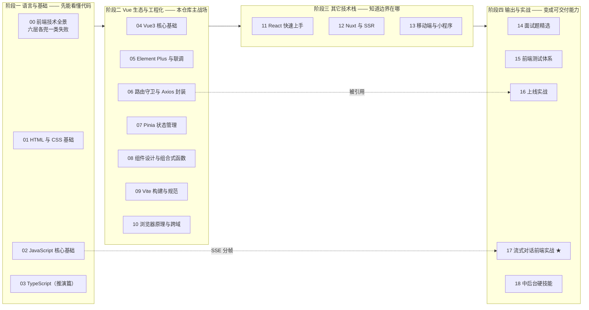

# 06-前端开发：从"页面能跑"到"能联调、能上线"

> **一句话结论**：本模块 19 篇正文只服务一件事——把 `ai-cs-frontend`（Vue ^3.5.39 + Element Plus ^2.14.3 + Vite ^8.1.1）这个真实工程读懂到"哪一行决定了什么"的程度：请求从哪个 axios 实例出去（`ai-cs-frontend/src/api/index.js:37-63`）、谁能进哪个页面（`ai-cs-frontend/src/router/index.js:38-48`）、流式回答怎么一帧帧渲染出来（`ai-cs-frontend/src/utils/sse.js`）、上线后为什么刷新不 404（`ai-cs-frontend/nginx.conf:68-70`）。
> **阅读前置**：会写 HTML/CSS/JS，跑过一次 `npm run dev`，知道 `package.json` 里的 scripts 和 dependencies 是干什么的。**不需要** Vue 经验，也**不要**先去补 TypeScript——本仓库前端是纯 JavaScript（`ai-cs-frontend` 的 `package.json` 无 typescript 依赖、src 下 0 个 `.ts` 文件），03 篇是"推演 + node 实测"，不是实装讲解。
> **证据基线与预计阅读**：B 级证据全部取自本仓库当次读取的真实文件（`ai-cs-frontend`、`ai-cs-frontend-react`、`ai-cs-notify`、`deploy/`），路径与行号可在编辑器里直接跳转核对；C 级证据为本机 node v24.16.0 现跑输出（不联网、不执行 `npm install`、不执行 `npm run build`）；A 级（`learning-docs/24-源码分析/assets/source` 的 Java 摘录）与本模块主题基本无交集，只在 05 篇核对 `Result` 契约时少量引用。整个模块精读约 **12~15 小时**，动手练习另计。

---

## 1. 这套材料写给谁、读完能做什么

### 1.1 两类读者

| 读者 | 起点 | 真正的卡点 | 本模块给的答案 |
|---|---|---|---|
| 后端转全栈（本仓库主力读者） | Java/Spring 熟，能手写 REST 与事务 | 前端没有"一次请求全链路"的心智模型；不理解为什么"改了数据视图不动"；不知道 `npm run build` 之后文件去了哪 | 用已经熟的后端概念对齐：拦截器 ≈ axios 拦截器、过滤器 ≈ 路由守卫、Saga/事务回滚 ≈"停止生成"+ 重试、Nginx ≈ 网关 |
| 前端补齐中后台能力 | 会写页面，没做过真实企业后台 | 权限、分页、表单校验、上传、空态这些"没人教但天天用"的东西全靠抄 | 08 篇给正确抽象位置，18 篇对着本仓库 24 个视图逐条指出缺在哪一行 |

### 1.2 读完能做到的六件事（都可验收）

1. **能说清一条请求的全链路**：浏览器 → `vite.config.js` 的 `/api` 代理（开发）或 `nginx.conf` 的 `/api` 反代（生产）→ 网关 8080 → 目标服务；并解释为什么本项目开发与线上**都不产生跨域**。
2. **能改一行就换掉全局鉴权行为**：知道自己该动 `ai-cs-frontend/src/api/index.js` 的 `createClient()`，而不是去 24 个视图里逐个补 `headers`。
3. **能读懂并改 SSE 流式对话**：`ChatView.vue` 的逐字渲染、"停止生成"（AbortSignal）、Agent 两阶段的确认契约，出错时知道是帧没切对还是后端没 flush。
4. **能判断"改样式没反应"的四种原因**：作用域、优先级、选择器没命中、构建产物没更新——且知道这四类**都不会报错**。
5. **能把 dist 变成可上线的镜像**：读懂 `ai-cs-frontend/Dockerfile` 的两阶段构建与 `nginx.conf` 的四段关键配置（immutable、no-store、try_files、`proxy_buffering off`）。
6. **能在面试里给出可验证的答案**：不说"SSE 就是服务器推送"，而说得出"帧以 `\n\n` 分隔、本项目在 `ai-cs-frontend/src/utils/sse.js` 里手写了分帧，因为 `EventSource` 不能带 `Authorization` 头"这种带证据的句子。

### 1.3 这套材料的证据口径（先约定，避免你被我误导）

| 级别 | 含义 | 本模块用法 |
|---|---|---|
| A 级 | 仓库内 Java 侧源码摘录（`24-源码分析/assets/source`） | 只在需要"前后端契约对得上"时引（05 篇的 `Result`），其余不硬引 |
| B 级 | 本仓库真实文件 + 真实行号 | **主体**。引用前当次 `read` 核对，行号可复查 |
| C 级 | 本机可复现命令 + 真实输出 | 纯 JS 语义验证、依赖/文件/行数统计、`vitest`/`eslint` 实跑 |
| 都不满足 | 需要浏览器渲染、需要 `npm run build`、需要 Docker | 一律写明"**未本机实测**，给出命令与判读方法"，绝不编数字 |

### 1.4 一条主线案例，贯穿全模块

后面的 19 篇不是 19 个独立话题，它们都在回答**同一件小事**：用户在 `ChatView` 里点一次"发送"，到屏幕上出现第一个字，中间发生了什么？这条主线可以按模块顺序拆成六段，每一段都能落到一个文件的一行：

| 段 | 发生了什么 | 落在哪 | 讲它的篇 |
|---|---|---|---|
| ① 拿到输入 | `ref` 里的字符串被读到，`v-model` 已经通过事件把它同步进来 | `ai-cs-frontend/src/views/ChatView.vue` 的 `script` 段 | 01 / 04 |
| ② 判断能不能发 | 没 Token 会被路由守卫先挡住；有 Token 才走到发请求 | `ai-cs-frontend/src/router/index.js:38-48` | 06 |
| ③ 把请求发出去 | 拦截器加 `Authorization: Bearer ...`，`baseURL` 来自 `API_BASE`（同源 `/api`） | `ai-cs-frontend/src/api/index.js:37-63`、`ai-cs-frontend/src/utils/runtime.js` | 06 / 10 |
| ④ 越过开发/生产两道门槛 | 开发是 Vite 代理 5173→8080；生产是 nginx `/api` 反代到 `aics_gateway`，且**不重写 URI** | `ai-cs-frontend/vite.config.js:29-41`、`ai-cs-frontend/nginx.conf:49-62` | 10 / 16 |
| ⑤ 一帧帧收流 | `fetch` + `getReader()` + `TextDecoder`，按 `\n\n` 切帧，最后一帧靠 `flush()` 补 | `ai-cs-frontend/src/utils/sseStream.js`、`ai-cs-frontend/src/utils/sse.js` | 02 / 17 |
| ⑥ 渲染与收尾 | 累加文本触发重渲染；用户点"停止生成"走 `AbortSignal`；Markdown 渲染要防 XSS | `ai-cs-frontend/src/views/ChatView.vue` | 04 / 08 / 17 |

**为什么要先看这张表**：它让你在任意一篇里都能回答"我现在读的这段，属于上面哪一段"。读不懂某一篇时，回到这张表定位它对应哪一段，比反复读原文有效。

---

## 2. 模块地图



> **读图说明**：横轴是**依赖方向**，不是重要性排序。四个阶段解决四种失败：阶段一解决"看不懂这行代码在干什么"；阶段二解决"能写但写不到可维护、可联调"；阶段三解决"遇到 React/SSR/移动端需求时不至于从零开始"；阶段四把前三阶段的知识压成"能验收的产出物"（一套测试、一次上线、一个能跑的对话页）。两条虚线是本模块内部最强的依赖：16 篇要用 06 篇的 `createClient()` 与 nginx 反代才能讲清"跨域为什么不发生"；17 篇的 SSE 分帧直接建立在 02 篇的事件循环与 `TextDecoder` 语义之上（`ai-cs-frontend/src/utils/sse.js` 78 行手写状态机）。**★ 17 篇是本项目最贴合实战的一篇**——`/chat/stream/sse` 是本仓库唯一"AI 产品感"直接由前端决定的地方，服务端 `SseEmitter` 5 分钟超时、Agent 流 120 秒超时这些约束都会直接变成前端代码里的超时与重连选择。

### 2.1 推荐顺序（三种读法，选一种，不要跳读）

| 读法 | 适用 | 顺序 | 说明 |
|---|---|---|---|
| 顺序读（推荐） | 第一次接触前端 | 00 → 01 → 02 → 04 → 05 → 06 → 09 → 10 → 17 → 15 → 16 → 18，最后 03/07/08/11/12/13/14 按需补 | 前 8 篇建立"能写+能联调"，17 篇吃透项目最硬的部分，15/16 收口"质量与上线" |
| 任务驱动 | 手上正好要做某个页面 | 05 → 06 → 18 → 08 | 直接对齐"表格/表单/权限/复用"，遇原理缺口再回查 02/04 |
| 急救模式 | 明天要面试 | 00 §2 的生态对照 → 02 §事件循环 → 04 §响应式三段链路 → 06 → 10 §跨域三处判定 → 14 | 全程配 14 篇的问答稿，每题都能落回本仓库文件 |

**不建议**的两种读法：跳过 02 直接读 04（会变成背 API）；跳过 09/10 直接读 16（上线四类事故只能靠记）。

### 2.2 每个阶段的"过门槛"动作

阶段之间不是读完就过，要有一个能自证的动作。做不到就留在本阶段，别往前赶：

| 阶段 | 门槛动作 | 过关判据 |
|---|---|---|
| 阶段一 → 阶段二 | 打开 `ai-cs-frontend/src/utils/sse.js`（78 行），逐行说出每一句在干什么 | 能指出哪里在按 `\n\n` 切帧、哪里在缓存不完整的半帧；**不需要**说出 Vue 的任何 API |
| 阶段二 → 阶段三 | 在 DevTools Network 里找到任意一条 `/api/*` 请求，说出它的完整 URL、`Authorization` 从哪来、401 时谁在跳转 | 三个答案分别落在 `vite.config.js:29-41` / `api/index.js:37-63` / 同一处响应拦截器 |
| 阶段三 → 阶段四 | 说明白"本项目为什么不做 SSR""为什么不用 React" | 不是"不需要"，而是能给出条件：首屏 SEO/时延是硬指标时 CSR 才不够；React 版是同一需求的第二条实现路线 |
| 阶段四收口 | 走完 §7 的三组检查点 | 18 条全过才算"能搭壳 / 能联调 / 能上线" |

---

## 3. 每篇一句话摘要

| 篇 | 解决什么问题 | 本项目对应代码 | 证据 |
|---|---|---|---|
| [00-前端技术全景介绍](./00-前端技术全景介绍.md) | 前端名词太多，先把"六层各兜一类失败"立起来 | `ai-cs-frontend/vite.config.js:50-63`、`ai-cs-frontend/src/utils/runtime.js:14-18`、`ai-cs-frontend/nginx.conf` | B + C |
| [01-HTML与CSS基础](./01-HTML与CSS基础.md) | 样式改了没反应 / 颜色死活不对 / 读屏念不出来——三类**无报错**事故 | `ai-cs-frontend` 的 `.vue` 单文件组件与 `dist/assets/*.css` | B + C |
| [02-JavaScript核心基础](./02-JavaScript核心基础.md) | "说不清为什么"的 bug：值语义 / 调度语义 / 绑定语义三层运行时 | 纯 node 脚本复现 + `ai-cs-frontend/src/utils/sseStream.js` 的 `await` 顺序 | C 为主 |
| [03-TypeScript快速上手](./03-TypeScript快速上手.md) | 类型到底买到了什么、代价是什么（本仓库**未落地** TS） | 反证：`ai-cs-frontend` 无 typescript 依赖、src 下 0 个 `.ts` | B（反证）+ C |
| [04-Vue3核心基础](./04-Vue3核心基础.md) | "改了数据视图不动"——Proxy `track`/`trigger` + effect + 调度器三段链路 | `ai-cs-frontend/src/views/*.vue` 的 `ref`/`computed` 用法 | B + C |
| [05-ElementPlus与前后端联调](./05-ElementPlus与前后端联调.md) | 组件库替不了契约：`code` 在哪判、`pageSize` 叫什么、业务失败为何 HTTP 200、时区 | `ai-cs-common` 的 `Result`/`ResultCode` + `ai-cs-frontend/src/api/index.js` | A + B + C |
| [06-路由守卫与Axios请求封装](./06-路由守卫与Axios请求封装.md) | 本项目只有两个合法横切位置，其余页面只该消费结果 | `ai-cs-frontend/src/router/index.js:38-48`、`ai-cs-frontend/src/api/index.js:37-63` | B + C |
| [07-Pinia状态管理实战](./07-Pinia状态管理实战.md) | 分水岭不是"用不用 Pinia"，而是"哪些状态该进全局"（**本仓库未装 pinia**） | 反证：`ai-cs-frontend` 依赖里无 pinia；现状靠 `localStorage`（`ai-cs-frontend/src/utils/auth.js`） | B（反证）+ C |
| [08-Vue3进阶：组件设计与组合式函数](./08-Vue3进阶：组件设计与组合式函数.md) | 复用单位是"有状态的生命周期逻辑"，纯计算该做纯函数 | 反例 `ai-cs-frontend/src/views/ChatView.vue`（549 行 / script 343 行）；正例 `ai-cs-frontend/src/utils/format.js` | B + C |
| [09-前端工程化：Vite构建与规范](./09-前端工程化：Vite构建与规范.md) | dev 快 / build 小 / 团队一致三者打架；本项目第三者只落一半 | `ai-cs-frontend/vite.config.js`（`manualChunks` 函数形式）、`ai-cs-frontend` 根 `package.json` 的 8 个 scripts | B + C |
| [10-浏览器原理与HTTP跨域](./10-浏览器原理与HTTP跨域.md) | 跨域在三处分别判定；本项目**压根没发出跨源请求** | `ai-cs-frontend/vite.config.js:29-41`（dev 代理）、`ai-cs-frontend/nginx.conf:49-62`（prod 同源 /api） | B + C |
| [11-React快速上手](./11-React快速上手.md) | React 只有两条规则：重新调用 + `Object.is` 判等 | `ai-cs-frontend-react`（24 个 `.jsx` 视图、antd ^5.22.5、vite ^5.4.11） | B + C |
| [12-Nuxt与SSR入门](./12-Nuxt与SSR入门.md) | SSR 是执行环境迁移；中后台选 CSR 是对的（全仓 `nuxt` 命中 0） | 反证：两套前端均无 Nuxt；`ai-cs-frontend` 是 `createApp` 纯 CSR（`ai-cs-frontend/src/main.js`） | B + C |
| [13-移动端与小程序开发](./13-移动端与小程序开发.md) | 难点是首屏体积 / 主线程预算 / 触摸命中区，不是"屏幕小" | `ai-cs-frontend` 的视口与 `dist` 体积读数、`ai-cs-frontend/src/views/ChatView.vue` 的滚动渲染 | B + C（无 A） |
| [14-前端面试题精选](./14-前端面试题精选.md) | 不背 API，只练"走哪条路径、卡在哪步、怎么证明" | 以 `api/index.js`、`utils/sse.js`、`nginx.conf` 三件套当答题素材 | B + C |
| [15-前端测试体系](./15-前端测试体系.md) | 测试价值随"离用户近"而升；本项目只做到第一层 | 7 个测试文件 / 42 个用例（`ai-cs-frontend/src/utils/*.test.js`、`ai-cs-frontend/src/directives/permission.test.js`），本机实跑 4.03s 全绿 | B + C |
| [16-前端上线实战](./16-前端上线实战.md) | 上线四道关：白屏 / 404 / 跨域 / 流式断 | `ai-cs-frontend/Dockerfile`（两阶段 + HEALTHCHECK）、`ai-cs-frontend/nginx.conf`（74 行） | B（C 仅登录命令） |
| [17-流式对话前端实战](./17-流式对话前端实战.md) | SSE 分帧、逐字渲染、"停止生成"、Agent 两阶段确认契约 | `ai-cs-frontend/src/utils/sse.js`、`ai-cs-frontend/src/utils/sseStream.js`、`ai-cs-frontend/src/views/ChatView.vue` | B + C |
| [18-中后台硬技能](./18-中后台硬技能.md) | 权限 / 表格分页 / 表单校验 / 上传 / 空态五类硬技能，缺在哪一行 | `ai-cs-frontend/src/directives/permission.js`、24 个视图里 128 处 `el-table` 与仅 2 处 `el-pagination` 的落差 | B + C |

> 表格里的"B（反证）"指该篇结论靠"仓库里查不到某依赖/某文件"成立，这本身是可核对的证据，但读者要自己跑一遍 grep 才服气——每篇正文都给了命令。

---

## 4. 本仓库前端现状真实盘点（数值均为本轮现测）

| 维度 | `ai-cs-frontend`（Vue 3，主工程） | `ai-cs-frontend-react`（React，对照工程） |
|---|---|---|
| 技术栈 | vue ^3.5.39 / vue-router ^4.6.4 / element-plus ^2.14.3 / vite ^8.1.1 | react ^18.3.1 / react-router-dom ^6.28.1 / antd ^5.22.5 / vite ^5.4.11 |
| 依赖个数 | dependencies **7**、devDependencies **10** | dependencies **8**、devDependencies **2** |
| npm scripts | **8** 个：`dev`/`build`/`preview`/`test`(=`vitest run`)/`test:watch`/`lint`(=`eslint .`)/`lint:fix`/`check`(=`lint && test && build`) | **3** 个：`dev`/`build`/`preview`（**无 test、无 lint**） |
| src 文件数 | **46** 个：25 `.vue`（`App.vue` + 24 个视图）+ 17 `.js` + 1 `.css` + 2 `.svg` + 1 `.png` | **34** 个：24 个 `views/*.jsx` + `layouts/MainLayout.jsx` + `api/index.js` + `utils/*` |
| src 代码量 | js + vue 合计 **6089** 行 | 同量级（11 篇口径：6077 行） |
| 路由/页面 | 路由表 **25 条**记录（`/login` 带 `meta.public`；`/chat` 与 `/feedback` 复用 `ChatView`；`/order/:orderNo` 动态段），视图 **24** 个 | 24 个视图，路由集中在 `MainLayout` |
| 网络层 | `ai-cs-frontend/src/api/index.js` 165 行，**15** 个 axios 实例（`createClient()` 统一加 `Bearer`、统一处理 401） | `ai-cs-frontend-react/src/api/index.js` 166 行（同构写法） |
| 类型系统 | **无 TypeScript**（无 typescript 依赖 / 0 个 `.ts` / 无 tsconfig） | 同：纯 JSX |
| 状态管理 | **无 pinia**；登录态放 `localStorage`（`ai-cs-frontend/src/utils/auth.js`，key `aics_token`/`aics_user`） | 无 redux/zustand，同样放 `localStorage` |
| 测试 | **有**：7 个测试文件、42 个用例、`vitest ^5.1.1` + `jsdom`；**无组件测试、无 E2E** | **形同没有**：1 个 `views/agentRequest.test.js`，但工程无 test 脚本、无 runner，跑不起来 |
| lint | **有且干净**：`eslint ^10.15.0` flat config（85 行），`vue/no-v-html: error` | **无** |
| 门禁（谁在跑上面这些） | **无**：无 `.husky`、无 prettier 接入、根 `.github/workflows` 只有 `python-learning-validate.yml`、`Jenkinsfile` 与 `Jenkinsfile-k8s` 里 `frontend` 命中 **0** 次 | **无**（连脚本都没有） |
| dev 端口 / 代理 | **5173**，`/api` → `http://localhost:8080`（`ai-cs-frontend/vite.config.js:12`，可被 `VITE_PROXY_TARGET` 覆盖），SSE 需去 `content-encoding` | **5174**，**无 proxy**（所以 React 版联调必须靠后端 CORS） |
| 生产网关地址 | `.env.production` 里 `VITE_GATEWAY=` **留空** → 走同源 `/api`（`ai-cs-frontend/src/utils/runtime.js:14-18` 明确禁止回退到 `localhost:8080`） | 无 `.env.production` 约定文档 |
| nginx.conf / Dockerfile | **都有**：`ai-cs-frontend/nginx.conf`（74 行）、`ai-cs-frontend/Dockerfile`（43 行，`node:22-alpine` 构建 + `nginx:1.27-alpine` 运行 + HEALTHCHECK） | **都没有** |
| deploy 里有没有前端 | **没有**：`deploy/docker-compose/`、`deploy/k8s/services/`、根 `docker-compose.yml` 中 `frontend|nginx` 命中 **0** 次 | 同 |
| 最近一次相关提交 | `2b80fe8 feat(frontend): 补前端工程化闭环（lint/test/build 三绿 + 镜像与 Nginx 托管）` | 无独立提交记录（与 Vue 版同批演进） |

**怎么自己复核**（C 级，30 秒内、不装依赖）：

```bash
# 1) 测试到底有没有、绿不绿（在 ai-cs-frontend 下，本机 node v24.16.0 实测）
node node_modules/vitest/vitest.mjs run
# → Test Files  7 passed (7)   Tests  42 passed (42)   Duration 4.03s
# 读法：7/42 是"逻辑层"用例（utils + directives + agentRequest），没有一个 .vue 组件被挂载

# 2) lint 是不是真干净
node node_modules/eslint/bin/eslint.js .
# → 无任何输出、退出码 0；读法：干净，但"干净"只说明没人拦，不说明有人跑

# 3) 门禁有没有人调用这两个脚本
git log --oneline -5 -- ai-cs-frontend
# → 2b80fe8 ... 只为"补齐脚本 + 镜像"，没有任何 CI 配置随之出现

# 4) 部署里到底有没有前端（在仓库根跑）
git grep -n -E "frontend|nginx" -- deploy docker-compose.yml
# → 无输出；读法：前端目前是"有镜像定义、无部署单元"
```

### 4.1 盘点之后的三条结论

1. **这个仓库的前端是"单工程 + 一份对照实现"**：`ai-cs-frontend`（Vue 3）是唯一被工程化过的那个——8 个 scripts、7 个测试文件、`nginx.conf` + `Dockerfile` 都有；`ai-cs-frontend-react` 是同一批页面的第二条路线（24 个 `.jsx` 对应 24 个 `.vue`），用来做框架对比，**没有测试/没有 lint/没有部署配置**。所以本模块的 B 级证据重心几乎必然落在 Vue 侧，React 侧只做对照。
2. **"有脚本"和"有门禁"是两件事**：脚本存在只说明能力可用；门禁要求"有人在你合并前强制跑它"。本仓库缺的正是后半段（无 `.husky`、无 CI job），这直接决定 09 篇的结论是"第三者只落一半"。
3. **前端在部署链上是断的**：`deploy/` 下没有任何前端服务定义，也没有 CI 构建镜像的步骤。这意味着 16 篇教的是"怎么把一个 dist 变成可上线镜像"，而不是"本项目已经这么上线了"——两者差别很大，交接时别说错。

---

## 5. 两条路线

### 5.1 路线 A：后端转全栈，2 周（每天 1.5~2 小时）

| 天 | 读什么 | 做什么 | 产出物（放自己分支，别改别人文件） |
|---|---|---|---|
| D1 | 00 全篇 + 01 §3.1~3.3 | 打开 `ai-cs-frontend`，`npm run dev`，把首页拆成"布局/表格/弹窗"三块画出来 | 一张组件树草图 |
| D2 | 02 全篇（事件循环 + `await` 顺序必跑脚本） | 跑文中的 node 片段，复述 `Promise` 与 `setTimeout` 的相对顺序 | 三行实验记录 |
| D3 | 04 §3.1~3.4 | 在任意视图里故意把对象从 `ref` 里解构出来，复现"视图不动" | 一段能复现+能修的 diff |
| D4 | 05 全篇 | 对着 `ai-cs-common` 的 `Result` 核对前端三处 `code` 判断，找出不一致的那一处 | 一张契约对照表 |
| D5~D6 | 06 全篇 | 读懂 `createClient()`；把某个视图里手写的 `headers`/`try-catch` 收敛到拦截器 | 删除 ≥10 行重复代码的 diff |
| D7 | 08 全篇 | 抽一个 composable：把 `ChatView.vue` 里"发送→渲染→清理"的状态机摘出来（只设计不合并） | 一份 composable 接口草案 |
| D8~D9 | 09 全篇 | 改 `manualChunks` 拆包策略并解释为什么必须是函数形式 | 注释版 `vite.config.js` 片段 |
| D10 | 10 全篇 | 用 DevTools Network 证明"本项目无 OPTIONS 预检"，截图不了就记录请求列表 | 一份 Network 判读记录 |
| D11~D12 | 17 全篇 | 读懂 `sse.js` 的 `flush()` 与 `sseStream.js` 的 `AbortSignal`；给"停止生成"补一条回归思路 | 一段能讲清帧边界的说明 |
| D13 | 15 全篇 | 照 15 篇给 `sseStream` 再补 2 个边界用例（纯 JS，无组件） | +2 个通过的测试 |
| D14 | 16 全篇 | 读懂 nginx 四段配置与 Dockerfile 两阶段；口述"白屏/404/跨域/流式断"四类事故成因 | 一份上线检查清单 |
| D15 | 18 全篇 | 对着 `permission.js` 说清为什么 `v-permission` 目前 0 处使用仍值得留 | 一段取舍说明 |

**总耗时**：约 22~28 小时。**验收**：能不看笔记答出 §7 的三组检查点。

### 5.2 路线 B：面试速通，3 天（每天 3~4 小时）

| 天 | 主攻 | 必读章节 | 产出物 |
|---|---|---|---|
| D1 上午 | 语言与响应式 | 00 §2 生态对照；02 事件循环/微任务；04 §3.1 响应式三段链路 | 能白板画出 `Proxy → effect → 调度 → patch` |
| D1 下午 | 请求与路由 | 06 全篇（两个横切位置）；05 §契约四条 | 能说出"新增一个接口该改哪一行、不该改哪 24 个文件" |
| D2 上午 | 浏览器与跨域 | 10 §三处判定；16 §四类事故 | 能解释"为什么本项目 dev/prod 都不跨域" |
| D2 下午 | 项目最硬一篇 | 17 全篇 | 能讲 SSE 分帧、`EventSource` 不能带头、AbortSignal 停生成、5 分钟/120 秒超时的前端含义 |
| D3 上午 | 工程化 | 09 §dev/build 两条链路；15 §测试金字塔 | 能答"为什么 `manualChunks` 只能是函数（Vite 8 底层 rolldown）" |
| D3 下午 | 刷题与串讲 | 14 全篇（只列问题，自己先答） | 一份自己写的答案稿，每题挂一个本仓库文件行号 |

**总耗时**：约 10~12 小时。**产出物**：一份"每答必挂证据"的答案稿；**不要把 03/07/11/12/13 排进来**——它们是"知道边界"的补充篇，面试前一晚读只会挤掉 06/17 的记忆。

### 5.3 两条路线怎么选、以及三种常见跑偏

| 情况 | 选哪条 | 理由 |
|---|---|---|
| 接下来两周要接手 `ai-cs-frontend` 的活 | 路线 A | 产出物是"能改代码的 diff"，不是笔记 |
| 两周内要面试、简历上写了"熟悉 Vue" | 路线 B | 面试官只考 06/17/10 三类问题，路线 A 的 D7~D14 花了 8 天但面试权重低 |
| 只想把"流式对话"搞明白 | 两条都不走 | 直接 17 + 02，两天足够；其余篇目等真需要再看 |

三种常见跑偏，提前标出来：

1. **先补 TypeScript 再学前端**——本仓库前端 0 个 `.ts`，补完没有练兵场，一周后就忘。03 篇放最后读完全够。
2. **先学 Pinia 再理解状态**——本仓库没装 pinia，没有真实状态可管，学完只会得到"建 store"的肌肉记忆，不会得到"哪些状态该进全局"的判断力。
3. **把"能 build 成功"当成"能上线"**——build 只证明产物生成了；白屏、刷新 404、流式断三件事都在 nginx 那一侧，见 16 篇。

---

## 6. 依赖关系

**前置不是 03-TypeScript**（本仓库前端没有 TS，读它性价比最低）。真正的前置是 01 与 02：读 04 需要 02 的闭包与 `this`，读 06 需要 01 的事件与表单基础。

| 关系 | 模块 / 篇 | 为什么相关 | 链接 |
|---|---|---|---|
| 全局前置 | 00-学习路线总览 | 不知道这套材料整体怎么排，容易在 06 里迷路 | [00-学习路线总览](../00-学习路线总览/README.md) |
| 篇内前置 | 01 HTML/CSS、02 JavaScript | 04/05/06 的所有例子都建立在 DOM 事件、闭包、`await` 顺序上 | [01](./01-HTML与CSS基础.md)、[02](./02-JavaScript核心基础.md) |
| 强相关（联调契约） | 02-Spring微服务 | 前端"契约四条"的另一半在 `ai-cs-common` 的 `Result`/`GlobalExceptionHandler`；网关鉴权决定 401 行为 | [02-Spring微服务](../02-Spring微服务/README.md)、[17-SpringMVC请求全链路与参数校验](../02-Spring微服务/17-SpringMVC请求全链路与参数校验.md) |
| 强相关（流式） | 04-中间件 的 05-SSE与WebSocket | 17 篇的前端分帧与后端的 `SseEmitter`/`proxy_buffering` 是一件事的两端 | [05-SSE与WebSocket实时通信](../04-中间件/05-SSE与WebSocket实时通信.md) |
| 强相关（上线） | 07-运维部署 | 16 篇的 `nginx.conf`/Dockerfile 在部署篇里是"一个服务"的视角 | [07-运维部署](../07-运维部署/README.md)、[01-Docker容器化](../07-运维部署/01-Docker容器化.md)、[03-JenkinsCICD流水线](../07-运维部署/03-JenkinsCICD流水线.md) |
| 强相关（反代细节） | 04-中间件 的 13-Nginx与OpenResty | `try_files`、`immutable`、`proxy_buffering off` 的通用原理 | [13-Nginx与OpenResty反向代理](../04-中间件/13-Nginx与OpenResty反向代理.md) |
| 强相关（AI 产品面） | 05-AI集成 的 Agent 编排 | Agent 两阶段确认契约的前端侧表现 | [04-智能客服Agent编排与人工转接](../05-AI集成/01-SpringAI框架集成/04-智能客服Agent编排与人工转接实现文档.md) |
| 交叉（质量观） | 08-测试 | 前端的"能跑"和"测过"是两件事，测试篇给同一套门禁语言 | [08-测试](../08-测试/README.md) |
| 交叉（口径已过时） | 17-研发效能 的 08-质量门禁 | 该篇仍写"前端无 lint 脚本、无 husky"；前端已补脚本（`2b80fe8`）**但仍无钩子与 CI**，以本文件 §4 为准 | [08-质量门禁与自动化](../17-研发效能与工程实践/08-质量门禁与自动化.md) |
| 交叉（安全边界） | 09-安全与设计模式 的 JWT | `v-permission` 只是"不给看"，越权拦截在后端 | [01-JWT鉴权与异常处理](../09-安全与设计模式/01-JWT鉴权与异常处理.md) |
| 交叉（可视化） | 14-数据工程 的 BI 看板 | 本仓库用了 `echarts ^5.6.0`，且它是最大的一个 chunk | [06-BI看板与ECharts可视化](../14-数据工程与OLAP/06-BI看板与ECharts可视化.md) |
| 交叉（业务落点） | 23-电商业务开发 | 24 个视图里有订单/商品/支付页，业务语义在那边 | [23-电商业务开发](../23-电商业务开发/README.md) |

### 6.1 前后端"同一件事"的两侧对照

读 02/04/07 那几个模块时最容易断线的地方，是同一个概念在两边叫不同名字。先记住这张对照：

| 这件事 | 前端（本模块） | 后端（对应模块） |
|---|---|---|
| 每个请求都要带令牌并统一处理失败 | `ai-cs-frontend/src/api/index.js:37-63` 的 `createClient()` 拦截器 | 网关的鉴权过滤器 + `ai-cs-common` 的 `GlobalExceptionHandler` |
| 谁能访问哪个资源 | `ai-cs-frontend/src/router/index.js:38-48` 守卫（只决定"看不看得到页面"） | 网关 JWT 校验 + 方法级鉴权（真正拦越权） |
| 失败怎么表达 | 判 `data.code`；HTTP 200 也可能是业务失败 | `Result` / `ResultCode` 的统一返回体 |
| 长连接推送 | `ai-cs-frontend/src/utils/sseStream.js`（SSE，请求-响应式流） | `/chat/stream/sse` 的 `SseEmitter`（5 分钟超时；Agent 流 120 秒） |
| 实时通知 | `ai-cs-frontend/src/views/NotifyView.vue`（WebSocket） | notify 服务 8086 的 `/ws/notify`（**当前前端连的是 8085，见 §8 第 5 条**） |
| 分页参数怎么叫 | `el-pagination` 的 `page-size` 绑到请求参数 | 后端 `pageSize`/`size` 的实际约定（05 篇核对过） |

**用法**：读后端 02 篇的"请求全链路"时，把上表右列当主线；读本模块 06 篇时看左列。两边对上之后，你才有资格说"这条链路我懂了"。

---

## 7. 检查点清单

三组检查点，**每组都可以在 10 分钟内自证**。任一条做不到，就回到对应篇目，不要往下走。

### 7.1 能搭壳（对应 01/04/05/09）

| # | 自测动作 | 验收标准 |
|---|---|---|
| 1 | 在 `ai-cs-frontend` 里新建一个视图并挂进 `ai-cs-frontend/src/router/index.js` | 刷新后能访问、不报错；能说出为什么不用改 `main.js` |
| 2 | 用 `el-table` + `el-pagination` 渲染任何列表接口 | 翻页参数名与后端一致；能指出本仓库 `el-pagination` 只有 2 处意味着什么 |
| 3 | 解释 `ai-cs-frontend/vite.config.js:56-61` 的 `manualChunks` 为什么必须是函数 | 能说出"Vite 8 底层 rolldown，对象形式会报 `Invalid type: Expected Function but received Object`" |
| 4 | 改一处样式没生效 | 能用四种原因（作用域/优先级/选择器/产物未更新）逐条排除，且知道这类问题**没有报错** |

### 7.2 能联调（对应 05/06/10/17）

| # | 自测动作 | 验收标准 |
|---|---|---|
| 1 | 说出新增一个接口要改哪些文件 | 只改 `ai-cs-frontend/src/api/index.js`（复用 `createClient()`），**不改** 24 个视图 |
| 2 | 在 DevTools 里找不到 `Authorization` 头 | 能指出是 `ai-cs-frontend/src/api/index.js:37-63` 的请求拦截器加的；再指出 401 只在响应拦截器统一处理 |
| 3 | 证明本项目开发态没有跨源请求 | Network 面板里 `/api/*` 的 Request URL 是 `localhost:5173`（走 Vite 代理），无 OPTIONS 预检 |
| 4 | 说出业务失败为什么 HTTP 还是 200 | 能引 `ai-cs-common` 的 `Result` 约定 + 前端三处 `code` 判断位置 |
| 5 | 停掉后端，点"发送" | 能说出这时前端看到的是什么（网络错误 vs 空回答），以及从哪一帧判断是后端没 flush |

### 7.3 能上线（对应 09/16）

| # | 自测动作 | 验收标准 |
|---|---|---|
| 1 | 解释 `.env.production` 里 `VITE_GATEWAY=` 为什么必须留空 | 能引 `ai-cs-frontend/src/utils/runtime.js:14-18`：回退 `localhost:8080` 会让生产白屏 |
| 2 | 解释"刷新子路由 404" | 能指 `ai-cs-frontend/nginx.conf:68-70` 的 `try_files $uri $uri/ /index.html` |
| 3 | 解释"改了代码用户还是旧页面" | 能区分 `index.html` 的 `no-store`（`ai-cs-frontend/nginx.conf:41-44`）与 `/assets/` 的 `immutable`（`:33-37`）用在不同文件上 |
| 4 | 解释"流式回答卡住不动，最后一次性全出来" | 能指 `ai-cs-frontend/nginx.conf:49-62` 的 `proxy_buffering off` + `Connection ""` |
| 5 | 说出镜像怎么构建 | `ai-cs-frontend/Dockerfile`：`node:22-alpine` 构建 → `nginx:1.27-alpine` 运行 → `HEALTHCHECK` 探测 `/index.html`；**本机无 Docker，未实跑** |

### 7.4 这张清单怎么用（别一次性刷完）

| 时机 | 用哪一组 | 目的 |
|---|---|---|
| 读完阶段一、阶段二之前 | 7.1 | 确认你"能写"，否则后面所有讨论都是空中楼阁 |
| 读到 06/10 之后 | 7.2 | 这几条是全模块最有面试价值的部分，每条都要能指到行号 |
| 准备交付/上线前 | 7.3 | 这五条对应四类真实事故，答不出就别点部署 |
| 复习（两周后） | 只抽 7.1-3、7.2-1、7.2-4、7.3-2、7.3-4 五条 | 这五条遗忘最快，也最贵 |

一条使用纪律：**每条检查点都要说出"哪个文件哪一行"**。只说结论不说位置的，等于没通过——本模块所有结论都挂着行号，你有权要求自己做到同样标准。

---

## 8. 诚实清单（写在这里，免得你在面试或交接时被问穿）

1. **测试不是"没有"，但只有一层**：7 个测试文件、42 个用例，本机 `node node_modules/vitest/vitest.mjs run` 实跑 **7 passed / 42 passed / 4.03s**。全是 utils、directives、`agentRequest` 这类纯逻辑；**组件测试、E2E、视觉回归、契约测试全空**。任何"本项目测试完善"的说法都是错的。
2. **有 lint 有 test，但没有门禁**：脚本齐（`npm run check` = lint + test + build），可仓库里**没有 `.husky`、没有 prettier 接入、根 CI 只有 `python-learning-validate.yml`、两个 Jenkinsfile 里 `frontend` 命中 0 次**。脚本靠人记得跑。
3. **`npm run check` 未整条验证过**：本轮按规矩不跑 `npm run build`，所以只有 lint 段（`eslint .` 退出码 0）与 test 段（42 通过）有实测；build 段**未本机实测**。
4. **deploy 里没有前端**：`deploy/docker-compose/`、`deploy/k8s/services/`、根 `docker-compose.yml` 中 `frontend|nginx` 命中 **0** 次。`Dockerfile` 与 `nginx.conf` 是"能构建的东西"，不是"已在跑的部署单元"；`Dockerfile` 注释里也写明"本机没有安装 Docker，未实跑验证"。
5. **一个真实已知缺陷（别当范例抄）**：`ai-cs-frontend/src/views/NotifyView.vue:114` 连的是 `ws://localhost:8085/ws/notify`——8085 是 message 服务，notify 服务实际是 **8086**（`ai-cs-notify/src/main/resources/application.yml:3` `port: 8086`）；且硬编码 `localhost`，线上必然连不上。
6. **`v-permission` 写好了但 0 处使用**：`ai-cs-frontend/src/directives/permission.js` 有 6 个用例守着，24 个视图里 `v-permission` 命中 **0**。它证明的是"能力可用"，不是"权限已做"。
7. **没有 Pinia、没有 TypeScript**：07 与 03 两篇的所有"会怎样"都是**推演 + node 实测**，不是本仓库实装；不要把 07 篇的 store 写法当成项目现状。
8. **SSR 完全没有**：全仓 `nuxt` 命中 0，12 篇是"为什么不做 + 什么条件下该做"。
9. **体积数字来自旧产物**：`dist/` 是上一轮构建的残留（57 个文件、31 个 `.js`，其中 `charts-DTbrIw2f.js` 约 1.03 MB），**不是本轮构建结果**。要自己的数字，请自行跑 `npm run build` 后看 `dist/assets`（本文件不提供该数字）。
10. **需要浏览器的结论都标了"未本机实测"**：真机弱网、iOS 键盘、Lighthouse、DevTools 截图、Docker 运行，本环境一律做不到，正文只给命令与判读方法。
11. **模块内格式不统一**：00~15 已套 12 节规范结构，**16/17/18 三篇仍是旧格式**（272/265/292 行，用"写给谁/前置/本篇产出"开头）。内容可靠，结构待改。
12. **`17-研发效能与工程实践/08-质量门禁与自动化.md` 里的前端口径已过时**：它写"前端无 lint 脚本、无 husky"。前半句已被提交 `2b80fe8` 推翻（脚本齐了），后半句仍成立（无钩子、无 CI）。两份文档冲突时，以本文件 §4 的现测值为准。

---

**下一步**：想先要一个能跑的东西 → 从 [17-流式对话前端实战](./17-流式对话前端实战.md) 开始；想先建立完整心智 → 从 [00-前端技术全景介绍](./00-前端技术全景介绍.md) 开始；明天要面试 → 直接进 [14-前端面试题精选](./14-前端面试题精选.md)。
