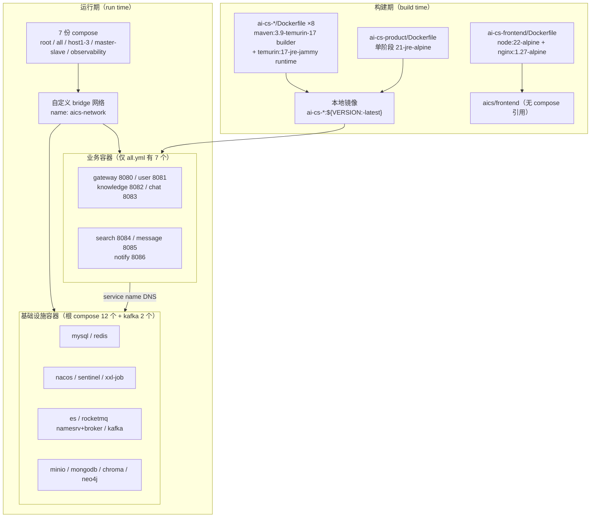
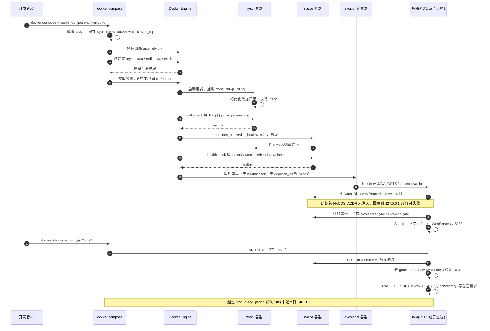

# Docker 容器化：12 个服务的启动依赖如何变成一份可复现编排

> **一句话结论**：Docker 在这套系统里的真实作用不是"把 jar 装进盒子"，而是把 12 个 Java 服务 + 11 类中间件的启动顺序、网络名字、配置注入路径、内存预算固化成一份可以反复重放的编排；踩的坑也几乎全在四件事上——**网络**（容器内 127.0.0.1 不是宿主机）、**数据卷**（bind mount 相对路径按 compose 文件目录解析）、**资源限制**（全仓 0 个 `mem_limit`，JVM 于是按宿主机 31.7 GiB 算堆）、**健康检查**（`depends_on` 不等于"等健康"）。
> **阅读前置**：知道 Linux namespace / cgroup 大概在管什么；能看懂 Maven 多模块 `-pl/-am` 的含义；对 Spring Boot 启动顺序有印象（Bean 初始化 → WebServer 启动 → 上下文就绪 → `SmartLifecycle` 收尾）。中间件侧细节看 [Nginx 应用实战与域名 IP 配置](../04-中间件/23-Nginx应用实战与域名IP配置.md)。
> **证据基线**：本仓 7 份 compose、12 个 Dockerfile、2 份 `.dockerignore`、`deploy/scripts/` 逐份读码核对（2026-11-27）；A 级源码取 `24-源码分析\assets\source\` 已入库摘录（Spring Boot 4.2.0 / Spring Cloud Alibaba 2025.1.0.0）；C 级实测在本机 pwsh 做静态解析与内存账。预计阅读 45~60 分钟。

**证据边界**（先说清楚本篇哪些是"跑出来的"、哪些只是"读出来的"）：

| 类别 | 本仓/本机状态 | 本篇怎么处理 |
| --- | --- | --- |
| A 级：Spring / Spring Boot / SCA 源码摘录 | `24-源码分析\assets\source\` 有 908 份 `.md` 存档 | 只引优雅停机、健康端点、Nacos 摘流三段，锚点写到行 |
| B 级：compose / Dockerfile / .dockerignore / 部署脚本 | 7 份 compose + 12 个 Dockerfile 全部真实存在 | 每条结论带文件与行号，先 read 后引 |
| C 级：静态统计（服务数/端口数/healthcheck 数/堆上限） | 本机 pwsh 可跑，已实测 | 直接贴真实输出 |
| C 级：容器运行时行为（`docker stats`、`docker inspect`、OOM 日志、启动耗时、镜像体积） | **本机 `docker` / `docker-compose` / `kubectl` 三者均 MISSING**（已探测） | 一律标注"未本机实测"，只给命令与判读方法，不写具体数值 |

---

## 0. 先看现象

### 现象一：`docker compose up -d` 一片绿，但 Java 服务注册不上 Nacos、连不上库

容器状态是 `Up`，日志里却是这种反复重试：

```text
2026-11-27T10:12:41.331+08:00  WARN 1 --- [main] c.a.c.n.registry.NacosServiceRegistry
  : nacos registry, DEFAULT_GROUP ai-cs-chat register failed...
com.alibaba.nacos.api.exception.NacosException: failed to req API:/nacos/v1/ns/instance
  after all servers([127.0.0.1:8848]) tried: Connection refused
```

（报错串为 Nacos 客户端的典型形态，**未在本机复现**；下面两处配置原文是逐字核对过的。）

问题不在容器，在**变量名没对上**。`docker-compose-all.yml` 注入的是 `NACOS_SERVER`：

```yaml
SPRING_PROFILES_ACTIVE: prod
NACOS_SERVER: nacos:8848
JAVA_OPTS: "-Xms256m -Xmx512m"
```

而服务自己读的是 `NACOS_ADDR`，且带默认值：

```text
ai-cs-chat/src/main/resources/application.yml
L19:   server-addr: ${NACOS_ADDR:127.0.0.1:8848}
L23:   server-addr: ${NACOS_ADDR:127.0.0.1:8848}
```

`NACOS_ADDR` 在容器里从未被设置 → 回落到 `127.0.0.1:8848` → **容器内的 127.0.0.1 是它自己** → 注册必然失败。更隐蔽的是 `spring.config.import` 全是 `optional:` 前缀（`ai-cs-chat/src/main/resources/application.yml#L27-L31`），拉不到远程配置不算致命错误，应用照样启动完成——于是"服务起来了"和"连不上"同时成立。

同一节还有第二个更硬的坑：`host1/host2/host3/master-slave` 四份编排里 14 条 bind mount 的宿主机路径根本不存在（见 §3.6），Docker 会把不存在的单文件路径**当目录建出来**再挂进去，于是 `redis-server <一个目录>` 直接起不来，容器在 `Restarting` 和 `Exited` 之间来回跳。

### 现象二：容器莫名其妙没了，Java 侧一行异常都没有

```text
$ docker inspect --format '{{.State.OOMKilled}} {{.State.ExitCode}}' aics-chat
true 137
```

（命令真实可用，**本机无 docker 未实测**；`137 = 128+9`，即被 SIGKILL。）

翻 `docker-compose*.yml` 全文：`mem_limit` 0 处、`cpus` 0 处、`deploy:` 0 处——**63 个服务一个资源上限都没有**。没有 `mem_limit` 时，容器看到的"可用内存"就是宿主机内存。本机实测：

```text
TotalPhysicalMemory = 34042929152 bytes (31.7 GiB)
```

于是 JDK 的容器感知（`UseContainerSupport`，JDK 10+ 默认开）读到的上限是 31.7 GiB，ergonomics 取 1/4 作最大堆：

```text
$ java -XX:+PrintFlagsFinal -version | Select-String 'MaxHeapSize|InitialHeapSize'
MaxHeapSize     = 8514437120   (7.93 GiB)
InitialHeapSize = 532676608    (508 MiB)
```

7.93 GiB 的堆上限对一个被 `-Xmx512m` 描述的服务意味着什么？意味着 compose 里写的 `JAVA_OPTS: "-Xms256m -Xmx512m"` 是它唯一的约束，而这个约束还可能被丢掉——`ai-cs-order/Dockerfile#L19` 与 `ai-cs-product/Dockerfile#L11` 用的是 exec form：

```text
ENTRYPOINT ["java", "-jar", "app.jar"]
```

exec form 不经过 shell，`${JAVA_OPTS}` 根本不会被展开，compose 传进来的 `-Xmx512m` 静默失效。此时 OOM 发生在 cgroup 之外（宿主机 OOM killer 挑进程），JVM 没有机会抛 `OutOfMemoryError`，日志里自然什么都没有。

### 现象三：Ctrl+C / `docker stop` 之后没有优雅停机

`docker stop` 先发 SIGTERM，默认等 10 秒，然后 SIGKILL。而项目里的优雅停机窗口配的是 30 秒：

```text
ai-cs-chat/src/main/resources/application.yml
L2:   shutdown: graceful
L7:     timeout-per-shutdown-phase: 30s
```

即：**应用愿意等 30 秒，Docker 只给 10 秒**。7 份 compose 里 `stop_grace_period` 命中 0 次（真实统计，见 §3.4），所以从第 10 秒起就是 SIGKILL，`GracefulShutdown` 里那句 "Graceful shutdown aborted with one or more requests still active" 连打印的机会都没有。

这些现象指向同一件事：**compose 只保证了"容器被创建"，没有任何一层保证"服务真的可用"**——变量名、挂载路径、内存上限、停机窗口，四处都是"配了但没对上"，而 Docker 对"没对上"一律不报错。

---

## 1. 整体地图



> **读图说明**：上图分上下两块。**上半块是构建期**，产物是镜像——9 个 Java 模块里 8 个走"maven 构建阶段 + JRE 运行阶段"的双阶段，`ai-cs-product` 是唯一的单阶段例外（不自带编译），前端走"node 构建 + nginx 静态托管"。**下半块是运行期**，7 份 compose 各自声明自己那批容器，但只有 `docker-compose-all.yml` 真正把业务服务也写进去了（且只写 7 个），根 `docker-compose.yml` 只管基础设施 14 个。中间那条 `service name DNS` 箭头是整套编排的隐形契约：业务容器靠服务名（`mysql`、`nacos`、`elasticsearch`）找中间件，任何一个名字对不上就是现象一。

**组件与责任划分**：

| 组件 | 责任 | 参与方 | 真实位置 |
| --- | --- | --- | --- |
| 根 `docker-compose.yml` | 单机基础设施基线（14 服务 / 18 宿主端口 / 13 healthcheck），CLAUDE.md 里的 `docker-compose up -d` 指它 | 全体开发、`deploy/scripts/check-local.ps1` | 仓库根 `docker-compose.yml`（359 行） |
| `docker-compose-all.yml` | 单机"基础设施 + 7 个业务服务"一锅端（14 服务 / 6 healthcheck） | 单机演示、集成联调 | `deploy/docker-compose/docker-compose-all.yml`（308 行） |
| `host1/2/3.yml` | 三机拆分（中间件按机器分布，业务服务跨主机连） | 分布式演示 | `deploy/docker-compose/docker-compose-host1.yml` 等同目录（181/109/158 行） |
| `master-slave.yml` | 主从形态演示（3 MySQL / 3 Redis / seata） | 高可用演示 | `deploy/docker-compose/docker-compose-master-slave.yml`（295 行） |
| `observability.yml` | Prometheus + Grafana + Tempo + OTel Collector | 可观测性验证 | `deploy/docker-compose/docker-compose-observability.yml`（73 行） |
| 9 个 Java `Dockerfile` | 把模块打成可运行镜像（构建上下文必须是仓库根） | 开发者、CI、离线分发 | 各模块根目录，如 `ai-cs-chat/Dockerfile` |
| `ai-cs-frontend/Dockerfile` | Vue3 产物 + Nginx 静态托管（自带 HEALTHCHECK） | 前端 | `ai-cs-frontend/Dockerfile`（34 行） |
| `.dockerignore` | 控制构建上下文体积（排除 `**/target`、`.git`） | 全体 | 仓库根 `.dockerignore` + `ai-cs-frontend/.dockerignore` |
| `check-local.ps1` | 验收脚本：探测 docker 就绪 + 读每个容器的 Status/Health | 交付/运维 | `deploy/scripts/check-local.ps1`（36 KB） |
| `deploy.sh` | 离线分发：`docker load` 7 个 tar 后拉起 | 现场部署 | `deploy/scripts/deploy.sh` |

---

## 2. 关键概念与关键类/关键配置

| 名称 | 位置 | 角色 | 关键参数 |
| --- | --- | --- | --- |
| 镜像层（layer） | `ai-cs-chat/Dockerfile#L3-L12` | 构建缓存的最小单元，每条 `COPY`/`RUN` 一层 | 命中条件：该层输入（含父层）完全相同 |
| 多阶段构建（multi-stage） | `ai-cs-chat/Dockerfile#L15-L19` | 构建环境与运行环境分离 | `FROM ... AS builder` + `COPY --from=builder` |
| `ENTRYPOINT`（exec form） | `ai-cs-order/Dockerfile#L19` | 容器主进程，不经 shell | `["java","-jar","app.jar"]`，不展开变量 |
| `ENTRYPOINT`（shell form） | `ai-cs-chat/Dockerfile#L19` | 经 `sh -c` 展开变量 | `["sh","-c","java ${JAVA_OPTS:-} -jar app.jar"]` |
| `JAVA_OPTS` 注入 | `docker-compose-all.yml#L175` 等 | 用环境变量改堆大小 | `-Xms256m -Xmx512m` |
| PID 1 与信号 | 容器运行时内核视角 | 决定 SIGTERM 能否到达 JVM | 无 `trap`/无 `&&` 时 `sh -c` 会 exec 成目标进程 |
| `stop_grace_period` | 7 份 compose 均未配置（0 命中） | `docker stop` 等多久再 SIGKILL | 默认 `10s` |
| 自定义 bridge 网络 | `docker-compose.yml#L356-L359` | 容器间 DNS + 隔离 | `driver: bridge`、`name: aics-network` |
| 服务名 DNS | 各 compose 的 `environment` | 业务容器找中间件的唯一手段 | `DB_HOST: mysql`、`NACOS_SERVER: nacos:8848` |
| 具名卷（named volume） | `docker-compose.yml#L345-L353` | 数据持久化，由 compose 管理生命周期 | `mysql-data:/var/lib/mysql` 等 8 个 |
| bind mount | `docker-compose.yml#L22-L25` | 把宿主文件塞进容器（配置注入） | 相对路径以 **compose 文件所在目录** 为基准 |
| `healthcheck` | `docker-compose.yml#L27-L32` 等 41 处 | 让运行时能区分"起来了"和"可用了" | `test` / `interval` / `retries` / `start_period` |
| `depends_on`（短语法） | `docker-compose-observability.yml#L43` | 只保证启动顺序，**不等健康** | `depends_on: [prometheus, tempo]` |
| `depends_on`（长语法） | `docker-compose.yml#L73-L75` | 等 `service_healthy` 才启动 | `condition: service_healthy` |
| `mem_limit` / `cpus` | 7 份 compose 均 0 处 | 给容器加 cgroup 上限 | 缺失 → JVM 按宿主机算堆 |
| `.dockerignore` | 仓库根 `.dockerignore#L1-L13` | 裁剪构建上下文 | `**/target`、`.git`、`deploy/scripts` |
| JDWP 调试端口 | 全仓启用 0 处（仅 `tools/rocketmq/bin/runserver.sh#L104` 有注释掉的旧写法） | 远程调试 Java | `-agentlib:jdwp=transport=dt_socket,server=y,...` |

---

## 3. 原理与证据逐段精读

### 3.1 镜像分层与缓存失效点：为什么先 `COPY pom` 再 `COPY src`

**在干什么。** 8 个同构 Dockerfile 的前 12 行是同一个套路：

```dockerfile
FROM maven:3.9-eclipse-temurin-17 AS builder
WORKDIR /build
COPY pom.xml .
COPY ai-cs-common/pom.xml ai-cs-common/
COPY ai-cs-chat/pom.xml ai-cs-chat/
RUN mvn dependency:go-offline -B -pl ai-cs-chat -am
COPY ai-cs-common/ ai-cs-common/
COPY ai-cs-chat/ ai-cs-chat/
RUN mvn package -pl ai-cs-chat -am -DskipTests -B
```

（src: `ai-cs-chat/Dockerfile#L3-L12`，注释行已略去）

Docker 构建缓存是**逐层字符串比对**：某层的输入变了，该层和它之后的所有层一起作废。这段写法把"依赖声明"和"业务源码"切成两组 `COPY`，于是改一行 Java 只让后两层失效，前四层（含 `mvn dependency:go-offline` 那个最贵的 `RUN`）全部命中缓存。

**为什么这么设计。** 一次 Spring Boot 4 + Spring Cloud Alibaba + Spring AI 的依赖树解析+下载是分钟级动作（**未本机实测，不写具体秒数**），而改代码是高频动作。把贵操作放前面、便宜的放后面，是分层缓存唯一有效的优化方向。

**换写法会怎样。** 如果写成 `COPY . .` 再 `RUN mvn package`，那么任意一次改 Java 都会让依赖下载层失效，每次构建都重新解析全量依赖；更糟的是 `COPY . .` 会把 `target/`、`.git`、`learning-docs/` 一起塞进上下文（除非 `.dockerignore` 挡住），构建上下文体积直接决定每次构建的传输成本。

**常见坑。**
1. **`go-offline` 与 `package` 的 `-pl/-am` 必须一致**。这里两处都是 `-pl ai-cs-chat -am`，所以离线层的解析结果与真正构建一致；一旦有人改成 `-pl ai-cs-chat`（少了 `-am`），离线层只拉 chat 自己的直接依赖，`ai-cs-common` 与传递依赖仍要联网——缓存看着命中了，构建却依旧慢。
2. **根 `pom.xml` 是 9 个镜像共享的失效源**。`<spring-boot.version>4.2.0</spring-boot.version>` 这类属性动一下，9 个模块的依赖层同时作废。这不是缺陷，是要心里有数：升级 Spring Boot 会让整批镜像重新构建。
3. **只 `COPY` 了 3 个 pom**（根 + common + 自己）。如果哪天 chat 依赖了 `ai-cs-order` 的 API 包，这个 Dockerfile 少了那一行 `COPY`，`mvn package` 会在容器里报 "Could not resolve dependencies" —— 而在宿主机 `mvn install` 是完全正常的。

### 3.2 多阶段构建：Java 与前端各自的最小镜像

**在干什么。** Java 侧两个阶段：`maven:3.9-eclipse-temurin-17 AS builder` 负责编译，`eclipse-temurin:17-jre-jammy` 只负责运行，jar 用 `COPY --from=builder` 搬过去（`ai-cs-chat/Dockerfile#L15-L17`）。前端侧同理：`node:22-alpine AS build` 跑 `npm ci` + `npm run build`，`nginx:1.27-alpine` 只收 `dist/` 和 `nginx.conf`（`ai-cs-frontend/Dockerfile#L11-L26`）。

**为什么这么设计。** 运行阶段完全不需要 Maven 仓库、JDK 编译器、`node_modules`、源码。多阶段让"构建产物"成为唯一过境物：镜像里剩下的东西越少，攻击面和拉取体积越小。

**换写法会怎样。** 单阶段用 `maven:3.9-eclipse-temurin-17` 直接跑 jar，镜像里会带上完整 Maven + 全部依赖缓存 + 源码（体积量级差异**未本机实测**）；前端单阶段则会把 `node_modules` 和源码一起发布出去，`ai-cs-frontend/Dockerfile#L4` 的注释已经写明这是"体积浪费也是源码泄露"。

**常见坑。**
1. **本项目里就有一个例外**：`ai-cs-product/Dockerfile` 只有 11 行，单阶段 `FROM eclipse-temurin:21-jre-alpine` + `COPY target/ai-cs-product-*.jar app.jar`。它不编译，要求构建前先 `mvn package`。后果有两层：一是它的运行时是 **JDK21 + alpine（musl）**，其余 8 个是 **JDK17 + jammy（glibc）**，同一套系统两种基础镜像；二是根 `.dockerignore` 排除了 `**/target`（`.dockerignore#L7`），所以拿仓库根当上下文构建 product 必然找不到 jar——只能 `docker build -f ai-cs-product/Dockerfile ai-cs-product`，即**把上下文退化成模块目录**。
2. **builder 与 runtime 的 libc 必须同族**。alpine 阶段编出来的 native 依赖拿到 jammy 上跑（或反之）会报 `not found`；product 就是这条规则的潜在受害者。
3. **`-DskipTests` 在这个仓里是必须的**：JaCoCo 覆盖率门禁挂在 `verify` 阶段（CLAUDE.md 的 TDD 规范），容器内没有测试资源时跑 `test` 会失败——所以 Dockerfile 里统一 `-DskipTests`，测试门禁只能留在 CI。

### 3.3 ENTRYPOINT / CMD 与 JVM 参数注入的三条不同路径

**在干什么。** 全仓 Dockerfile 的启动行只有三种形态（真实清单）：

```text
ai-cs-chat|gateway|knowledge|message|notify|search|user/Dockerfile
  ENTRYPOINT ["sh", "-c", "java ${JAVA_OPTS:-} -jar app.jar"]
ai-cs-order/Dockerfile#L19, ai-cs-product/Dockerfile#L11
  ENTRYPOINT ["java", "-jar", "app.jar"]
ai-cs-frontend/Dockerfile#L34
  CMD ["nginx", "-g", "daemon off;"]
```

**为什么这么设计。** shell form 的唯一好处是能在启动时拼变量，于是 `JAVA_OPTS` 这种"部署期才决定"的参数可以从 compose 的 `environment` 注入，不用为每个环境重新打镜像。exec form 的好处是不经过 shell、PID 1 直接是 java、信号直达。

**换写法会怎样。** 把 chat 换成 exec form，`JAVA_OPTS` 立刻失效，堆大小回到 JDK 默认（在本机就是 7.93 GiB）；把 order 换成 shell form，信号路径变长（见 3.4），但堆可控。**两者是互斥的**——不同时改就必然丢一头，而 order/product 当前是"丢堆、得信号"。

**常见坑。**
1. **`${JAVA_OPTS:-}` 的空值兜底不能省**。少了 `:-`，变量未设置时展开成空串还好，但若变量名拼错成 `${JAVA_OPT}`，shell 展开为空、命令照样能跑，只是"参数静默消失"——这就是本项目 order 的翻版：不报错，只失效。
2. **`JAVA_OPTS` 不是 JDK 的约定**。它只是社区惯例（Tomcat 起的头）。容器里真正被 JVM 自动识别的是 `JAVA_TOOL_OPTIONS` / `JDK_JAVA_OPTIONS`。想让 exec form 也能被注入，正确做法是 compose 传 `JAVA_TOOL_OPTIONS: "-Xmx512m"`——JVM 启动时会打印 `Picked up JAVA_TOOL_OPTIONS: ...`，一眼能验证是否生效。
3. **`CMD` 与 `ENTRYPOINT` 混用会互相覆盖**。Nginx 官方镜像的 `CMD` 被 `ai-cs-frontend/Dockerfile#L34` 重写了一次，如果哪天再加上 `ENTRYPOINT`，`docker run <image> sh` 这种临时排障入口就没了。

### 3.4 1 号进程与信号传递：SIGTERM 到底能不能到 JVM

**在干什么。** `docker stop` 的动作序列是固定的：给容器内 **PID 1** 发 SIGTERM → 等 `stop_grace_period`（默认 10s）→ 发 SIGKILL。SIGTERM 只到 PID 1，**子进程默认收不到**。所以"能不能优雅停机"完全取决于 PID 1 是谁。

**为什么这么设计。** Linux 内核不会给 PID 1 应用默认信号处置（否则容器一按 Ctrl+C 就死，init 进程的职责没人担），信号必须由 PID 1 自己处理或转发。Docker 因此提供了 `--init` / `init: true`，用 tini 充当 PID 1 做信号转发与僵尸回收。

**换写法会怎样。** `sh -c "java ..."` 里如果只有**一条**命令，主流 shell（dash/bash）会做 exec 优化：shell 进程直接被 java 替换，java 成为 PID 1，SIGTERM 直达 JVM——这是本仓 7 个服务"碰巧能优雅停机"的原因。但只要有人把启动串改成 `java ... && echo done`，或加了 `trap`、或加 `exec` 之外的前置命令，shell 就不 exec 了，变成"sh 是 PID 1、java 是子进程"，SIGTERM 落在 sh 身上，JVM 等不到停机信号，Spring 的 `GracefulShutdown` 完全不会启动。

**回到本仓的真实缺口**：即使信号顺利到达 JVM，停机窗口也对不上——`spring.lifecycle.timeout-per-shutdown-phase: 30s`（11 个模块的 application.yml 第 7 行），而 7 份 compose 里 `stop_grace_period` 命中 **0** 次。Spring 侧的机制是这样的：

```java
// GracefulShutdown.shutDownGracefully — 只做两件事：关监听、等在途请求
logger.info("Commencing graceful shutdown. Waiting for active requests to complete");
new Thread(() -> doShutdown(callback, shutdownUnderway), "tomcat-shutdown").start();
```

（src: `GracefulShutdown.java.md#L41-L44`）

```java
// doShutdown — 先关 connector，再等活跃请求收尾
GracefulShutdownResult result = awaitInactiveOrAborted(shutdownUnderway);
if (result == GracefulShutdownResult.REQUESTS_ACTIVE) {
	logger.info("Graceful shutdown aborted with one or more requests still active");
}
else {
	logger.info("Graceful shutdown complete");
}
```

（src: `GracefulShutdown.java.md#L57-L62`）

触发它的不是 SIGTERM 本身，而是 Spring 的 `SmartLifecycle` 在最末期被 `stop`：

```java
public void stop(Runnable callback) {
	this.webServer.shutDownGracefully((result) -> callback.run());
}

public int getPhase() {
	return WebServerApplicationContext.GRACEFUL_SHUTDOWN_PHASE;
}
```

（src: `WebServerGracefulShutdownLifecycle.java.md#L42-L54`）

注意 `GRACEFUL_SHUTDOWN_PHASE` 是**最大的 phase**，意味着它是关闭流程的最后一棒：Bean 都销毁完了，WebServer 才开始等在途请求。这解释了为什么"先摘流、再等请求"必须由别的组件负责——Nacos 就是那个组件：

```java
protected void doGracefulShutdown() {
	autoServiceRegistration.stop();
	Integer gracefulShutdownWaitTime = this.nacosDiscoveryProperties.getGracefulShutdownWaitTime();
	ThreadUtils.sleep(gracefulShutdownWaitTime);
```

（src: `NacosGracefulShutdownDelegate.java.md#L67-L72`）

`getGracefulShutdownWaitTime()` 的默认值在源码里是 `10 * 1000`（`NacosDiscoveryProperties.java.md#L238`），本仓**没有显式配置**过它（全仓 0 命中，只存在于 learning-docs 与本摘录里）。所以真实时序是：`autoServiceRegistration.stop()` 先从 Nacos 摘掉实例 → 睡 10s 让网关的本地缓存过期 → 继续 Spring 关闭 → 最后 WebServer 优雅关连接。这 10s 加上 Tomcat 等请求的时间，很容易越过 Docker 的 10s 默认窗口。

**常见坑。**
1. **`stop_grace_period` 必须 ≥ (Nacos 摘流等待 + Tomcat 在途请求上限 + 缓冲)**。本仓 `30s` 的 phase timeout + 10s 摘流 ≈ 40s 量级，配 `stop_grace_period: 45s` 才有意义——现在一个都没配。
2. **别用 `docker stop -t 60` 当解法**。它是命令行参数，不是编排文件的一部分；CI、`deploy.sh`、别人本机各敲各的，等于没约束。
3. **日志是唯一可信的验证**。停机真的优雅时，日志里必然出现 `Commencing graceful shutdown` 和 `Graceful shutdown complete`；只有前者没有后者 = 在途请求超时；两条都没有 = 信号根本没到 JVM。

### 3.5 网络模式与容器间 DNS

**在干什么。** 根 compose 显式建了一个 bridge 网络并**固定名字**：

```yaml
networks:
  aics-network:
    driver: bridge
    name: aics-network
```

（src: `docker-compose.yml#L356-L359`）

固定 `name` 的意义：不写 `name` 时 compose 会加项目前缀（`deploy_aics-network`），一旦有人从别的目录、用别的 `-p` 起来，网络名就变了，跨编排互访全断。写死名字后，7 份编排里的容器只要声明同一个网络就能互相解析。

业务容器找中间件全靠服务名 DNS：`DB_HOST: mysql`、`NACOS_SERVER: nacos:8848`、`ES_HOST: elasticsearch:9200`、`ROCKETMQ_NAMESRV: rocketmq-namesrv:9876`（`docker-compose-all.yml#L174` 起）。

**为什么这么设计。** 自定义 bridge（非 default bridge）自带内嵌 DNS，容器名与服务名都能解析；`127.0.0.1` 在容器里只指自己，所以"最省事"的写法 `localhost:3306` 在任何编排里都是错的。

**换写法会怎样。** 三机方案（`host1/2/3.yml`）走的是另一条路：跨主机没法靠 service name，只能**发宿主端口 + 用宿主机 IP**：

```yaml
NACOS_SERVER: ${HOST1_IP}:8848
DB_HOST: mysql-slave1
```

（src: `docker-compose-host2.yml#L65-L66`）

代价立刻显现：同一份服务在 host2 上必须解析 `HOST1_IP`，环境变量漏了就是空串（→ `:8848`，直接连本机）；而且跨主机互访要求目标端口必须发布到宿主——这正是全仓 88 个宿主端口的由来，也是 21 个端口号在不同编排里重复的由来（`3306`×6、`6379`×6、`8848`×4、`9200`×4…）。**这 21 个重复端口不是错误，而是"同一套编排在不同时刻独占同一台机器"的直接证据**：同时起两份就会 `port is already allocated`。

**常见坑。**
1. **`container_name` 与 service name 是两个东西**。`mysql` 服务名是 DNS 契约，`aics-mysql` 是容器名（`docker-compose.yml#L13`）。两者都能解析，但只有 service name 会被 docker compose 当作稳定契约——改了 `container_name` 不影响服务名，改服务名就会打断所有 `DB_HOST`。
2. **Kafka 的三监听器是这节最好的教材**：`PLAINTEXT://localhost:9092` 给宿主机上的 IDE，`INTERNAL://kafka:29092` 给容器内，`CONTROLLER://:9093` 给 KRaft 内部。广播地址写错，客户端能连上 broker 却收不到元数据——表现为"连上了然后卡住"。
3. **`observability.yml` 里 `- "4317"` 是个反例**：只写容器端口不写宿主端口，Docker 会随机分配一个宿主端口（`docker-compose-observability.yml#L52`），而同一个 collector 又写了 `- "4317:4317"`（L63）。两处语义不一致，人在宿主上 `curl 4317` 时根本不知道连到了谁。

### 3.6 数据卷与 bind mount 的取舍

**在干什么。** 根 compose 用 8 个具名卷做持久化，用 bind mount 做配置注入：

```yaml
volumes:
  - mysql-data:/var/lib/mysql
  - ./deploy/mysql/mysql.cnf:/etc/mysql/conf.d/mysql.cnf
  - ./deploy/mysql/init.sql:/docker-entrypoint-initdb.d/init.sql
  - ./deploy/mysql/xxl-job-init.sql:/docker-entrypoint-initdb.d/xxl-job-init.sql
  - ./deploy/mysql/canal-init.sql:/docker-entrypoint-initdb.d/canal-init.sql
```

（src: `docker-compose.yml#L20-L25`）

具名卷（named volume）由 Docker 管理，落在 `/var/lib/docker/volumes/`，`compose down` 不会删、`down -v` 才删。bind mount 则把宿主上的**具体路径**映射进去，改配置不用重建镜像。

**为什么这么设计。** 数据要活得比容器长（具名卷），配置要能被 git 管（bind mount）。两者的边界很清晰：**会被程序改写的东西放卷，人工编辑的东西放 bind。**

**换写法会怎样。** 把 MySQL 数据目录也改成 bind mount，就落进"宿主机文件系统语义"的坑：Windows/macOS 上经由 VM 的文件共享会让 MySQL 报权限/锁错误；改用匿名卷则在 `down` 之后无法找回数据。

**这里有一处真实且致命的错误。** bind mount 的**相对路径以 compose 文件所在目录为基准**，不是仓库根。`docker-compose-all.yml` 写的是 `../mysql/mysql.cnf`（正确，指向 `deploy/mysql/`），而 `host1/host2/host3/master-slave` 四份写的是：

```yaml
- ./mysql/master.cnf:/etc/mysql/conf.d/master.cnf
- ./redis/redis.conf:/usr/local/etc/redis/redis.conf
```

（src: `docker-compose-host1.yml#L27-L49`；`docker-compose-master-slave.yml#L20-L21` 写成 `./deploy/mysql/...`）

真实统计（pwsh 逐条 `Test-Path`，基准为各自 compose 文件目录）：**21 条 bind mount 里 14 条源路径不存在**。Docker 的行为不是报错，而是**在宿主上把该路径建成一个空目录**再挂进去。于是：
- MySQL 侧：`/etc/mysql/conf.d/master.cnf` 变成一个空目录，官方镜像的 `conf.d` 本来就是目录，MySQL 照常启动——**配置静默失效**，字符集/时区/最大连接数全部回默认。
- Redis 侧：`/usr/local/etc/redis/redis.conf` 变成空目录，而 `command: redis-server /usr/local/etc/redis/redis.conf` 是把它当**文件**读 → 启动即失败，`restart: always` 让它无限重启。

**常见坑。**
1. **单文件 bind mount 失败不报错**，只会静默建目录。排查手法是 `docker exec <c> ls -ld <挂载点>`，看到 `drwxr-xr-x` 就是踩坑了（本应 `-rw-r--r--`）。
2. **`/data/minio/data:/data` 是宿主绝对路径**（`docker-compose.yml#L162`），Linux 上没问题，Windows/macOS 上落在 Docker Desktop 的 VM 内部，肉眼找不到；而且不受 `compose down -v` 管理。
3. **`init.sql` 只在数据目录为空时执行**。改了 `init.sql` 但 `mysql-data` 卷还在，改动完全不生效——这是"脚本改了、库没变"最常见的解释。

### 3.7 资源限制：没有 `mem_limit` 时 JVM 会算出多大的堆

**在干什么。** 7 份 compose 里 `mem_limit`、`cpus`、`deploy:` 三项**全部 0 命中**（真实统计）。也就是说 63 个服务没有一个有 cgroup 内存上限。

**为什么这么设计（以及这里为什么反过来是缺陷）。** 现代 JDK 通过 `UseContainerSupport` 读取 cgroup 限额来决定默认堆；读不到限额时退回读取**宿主机总内存**。本机 31.7 GiB → `MaxHeapSize = 8514437120`（7.93 GiB，25%）。一个"设计上 -Xmx512m"的服务，如果没有真正拿到这个参数（见 3.3 的 order/product），就拥有 7.93 GiB 的堆上限。

**换写法会怎样。** k8s 那边做对了：`deploy/k8s` 下有 **27 个 `resources:` 块**，例如 `deploy/k8s/elasticsearch.yaml#L70-L75` 写 requests `cpu: 500m / memory: 1Gi`、limits `cpu: 2000m / memory: 2Gi`，注释点明"容器内存需大于 JVM 堆 + 堆外内存"。compose 侧 0 个 vs k8s 侧 27 个，这就是"演示编排"与"生产编排"的分界线。

**常见坑。**
1. **compose v2 里 `mem_limit` 只在非 swarm 模式生效**，`deploy.resources.limits` 是 swarm/k8s 语义；写错位置会"看起来配了、实际没生效"。当前基线（Compose V2 插件）支持顶层 `mem_limit`，也支持 `deploy.resources`（在非 swarm 下被兼容解析）——但**别混用两套**。
2. **`-Xmx` 必须小于 limit**，且要给堆外留量：Metaspace + 直接内存 + 线程栈 + code cache。ES 那条注释就是这个意思。经验配比是 limit ≈ 1.3~1.5 × `-Xmx`（经验值，非实测）。
3. **OOM 有两种，现象完全不同**：cgroup 内 OOM → JVM 被 SIGKILL，`docker inspect` 的 `.State.OOMKilled = true`；宿主机全局 OOM → 内核挑一个进程杀，容器只看到 `ExitCode 137`，`OOMKilled` 可能是 `false`。**这就是现象二"日志什么都没有"的成因**。
4. **JDK 8 老镜像读不到 cgroup v2**。本仓基础镜像是 `eclipse-temurin:17-jre-jammy`，没问题；但如果有人换回 JDK8 镜像，`-XX:+UseContainerSupport` 会静默失效，堆又变回按宿主机算。

### 3.8 healthcheck 与 depends_on 的真实语义

**在干什么。** 41 个 healthcheck 分布在 63 个服务上（真实统计），分布极不均匀：

| compose | 服务数 | healthcheck 数 | 说明 |
| --- | --- | --- | --- |
| 根 `docker-compose.yml` | 14 | 13 | 只有 `kafka-init` 没有——一次性任务不需要健康 |
| `docker-compose-all.yml` | 14 | 6 | **7 个 Java 服务全部没有 healthcheck** |
| `host1/host2/host3` | 7/5/7 | 4/2/4 | 只覆盖中间件 |
| `master-slave` | 12 | 12 | 覆盖最全，连 seata 都探 `/health` |
| `observability` | 4 | 0 | Prometheus/Grafana/Tempo 一个都没有 |

**为什么这么设计。** healthcheck 解决的是"进程还活着但服务不可用"（比如 Spring 上下文还没 refresh 完、MySQL 还在 recovery）。`depends_on` 的短语法只等"容器启动"，长语法 `condition: service_healthy` 才等健康——这两个语义差一个数量级。

**换写法会怎样。** `observability.yml` 用的是短语法：

```yaml
depends_on: [prometheus, tempo]
```

（src: `docker-compose-observability.yml#L43`）

意思是"这俩容器创建完就起我"，Prometheus 的配置还没加载完 Grafana 就已经开机。相比之下根 compose 的写法才是对的：

```yaml
depends_on:
  mysql:
    condition: service_healthy
```

（src: `docker-compose.yml#L73-L75`）

**常见坑。**
1. **`depends_on` 管的是启动顺序，不是就绪等待，更不管重启**。MySQL 后来挂了，依赖它的应用不会跟着重启——这是 compose 与 k8s readinessProbe 的本质差别。
2. **`condition: service_healthy` 要求被依赖方**真的**有 healthcheck**。all.yml 里 7 个 Java 服务全部缺 healthcheck，所以它们之间不能互相 `service_healthy`；这解释了为什么 all.yml 的依赖只敢指向中间件。
3. **healthcheck 里的工具必须存在于镜像中**。`nc`（rocketmq namesrv 的探针）、`mongosh`（mongo 的探针）、`wget`（xxl-job/sentinel/neo4j 的探针）、`curl`（mysql 之外的多数）——镜像一升级把工具删了，探针就永久 `unhealthy`，而容器本身完全正常。判读要看 `docker inspect` 的 `State.Health.Log` 最后一条的 `ExitCode` 与 `Output`。
4. **`start_period` 是免罚期**。ES 的 `start_period: 40s`（`docker-compose.yml#L105`）、xxl-job 的 `45s`（`#L255`）、kafka 的 `40s`（`#L315`）都是给 JVM / 集群初始化留的；把它去掉，慢机器上会连续失败到 `unhealthy`。
5. **探针口径决定它到底证明了什么**。本仓的探针大多只证明"端口能应答"：xxl-job 探 `/xxl-job-admin/` 登录页（`#L251`）、sentinel 探根路径 `/`（`#L268`）、neo4j 探浏览器端口 `7474`（`#L226`）、chroma 探 `/api/v1/heartbeat`（`#L203`）、kafka 用 `kafka-broker-api-versions.sh`（`#L311`）。它们**不检查自身依赖**——探针 `healthy` 与"业务链路通"是两件事，别把 `healthy` 当成就绪证书。

### 3.9 `.dockerignore` 与构建上下文

**在干什么。** 根 `.dockerignore` 13 行，把 `.git`、`.agents`、`.codex`、`docs`、`deploy/docker-compose`、`deploy/scripts`、`**/target`、IDE 目录、`*.log`、`images-export`、`deploy-package` 全排掉。前端有自己的一份，注释里写清了"不带 `.git`，否则 `COPY . .` 会把仓库历史塞进构建层"。

**为什么这么设计。** 构建上下文是**整个目录树**，客户端要先把它打包发给 builder；上下文越大，每次构建越慢，`COPY . .` 也越容易把不该进镜像的东西带进去。

**换写法会怎样。** 没有 `.dockerignore` 时，`COPY . .` 会把 `learning-docs/`（几百 MB 的文档与 assets）、各模块 `target/`、`.git` 一起打进构建层，且这些内容**一变就整层失效**，缓存命中率归零。

**常见坑。**
1. **Dockerfile 在哪 ≠ 上下文在哪**。9 个 Java Dockerfile 放在各模块目录，但要 `COPY ai-cs-common/pom.xml`（兄弟目录），因此构建命令必须是 `docker build -f ai-cs-chat/Dockerfile .`——上下文是仓库根。在 `ai-cs-chat/` 目录里直接 `docker build .` 会报 `COPY failed: file not found`。
2. **根 `.dockerignore` 排了 `**/target`**，这与 product 的单阶段 Dockerfile（`COPY target/*.jar`）直接冲突：根上下文里没有 target，模块上下文里才有。两条规则只能二选一。
3. **`.dockerignore` 不排除 `deploy/mysql`、`deploy/redis`**，而 `deploy/docker-compose` 被排除了——意味着从根上下文构建时，中间件配置会进上下文，编排文件不会。这个组合是有意的（配置给镜像用、编排不参与构建），但很容易被误读成"deploy 整个被忽略"。

### 3.10 JDWP 调试端口与生产禁用边界

**在干什么。** 全仓搜索 `jdwp` / `5005` / `address=*`：**项目代码、Dockerfile、compose 里启用 0 处**。唯一的命中是仓库里 vendored 的 RocketMQ 启动脚本里被注释掉的旧写法：

```bash
#JAVA_OPT="${JAVA_OPT} -Xdebug -Xrunjdwp:transport=dt_socket,address=9555,server=y,suspend=n"
```

（src: `tools/rocketmq/bin/runserver.sh#L104`）

**为什么这么设计（默认关闭是设计约束，不是可选项）。** JDWP 协议**没有任何认证**：能连上端口的人就能读写内存、改字节码、调用任意方法，等价于远程代码执行。`address=*:5005` 是监听所有网卡，容器里再 `-p 5005:5005` 就是把它发布到宿主机网络。

**换写法会怎样。** 想在容器里断点调试，正确姿势是三条同时满足：`JAVA_TOOL_OPTIONS` 或 `JAVA_OPTS` 里加 `-agentlib:jdwp=transport=dt_socket,server=y,suspend=n,address=*:5005`；端口只绑回环 `127.0.0.1:5005:5005`；只存在于本地 profile 的 compose override 文件里，不进主编排。

**常见坑。**
1. **`-Xdebug -Xrunjdwp` 是 JDK 8 及更早的写法**，JDK 9+ 必须用 `-agentlib:jdwp`。抄旧博客会得到 `Error: Could not create the Java Virtual Machine`。
2. **`suspend=y` 会让容器"启动即挂起"**，看起来像启动卡住、healthcheck 永远失败——调试完必须改回 `n`。
3. **别和 `restart: always` 一起用**。崩一次重启一次，调试端口反复占用释放，IDE 的 attach 会间歇性失败。

---

## 4. 一次完整执行时序



> **读图说明**：竖读三段。**第一段（1-6）是编排解析**，注意第 2 步——`${VERSION:-latest}` 和 `${HOST1_IP}` 在这一刻就被展开，之后所有"变量没生效"的问题都要回到这一步找。**第二段（7-18）是启动链**，顺序由 `depends_on: service_healthy` 决定：mysql 先健康、nacos 才起、nacos 健康了才算就绪；但第 15 步 ai-cs-chat 是**脱离链子**启动的——它既没有 healthcheck 也没有人等它，所以"容器 Up 但注册失败"可以长时间不被发现。**第三段（19-24）是停机**，关键分叉在第 20 步信号落在哪个进程，以及第 24 步的 10s 死线。

**哪一步失败会报什么**（命令与现象均为真实可复现的形态，容器运行时部分**未本机实测**）：

| 步骤 | 失败原因 | 你看到的 | 判读入口 |
| --- | --- | --- | --- |
| 2 变量展开 | `HOST1_IP` 未定义 | `NACOS_SERVER=:8848`，客户端连本机 | `docker compose config` 看展开结果 |
| 3-4 网络/卷 | 已存在同名网络/卷 | `network aics-network was found but has incorrect label` | `docker network ls` |
| 4 bind mount | 源路径不存在 | 静默建成空目录，容器可能仍 Up | `docker exec <c> ls -ld <path>` |
| 5 拉镜像 | tag 不存在（`${VERSION}` 未给） | `manifest for ai-cs-chat:latest not found` | `docker images` |
| 8 MySQL 初始化 | `init.sql` 语法错 | 容器 `Exited(1)`，`restart: always` 无限重试 | `docker compose logs mysql` |
| 9 healthcheck | 镜像缺 `curl`/`nc` | 永久 `unhealthy`，依赖它的服务永不启动 | `docker inspect` 的 `Health.Log` |
| 12 healthcheck | Nacos 还没起完（`start_period` 小） | 依赖方卡在 `ContainerCreating` | `docker compose ps` |
| 16 注册 | `NACOS_ADDR` 回落 127.0.0.1 | `failed to req API:/nacos/v1/ns/instance ... Connection refused` | `logs` + `application.yml#L19` |
| 17 上下文 | 端口占用/DB 连不上（`DB_HOST` 未注入） | `Exited(1)` + `Communications link failure` | `logs --tail=50` |
| 22 摘流 | 无 Nacos 连接（前面就失败了） | 摘流日志缺失，但不阻塞停机 | `logs` 里搜 `graceful shutdown` |
| 24 死线 | `stop_grace_period` 未配 | `ExitCode 137`，无 `Graceful shutdown complete` | `docker inspect` |

---

## 5. 设计取舍

| 维度 | 方案 A | 方案 B | 本项目选择 | 理由与代价 |
| --- | --- | --- | --- | --- |
| 构建编排 | 单阶段（maven 镜像直接跑） | 多阶段（builder + JRE） | **多阶段（8/9 个模块）** | 运行镜像小、不含源码；代价是 Dockerfile 变长、缓存层要精心排布 |
| 产品模块 | 与其他模块统一双阶段 | 单阶段 + 预构建 jar | **单阶段 21-jre-alpine** | 少一次容器内编译；代价是基础镜像与 libc 与其余 8 个不一致，且与根 `.dockerignore` 冲突 |
| 参数注入 | exec form（信号直达） | shell form（可拼 `JAVA_OPTS`） | **7 个 shell / 2 个 exec** | 不统一：order/product 能优雅停机但丢堆参数；其余能控堆但依赖 shell 的 exec 优化 |
| 网络 | default bridge + `links` | 自定义 bridge + service DNS | **自定义 bridge，固定 `name`** | DNS 稳定、可跨文件共享；代价是**跨文件同名网络必须完全一致**，且 21 个宿主端口重复 |
| 数据持久化 | 全 bind mount（可见可备份） | 具名卷 + 配置 bind mount | **具名卷存数据、bind 存配置** | 数据跨容器生命周期、配置进 git；代价是 14 条 bind 路径写错后**静默失败** |
| 资源限制 | 不设（演示够用） | `mem_limit` + JVM `-Xmx` 对账 | **compose 0 个，k8s 27 个** | 单机演示省事；代价是 JVM 按宿主机 31.7 GiB 算堆，OOM 无异常日志 |
| 健康检查 | 全部服务都加 | 只给中间件加 | **41/63，业务服务除 frontend 外全无** | 中间件是本项目的真实依赖瓶颈；代价是业务服务"Up 但不可用"不可观测 |
| 停机窗口 | 用命令行 `docker stop -t` | 编排内 `stop_grace_period` | **都没有（0 处）** | 现状即缺陷：Spring 愿等 30s，Docker 只给 10s |
| 配置分发 | 打进镜像 | 挂载 + 环境变量 | **挂载 + `NACOS_SERVER` 等环境变量** | 改配置不用重建；代价是变量名与 `application.yml` 的 `${NACOS_ADDR:...}` **没对上** |
| 镜像分发 | 公共仓库拉取 | `docker save/load` 离线 tar | **`deploy.sh` 走离线 tar**（7 个服务） | 现场无外网也能部署；代价是 order/product/pay/mq 不在分发清单里 |

**可扩展点清单**（都是"当前未落地"的改法，不是已实现）：

1. **补 `mem_limit` + `JAVA_TOOL_OPTIONS`**：给 7 个业务服务各加 `mem_limit: 768m` 与 `JAVA_TOOL_OPTIONS: "-Xmx512m"`，exec form 也能生效。
2. **补 `stop_grace_period: 45s`**：与 `timeout-per-shutdown-phase: 30s` + Nacos 默认 10s 摘流对齐。
3. **给 7 个 Java 服务加 healthcheck**：`test: ["CMD-SHELL","wget -qO- http://localhost:8080/actuator/health || exit 1"]`（需确认镜像内有 `wget`，或改用 `curl`），把 `depends_on` 升级成 `service_healthy`。
4. **把 `NACOS_SERVER` 统一改名成 `NACOS_ADDR`**，或反过来在 `application.yml` 里同时接受两个变量名；这是现象一的根治法。
5. **给 order/product/pay/mq 补进 compose 与 `deploy.sh`**：当前 11 个服务端口里有 4 个（8087/8088/8089/8090）在任何编排中都没有对应容器。
6. **把 `minio:latest` 固定 tag**，其余 45 个服务都已固定。
7. **修 14 条 bind mount 路径**为 `../mysql/...` / `../redis/...`，并在 CI 里加一条"所有 bind mount 源路径必须存在"的静态检查（本次用的 pwsh `Test-Path` 脚本可以直接复用）。

---

## 6. 踩坑与调试手法

### 坑 1：`docker compose up -d` 之后服务互相看不见

**症状**：容器全 Up，日志里 `Connection refused` 指向 `127.0.0.1`。
**根因**：`NACOS_ADDR` / `DB_HOST` 这类变量在 `application.yml` 里带默认值，容器里没注入就回落本机。
**查法**（真调试手法，静态可复现）：第一条命令列出 compose 注入的全部环境变量名，第二条列出 `application.yml` 里实际引用的占位符，两边对照即可。

```powershell
# list injected env names, then placeholders referenced by application.yml
Select-String -Path deploy\docker-compose\*.yml -Pattern '^\s+[A-Z_]+:' |
  ForEach-Object { ($_.Line -split ':')[0].Trim() } | Sort-Object -Unique
Select-String -Path ai-cs-*\src\main\resources\application.yml -Pattern '\$\{[A-Z_]+' -AllMatches |
  ForEach-Object { $_.Matches.Value } | Sort-Object -Unique
```

判读：左边出现 `NACOS_SERVER`、右边出现 `${NACOS_ADDR` —— 名字对不上，就是本坑。本项目当前**正是这个结果**。

### 坑 2：容器被 OOM kill，Java 日志一片空白

**症状**：`ExitCode 137`，没有 `OutOfMemoryError`，没有 GC 日志异常。
**查法**（真调试手法）：

```powershell
docker inspect --format '{{.State.OOMKilled}}|{{.State.ExitCode}}|{{.HostConfig.Memory}}' aics-chat
docker stats --no-stream --format 'table {{.Name}}\t{{.MemUsage}}\t{{.MemPerc}}'
```

判读三条：`Memory` 为 `0` 说明**没设上限**（本仓所有服务都是 0）；`MemUsage` 的分母是宿主总量而不是限额，说明容器在裸奔；`OOMKilled=true` 才是 cgroup 内 OOM，`false` + `137` 更可能是宿主机 OOM killer。堆侧对账用 `java -XX:+PrintFlagsFinal -version | Select-String MaxHeapSize`，本机实测 8514437120（7.93 GiB）。

### 坑 3：`docker stop` 之后没有优雅停机

**症状**：日志里既没有 `Commencing graceful shutdown`，也没有 `Graceful shutdown complete`。
**查法**：先确认 PID 1 到底是谁（真调试手法）：

```bash
docker exec aics-chat cat /proc/1/comm
docker exec aics-chat ps -o pid,ppid,comm -p 1
```

判读：输出 `java` → 信号直达 JVM，问题在窗口太短（去查 `stop_grace_period`）；输出 `sh` → 信号落在 shell 上，JVM 收不到（去查 ENTRYPOINT 有没有被改成多命令）。再补一条：`docker events --filter container=aics-chat` 能看到 `kill` / `die` 时间戳，`kill` 到 `die` 间隔就是实际拿到的停机窗口。

### 坑 4：改配置不生效、改 `init.sql` 不生效

**症状**：`mysql.cnf` 明明改了字符集，容器里还是默认值。
**查法**：

```bash
docker exec aics-mysql ls -ld /etc/mysql/conf.d/mysql.cnf
docker exec aics-mysql cat /etc/mysql/conf.d/mysql.cnf | head
```

判读：第一行是 `drwxr-xr-x` → 挂进去的是**目录**，说明宿主源路径不存在（本仓 host1/2/3/master-slave 的 14 条就是这种）；是 `-rw-r--r--` 但内容为空 → 宿主文件存在但为空。`init.sql` 不生效则是另一种：只在数据目录为空时执行，先 `docker compose down -v` 清卷。

### 坑 5：`port is already allocated`

**症状**：起第二份编排时报端口占用。
**根因**：88 个宿主端口里 21 个端口号跨文件重复（`3306`×6、`6379`×6、`8848`×4…）。
**查法**：

```powershell
docker ps --format 'table {{.Names}}\t{{.Ports}}' | Select-String '3306|6379|8848'
```

判读：先看是谁占着，再决定是 `down` 掉旧编排还是用 `-p` 项目名 + 改端口。**别用 `docker compose down -v` 来腾端口**——那会连数据卷一起删。

### 坑 6：healthcheck 永远 `unhealthy`，但业务其实正常

**症状**：`docker compose ps` 显示 `(unhealthy)`，手工 `curl` 端点却 200。
**根因**：探针命令依赖镜像里的工具（`nc`/`wget`/`curl`/`mongosh`），镜像升级后工具没了。
**查法**：

```powershell
docker inspect --format '{{json .State.Health}}' aics-rocketmq-namesrv |
  ConvertFrom-Json | Select-Object -ExpandProperty Log | Select-Object -Last 3
```

判读：看最后一条 `ExitCode` 与 `Output`。`ExitCode=127` = 命令不存在（工具丢了）；`ExitCode=1` + `Connection refused` = 服务真没起来。这个 `--format` 字符串在 `deploy/scripts/check-local.ps1#L251` 里被实际使用（服务端 Status + Health 一次取回），可以直接借用。

### 坑 7：镜像构建突然变慢、缓存全失效

**症状**：改一行 Java，构建又跑了全量依赖下载。
**查法**：`docker build --progress=plain` 看哪一层 `CACHED` 消失；再查是不是根 `pom.xml` 或 `ai-cs-common/pom.xml` 被动过（这两个是 9 个镜像共享的失效源），或者 `COPY . .` 把 `target/`、`.git` 带进了上下文（`.dockerignore` 是否生效）。

### 坑 8：容器里 `localhost` 连不上宿主上的中间件

**症状**：本机 IDE 跑得好好的服务，装进容器连不上宿主机。
**根因**：容器内 `localhost` 是自己。
**解法**：走 `aics-network` + service name（首选）；宿主机则用 `host.docker.internal`（Docker Desktop 提供）；Linux 上要 `--add-host=host.docker.internal:host-gateway`。

---

## 7. 版本差异

| 项 | 旧写法 | 当前基线 | 变化点 | 迁移动作 |
| --- | --- | --- | --- | --- |
| Compose 文件版本号 | 顶部写 `version: '3.8'`（本仓 7 份全都有，`docker-compose.yml#L1`） | Compose V2 已忽略该字段，写它会打 deprecation 警告 | 规格合并成单一最新版 | 删掉 `version:` 一行即可，无行为变化 |
| 启动命令 | `docker-compose up -d`（CLAUDE.md 仍这么写） | `docker compose up -d`（V2 插件） | 连字符版是独立的 Python 实现，已停止维护 | 文档与脚本统一改成 `docker compose`；`deploy.sh` 里若用了旧名要同步 |
| 资源限制 | `mem_limit` / `cpus`（V1 语法） | `deploy.resources.limits` 优先（swarm/k8s 语义），V2 非 swarm 仍兼容 `mem_limit` | 两套并存 | 本仓两者都 0 处；新增时**只选一种**，别混写 |
| 依赖等待 | `depends_on: [a, b]`（短语法） | `depends_on: {a: {condition: service_healthy}}` | V2.1+ 才恢复 `condition` 长语法 | `observability.yml#L43`、`#L67` 仍是短语法，需升级 |
| 基础镜像 | JDK8 + `-Xdebug -Xrunjdwp`（`tools/rocketmq/bin/runserver.sh#L104` 的注释） | JDK17（`eclipse-temurin:17-jre-jammy`）+ `-agentlib:jdwp` | JDK9 起 `-Xdebug` 被移除；JDK10 起容器感知默认开 | 调试参数换写法；product 的 `21-jre-alpine` 要统一成 17 或全仓升 21 |
| Nacos 镜像 | 项目基线文档写 Nacos 3.3 | compose 里是 `nacos/nacos-server:v2.3.2`（`docker-compose.yml#L57`） | 客户端是 `spring-cloud-starter-alibaba-nacos-discovery:2025.1.0.0`，与 2.3.2 服务端并非同一代 | 二选一：升镜像到 3.x 并回归注册/配置拉取，或把基线文档改成 2.3.2；**当前是不一致状态，未在本机验证过该组合** |
| MySQL 认证插件 | `--default-authentication-plugin=mysql_native_password`（`docker-compose.yml#L26`） | MySQL 8.0 已 deprecated，8.4 移除该选项 | 8.4 起启动直接报未知变量 | 升 8.4 前必须删这行，改用 `caching_sha2_password` |
| 镜像 tag | 全部浮动（`ai-cs-*:${VERSION:-latest}`） | 45 个服务已固定 tag，16 个浮动（`${VERSION:-latest}` 或 `:latest`） | 浮动 tag 让"同一份编排跑出不同结果" | 构建时用 git commit 短哈希做 tag；`minio:latest` 尤其危险 |
| 健康检查 | 只给中间件加 | 41/63；探针大多打在"首页能不能返回"上，例如 `docker-compose.yml#L251` 的 xxl-job 探的是 `http://localhost:8080/xxl-job-admin/` | 探针目标从"进程活着"升级为"端点可用" | 业务服务补 `/actuator/health`；中间件保留现有探针，但要知道它只证明 HTTP 有响应 |
| 编排文件数 | 旧稿说"5 套编排 + 9 个结构相同的 Dockerfile" | 实际 **7 份 compose**（根 1 + `deploy/docker-compose` 6）、12 个 Dockerfile（8 同构 + product + frontend + py-recommend） | 旧稿是把目录当索引写，未逐份核对 | 以本篇 §1 表格为准 |

---

## 8. 面试高频问与答

> 只列问题，答案在自测题的折叠里找相关线索。

1. 为什么 Dockerfile 要先 `COPY pom.xml` 再 `COPY src`？如果把两步合并会怎样？
2. 多阶段构建的 `COPY --from=builder` 到底省掉了什么？运行阶段为什么不能直接用 maven 镜像？
3. `ENTRYPOINT` 的 exec form 与 shell form 在**信号传递**和**变量展开**上分别差在哪里？
4. `ENTRYPOINT ["sh","-c","java -jar app.jar"]` 里的 java 到底是不是 PID 1？什么情况下会变？
5. `docker stop` 的超时是 10 秒还是 30 秒？`stop_grace_period` 与 Spring 的 `timeout-per-shutdown-phase` 是什么关系？
6. 没设 `mem_limit` 时，JDK 会给容器里的 Java 进程分配多大的最大堆？依据是什么？
7. `OOMKilled=true` 和 `ExitCode=137` 有什么区别？为什么后者的场景里 JVM 不打印 `OutOfMemoryError`？
8. `depends_on` 的短语法和长语法（`condition: service_healthy`）在启动顺序上分别保证了什么？它管不管"依赖后来挂了"？
9. healthcheck 的 `test` 里写了 `nc`，镜像里没有 `nc` 会发生什么？怎么快速定位？
10. 自定义 bridge 网络里的容器，怎么解析到另一个容器？`localhost` 为什么不行？
11. bind mount 的相对路径以哪个目录为基准？源路径不存在时 Docker 会报错吗？
12. 具名卷（named volume）和 bind mount 各适合放什么？`compose down` 与 `down -v` 的区别？
13. `.dockerignore` 里排了 `**/target`，为什么 `ai-cs-product` 的镜像还能构建成功（或为什么构建失败）？
14. 镜像 tag 用 `:latest` 或 `${VERSION:-latest}` 会带来什么后果？怎么让同一份 compose 可复现？
15. 为什么生产环境必须关闭 JDWP？`address=*:5005` 与 `127.0.0.1:5005:5005` 的安全差别在哪？
16. 12 个服务的启动依赖，用 compose 编排和用 k8s 编排在"就绪"这件事上有什么本质差别？

---

## 9. 动手练习

### 练习 1：给 7 份编排做一次静态体检（不启动任何容器）

用 pwsh 解析所有 compose，输出"服务数 / 宿主端口数 / healthcheck 数 / 资源限制数 / 固定 tag 数"表。
**验收标准**：能复现出 `63 / 88 / 41 / 0 / 45` 这五个数；能指出 `kafka-init` 为什么不该有 healthcheck；能说清 `observability.yml` 里那个 `- "4317"` 让统计口径发生什么变化（答案：它是唯一一条只有容器端口的条目，所以"端口条目 89、宿主端口 88"）。

### 练习 2：造一次真实的缓存失效

把 `ai-cs-chat/Dockerfile` 复制成 `Dockerfile.bak`，把第 5-7 行的三个 `COPY pom` 合并成 `COPY . .`，然后对比两次构建的 `--progress=plain` 输出。
**验收标准**：能指出哪些层从 `CACHED` 变成重新执行；能解释为什么"合并成一个 COPY"会让依赖下载层每次都失效；**若本机无 docker，改为纯静态推演并写明无法实测**。

### 练习 3：修掉 14 条错误的 bind mount 并证明修对了

把 `host1/host2/host3/master-slave` 里的 `./mysql/...`、`./redis/...`、`./deploy/mysql/...` 统一改成 `../mysql/...`、`../redis/...`。
**验收标准**：写一个脚本，把每条 bind mount 的源路径按"相对 compose 文件目录"解析后 `Test-Path`，修改前输出 7 存在 / 14 不存在，修改后输出 21/21 存在。注意**不要真的改这几个文件**（属于他人文件），只输出 patch 建议。

### 练习 4：做一次 JVM 堆与容器上限的对账

在本机执行 `java -XX:+PrintFlagsFinal -version`，取出 `MaxHeapSize`，换算成 GiB，并与宿主机总内存比值。
**验收标准**：能算出 8514437120 ≈ 7.93 GiB ≈ 31.7 GiB × 25%；能说明为什么"给容器加 `mem_limit: 1g` 之后这个数会变成约 256 MiB"（cgroup 限额被容器感知读到）；能列出至少 3 项堆外内存开销，说明 `-Xmx` 不能等于 `mem_limit`。

### 练习 5：给一个服务补齐优雅停机的全链路配置

为 `ai-cs-chat` 写出需要改的三处：`stop_grace_period`、`JAVA_TOOL_OPTIONS`（或保留 `JAVA_OPTS`）、healthcheck。
**验收标准**：三处数值能自洽——`stop_grace_period(45s) > timeout-per-shutdown-phase(30s) + Nacos 摘流(10s)`；能说明改 exec form 时为什么必须同时换 `JAVA_TOOL_OPTIONS`；能用日志里的两句英文确认停机是否真的优雅。

### 练习 6：给 `minio:latest` 换成固定版本并写出回滚方案

查出当前 compose 里 minio 的用法，给出固定 tag 的写法与验证命令。
**验收标准**：能说明 `latest` 的风险（同一份编排在不同时间拉到不同镜像）；给出 `docker inspect --format '{{index .Config.Labels "org.opencontainers.image.version"}}'` 之类的版本确认手法；能写出"固定 tag → 验证 healthy → 保留旧 tag 以便回滚"的三步。

### 练习 7（进阶）：用 `docker compose config` 把变量展开问题一次性打出来

对 7 份编排逐一执行 `docker compose -f <file> config`，把 `NACOS_SERVER` / `HOST*_IP` 展开后的最终值列出来。
**验收标准**：能明确列出哪几份文件在缺省环境变量下会展开成 `:8848` 这种残缺地址；能说明 `config` 命令是**纯本地解析**（不启动容器、不联网），因此可以安全地在 CI 里跑。

---

## 小结

- Docker 在本项目里的价值不在"打包"，而在把 **12 个服务 + 11 类中间件**的启动依赖固化成可重放编排；7 份 compose、63 个服务、88 个宿主端口是这套编排的真实规模。
- 构建侧的核心是**分层缓存**：8 个 Java 模块靠"先 `COPY pom` 再 `COPY src`"把依赖下载钉在最贵的层上；`ai-cs-product` 的单阶段是唯一例外，也是唯一与根 `.dockerignore` 冲突的模块。
- 启动参数注入有三条路径，本项目**两条是坏的**：`order`/`product` 的 exec form 丢掉 `JAVA_OPTS`，其余 7 个靠 shell form 才拿到堆参数——而 shell form 能不能优雅停机，取决于 shell 有没有做 exec 优化。
- 资源限制是最刺眼的空白：**compose 侧 0 个 `mem_limit`，k8s 侧 27 个 `resources`**。没有上限时 JVM 按宿主机 31.7 GiB 算堆（实测 `MaxHeapSize = 7.93 GiB`），OOM 发生在 cgroup 之外，日志里自然没有痕迹。
- 健康检查分布不均：**41/63**，业务服务除前端外全无 healthcheck，因此 `depends_on: service_healthy` 只能用在中间件上；`observability.yml` 还在用不等健康的短语法。
- 停机是一条链：**SIGTERM → PID 1 → Spring `SmartLifecycle`（最大 phase）→ Tomcat 等在途请求**，而 Docker 的死线由 `stop_grace_period` 决定——本项目**一处都没配**，等于把 Spring 的 30s 窗口砍成默认 10s。
- 最容易骗过人的坑是"静默失败"：bind mount 源路径不存在会被建成空目录（14 条）、变量名对不上会回落 `127.0.0.1`、exec form 丢参数不报错——它们都不会让 `up -d` 变红。
- **今天就能做的一件可操作归纳**：先跑 §6 坑 1 那两条 `Select-String`，把 `application.yml` 里的 `${...}` 占位符与 compose 注入的变量名做一次全量对照；名字对不上的那几处，就是"容器都起来了但服务连不上"的全部答案。

---

## 自测题

<details>
<summary>1. 为什么先 `COPY pom.xml` 再 `COPY src`？合并成一条 `COPY . .` 会怎样？</summary>

**参考答案**：Docker 逐层缓存，某层输入变化会让它和之后所有层失效。把"依赖清单"和"业务源码"分成两组 COPY，改 Java 只让后两层失效，最贵的 `mvn dependency:go-offline` 层仍命中。合并成 `COPY . .` 后，任何代码改动都会让依赖下载层失效，每次全量解析依赖；同时 `target/`、`.git` 等会被塞进构建上下文（靠 `.dockerignore` 勉强挡，但缓存收益已经丢了）。

</details>

<details>
<summary>2. 多阶段构建到底省了什么？为什么运行阶段不直接用 maven 镜像？</summary>

**参考答案**：省掉构建工具链与中间产物——Maven、本地仓库缓存、JDK 编译器、源码、`node_modules` 都不进最终镜像，只留 jar 或 `dist/`。直接用 maven 镜像意味着镜像里带完整 JDK + Maven + 依赖缓存（体积差一个量级，具体倍数未本机实测），且源码进镜像构成信息泄露面。本仓 8 个 Java 模块都走 `maven:3.9-eclipse-temurin-17 AS builder` → `eclipse-temurin:17-jre-jammy`。

</details>

<details>
<summary>3. exec form 与 shell form 在信号和变量上分别差什么？</summary>

**参考答案**：exec form（`["java","-jar","app.jar"]`）不经过 shell，PID 1 就是 java，SIGTERM 直达，但 `${JAVA_OPTS}` **不会**被展开；shell form（`["sh","-c","java ${JAVA_OPTS:-} -jar app.jar"]`）能展开变量，但 PID 1 是 sh——除非 shell 对"单条命令"做 exec 优化把 java 顶上去。本仓 order/product 用前者（丢堆参数），其余 7 个用后者（靠优化拿信号）。

</details>

<details>
<summary>4. `sh -c "java ..."` 里的 java 是 PID 1 吗？什么时候不是？</summary>

**参考答案**：多数情况下是——dash/bash 对 `-c` 的**最后一条命令**会做 exec 优化，shell 进程被 java 替换。一旦启动串变成多条命令（`java ... && echo done`）、加了 `trap`、或前面有别的命令，就不 exec，于是 sh 是 PID 1、java 是子进程，SIGTERM 停在 sh 上，JVM 收不到停机信号。验证手法：`docker exec <c> cat /proc/1/comm`。

</details>

<details>
<summary>5. `docker stop` 等多久？和 `timeout-per-shutdown-phase` 什么关系？</summary>

**参考答案**：默认等 `stop_grace_period`，不配就是 **10 秒**，到点 SIGKILL。Spring 的 `spring.lifecycle.timeout-per-shutdown-phase: 30s`（11 个模块都配了）是**应用侧**愿意等多久。两者独立：Docker 只认自己的死线。本仓 `stop_grace_period` 命中 0 次，所以 30s 的窗口实际只有 10s 可用，第 10 秒起就 SIGKILL。

</details>

<details>
<summary>6. 没设 `mem_limit` 时 JDK 给多大堆？依据是什么？</summary>

**参考答案**：按**宿主机**总内存的 1/4。本机 31.7 GiB → `MaxHeapSize = 8514437120`（≈7.93 GiB），`InitialHeapSize = 532676608`（≈508 MiB，1/64）。依据是 JDK 10+ 默认开启的 `UseContainerSupport`：能读到 cgroup 限额就用限额算，读不到就退回物理内存。7 份 compose 全是 0 个 `mem_limit`，所以每个容器都在按 31.7 GiB 算。

</details>

<details>
<summary>7. `OOMKilled=true` 与 `ExitCode=137` 的区别？为什么后者没有 `OutOfMemoryError`？</summary>

**参考答案**：`137 = 128+9`，只说明进程收到 SIGKILL。`OOMKilled=true` 说明是 **cgroup 内存超限**被杀（容器自己撞上限）。如果没设 `mem_limit`、内存压力来自宿主机全局，内核 OOM killer 挑进程杀，容器只看到 `137` 而 `OOMKilled` 可能是 `false`。JVM 没有机会抛 `OutOfMemoryError`，因为它是被外部 SIGKILL 直接终止的——堆分配还没失败到能抛异常的程度。

</details>

<details>
<summary>8. `depends_on` 短语法 vs 长语法，各保证什么？管不管"依赖后来挂了"？</summary>

**参考答案**：短语法 `depends_on: [a, b]` 只保证**创建顺序**（a、b 容器先创建），不等就绪；长语法 `condition: service_healthy` 会等被依赖方 healthcheck 变 healthy 才启动自己（要求对方**真的有** healthcheck）。两者都**不管运行期**：被依赖方后来挂掉，compose 不会重启依赖方——那是 k8s readinessProbe/重启策略的职责。

</details>

<details>
<summary>9. healthcheck 里写 `nc` 但镜像里没有 `nc`，会怎样？怎么定位？</summary>

**参考答案**：探针命令直接以 127（command not found）失败，容器永远 `unhealthy`，但业务本身可能完全正常；依赖它的 `service_healthy` 服务则永远不启动。定位：`docker inspect --format '{{json .State.Health}}' <c>` 看 `Log` 最后几条的 `ExitCode` 与 `Output`。`ExitCode=127` = 工具缺失；`1` + 连接错误 = 服务真没起来。本仓 rocketmq 用 `nc`、mongo 用 `mongosh`、xxl-job/sentinel/neo4j 用 `wget`，都属于这类"探针依赖镜像内容"。

</details>

<details>
<summary>10. 自定义 bridge 里怎么解析到别的容器？`localhost` 为什么不行？</summary>

**参考答案**：自定义 bridge 自带内嵌 DNS，`service name`（`mysql`、`nacos`、`elasticsearch`）和容器名都能解析。`localhost` 在容器里指容器自己的 loopback，中间件在**别的**网络命名空间里，所以永远连不上。跨主机方案（host1/2/3）没法用 service name，只能发布宿主端口 + 用 `${HOST1_IP}:8848` 这种地址，这也是 88 个宿主端口的来源。

</details>

<details>
<summary>11. bind mount 的相对路径以哪个目录为准？源路径不存在会报错吗？</summary>

**参考答案**：以 **compose 文件所在目录**为基准（不是执行命令时的 cwd，也不是仓库根）。源路径不存在时 Docker **不报错**，会在宿主上把该路径建成空目录再挂进去。后果：单文件挂载变成空目录 → MySQL 配置静默失效、Redis 因 `redis-server <目录>` 启动失败。本仓 21 条 bind mount 里 14 条不可解析（host1/2/3/master-slave）。

</details>

<details>
<summary>12. 具名卷 vs bind mount，各放什么？`down` 与 `down -v` 差在哪？</summary>

**参考答案**：会被程序改写的数据放具名卷（MySQL 数据目录、ES 索引、Kafka 日志），人工编辑的配置放 bind mount（`mysql.cnf`、`redis.conf`、`init.sql`）。`compose down` 只删容器和网络，卷保留；`down -v` 连具名卷一起删。所以"腾端口"时千万别顺手 `-v`。

</details>

<details>
<summary>13. 根 `.dockerignore` 排了 `**/target`，product 镜像为什么还能/不能构建？</summary>

**参考答案**：`ai-cs-product/Dockerfile` 是单阶段，`COPY target/ai-cs-product-*.jar app.jar`，依赖"构建前已 `mvn package`"这个前提。若用仓库根当上下文（像其余 9 个那样），`**/target` 被排除 → `COPY` 找不到 jar → 构建失败。唯一可行方式是 `docker build -f ai-cs-product/Dockerfile ai-cs-product`，把上下文收缩到模块目录（那里没有 `.dockerignore` 排除 target）。

</details>

<details>
<summary>14. 镜像 tag 用 `:latest` 或 `${VERSION:-latest}` 的后果？怎么做到可复现？</summary>

**参考答案**：同一份 compose 在不同时间 `pull` 会拿到不同镜像，"编排"就不再可复现；回滚也无从谈起。本仓 63 个服务里 45 个固定 tag、16 个浮动（7 个 `ai-cs-*:${VERSION:-latest}` 家族 + `minio:latest`）。做法：构建时用 git commit 短哈希或 semver 打 tag，编排里引用固定 tag，把 `VERSION` 设为必填（去掉 `:-latest` 默认值）。

</details>

<details>
<summary>15. 为什么生产必须关 JDWP？两种写法的安全差别？</summary>

**参考答案**：JDWP 无认证，能连上就能读写内存、替换字节码、调用任意方法，等价于 RCE。`address=*:5005` 监听所有网卡，配 `-p 5005:5005` 就等于把它挂到网络上；`-p 127.0.0.1:5005:5005` 只绑宿主回环，攻击面收缩到本机。本仓当前**启用 0 处**（只有 `tools/rocketmq/bin/runserver.sh#L104` 一条注释掉的旧写法），是正确状态；要开就只在本地 override 文件里开。

</details>

<details>
<summary>16. compose 与 k8s 在"就绪"这件事上的本质差别？</summary>

**参考答案**：compose 的 `healthcheck` 只用于展示状态和 `depends_on: service_healthy`（启动期一次性判断），没有探针驱动的**流量摘除**和**自动重启/滚更**；k8s 有 liveness/readiness/startup 三种探针，readiness 失败会把 Pod 从 Service endpoints 摘掉，liveness 失败会重启容器。本仓的对照很直观：compose 侧 0 个资源限制、业务服务普遍无 healthcheck；k8s 侧 27 个 `resources:` 块，且注释明确写了"容器内存需大于 JVM 堆 + 堆外内存"。

</details>
