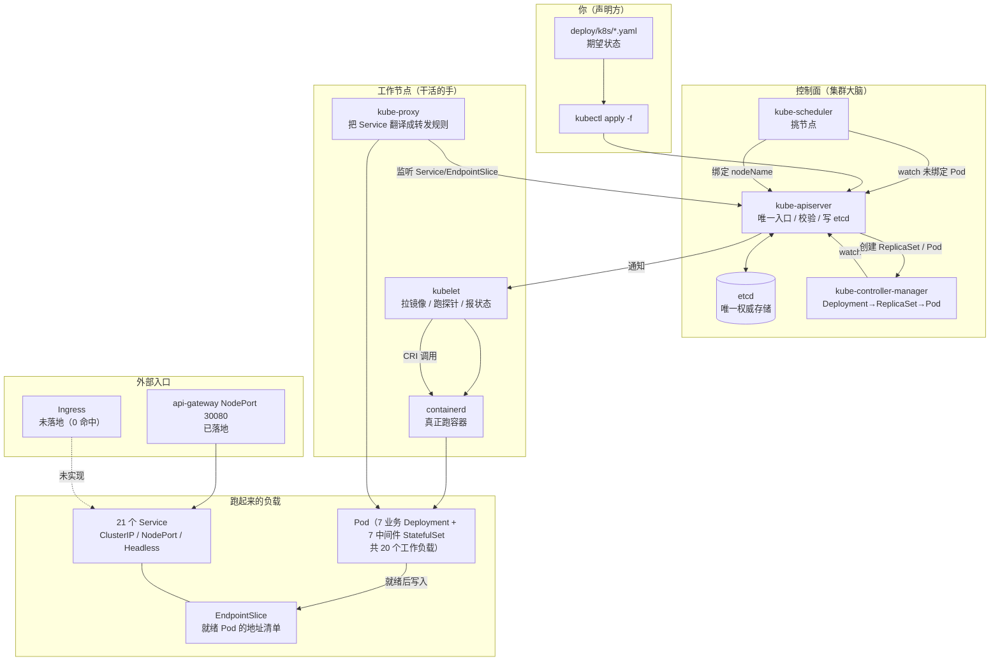
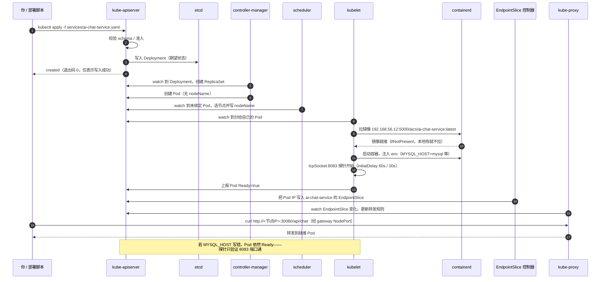

# Kubernetes 入门：声明式收敛、探针与资源配额

> **一句话结论**：K8s 的价值不是"帮你启动容器"，而是你把**期望状态**写进清单后，由控制器一遍遍把现实拉回期望；代价是应用必须把"怎样才算活着、什么时候能接流量、要多少内存、能不能和谁同节点、下线要等多久"全部写成声明——**没写的部分 K8s 不会猜，只会按默认值随机表现**。
> **阅读前置**：读过同目录 01 篇（容器与 Docker Compose）；知道 Spring Boot 的 `server.shutdown=graceful` 是干什么的（`learning-docs/02-Spring微服务/03-Nacos注册与配置中心.md` 讲了下线时序）；能读懂 YAML 缩进，知道 `kubectl` 是命令行客户端。
> **证据基线**：**B 级**＝`deploy/k8s/` 全部 20 份清单（1962 行、47 个资源对象）+ `deploy/scripts/k8s-*.sh` 四个部署脚本 + 各服务 `application.yml` / `Dockerfile`，逐行 read 核对；**A 级**＝`24-源码分析/assets/source/` 已入库的 Spring Boot 4.2.0 摘录；**C 级**＝本机 pwsh 对清单做的静态统计（本机**没有 kubectl / docker / minikube / k3d / helm**，因此运行态一律写"未实测，给命令与判读方法"）。预计阅读 **75~90 分钟**。

## 证据边界

| 类别 | 本仓状态 | 本篇怎么处理 |
| --- | --- | --- |
| `deploy/k8s/` 清单 | 已落地 20 份（含 `services/` 8 份） | 逐项点评，全部给真实行号 |
| 探针 | 已落地 40 个（liveness 20 + readiness 20），**startupProbe 0 个** | 做完整普查表，指出缺口的后果 |
| requests / limits | 20 个工作负载**全部**有容器级 requests + limits | 用它算资源账 |
| Ingress / NetworkPolicy / PDB / HPA / 亲和 / 拓扑分布 / securityContext / terminationGracePeriodSeconds / strategy | **全部 0 命中** | 只给"该写什么 + 不写的后果"，明确标注**未落地** |
| 运行态（Pod 真跑起来了吗、Endpoints 有几个） | 本机无 kubectl，**未实测** | 给命令 + 判读方法，报错原文标注"预期形态" |
| Spring Boot 的 `/actuator/health/liveness` 端点 | **应用层 0 命中**（只有 `docs/05-部署上线.md` 这类文档在写它） | 作为"文档漂移"写进第 7 节 |

本机工具探测原文（C 级证据的边界声明）：

```text
MISSING kubectl
MISSING docker
MISSING minikube
MISSING k3d
MISSING helm
FOUND node -> C:\Program Files\nodejs\node.exe (v24.16.0)
pwsh 5.1.26100.9818
```

---

## 0. 先看现象

这三个症状都来自本仓 `deploy/k8s/` 的真实文本，不是假设场景。它们看起来毫无关系，其实是同一条链上的三个断点。

### 0.1 `apply` 一个目录，被"命名空间不存在"打断

`deploy/scripts/k8s-deploy-services.sh#L30-L31` 的写法是**整目录 apply**：

```bash
kubectl apply -f deploy/k8s/namespace.yaml
kubectl apply -f deploy/k8s/services/
```

而 `deploy/k8s/services/product-service.yaml#L20-L21` 里写的是另一个命名空间：

```yaml
  namespace: aics               # ⚠️ 与其他服务（ai-customer-service）不一致；若未创建
                                #    aics 命名空间，apply 会直接报 NotFound 错误
```

`namespace.yaml#L9-L15` 只创建了 `ai-customer-service`（并且顺手给它打了 `environment: production` 标签）。于是整目录 apply 会在第八个文件上失败：

```text
Error from server (NotFound): error when creating "deploy/k8s/services/product-service.yaml":
namespaces "aics" not found
```

（**报错形态为预期输出，未本机实测**：本机没有集群。判读方法在 6.3。）

### 0.2 镜像拉到了，容器却起不来：`CreateContainerConfigError`

同一个文件里，密码不是明文，而是引用一个 Secret：

```yaml
            - name: SPRING_DATASOURCE_PASSWORD
              valueFrom:
                secretKeyRef:
                  name: mysql-secret   # ⚠️ 同上，需要先自行创建这个 Secret
                  key: password
```

（`deploy/k8s/services/product-service.yaml#L52-L56`）

全仓 grep `mysql-secret` 只有 3 处命中，**全在这一个文件的注释里**（`#L9`、`#L50`、`#L55`），没有任何 `kind: Secret` 定义它。于是 Pod 会停在 `CreateContainerConfigError`：

```text
NAME                               READY   STATUS                       RESTARTS   AGE
product-service-7d9c8f6b5d-x2vqn   0/1     CreateContainerConfigError   0          2m
# kubectl describe pod 里的 Events：
Warning  Failed   kubelet  Error: secret "mysql-secret" not found
```

**这是 K8s 与 Compose 最大的体感差异**：Compose 里一个未定义变量最多是空字符串，K8s 里它会让容器**根本不被创建**——控制器不会替你去发明这个 Secret。

### 0.3 `READY 1/1`，但业务请求全是 502

最反直觉的一个。`deploy/k8s/services/ai-chat-service.yaml#L100-L111` 的两个探针都是 TCP：

```yaml
          livenessProbe:
            tcpSocket:
              port: 8083
            initialDelaySeconds: 60
            periodSeconds: 15
            timeoutSeconds: 5
          readinessProbe:
            tcpSocket:
              port: 8083
            initialDelaySeconds: 30
            periodSeconds: 10
            timeoutSeconds: 5
```

TCP 探测只问一件事：**8083 端口能不能握手**。Spring Boot 在上下文刷新到一定阶段就把端口 listen 起来了，此时 Nacos 注册、数据库连接池、RocketMQ 生产者可能都还没好。于是：

```text
$ kubectl get pods -n ai-customer-service
ai-chat-service-6b8f9d7c4f-h4q2m   1/1   Running   0   40s      # ← K8s 认为它健康
$ kubectl logs -n ai-customer-service deploy/ai-chat-service --tail=20
Caused by: java.net.UnknownHostException: mysql            # ← 它自己心里没底
```

（日志为**预期形态**；之所以会 `UnknownHostException`，见下一条真实配置。）

`MYSQL_HOST` 写的是 `mysql`，而本目录的 Service 名是 `mysql-master` / `mysql-slave`：

```yaml
            - name: MYSQL_HOST
              value: "mysql"               # MySQL 地址
              # 注意：本目录创建的 Service 名是 mysql-master / mysql-slave，
              # 没有 “mysql”。若连接失败改成 mysql-master
```

（`deploy/k8s/services/ai-chat-service.yaml#L58-L61`，注释是清单作者自己写的。`deploy/k8s/nacos.yaml#L62-L63` 的 `MYSQL_SERVICE_HOST` 犯了同一处错。）

> **这些现象指向同一件事**：K8s 只对**你写下来的声明**负责。命名空间、依赖的 Secret、Service 名、健康判定标准，只要你没写或写错，它既不报"配置不完整"，也不会替你做语义检查——它会安静地把 Pod 拉到 `Running`，然后让你在业务报错里自己找原因。下面按"声明了什么 → 控制器怎么收敛 → 没声明的那部分谁兜底"这条线逐段拆。

---

## 1. 整体地图



> **读图说明**：① 图里只有 `kubectl` 一个箭头指向 apiserver——**没有任何组件直接"执行"你的清单**，控制面所有组件都是 watch apiserver 后各干各的，这就是第 3.1 节"apply 之后没有执行过程"的来源。② `kube-scheduler` 只负责挑节点（写 `nodeName`），真正跑容器的是节点上的 `kubelet + containerd`，两者之间隔着一次 API 写入，所以"调度成功"不等于"启动成功"。③ `EndpointSlice → kube-proxy → Pod` 这条链是**探针真正的作用点**：readiness 决定 Pod 进不进 EndpointSlice，kube-proxy 只转发到 EndpointSlice 里的地址。④ 虚线 `Ingress` 是本仓**完全未落地**的部分，别把第 3.2 节的 Ingress 职责当成现状。

组件责任与失效表现：

| 组件 | 责任 | 谁在用它 | 是否权威源 | 失效后的表现 |
| --- | --- | --- | --- | --- |
| `kube-apiserver` | 唯一写入口、认证鉴权、准入校验 | `kubectl`、所有控制器 | 是（写） | `kubectl` 全部超时，集群"失联"但已有 Pod 继续跑 |
| `etcd` | 存全部对象状态 | 仅 apiserver | **是（唯一真相）** | apiserver 只读或不可用，控制器停摆 |
| `kube-controller-manager` | 把现实拉回期望（Deployment/RS/Node…） | watch apiserver | 否 | 删了 Pod 不重建，`kubectl apply` 后看不到新 Pod |
| `kube-scheduler` | 给未绑定 Pod 选节点 | watch apiserver | 否 | Pod 卡 `Pending`（`0/3 nodes are available`） |
| `kubelet` | 拉镜像、起容器、跑探针、上报状态 | 节点上常驻 | 否 | 节点 `NotReady`，Pod 被驱逐 |
| `containerd` | 容器运行时 | kubelet | 否 | 镜像拉不下来（`ImagePullBackOff`） |
| `kube-proxy` | Service → 转发规则（本仓清单未涉及） | 节点上常驻 | 否 | Service IP 不通，但 Pod IP 可达 |
| Probe（探针） | 告诉 K8s "活没活、能不能接流量" | kubelet 执行 | 否 | 见 3.3：不写=`Running` 即健康，写错=随机重启 |

---

## 2. 关键概念与关键配置

先把术语一次说清（每个都只用一句话，后面正文再展开）：

- **期望状态（desired state）**：清单里写的东西——"我要 2 个副本、镜像 tag 是 X、内存上限 512Mi"。
- **控制器循环（reconcile loop）**：控制器不断做"读期望 → 读现实 → 只做差异动作"，差 1 个副本就建 1 个，不重建已有的。
- **Pod**：最小调度单位，一个 Pod 内可多容器、共享网络与卷；**Pod 是不可变的**，改了模板只会新建 Pod，不会原地改。
- **ReplicaSet**：保证"同时有 N 个同模板 Pod 在跑"；你几乎不直接写它，由 Deployment 代管。
- **Deployment**：管"无状态应用的一次发布"——版本、滚动参数、回滚；它自己不建 Pod，建的是 ReplicaSet。
- **StatefulSet**：管"有身份的应用"——固定名字（`mysql-master-0`）、稳定网络标识（配 headless Service）、每副本独立 PVC。
- **Service**：一组 Pod 的**稳定虚拟 IP + DNS 名**，靠 label selector 选 Pod；Pod IP 会变，Service 名不变。
- **EndpointSlice**：Service 背后"当前可转发地址"的清单，**只有 readiness 通过的 Pod 才会进去**。
- **Probe**：kubelet 定期对容器做的检查，分 liveness / readiness / startup 三种，失败后果完全不同（3.3）。
- **requests / limits**：requests 是调度承诺（节点必须留出来），limits 是运行时硬上限（超内存 `OOMKilled`，超 CPU 被限流）。
- **QoS 类别**：`Guaranteed`（requests==limits）/ `Burstable`（有 requests 但不等于 limits）/ `BestEffort`（都没写）——节点内存吃紧时按此顺序驱逐，本仓 20 个工作负载全是 `Burstable`。
- **PDB（PodDisruptionBudget）**：自愿驱逐（节点维护、`drain`）时的"最少保留几个"保证金；它**不防崩溃**，只防"你主动赶人赶太狠"。
- **拓扑分布（topologySpreadConstraints）**：让副本按节点/可用区分开，而不是全挤在一个节点上。

关键配置与本仓落点：

| 名称 | 位置 | 角色 | 关键参数（本仓实际值） |
| --- | --- | --- | --- |
| `Namespace` | `deploy/k8s/namespace.yaml#L9-L15` | 资源隔离边界 + 名字作用域 | `ai-customer-service`（`product-service.yaml` 误用 `aics`） |
| `Deployment` | `deploy/k8s/services/*.yaml`（13 个 Deployment） | 无状态发布单元 | `replicas: 1`，仅 `product-service` 为 `2` |
| `StatefulSet` | `deploy/k8s/{mysql,redis,elasticsearch,chroma,neo4j,minio}.yaml`（7 个） | 有状态单元 | `serviceName` + `volumeClaimTemplates` |
| `Service` | 21 个（含 1 个 headless `redis-headless`） | 稳定 DNS / VIP | `api-gateway` 是唯一 `NodePort: 30080` |
| `livenessProbe` | 20/20 工作负载 | 失败 → 重启容器 | 最常用 `initialDelaySeconds: 60`、`periodSeconds: 15` |
| `readinessProbe` | 20/20 工作负载 | 失败 → 摘出 EndpointSlice | `initialDelaySeconds: 30`、`periodSeconds: 10` |
| `startupProbe` | **0/20** | 启动期豁免另两个探针 | 未落地 |
| `resources.requests` | 20/20 | 调度承诺 | 例：`ai-chat-service` 200m / 512Mi |
| `resources.limits` | 20/20 | 运行硬上限 | 例：`ai-chat-service` 1000m / 1Gi |
| `JAVA_OPTS` | `deploy/k8s/services/*.yaml` 共 7 处 | 把堆大小写死 | `-Xms512m -Xmx512m`（chat）、`-Xms256m -Xmx256m`（其余 6 个） |
| `configMap` / `secretKeyRef` | `redis.yaml`、`mysql.yaml`、`ai-chat-service.yaml`、`neo4j.yaml`、`xxl-job.yaml` | 配置外置 | `secretKeyRef` 7 处；`stringData` 明文示例在 `deploy/k8s/middleware-secrets.example.yaml` |

---

## 3. 原理与证据逐段精读

每段都按四层写：**在干什么 → 为什么这么设计 → 换成别的写法会怎样 → 常见坑**。

### 3.1 声明式与控制器循环：`apply` 之后没有"执行过程"

**在干什么。** `kubectl apply -f x.yaml` 只做一件事：把 YAML 变成对 apiserver 的一个 PATCH/POST 请求，apiserver 校验后写进 etcd，然后**这条命令就结束了**。后面的建 Pod、拉镜像、起容器全部是别的组件异步干的：`kube-controller-manager` watch 到"Deployment 期望 1 个副本、现役 ReplicaSet 有 0 个"，于是创建/扩容 ReplicaSet；ReplicaSet 控制器发现"期望 1 个 Pod、现有 0 个"，创建 Pod 对象；`kube-scheduler` watch 到"Pod 没 `nodeName`"，挑一个节点写回去；节点上的 `kubelet` watch 到"有 Pod 分给我"，才去调 containerd 拉镜像、起容器。

所以 `apply` 的退出码 0 只代表**写入成功**，不代表跑起来了。这也解释了为什么本仓的部署脚本在每次 apply 后面紧跟一行 `kubectl rollout status`——它才是"等到收敛"的同步点：

```bash
kubectl apply -f deploy/k8s/mysql.yaml
kubectl rollout status statefulset/mysql-master -n "${NAMESPACE}" --timeout=300s
```

（`deploy/scripts/k8s-apply-infra.sh#L11-L12`）

**为什么这么设计。** 把"期望"和"执行"分开，换来三件事：① **自愈**——Pod 被 OOM 杀掉，ReplicaSet 控制器发现差一个，自动补；② **幂等**——重复 apply 同一个文件不会多建资源，因为控制器只看差异；③ **可离线推理**——etcd 里的状态就是集群全部真相，出了事故可以只读 etcd 复现。这是"拉模式"对比 Compose 的"推模式"最本质的区别：Compose 是 `docker run` 一组容器，容器死了没人管。

**换成别的写法会怎样。** 用 `kubectl create -f`，第二次直接报 `AlreadyExists`；用 `kubectl replace --force`，会**删除再重建**（Pod 全灭）；用 `kubectl run` 起单个 Pod，没有 Deployment 兜底，Pod 挂了就永久没了——本仓一个都没这么写，全部走 `deploy/` 目录下的清单，就是为了保持"声明式的幂等"。

**常见坑。** ① 以为 apply 完就能访问——`rollout status` 之前 Pod 可能还在 `ContainerCreating`；② 改了 `ConfigMap` 挂载的配置就以为应用会变（见 3.7）；③ 把 `latest` tag 的镜像重新 push 后 `apply`，发现毫无变化——**清单没变，控制器没有差异可做**，必须 `kubectl rollout restart` 或 `kubectl set image` 才触发（这正是本仓 `deploy/scripts/k8s-deploy-services.sh#L40` 用 `kubectl set image` 而非 apply 的原因）。

### 3.2 Pod / Deployment / Service / Ingress 四件套的职责边界

**在干什么。** 四者的分工是一条单向链：

| 对象 | 管什么 | 不管什么 | 本仓证据 |
| --- | --- | --- | --- |
| **Pod** | 一组共享网络的容器、可挂卷；**不可变** | 不管"要几个"、不管"挂不挂" | 没有手写 Pod，全部由工作负载生成 |
| **Deployment** | 副本数、版本、滚动参数、回滚 | 不给稳定 IP、不做负载均衡 | 13 个 Deployment（`deploy/k8s/services/*.yaml` 8 个 + nacos / rocketmq×2 / sentinel / xxl-job） |
| **StatefulSet** | 稳定身份 + 每副本独立存储 | 不做滚动策略的"随意"版本（默认按序号逆序更新） | 7 个（mysql-master 1 副本、mysql-slave 2 副本、redis、ES、Chroma、Neo4j、MinIO） |
| **Service** | 稳定 VIP/DNS + 四层转发 + 只转就绪 Pod | 不做七层路由、不做 TLS 终止、不做路径分流 | 21 个；`api-gateway` 用 `NodePort 30080`（`deploy/k8s/services/api-gateway.yaml#L19-L25`） |
| **Ingress** | 七层入口：域名/路径分流、TLS | 自己不是负载均衡器，需要 Ingress Controller 实现 | **完全未落地**（全仓 `kind: Ingress` 0 命中） |

**为什么这么设计。** 每一层只解决一个问题，才能各自替换：换发布策略只动 Deployment，换暴露方式只动 Service/Ingress，Pod 层保持无知。这也是本仓"外网只暴露一个 NodePort 给网关、其余全 ClusterIP"能成立的原因——**边界靠清单表达，而不是靠防火墙约定**。

**换成别的写法会怎样。** 把所有服务都改成 `NodePort`：每个服务在每台节点上占一个 30000–32767 端口，节点数×服务数就是暴露面，且没有七层分流能力（想按 `/api/user` 分流只能改网关）。反过来现在这样只暴露 1 个 NodePort 的问题也很明确：**没有域名、没有 TLS、没有路径级限流**，全靠网关进程自己做——网关挂了整站不可用（这也是缺 PDB/多副本的直接风险）。

**常见坑。** ① `Service` 的 `selector` 和 Pod 的 `labels` 差一个字符就选不到，`kubectl get endpoints` 显示 `<none>`；② 把 `Ingress` 当"装了就有"的东西——不部署 Ingress Controller，`kubectl apply` 一个 Ingress 不会产生任何实际效果；③ StatefulSet 忘了写 `serviceName`（或用普通 ClusterIP 而非 headless），Pod 之间就拿不到稳定域名。

### 3.3 探针三兄弟：失败后果完全不同的三种检查

**在干什么。** 三个探针都是 kubelet 按周期对容器发一次"检查"，但触发动作不同：

| 探针 | 失败后 K8s 干什么 | 该问的问题 | 本仓落地情况 |
| --- | --- | --- | --- |
| `livenessProbe` | **杀容器并重启**（按 `restartPolicy`，`Pod` 本身不重建） | "它彻底卡死了吗？重启能不能救回来？" | 20/20 |
| `readinessProbe` | **从 Service 的 EndpointSlice 里摘掉**（不重启、不杀进程） | "此刻能安全接流量吗？" | 20/20 |
| `startupProbe` | 启动期**屏蔽另外两个探针**，成功后交接 | "它启动完了吗？" | **0/20** |

**三类失败后果的差别值得背下来**：liveness 失败 = 重启（有中断、有冷启动成本）；readiness 失败 = 不接流量（进程继续活着，缓存与连接不丢）；startup 失败 = 达到 `failureThreshold × periodSeconds` 后被杀（给慢启动应用一条"宽限期"专用通道）。

**为什么这么设计。** 因为"活"和"可用"是两件事。一个连不上数据库的实例**不该被重启**（重启一次还是连不上，只会变成重启风暴），但它**必须不接流量**。所以 Spring Boot 专门准备了两个健康组：`liveness`（进程存活、不依赖外部资源）与 `readiness`（依赖项就绪）。Spring Boot 4 里这两个组由健康端点分组机制提供：`HealthEndpointConfiguration` 在缺少自定义实现时装配 `AutoConfiguredHealthEndpointGroups`（[[源码:HealthEndpointConfiguration.java.md#L48-L51]]），后者把"主组"和 `properties.getGroup()` 配置出来的分组分开构建（[[源码:AutoConfiguredHealthEndpointGroups.java.md#L69-L71]]）——这就是 `management.endpoint.health.group.readiness.include=...` 能生效的落点。

**换成别的写法会怎样（本仓的真实对照）。** 本仓刚好把三种典型写法都摆了样本，用 C 级普查可以逐个数出来：

```text
$ pwsh -c "统计 deploy/k8s 下探针类型"
livenessProbe   20
readinessProbe  20
startupProbe     0
探测方式       httpGet=15  tcpSocket=19  exec=6   (合计 40 个探针)
```

- **tcpSocket（19 个）**：7 个业务服务（chat/gateway/knowledge/message/notify/search/user）+ RocketMQ 两个 + Neo4j 的 liveness。只验证"端口通"——`ai-chat-service.yaml#L100-L111` 就是这样，于是 0.3 那个"READY 1/1 但 500"的场景必然发生。
- **httpGet（15 个）**：Chroma `/api/v1/heartbeat`（`deploy/k8s/chroma.yaml#L50-L61`）、MinIO `/minio/health/live|ready`（`deploy/k8s/minio.yaml#L76-L87`）、Elasticsearch `/_cluster/health`（`deploy/k8s/elasticsearch.yaml#L76-L88`）、Nacos、Sentinel、XXL-Job、以及 `product-service` 的 `/actuator/health`（`deploy/k8s/services/product-service.yaml#L68-L79`）。
- **exec（6 个）**：MySQL 的 `mysqladmin ping -h localhost -uroot -proot`（`deploy/k8s/mysql.yaml#L161-L184`）、Redis 的 `redis-cli ping`（`deploy/k8s/redis.yaml#L131-L144`）。

对照 Spring Boot 侧的现状：**应用层没有为探针准备任何端点**——全仓 `management.endpoint.health.probes` / `/actuator/health/liveness` 在 yml、java 里 0 命中，只有 `docs/05-部署上线.md` 的几段文档在写 liveness/readiness 路径。能用的只有 Nacos 共享配置暴露出来的 `health,info,prometheus`（`tools/nacos-config/aics-shared.yml#L26-L34`）。

**正确写法（本仓未落地，属"应该怎么做"）。** 应用侧开探针组：

```yaml
management:
  endpoint:
    health:
      probes:
        enabled: true          # 不开这个，/actuator/health/liveness 就是 404
  endpoints:
    web:
      exposure:
        include: health,info,prometheus
```

清单侧把业务服务的 `tcpSocket` 换成 `httpGet` 指向 `/actuator/health/liveness|readiness`，并加 startupProbe 给慢启动（chat 要连 Nacos + 向量库 + 大模型客户端，60 秒的 `initialDelaySeconds` 是**猜的**，不是量出来的）。

**常见坑（本仓已踩中两条）。**

1. **liveness 用聚合健康端点 → 重启风暴**。`product-service.yaml#L74-L79` 的 liveness 打 `/actuator/health`，这个端点的状态由所有组件聚合而成：MySQL 一挂，`/actuator/health` 变 `DOWN`，liveness 连续失败 3 次（默认 `failureThreshold: 3`）后容器被杀；重启后 MySQL 还没起来，再被杀——两个副本会一起打转，同时把数据库连接数反复打满。
2. **liveness 用 readiness 语义的接口**。`deploy/k8s/nacos.yaml#L83-L89` 的 liveness 打的是 `/nacos/v1/console/health/readiness`——同一个 URL 同时当活性和就绪用，等于告诉 K8s"它 Nacos 在启动自检中就可以被重启"。
3. **探针里塞明文密码**。MySQL 的 exec 探针 `-proot` 会出现在 `kubectl describe pod` 和 `ps` 里（`deploy/k8s/mysql.yaml#L161-L172`）。
4. **不设 `failureThreshold` / `successThreshold`**：全仓这两个字段 0 命中，一律吃默认值（失败 3 次判死、成功 1 次判活）。对数据库这种"抖动一下就可能超时"的探针，默认 3 次配上 `timeoutSeconds: 3` 只有 9 秒容忍度。

### 3.4 readiness 是怎么变成"接不接流量"的

**在干什么。** 链路是：`readinessProbe` 通过 → kubelet 上报 Pod `Ready` 条件 → EndpointSlice 控制器把这个 Pod IP 写进对应 Service 的 EndpointSlice → 各节点 `kube-proxy` watch 到变化，更新转发规则 → 新流量才可能落到它身上。所以**readiness 是"流量的开关"，不是"健康的分值"**。

**为什么这么设计。** 把"哪些地址可以转发"做成一份独立可观察的清单（EndpointSlice），既让转发层不必理解探针，也让排障有了直接的观测点：`kubectl get endpoints <svc>` 为空基本等于"所有 Pod 都 readiness 失败或 selector 选错"。

**换成别的写法会怎样。** 不写 readiness（或像本仓 7 个业务服务那样写 TCP），端口一通就进 EndpointSlice：滚动更新时旧 Pod 还在处理长请求、新 Pod 已经在接流量但 Spring 上下文没刷新完，于是发布期间出现间歇性 502/超时——这类"发布才出现、发布完就好"的故障，八成是 readiness 写得太粗。

**常见坑。** ① readiness 的 `initialDelaySeconds` 比真实启动时间短，导致启动期反复在 EndpointSlice 里进出（对应 `READY 0/1` 的抖动，配合 `kubectl get pods -w` 能看到 0/1↔1/1 跳变）；② 没有 `startupProbe` 时，把 liveness 的 `initialDelaySeconds` 当成"启动宽限期"来调，调到 300 秒就等于"真卡死了也要等 5 分钟才重启"。

### 3.5 requests / limits 与 JVM 感知：谁在决定堆大小

**在干什么。** `requests` 只在调度时用（节点剩余资源够不够），`limits` 在运行时用（cgroup 限制）。JVM 感知容器内存这件事有两个前提：**① 容器有 limits；② JVM 参数用百分比而不是绝对值**。

**为什么这么设计。** JVM 的默认堆上限是按"容器可用内存的 1/4"算的（`MaxRAMPercentage` 默认 25%），前提是 JVM 能读到 cgroup 里的 limit。写成 `-Xmx512m` 就把这个自适应关掉了：你改 limits 到 2Gi，堆还是 512m，多出来的内存只给堆外（元空间、直接内存、线程栈、Netty）——资源浪费；反过来 limits 小于 `-Xmx` 就是必死：容器内存到 limits 直接被 `OOMKilled`，而且**看不到 Java 的 `OutOfMemoryError`**，因为杀进程的是内核不是 JVM。

本仓的现状是一整排固定堆：

```text
deploy/k8s/services/ai-chat-service.yaml#L92   -Xms512m -Xmx512m     limits 1Gi
deploy/k8s/services/api-gateway.yaml#L62       -Xms256m -Xmx256m     limits 512Mi
deploy/k8s/elasticsearch.yaml#L65              -Xms512m -Xmx512m     limits 2Gi
deploy/k8s/nacos.yaml#L72-L75                  JVM_XMS 256m / JVM_XMX 512m   limits 1Gi
deploy/k8s/rocketmq.yaml#L55                   -server -Xms256m -Xmx256m     limits 512Mi
```

`MaxRAMPercentage` 全仓 **0 命中**。按单副本口径把 20 个工作负载的 requests/limits 加起来（C 级实算）：

```text
单副本口径（20 个工作负载各算 1 份）:  requests 3300m / 7040Mi (6.88Gi)   limits 14500m / 16896Mi (16.5Gi)
按 replicas 加权（21 个 Pod）:          requests 3800m / 7808Mi (7.63Gi)   limits 16000m / 18Gi
PVC 合计: 10+20+10+10+10+20+5 = 85Gi（7 条 volumeClaimTemplates，全部 local-path）
JVM 堆声明合计（7 个 Java 服务）: 512 + 256×6 = 2048Mi
```

读这组数要读两件事：**limits 合计 18Gi 是"出事时可能被吃掉的内存上限"**，调度器只保证 7.63Gi 的 requests，节点实际需要的内存介于两者之间；**堆合计 2048Mi 对应 18Gi 的容器上限**，说明限流/OOM 的大头在堆外与中间件（ES 2Gi、Neo4j 2Gi、Chroma 1Gi 这些是非 JVM 或自管堆的）。

**换成别的写法会怎样。** 把 7 个服务改成 `-XX:MaxRAMPercentage=70`，limits 就变成唯一的内存旋钮：调大 limits 堆跟着涨，调小跟着降，永远不会出现"`-Xmx` 比 limits 还大"的必死配置。但百分比也有代价：堆外内存多的服务（Netty 网关、大量线程池）70% 可能偏激进，网关这类通常要下调。另外本仓有个隐藏差异需要点出来：

```text
ai-cs-chat/Dockerfile#L21        ENTRYPOINT ["sh", "-c", "java ${JAVA_OPTS:-} -jar app.jar"]
ai-cs-product/Dockerfile#L11     ENTRYPOINT ["java", "-jar", "app.jar"]
```

前者是 shell 形式，`JAVA_OPTS` 环境变量**生效**；后者是 exec 形式，**任何 `JAVA_OPTS` 都不会被读取**。所以 `product-service.yaml` 里没有 `JAVA_OPTS`（全仓 `deploy/k8s/services/*.yaml` 只有 7 处），不是忘了写，而是写了也没用——它的堆完全由 JVM 默认值（容器内存 1/4 ≈ 128m，limits 512Mi）决定。

**常见坑。** ① `limits` 小于 `-Xmx` + 堆外开销 → `OOMKilled`（`kubectl describe pod` 里 `Last State: Terminated, Reason: OOMKilled`）；② 只写 `limits` 不写 `requests` → 调度按 0 计算，节点会被超卖到爆；③ 只看 `kubectl top pod` 的 RSS 判断内存够不够，忽略堆外与页缓存；④ 用 exec 形式的 ENTRYPOINT 却指望环境变量调堆（本仓 `ai-cs-product` 就是这个坑）。

### 3.6 调度约束：亲和、反亲和、拓扑分布、PDB

**在干什么。** 这一族配置回答"Pod 允许落在哪、跟谁能/不能同处、维护时最少留几个"：

| 机制 | 一句话 | 典型写法意图 | 本仓 |
| --- | --- | --- | --- |
| `nodeAffinity` / `nodeSelector` | 只能落在带某标签的节点 | 有 GPU/SSD 的节点跑特定负载 | 0 命中 |
| `podAntiAffinity` | 不能和某 Pod 同节点 | 同一服务两副本别放一台机 | 0 命中 |
| `topologySpreadConstraints` | 按 zone/hostname 均匀打散 | 多副本跨节点均衡 | 0 命中 |
| `PDB`（PodDisruptionBudget） | 自愿驱逐时保底副本数 | `drain` 节点时不至于全灭 | 0 命中 |
| `tolerations` / `priorityClassName` | 容忍污点 / 抢占优先级 | 关键服务优先调度 | 0 命中 |

**为什么这么设计。** 调度器只保证"资源够"，不保证"故障域分开"。单机 8 核 32G 的集群里，两个副本完全可以落在同一台机器上——这台机器重启，两个副本一起消失，`replicas: 2` 提供的可用性归零。

**换成别的写法会怎样（本仓的真实风险）。** `product-service` 是全仓唯一 `replicas: 2` 的服务（`deploy/k8s/services/product-service.yaml#L25`），也没写反亲和/拓扑分布——两个副本可能同节点。而 7 个中间件 StatefulSet 全是单副本（`mysql-master` 1、`redis` 1、`elasticsearch` 1、`chroma` 1、`neo4j` 1、`minio` 1；只有 `mysql-slave` 是 2），这些单副本一旦所在节点 `drain`，**没有 PDB 保护就是直接消失**，业务侧表现为 30 秒~数分钟的全面不可用。

**常见坑。** ① 以为 `replicas: 2` 就有高可用（不看反亲和就是自欺）；② PDB 的 `minAvailable` 写成 100% 会让节点维护永久卡住（驱逐被拒，`drain` 挂住）；③ 硬反亲和（`requiredDuringSchedulingIgnoredDuringExecution`）在节点数不足时让第二个副本永远 `Pending`——比"同节点"更糟。

落地清单（本仓未落地，给出可直接用的片段）：

```yaml
spec:
  template:
    spec:
      topologySpreadConstraints:
        - maxSkew: 1
          topologyKey: kubernetes.io/hostname
          whenUnsatisfiable: ScheduleAnyway
          labelSelector:
            matchLabels: { app: product-service }
---
apiVersion: policy/v1
kind: PodDisruptionBudget
metadata:
  name: product-service-pdb
  namespace: ai-customer-service
spec:
  minAvailable: 1
  selector:
    matchLabels: { app: product-service }
```

### 3.7 ConfigMap / Secret 与配置热更新的真实限制

**在干什么。** 有两种用法：**环境变量注入**和**文件挂载**。它们的"热更新"能力完全不同：

| 用法 | 改了源对象后 | 需要什么才生效 |
| --- | --- | --- |
| `env` / `envFrom` | **不会变** | 必须重建 Pod（环境变量在进程启动时确定） |
| 完整挂载 `volumeMounts`（不带 `subPath`） | 挂载目录内容**会自动更新**（kubelet 周期同步，通常数十秒） | 应用自己重新读文件（Spring 的 `spring.config.import` 再拉一次 / 重启） |
| `subPath` 挂载 | **不会更新** | 必须重建 Pod（众所周知的限制） |

**为什么这么设计。** 环境变量是进程的启动参数，改它唯一的办法就是换进程；而卷是"文件系统层面的投影"，kubelet 可以做原子替换（symlink 切换）。这是操作系统的物理限制，不是 K8s 的实现偷懒。

**换成别的写法会怎样。** 本仓 7 个业务服务全部用环境变量注入（例如 `deploy/k8s/services/ai-chat-service.yaml#L54-L90` 的 `NACOS_ADDR`、`MYSQL_*`、`OPENAI_*`），这意味着**改任何一项都要 `kubectl rollout restart deployment/xxx`**；而 `deploy/k8s/redis.yaml#L32-L48` 的 `redis.conf` 与 `deploy/k8s/mysql.yaml#L18-L75` 的 `my.cnf` 是挂载进容器的，文件会更新——但 Redis/MySQL 也不会自己重读配置，最终还是要重启或 `CONFIG SET`。

**Secret 的边界要单独说清。** `deploy/k8s/middleware-secrets.example.yaml` 用的是 `stringData`（明文写 YAML，交给 apiserver 做 base64），文件头自己写了要求："复制成 `middleware-secrets.yaml` 再填真值，不要提交 Git"。必须知道：**base64 不是加密，Secret 默认也不是加密存储**——能读该命名空间 Secret 的人就能读到密码，真正要护住得靠 etcd 静态加密 + RBAC + 外部密钥管理。

**常见坑。** ① 改了 `ConfigMap` 用 `env` 注入的项，`kubectl apply` 后 Pod 内 `echo $VAR` 还是旧值（本仓最容易踩，因为 7 个服务都用 env）；② 把 Secret 当配置中心，改完不重启，以为热更新了；③ 明文密码进清单（本仓 `deploy/k8s/services/ai-chat-service.yaml#L68-L69` 的 `MYSQL_PASSWORD: "root"`、`deploy/k8s/mysql.yaml#L144-L145` 的 `MYSQL_ROOT_PASSWORD`），一旦推到 Git 就是永久泄露。

### 3.8 滚动更新参数与优雅停机的配合：一次关停到底要几秒

**在干什么。** 滚动更新由 Deployment 的 `strategy` 控制：`maxSurge`（允许超出期望副本数的上限，可写数量或百分比）、`maxUnavailable`（允许同时不可用的上限）。关停一侧由三段时间决定：

| 时间 | 来源 | 本仓值 |
| --- | --- | --- |
| 摘流量的延迟 | Pod 进入 `Terminating` 后立刻从 EndpointSlice 摘除，但 kube-proxy/客户端有缓存窗口 | 无 `preStop` 钩子（0 命中） |
| 应用自身的优雅停机窗口 | `server.shutdown: graceful` + `spring.lifecycle.timeout-per-shutdown-phase` | **30s**（`ai-cs-chat/src/main/resources/application.yml#L2`、`#L7`；11 个模块一致） |
| Nacos 注销后的等待 | `gracefulShutdownWaitTime` 默认 `10 * 1000`（`NacosGracefulShutdownDelegate` 在 `ContextClosedEvent` 里 sleep） | **10s**（未显式覆盖） |
| 内核强杀时刻 | `terminationGracePeriodSeconds` | **未配置 → 默认 30s**（全仓 0 命中） |

优雅停机的实现可以精确到方法：Tomcat 的 `GracefulShutdown.shutDownGracefully` 起一个 `tomcat-shutdown` 线程去做关停（[[源码:GracefulShutdown.java.md#L41-L51]]）；`doShutdown` 里先 `connectors.forEach(this::close)`，而 `close` 的动作是 `connector.pause()` 加 `closeServerSocketGraceful()`——**先不再接受新连接**（[[源码:GracefulShutdown.java.md#L79-L82]]）；随后 `awaitInactiveOrAborted` 每 50ms 轮询一次"还有没有在飞的请求"（[[源码:GracefulShutdown.java.md#L84-L100]]），判定依据是 `StandardContext.getInProgressAsyncCount() > 0` 或 `StandardWrapper.getCountAllocated() > 0`（[[源码:GracefulShutdown.java.md#L113-L128]]）。这个轮询的上限就是 `timeoutPerShutdownPhase`，兜底默认值 10000ms（[[源码:DefaultLifecycleProcessor.java.md#L124]]），本项目用 `spring.lifecycle.timeout-per-shutdown-phase: 30s` 把它抬到 30 秒；`onClose()` 触发 `stopBeans(StopMode.ALL)` 走完整生命周期（[[源码:DefaultLifecycleProcessor.java.md#L336-L337]]）。

**为什么这么设计。** 因为"关停"不是瞬间动作，而是四件事按序发生：不再接新连接 → 等在飞请求结束 → 注销注册中心并等调用方缓存过期 → 进程退出。任何一步的时间预算被截断，都会变成"用户看到 502"。

**换成别的写法会怎样（本仓的时间账是负的）。** 最坏情况：应用侧 30s（`timeout-per-shutdown-phase`）+ Nacos 侧 10s（`gracefulShutdownWaitTime`）= **40s**，而 K8s 侧 `terminationGracePeriodSeconds` 用默认 **30s**——**SIGKILL 会先到**，最后 10 秒的等待白等，在飞请求被硬断。修法二选一：把 `terminationGracePeriodSeconds` 提到 45s 以上，或者在 `preStop` 里做等待并把应用侧 timeout 压到 30s 以内。

**常见坑。** ① `maxUnavailable: 0` + `maxSurge: 0` 会让发布永久卡住（没有可用配额也没有额外配额）；② 单副本服务（本仓 19 个都是 `replicas: 1`）滚动更新时**必然有一段无副本可用期**——`maxUnavailable` 再小也救不了，只能靠多副本；③ 只调应用 `timeout-per-shutdown-phase` 不调 `terminationGracePeriodSeconds`（本仓现状），等于把参数写在了没人读的那一层。

### 3.9 StatefulSet 与有状态组件：Chroma 单副本 1Gi 的真实风险

**在干什么。** StatefulSet 给每个副本三样东西：固定序号名字（`chroma-0`）、稳定网络标识（`serviceName` + headless Service）、独立 PVC（`volumeClaimTemplates`）。本仓 7 个有状态组件的存储全部是 `storageClassName: local-path`。

**为什么这么设计。** 有状态应用不能"随便换个身份就继续跑"：数据在 PVC 上，PVC 和 Pod 序号绑定；DNS 名稳定，集群内才能用 `mysql-master-0.mysql:3306` 这种地址。反过来，`local-path` 卷的数据**只在那个节点的本地磁盘上**——Pod 被调度到别的节点，数据看不见（这是本仓单机学习环境的合理取舍，但绝不能当生产方案）。

**换成别的写法会怎样（以 Chroma 为例）。** `deploy/k8s/chroma.yaml#L33` 明确写了单副本：

```yaml
  serviceName: chroma           # 关联的 Service（若用 headless Service 可获得稳定 DNS）
  replicas: 1                   # 单副本：学习环境，数据一致性简单
```

内存上限 `1Gi`（`#L66-L68`，注释"防止把节点内存吃光"）、requests 256Mi、PVC 10Gi（`#L69-L77`）。风险有三层：① **单副本 = 单点**，Chroma 挂了知识库检索全挂，且 `replicas: 1` 时滚动更新存在无副本窗口；② **1Gi 上限对向量库偏紧**：Chroma 0.5.20 默认把集合索引放在内存 + 段文件里，知识库规模一旦上来（上万条 chunk），内存超限就是 `OOMKilled`，而重启后又要重新加载索引——表现为"用一段时间就自动重启一次"；③ **`local-path` + 单副本**：节点故障后 PVC 需要人工迁移，没有副本可切。

**常见坑。** ① 给 StatefulSet 用普通 ClusterIP 而不是 headless（`clusterIP: None`），Pod 间域名不稳定（本仓 `redis-headless` 是正确示范，见 `deploy/k8s/redis.yaml#L74-L88`）；② 改了 `volumeClaimTemplates` 以为会扩容——**它只在创建时生效，改它不会 rescale 已有 PVC**，必须手动 `kubectl edit pvc` 或重建；③ 删 StatefulSet 不带 `--cascade=orphan` 时装也可能删数据（取决于回收策略），学习环境删之前先看清 PVC。

### 3.10 HPA 的指标陷阱：CPU 对 LLM 服务没有意义

**在干什么。** HPA（HorizontalPodAutoscaler）按指标扩缩副本：最常用 `targetCPUUtilizationPercentage`，也支持内存与自定义指标。它的计算基准是 **requests**：`利用率 = 实际用量 / requests.cpu`。

**为什么这么设计、对 AI 服务为什么失效。** 因为 CPU 利用率假设"负载增加 → CPU 上升"这条因果链成立。对 LLM 服务，链是断的：一次对话的耗时主要花在**等第一个 token**（网络 IO 等待，CPU 空闲）与**token 流式输出**（IO 等待）；向量检索的耗时在 Chroma 网络往返。结果就是：**并发涨十倍，CPU 利用率可能只从 8% 涨到 15%**，HPA 永远不扩；而 `limits.cpu: 1000m` 的限流（CFS throttling）又会把偶发的 tokenize 尖峰削平，让指标更平滑。本仓 `ai-chat-service` 的 requests 是 200m、limits 1000m（`deploy/k8s/services/ai-chat-service.yaml#L93-L99`），若按 70% 目标扩缩，触发阈值就是 140m 的实际用量——几乎永远达不到。

**换成别的写法会怎样。** 换成自定义指标才有意义：在途请求数（`http.server.active_requests`）、P95 首 token 延迟、队列深度、模型端并发配额占用。这些指标本仓**已经具备采集基础**（11 个模块都有 `spring-boot-starter-actuator` + `micrometer-registry-prometheus`，如 `ai-cs-chat/pom.xml#L212`、`#L222`），但 HPA 对象本身 **0 命中**，也没有 Prometheus Adapter 之类的自定义指标通道——所以这条路目前是"能观测、不能自动扩"。

**常见坑。** ① 没装 `metrics-server` 就建 HPA，`kubectl get hpa` 一直 `<unknown>/70%`；② 不写 requests 就配 CPU 目标，利用率无从计算（HPA 会报错或永远不扩）；③ 对 JVM 服务设内存型 HPA——JVM 内存只涨不落（堆释放不等于 RSS 下降），扩出来的 Pod 永远缩不回去。

---

## 4. 一次完整执行时序

以"部署 ai-chat-service 并让它真正接流量"为主线，把第 1 节那些组件串起来：



> **读图说明**：① 第 3 步之后 `kubectl apply` 就返回了，**第 5–14 步全是异步的**，这是"apply 成功 ≠ 服务可用"的全部原因；② 第 9 步是 `IfNotPresent` 的分水岭——tag 是 `latest` 但本地已有同名镜像时**不会重新拉取**，这正是"推了新镜像、Pod 行为没变"的根因；③ 第 12 步探针通过才让第 13 步发生，`readiness` 真正作用于流量；④ 最后那条 Note 是本节的重点：本仓 7 个业务服务的 `tcpSocket` 探针**永远无法发现"端口通但依赖没连上"**。

失败点与对应报错（判读方法见第 6 节）：

| 失败在哪一步 | 现象 | `kubectl describe pod` / 日志关键词 |
| --- | --- | --- |
| 第 2 步（命名空间不存在） | apply 直接报错 | `Error from server (NotFound): namespaces "aics" not found` |
| 第 8 步（拉镜像） | Pod `ImagePullBackOff` | `Failed to pull image ...: not found` / `unauthorized` |
| 第 8 步（tag 漂移） | 无报错，行为却不是新版 | 无事件；`kubectl get pod -o jsonpath='{.status.containerStatuses[0].imageID}'` 才是真跑的东西 |
| 第 10 步（secret 缺失） | 容器根本没创建 | `CreateContainerConfigError` + `Error: secret "mysql-secret" not found` |
| 第 10 步（JVM 超过 limits） | 反复重启 | `Last State: Terminated, Reason: OOMKilled, Exit Code: 137` |
| 第 11 步（启动慢/依赖缺） | `CrashLoopBackOff` | 应用日志里 `UnknownHostException` / `Connection refused` |
| 第 12 步（readiness 永不过） | `READY 0/1`，Endpoints 为空 | `Readiness probe failed: ...`；`kubectl get endpoints <svc>` 为 `<none>` |
| 第 16 步（关停时间不够） | 发布期间零星 502 | 应用日志 `Graceful shutdown aborted with one or more requests still active` |

---

## 5. 设计取舍

| 取舍点 | 本仓选择 | 得到什么 | 付出什么 |
| --- | --- | --- | --- |
| 单副本 vs 多副本 | 19/20 工作负载 `replicas: 1`（仅 product 与 mysql-slave 为 2） | 资源占用低、调试直观 | 单点故障；滚动更新有窗口期 |
| NodePort vs Ingress | 只暴露 `api-gateway` NodePort 30080 | 零额外组件、端口固定好记 | 无域名/TLS/路径级治理；网关成为唯一入口 |
| 探针用 TCP vs Actuator | 7 个业务服务用 `tcpSocket` | 不依赖应用配合、不会误杀 | 无法发现"端口通但依赖坏"（0.3 现象） |
| 固定 `-Xmx` vs 百分比 | 固定 `-Xms/-Xmx`，`MaxRAMPercentage` 0 命中 | 内存可预测 | limits 调整后堆不跟随；与 exec 型 ENTRYPOINT 完全不兼容 |
| 存储 `local-path` | 7 个 PVC 全用 `local-path` | 集群零依赖、单机即用 | 数据绑节点；节点故障需人工救 |
| 无 PDB / 无反亲和 | 0 命中 | 清单短、上手快 | `drain` 时单副本服务直接消失 |
| Secret 用示例文件 | `middleware-secrets.example.yaml`（明文占位） | 模板可提交、真值不入库 | 一旦照抄成 `.yaml` 提交就把密码漏了 |

**可扩展点清单**（按"投入/收益"排序，本仓全部未落地）：

1. **给 7 个业务服务换 Actuator 探针** + 补 `startupProbe`（投入小、收益最大，直接消除 0.3 现象）。
2. **补 `terminationGracePeriodSeconds: 45`**（一行改动，修复 40s > 30s 的时间账）。
3. **Ingress + 一个 Ingress Controller**，替代裸 NodePort，拿到域名与 TLS。
4. **`topologySpreadConstraints` + PDB**：让 `product-service` 的 2 副本真正分散，并护住单副本中间件。
5. **镜像 tag 从 `latest` 换成 git sha / 版本号**，并把 `imagePullPolicy` 与发布脚本统一（现状是清单里 `:latest`、脚本里 `VERSION=dev`）。
6. **`securityContext`**（`runAsNonRoot`、`readOnlyRootFilesystem`、`allowPrivilegeEscalation: false`），当前 0 命中。
7. **NetworkPolicy**：现状是集群内任意 Pod 可直连 MySQL/Redis，没有网络分段。
8. **HPA + 自定义指标**（在途请求数/首 token 延迟），先把 `metrics-server` 装上再说。

---

## 6. 踩坑与调试手法

### 6.1 手法一：没有集群时，先用 pwsh 把清单"画像"出来

这是本机真正跑过的手法（C 级）。它解决一个问题：**判断"缺口在清单还是在运行时"**——如果清单里就没有 PDB，那线上缺 PDB 不是集群问题。

```powershell
$k8s = 'D:\Projects\Persion\ai-customer-service\deploy\k8s'
$files = Get-ChildItem -Path $k8s -Recurse -Filter *.yaml -File
$patterns = [ordered]@{
  'livenessProbe' = 'livenessProbe:'; 'readinessProbe' = 'readinessProbe:'; 'startupProbe' = 'startupProbe:'
  'requests' = '^\s+requests:'; 'limits' = '^\s+limits:'
  'strategy' = '^\s+strategy:'; 'terminationGracePeriodSeconds' = 'terminationGracePeriodSeconds:'
  'affinity' = 'affinity:'; 'topologySpreadConstraints' = 'topologySpreadConstraints:'
  'PodDisruptionBudget' = 'kind:\s*PodDisruptionBudget'; 'NetworkPolicy' = 'kind:\s*NetworkPolicy'
  'Ingress' = 'kind:\s*Ingress'; 'HorizontalPodAutoscaler' = 'kind:\s*HorizontalPodAutoscaler'
}
foreach ($k in $patterns.Keys) {
  $n = 0; foreach ($f in $files) { $n += (Select-String -Path $f.FullName -Pattern $patterns[$k] -AllMatches).Count }
  "{0,-32} {1,4}" -f $k, $n
}
```

真实输出（本机）：

```text
livenessProbe                       20
readinessProbe                      20
startupProbe                         0
requests                            27        # 20 个容器级 + 7 个 volumeClaimTemplates 的 requests.storage
limits                              20
strategy                             0
terminationGracePeriodSeconds        0
affinity                             0
topologySpreadConstraints            0
PodDisruptionBudget                  0
NetworkPolicy                        0
Ingress                              0
HorizontalPodAutoscaler              0
```

**判读方法**：`requests` 数量比 `limits` 多 7，多的正好是 `volumeClaimTemplates` 里的 `requests: storage`——**别把它误读成"有 7 个容器漏了 limits"**。同理 `replicas` 字面求和是 21（不是 20），因为 `mysql-slave` 与 `product-service` 各 2 副本。

### 6.2 手法二：把"时间账"算成一行不等式

开停机的坑几乎都能用一次减法预判。把三段时间写下来：应用侧 `timeout-per-shutdown-phase: 30s`（`ai-cs-chat/src/main/resources/application.yml#L7`）+ Nacos `gracefulShutdownWaitTime` 默认 10s（`NacosGracefulShutdownDelegate` 的 `ThreadUtils.sleep`，见 3.8）＝ 40s；K8s 侧 `terminationGracePeriodSeconds` 未配置 → 默认 30s。**40 > 30 → 必然 SIGKILL**。这个结论不需要集群，只需要读三处配置。判读技巧：先查 `grep -rn terminationGracePeriodSeconds deploy/k8s` 有没有命中（本仓 0），再查应用侧两项是否存在（本仓 11 个模块都有）。

### 6.3 手法三：`describe` + `events` 判读"卡在哪一层"

有集群时这是第一动作，顺序固定：

```bash
kubectl get pods -n ai-customer-service -o wide          # 看 STATUS / RESTARTS / NODE
kubectl describe pod <pod> -n ai-customer-service        # 看 Events（自下往上看）与 Last State
kubectl get events -n ai-customer-service --sort-by=.lastTimestamp | tail -30
```

判读口诀：**`Pending` 看调度器（资源/亲和/污点）、`ImagePullBackOff` 看仓库与凭据、`CreateContainerConfigError` 看 ConfigMap/Secret 名字、`CrashLoopBackOff` 看容器日志、`Running` 但 `0/1` 看 readiness 探针、`OOMKilled`（`Exit Code 137`）看 limits。**（本机无 kubectl，以上命令未实测。）

### 6.4 手法四：`latest` + `IfNotPresent` 的"静默不更新"

症状：`kubectl apply` 成功、`rollout status` 也成功，但行为是旧版本。原因：清单里 tag 是 `latest`（7 个服务全如此），`imagePullPolicy: IfNotPresent`（`deploy/k8s/services/ai-chat-service.yaml#L49`）让 kubelet 认为本地已有该 tag 就不拉；而清单文本没变，控制器没有差异可做，**连 Pod 都不会重建**。三步验证：

```bash
kubectl get pod <pod> -n ai-customer-service -o jsonpath='{.status.containerStatuses[0].image}{"  "}{.status.containerStatuses[0].imageID}{"\n"}'
# image 是 ...:latest，imageID 是 sha256:...（真跑的那个），两者要对照
kubectl rollout history deployment/ai-chat-service -n ai-customer-service
kubectl set image deployment/ai-chat-service ai-chat-service=192.168.56.12:5000/aics/ai-chat-service:dev -n ai-customer-service
```

本仓 `deploy/scripts/k8s-deploy-services.sh#L40-L41` 正是用 `kubectl set image` + `rollout status` 的组合绕过这个问题；反过来，直接 `apply` 清单永远不会更新镜像。

### 6.5 手法五：Service 通不通，先看 Endpoints 再看 Pod

```bash
kubectl get endpoints ai-chat-service -n ai-customer-service      # 空 → readiness 全挂或 selector 选错
kubectl get endpointslices -n ai-customer-service -l kubernetes.io/service-name=redis
kubectl get svc ai-gateway -n ai-customer-service -o yaml | findstr nodePort
kubectl exec deploy/api-gateway -n ai-customer-service -- wget -qO- http://ai-chat-service:8083/actuator/health
```

判读：`Endpoints` 为空时不要急着查网络——先 `kubectl get pod --show-labels` 与 Service 的 `selector` 对一遍（本仓 selector 一律 `app: <name>`，对上了才继续）。集群内 DNS 只在同一命名空间短名可用，跨命名空间必须 `svc.ns.svc.cluster.local`——`product-service.yaml` 里写 `mysql-svc` / `redis-svc` / `nacos-svc`（`#L42`、`#L58`、`#L60`）三个名字全都不存在，是比命名空间更早爆炸的一层。

### 6.6 手法六：把 tcpSocket 升到 Actuator 探针时，四个必查点

升级不是改一行 path 就完事：① **端点是否暴露**——`aics-shared.yml` 只暴露了 `health,info,prometheus`，`/actuator/health/liveness` 属于 `health` 下的子路径，但需要 `management.endpoint.health.probes.enabled=true` 才注册（本仓 0 命中）；② **liveness 组里不能含外部依赖**——Spring Boot 的 liveness 组默认只含 `livenessState`，若把 `db` 加进去就退化成 3.3 说的重启风暴；③ **就绪与存活的 `initialDelaySeconds` 要重排**，有了 `startupProbe` 后 liveness 的初延时可以降下来；④ **探针 path 必须与 `server.servlet.context-path` 一致**，否则永远是 404 而 `describe` 里只显示 `HTTP probe failed with statuscode: 404`。

---

## 7. 版本差异

| 项 | 旧写法（会被拒或已失效） | 当前基线 | 变化点 | 迁移动作 |
| --- | --- | --- | --- | --- |
| Ingress API | `extensions/v1beta1` | `networking.k8s.io/v1`（1.22 起移除旧版） | 版本组变更，`backend` 结构改为 `backend.service.name/port.number` | 改 `apiVersion` 并重排 `backend` |
| PodSecurityPolicy | `policy/v1beta1` PSP | 已移除，改用 Pod Security Admission（`pod-security.kubernetes.io/*` 标签） | PSP 在 1.25 移除 | 用命名空间标签 + `securityContext` 替代（本仓 `securityContext` 0 命中，尚未开始） |
| HPA API | `autoscaling/v2beta1` | `autoscaling/v2` | 指标结构统一为 `metrics[]` + `target` | 改 `apiVersion`，`targetCPUUtilizationPercentage` → `metrics[].resource.target` |
| Spring Boot 探针 | 自写 `/health` 端点 + 手写 check | `management.endpoint.health.probes.enabled=true` 提供 `liveness`/`readiness` 组 | 2.3 引入探针组；Boot 4 把健康检查拆到 `spring-boot-health` 模块 | 开 `probes.enabled`，liveness 组只留 `livenessState` |
| 优雅停机 | 自己在 `@PreDestroy` 里 sleep | `server.shutdown=graceful` + `spring.lifecycle.timeout-per-shutdown-phase` | Boot 4.2 里 `ServerProperties.shutdown` 的**默认值已是 GRACEFUL**（[[源码:ServerProperties.java.md#L97-L100]]） | 显式写清楚，别依赖默认值（本仓 11 个模块都显式配了） |
| Nacos 镜像 | `nacos/nacos-server:v2.3.2`（本仓清单值） | 项目基线 **Nacos 3.3** | 清单镜像落后一个大版本，`9848` gRPC 端口语义在新版有变化 | 换镜像 tag 并回归 `spring.cloud.nacos.*` 配置（本仓未做） |
| 部署目录结构 | `docs/05-部署上线.md#L753-L774` 引用的 `k8s/namespace.yaml`、`k8s/common/secrets.yaml`、`k8s/host1/mysql-master.yaml`、`k8s/host2/...`、`k8s/host3/...` | 实际只有 `deploy/k8s/`（平铺 + `services/`） | **文档漂移**：`deploy/k8s/common/`、`deploy/k8s/host1..3/` 目录都不存在 | 以 `deploy/scripts/k8s-apply-infra.sh` 为准，或按实际目录重写该文档段落 |
| 部署入口 | 手工逐个 `kubectl apply`（旧文档写法） | 四个脚本：`deploy/scripts/k8s-apply-infra.sh`、`deploy/scripts/k8s-build-push.sh`、`deploy/scripts/k8s-deploy-services.sh`、`deploy/scripts/k8s-init-mysql.sh` | 脚本里 `VERSION` 默认 `dev`，清单里写 `latest`，两者不一致 | 统一 tag 策略，改 `VERSION` 或改清单 |

---

## 8. 面试高频问与答

只列问题（答案在第 3 节与自测题参考答案里）：

1. `kubectl apply` 返回成功，为什么 Pod 可能还没起来？中间经过哪些组件？
2. Deployment、ReplicaSet、Pod 三者是什么关系？为什么不直接建 Pod？
3. liveness 和 readiness 的失败后果有什么本质区别？各举一个"用错就出事"的场景。
4. 为什么 liveness 探针不能指向聚合型的 `/actuator/health`？
5. `startupProbe` 解决了什么问题？没有它时你会怎么凑合，代价是什么？
6. `requests` 和 `limits` 分别在哪个阶段起作用？只写 limits 会发生什么？
7. 为什么推荐 `-XX:MaxRAMPercentage` 而不是 `-Xmx`？什么情况下反而该用 `-Xmx`？
8. `requests.cpu = 200m`、`limits.cpu = 1000m`、QoS 类别是什么？节点内存不足时它先被杀还是后被杀？
9. StatefulSet 比 Deployment 多给了什么？为什么有状态服务必须配 headless Service？
10. `local-path` 存储的风险是什么？生产环境你会换成什么？
11. 滚动更新时 `maxSurge: 0, maxUnavailable: 1` 与 `maxSurge: 1, maxUnavailable: 0` 的区别？单副本服务能靠参数实现零中断吗？
12. 为什么调大 `timeout-per-shutdown-phase` 反而可能让用户看到 502？K8s 侧必须同步改哪个字段？
13. 改了 ConfigMap 里的一个值，Pod 里 `echo $VAR` 为什么不变？两条让它生效的路径分别是什么？
14. Secret 的 base64 是加密吗？真正保护它靠什么？
15. HPA 为什么对 LLM 推理服务基本无效？你会换成什么指标？
16. `EndpointSlice` 为空可能有哪些原因？排查顺序是什么？
17. 镜像 tag 是 `latest` 且 `imagePullPolicy: IfNotPresent` 时，重新 push 镜像后 `apply` 为什么不生效？
18. PDB 保护的是什么场景？它能不能防止 Pod 崩溃？

---

## 9. 动手练习

每条都给了验收标准（可自查，不需要集群的会注明）。

1. **【无需集群】给清单做完整画像。** 用 6.1 的脚本统计 `deploy/k8s` 下：探针总数与类型分布、requests/limits 命中数、以及 Ingress/PDB/NetworkPolicy/HPA 的命中数。**验收**：能解释 `requests=27` 与 `limits=20` 差 7 的原因，并说出 `replicas` 求和为什么是 21 而不是 20。
2. **【无需集群】算一次资源账。** 按单副本口径与 replicas 加权两种方式，算出 20 个工作负载的 requests/limits 合计（CPU 与内存），并与本文的 3300m/7040Mi、3800m/7808Mi 对齐；再统计 7 个 PVC 的容量合计。**验收**：两个口径的差值恰好等于 `mysql-slave` 与 `product-service` 各多出的那一份。
3. **【无需集群】修一份清单。** 复制 `deploy/k8s/services/ai-chat-service.yaml` 到临时目录，把 `tcpSocket` 探针改成 `/actuator/health/liveness|readiness`，补 `startupProbe`（`failureThreshold: 30`、`periodSeconds: 5`）、补 `terminationGracePeriodSeconds: 45`，并修正 `MYSQL_HOST`。同时写出应用侧必须配套加的三行 `management.*` 配置。**验收**：逐条说明每个改动的失效后果（为什么是 45 而不是 30），并把 `MYSQL_HOST` 改成真实存在的 Service 名（写出你查到的名字与文件行号）。
4. **【无需集群】审计 Secret 卫生。** 全仓搜 `PASSWORD` / `password` 的明文出现位置，列出哪些在清单里、哪些在 `stringData` 里、哪些走了 `secretKeyRef`。**验收**：给出"本仓明文密码共 N 处"的具体清单（文件 + 行号），并解释 `stringData` 与 `data` 的区别。
5. **【有集群】走一遍完整链路并抓证据。** `apply` → `get pods -w` 观察 `ContainerCreating → Running → 1/1` → `get endpoints` → 集群内 `wget` 打网关。**验收**：能贴出 Pod 从创建到 Ready 的 `describe` Events 全序列，并指出每一步分别由哪个组件驱动（对照第 4 节时序图）。
6. **【有集群】故意制造一次 `CrashLoopBackOff` 与一次 `0/1`。** 先把 `limits.memory` 调到低于 `-Xmx`（观察 `OOMKilled`、`Exit Code 137`），再恢复；然后把 readiness 的 path 改成不存在的 `/healthz`（观察 `READY 0/1` 且 `Endpoints` 为空，但 Pod 不重启）。**验收**：两次 `describe` 输出能分别定位到"被内核杀"和"被判定不就绪"，并说明为什么第二种**不该**用 liveness 制造。
7. **【有集群】验证优雅停机的时间账。** 给服务加 `preStop: sleep 10`（或直接改 `terminationGracePeriodSeconds`），用 `kubectl delete pod` 触发关停，同时在另一个终端持续打请求，统计 5xx 数量。**验收**：给出改前/改后的 5xx 计数对比，并解释日志里 `Graceful shutdown aborted with one or more requests still active` 出现与不出现的条件。

---

## 小结

- K8s 的全部行为都来自两件事：**你写的期望状态** 与 **控制器的收敛动作**；`apply` 只负责写入，跑起来是异步的，所以 `rollout status` 才是同步点。
- 四件套边界清晰：Pod 是调度单位，Deployment/StatefulSet 管副本与身份，Service 给稳定地址并**只转发就绪 Pod**，Ingress 做七层入口——本仓 Ingress **完全未落地**，外网只靠 `api-gateway` 的 `NodePort 30080`。
- 探针普查结论（C 级实测）：**liveness 20/20、readiness 20/20、startupProbe 0/20**；方式上 `tcpSocket 19 / httpGet 15 / exec 6`。7 个业务服务用 TCP 探针 = 端口通就算健康，这是本仓"READY 1/1 但业务 500"的结构性原因。
- 资源账：单副本口径 requests 3300m/7040Mi、limits 14500m/16896Mi；加权 21 Pod 后 3800m/7808Mi 与 16000m/18Gi；PVC 共 85Gi 全 `local-path`。`MaxRAMPercentage` 全仓 0 命中，7 个 Java 服务用固定 `-Xmx`，而 `ai-cs-product` 的 exec 型 ENTRYPOINT 连 `JAVA_OPTS` 都不读。
- 优雅停机的时间账是**负数**：应用侧 30s + Nacos 10s = 40s > `terminationGracePeriodSeconds` 默认 30s，`SIGKILL` 会提前到达；这是"只改应用参数、不改清单"的典型后果。
- 调度与治理是整片空白：亲和/反亲和、拓扑分布、PDB、NetworkPolicy、HPA、`securityContext`、`strategy` 全部 **0 命中**——这不是"K8s 不给"，是清单没写，K8s 不会替你补。
- 下一步只需做两件小事就能消掉本篇一半的现象：**把 7 个业务服务的探针换成 Actuator 的 liveness/readiness 组**（应用侧加 `management.endpoint.health.probes.enabled=true`），**给所有 Deployment 补 `terminationGracePeriodSeconds: 45`**。

---

## 自测题

**1. 为什么 `kubectl apply -f` 返回 0，服务却可能几分钟都访问不了？**

<details><summary>参考答案</summary>

`apply` 只是把清单写进 apiserver 并落到 etcd，返回码代表"写入成功"。之后是 `kube-controller-manager` 建 ReplicaSet/Pod、`kube-scheduler` 绑定节点、`kubelet` 拉镜像起容器、探针通过才进 EndpointSlice——全是异步的。所以脚本里必须用 `kubectl rollout status`（本仓 `deploy/scripts/k8s-apply-infra.sh#L12` 就是这条）作为真正的同步点。
</details>

**2. liveness 与 readiness 失败后，K8s 分别做什么？**

<details><summary>参考答案</summary>

liveness 失败 → 杀容器并按 `restartPolicy` 重启（Pod 不重建，重启次数 +1）；readiness 失败 → 只把 Pod 从 Service 的 EndpointSlice 摘除，进程继续活着。所以"依赖暂时不可用"应该走 readiness，"进程彻底卡死"才走 liveness。
</details>

**3. 本仓 7 个业务服务的探针用什么方式？这会导致什么现象？**

<details><summary>参考答案</summary>

`tcpSocket`（例如 `deploy/k8s/services/ai-chat-service.yaml#L100-L111` 的 8083）。TCP 只验证端口可握手，Spring 上下文可能还没刷新完、`MYSQL_HOST="mysql"`（`#L58-L61`）指向不存在的 Service，于是 Pod 显示 `READY 1/1` 但请求报 500/超时，`kubectl logs` 里能看到 `UnknownHostException: mysql`。
</details>

**4. 为什么 liveness 不能指向 `/actuator/health`？本仓哪个文件踩了这个坑？**

<details><summary>参考答案</summary>

`/actuator/health` 是聚合端点，数据库/Redis 任一组件 `DOWN` 它就 `DOWN`，liveness 连续失败 3 次（默认 `failureThreshold`）就重启容器；重启后依赖仍未恢复，形成重启风暴，还会反复打满数据库连接。`deploy/k8s/services/product-service.yaml#L74-L79` 就是这种写法。正确做法是 liveness 用 `/actuator/health/liveness`（只含 `livenessState`）。
</details>

**5. `startupProbe` 解决什么问题？本仓落地了吗？**

<details><summary>参考答案</summary>

它给慢启动应用一条专用宽限通道：启动期内另外两个探针被屏蔽，成功后交接。没有它就只能把 liveness 的 `initialDelaySeconds` 调大，代价是"真卡死了也要等那么久才重启"。本仓 `startupProbe` **0 命中**，20 个工作负载全缺，`initialDelaySeconds: 60` 是拍的。
</details>

**6. `requests` 与 `limits` 分别作用于哪个阶段？只写 `limits` 有什么问题？**

<details><summary>参考答案</summary>

`requests` 只在调度时用（节点必须留够），`limits` 在运行时由 cgroup 强制（超内存 `OOMKilled`，超 CPU 被限流）。只写 limits 等于 requests=0，调度器会无限超卖节点，Pod 一多就互相挤爆；QoS 也会落到 `Burstable` 甚至 `BestEffort`，节点内存压力时首页被驱逐。
</details>

**7. `MaxRAMPercentage` 与 `-Xmx` 的取舍？本仓还有哪个更隐蔽的问题？**

<details><summary>参考答案</summary>

百分比让堆跟随容器 limits 自适应，改 limits 即改堆；固定 `-Xmx` 更可预测，适合堆外开销大、需要精确控制的场景。方向性约束：`-Xmx` 必须小于 limits 留出堆外空间，否则必 `OOMKilled`（Exit Code 137）。更隐蔽的问题是 `ai-cs-product/Dockerfile#L11` 用 exec 形式 `ENTRYPOINT ["java","-jar","app.jar"]`，环境变量 `JAVA_OPTS` 根本不会被读取，而其他服务用 `sh -c "java ${JAVA_OPTS:-} -jar app.jar"`（`ai-cs-chat/Dockerfile#L21`）。本仓 `MaxRAMPercentage` 0 命中。
</details>

**8. 本仓 `replicas: 2` 的两个服务是哪些？为什么说 2 副本不一定等于高可用？**

<details><summary>参考答案</summary>

`product-service`（`deploy/k8s/services/product-service.yaml#L25`）与 `mysql-slave`（`deploy/k8s/mysql.yaml#L199` 起，`replicas: 2`）。没有 `podAntiAffinity` / `topologySpreadConstraints`（全仓 0 命中）时两个副本可能落在同一节点，节点故障两个一起没；也没有 PDB，`kubectl drain` 会把它们同时赶走。
</details>

**9. 优雅停机的时间为什么在本仓会不够？给出不等式。**

<details><summary>参考答案</summary>

应用侧 `spring.lifecycle.timeout-per-shutdown-phase: 30s`（`ai-cs-chat/src/main/resources/application.yml#L7`）加上 Nacos `gracefulShutdownWaitTime` 默认 10s（`NacosGracefulShutdownDelegate` 在 `ContextClosedEvent` 里 sleep）＝ 40s；而 `terminationGracePeriodSeconds` 全仓 0 命中 → 用默认 30s。40 > 30，SIGKILL 提前到达。修法：`terminationGracePeriodSeconds: 45`（或 `45` 以上）或压小应用侧超时。
</details>

**10. 改了 `ConfigMap` 里被 `env` 引用的值，为什么 Pod 内还是旧值？**

<details><summary>参考答案</summary>

环境变量在容器创建时注入进程环境，之后不会变。要么 `kubectl rollout restart deployment/<name>`，要么改成卷挂载（完整目录挂载会由 kubelet 周期同步更新，但应用仍需重新读文件；`subPath` 挂载连文件都不会更新）。本仓 7 个业务服务全部用 `env`，所以改配置必须重启。
</details>

**11. `Secret` 的 base64 算加密吗？本仓是怎么处理敏感值的？**

<details><summary>参考答案</summary>

不算——base64 只是编码，任何能读该命名空间 Secret 的人都能解出明文。真正保护要 etcd 静态加密 + 严格 RBAC + 外部密钥管理。本仓 `deploy/k8s/middleware-secrets.example.yaml` 用 `stringData` 放占位值并注明"复制成 `middleware-secrets.yaml` 再填真值，不要提交 Git"；但仍有明文泄露面：`deploy/k8s/services/ai-chat-service.yaml#L68-L69` 的 `MYSQL_PASSWORD: "root"`、`deploy/k8s/mysql.yaml#L144-L145` 的 `MYSQL_ROOT_PASSWORD`。
</details>

**12. 为什么 HPA 用 CPU 指标对 LLM 推理服务基本无效？**

<details><summary>参考答案</summary>

HPA 的 CPU 利用率基于 requests，而 LLM 请求的耗时主要花在等网络 IO（首 token 延迟、流式输出），并发上涨时 CPU 只轻微上升；本仓 `ai-chat-service` requests 200m、limits 1000m，按 70% 目标等于 140m 才触发，几乎永不达标。应该换在途请求数、P95 首 token 延迟、队列深度等自定义指标（需要 `metrics-server` + 自定义指标通道，本仓 HPA 0 命中）。
</details>

**13. `EndpointSlice` 为空，可能是哪些原因？排查顺序？**

<details><summary>参考答案</summary>

① Service 的 `selector` 与 Pod 的 `labels` 不匹配；② Pod 全部 readiness 失败（`READY 0/1`）；③ Pod 没起来（Pending/镜像问题）；④ Service 与 Pod 不在同一命名空间。顺序：先 `kubectl get pod --show-labels` 对 selector，再 `describe pod` 看 readiness 失败原因，最后才查网络。`product-service.yaml` 里写 `mysql-svc`/`redis-svc`/`nacos-svc`（`#L42`、`#L58`、`#L60`）属于更早期的错误——这些 Service 名根本不存在。
</details>

**14. 镜像 tag 是 `latest` + `imagePullPolicy: IfNotPresent`，重新 push 后 `apply` 为什么不生效？**

<details><summary>参考答案</summary>

清单文本没变，控制器没有差异可做，连 Pod 都不会重建；即使重建，`IfNotPresent` 让 kubelet 认为本地已有该 tag 而跳过拉取。验证要看 `imageID`（真跑的 sha256）而不是 `image` 字段；修复用 `kubectl set image`（本仓 `deploy/scripts/k8s-deploy-services.sh#L40`）或 `kubectl rollout restart`，长期方案是改用唯一 tag。
</details>

**15. StatefulSet 的 `volumeClaimTemplates` 改了存储大小，已有 PVC 会扩容吗？**

<details><summary>参考答案</summary>

不会。`volumeClaimTemplates` 只在创建 PVC 时生效，改它不影响既有 PVC（老版本还会因字段不可变而报错），必须手动 `kubectl edit pvc`/`kubectl patch pvc`（且 StorageClass 要允许扩容），或删掉 PVC 重建（数据会丢）。本仓 7 个 PVC 全是 `local-path` + 固定容量（10/20/10/10/10/20/5 Gi，合计 85Gi）。
</details>

**16. 本仓的 `product-service.yaml` 有哪些"直接 apply 会失败"的硬错误？**

<details><summary>参考答案</summary>

① `namespace: aics` 不存在（`#L20-L21`，只创建了 `ai-customer-service`）；② 引用未定义的 `mysql-secret`（`#L50`、`#L55`，全仓仅在本文件注释里出现）；③ `mysql-svc`/`redis-svc`/`nacos-svc` 三个 Service 名都不存在（`#L42`、`#L58`、`#L60`）；④ 镜像 `aics/ai-cs-product:latest` 没有私有仓库前缀（`#L36`），集群拉不到。文件头 `#L5-L13` 自己已经列了这些问题并注明"仅作参考模板"。
</details>

**17. 为什么说"没写 PDB"和"没写反亲和"是两种不同的风险？**

<details><summary>参考答案</summary>

反亲和/拓扑分布防的是**被动故障**（节点宕机、单机故障导致多副本同时消失）；PDB 防的是**主动驱逐**（`kubectl drain`、节点维护、集群升级时的自愿中断）。两者互补：有反亲和没 PDB，维护时仍可能全军覆没；有 PDB 没反亲和，崩溃时仍可能两个副本一起没。
</details>

**18. Spring Boot 4.2 里 `server.shutdown` 的默认值是什么？既然有默认值，为什么还要显式写？**

<details><summary>参考答案</summary>

默认已经是 `Shutdown.GRACEFUL`（[[源码:ServerProperties.java.md#L97-L100]]）。仍建议显式写：版本升级默认值可能变化、代码评审时要一眼看出"这个服务是优雅停机的"，而且**真正决定成败的是 `timeout-per-shutdown-phase` 与 K8s 的 `terminationGracePeriodSeconds` 的配合**——本仓 11 个模块都显式写了 `shutdown: graceful` 与 `timeout-per-shutdown-phase: 30s`，但清单侧一项都没配，正好是"应用层写了、编排层没接"的反面教材。
</details>
