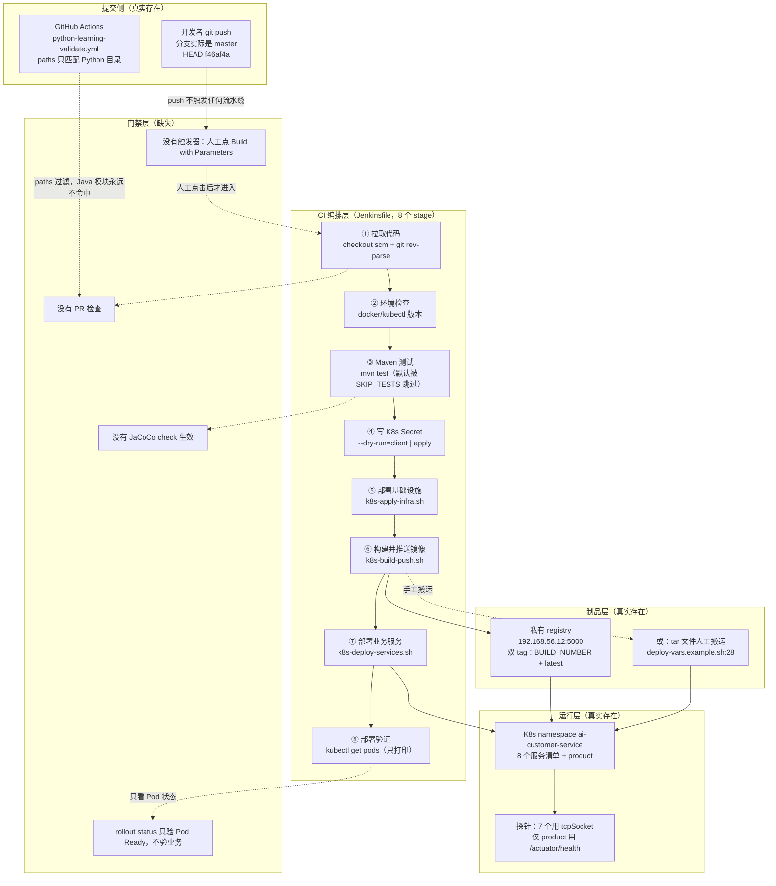
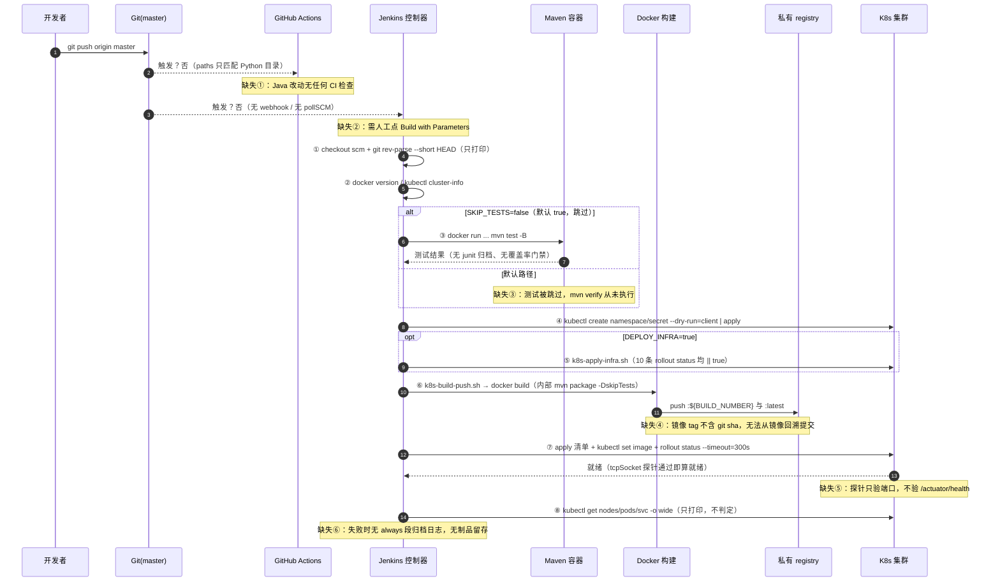

# 03. Jenkins CI/CD 流水线：门禁决定一切，工具只是外壳

> **一句话结论**：本项目的流水线骨架其实已经写好——根目录 `Jenkinsfile` 有 8 个 stage、`deploy/scripts/` 下有 18 个配套脚本——但它只回答"能不能部署到集群"，从不回答"这个提交能不能合并"：测试开关默认就是跳过、覆盖率门禁只在 5 个模块声明、触发器和 PR 检查一个都没有，所以真正的门禁数是 0 道。
>
> **阅读前置**：先读 [01-Docker容器化](01-Docker容器化.md) 与 [02-Kubernetes入门](02-Kubernetes入门.md)；需要知道 Maven 的 `test` 与 `verify` 两个生命周期阶段的边界（前者只跑测试，后者才触发 `jacoco:check` 这类绑定在 verify 上的插件）。没用过 Jenkins 也能读——所有 Jenkins 术语第一次出现时都会解释。
>
> **证据基线**：A 级 1 处（`learning-docs/24-源码分析/assets/source/` 中 Spring Boot 4.2.0 的健康端点聚合实现，用来证明"TCP 探针通 ≠ 应用健康"）；B 级 18 处（`Jenkinsfile`、`Jenkinsfile-k8s`、`deploy/scripts/` 下 8 个脚本、`.github/workflows/python-learning-validate.yml`、根 `pom.xml` 与 8 个模块 `pom.xml`、模块 `Dockerfile`、`deploy/k8s/services/` 清单，全部当次 read 核对行号）；C 级 4 组 pwsh 静态审计（含真实输出与判读方法）。预计阅读 35 分钟。

**证据边界**（先把"哪些话我不该说"讲清楚，后面不再重复）

| 能力 | 本机实测结果 | 本篇怎么处理 |
|---|---|---|
| docker | `Get-Command docker` 取不到 → 本机无 Docker | 凡出现 `docker build/run/load` 的段落，输出都标注"未本机实测，给出命令与判读方法" |
| kubectl / K8s 集群 | 未安装、无集群 | `kubectl ...` 一律写成"应在部署机上执行的命令 + 应该看到什么" |
| Jenkins 控制器 | 本机无 Jenkins 实例 | Jenkins 参数的真实默认值全部来自 `Jenkinsfile` 文件本身，不是界面截图 |
| mvn | 未安装，且本篇禁止执行 | `mvn test` / `mvn verify` 输出属"未本机实测"，但判读方法照给 |
| 静态审计（pwsh 读 Jenkinsfile/YAML/XML） | 可跑，已跑 | §2、§6、§7 里"只有 5 个模块声明 JaCoCo"这类结论都是本机真实输出，可复现 |

本机探测原文（一次跑完三条，结果都是 MISSING）：

```powershell
(Get-Command docker  -ErrorAction SilentlyContinue) -ne $null   # False
(Get-Command kubectl -ErrorAction SilentlyContinue) -ne $null   # False
(Get-Command mvn     -ErrorAction SilentlyContinue) -ne $null   # False
```

换句话说：**本篇所有关于"跑起来会怎样"的描述，都是读代码 + 读配置推出的因果链，不是跑出来的日志**。凡是这种地方都会写明"未本机实测"。

---

## 0. 先看现象

### 现象一：合进主干的代码，从来没跑过测试

三份文件同时把测试关掉了，而且互相不留痕迹：

```groovy
// Jenkinsfile:17  —— Jenkins 里"跑测试"这个开关的默认值
booleanParam(name: 'SKIP_TESTS', defaultValue: true, description: '跳过 Maven 测试阶段')
```

```dockerfile
# ai-cs-order/Dockerfile:14 附近（与 gateway/knowledge/... 同构）—— 镜像里那次编译
RUN mvn package -pl ai-cs-order -am -DskipTests -B
```

```text
# CLAUDE.md:26  —— 团队被要求记的"后端全量编译"命令
mvn clean install -DskipTests
```

`Jenkinsfile` 里 `mvn` 只出现一次，在 L64：`mvn test -B`。整个仓库的两个 Jenkinsfile 中 **`mvn verify` 出现 0 次**（实测 `Select-String -Pattern 'mvn |verify'` 只命中 L64 的 `mvn test -B` 和 L20 的 `VERIFY_DEPLOY` 布尔参数名）。这意味着覆盖率插件永远没有机会执行——因为 `jacoco:check` 绑定在 `verify` 阶段，而 `test` 阶段在它之前就结束了。

跑起来的日志会是这样（未本机实测，Maven 标准行为）：

```text
[INFO] Tests are skipped.
```

判读方法：只要日志里有 `Tests are skipped.` 或 `-DskipTests`，这一轮就是"编译通过"而不是"测试通过"，两者在门禁意义上完全不同。

### 现象二：发布靠手工 `mvn` + 拷贝 tar

发布脚本假设"镜像是一个 tar 文件，被人从 Jenkins 机器搬到部署机"：

```bash
# deploy/scripts/deploy-host1.sh:33-41
# 从 tar 文件加载镜像（由 Jenkins 构建并分发）
for svc in ai-cs-gateway ai-cs-user; do
    tar_file="/opt/aics/images/${svc}-${VERSION}.tar"
    if [ -f "$tar_file" ]; then
        echo "  加载 ${svc}:${VERSION} ..."
        docker load -i "$tar_file"
    else
        echo "  WARN: 镜像文件不存在: $tar_file"      # ← 缺镜像只 WARN，不 exit 1
    fi
done
```

```bash
# deploy/scripts/deploy-vars.example.sh:28-29
# 镜像由 Jenkins 构建并分发为 tar 文件，无需镜像仓库
export VERSION="latest"                   # 镜像版本号
```

两个细节值得记住：**缺镜像时只打印 WARN 而不退出**，所以"部署成功"的日志里可以完全没有新镜像；**版本号默认是 `latest`**，于是"这次部署的是哪个提交"永久丢失。

### 现象三：回滚 = 把上一次的 jar 再拷一遍

全仓搜索 `rollout undo` / `rollout history` / `--record`，只在文档里命中三行（`docs/05-部署上线.md` 约 938 行），**流水线脚本与 `deploy/scripts/` 中 0 处**。而 K8s 清单里所有业务镜像都是 `:latest`：

```yaml
# deploy/k8s/services/api-gateway.yaml:49
image: 192.168.56.12:5000/aics/api-gateway:latest
```

同时 `imagePullPolicy: IfNotPresent`（7 个服务清单一律如此，product 清单连仓库前缀都没有）。`:latest` + `IfNotPresent` 的组合意味着：节点上已有同名镜像时，新构建的镜像可能根本拉不下来，你看到的"回滚"和"发布"有时是同一份旧产物。而 Jenkins 侧只保留最近 20 次构建（`Jenkinsfile:7` 的 `logRotator(numToKeepStr: '20')`），第 21 次之后连"上一次的 jar"都要去别的机器上找。

**这些现象指向同一件事：本项目有"部署编排"，没有"合并门禁"。** 流水线负责把代码搬到集群上，却不负责判断这份代码值不值得上线；于是"上线"这个动作本身成了唯一的验收环节，而它又是人工点按钮触发的。

---

## 1. 整体地图



> **读图说明**：图里只有一条实线主链路（`DEV → S1 … S8 → K8S`），其余全是虚线——虚线代表"名义上存在、实际不生效"的部分。**最关键的一根箭头是 `DEV` 到 `S1` 之间那段绕行**：开发者 push 之后并不到达任何 stage，必须先有人手工点"Build with Parameters"（这条人工触发在 `docs/09-Jenkins-GitHub-Docker-K8s-一主二从部署操作文档.md` 约 528 行只有一行说明，全仓 grep `webhook|pollSCM|触发器` 在项目文件里 0 命中）。如果把这根绕行看成实线、以为"提交即构建"，就会得出一份完全乐观的结论。**第二根要看清的是 `S8 → G4`**：第八个 stage 名字叫"部署验证"，但它只执行 `kubectl get`，不判断退出码之外的任何东西——把它当门禁是本篇要纠正的核心误解。

### 组件、责任、参与方与落地状态

| 组件 | 位置 | 责任 | 谁触发/参与 | 落地状态 |
|---|---|---|---|---|
| `Jenkinsfile` | 仓库根，169 行 | 声明式流水线主链路（8 stage、6 个 `when` 条件） | Jenkins 控制器（`agent any`，L2） | **已落地**，但无 `triggers` 块 |
| `Jenkinsfile-k8s` | 仓库根，173 行 | 同上，只是 Maven 镜像走 `docker.m.daocloud.io` 前缀、密钥参数改成 `password` 类型 | 同上 | 已落地，与上者并存、内容不一致 |
| `deploy/scripts/k8s-build-push.sh` | 42 行 | 逐服务 `docker build` + 双 tag push | stage ⑥ 调用 | 已落地；case 映射只覆盖 7 个模块 |
| `deploy/scripts/k8s-deploy-services.sh` | 44 行 | `kubectl apply` 清单 + `kubectl set image` + `rollout status --timeout=300s` | stage ⑦ 调用 | 已落地 |
| `deploy/scripts/k8s-apply-infra.sh` | 42 行 | MySQL/Nacos/Redis/ES/RocketMQ/MinIO/Chroma/Neo4j/XXL-Job/Sentinel 逐个 apply | stage ⑤ 调用 | 已落地；10 条 rollout 全带 `|| true` |
| `deploy/scripts/k8s-init-mysql.sh` | 21 行 | `kubectl exec -i ... < init.sql` 灌库 | 可选 stage | 已落地；无版本表 |
| `deploy/scripts/verify-deploy.sh` | 4.3 KB | PASS/FAIL 计数，`curl /actuator/health` 判活 | **无人调用** | 已落地但未接入流水线 |
| `deploy/scripts/check-local.ps1` | 36 KB | 7 层只读自检，退出码 0/1（注释自称"可直接接入 CI/CD 门禁"） | **无人调用** | 已落地但未接入流水线 |
| `.github/workflows/python-learning-validate.yml` | 120 行 | 唯一 CI 配置；只校验 Python 目录与 py-recommend | GitHub push/PR + `paths` 过滤 | 已落地，与 Java 模块无关 |
| 根 `pom.xml` 的 `pluginManagement` | L349-L389 | 定义 jacoco `prepare-agent` / `report`(test 阶段) / `check`(verify 阶段，行≥0.40、分支≥0.30) | 子模块声明才生效 | **半落地**：只声明在 `pluginManagement`，不激活 |
| `deploy/k8s/` 清单 | 12 个中间件/命名空间文件 + 8 个业务服务 | 集群目标状态 | `kubectl apply` | 已落地；product 清单自述"直接 apply 大概率跑不起来" |

---

## 2. 关键概念与关键配置

先把四个名词钉死，后面不再解释：

- **CI（Continuous Integration，持续集成）**：每次提交都自动编译 + 跑测试，把"集成问题"从发布前一天提前到提交后十分钟。
- **CD（Continuous Delivery/Deployment，持续交付/部署）**：前者指"随时可以发布"，后者指"自动发布"。本项目处于两者之间，且**交付前的验证环节是空的**。
- **流水线四阶段**：构建（compile）→ 测试（test）→ 制品（artifact）→ 部署（deploy）。**门禁**就是两阶段之间的"过不去就停下并报警"的判定。
- **门禁（quality gate）**：一个返回非 0 退出码就会让流水线变红的检查。它的位置比它的强度更重要——放在部署阶段的门禁，本质是"事故后止损"；放在合并阶段的门禁，才是"事故前拦截"。

| 名称 | 位置 | 角色 | 关键参数 / 关键值 |
|---|---|---|---|
| 声明式流水线（Declarative Pipeline） | `Jenkinsfile:1` 起 | 用 Groovy DSL 把流水线当代码存进仓库（Pipeline as Code） | `agent any`、`options`、`stages`、`post` 四段固定骨架 |
| `agent` | `Jenkinsfile:2` | 指定在哪台机器上执行 | `any` = 任一可用节点；本项目所有 stage 都在同一个 agent 上跑，没有分布式并行 |
| `options` | `Jenkinsfile:4-8` | 流水线级行为 | `timestamps()`（每行加时间戳，排查耗时必开）、`disableConcurrentBuilds()`（同一任务串行）、`buildDiscarder(logRotator(numToKeepStr: '20'))`（只留 20 次构建 → 直接影响回滚窗口） |
| `parameters` | `Jenkinsfile:11-22` | 人工传入的参数，全部在**点击构建之后**生效 | `VERSION`（空 = 用 `BUILD_NUMBER`）、`DEPLOY_MODE`（full/build-only/deploy-only/infra-only）、`SERVICES`（默认 7 个模块）、`SKIP_TESTS=true`、`DEPLOY_INFRA=false`、`INIT_DATABASE=false`、`VERIFY_DEPLOY=true` |
| `stage` / `when` | 8 个 stage / 6 个 `when` | 阶段与执行条件 | 例如测试 stage 的条件是 `!params.SKIP_TESTS && DEPLOY_MODE != 'deploy-only' && DEPLOY_MODE != 'infra-only'`（`Jenkinsfile:50-55`） |
| `post` | `Jenkinsfile:151-168` | 流水线收尾动作 | **只有 `success` 和 `failure` 两段；没有 `always`、没有 `junit`、没有 `archiveArtifacts`**（实测 `always {` 命中 0 次） |
| `credentials` / `withCredentials` | 全仓 | 把密钥从 Groovy 字符串里挪进 Jenkins 凭据库，运行时临时注入 | **两个 Jenkinsfile 中 `withCredentials` 命中 0 次**；密钥改用 `parameters` 的 `string`（明文，`Jenkinsfile:22`）或 `password`（`Jenkinsfile-k8s:22`）直接传给 `kubectl --from-literal` |
| `image_name()` | `deploy/scripts/k8s-build-push.sh:8-19` | 模块名 → 镜像名映射 | 只映射 7 个：gateway→api-gateway、user→user-service、knowledge→knowledge-service、chat→ai-chat-service、search→search-service、message→message-service、notify→notify-service；其他走 `*) exit 1` |
| `jacoco:check` | 根 `pom.xml:349-389`（`pluginManagement`） | 覆盖率门禁本体：`LINE COVEREDRATIO ≥ 0.40`、`BRANCH ≥ 0.30`，绑定 `verify` 阶段 | 只在 `pluginManagement` 里 → **被子模块继承的是"版本与规则"，不是"执行"**；实测仅 order/message/notify/pay/product 五个模块在 `<build><plugins>` 里声明了它 |
| `HealthEndpointSupport` | `learning-docs/24-源码分析/assets/source/HealthEndpointSupport.java.md` | `/actuator/health` 的聚合入口：把各 HealthContributor 的状态聚成一个总状态 | 聚合规则见 [[源码:HealthEndpointSupport.java.md#L190-L198]]：任一组件非 UP，聚合状态就不是 UP——这是"TCP 探针通过 ≠ 应用健康"的类级证据 |

```java
// HealthEndpointSupport 的聚合逻辑：先收集每个组件的状态，再交给 StatusAggregator 合并
// (src: HealthEndpointSupport.java.md#L190-L198)
Status status = statusAggregator
        .getAggregateStatus(descriptors.values().stream().map(this::getStatus).collect(Collectors.toSet()));
```

这段代码在 §3.5 会用到：K8s 的 `tcpSocket` 探针只要端口能连上就算成功，而 `/actuator/health` 要求数据库、Redis 等下游都 UP 才算成功——这是两种完全不同强度的门禁。

---

## 3. 原理与证据逐段精读

### 3.1 四阶段与本项目的阶段错位

**在干什么。** 教科书四阶段是"构建 → 测试 → 制品 → 部署"，每个阶段末尾挂门禁。本项目的八个 stage 按顺序是：拉代码、环境检查、`mvn test`、写 Secret、部署基础设施、构建并推送镜像、部署业务服务、`kubectl get`。已经能看出错位：**"测试"排在"构建镜像"之前，但真正产出可运行产物的那次编译发生在镜像内部**（`RUN mvn package -pl ai-cs-order -am -DskipTests -B`），两者的依赖解析、JDK、参数都不同。

**为什么这么设计。** 这是"容器化部署 + Jenkins 编排"的常见副产品：开发者先在宿主机/容器里跑一遍测试（快速反馈），再让镜像自己编译（保证可重复构建）。设计意图没错，错在**两次编译的开关不一致**：stage ③ 允许 `-DskipTests`，镜像里默认就是 `-DskipTests`，于是"编译通过"这个信号被用了两次，而"测试通过"这个信号一次也没被真正采集。

**换写法会怎样。** 如果 stage ③ 改成 `mvn clean verify -B`（而不是 `mvn test -B`），那么 5 个声明了 JaCoCo 的模块会在覆盖率不足时让流水线变红，另外 7 个模块仍会通过——门禁强度取决于模块，这种"部分生效"比完全没有更难发现。更彻底的做法是把 `jacoco` 从 `pluginManagement` 移到根 `pom.xml` 的 `<build><plugins>` 里，让所有子模块强制继承。

**常见坑。** `mvn test` 与 `mvn verify` 的差别不是"多跑几个测试"，而是**插件绑定的生命周期阶段不同**：`jacoco:report` 绑定 `test`，`jacoco:check` 绑定 `verify`。所以只跑 `mvn test` 时，报告会生成（`target/site/jacoco/`），但永远不会被判不合格——这解释了为什么"我们本地也看覆盖率报告"和"CI 从来不因覆盖率失败"可以同时成立。

### 3.2 Jenkins 模型：Pipeline as Code 把流水线变成了需要评审的代码

**在干什么。** `Jenkinsfile` 是放在仓库根的一个 Groovy 文件，Jenkins 控制器检出它、解析成执行计划（DAG），然后分派到 agent 上跑。这套做法的关键收益不是"方便"，而是**流水线本身进了 Git 历史**：谁把 `SKIP_TESTS` 的默认值从 `false` 改成 `true`，`git log -p Jenkinsfile` 能查到。

**为什么这么设计。** 早期 Jenkins 用界面点配置（freestyle job），配置存在 Jenkins 自己的 `config.xml` 里，无法评审、无法复制、无法和代码同版本。Pipeline as Code 把"怎么构建"变成"和代码一起 review 的文本"。

**换写法会怎样。** 如果继续用界面配置，`SKIP_TESTS=true` 这种决定会永久隐形——它不在任何 diff 里。反过来，一旦把它写进 `Jenkinsfile`，这个默认值就成了可审计的、可被 review 拦下的一行。

**常见坑（本项目三个真实的坑）。**

第一，**密钥走参数而不是凭据**。`Jenkinsfile:22` 声明 `string(name: 'OPENAI_API_KEY', defaultValue: 'demo-key')`，值会出现在构建历史、参数页和 Groovy 变量里；`Jenkinsfile-k8s:22` 改成了 `password(...)`（界面遮蔽），但值仍以 `--from-literal` 形式进了 `kubectl` 命令行。`withCredentials` 的正确用法是把凭据注入成环境变量并自动打码：

```groovy
// 本项目未采用（withCredentials 命中 0 次），这是应改成的最小形状
stage('写 Secret') {
    steps {
        withCredentials([string(credentialsId: 'aics-openai-key', variable: 'OPENAI_KEY')]) {
            sh '''
              kubectl create secret generic aics-secrets \
                --from-literal=openai-api-key="$OPENAI_KEY" \
                --dry-run=client -o yaml | kubectl apply -f -
            '''
        }
    }
}
```

第二，**`post` 只处理成功和失败，不留证据**。没有 `always`，就没有"失败时也归档日志"；没有 `junit`，测试报告不会进 Jenkins 界面（而且因为跳过测试，本来也没报告）；没有 `archiveArtifacts`，制品不落 Jenkins。三者叠加的后果是：**流水线红了，你手里只有控制台滚动文本**。

第三，**两个 Jenkinsfile 并存且不一致**。密钥参数类型（`string` vs `password`）、Maven 镜像（`maven:3.9-eclipse-temurin-17` vs `docker.m.daocloud.io/library/maven:3.9-eclipse-temurin-17`）、Secret 写入前后的 `set +x`/`set -x`，都是成对差异。哪一份生效取决于 Jenkins 任务里配置的脚本路径——而仓库里没有任何文件记录这件事。

### 3.3 构建缓存与并行：依赖层缓存有了，模块并行没有

**在干什么。** 两处缓存机制：镜像构建侧，`Dockerfile` 先只 COPY 三个 `pom.xml` 再 `mvn dependency:go-offline -B -pl ai-cs-order -am`，然后才 COPY 源码——这样源码改动不会让依赖层失效；Jenkins 侧，测试 stage 把 `$HOME/.m2` 挂进 Maven 容器（`-v "$HOME/.m2":/root/.m2`），跨次构建复用本地仓库。

**为什么这么设计。** Maven 依赖下载是最容易吃满带宽的一步，缓存的主战场是"依赖不变"这个大概率事件。Docker 的分层缓存和 Maven 的本地仓库是在两个层级上做同一件事。

**换写法会怎样。** 如果 `Dockerfile` 把 `COPY . .` 放在 `mvn dependency:go-offline` 之前，任何一次改代码都会让依赖层失效，构建从"秒级"变成"分钟级"——这是最典型的一处优化点，本项目做对了。反过来，`-v $HOME/.m2:/root/.m2` 也有代价：容器内以 root 写入的 `.m2` 会污染宿主目录的属主（在 Linux 宿主上表现为后续非 root 构建失败），生产上更稳的是命名卷（`-v m2cache:/root/.m2`）。

**常见坑（并行）。** 全仓没有任何 `-T`/`--threads` 参数（grep `-T` 在项目文件里只命中 `tools/nacos`、`tools/rocketmq`、`tools/seata` 的第三方脚本）。12 个模块的构建是纯串行；而 `deploy/scripts/k8s-build-push.sh` 是一个 `for` 循环逐个 `docker build`，7 个镜像无法并行。真正需要并行的场景（多模块编译、多镜像构建）本项目一个都没用上，**这属于"还没到优化阶段"，不是错**——因为在门禁缺失的前提下，把流水线跑得更快只会让没有测试的代码上线得更快。

### 3.4 制品与版本号：`SNAPSHOT`、`BUILD_NUMBER` 和两条断掉的回溯链

**在干什么。** 项目版本是 `1.0.0-SNAPSHOT`（根 `pom.xml`）。镜像 tag 由 `IMAGE_VERSION = "${params.VERSION ?: env.BUILD_NUMBER}"` 决定，推送时打两个 tag：`${REGISTRY}/aics/${image}:${VERSION}` 和 `:latest`（`k8s-build-push.sh:27-28`）。

**为什么这么设计。** `SNAPSHOT` 表示"随时会被覆盖的开发版本"，Maven 仓库语义上允许它被重新发布，是开发期最快的方式。用 `BUILD_NUMBER` 当镜像 tag 保证"每次构建唯一"，看起来足够。

**换写法会怎样（三条断掉的链）。**

第一条：**镜像 tag 无法回溯到提交**。stage ① 里执行了 `git rev-parse --short HEAD`，但结果只打印，不参与 tag（tag 用 `BUILD_NUMBER`）。要从镜像回到源码，必须去 Jenkins 界面查第 N 次构建的 revision，而构建记录只保留 20 次。把 tag 改成 `${BUILD_NUMBER}-${GIT_SHA:0:7}` 或直接用 `git rev-parse --short HEAD` 作主 tag，就能让镜像自证身份。

第二条：**`latest` 是可变引用**。清单里写 `:latest` + `imagePullPolicy: IfNotPresent`，节点已有旧镜像时不会重新拉取；而 `kubectl set image` 把镜像名从 `...:latest` 改成 `...:BUILD_NUMBER`，会触发滚动更新；下一次流水线再 `kubectl apply` 清单，又把 `:latest` 改回去，**触发第二次不必要的滚动**。这条"apply 与 set image 互相打架"的链路是本篇最容易被忽略的坑。

第三条：**没有任何发布版**。全仓没有 `-SNAPSHOT` 之外的项目版本号，也没有 `mvn versions:set` 或 release 插件配置。也就是说，"发布 1.0.0"这个动作在制品层面不存在，只有"第 137 次构建"。

### 3.5 部署策略与回滚：`set image` + `rollout status` 只是存活门禁

**在干什么。** stage ⑦ 调 `k8s-deploy-services.sh`：先 `kubectl apply -f deploy/k8s/namespace.yaml` 和 `kubectl apply -f deploy/k8s/services/`（`k8s-deploy-services.sh:30-31`），再逐服务 `kubectl set image deployment/<name> <name>=<full_image> -n <ns>`（L40），最后 `kubectl rollout status ... --timeout=300s`（L41）。

**为什么这么设计。** `rollout status` 是 K8s 原生的"等新副本就绪"命令，超时返回非 0，正好可以当门禁用——设计者的意图是对的。

**换写法会怎样（强度问题）。** `rollout status` 判定"就绪"的依据是 Pod 的 readiness 探针；而本项目 7 个服务清单用的是 `tcpSocket` 探针，只有 `product-service.yaml` 用 `httpGet: /actuator/health`（`product-service.yaml:68-79`，文件里自己写着"这里用 HTTP 健康端点（比 TCP 探测更准确）"）。`tcpSocket` 探针只能证明 Tomcat 端口在监听，不能证明数据源、Redis、Nacos 连接正常。结合 A 级证据：`/actuator/health` 的状态是各 HealthContributor 的聚合（[[源码:HealthEndpointSupport.java.md#L190-L198]]），任一组件 DOWN 则整体非 UP——这正是我们需要而 `tcpSocket` 给不出的信号。

结论：**`rollout status --timeout=300s` 是"进程起来了"的门禁，不是"业务可用"的门禁。** 把它当质量门禁，会在"应用启动成功但数据库连不上"这类最常见的故障上完全失守。

**回滚怎么办。** 正确做法是声明式清单 + 可回滚的版本引用：

```yaml
# 本项目未采用：清单里全是 :latest，无法用 rollout undo 回到上一个版本
spec:
  template:
    spec:
      containers:
        - name: api-gateway
          image: 192.168.56.12:5000/aics/api-gateway:1.0.0-${GIT_SHA}   # 提交身份可见
```

只要清单里的 tag 是唯一且不可变的，`kubectl rollout undo deployment/api-gateway` 就能生效（ReplicaSet 由 Deployment 保留历史）。而清单里是 `:latest` 时，`rollout undo` 只换回同一个 `:latest` 字符串，等于没回滚——这就是为什么本项目只能"把上一次的 jar 再拷一遍"。

### 3.6 数据库变更：一份幂等 DDL 脚本，没有一个版本号

**在干什么。** 数据库初始化靠 `deploy/mysql/init.sql`（33,831 字节）+ `k8s-init-mysql.sh`：

```bash
# deploy/scripts/k8s-init-mysql.sh 关键动作（管道喂整份 SQL）
kubectl wait --for=condition=Ready "pod/${MYSQL_POD}" --timeout=300s
kubectl exec -i "${MYSQL_POD}" -- mysql -uroot -p"${MYSQL_ROOT_PASSWORD}" < "${INIT_SQL}"
```

`init.sql` 的实测统计（pwsh 真实输出，见 §7）：`CREATE DATABASE` 6 处、`CREATE TABLE` 29 处、`IF NOT EXISTS` 35 处、`DROP TABLE` 0 处、`DROP DATABASE` 0 处。也就是说它**幂等、不破坏数据**，这是它最大的优点。

**为什么这么设计。** 对一个以"跑起来"为目标的课程/演示项目，一份可重复执行的建库脚本足够；把它挂成可选 stage（`INIT_DATABASE` 默认 `false`）也避免了误清库。

**换写法会怎样。** 它没有版本表，因此**不能表达增量变更**：加一个字段、改一个索引，只能改 `init.sql` 里对应的 `CREATE TABLE`——对已有库无效（`CREATE TABLE IF NOT EXISTS` 遇到已存在的表直接跳过），对新库有效。结果就是新老环境 schema 悄悄分叉。全仓 Flyway / Liquibase 命中 **0 次**（12 个模块 `pom.xml` 与根 `pom.xml` 都查过）。正确形态是：

```sql
-- Flyway 约定：文件名即版本，V1__init.sql、V2__add_order_index.sql，执行记录在 flyway_schema_history
-- 本项目未采用；当前只有一份 init.sql，无版本号、无 checksum
```

**常见坑。** `kubectl exec -i ... < init.sql` 这种"整份灌入"的方式，失败时很难定位到具体语句——`mysql` 客户端默认遇错继续（除非加 `--force` 的反面 `--abort-source-on-error` 或客户端 `--init-command`），所以流水线可能"成功"而库只建了一半。判读方法：跑完后 `SELECT COUNT(*) FROM information_schema.tables WHERE table_schema IN (...)` 与预期表数对比，而不是看退出码。

### 3.7 GitHub Actions 的取舍：唯一那条流水线只覆盖 Python

**在干什么。** 全仓唯一的 CI 配置是 `.github/workflows/python-learning-validate.yml`（120 行），4 个 job：`validate-examples`（跑 `python validate_all_examples.py --verbose`）、`test-py-recommend`（`ruff check`、`black --check ... || true`、`mypy ... || true`、`pytest --cov`、`codecov-action` 带 `fail_ci_if_error: false`）、`check-links`、`build-docker`（`push: false`，`cache-from/cache-to: type=gha`）。

**为什么这么设计。** 触发条件写了 `paths: learning-docs/22-Python速成/**` 和 `ai-cs-py-recommend/**`——意图很明确：只校验"文档里的示例代码能跑"和"Python 推荐服务没问题"，避免每次提交都触发重量级检查。

**换写法会怎样（关键事实）。** `paths` 过滤的反面是：**12 个 Java 模块的任何改动都不触发任何 CI**。这不是"CI 很弱"，而是"Java 侧完全没有 CI"。而且这条工作流自身的门禁也被削过：`black --check ... || true` 与 `mypy ... || true` 把两个静态检查变成了"只打印不判定"，`codecov` 的 `fail_ci_if_error: false` 让覆盖率上报失败也不影响结果。整条 workflow 里真正会变红的只有 ruff、pytest（其退出码）与链接检查。

**常见坑。** 用 `|| true` 收尾的检查，日志里永远显示成功，几个月后没人知道 `mypy` 其实一直在报错。识别方法：`grep -n '|| true' .github/workflows/*.yml`——本项目命中 2 处，都在 `test-py-recommend` 里。

---

## 4. 一次完整执行时序

一个服务（以 `ai-cs-chat` 为例）从提交到上线的完整链路。**实线是真实发生的，虚线位置是本项目缺失或只打印不判定**。



> **读图说明**：注意前四条箭头都是 `-->>`（虚线返回）——push 既不打到 GitHub Actions，也不打到 Jenkins，这是全图最重要的事实。真正驱动流水线的是 `Note` 里的"缺失②：需人工点 Build with Parameters"。另外要看清第 6 步内部还有一次 `mvn package -DskipTests`：**即使 stage ③ 没跳过测试，镜像里那次编译也一定跳过了测试**，所以"镜像里的产物经过测试"这句话在本项目中永远不成立。

### 哪一步失败，报什么错

下表是"如果这一步出错，日志会是什么形状"。前四条是脚本原文里可见的因果，后三条标注为"未本机实测"。

| 步骤 | 失败形态 | 日志/报错原文形状 | 定位方法 |
|---|---|---|---|
| ② 环境检查 | agent 上没有 Docker 或 kubectl | `docker: command not found` / `The connection to the server localhost:8080 was refused` | 先 `docker version` 与 `kubectl version --client`，再看 `kubectl cluster-info` |
| ④ 写 Secret | 命名空间不存在或权限不足 | `Error from server (Forbidden): secrets is forbidden` | `kubectl auth can-i create secrets -n ai-customer-service` |
| ⑥ 构建推送 | 模块名不在 case 映射内 | `Unknown service module: ai-cs-order`（`k8s-build-push.sh:17` 原文）→ `exit 1` | 传参前对照 7 个映射；order/product/pay/mq 一律失败 |
| ⑥ 构建推送 | 私有仓库是 HTTP，containerd 拒绝 | `http: server gave HTTP response to HTTPS client` | 用 `deploy/scripts/setup-containerd-insecure-registry.sh` 或 `setup-jenkins-docker-insecure-registry.sh` 配 insecure 名单 |
| ⑦ 部署 | 镜像拉不到 | `ErrImagePull` / `ImagePullBackOff`（未本机实测） | `kubectl describe pod` 看 Events 末行 |
| ⑦ 部署 | 探针不过 | `Readiness probe failed`、`rollout status` 超时 300 秒报 `error: deployment "x" exceeded its progress deadline`（未本机实测） | `kubectl get pod -o wide` + `kubectl logs --previous` |
| ⑧ 部署验证 | **什么错都不会报** | 只有 `kubectl get` 的表格输出 | 这正是问题所在：这一步恒为成功 |

---

## 5. 设计取舍

| 决策点 | 备选方案 | 本项目选择 | 理由（可从证据推出） | 代价 |
|---|---|---|---|---|
| 流水线引擎 | Jenkins / GitHub Actions / GitLab CI | **两个都用**：Jenkins 管部署，Actions 管 Python 文档 | Jenkins 在内网、能直连私有 registry 与 K8s；Actions 免费跑 Python 校验 | 两套模型并存，没人对"Java 侧门禁"负责；Actions 的 `paths` 过滤让 Java 彻底裸奔 |
| 流水线形态 | Jenkinsfile（declarative）/ 界面 freestyle / 共享库 | **declarative + 仓库根单文件** | 可评审、可 diff、零额外基建 | 没有共享库 → 两个 Jenkinsfile 必然分叉（已发生） |
| 测试开关默认值 | 默认跑 / 默认跳过 | **默认跳过（`SKIP_TESTS=true`）** | 首跑通顺（不用等测试、不用配测试依赖） | 门禁默认关闭；默认值就是实际行为 |
| 覆盖率门禁位置 | 根 `<build><plugins>` / 子模块自声明 / 不设 | **只在 `pluginManagement`，5 个模块自声明** | 允许"先给严格模块上锁" | 7 个模块无门禁；chat 有 60 个测试类却不受约束 |
| 镜像 tag | `BUILD_NUMBER` / git sha / 语义版本 | **`BUILD_NUMBER` + 双 tag（含 `latest`）** | 简单、唯一、无需额外计算 | 无法从镜像回溯提交；`latest` 与 `IfNotPresent` 组合导致漂移 |
| 清单镜像引用 | 不可变 tag + 渲染 / 固定 `:latest` | **清单写死 `:latest`** | 清单可手写可读 | `apply` 与 `set image` 互相覆盖，`rollout undo` 失效 |
| 健康判定 | `tcpSocket` / `httpGet /actuator/health` / 自定义脚本 | **7 个 `tcpSocket`，1 个（product）`httpGet`** | TCP 探针不依赖 actuator 配置（gateway 的 `application.yml` 里连 `endpoints.web.exposure` 都没配） | 探针通过 ≠ 业务可用；这是 §3.5 的核心缺陷 |
| 数据库变更 | Flyway / Liquibase / 幂等脚本 + 人工审批 | **幂等 `init.sql` + 可选 stage** | 零依赖、可重复执行 | 无版本演进能力；新老环境 schema 分叉 |
| 凭据管理 | `credentials` + `withCredentials` / 参数传明文 | **参数（`string`/`password`）→ `--from-literal`** | 少配一步 Jenkins 凭据 | 密钥进构建历史与命令行；`string` 类型完全明文 |
| 回滚手段 | `rollout undo` + 不可变 tag / 重灌上一版镜像 | **重灌镜像（手工）** | 与 `:latest` 方案自洽 | 无审计、无时间点、依赖 20 次构建窗口 |

### 可扩展点清单（按"性价比 / 风险"排序，均为**未落地**）

1. **把 `mvn test -B` 改成 `mvn -B verify`**，并把 `jacoco` 从 `pluginManagement` 提到根 `<build><plugins>`：一行改动，让 12 个模块全部受 40%/30% 约束。风险：现有覆盖率不足的模块立刻变红（这正是门禁的意义）。
2. **给 Jenkinsfile 加 `triggers { githubPush() }` 或 GitLab 的 `pollSCM('H/5 * * * *')`**：把"人工点按钮"变成"提交即构建"。风险：需要先有凭据与网络可达。
3. **把 `SKIP_TESTS` 默认值改成 `false`**，并在 PR 场景下禁止覆盖：一行改动，把"默认不测试"翻成"默认测试"。
4. **镜像 tag 引入 git sha**：stage ① 已有 `git rev-parse --short HEAD`，把结果写进 `IMAGE_VERSION`。
5. **清单改为不可变 tag + 用 `envsubst` 渲染**：这是 `rollout undo` 生效的前提。
6. **7 个服务清单的探针从 `tcpSocket` 换成 `httpGet /actuator/health`**：需要先给 gateway/chat 补 `management.endpoints.web.exposure.include`（当前两个文件里都没有）。
7. **接入 `deploy/scripts/check-local.ps1` 作为部署后门禁**：它已经返回 0/1，只是没人调用。
8. **加 `post { always { junit ...; archiveArtifacts ... } }`**：让失败也有证据。
9. **引入 Flyway**（用 `init.sql` 作为 `V1__baseline.sql` 起点）：把 schema 变更纳入流水线。
10. **模块并行构建**（`mvn -T 1C`）与多镜像并行 `docker build`：等门禁补齐后再做，否则只是加速裸奔。

---

## 6. 踩坑与调试手法

以下 8 条，前 4 条给**本机可复现的静态审计命令与真实输出**（C 级，已实测），后 4 条是需要集群/日志在场的调试手法（给出命令与判读方法，标注未本机实测）。

### 坑 1：以为"有 Jenkinsfile = 有 CI 门禁"（调试手法，C 级实测）

**现象**：评审时说"我们有流水线"，于是没人再问测试跑没跑。

**实测命令与真实输出**：

```powershell
Get-ChildItem -Recurse -Force -Filter "Jenkinsfile*" -File | Select-Object FullName
```

```text
D:\Projects\Persion\ai-customer-service\Jenkinsfile
D:\Projects\Persion\ai-customer-service\Jenkinsfile-k8s
```

```powershell
foreach($f in 'Jenkinsfile','Jenkinsfile-k8s'){
  $t = Get-Content $f -Raw
  "{0}: stage={1} when={2} sh={3} withCredentials={4} postAlways={5} lines={6}" -f $f,
    ([regex]::Matches($t,"stage\('")).Count, ([regex]::Matches($t,'when \{')).Count,
    ([regex]::Matches($t,'\bsh ')).Count, ([regex]::Matches($t,'withCredentials')).Count,
    ([regex]::Matches($t,'always \{')).Count, (Get-Content $f).Count
}
```

```text
Jenkinsfile: stage=8 when=6 sh=9 withCredentials=0 postAlways=0 lines=169
Jenkinsfile-k8s: stage=8 when=6 sh=9 withCredentials=0 postAlways=0 lines=173
```

**判读方法**：`withCredentials=0` 说明没有走凭据库；`postAlways=0` 说明失败时不会归档任何证据；`stage=8` 只说明"有 8 段编排"，与"有没有门禁"无关。**触发器的判读要另查主键**：`Select-String -Path Jenkinsfile -Pattern 'triggers'` 命中 0 次 = 没有自动触发。

### 坑 2：以为覆盖率门禁全模块生效（调试手法，C 级实测）

**现象**：`CLAUDE.md:131-135` 写着"行覆盖率 ≥ 40%、分支覆盖率 ≥ 30%，`mvn verify` 时自动检查，不达标则构建失败"，读起来像全局策略。

**实测命令与真实输出**：

```powershell
Get-ChildItem -Directory -Filter 'ai-cs-*' | Where-Object { Test-Path (Join-Path $_.FullName 'pom.xml') } | ForEach-Object {
  [pscustomobject]@{
    Module    = $_.Name
    JaCoCo    = (Select-String -Path (Join-Path $_.FullName 'pom.xml') -Pattern 'jacoco-maven-plugin' -Quiet)
    TestJava  = @(Get-ChildItem (Join-Path $_.FullName 'src\test\java') -Recurse -Filter *.java -ErrorAction SilentlyContinue).Count
    Dockerfile= (Test-Path (Join-Path $_.FullName 'Dockerfile'))
  }
} | Format-Table -AutoSize
```

```text
Module          JaCoCo TestJava Dockerfile
------          ------ -------- ----------
ai-cs-chat       False       60       True
ai-cs-common     False        7      False
ai-cs-gateway    False        9       True
ai-cs-knowledge  False        3       True
ai-cs-message     True       12       True
ai-cs-mq         False        2      False
ai-cs-notify      True        8       True
ai-cs-order       True       17       True
ai-cs-pay         True       11      False
ai-cs-product     True        7       True
ai-cs-search     False        3       True
ai-cs-user       False        8       True
```

**判读方法**：`JaCoCo=False` 的 7 个模块跑 `mvn verify` 时**不会**执行 `jacoco:check`（因为插件只在根 `pluginManagement` 里声明，子模块不声明就不激活）。最容易误判的是 `ai-cs-chat`：它有 60 个测试类（全仓最多），却恰好没有门禁——"测试最多"和"门禁最严"在这张表里是两个正交的维度。

### 坑 3：`mvn test` 通过了，覆盖率却没被检查

**现象**：本地 `mvn test` 后 `target/site/jacoco/index.html` 有报告，CI 也全绿，于是以为覆盖率达标。

**判读方法**：看报告文件是否被生成 vs 看 `jacoco:check` 是否执行。命令（未本机实测，本机无 mvn）：

```bash
mvn -pl ai-cs-order test   -B | grep -E 'jacoco|BUILD'   # 只会出现 prepare-agent/report，没有 check
mvn -pl ai-cs-order verify -B | grep -E 'jacoco|Rule violated|BUILD'
```

不达标时 Maven 会打印（形状固定，数值取决于真实覆盖率）：

```text
[WARNING] Rule violated for bundle ai-cs-order: lines covered ratio is 0.31, but expected minimum is 0.40
[INFO] BUILD FAILURE
```

反过来，如果你的 `verify` 日志里根本没有 `jacoco-maven-plugin:check` 这一行，说明该模块没声明插件——回去看坑 2 的表。

### 坑 4：`:latest` + `IfNotPresent` 让"发布了"变成"没变"

**现象**：流水线绿了、`kubectl set image` 也执行了，但 `kubectl get pod -o wide` 里 Pod 的 AGE 是很久以前。

**判读方法**（未本机实测，需集群）：比对"清单里的镜像"和"实际运行的镜像"三个字段：

```bash
kubectl -n ai-customer-service get deploy api-gateway \
  -o jsonpath='{.spec.template.spec.containers[0].image}{"\n"}'
kubectl -n ai-customer-service get pod -l app=api-gateway \
  -o jsonpath='{range .items[*]}{.metadata.name}{"\t"}{.status.containerStatuses[0].imageID}{"\n"}{end}'
```

`imageID` 里的 sha256 才是节点上真跑的那一份。如果它和 registry 里刚推的 digest 不一致，就是没更新。**根本原因**在 `k8s-deploy-services.sh` 的 `apply` 与 `set image` 顺序：清单固定 `:latest`，`apply` 每次都把 Deployment 的镜像字段写回 `:latest`。

### 坑 5：`product-service` 在另一个命名空间，`apply` 直接 NotFound

**现象**：`kubectl apply -f deploy/k8s/services/` 到一半报错退出，前面的服务已经更新，后面的没有——部分发布。

**证据**：`deploy/k8s/services/product-service.yaml:20` 的 `namespace: aics`（其他 7 个是 `ai-customer-service`），而 `deploy/k8s/namespace.yaml` 只创建后者；同一个文件的 L85 Service 也是 `aics`。文件头 L5-L12 自己列了四条待确认项，包括"直接 apply 大概率跑不起来"。

**判读方法**：`kubectl get ns` 里没有 `aics` 时，`apply` 会报 `Error from server (NotFound): error when creating "...": namespaces "aics" not found`。修法二选一：把清单 namespace 改齐，或在 apply 前 `kubectl create namespace aics`——**但后者会让 product 落到一个没有配置/Secret 的命名空间里，Pod 起来也是坏的**。

### 坑 6：缺镜像只 WARN，不失败

**现象**：部署脚本"跑完了"，日志里混着几行 `WARN: 镜像文件不存在`，服务版本没变。

**证据**：`deploy/scripts/deploy-host1.sh:39-41` 的 `else` 分支只 `echo "  WARN: ..."`，没有 `exit 1`；脚本也没有 `set -e`。

**判读方法**：把 `WARN` 当 FAIL 数——`bash deploy-host1.sh 2>&1 | tee deploy.log; grep -c WARN deploy.log`，非 0 就认为部署不可信。对比参考：`deploy/scripts/k8s-build-push.sh` 用了 `set -euo pipefail`，同样的问题在 k8s 脚本里不会静默。

### 坑 7：Windows 上改脚本，Linux 上 `bash: $'\r': command not found`

**现象**：在 Windows 编辑 `Jenkinsfile` 或 `.sh` 后提交，CI 报 `bash: /workspace/deploy/scripts/k8s-deploy-services.sh: /bin/bash^M: bad interpreter`。

**证据**：`.gitattributes` 只有 6 行，覆盖 `*.sh`、`Jenkinsfile`、`Dockerfile`、`*.yaml`、`*.yml`、`*.md`——**`Jenkinsfile-k8s` 与 `*.ps1` 不在其中**。

**判读方法**：`git ls-files --eol deploy/scripts/k8s-deploy-services.sh`，看 `i/lf w/crlf` 这类标记；`w/crlf` 就是工作区被改成了 CRLF（提交时会被规范化为 LF，但如果编辑器在 Docker 卷里写入则绕过 Git）。

### 坑 8：`-v $HOME/.m2:/root/.m2` 污染宿主目录

**现象**：第二次构建开始报权限错误，或 Maven 下载奇怪的 `.lastUpdated` 文件。

**证据**：`Jenkinsfile:59-64` 把 `$HOME/.m2` 挂到容器内 `/root/.m2`，容器内以 root 运行 Maven。

**判读方法**：`ls -ln ~/.m2/repository | head` 看属主是否变成 `0`（root）。修法：改成命名卷 `-v m2cache:/root/.m2`，或在容器里 `-e MAVEN_CONFIG=/tmp/.m2` 并在收尾时 `chown -R`。

---

## 7. 版本差异

| 旧写法 | 当前基线 | 变化点 | 迁移动作 |
|---|---|---|---|
| 旧稿把根目录 `Jenkinsfile` 描述为"主力、需新建"，`Jenkinsfile-k8s` 为"Maven 镜像走国内源的变体" | **两份都已存在**（169 / 173 行），差异只有 3 处：密钥参数类型、Maven 镜像前缀、Secret 写入前后的 `set ±x` | 事实确认：不是"待建"，是"已建但无人维护" | 删掉"创建 Jenkinsfile"的步骤（`docs/05-部署上线.md` 约 830 行仍在教这件事），改成"审查已有两份并合并成一份" |
| 旧稿把 `kubectl rollout status --timeout=300s` 称为"流水线的质量门禁" | 它是**存活/就绪门禁**：判定依据是 `tcpSocket` 探针（7 个服务），只有 product 用 `httpGet /actuator/health` | 语义降级：门禁从"业务可用"降到"端口在听" | 清单探针改 `httpGet`，并先给 gateway/chat 补 `management.endpoints.web.exposure` |
| 旧稿的"测试门禁：单测不过不许发版"写成了既有能力 | 现状是 `SKIP_TESTS` **默认 `true`**（`Jenkinsfile:17`），两个 Jenkinsfile 里 `mvn verify` 命中 **0 次** | 从"未来态"回到"现状=没有" | 默认值改 `false`；`mvn test` 改 `mvn verify` |
| 旧稿按 `CLAUDE.md` 的说法认为覆盖率门禁全局生效（40%/30%） | 规则只在根 `pom.xml:349-389` 的 `pluginManagement`；仅 order/message/notify/pay/product 五个模块声明 | 从"全局"变"5/12 模块" | 把插件声明上提到根 `<build><plugins>` |
| 旧稿说"Jenkins 构建并分发镜像" | 现在有两条并行事实：`k8s-build-push.sh` 推私有 registry；`deploy-host*.sh` 从 tar 加载（`deploy-vars.example.sh:28-29` 的 `VERSION="latest"`） | 制品来源不唯一，且 tar 路径缺文件只 WARN | 只保留 registry 一条路径，tar 方案标注为历史方案 |
| 旧稿把 `--dry-run=client -o yaml \| kubectl apply -f -` 当技巧介绍 | **属实，可保留**：这是 namespace/secret 幂等 upsert 的标准写法（`Jenkinsfile:78` 与 `:84`） | 无 | 保留，并补一句"它只保证幂等，不保证密钥不进日志" |
| 旧稿提示 containerd 拉 HTTP 私有仓库会失败 | **属实**：`setup-containerd-insecure-registry.sh` 与 `setup-jenkins-docker-insecure-registry.sh` 都在，后者先备份 `/etc/docker/daemon.json` 再 `systemctl restart docker` | 无 | 保留 |
| GitHub Actions 只描述为"Python 文档校验" | `.github/workflows/python-learning-validate.yml` 有 4 个 job，含 `build-docker`（`push: false`）与 `cache-from/cache-to: type:gha`；`black`/`mypy` 用 `\|\| true` 放过，`codecov` 的 `fail_ci_if_error: false` | 从"文档校验"变成"带一个不推送的镜像构建 + 三个被豁免的检查" | 去掉 `\|\| true`，让静态检查真的能红；把 `paths` 里的 Java 目录加进来或新建 Java workflow |
| 全仓 CI 配置曾被认为有多套（GitLab/Drone 等） | 实测：`.gitlab-ci.yml`、`azure-pipelines.yml`、`.drone.yml`、`.travis.yml`、`bitbucket-pipelines.yml` 全部不存在；`.mvn/`、`mvnw`、`mvnw.cmd` 也不存在 | 项目没有 Maven Wrapper，"每个 agent 上装 Maven"是隐含前提 | 若要脱离 Jenkins 容器跑构建，先补 wrapper |

> 一句话记住这节的结论：**旧稿的"操作步骤"大多属实，但"门禁"部分是把目标写成了现状。** 判断方法很简单——每看到一个"门禁"，回去找它的退出码在哪。

---

## 8. 面试高频问与答

（只列问题。每题都应该能用"本项目哪一步、哪个文件、哪行"回答，答不上来就回去看 §3。）

1. CI 和 CD 的区别是什么？"持续交付"与"持续部署"的边界在哪一步？
2. 一条流水线的四个阶段各自的门禁是什么？为什么门禁位置比门禁强度更重要？
3. Jenkins 的 Pipeline as Code 相比界面配置 freestyle job，解决了什么具体问题？
4. Declarative Pipeline 的 `agent`、`stages`、`when`、`post` 各自控制什么？`post` 里为什么必须有 `always`？
5. Jenkins 的凭据为什么要用 `credentials` + `withCredentials`？直接用参数传密钥会泄露到哪些地方？
6. 同一个仓库里有两个 Jenkinsfile，会导致什么问题？你怎么在工程上避免分叉？
7. `mvn test` 和 `mvn verify` 的差别在哪？为什么 JaCoCo 的 `check` 放在 `verify` 上？
8. `pluginManagement` 和 `plugins` 的区别是什么？为什么把 JaCoCo 只写在 `pluginManagement` 里等于没门禁？
9. Maven 依赖缓存和 Docker 层缓存分别缓存什么？为什么 `Dockerfile` 要先 COPY `pom.xml` 再 COPY 源码？
10. 为什么 `docker build` 里的 `mvn package` 会让"测试通过"这个结论失效？两次编译如何避免不一致？
11. 镜像 tag 用 `BUILD_NUMBER`、git sha、语义版本，各自的优缺点？为什么要把 sha 写进 tag？
12. `:latest` + `imagePullPolicy: IfNotPresent` 会引发什么事故？`kubectl set image` 和 `kubectl apply` 为什么会互相覆盖？
13. 滚动更新、蓝绿、金丝雀三种部署策略的失败代价分别是多少？各自需要什么基础设施（Service/Ingress/流量权重）？
14. `kubectl rollout status` 判定"就绪"的依据是什么？`tcpSocket` 探针和 `httpGet /actuator/health` 探针的强度差在哪？
15. 回滚为什么必须依赖不可变制品？`rollout undo` 在 `:latest` 方案下为什么等于没回滚？
16. 数据库变更怎么进流水线？Flyway 与 Liquibase 的核心差异（版本表、checksum、回滚能力）是什么？
17. 门禁失败该由谁修？"流水线红了但没人在意"在组织上意味着什么？
18. 如何在仓库里证明"某个门禁真的会失败"？（提示：故意提交一个覆盖率不足的改动，看流水线颜色）

---

## 9. 动手练习

每条都给了**验收标准**，做完能自己判断对错。

1. **静态审计自己的仓库（10 分钟）**：用 §6 坑 1、坑 2 的两段 pwsh 脚本，产出"模块 × JaCoCo × 测试类数 × Dockerfile"矩阵与 Jenkinsfile 结构计数。
   *验收*：能指出（a）有几个模块有测试但没有门禁（本项目是 chat 等 6 个），（b）`withCredentials` 与 `always` 各出现几次。
2. **把门禁从"部分"改成"全部"（30 分钟）**：在根 `pom.xml` 的 `<build><plugins>`（注意不是 `pluginManagement`）加入 `jacoco-maven-plugin`，用 `mvn -B verify` 观察哪些模块先红。
   *验收*：`mvn -pl ai-cs-chat verify` 失败，报错含 `Rule violated for bundle ai-cs-chat`，且失败原因指向行覆盖或分支覆盖而不是编译错误。
3. **给流水线装触发器（20 分钟）**：在 `Jenkinsfile` 加 `triggers { pollSCM('H/5 * * * *') }`（或 `githubPush()`），提交一次空改动。
   *验收*：Jenkins 任务在 5 分钟内自动启动一次，构建历史里出现"Started by an SCM change"。
4. **让镜像能自证身份（30 分钟）**：把 stage ① 的 `git rev-parse --short HEAD` 结果写进 `IMAGE_VERSION`，镜像 tag 变成 `<BUILD_NUMBER>-<sha>`。
   *验收*：`docker images` 里能看到新 tag；给定任意一个 tag，能 `git log -1 --format=%H <sha>` 反查到提交。
5. **把 `tcpSocket` 换成真实健康检查（45 分钟）**：选 gateway，先在 `ai-cs-gateway/src/main/resources/application.yml` 加 `management.endpoints.web.exposure.include: health,prometheus`，再把清单探针改 `httpGet /actuator/health`。
   *验收*：故意停掉一个下游（如把 Redis 连接串指向错误端口），Pod 变成 `0/1 Running`，`kubectl describe pod` 的 Events 出现 `Readiness probe failed: HTTP probe failed with statuscode: 503`——注意这是**未本机实测**的预期形态，你要用自己集群的输出替换它。
6. **把 `check-local.ps1` 接成部署后门禁（20 分钟）**：在 `post` 段或 stage ⑧ 里调用它并按退出码判失败。
   *验收*：人为让某个服务健康检查失败，流水线变红；恢复后变绿，且 `always` 段里有报告归档。
7. **写一版 rollback 剧本（20 分钟）**：用不可变 tag 的前置条件下，写出"如何在一个被删除的 Deployment 版本上回滚"的脚本；再证明在 `:latest` 方案下这个脚本无效。
   *验收*：文档里有两条命令与各自输出判读；并且明确指出"本项目当前状态下该脚本不可用"的原因（清单固定 `:latest`）。

---

## 小结

- **本项目的 CI/CD 是"有编排、无门禁"**：`Jenkinsfile` 8 个 stage / 169 行、`Jenkinsfile-k8s` 8 个 stage / 173 行，`deploy/scripts/` 下 18 个脚本，但 `triggers` 与 `withCredentials` 命中都是 0。
- **测试门禁默认关闭**：`SKIP_TESTS` 默认 `true`（`Jenkinsfile:17`），两个 Jenkinsfile 里 `mvn verify` 出现 0 次，`CLAUDE.md:26` 教的就是 `mvn clean install -DskipTests`，镜像里那次编译也是 `-DskipTests`。
- **覆盖率门禁只覆盖 5/12 模块**：规则写在根 `pom.xml:349-389` 的 `pluginManagement`，只有 order/message/notify/pay/product 声明；测试类最多的 chat（60 个）恰好没有门禁。
- **唯一自动化 CI 与 Java 无关**：`.github/workflows/python-learning-validate.yml` 的 `paths` 只匹配 Python 文档与 py-recommend，且 `black`/`mypy` 用 `|| true` 放过、`codecov` 设 `fail_ci_if_error: false`。
- **部署门禁只是存活门禁**：`rollout status --timeout=300s` 依赖 `tcpSocket` 探针；只有 product 清单用 `httpGet /actuator/health`，而 `/actuator/health` 是聚合状态（[[源码:HealthEndpointSupport.java.md#L190-L198]]）。
- **回滚不可靠**：清单固定 `:latest` + `IfNotPresent`，`rollout undo` 在脚本中 0 处；Jenkins 只留 20 次构建，`deploy-host1.sh:39-41` 缺镜像只 WARN。
- **数据库无版本演进能力**：`init.sql` 幂等（`IF NOT EXISTS` 35 处、`DROP` 0 处）但不能表达 `ALTER`，Flyway/Liquibase 在全部 `pom.xml` 中 0 命中。
- **下一步最省力的一个动作**：把 `Jenkinsfile:17` 的 `defaultValue: true` 改成 `false`，把 `mvn test -B`（L64）改成 `mvn -B verify`——两处改动同时打开"测试门禁"和"覆盖率门禁"（后者只对已声明的 5 个模块生效），这是本项目从"能部署"迈向"能合并"的最小一步。

---

## 自测题

<details>
<summary>1. 为什么说本项目"8 个 stage 不等于 8 道门禁"？</summary>

**参考答案**：stage 只表示"编排了几段动作"，门禁要求"这一段不过就让流水线变红"。本项目的 8 个 stage 里，第 ③ 段（`mvn test`）被 `SKIP_TESTS=true` 默认关闭，第 ⑧ 段（部署验证）只执行 `kubectl get` 打印表格、不做判定，第 ⑤ 段的 10 条 `rollout status` 全带 `|| true`。真正会因质量问题变红的只剩第 ⑥⑦ 段的构建/部署错误，而那是"工程能不能跑"，不是"代码对不对"。
</details>

<details>
<summary>2. `pluginManagement` 与 `plugins` 的区别是什么？为什么 JaCoCo 只写在 `pluginManagement` 里等于没装门禁？</summary>

**参考答案**：`pluginManagement` 只提供"版本与配置的模板"，不激活任何插件；子模块必须在自己的 `<build><plugins>` 里声明该插件，才会继承模板中的版本与 executions。本项目根 `pom.xml:349-389` 在 `pluginManagement` 里定义了 `prepare-agent`/`report`/`check`，而只有 order/message/notify/pay/product 五个模块在 `<build><plugins>` 里声明了它——其余 7 个模块跑 `mvn verify` 时根本不会执行 `jacoco:check`。
</details>

<details>
<summary>3. 为什么"跑 `mvn test`"看不出覆盖率是否达标，即使报告已经生成？</summary>

**参考答案**：因为 `jacoco:report` 绑定在 `test` 阶段（生成 HTML/XML 报告），而 `jacoco:check` 绑定在 `verify` 阶段（判定并可能让构建失败）。只跑 `mvn test`，生命周期在 `verify` 之前就结束了，`check` 从未执行，所以报告有、判定没有。判读方法：日志里应看到 `jacoco-maven-plugin:<ver>:check` 这一行，不达标时会出现 `Rule violated for bundle ...` 并 `BUILD FAILURE`。
</details>

<details>
<summary>4. `Jenkinsfile:22` 用 `string(...)` 声明 `OPENAI_API_KEY`，风险具体在哪三处？</summary>

**参考答案**：① 值以明文出现在构建参数页与构建历史里，任何有该任务读权限的人都能看到；② 值作为 Groovy 变量进入流水线脚本环境，`sh` 步骤里若被 `set -x` 展开会打进控制台日志（`Jenkinsfile-k8s` 因此在写 Secret 前后加了 `set +x`/`set -x`，恰好证明这个风险真实存在）；③ 通过 `kubectl create secret --from-literal=` 传值时，密钥进入进程命令行，同机其他用户 `ps` 可见。正确形态是 `credentials` + `withCredentials`，配合 `password` 类型与日志打码。
</details>

<details>
<summary>5. 为什么 `:latest` + `imagePullPolicy: IfNotPresent` 的组合特别危险？</summary>

**参考答案**：`IfNotPresent` 表示"节点本地已有同名镜像就不拉"。而 `:latest` 是个可变引用，本地那份可能是几天前的。两者相乘的结果是：即使 registry 里已经推上新镜像，节点也可能继续用旧镜像启动 Pod——发布"成功"但版本没变。此外 `kubectl apply` 清单会把镜像字段写回 `:latest`，与 `kubectl set image` 设置的唯一 tag 互相覆盖，触发多余滚动更新，并让 `rollout undo` 失效（换回的仍是同一个 `:latest` 字符串）。
</details>

<details>
<summary>6. `kubectl rollout status --timeout=300s` 到底验证了什么？为什么不能当作质量门禁？</summary>

**参考答案**：它验证"新 ReplicaSet 的 Pod 达到 Ready 且旧 Pod 被终止"，判据是 readiness 探针。本项目 7 个服务清单用 `tcpSocket` 探针，只能证明端口在监听；应用"启动成功但数据源/Redis/Nacos 连不上"这类最常见故障完全不会被发现（`/actuator/health` 才会因为任一 HealthContributor DOWN 而返回非 UP，见 [[源码:HealthEndpointSupport.java.md#L190-L198]]）。所以它是**存活门禁**，不是**业务门禁**。
</details>

<details>
<summary>7. 同一个仓库有两个 Jenkinsfile，实际危害是什么？</summary>

**参考答案**：① 哪份生效取决于 Jenkins 任务里配置的脚本路径，而该配置不在仓库里，无法评审；② 二者必然分叉——本项目已分叉在密钥参数类型（`string` vs `password`）、Maven 镜像（官方 vs `docker.m.daocloud.io` 前缀）、日志抑制（`set ±x`）三处；③ 修复 bug 时只改一份，另一份继续带着旧问题上线。工程上的解法是把差异抽成参数/共享库（Shared Library），或只保留一份并由环境变量区分。
</details>

<details>
<summary>8. 为什么"镜像里那次 `mvn package -DskipTests`"让"测试通过"这个信号彻底失效？</summary>

**参考答案**：因为最终跑在集群上的是镜像里的产物，而那份产物由一次显式跳过测试的编译生成。即使 stage ③ 真的跑了 `mvn test`，测试覆盖的是"agent 上用 `$HOME/.m2` 和容器内 Maven 编译出来的 classes"，与镜像内产物在依赖解析、JDK 小版本、构建参数上都可能不同。正确姿势是在镜像构建内部就执行 `mvn -B verify`（与门禁同一份规则），或由 CI 构建出制品（jar）后只做 `docker build` 打包，不在镜像里重新编译。
</details>

<details>
<summary>9. 本项目数据库变更为什么不能进现有流水线？最缺的是什么？</summary>

**参考答案**：现有机制是 `k8s-init-mysql.sh` 把 `deploy/mysql/init.sql` 整份管道喂给 `mysql` 客户端。`init.sql` 幂等（`IF NOT EXISTS` 35 处、`DROP` 0 处）但**没有版本表、没有 checksum、没有 `ALTER` 能力**——对已存在的表 `CREATE TABLE IF NOT EXISTS` 直接跳过，所以"加字段"这种变更对新库有效、对老库无效，新老环境 schema 静默分叉。Flyway/Liquibase 在全部 `pom.xml` 中命中 0 次。最缺的是"迁移脚本版本化 + 执行记录表（如 `flyway_schema_history`）+ 变更评审"这三件套。
</details>

<details>
<summary>10. 为什么 `.github/workflows/python-learning-validate.yml` 的 `paths` 过滤是"Java 侧完全没有 CI"的直接证据？</summary>

**参考答案**：GitHub Actions 的 `paths` 是白名单式触发条件：只有改动命中列出的路径，工作流才会启动。该文件只列了 `learning-docs/22-Python速成/**` 与 `ai-cs-py-recommend/**`，而 12 个 Java 模块（`ai-cs-gateway`、`ai-cs-chat` 等）都不在列表里——所以修改任何 Java 代码都不会出现任何 GitHub Actions 运行记录。要验证，可以看任一 Java 提交对应的 checks 页为空，或用 §6 的命令确认全仓只有这一个 workflow 文件。
</details>

<details>
<summary>11. `|| true` 出现在静态检查命令末尾，会制造什么长期后果？</summary>

**参考答案**：它把"检查失败"改写成"命令成功"，于是流水线永久为绿，问题只留在日志深处。后果是：① 新告警与历史告警混在一起，没人愿意清理；② 团队逐渐认为该检查"没用"，最终删掉；③ 真正出问题时无法用"我们一直有 mypy"为自己辩护。本条 workflow 里 `black --check ... || true`、`mypy ... || true` 命中 2 处，`codecov-action` 的 `fail_ci_if_error: false` 是同一类妥协。
</details>

<details>
<summary>12. 门禁失败应该由谁负责？请给出一个可执行的归属规则。</summary>

**参考答案**：门禁失败的责任归属于"让该门禁变红的那次改动"，也就是提交者——因为门禁是客观规则，不是某个人的偏好。可执行的规则是：① 门禁规则本身（阈值、豁免）只能通过 PR 修改并有评审记录；② 提交者默认必须修复，不允许"先合并后补"；③ 若确需临时豁免，用显式白名单文件（带到期日期）而不是在 CI 里加 `|| true`；④ 连续 N 次无人处理的门禁视为失效，触发责任升级——因为"红了没人管"比"没有门禁"更糟：它训练所有人忽略红色。
</details>

<details>
<summary>13. 滚动更新、蓝绿、金丝雀三种策略，各自的失败代价与前置条件是什么？</summary>

**参考答案**：滚动更新（本项目默认，未显式配置 `strategy`）零额外基础设施，但新旧版本共存期间用户会看到混合行为，回滚速度取决于镜像是否可回溯；蓝绿需要两套完整环境 + 一个切流入口（Service selector 或 Ingress），切换秒级但资源翻倍；金丝雀需要按权重分流能力（Ingress 注解、服务网格或网关灰度路由），能在小流量上验证真实指标，但需要可观测性配套（否则"金丝雀没问题"只是没看见问题）。本项目仅在 `.claude/agents/deliverer.md` 与 `docs/fde/交付手册模板.md` 提到金丝雀/蓝绿，`deploy/` 与两个 Jenkinsfile 中 0 处落地。
</details>

<details>
<summary>14. 为什么"回滚靠把上一次的 jar 再拷一遍"在工程上是不可接受的？请列出三条具体风险。</summary>

**参考答案**：① **不可审计**：没有"何时、由谁、把哪个版本回滚到哪个版本"的记录，事故复盘中无法还原；② **依赖人工记忆与本地文件**：`deploy-host1.sh` 依赖 `/opt/aics/images/<svc>-<VERSION>.tar` 存在，缺失时只打 WARN 不失败，可能"回滚"成原地不动；③ **窗口有限**：Jenkins 只保留 20 次构建（`logRotator(numToKeepStr: '20')`），更早的制品不在任何地方，而数据库若有向前迁移则无法回退到旧 schema。可接受的做法是：不可变 tag + `rollout undo`/`rollout history` + 制品仓库长期保留 + 数据库迁移的向后兼容设计。
</details>
