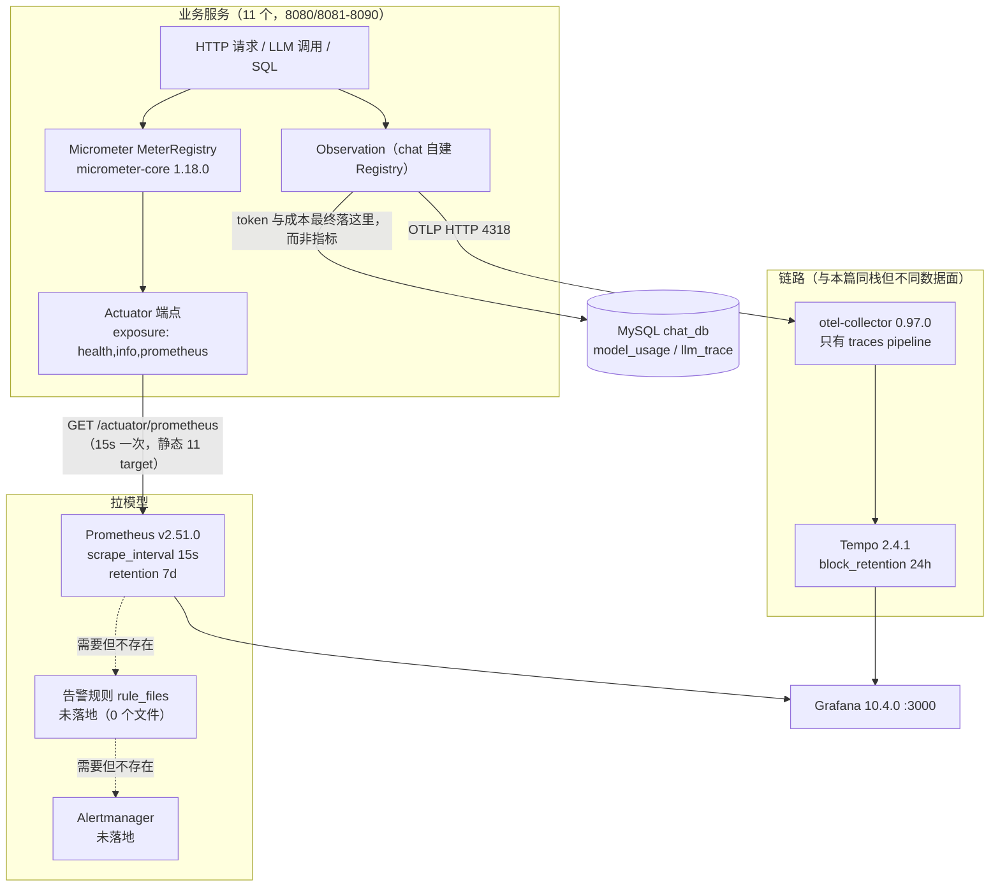
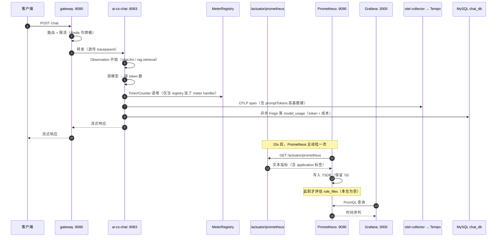

# 04-Prometheus 可观测性：指标的价值取决于你写了哪些告警，而不是你采集了多少 series

> **一句话结论**：本仓已经把"指标能被抓"这条路铺通了一半——11 个模块引了 `micrometer-registry-prometheus`、`deploy/observability/prometheus.yml` 按 15s 抓 11 个 `/actuator/prometheus`、Prometheus 留 7d、Tempo 留 24h；但另一半是空的：**0 个告警规则文件、0 处 `rule_files`/`alerting`、0 个自定义 Meter、0 处 histogram 配置、0 个 exemplar**。所以现在这套栈只能回答"曲线长什么样"，回答不了"什么时候该叫人起床"——而后者才是指标存在的理由。
> **阅读前置**：会看 YAML、跑过 `curl`、知道 JVM 有堆和线程池；不必读过 Prometheus 官方文档，本篇会把 counter/gauge/histogram/summary、拉模型、PromQL 的 `rate` 与 `histogram_quantile` 从"它到底在算什么"讲起。想先补"服务怎么起来的"，看同目录 [09-AI与治理中间件部署](../04-中间件/09-AI与治理中间件部署.md)（中间件编排）与 [06-优雅停机与零丢失滚动更新.md](./06-优雅停机与零丢失滚动更新.md)（停机与探针）；日志侧见 [07-Loki日志聚合.md](./07-Loki日志聚合.md)。
> **证据基线**：`deploy/observability/prometheus.yml`（24 行）、`deploy/docker-compose/docker-compose-observability.yml`（73 行）、`deploy/observability/tempo.yaml`（27 行）、`deploy/observability/otel-collector.yaml`（20 行）、`tools/nacos-config/aics-shared.yml`（37 行）、11 个模块的 `application.yml` 与 `pom.xml`、`ai-cs-order/eff-order.xml`（484026 字节，唯一 effective pom）；结构性计数全部用 PowerShell/node 实跑（见 §6 与 §3）。**本机无 docker / 无 kubectl / 无 promtool**（已实测，见下表），所以凡涉及"容器内会发生什么""Prometheus 会返回什么"，要么给配置行号，要么写成推演并标注。预计阅读 45 分钟。

### 证据边界（先看这张表，再决定信哪句）

| 类别 | 本仓真实状态（实测） | 本篇怎么处理 |
| --- | --- | --- |
| Spring 源码摘录（A 级） | `24-源码分析/assets/source/` 共 908 份，**含 actuator/observation/tracing 相关 25 份，不含任何 Micrometer 类**（无 `MeterRegistry`、无 `Timer`、无 histogram 相关类） | 只对确实入库的类给行号锚点；Micrometer/PromQL 的语义按官方文档推导，**不编行号** |
| 编排与配置（B 级） | 7 个 compose（合计 63 个服务定义）、`deploy/observability/` 4 个文件、11 个 `application.yml` | 每条结论附文件与行号，读一次核一次 |
| 本机可跑（C 级） | `MISSING docker`、`MISSING kubectl`、`MISSING promtool`、`FOUND node`（`C:\Program Files\nodejs\node.exe`）、PowerShell `5.1.26100.9818` Desktop | 用 PowerShell 解析 YAML 做真实计数、用 node 做资源/容量算术；**Prometheus 本身连不上，PromQL 一律标注未实测** |
| 指标数据面 | 无 Prometheus 实例、无 Grafana 实例 | 所有"这条查询返回什么"都给判读方法，不给假数据 |
| 行号约定（A 级锚点） | 归档文件每行形如 `190 | <原始源码行>`：**左侧是归档 .md 的行号，右侧是原始 .java 的行号**（两者固定差 15 行） | 本篇锚点 `#Lm-Ln` 一律指**右侧那一列，即原始 .java 行号**；回原文核对时看右边那列 |

---

## 0. 先看现象

三个症状，分别落在"暴露面""抓取面""查询面"。它们的共同点是——**每一环出问题都不会报错，只会安静地少一点数据**。

### 现象 1：`/actuator/health` 返回 200，`/actuator/prometheus` 却是 404

本地起一个服务（比如 gateway），习惯性先探健康：

```powershell
curl.exe -s -o NUL -w "%{http_code}`n" http://127.0.0.1:8080/actuator/health
curl.exe -s -o NUL -w "%{http_code}`n" http://127.0.0.1:8080/actuator/prometheus
```

```text
200
404
```

> 证据等级：这两行是**配置推演，非本篇实测**（本篇禁止启动服务、禁止 `mvn`，本机亦无 Docker）。`200` 的依据是 Boot 默认暴露 `health`；`404` 的依据是下面这条链条——`prometheus` 末尾点必须显式进 `include`，而本仓 11 个 `application.yml` 里 `exposure` 出现 **0** 次（§3.4 实测），只在 Nacos 侧写了一份。想自己验，把上面两条命令原样跑即可（判读：`200`+`404` = 暴露面没生效；`200`+`200` = 已生效；两条都 `000` = 服务没起）。

定位到的原因是**暴露面根本没开在应用里**，而是开在 Nacos 的共享配置里（`tools/nacos-config/aics-shared.yml` 第 27-31 行）：

```yaml
management:
  endpoints:
    web:
      exposure:
        include: health,info,prometheus
```

而 11 个模块的 `application.yml` 里，`management.endpoints.web.exposure` 出现次数是 **0**（§3.4 有实测表格）。拉配置用的是 `optional:nacos:aics-shared.yml`（`ai-cs-gateway/src/main/resources/application.yml` 第 30 行）——`optional:` 的语义是"拉不到就跳过，不算失败"。于是 **Nacos 没起 / namespace 不匹配 / 配置没发布**，这三种情况呈现的是同一个结果：服务健康、指标 404、日志里最多一行不显眼的告警。

### 现象 2：Prometheus 的 Targets 页面 11 个 target 一片红

抓取失败的典型报错串（Prometheus 会把错误原文写进 `/api/v1/targets` 的 `lastError` 字段，本机无实例，未实测，仅给判读方法）：

```text
Get "http://host.docker.internal:8083/actuator/prometheus": dial tcp 192.168.65.254:8083:
connect: connection refused
```

`connection refused` 有三种完全不同的成因，修法互斥：① 服务真的没起（宿主 8083 无监听）；② 服务起了但 `/actuator/prometheus` 404（现象 1，此时错误串会变成 `server returned HTTP status 404 Not Found`）；③ 地址本身错了——`host.docker.internal` 是 Docker Desktop 的宿主别名，**Linux 原生 Docker 没有这个名字**，`deploy/observability/prometheus.yml` 第 23-24 行专门留了注释提醒：

```yaml
    # Linux 宿主机需在 compose 里为 prometheus 服务加 extra_hosts:
    #   - "host.docker.internal:host-gateway"
```

注释是提醒，不是配置——真正需要它的人（Linux 部署者）最容易漏掉。

### 现象 3：写了一条"教科书级"的分位数查询，结果空数组

```promql
histogram_quantile(0.95, sum by (le, uri) (rate(http_server_requests_seconds_bucket{application="ai-cs-chat"}[5m])))
```

返回 `[]`（空）。第一反应是"PromQL 写错了"，实际上是**这个指标族里的 `_bucket` 从来不存在**：Spring Boot 默认只输出 `http_server_requests_seconds_count/_sum/_max`，要拿到桶必须显式打开直方图（`management.metrics.distribution.percentiles-histogram.http.server.requests=true`）。全仓 grep `percentiles|distribution|histogram|slo`，除 Nacos 自身的 accesslog 外 **0 命中**。更麻烦的是：`count` 和 `sum` 都在，`avg` 也能算出来，所以"看起来指标是好的"，只有分位数查询是空。

### 这三个症状的共同点

| 现象 | 第一反应 | 真实原因 | 定位入口（命令见 §6） |
| --- | --- | --- | --- |
| `/actuator/prometheus` 404 | 依赖没引 | 暴露面只写在 Nacos 共享配置，`optional:` 拉不到即静默丢失 | `curl /actuator` 看 `_links` 里有没有 `prometheus` |
| Target 一片红 | 服务挂了 | 宿主名/端口/暴露面三者之一；`refused` 与 `404` 是两种病 | Prometheus `/api/v1/targets` 的 `lastError` |
| 分位数查询为空 | PromQL 语法 | `_bucket` 序列压根没产生 | `absent(...bucket...)` 与 `count by (__name__)` |

这些现象指向同一件事：**这条链路上每一环都在用"默认值 + 可选导入"兜底，而指标恰好是"缺了也不影响业务"的东西**——所以缺了没人喊。下面从"指标长什么样"开始，把这条链路逐段拆开。

---

## 1. 整体地图



> **读图说明**：① 实线是**已落地**、点线是**未落地**——`RULES` 与 `AM` 两个节点在本仓不存在任何文件（`deploy/observability/` 只有 4 个文件，无 `rules/*.yml`、无 alertmanager 配置），这正是本篇的论点所在：采集链路（左半）是通的，判定链路（点线）是空的。② 从 `APP` 到 `PROM` 的箭头只有一条、方向是 **Prometheus 主动拉**：`ACT` 只是被动应答，服务不知道 Prometheus 存在，所以"停掉 Prometheus 服务照跑、指标全丢"是设计内的行为，不是故障。③ `OBS --> DB` 这条线是理解本仓的关键：**LLM 的 token 与成本没有变成指标**，而是经 Feign 落到 MySQL 的 `model_usage` 表（`deploy/mysql/llm-observability-init.sql`），所以"用 PromQL 做 token 看板"在本仓做不到，只能查库。④ `ACT` 依赖的是 Nacos 里的 `exposure` 配置，Nacos 缺席时这条边**静默断开**（现象 1）。

各组件"谁负责什么、谁调用谁"，逐项来自真实文件：

| 组件 | 真实位置（行号） | 责任 | 谁依赖它 / 参与方 |
| --- | --- | --- | --- |
| `micrometer-registry-prometheus` | 11 个模块的 `pom.xml`（如 `ai-cs-gateway/pom.xml`、`ai-cs-chat/pom.xml`） | 把 Micrometer 的 Meter 编码成 Prometheus 文本格式 | 应用自身 |
| `/actuator/prometheus` 端点 | `tools/nacos-config/aics-shared.yml` 第 27-31 行开启 | 暴露抓取入口（文本/OpenMetrics） | Prometheus |
| `prometheus.yml` | `deploy/observability/prometheus.yml`（24 行） | 声明抓谁、多久抓一次 | Prometheus 容器 |
| Prometheus 服务 | `deploy/docker-compose/docker-compose-observability.yml` 第 20-31 行（`prom/prometheus:v2.51.0`，宿主 9090，`--storage.tsdb.retention.time=7d`） | 存储时序、执行 PromQL、执行告警规则 | Grafana、运维 |
| Grafana | 同文件第 33-44 行（`grafana/grafana:10.4.0`，宿主 3000） | 画图/看板（本仓 **0 个 dashboard 文件**，只有 datasource） | 人 |
| data source | `deploy/observability/grafana/provisioning/datasources/datasources.yaml` 第 4-16 行 | 把 Prometheus(:9090) 与 Tempo(:3200) 接进 Grafana | Grafana |
| otel-collector | 同 compose 第 58-68 行（OTLP 4317/4318 → `tempo:4317`） | 收 trace 转发（**无 metrics pipeline**） | chat 等服务的 OTLP 导出器 |
| Tempo | 同 compose 第 46-56 行；`deploy/observability/tempo.yaml` 第 19 行 `block_retention: 24h` | trace 存储 24h | Grafana |
| 告警规则 / Alertmanager | **不存在**（`rule_files` 0 处、`alerting` 0 处） | —— | —— |
| 业务指标（token/成本） | `deploy/mysql/llm-observability-init.sql` 建 5 张表 | 以行存表替代指标 | 运营/财务查询 |

---

## 2. 关键概念与关键类/关键配置

| 名称 | 位置 | 角色 | 关键参数 / 判据 |
| --- | --- | --- | --- |
| counter（计数器） | Micrometer `Counter` | 只增不减的累计值，唯一有意义的操作是"取速率" | 必须配 `rate()/increase()` 才有意义；重启归零靠 `rate` 的 `counter reset` 处理 |
| gauge（瞬时值） | Micrometer `Gauge` | 可上可下的当前值（线程数、连接数、温度） | 抓取时刻采一次；两次抓取之间的尖峰**看不见** |
| histogram（直方图） | Micrometer `DistributionSummary`/`Timer` | 把观测值落进预定义桶，服务端可聚合、可算分位数 | 桶边界固定；默认不输出 `_bucket`，须开 `percentiles-histogram` |
| summary（摘要） | Micrometer `Timer.percentiles` 优先算在客户端 | 客户端直接算分位数 | 分位数**不可再聚合**：两台实例的 p95 不能平均 |
| 拉模型（pull） | `deploy/observability/prometheus.yml` | Prometheus 定时来抓，目标列表写在配置里 | `scrape_interval: 15s`；目标离线不会被记录，只会 `up=0` |
| pushgateway | 本仓**未使用** | 给抓不到的短生命周期任务做中转 | 只适合批处理；进程退出后旧值一直留在网关里（腐坏） |
| Micrometer 命名映射 | `micrometer-registry-prometheus` | `http.server.requests` → `http_server_requests_seconds` | `.`→`_`、加 base unit、counter 加 `_total`、tag 变 label |
| `management.endpoints.web.exposure.include` | `tools/nacos-config/aics-shared.yml` 第 31 行 | 决定哪些端点注册进 Web 层 | 本仓 `health,info,prometheus`（三个） |
| `EndpointDiscoverer#isEndpointExposed` | `[[源码:EndpointDiscoverer.java.md#L190-L200]]` | 只有"已暴露"的端点才会被转换并注册 | 暴露面为空 → 端点根本不进 handler mapping → 404 |
| `WebMvcEndpointHandlerMapping` | `[[源码:WebMvcEndpointHandlerMapping.java.md#L55-L61]]` | 把端点挂到 Web 层，并设 `setOrder(-100)` | 优先级高于业务 Controller，路径 `/actuator/**` 被它抢走 |
| `EnvironmentEndpoint` | `[[源码:EnvironmentEndpoint.java.md#L73-L77]]` | `/actuator/env`：返回**全部配置项** | 脱敏靠 `Sanitizer`（`[[源码:EnvironmentEndpoint.java.md#L194-L197]]`），只认已知密钥关键字 |
| `BeansEndpoint` | `[[源码:BeansEndpoint.java.md#L31-L32]]` | `/actuator/beans`：按 context 列出全部 bean | 直接暴露内部结构，攻击面/噪声都大 |
| `PathMappedEndpoints` | `[[源码:PathMappedEndpoints.java.md#L81-L108]]` | 端点 id → 实际路径（`/actuator/<id>`）的映射表 | 排查"为什么是 404 而不是 401"时先看它给出的路径 |
| `TraceSpanObservationHandler` | `ai-cs-chat/src/main/java/com/aics/chat/observability/TraceSpanObservationHandler.java` | 把 Observation 组装成 span（**只进 trace，不进指标**） | onStop 时读 `span.type` 等 key |
| `ObservationConfig` | `ai-cs-chat/src/main/java/com/aics/chat/observability/ObservationConfig.java` 第 40-57 行 | chat 自建 `ObservationRegistry` | **没有挂 `DefaultMeterObservationHandler`** → Observation 不产 Timer |
| `model_usage` 表 | `deploy/mysql/llm-observability-init.sql` | token / `estimated_cost` 的真实归属 | 指标侧无对应系列（§3.3） |

---

## 3. 原理与证据逐段精读

### 3.1 四种指标类型：为什么"直方图分位数"比"平均值"有用

**在干什么。** 四种类型不是四个 API，而是四种**代价与能力的取舍**：

| 类型 | 语义 | 服务端能算什么 | 不能算什么 | 典型落点（本仓） |
| --- | --- | --- | --- | --- |
| counter | 单调递增累计 | `rate`（每秒）、`increase`（区间增量） | 直接读绝对值（会把重启当尖峰） | `http_server_requests_seconds_count`、`jvm_gc_pause_seconds_count` |
| gauge | 当前瞬时值 | 直接读、`avg_over_time` | 两次抓取之间的瞬时峰值 | `hikaricp_connections_active`、`jvm_memory_used_bytes` |
| histogram | 每个桶一个计数（`le`） | `histogram_quantile` 算任意分位、跨实例相加 | 精确值（桶边界就是精度上限） | 需显式开启；本仓**未开** |
| summary | 客户端算好的分位数 | 只能原样展示 | **跨实例聚合**（p95 不能求平均） | 本仓未用；`Timer.percentiles` 一开即属此类 |

关键差别在"聚合"两个字。平均值是**算术平均**，它把长尾藏起来：10 个请求 9 个 20ms、1 个 5s，平均值 ≈ 518ms，看起来"还行"，而 p95 直接是 5s——用户在骂街的那个请求，在平均值里被稀释成了 1/10 的权重。更糟的是**平均不了**：网关的平均延迟不是上游各服务平均延迟之和，但分位数近似可以相加（严格说是"可合并"而非"可平均"）。

直方图为什么能算分位数：它保存的是"小于等于 X 的请求有多少个"这种**可加**的计数。查询时先把各实例、各时间点的桶计数加总，再在累积分布上插值——所以 `sum by (le)` 是必需的，漏了它就会对分位数再求平均，得到无意义的数。

**为什么这么设计。** 拉模型每次抓取只能看到"一个数字"，无法看到"这一个数字是怎么来的"。所以要么在客户端就把分布压成分位数（summary，代价是不可聚合），要么把分布留成桶（histogram，代价是查询时算）。Prometheus 选了后者，因为**多实例 + 多次抓取的聚合是它存在的理由**。

**换写法会怎样。** 只留 `_count`/`_sum` 也能算平均值，磁盘最省（3 条序列 vs 十几个桶序列）；代价是所有长尾故障都看不见。反过来把桶切到极细（比如 0.001~60 秒几十个桶），分位数精度上去了，但每条序列变成几十条，磁盘与抓取体积线性上涨——这就是下一段的基数账。

**常见坑。** ① 以为 `_max` 能代替 p99：`_max` 是"抓取窗口内的最大单次"，一次抖动就跳到顶，告警会疯狂抖动；② 以为 summary 的分位数跨实例可加，两台机器各 p95=100ms，全站 p95 并不是 100ms（也不是 200ms，除非流量恰好对半）；③ 开了 `percentiles` 却没意识到它引入的是 summary，仍然用 `sum by (le)` 去查，查不到东西。

### 3.2 拉模型与 pushgateway：为什么本仓只有 pull

**在干什么。** Prometheus 的工作方式是"我按名单去敲门"：`deploy/observability/prometheus.yml` 第 6-22 行声明了一个 job、11 个静态 target，每 15s 对每个 target 发一次 `GET /actuator/prometheus`，把返回的文本解析成 `(metric, labels, timestamp, value)` 四元组入库。

**为什么这么设计。** 拉模型把"谁存在"这件事放在 Prometheus 侧（配置即目标清单），带来三个好处：① 目标挂了是**可观测的**——`up{job="ai-cs-services"} == 0`，推模型里"没数据"和"没事发生"分不开；② 抓取节奏由服务端统一控制，不会被某个应用的爆发拖垮存储；③ 目标端无需知道 Prometheus 地址，配置更简单。代价是：**短命进程抓不到**（批处理跑 3 秒就退出，可能一次都没被抓到），以及**目标清单必须由人/服务发现维护**。

**换写法会怎样。** 给批处理接 pushgateway：任务结束时 `POST` 一次，Prometheus 改成抓 pushgateway。它解决了"抓到"，但引入了新问题——pushgateway 里存的是**最后一次推送的值**，任务不再运行后这个值永远不消失，于是"昨天还有 100 条待处理，今天任务挂了"看起来一切正常。正确用法只有一种：任务结束时**清掉**自己的 group（`DELETE` 或 `push` 后由 job 自行删除），并且只放"任务级结果"而非"实例级状态"。

**常见坑。** ① 本仓**没有** pushgateway，所以任何"跑一次就退出的脚本需要上报指标"的需求都不能靠现有栈满足（要么落日志，要么落 MySQL——本仓 `llm_trace`/`model_usage` 走的就是后者）；② 把 `scrape_interval` 改成 1s 想"看得更细"，结果 11 个 target 每秒各回几百 KB，Prometheus 自己的 CPU 先崩；③ 以为 push 就"实时"，其实 Prometheus 仍然只在抓取时刻采样，实时性由 `scrape_interval` 决定，与推拉无关。

### 3.3 Micrometer → Prometheus 的映射，以及标签基数爆炸的真实代价

**在干什么。** 应用里写的是 `http.server.requests`（点分命名 + tag），暴露出来变成：

```text
http_server_requests_seconds_count{application="ai-cs-chat",method="POST",status="200",uri="/chat",} 42
http_server_requests_seconds_sum{application="ai-cs-chat",method="POST",status="200",uri="/chat",} 12.345
http_server_requests_seconds_max{application="ai-cs-chat",method="POST",status="200",uri="/chat",} 0.812
```

三条规则一眼要记住：① `.` 换 `_`；② 计量单位变成后缀（`seconds`）——所以同一个业务改了单位，指标名就变了，看板全空；③ counter 自动加 `_total`（`http_server_requests_seconds_count` 是 Boot 特例，它本身就是 counter 但保留 `_count` 后缀），tag 变 label。（上面三行是**命名格式示意，数值为占位，非本机实测抓取结果**——`application="ai-cs-chat"` 与 `uri="/chat"` 取自本仓服务名与路由。）

`application` 这个 label 不在 11 个 `application.yml` 里——它在 Nacos 共享配置里统一注入（`tools/nacos-config/aics-shared.yml` 第 35-37 行）：

```yaml
  metrics:
    tags:
      application: ${spring.application.name}
```

这一行是整个多服务看板的地基：没有它，11 个服务的 `http_server_requests_seconds_count` 会**同名同标签**地混在一起，`sum()` 出来的数字看不出是谁的。

**为什么这么设计。** 用 label 而不是"每个服务一个指标名"，才能写出一条查询覆盖全部服务（`sum by (application)`）。代价是 label 的取值组合数 = series 数，而 series 数是 Prometheus 的成本单位。

**换写法会怎样（算一笔真实的账）。** 用 node 实算（命令见 §6.3）：

```text
每 target 每天抓取次数 = 5760
7 天每 target 抓取次数 = 40320
series/target=300  -> 7d 总样本 = 133,056,000 ; 按 1 byte/sample ≈ 126.9 MiB ; 按 2 ≈ 253.8 MiB
series/target=1000 -> 7d 总样本 = 443,520,000 ; 按 1 byte/sample ≈ 423.0 MiB ; 按 2 ≈ 845.9 MiB
series/target=5000 -> 7d 总样本 = 2,217,600,000 ; 按 1 byte/sample ≈ 2114.9 MiB ; 按 2 ≈ 4229.7 MiB
```

（`1~2 byte/sample` 是 Prometheus 官方文档给出的压缩后量级；本机无实例，**未实测**，所以这里只作数量级判断。）

11 个 target × 每 target 1000 series 就是 1.1 万条活跃序列、7 天 4.4 亿样本，落在 400~850 MiB 区间——这台机器扛得住。真正危险的是**基数爆炸**：一条 `uri` label 如果被写成含路径变量（`/order/12345` 而不是 `/order/{id}`），20 个接口 × 每个 200 个不同 id × 11 个 target：

```text
20 个接口 x 11 target = 220 series
若把 userId 拼进标签: 20 x 200 x 11 = 44000 series（单指标族）
```

从 220 涨到 44000，同样是 7 天保留期，磁盘从"几百 KB"变成"几十 GB"，而抓取体积跟着涨，Prometheus 的 `scrape_duration_seconds` 与内存一起爆——**这就是"标签爆炸"的具体形态：不是查询变慢，是整个采集栈被打死。**

**本仓有一处特别值得学的反面与正面。** chat 的 LLM 调用把 token 数写进了 Observation 的**高基数**键（`ai-cs-chat/src/main/java/com/aics/chat/service/impl/ResilientAiService.java` 第 486-499 行，`promptTokens`/`completionTokens` 走 `highCardinalityKeyValue`）。这是**对的**：token 数的取值空间极大，放进 label 就是把基数交给用户输入。代价是 token 只进 span、不进指标——所以想用 PromQL 画"每小时 token 消耗"在本仓做不到，只能查 `model_usage` 表（`deploy/mysql/llm-observability-init.sql`，其中 `estimated_cost DECIMAL(12,6)` 已经按 `tools/nacos-config/ai-cs-chat.yml` 的 `aics.usage.pricing` 估好价）。

**常见坑。** ① 把用户 ID、请求 ID、SQL 语句塞进 label（最常见，也最致命）；② 以为 `_max` 是单次请求最大值，其实它是抓取窗口内的最大值；③ 改了单位（`ms`→`seconds`）却没更新看板；④ 只在本地 `application.yml` 里加 `metrics.tags`，忘了 Nacos 里的共享配置会覆盖/合并——本仓的顺序是本地配置优先、Nacos 后到，冲突时以先加载者为准（配置优先级规则见 [09-AI与治理中间件部署](../04-中间件/09-AI与治理中间件部署.md)）。

### 3.4 Actuator 暴露面：`include` 该开哪些、为什么不能全开

**在干什么。** `management.endpoints.web.exposure.include` 是一个白名单，决定哪些端点会被注册进 Web 层。机制上分两步：`EndpointDiscoverer` 先筛出"暴露的"端点，`WebMvcEndpointHandlerMapping` 再把它们挂成 Controller：

```java
// (src: EndpointDiscoverer.java.md#L190-L200)
private Collection<E> convertToEndpoints(Collection<EndpointBean> endpointBeans) {
    Set<E> endpoints = new LinkedHashSet<>();
    for (EndpointBean endpointBean : endpointBeans) {
        if (isEndpointExposed(endpointBean)) {
            E endpoint = convertToEndpoint(endpointBean);
            if (isInvocable(endpoint)) {
                endpoints.add(endpoint);
            }
        }
    }
    return Collections.unmodifiableSet(endpoints);
}
```

`isEndpointExposed` 的判断在 `[[源码:EndpointDiscoverer.java.md#L288-L290]]`（定义位置），**没过这一关的端点连 HandlerMapping 都不会进**——这就是"404 而不是 403"的根源：不是被拦住，是不存在。

**为什么这么设计。** 因为不同端点泄露的信息量差了几个数量级。看两个真实类的自我介绍：

| 端点 | 真实实现 | 它到底返回什么 | 风险等级 |
| --- | --- | --- | --- |
| `/actuator/health` | `[[源码:HealthEndpoint.java.md#L34-L35]]` | 聚合各组件的健康状态 | 低（本仓还设了 `show-details: never`） |
| `/actuator/info` | Boot 内置 | 构建信息、git 信息 | 低 |
| `/actuator/prometheus` | Micrometer registry | 指标文本（无业务明文） | 低 |
| `/actuator/env` | `[[源码:EnvironmentEndpoint.java.md#L73-L77]]` | **全部 PropertySource 的键值**，脱敏靠 `Sanitizer`（`[[源码:EnvironmentEndpoint.java.md#L194-L197]]`）只匹配已知关键字 | 高 |
| `/actuator/beans` | `[[源码:BeansEndpoint.java.md#L31-L32]]` | 按 applicationContext 列出所有 bean 及其依赖 | 中高 |
| `/actuator/heapdump` | Boot 内置 | 整个堆的二进制 dump | 极高（可离线提取内存里的密钥） |
| `/actuator/threaddump` | Boot 内置 | 全部线程栈 | 中 |
| `/actuator/loggers` | Boot 内置 | 读**并写**日志级别 | 高（`POST` 可改级别） |
| `/actuator/shutdown` | Boot 内置 | 优雅关停应用 | 极高（一个 POST 停掉服务） |

`EnvironmentEndpoint` 的危险不是"它写得不好"，而是它的职责就是返回环境：`describeValueOf` → `sanitize` → `SanitizingFunction` 这条链只认"名字里像密码的键"。本仓恰恰有一份写着明文的配置——`tools/nacos-config/aics-shared.yml` 第 1-24 行里有 `spring.ai.openai.api-key`、`aics.embedding.api-key`、`aics.jwt.secret`。一旦 `include` 里多了一个 `env`，这些值就是一次 `curl` 的距离（能否被脱敏取决于键名匹配，实例名如 `aics.embedding.api-key` 通常会命中 `key` 规则，但**不能指望**）。

**换写法会怎样。** 常见三种写法对比：

| 写法 | 效果 | 评价 |
| --- | --- | --- |
| `include: "*"` | 全开 | 等于把 heapdump/shutdown/env 挂到公网，禁止 |
| 不配（Boot 默认只开 health） | 最安全，但 Prometheus 抓不到 | 本仓 11 个 `application.yml` 就是这个状态，靠 Nacos 兜底 |
| `include: health,info,prometheus` | 三个只读、无明文 | **本仓选的就是这个**，正确 |

**为什么不能全开（运维视角的补充）。** ① 端点泄漏与"指标"无关，但**同一个开关控制两者**，所以图省事写成 `*` 的人往往只是为了 prometheus；② `shutdown` 端点一旦可写，配合本仓 `server.shutdown: graceful`，一个误发的 POST 会触发一次真正的优雅停机（见 [06-优雅停机与零丢失滚动更新.md](./06-优雅停机与零丢失滚动更新.md)）；③ 更隐蔽的是**性能**：`/actuator/beans` 每次请求都遍历容器，`heapdump` 会让 JVM 停顿数秒——把它放进 Prometheus 的抓取路径里，就是一分钟一次的自我攻击。

**常见坑。** ① 只在本地 `application.yml` 配了 `include`，生产用 Nacos 配置覆盖后忘了同步（本仓反过来，只在 Nacos 里配，本地 0 处，见下表）；② 用 `exclude` 而不是 `include`——白名单比黑名单安全，因为未来新增的端点默认不开；③ 开了 `prometheus` 却把 `management.server.port` 单独设了端口，导致 Prometheus 的 `metrics_path` 全错（本仓未设独立端口，`prometheus.yml` 里写的就是业务端口）。

实测这十一个模块的配置分布（PowerShell 真实输出，命令见 §6.2）：

```text
module          lines mgmt_lines exposure tracing
ai-cs-chat        178          0        0       0
ai-cs-gateway      60          1        0       3
ai-cs-knowledge    42          1        0       3
ai-cs-message      33          1        0       3
ai-cs-mq           52          1        0       3
ai-cs-notify       38          1        0       3
ai-cs-order        66          1        0       3
ai-cs-pay          33          1        0       3
ai-cs-product      56          1        0       3
ai-cs-search       65          1        0       3
ai-cs-user         38          1        0       3
合计: 模块=11 有 management: 的=10 有 exposure/prometheus 字样的=0 有 tracing/otlp 的=10
```

读法：`mgmt_lines=1` 的那一行是 `management.tracing.*`（如 `ai-cs-gateway/src/main/resources/application.yml` 第 60-66 行），**不是** exposure；`exposure` 列全 0 说明**暴露面 100% 依赖 Nacos**；chat 三列全 0，因为它的 `application.yml`（178 行）里连 `management` 段都没有——chat 的链路是自建 `ObservationConfig`（第 40-57 行 `ObservationRegistry.create()`），这条路**只挂 trace handler，没有 `DefaultMeterObservationHandler`**，所以即使 exposure 打开了，chat 的 Observation 也不会变成 Timer 指标（B 级推断，依据是代码里两次 `observationConfig().observationHandler(...)` 只注册了 `TraceSpanObservationHandler` 与 `OtlpObservationHandler`）。

### 3.5 黄金四信号与每层落点：本仓哪些层是瞎的

**在干什么。** 黄金四信号（latency / traffic / errors / saturation）不是四个指标，而是四个**提问角度**，每个角度在不同层次有不同承载。把本仓逐层对一遍：

| 层 | 延迟 | 流量 | 错误 | 饱和度 | 本仓真实状态 |
| --- | --- | --- | --- | --- | --- |
| 网关（8080） | `http_server_requests_seconds_*` | 同上 `_count` 的 rate | `status=~"5.."` 计数 | 连接池/线程 | 有（依赖 exposure），**无分位桶** |
| 服务（11 个） | 同上 + `chat.*` Observation | 同上 | 同上 + `resilience4j_*`? | Tomcat 线程 | 部分：`resilience4j-micrometer` 在本地 m2 存在，但 chat 只引 `resilience4j-spring-boot4` |
| DB 连接池 | `hikaricp_connections_acquire_seconds`（需开桶） | `hikaricp_connections_usage`? | 连接超时计数 | `hikaricp_connections_active/max`、`_pending` | 指标由 Hikari 自动注册（配置在 Nacos `ai-cs-order.yml` 第 10-16 行，`maximum-pool-size: 10`），但**没有告警**在用 |
| 线程池 | 无 | 无 | 无 | 无 | **瞎**：`ai-cs-chat/src/main/java/com/aics/chat/config/ObservabilityExecutorConfig.java` 第 27-59 行建了两个 `ThreadPoolTaskExecutor`，**没绑定 `ExecutorServiceMetrics`、没建 Gauge** |
| JVM | `jvm_gc_pause_seconds_*` | `jvm_gc_memory_allocated_bytes_total` | — | `jvm_memory_used_bytes`/`jvm_threads_live_threads` | 自动有（actuator 内置），无告警 |
| LLM 调用 | `chat.llm`（Observation，若挂 meter handler 才有 Timer） | token 数（**在 MySQL**） | `status`/`error_summary`（在 MySQL） | 并发/配额（`aics.model-router.quota`，在配置里） | **几乎全瞎**：指标侧无 token、无成本、无失败率 |

这张表就是本篇论点最直接的证据：右上角的"错误"和"饱和度"两列，一半格子写着"瞎"或"无告警"。

**为什么这么设计。** 框架是"能自动就自动"：HTTP 服务端、JVM、Hikari 都由 Boot 自动装配好，所以"有指标"是默认结果；而"业务指标"必须有人显式写代码，所以它天然缺失。这不是本仓的怠工，是**框架默认值只覆盖它理解的东西**——LLM 调用、token 成本、线程池排队，框架不认识。

**换写法会怎样。** 想让上表没有空格，最小改动是三处：① 开 `management.metrics.distribution.percentiles-histogram.http.server.requests: true`（延迟分位可用）；② 把两个线程池用 `ExecutorServiceMetrics.monitor(registry, executor, "chat.usage")` 包一层（饱和度可见）；③ 在 `finishLlmObservation` 里额外 `Counter.builder("chat.llm.tokens").tag("model", ...)` 累加 token（**用 counter 而不是 label 里的 token 值**，因为 counter 只加 1 个数字、基数不变）。三处都不难，难的是"没人被叫醒过，所以没人补"。

**常见坑。** ① 把"有指标"当成"有可观测性"——本仓 11 个 target 全绿，LLM 全链路失败也能全绿；② 给线程池只看 `active`，不看 `queue_size`（排队才是过载的第一征兆）；③ DB 池只看 `active/max`，不看 `pending`（等连接的线程数才是用户感知到的等待）。

### 3.6 PromQL：四条查询与它们的判读边界

**在干什么。** 以下四条查询是本篇的核心工具，**本机无 Prometheus 实例，全部未实测**，但语法与判读方法可直接照用（粘贴到 Grafana Explore 的 Prometheus 数据源）。

（1）错误率——先看"有没有错"，再看"错在哪"：

```promql
sum by (application) (rate(http_server_requests_seconds_count{status=~"5.."}[1m]))
/
sum by (application) (rate(http_server_requests_seconds_count[1m]))
```

判读：分子为 0 且分母非 0 = 真没 5xx（不是没数据）；两者同时为 0 = 服务没在接流量或指标没抓到，**先查 `up`**。

（2）分位数——本仓会返回空，这本身就是结论：

```promql
histogram_quantile(0.95, sum by (le, application) (rate(http_server_requests_seconds_bucket[5m])))
```

判读：返回 `[]` → 桶不存在（配 `_bucket` 开关）；返回一堆 0.005/0.01 这类桶边界值的聚集 → 绝大多数请求落在第一个桶，说明桶切得不对（默认桶对秒级接口太粗）。

（3）抓取断裂——告警里最该有的一条：

```promql
up{job="ai-cs-services"} == 0 or absent(up{job="ai-cs-services"})
```

判读：`up == 0` 是"目标在名单上但抓不到"；`absent(...)` 是"连名单都没了"（Prometheus 配置被换/被清空）。两者的处置完全不同，所以**必须分别建规则**，不要合成一条。

（4）DB 连接池饱和度：

```promql
hikaricp_connections_active{application="ai-cs-order"} / hikaricp_connections_max{application="ai-cs-order"}
hikaricp_connections_pending{application="ai-cs-order"}
```

判读：比值长期 > 0.8 或 `pending` 持续 > 0，说明连接不够——本仓 `maximum-pool-size: 10`，10 个连接对 200 个 Tomcat 线程是明显偏小的（`tools/nacos-config/ai-cs-order.yml` 第 10-16 行）。

补充两条"诊断用"的元查询（不画图，只排查）：

```promql
topk(10, count by (__name__)({__name__=~".+"}))     # 哪个指标族序列最多 → 基数元凶
count by (application) ({__name__=~"http_server_requests.*"})  # 每个服务暴露了多少条
```

**为什么这么设计。** PromQL 的设计中心是"向量之间的算术"：`rate()` 处理 counter 的重启与单调性，`histogram_quantile()` 处理桶的累积，`absent()` 处理"没有数据"这种特殊情况。它们共同的前提是——**你选对了指标类型**。用错类型（对 gauge 用 `rate`，对 summary 用 `sum by (le)`）不会报错，只会给一个恒为 0 或恒为空的答案。

**换写法会怎样。** `increase(x[10m])` 与 `rate(x[10m])*600` 数值等价，但 `increase` 在区间边界上做外推，短区间（如 `[15s]`）会因样本不足而丢掉整段；`rate` 要求区间内**至少两个样本**，所以 `[15s]` 窗口配 15s 抓取间隔等于"随机取 1~2 个点"。经验规则：**窗口 ≥ 4 × scrape_interval**，即本仓最小用 `[1m]`，告警用 `[5m]`。

**常见坑。** ① 用 `rate` 直接对 `_sum`/`_count` 之外的 gauge 用（如 `rate(jvm_memory_used_bytes[1m])` 会得到 0 或负值抖动）；② `sum` 忘记 `by (le)` 就交给 `histogram_quantile`；③ 把 `[5m]` 写成 `[5]`（后者是 5 秒）；④ 忘了 `labels` 维度差异导致"没有匹配的向量"——两侧 label 集合不一致时 `/` 会返回空，这时要用 `on()`/`group_left`。

### 3.7 告警规则与 `for` 防抖：本仓缺的那一半

**在干什么。** 一条规则由三部分组成：表达式（PromQL）、持续时间（`for`）、标签/注解（`labels`/`annotations`）。`for: 5m` 的语义是"表达式连续 5 分钟为真才置 Firing"，中间只要断一次就重置计时器。下面是一份**可以直接落地但本仓未落地**的规则文件（本仓 `deploy/observability/` 下没有 `rules/` 目录，需新建并在 `prometheus.yml` 里加 `rule_files:` 指向它）：

```yaml
groups:
  - name: ai-cs-golden-signals
    rules:
      - alert: ServiceDown
        expr: up{job="ai-cs-services"} == 0
        for: 1m
        labels: { severity: critical }
        annotations:
          summary: "{{ $labels.instance }} 抓取失败超过 1 分钟"
          runbook: "先看 /api/v1/targets 的 lastError，区分 refused / 404 / timeout"

      - alert: HighErrorRate
        expr: |
          sum by (application) (rate(http_server_requests_seconds_count{status=~"5.."}[5m]))
          / sum by (application) (rate(http_server_requests_seconds_count[5m])) > 0.05
        for: 10m
        labels: { severity: critical }
        annotations:
          summary: "{{ $labels.application }} 5xx 比例 > 5%（持续 10 分钟）"

      - alert: SlowP99
        expr: |
          histogram_quantile(0.99, sum by (le, application) (rate(http_server_requests_seconds_bucket[5m]))) > 2
        for: 10m
        labels: { severity: warning }
        annotations:
          summary: "{{ $labels.application }} p99 > 2s"
```

注意第三条在本仓是**死规则**：`_bucket` 不存在 → 表达式恒为空 → 永远不触发。这种"看起来有告警、其实永不响"的规则比没有告警更危险，因为它给了虚假的安全感。加规则时配一条自检：`absent(http_server_requests_seconds_bucket) == 1`（有桶时该表达式为空，说明规则可用；返回 1 说明桶没了）。

**为什么这么设计。** `for` 是"抖动"与"迟钝"之间的旋钮：太短 → 每次 GC、每次发版都告警，人开始忽略告警；太长 → 真故障晚 10 分钟才叫人。经验值：**基础设施级（抓取失败、进程挂）1~2 分钟；业务级（错误率、延迟）5~10 分钟**。

**换写法会怎样。** 不用 `for`，改用 `avg_over_time(...)` 平滑：能压住抖动，但会把"持续 3 分钟的真故障"也平均掉。两者可以叠加，但不要用 `for: 0` 图快——Prometheus 默认 15s 评估一次，`for: 0` 等于"任意一个采样点越界就告警"。

**常见坑。** ① 忘了 `groups` 这一层，`promtool check rules` 会直接报 `field groups not found`（本机 `MISSING promtool`，此条未实测，属官方格式约束）；② 规则文件改了但没 `reload`（`curl -X POST http://localhost:9090/-/reload`，需要 `--web.enable-lifecycle`，本仓 compose 第 28-30 行的 command **没有**这个参数，所以只能重启容器）；③ 把 `absent()` 写进 `for: 5m` 的规则里——`absent` 本来就是"没数据"，再等 5 分钟才报，等于把发现时间翻倍。

### 3.8 多实例、抓取配置与 exemplar：指标怎么和 trace/log 连起来

**在干什么。** 三件事共用一个前提：**指标必须能定位到"哪个实例、哪次请求"**。

先说多实例。本仓的抓取配置是**静态 11 个宿主端口**（`deploy/observability/prometheus.yml` 第 11-22 行），一个服务一个端口——这在"每台机器各起一份、端口固定"的本地形态下是对的。一旦进入 k8s 或滚动更新，Pod IP 每次都变、同一服务多副本，静态名单立刻失效：名单里还写着旧 IP（抓不到）、或只写了 Service 名（只能抓到随机一个 Pod，其余副本的指标永久丢失）。正确做法是服务发现（k8s 里是 `kubernetes_sd_configs` + `ServiceMonitor`）；本仓 k8s 目录实测 **`ServiceMonitor` 0 命中**，8 个 service 清单里也没有任何 Prometheus 注解。

再说 exemplar。exemplar 是"指标样本附带一个 trace_id"：当你在 Grafana 上看到 p99 尖刺的那个点，点进去直接跳到对应的那条 trace。它要求三件事齐全：① 应用侧在记录指标时把当前 trace 上下文塞进 exemplar；② 端点以 OpenMetrics 格式暴露（`Accept: application/openmetrics-text`）；③ Prometheus 侧开启 exemplar 存储（2.51 默认存储 exemplar 但只在 OpenMetrics 抓取时采）。本仓三件事**都没做**：`exemplar` 全仓 0 命中、`prometheus.yml` 无 `enable_exemplars` 相关配置、chat 的 Observation 只挂了 trace handler 没有 meter handler（连"指标"这一步都没到）。

那本仓靠什么关联？靠 **span 里的 `request_id` 与 MySQL**：`deploy/mysql/llm-observability-init.sql` 的 `llm_trace` 表以 `request_id` 为幂等键存 `spans_json`，`model_usage` 同键存 token 与 `estimated_cost`。所以本仓的实际链路是"日志/库里有 correlation id，指标里没有"——**排查时从指标跳到日志需要手工拼 id**，这就是 exemplar 缺失的真实代价。

**为什么这么设计。** 指标是"聚合后的数字"，天然丢掉了"这一次请求"的身份；trace 是"单次请求的完整路径"，天然无法聚合。exemplar 是两者之间唯一的桥，代价是每条约 100 字节的额外存储与对 OpenMetrics 的依赖——所以它是一个"值得但不免费"的特性。

**换写法会怎样。** 不引入 exemplar，也可以让指标带上 `instance` label（Prometheus 自动加 `instance="host.docker.internal:8083"`），把范围缩到实例，再用时间窗去日志里捞。这解决 80% 的问题，剩下 20%（"这条尖刺是哪次请求"）无解。

**常见坑。** ① 以为 trace_id 自动出现在指标里（不会，必须显式配置 exemplar）；② Tempo 只留 24h（`tempo.yaml` 第 19 行 `block_retention: 24h`）而很多人以为和 Prometheus 一样 7d——**超过一天就查不到 trace**；③ 滚动更新后 `instance` label 变了，历史曲线断成两截，看板要按 `application` 聚合而不是按 `instance`。

---

## 4. 一次完整执行时序

以"一次 LLM 对话请求"为线索，看指标在哪一步产生、哪一步丢掉：



> **读图说明**：① 第 7 步（`S->>R`）是**全篇最脆的一环**——chat 的 `ObservationRegistry` 是自建的、只挂了 trace handler，所以这一步在本仓实际**不产生指标**；agent 序号对得上，但数据流断在这里。② 第 9 步（`S->>M`）与第 8 步（`S->>T`）是并行的两条支路：token/成本走 MySQL，trace 走 OTLP，**它们都不经过 Prometheus**。③ 第 12-14 步是**拉模型的本质**：应用侧早已结束请求，Prometheus 才在 15s 后的某个时刻把"截至此刻的累计值"读走——所以任何"瞬时"信息（这一次请求多慢）在指标里只剩聚合后的桶/计数。④ 图里没有"告警"参与者，因为本仓没有规则文件；`Note over P` 那行明确标出这个空位。

失败点与报错的对应关系（**判据来自配置，错误串为典型形态，本机未实测**）：

| 步骤 | 若失败 | 你会看到什么 | 先查哪里 |
| --- | --- | --- | --- |
| 2 路由/限流 | Redis 不可用 | 网关日志 `RedisConnectionFailureException`，限流降级为本地 | `aics.gateway.rate-limit.enabled`（`ai-cs-gateway/src/main/resources/application.yml` 第 40 行） |
| 6 调模型 | 上游超时/限流 | `ResilientAiService` 触发 fallback，`aics.model-router` 换模型 | `tools/nacos-config/ai-cs-chat.yml` 的 `scenarios` 与 `quota` |
| 7 记指标 | 暴露面未开 | 端点 404，`/actuator` 的 `_links` 里没有 `prometheus` | `aics-shared.yml` 是否被拉取 |
| 8 导 trace | collector 未起 | 应用侧 `BatchSpanProcessor` 静默丢弃，**无异常** | `OTLP_ENDPOINT`；注意 7 个 compose 里 **0 处**传这个变量 |
| 9 落库 | message 服务不可用 | `usageExecutor` 队列积压 1000 后 `AbortPolicy` 报错 | `ObservabilityExecutorConfig` 第 27-40 行 |
| 12 抓取 | 目标 404/refused | `up=0`，`lastError` 里有 `404` 或 `refused` | `deploy/observability/prometheus.yml` 的 target |
| 15 评估规则 | 无规则文件 | **什么都不会发生**（这正是问题） | `rule_files` 是否存在 |

---

## 5. 设计取舍

| 取舍点 | 本仓的选择 | 换来什么 | 付出什么 | 可扩展点 |
| --- | --- | --- | --- | --- |
| 暴露面放哪 | 只放 Nacos 共享配置（本地 0 处） | 一处改、11 个服务生效 | Nacos 缺席即全局 404，且无告警 | 本地 `application.yml` 加一份兜底 `include`，Nacos 覆盖 |
| 开哪些端点 | `health,info,prometheus` | 无明文泄露、抓取够用 | 排障时没有 `env`/`loggers`（需要时临时开 + 重启） | 用 `management.endpoint.<id>.access` 做细粒度开关 |
| 抓取方式 | 静态 11 个宿主端口 | 简单、可读、与本机形态一致 | 多副本/滚动更新即失效 | 换 `kubernetes_sd_configs` 或 file_sd |
| 存储时长 | Prometheus 7d（compose 第 30 行） | 容量可控 | 周同比做不到；Tempo 只有 24h，比指标更短 | 远端存储（Thanos/Mimir）或调 retention |
| 指标粒度 | 只用默认指标（HTTP/JVM/Hikari） | 零代码成本 | 业务面全瞎（token/成本/线程池） | 三处最小改动见 §3.5 |
| token 与成本 | 落 MySQL 行存表 | 可做精确对账、可按用户配额 | 无法用 PromQL 做实时看板/告警 | 补一个 `chat.llm.tokens_total` counter（低基数） |
| trace 与指标关联 | 无 exemplar | 无额外依赖 | 从指标跳不到 trace | 开 OpenMetrics + exemplar，Grafana 配 `exemplarTraceIdDestinations` |
| 告警 | **无**（0 文件） | 无噪音 | **指标只被"看"，不被"用"** | 落地 §3.7 的规则文件 + Alertmanager |

可扩展点清单（按性价比排序）：

1. `rule_files` + 3 条规则（`ServiceDown` / `HighErrorRate` / `SlowP99`）——最高收益、最低成本。
2. `percentiles-histogram.http.server.requests=true`——让分位数查询从"空"变"有"。
3. `ExecutorServiceMetrics` 包两个线程池——补上唯一完全瞎掉的一层。
4. `chat.llm.tokens_total` counter（按 `model`/`scenario` 打标签，**不按用户**）。
5. Grafana dashboard 落成文件（`deploy/observability/grafana/provisioning/dashboards/`，目前连目录都没有）。
6. Alertmanager 服务 + 通知渠道（本仓 compose 里 4 个服务，没有它）。

---

## 6. 踩坑与调试手法

### 6.1 手法一：用 `/actuator` 的 `_links` 判断"端点存不存在"（30 秒定位 404）

```powershell
curl.exe -s http://127.0.0.1:8083/actuator
```

判读：返回的 `_links` 里**有** `prometheus` → 暴露面正常，问题在抓取侧（地址/网络）；**没有** → 暴露面没生效，去查 Nacos 配置是否被拉到（本机服务用 `optional:` 导入，拉不到不报错）。这条比 `curl /actuator/prometheus` 多一个信息：能一次看到**所有**已开端点，避免"逐个猜"。

### 6.2 手法二：PowerShell 静态统计"配置到底配在哪"（本机真实输出）

```powershell
cd D:\Projects\Persion\ai-customer-service
foreach ($d in Get-ChildItem -Directory -Filter 'ai-cs-*') {
  $p = Join-Path $d.FullName 'src\main\resources\application.yml'
  if (Test-Path $p) {
    $c = Get-Content $p
    '{0,-16} lines={1,-4} mgmt={2} exposure={3} tracing={4}' -f $d.Name, $c.Count,
      ($c | Select-String '^\s*management:').Count,
      ($c | Select-String 'exposure|prometheus').Count,
      ($c | Select-String 'tracing\.sampling|otlp').Count
  }
}
```

输出即 §3.4 的表。判读方法：**`exposure` 列全 0 = 暴露面完全外置**；任何模块 `lines` 明显偏小（如 chat 178 行却 `mgmt=0`）说明它走的是自建配置路线，要去读它的 `@Configuration` 类而不是 yml。

### 6.3 手法三：算清"这套指标要多少磁盘"，别等 Prometheus 写满

```powershell
node -e "const t=11,i=15,d=7,p=86400/i;for(const s of [300,1000,5000]){const n=t*s*p*d;console.log('series/target='+s+' 7d 样本='+n.toLocaleString()+' ≈ '+(n/1048576).toFixed(1)+' MiB @1B/sample')}"
```

（本机 `FOUND node`，上面这段是真实执行过的等价命令，输出见 §3.3。）判读：把 `s` 换成你 `/api/v1/status/tsdb` 里读到的真实 series 数，就能预判磁盘；`storage.tsdb.retention.time=7d` 是**时间上限**而不是容量上限——磁盘先满时 Prometheus 会以 `--storage.tsdb.retention.size` 之外的方式退化（默认不设 size 限制，写满即崩）。

### 6.4 手法四：用元查询找"基数元凶"

```promql
topk(10, count by (__name__)({__name__=~".+"}))
```

判读：正常情况下序列最多的是 `http_server_requests_*`、`jvm_*`、`hikaricp_*`（几十到几百条）；如果出现某条 `*_total` 有上万条，几乎必然是某处把高基数维度（用户 id、请求 id、URL 明文）写进了 label。**这是排查"Prometheus 内存涨"最快的入口**，比看日志快一个数量级。

### 6.5 坑：`histogram_quantile` 静默返回空

前面提过，但值得单列成"坑"，因为它**不报错**。自检方式：先查 `absent()`：

```promql
absent(http_server_requests_seconds_bucket{application="ai-cs-chat"})
```

返回 `1` → 桶根本不存在（本仓现状）；返回空 → 桶在，问题在 `sum by (le)` 或时间窗。

### 6.6 坑：把 Tempo 的 24h 当成指标保留期

旧文档曾这样写："Prometheus 数据保留 24 小时"。实测两处配置是分开的：Prometheus `--storage.tsdb.retention.time=7d`（compose 第 30 行），Tempo `block_retention: 24h`（`deploy/observability/tempo.yaml` 第 19 行）。**指标 7 天、trace 1 天**——所以"上周的曲线还在，点进去看不到 trace"不是 bug。

### 6.7 坑：容器里 trace 全丢，而且没有任何报错

7 个 compose 文件里，`OTLP_ENDPOINT` 与 `TRACING_SAMPLING` 的出现次数是 **0**（实测 grep），而 10 个服务的 `application.yml` 写的是 `${OTLP_ENDPOINT:http://127.0.0.1:4318/v1/traces}`。于是容器内的服务会往**自己容器**的 4318 端口发 OTLP——collector 在另一个容器里，必然收不到；`BatchSpanProcessor` 的失败只体现在内部日志，业务无感。修法是在编排里补 `OTLP_ENDPOINT: http://otel-collector:4318/v1/traces`（本仓未落地）。

### 6.8 坑：改动 `aics-shared.yml` 后没生效

`optional:nacos:` 拉到的配置在**启动时**装配；改 Nacos 上的 `exposure` 需要重启服务（`management.endpoints.*` 不在 `@RefreshScope` 的常规刷新范围内）。判读：`curl /actuator` 的 `_links` 没变化 = 没重启，不是配置写错。

---

## 7. 版本差异

| 项 | 旧写法 / 旧文档说过 | 当前基线（实测） | 变化点 | 迁移动作 |
| --- | --- | --- | --- | --- |
| 追踪组件 | 旧稿把可观测性写成一件事（"Prometheus + 链路"），并未点名实现 | Micrometer Tracing **1.8.0** + OpenTelemetry **1.68.0** + OTLP（`ai-cs-order/eff-order.xml` 第 7013-7017、7023-7027 行） | 版本以 Boot 4.2.0 BOM 为准，不是手写 | 升级 Boot 时只看 BOM，不锁单点版本 |
| 代码注释里的版本 | `ObservationConfig` 第 28-29 行注释写"Boot 3.2.5：micrometer-tracing 1.2.5 / opentelemetry 1.31.0" | 实际 1.8.0 / 1.68.0 | 注释漂移 3 个大版本 | 改注释，别照注释判断依赖行为 |
| 指标注册表 | 旧稿未区分"有没有自定义指标" | `micrometer-registry-prometheus` **1.18.0** 在 11 个 pom 里；自定义 Meter **0 处**（668 个 java 文件实测） | 只有框架默认指标 | 需要业务指标就得写代码，不是开配置 |
| Hikari 指标名 | 旧稿写 `hikari_connections*` | 真实前缀是 **`hikaricp_`**（Micrometer 规范：`hikaricp.connections.active` → `hikaricp_connections_active`） | 少一个 `cp`，查询永远为空 | 看板与告警里全部改 `hikaricp_*` |
| 分位数查询 | 旧稿直接给 `histogram_quantile(..._bucket...)` | 全仓无 `percentiles-histogram` 配置，`_bucket` **不存在** | 查询恒空 | 先开直方图再写查询 |
| 保留期 | 旧稿写"Prometheus 保留 24h" | Prometheus **7d**、Tempo **24h** | 两个数据面搞混 | 分别记：指标 7d、trace 24h |
| 指标族清单 | 旧稿列了 `rocketmq_producer_*` 等 | 全仓无任何证据表明该族存在（RocketMQ 客户端指标需额外注册） | 凭想象列指标 | 只写 `curl /actuator/prometheus` 里真实出现的族 |
| 告警 | 旧稿未提 | 0 个规则文件、0 处 `rule_files`/`alerting`/`alertmanager` | 缺整整一半 | 见 §3.7 |
| exemplar | 旧稿未提 | 0 命中，且 `_bucket` 都没有 | 缺 trace↔指标关联 | 先补直方图，再谈 exemplar |
| 编排路径 | 旧稿把主 compose 写成 `deploy/` 下的 `docker-compose.yml` | 主 compose 在仓库根：`docker-compose.yml`（359 行）；`deploy/` 下只有 `docker-compose/` 子目录 | 路径漂移，照抄会 `no such file` | 命令一律写 `-f` 带完整相对路径 |
| compose 的 `version:` | observability compose 首行 `version: '3.8'`（第 1 行） | Compose v2 已废弃该字段 | 会告警"属性已过时" | 删首行即可 |

---

## 8. 面试高频问与答

1. counter 和 gauge 的本质区别是什么？为什么 `rate()` 只能用在 counter 上，"对 gauge 用 rate"会得到什么？
2. 为什么说"平均延迟"是有害的指标？p95/p99 好用在哪，代价是什么？
3. summary 的分位数为什么不能跨实例聚合？两台机器各 p95=100ms，全站 p95 是多少？
4. `histogram_quantile(0.95, ...)` 为什么必须先 `sum by (le)`？漏掉 `le` 会得到什么？
5. Prometheus 的桶边界是固定的，如果我的接口延迟分布集中在 1~3 秒，默认桶会发生什么？怎么调？
6. 拉模型相对推模型的三个优势是什么？pushgateway 的"旧值腐坏"问题怎么解？
7. 为什么 `up == 0` 与 `absent(up)` 要分成两条告警？它们分别代表什么故障？
8. `rate(x[1m])` 在 15s 抓取间隔下有几个样本？为什么窗口至少要 4 倍抓取间隔？
9. Micrometer 的 `http.server.requests` 到 Prometheus 的 `http_server_requests_seconds_count` 之间做了哪几次变换？
10. 标签基数为什么会"打死"整个 Prometheus，而不是只让查询变慢？
11. `management.endpoints.web.exposure.include: "*"` 具体危险在哪几个端点？为什么 `env` 比 `health` 危险？
12. 暴露面没开时，请求 `/actuator/prometheus` 返回 404 还是 403？为什么？
13. 黄金四信号里"饱和度"在应用层最容易被忽略的是哪一层？怎么观测？
14. exemplar 解决什么问题？它需要哪三个条件同时满足？
15. 多实例场景下，静态 `static_configs` 会在什么时候静默丢数据？
16. 指标显示"一切正常"但用户投诉超时，最可能漏了哪个信号？

---

## 9. 动手练习

1. **把它从 0 补到 3 个端点而不动别人文件。** 在你自己的服务里（不改 Nacos 共享配置）加 `management.endpoints.web.exposure.include: health,info,prometheus`，然后 `curl /actuator` 验证。
   *验收标准：`_links` 里出现 `prometheus`；把 `include` 改成 `health,info` 后同一命令里它消失——两次输出都贴进笔记。*
2. **让分位数查询从"空"变"有"。** 打开 `management.metrics.distribution.percentiles-histogram.http.server.requests: true` 与 `percentiles: 0.5,0.95,0.99`，对比前后的 `_bucket` 是否存在。
   *验收标准：给出 `curl /actuator/prometheus | findstr http_server_requests_seconds_bucket` 前后的行数差，并解释 `percentiles` 与 `percentiles-histogram` 分别产生什么（前者 summary、后者桶）。*
3. **写三条真正会响的告警规则。** 按 §3.7 写 `rules/ai-cs.yml`，在 `prometheus.yml` 加 `rule_files`，并给每条规则写一句"它防止什么事故"。
   *验收标准：`promtool check rules` 通过（本机无 promtool，可写"未实测"）；三条规则分别覆盖"抓不到/错得多/慢"；能指出哪条在本仓当前会恒为空以及为什么。*
4. **给线程池补饱和度指标。** 为 `ObservabilityExecutorConfig` 的两个 `ThreadPoolTaskExecutor` 绑定 `ExecutorServiceMetrics`（或注册 `Gauge` 读 `getQueueSize()`）。**注意：这是别人模块的文件，只能写补丁草稿，不要直接改。**
   *验收标准：补丁草稿里出现 gauge 名（如 `chat_usage_executor_queue_size`）；说明为什么看 `queue_size` 比看 `active` 更早发现过载。*
5. **算一次真实的容量账。** 用 §6.3 的命令，把 `s` 换成你本地实测的 series 数，给出 7 天磁盘预估与"还能加多少个服务"。
   *验收标准：给出计算过程与结论；结论中明确区分"算术推演"与"实测值"。*
6. **验证一条"看起来有用其实恒为空"的查询。** 用 `absent(..._bucket...)` 证明本仓没有桶，再把这条查询改写成一条**不依赖桶**的延迟近似（用 `_sum/_count`）。
   *验收标准：两条查询都贴出来，并说明后者为什么在长尾场景下不可信。*
7. **画清两个保留期。** 在 Grafana 里（或纸面）画出"指标 7d / trace 24h"的时间轴，标出"能查曲线但查不到 trace"的那段区间。
   *验收标准：时间轴的两端分别对应 `docker-compose-observability.yml` 第 30 行与 `tempo.yaml` 第 19 行。*

---

## 小结

- 指标链路在本仓是**半通**的：11 个模块有 registry、`prometheus.yml` 15s 抓 11 个目标、Prometheus 留 7d——但 `rule_files`/`alerting`/`alertmanager`/exemplar 全为 0，所以它只能"看"，不会"喊"。
- 四种指标类型的取舍核心是**可聚合性**：counter 靠 `rate`、histogram 靠 `sum by (le)` 可跨实例相加，summary 的分位数一旦算出来就死了；本仓没开直方图，所以 `histogram_quantile` 恒空。
- 暴露面 100% 依赖 Nacos 共享配置（`aics-shared.yml` 第 27-31 行，`include: health,info,prometheus`），11 个 `application.yml` 里 0 处占位；`optional:nacos:` 让"拉不到"变成"静默 404"，这是本篇最初那个症状的根因。
- 不能开 `include: "*"`：`/actuator/env` 返回全部配置（本仓 Nacos 配置里有明文 api-key）、`/actuator/beans` 列出全部 bean、`/actuator/heapdump` 能把内存整个吐出来。
- 黄金四信号逐层对账后，**线程池与 LLM 调用两层是瞎的**：`ObservabilityExecutorConfig` 的两个线程池没绑任何指标；token 与 `estimated_cost` 落在 MySQL 的 `model_usage`（`deploy/mysql/llm-observability-init.sql`），不在指标里。
- 静态 `static_configs` 在"端口固定、一机一份"时够用，多副本/滚动更新即失效；k8s 侧 `ServiceMonitor` 0 命中。两个保留期别搞混：**指标 7d、trace 24h**。
- 落地状态要分清：**已落地**＝依赖与 registry、11 target 抓取配置、`exposure` 共享配置、Grafana datasource、MySQL 侧 token/成本表、k8s 探针；**未落地**＝告警规则/Alertmanager、`percentiles-histogram`、自定义 Meter、线程池指标、exemplar、k8s 服务发现、compose 里的 `OTLP_ENDPOINT`。
- 下次动手第一件事：先写 `ServiceDown` 与 `HighErrorRate` 两条规则——**在没有告警之前，所有指标都只是装饰**；写不出告警的指标，可以考虑不采。

---

## 自测题

**1. 为什么说本篇的主题是"告警决定指标价值"？本仓在这件事上缺了什么？**

<details><summary>参考答案</summary>指标只是原料，告警才是把原料变成行动的那一步。采集得再多，如果没有规则去判定"何时该叫人"，故障依然只能靠用户投诉发现。本仓实测：`deploy/observability/prometheus.yml` 24 行里 `rule_files`、`alerting`、`alertmanager`、`exemplar` 命中数都是 0，`deploy/observability/` 下只有 4 个文件（无规则文件），compose 里也没有 Alertmanager 服务。所以现在是"能看图、不报警"。</details>

**2. counter 与 gauge 的区别是什么？为什么 `rate()` 不能用在 gauge 上？**

<details><summary>参考答案</summary>counter 单调递增（只加不减，重启归零），gauge 是当前瞬时值可上可下。`rate()` 的前提是"单调递增值在区间内被消耗"，它会把重启当作 reset 补偿；对 gauge 用 `rate` 得到的是"这个数在变快还是变慢"，对 `jvm_memory_used_bytes` 这种来回波动的量没有物理意义，通常返回 0 或正负抖动。</details>

**3. 为什么平均值会掩盖故障？举一个具体数字。**

<details><summary>参考答案</summary>算术平均被大量小值稀释。10 个请求里 9 个 20ms、1 个 5000ms，平均值约 518ms，看起来"还能接受"；而 p95 = 5000ms，正好是用户在骂的那一次。平均值还会让人误以为"延迟是均匀的"，实际上分布常常是双峰（缓存命中 vs 回源）。</details>

**4. 两台实例各自 p95 = 100ms，全站 p95 是多少？为什么？**

<details><summary>参考答案</summary>无法从这两个数算出来，必须知道各自的流量与分布——分位数不可加、不可平均。只有在直方图（桶计数可加）的情况下，把各实例的桶相加后用 `histogram_quantile` 才能得到全站分位。这就是 summary（客户端分位）不适合多实例聚合的根本原因。</details>

**5. `histogram_quantile(0.95, sum by (uri) (rate(..._bucket[5m])))` 少了什么？后果是什么？**

<details><summary>参考答案</summary>少了 `le`（桶上界）。`histogram_quantile` 需要按 `le` 分组才能构造累积分布；漏掉 `le` 后每个 `uri` 只剩一个聚合值，函数无法还原分布，结果通常为空或全为 0（不同 Prometheus 版本行为略有差异，但都不会给出正确分位）。正确写法是 `sum by (le, uri)`。</details>

**6. 本仓为什么 `histogram_quantile` 恒返回空？怎么验证？**

<details><summary>参考答案</summary>因为没有开启直方图桶：全仓 grep `percentiles|distribution|histogram` 除 Nacos accesslog 外 0 命中，所以 `http_server_requests_seconds_bucket` 这个序列从未产生。验证方式：查 `absent(http_server_requests_seconds_bucket{application="ai-cs-chat"})`，返回 `1` 说明桶不存在；或 `curl /actuator/prometheus | findstr _bucket` 看有没有该族。</details>

**7. `up{job="x"} == 0` 与 `absent(up{job="x"})` 分别代表什么？为什么要分开告警？**

<details><summary>参考答案</summary>`up == 0` 表示"目标在抓取名单里但抓不到"（服务挂了、端口错、404、网络不通）；`absent(up{job="x"})` 表示"连这些序列都没有"（job 名被改、配置被清空、Prometheus 抓取配置未加载）。前者是目标侧故障，后者是配置侧故障，处置路径完全不同，合成一条会丢失区分度。</details>

**8. 抓取间隔 15s，`rate(x[1m])` 里最多有几个样本？`[15s]` 为什么危险？**

<details><summary>参考答案</summary>理论上 4 个样本（1m/15s），实际受对齐与抖动影响可能只有 3 个。`[15s]` 在 15s 抓取间隔下常常只有 1 个样本，而 `rate` 至少需要 2 个，结果会变成"有时有值、有时为空"，图形呈断续锯齿。经验规则：窗口 ≥ 4 × `scrape_interval`，本仓最小用 `[1m]`。</details>

**9. Micrometer 的 `http.server.requests` 变成 `http_server_requests_seconds_count` 经历了哪些变换？**

<details><summary>参考答案</summary>① 点分命名转下划线；② 追加计量单位后缀（`seconds`，来自 Timer 的 baseUnit）；③ counter 类型加 `_total`（`http.server.requests` 在 Boot 里以 `_count`/`_sum`/`_max` 三序列输出，属该规则的特例）；④ tag 转成 label（`application`/`uri`/`status`/`method`/`exception`/`outcome`）。所以改单位或改指标名，看板必须同步改。</details>

**10. 标签基数爆炸为什么能"打死"整个采集栈？**

<details><summary>参考答案</summary>series 数 = label 取值组合数，而每条 series 每天要被采样 5760 次（15s 间隔）。本仓 11 个 target：每 target 1000 series 时 7 天约 4.4 亿样本（≈400~850 MiB）；若把 userId 拼进 label（20 接口 × 200 用户 × 11 target = 44000 series/族），磁盘与内存线性放大几十倍，抓取响应体变大导致 `scrape_duration_seconds` 上升、抓取超时、Prometheus 内存与 GC 恶化——不是某条查询慢，是整栈退化。</details>

**11. 为什么 `management.endpoints.web.exposure.include: "*"` 危险？举两个最危险的端点。**

<details><summary>参考答案</summary>因为一个开关统一控制所有端点，其中多个是"读配置/读内存/写状态"级别：`/actuator/env` 返回全部 PropertySource 键值（`[[源码:EnvironmentEndpoint.java.md#L73-L77]]`，脱敏只靠 `Sanitizer` 匹配已知关键字，而本仓 `aics-shared.yml` 里有明文 api-key）；`/actuator/heapdump` 导出整堆二进制、`/actuator/shutdown` 可 POST 停服务、`/actuator/loggers` 可改日志级别。白名单 `health,info,prometheus` 三个都只读且无明文。</details>

**12. 暴露面没开时，请求 `/actuator/prometheus` 得到 404 还是 403？**

<details><summary>参考答案</summary>404。因为端点压根没被注册进 Web 层：`EndpointDiscoverer#convertToEndpoints` 只转换 `isEndpointExposed` 为真的端点（`[[源码:EndpointDiscoverer.java.md#L190-L200]]`），没通过的连 `WebMvcEndpointHandlerMapping` 都不会进，路由表里没有这个路径。403 是"路由存在但被安全策略拒绝"，两者在排查时的下一步完全不同（前者查配置，后者查 Security）。</details>

**13. 本仓为什么 `/actuator/health` 能通、`/actuator/prometheus` 不通？**

<details><summary>参考答案</summary>Boot 默认只暴露 `health`（无需任何配置），而 `prometheus` 必须显式放进 `include`。本仓的 `include` 只写在 Nacos 共享配置 `tools/nacos-config/aics-shared.yml` 第 31 行，11 个 `application.yml` 里 0 处；导入语句是 `optional:nacos:aics-shared.yml`（如 `ai-cs-gateway/src/main/resources/application.yml` 第 30 行），拉不到时静默跳过 → 只剩默认的 health。所以"health 通、prometheus 404"正是"Nacos 没生效"的指纹。</details>

**14. 黄金四信号里，应用层最容易被忽略的饱和度指标是哪一层？本仓具体缺什么？**

<details><summary>参考答案</summary>线程池（尤其是排队长度）。本仓 `ai-cs-chat/src/main/java/com/aics/chat/config/ObservabilityExecutorConfig.java` 第 27-59 行建了 `usageExecutor`（core 1/max 4/queue 1000）与 `evalExecutor`（core 1/max 2/queue 500），但没有任何 `ExecutorServiceMetrics` 绑定或 `Gauge` 注册，所以队列积压完全不可见——`usageExecutor` 队列满 1000 后按 `AbortPolicy` 报错，这是它唯一"发声"的方式。次容易忽略的是 DB 连接池的 `hikaricp_connections_pending`。</details>

**15. exemplar 是什么？需要哪三个条件？本仓为什么没有？**

<details><summary>参考答案</summary>exemplar 是挂在指标样本上的"这次请求的 trace_id"，用于从分位尖刺直接跳到对应 trace。三个条件：应用在记录指标时附加 trace 上下文、端点以 OpenMetrics 格式暴露、Prometheus 侧开启 exemplar 采集。本仓：`exemplar` 全仓 0 命中、没有 `_bucket`（连直方图都没开）、chat 的自建 `ObservationRegistry` 只挂 trace handler 没有 meter handler，三条件全不满足。</details>

**16. 静态 `static_configs` 在多实例场景下会怎么"静默"丢数据？**

<details><summary>参考答案</summary>`deploy/observability/prometheus.yml` 第 11-22 行写死 11 个 `host.docker.internal:端口`。多副本时同一服务只写了一个地址 → 只能抓到其中一个实例，其余副本的指标永远缺失，且 `up=1` 看起来一切正常（不会报错，只会少数据）；滚动更新后 Pod IP 变化 → 旧地址 `refused`，新地址不在名单里。正确做法是服务发现（`kubernetes_sd_configs` / `ServiceMonitor`），本仓 k8s 目录里 `ServiceMonitor` 0 命中。</details>

**17. Prometheus 保留期是多久？Tempo 呢？这个差异在排障时会造成什么错觉？**

<details><summary>参考答案</summary>Prometheus 7 天（`deploy/docker-compose/docker-compose-observability.yml` 第 30 行 `--storage.tsdb.retention.time=7d`），Tempo 24 小时（`deploy/observability/tempo.yaml` 第 19 行 `block_retention: 24h`）。错觉是"上周的延迟曲线还在，点进去却没有 trace"——数据面不同、保留期不同。旧文档曾把两者混成"保留 24 小时"。</details>

**18. 如果只能加一条告警，你加哪条？为什么？**

<details><summary>参考答案</summary>`up{job="ai-cs-services"} == 0` 配 `for: 1m`。因为它能覆盖"服务挂了/端口错/暴露面 404/网络不通"四种故障，是其他所有指标告警的前置条件——抓不到数据时，任何业务阈值告警都会因为"没有数据"而静默失效。第二条才是错误率（`HighErrorRate`）。</details>
