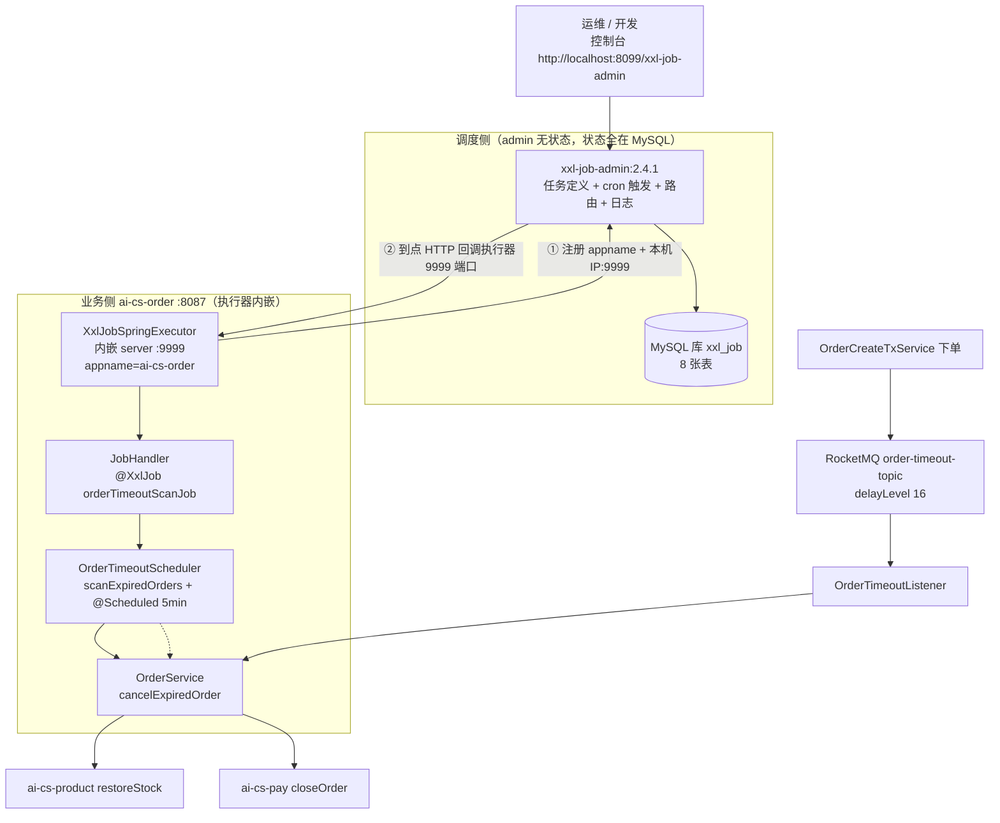
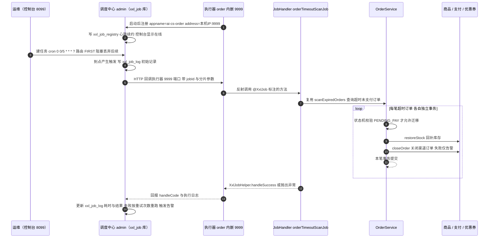

# 05-XXL-Job 分布式调度：不重复执行、失败看得见、扩缩容不崩

> **一句话结论**：分布式调度要解决三件事——不重复执行、失败能看到、扩缩容不崩；XXL-Job 的解法是把"什么时候跑、派给谁、跑成什么样"这三件事从业务进程里搬到一个独立的调度中心（admin），业务服务只留一个"执行器 + JobHandler"，代价是多一套 admin + 一个独立库。
> **阅读前置**：读过 [02-Kubernetes入门](./02-Kubernetes入门.md) 的多副本/Service 概念（本篇讨论"3 个副本都在跑同一个定时任务"），以及 [04-Prometheus可观测性](./04-Prometheus可观测性.md) 的"指标/日志分开看"的视角；订单状态机与事务请对照 `ai-cs-order/src/main/java/com/aics/order/statemachine/OrderStateTransitionService.java`。
> **证据基线**：A 级 9 处锚点（13 次引用，全部落在 `learning-docs/24-源码分析/assets/source/` 的 spring-tx 摘录：事务切面、线程绑定资源、`rollbackFor` 默认值）+ B 级 22 处（`pom.xml`、`ai-cs-order/src/main/resources/application.yml`、`docker-compose.yml`、`deploy/mysql/xxl-job-init.sql`、`deploy/k8s/xxl-job.yaml`）+ C 级 9 条本机 pwsh 实测（工具链/端口探测、`~/.m2` 依赖清单、调度注解统计、compose 解析统计、宿主与 JVM 时区探测、`eff-order.xml` 取证、`git` 跟踪性、`deploy/k8s/services/` 清单、compose 变体 grep）；预计阅读 25 分钟。

**证据边界（先划清楚，后面每句结论都落在这条线内）**

| 类别 | 本仓 / 本机真实状态 | 本篇怎么处理 |
|---|---|---|
| 调度中心运行态 | 本机 `docker` `MISSING`、`kubectl` `MISSING`、`jenkins` `MISSING`（C 级探测原文，见 §6.1）；端口 8099 `CLOSED` | 不写"已验证可调度"，只给静态证据 + 命令与判读 |
| 执行器是否在跑 | `aics.xxl-job.enabled` 默认 `false`（`ai-cs-order/src/main/resources/application.yml#L54`） | 一律写"代码就位、默认未启用"，不写成已上线 |
| 依赖能否离线构建 | `~/.m2/repository/com/xuxueli/xxl-job-core/2.4.1/` 只有 `.pom` 与 `.pom.lastUpdated`，**全盘没有 xxl-job 的 jar**（C 级实测） | 不写"编译通过"；写"本机缺 jar，离线编译会失败" |
| 源码摘录库覆盖 | 905 份摘录中以 Spring / Spring Boot / Spring AI / spring-tx 为主，**没有任何 spring-context 调度源码**（`ScheduledAnnotationBeanPostProcessor` 0 命中） | `@Scheduled` 一节不挂 A 级锚点，改用代码行为 + C 级统计 |
| 分片任务 | `getShardIndex` / `getShardTotal` 全仓 **0 命中**，`IJobHandler` 接口实现类 **0 个** | 分片一节讲语义 + 给出最小改法，标 ❌ 未落地 |
| 仓库里的一手证据边界 | `ai-cs-order/eff-order.xml`（13277 行 effective-pom 快照）**未被 git 跟踪**（`git status` 显示 `??`），里面却残留 `net.javacrumbs.shedlock:shedlock-spring:5.10.0`、`shedlock-provider-jdbc-template:5.10.0`、`com.aliyun.schedulerx:schedulerx2-worker:1.13.3`，而所有 `pom.xml` 对 `shedlock` / `schedulerx` 的命中都是 **0** | 不拿它当"项目已用 ShedLock / SchedulerX"的证据，只当本地产物残留写进 §6.8 |

---

## 0. 先看现象

**现象一：主路径的异常被"吃掉"，消息照样被确认。**

`ai-cs-order/src/main/java/com/aics/order/listener/OrderTimeoutListener.java#L29-L33`：

```java
try {
    eventPublisher.publishEvent(new OrderTimeoutEvent(orderNo));
} catch (Exception e) {
    log.error("发布订单超时领域事件失败: orderNo={}", orderNo, e);
}
```

RocketMQ 的消费语义是"不抛异常 = 消费成功 = ACK"。这段 `catch` 只打日志不再抛，于是：关单失败 → 消息被确认 → 不可重投。而这条消息本身只有一次机会——`ai-cs-order/src/main/java/com/aics/order/service/impl/OrderCreateTxService.java#L144-L146` 发的是**一次性延迟消息**：

```java
rocketMQTemplate.syncSend("order-timeout-topic",
        MessageBuilder.withPayload(orderNo).build(),
        5000, 16); // delayLevel 16 ≈ 30min
```

配合 `@Value("${order.timeout-minutes:30}")`（同文件 `#L61-L62`）——过期时间 30 分钟、延迟消息也是 30 分钟级，两条时间线几乎重合。

**现象二：多副本部署时，兜底扫描在每个副本上各跑一遍。**

`ai-cs-order/src/main/java/com/aics/order/task/OrderTimeoutScheduler.java#L29-L54` 里没有任何锁，日志字符串是三段固定的：

```text
定时任务：扫描超时未支付订单...
定时任务：无超时订单
定时任务：取消订单失败 orderNo=xxx
```

三个副本就是三份 `扫描超时未支付订单...`、三份 `selectList`、三份并发去调 `cancelExpiredOrder`。日志里同一秒出现三条相同 `orderNo` 的取消记录，是这个问题的标准指纹。

**现象三：执行器"配了"，但从来没注册上。**

`ai-cs-order/src/main/resources/application.yml#L53-L58` 有完整的执行器配置段，`XxlJobConfig.java#L44` 还会打印一行 `XXL-Job 执行器已启用: admin=..., port=9999`——但默认 `enabled: ${XXL_JOB_ENABLED:false}` 是关的，本机 8099 也是 `CLOSED`。也就是说：**日志里没有这行 = 开关没开；有这行但控制台"执行器管理"里看不到节点 = admin 不可达或端口不通**。

更隐蔽的一种：`XxlJobConfig.java#L26` 写的是 `@Value("${aics.xxl-job.admin-addresses}")`——**没有默认值**。一旦有人只把 `aics.xxl-job.enabled` 打开、却把 `admin-addresses` 覆盖成空/Nacos 里删了这项，启动就会直接失败在占位符解析（Spring 的固定格式：`Could not resolve placeholder 'aics.xxl-job.admin-addresses'`）。相比之下 `access-token` 和 `port` 都写了默认值（`#L29`、`#L32`），唯独最关键的地址没写。

这些现象指向同一件事：**"任务该由谁在什么时候跑、跑失败算谁的"这件事，项目里没有唯一的裁决者**——MQ 只管投递不管重试，`@Scheduled` 每个副本都跑，admin 有编排但执行器默认不启用，于是每一层都只能"尽力而为"。

---

## 1. 整体地图



> **读图说明**：图里有两条完全不同的控制流。**实线环是"调度中心驱动"**——执行器主动向 admin 注册（①），admin 到点反向回调执行器的 9999 端口（②），执行器自己不决定"什么时候跑"；这就是"不重复执行"的物理基础：只有 admin 会发号施令，且一轮只发给一台。**虚线部分是"业务进程自己驱动"**——`@Scheduled` 不经过 admin，每个副本都跑；RocketMQ 那支只在"下单时发的那一次延迟消息"到点时触发。注意两支最终都汇到同一个 `cancelExpiredOrder`，这就是为什么幂等只能做在业务方法里（§3.8），不能靠调度层兜。图中 `:8087` 是业务端口、`:9999` 是执行器内嵌 server 端口，两者互不相干——admin 只认 9999。

组件职责表：

| 组件 | 责任 | 参与方 | 本仓落点 | 落地状态 |
|---|---|---|---|---|
| 调度中心 admin | 存任务定义、按 cron 触发、按路由策略选执行器、收结果、记日志、重试与告警 | 运维（建任务/看日志） | `docker-compose.yml#L235-L257`（镜像 `xuxueli/xxl-job-admin:2.4.1`，宿主 8099→容器 8080） | ⚠️ 编排已写，本机未启动 |
| 调度库 `xxl_job` | 任务、日志、注册表、锁表 | admin 独占 | `deploy/mysql/xxl-job-init.sql`（8 张表） | ✅ 建表脚本在库 |
| 执行器 | 注册到 admin、接收回调、执行 JobHandler、回报结果 | ai-cs-order 进程 | `ai-cs-order/src/main/java/com/aics/order/task/XxlJobConfig.java#L36-L46` | ⚠️ 代码就位，默认关闭 |
| JobHandler | 一次调度的入口方法 | 业务开发 | `ai-cs-order/src/main/java/com/aics/order/task/OrderTimeoutScanJob.java#L27-L32` | ✅ 1 个 |
| 本地兜底扫描 | admin 缺席时的兜底 | ai-cs-order 进程 | `ai-cs-order/src/main/java/com/aics/order/task/OrderTimeoutScheduler.java#L29` | ✅ 默认唯一在跑的 |
| 延迟消息 | 实时主路径 | order / RocketMQ | `ai-cs-order/src/main/java/com/aics/order/service/impl/OrderCreateTxService.java#L143-L146` | ✅ |
| 巡检脚本 | admin 容器与 8099 端口纳入巡检 | SRE | `deploy/scripts/check-local.ps1#L93`、`#L108` | ✅ |

---

## 2. 关键概念与关键类/关键配置

先把术语钉死（后面全文按这套词说）：

- **调度中心（admin）**：独立部署的 Web 应用，知道"有哪些任务、什么时间跑、派给谁"。它**不执行业务代码**。
- **执行器（executor）**：内嵌在业务服务里的一个 HTTP server（本项目 9999），负责"报到 + 接单 + 跑 + 回报"。
- **JobHandler**：执行器里真正跑的那段代码，用 `@XxlJob("名字")` 注册，admin 侧靠这个名字找人。
- **路由策略**：admin 从"同 appname 的多台执行器"里挑几台。挑一台 = FIRST/轮询/一致性哈希等；挑全部 = 分片广播。
- **分片（sharding）**：广播给 N 台时，每台拿到 `(shardIndex, shardTotal)`，**数据切分要业务自己写**。
- **阻塞处理策略**：同一任务上一次还没跑完、下一次又到点了怎么办（丢弃 / 串行 / 覆盖）。
- **调度过期（misfire）**：admin 停机错过了触发点，恢复后补不补。

| 名称 | 位置 | 角色 | 关键参数 / 语义 |
|---|---|---|---|
| `xxl-job-core` 版本 | `pom.xml#L81`、`#L302-L306` | 唯一版本来源（dependencyManagement 统一） | `2.4.1`；模块侧只写 `artifactId`（`ai-cs-order/pom.xml#L143-L146`） |
| `XxlJobSpringExecutor` | `XxlJobConfig.java#L36-L46` | 执行器 Bean，随容器启停 | `appname=ai-cs-order`(#L39)、`port=9999`(#L40)、`logPath=~/logs/xxl-job/ai-cs-order`(#L42)、`logRetentionDays=7`(#L43) |
| `@ConditionalOnProperty` | `XxlJobConfig.java#L23` | 开关式装配 | `aics.xxl-job.enabled=true` 才创建执行器 |
| `@XxlJob` | `OrderTimeoutScanJob.java#L27` | JobHandler 名，admin 建任务时填 | 值 = `orderTimeoutScanJob`（必须逐字一致） |
| `XxlJobHelper` | `OrderTimeoutScanJob.java#L31` | 结果回报 + 分片参数入口 | `handleSuccess/handleFail`；`getShardIndex()/getShardTotal()` |
| 路由策略 | `xxl_job_info.executor_route_strategy`（`deploy/mysql/xxl-job-init.sql#L19`） | 派给谁 | FIRST / 轮询 / 随机 / 一致性哈希 / 最不经常使用 / 故障转移 / 忙碌转移 / 分片广播 |
| 阻塞处理策略 | `xxl_job_info.executor_block_strategy`（`#L22`） | 上一轮没完怎么办 | 单机串行 / 丢弃后续调度 / 覆盖之前调度 |
| 调度过期策略 | `xxl_job_info.misfire_strategy`（`#L18`） | admin 漏触发后补不补 | 默认 `DO_NOTHING` |
| 超时 | `xxl_job_info.executor_timeout`（`#L23`） | 单次执行最长多久 | 秒；0 = 不限 |
| 失败重试 | `xxl_job_info.executor_fail_retry_count`（`#L24`） | 失败自动重跑几次 | 默认 0 |
| 执行日志 | `xxl_job_log`（`#L37-L54`） | 每次触发的账本 | `trigger_code/handle_code`、`executor_sharding_param`(#L45)、`alarm_status`(#L53) |
| 注册表 | `xxl_job_registry`（`#L82-L89`） | 在线执行器清单 | 唯一索引（group+key+value），admin 定时清理过期节点 |
| 执行器分组 | `xxl_job_group`（`#L94-L102`） | appname ↔ 地址清单 | `address_type`：`0` 自动注册 / `1` 手动录入（`#L99`） |
| 调度锁 | `xxl_job_lock`（`#L116-L121`） | admin 集群内互斥 | 固定一行 `schedule_lock`，靠行锁保证"同一时刻只有一个 admin 在触发" |

业务侧 4 个配置项（`ai-cs-order/src/main/resources/application.yml#L53-L58`，C 级统计 = 4 项）：

| 配置项 | 默认值 | 作用 | 坑 |
|---|---|---|---|
| `aics.xxl-job.enabled` | `${XXL_JOB_ENABLED:false}` | 是否创建执行器 | 关着也不会报错——**这就是"以为配了其实没开"的根源** |
| `aics.xxl-job.admin-addresses` | `${XXL_JOB_ADMIN:http://127.0.0.1:8099/xxl-job-admin}` | admin 集群地址，逗号分隔 | 代码里**没有默认值**（`XxlJobConfig.java#L26`），删了这项启动即失败 |
| `aics.xxl-job.access-token` | `default_token` | 执行器与 admin 的通信令牌 | 必须与 admin 的 `--xxl.job.accessToken` 一致（`docker-compose.yml#L246`） |
| `aics.xxl-job.executor.port` | `9999` | 内嵌 server 端口 | 与业务端口 8087 无关；非 K8s 环境必须对外可达 |

---

## 3. 原理与证据逐段精读

### 3.1 执行器的开关式装配：为什么 `@ConditionalOnProperty` 比"集成方式"更值得学

**在干什么**：`XxlJobConfig` 整个类被 `@ConditionalOnProperty(name = "aics.xxl-job.enabled", havingValue = "true")` 罩住（`XxlJobConfig.java#L23`），开关关着时这个 `@Configuration` 根本不参与装配，`xxlJobExecutor` bean 压根不存在；打开才 `new XxlJobSpringExecutor()` 并逐项 `set`（`#L36-L46`）。

**为什么这么设计**：执行器启动时会**主动向 admin 注册**，注册不上就按间隔重试。本地开发没有 admin 时，如果无条件装配，结果就是每分钟几条注册失败日志、外加一个占着 9999 的空 server——开发体验被中间件绑架。注释把意图写得很直白：`enabled=false` 时"本服务退回 `@Scheduled` 兜底扫描，保证本地无 admin 也能正常启动"（`XxlJobConfig.java#L18-L19`）。而 `XxlJobConfigTest` 正是用 `ApplicationContextRunner` 把这条契约锁死：默认时 `assertFalse(context.containsBean("xxlJobExecutor"))`（`ai-cs-order/src/test/java/com/aics/order/task/XxlJobConfigTest.java#L22`），给上属性时 `assertTrue`（`#L29`）。

**换写法会怎样**：把 `@Value` 换成构造函数注入 + `@ConfigurationProperties`，好处是能 `@Validated` 强制 `admin-addresses` 非空、能在 IDE 里补全；坏处是这 4 个参数的注入点变得"看起来像业务配置"。若把开关做成 Nacos 动态开关（`@RefreshScope`），改配置就能启停执行器——但注册/注销是有网络副作用的操作，热刷新比"重启一次"更难排查，本项目选了重启。

**常见坑**：① 只开 `enabled` 不开 `admin-addresses` → 占位符解析失败；② 只在 IDE 里加了 `-Daics.xxl-job.enabled=true`，而容器里跑的是镜像，环境变量没进 `XXL_JOB_ENABLED`，于是线上仍是关的；③ 开关的 key 是 `aics.xxl-job.enabled` 而 `@Value` 读的是 `aics.xxl-job.admin-addresses`——**两套前缀写法混用**（点号 vs 短横线）在 `-D` 命令行和宽松绑定下都容易出岔子，写配置时以 yml 里的原文为准。

### 3.2 JobHandler 只做入口：薄入口 + 厚复用

**在干什么**：`OrderTimeoutScanJob` 的方法体只有三行——打一行日志、调 `orderTimeoutScheduler.scanExpiredOrders()`、`XxlJobHelper.handleSuccess("订单超时扫描完成")`（`OrderTimeoutScanJob.java#L28-L32`）。

**为什么这么设计**：这段扫描逻辑已经被 `@Scheduled` 用着，JobHandler 再写一份就会出现"两套超时关单逻辑"。把 JobHandler 做成**纯入口**，调度方式（本地 cron / 中心 cron / 手动"执行一次"）与业务实现解耦——这也是"换调度框架时只改入口"的前提。

**换写法会怎样**：直接在 `@XxlJob` 方法里写 `@Transactional` + 全量扫描 + 逐单取消，看起来更"内聚"，实际上把"调度边界"和"事务边界"粘死了：一次调度里所有订单共用一个事务，第 500 单失败会把前 499 单一起回滚，且重试会把已成功的再跑一遍（因为事务已回滚，状态没落库）。反过来，如果让 JobHandler 完全不知道分片参数，将来要分片就得改方法签名——这正是本项目现在的状态（§3.5）。

**常见坑**：① `handleSuccess` 只表示"handler 没抛异常"，**不代表业务全部成功**——`scanExpiredOrders` 内部逐单 `catch (Exception e)`（`OrderTimeoutScheduler.java#L50-L52`），所以"10 单失败 3 单"在 admin 里照样是绿色成功。② 方法无返回值、无 `try/catch` 时，异常会冒泡到执行器，admin 侧记为失败并可能重试（`executor_fail_retry_count`）——本项目没配重试（默认 0），所以失败就是失败，只能靠下一轮。

### 3.3 注册：执行器怎么"报到"

**在干什么**：执行器启动后，把 `(registry_group, registry_key=appname, registry_value=address)` 写进 admin 的 `xxl_job_registry` 表（表结构与唯一索引见 `deploy/mysql/xxl-job-init.sql#L82-L89`），并按 30 秒级心跳续约；admin 侧定时把过期节点剔掉。控制台"执行器管理"里看到的那一行"在线地址"，就是这张表的投影。地址来源可以是自动注册（`xxl_job_group.address_type=0`）或手工录入（`1`，见 `#L99`）。

**为什么这么设计**：调度中心**不主动探活**，只信执行器上报——这样扩缩容不需要改任何 admin 配置：新 Pod 起来自己写一行，Pod 挂了心跳停了自己消失。这也是"扩缩容不崩"的实现方式：地址清单是**动态表**，不是配置文件。

**换写法会怎样**：手工录入地址（`address_type=1`）在 K8s 里几乎必错——Pod IP 每次重建都变，手工清单会指向已回收的 IP，admin 回调超时，表现为"任务一直在跑但业务没反应"。若不用注册表、改用 Nacos/Consul 做服务发现，得自己实现 `ExecutorRegistry` 那一层，等于重写一遍。

**常见坑**：① 执行器多网卡时（容器 + 宿主机 veth），自动探测到的 IP 可能是 admin 到不了的地址——`XxlJobConfig` 没调 `setIp(...)`，只设了 `setPort(9999)`（`#L40`），这是个**已知风险点，本项目未实测**；② K8s 下 `deploy/k8s/services/` 里只有 api-gateway/user/knowledge/ai-chat/search/message/notify/product 八个清单，**没有 order-service**，也没有任何 Service 暴露 9999，所以一旦上 K8s，admin 只能靠 Pod IP 直连，Pod 重建就会短暂失联；③ 9999 只监听容器内不对外，宿主/集群网络策略默认会拦——报错形态是 admin 日志里的回调超时，不是执行器报错。

### 3.4 路由策略：谁来接单

| 策略 | 语义 | 适合的任务 | 本项目的适用性 |
|---|---|---|---|
| FIRST | 固定选地址列表第一个 | 单实例含义、幂等、不想并发 | ✅ 本项目 `OrderTimeoutScanJob.java#L25` 注释即建议 FIRST |
| 轮询 / 随机 | 依次 / 随机挑一台 | 多台分摊负载、无状态 | ⚠️ 扫描类任务用它 = 多台轮流扫，仍可能重叠 |
| 一致性哈希 | 按任务参数哈希固定落到某台 | 有本地缓存/本地文件的任务 | ❌ 本项目无此需求 |
| 最不经常使用 / 忙碌转移 | 挑最闲的空闲执行器 | 长任务、要避开忙节点 | ❌ 未配置 |
| 故障转移 | 失败后自动换一台重试 | 高可用要求 | ⚠️ 与"幂等"必须同时成立才安全 |
| 分片广播 | 发给**全部**执行器，每台带 `shardIndex/shardTotal` | 大数据量并行处理 | ❌ 本项目未实现（§3.5） |

**在干什么**：admin 触发时按 `xxl_job_info.executor_route_strategy`（`deploy/mysql/xxl-job-init.sql#L19`）从 `appname` 对应的在线地址里选目标，然后 HTTP 回调其 9999 端口。

**为什么这么设计**：把"派给谁"做成策略，是因为同一个调度问题在不同任务上答案相反——关单扫描想"只跑一次"，导出报表想"多台并行"。策略放在 admin 侧，业务代码不用感知。

**换写法会怎样**：用轮询替代 FIRST，扫描任务在多实例下变成"每次换一台扫"，如果上一台的扫描还没结束（阻塞策略又不是丢弃），会出现两台同时扫同一批单——这正是"路由 + 阻塞策略必须一起想"的原因。用故障转移而不做幂等，则"失败重试"会直接变成"重复执行"。

**常见坑**：① 改路由策略不会重算已触发的实例，改完要等下一轮；② FIRST + 执行器扩到 3 台但 3 台配置不一致（老版本代码）时，任务只会落到"列表第一台"，恰好是老版本就可能一直跑旧逻辑；③ 分片广播在只有 1 台执行器时不会报错，只是"每片都是全量"，很容易被误判成"分片正常工作"。

### 3.5 分片广播：每片拿到 index/total，切数据必须自己写

**在干什么**：路由策略选分片广播时，admin 把同一次触发**发给全部 N 台执行器**，每台收到自己的 `shardIndex`（0..N-1）与 `shardTotal`（=N），业务代码用 `XxlJobHelper.getShardIndex()` / `getShardTotal()` 读取，然后**自己**决定"我只处理哪一部分"。分片参数同时落库到 `xxl_job_log.executor_sharding_param`（`deploy/mysql/xxl-job-init.sql#L45`），事后可以核对每片跑了多少。

**为什么这么设计**：这是"扩缩容不崩"的另一半——数据量涨了不加机器就得跑很久，加机器却不能让每台都处理全量。分片把"并行度"变成"执行器台数"，且**不需要改 admin 配置**：从 3 台扩到 5 台，`shardTotal` 自动变 5。

**换写法会怎样**：用 `id % shardTotal == shardIndex` 是最省事的切法，但对"时间窗口 + 状态"型查询要小心：每台都 `select ... where expire_time < now() limit 1000` 而不加 `id % N` 过滤，就是"5 台各扫全量、各关一遍"。所以本项目现在的写法（`OrderTimeoutScheduler.java#L38-L41` 全量查询 + 逐单取消）**如果直接改成广播，会立刻变成 5 倍并发写同一批订单**——C 级统计显示全仓 `getShardIndex`/`getShardTotal` 命中 **0 次**，即当前根本没做这层。

最小改法（示意，未经实测，仅结构参考）：

```java
@XxlJob("orderTimeoutScanJob")
public void orderTimeoutScanJob() {
    int index = XxlJobHelper.getShardIndex();   // 本片编号
    int total = XxlJobHelper.getShardTotal();   // 本片总数
    // 只取属于本片的订单号：按主键取模，避免每台都扫全量
    List<Order> expired = orderMapper.selectList(new LambdaQueryWrapper<Order>()
            .eq(Order::getStatus, OrderStatus.PENDING_PAY.getCode())
            .lt(Order::getExpireTime, LocalDateTime.now())
            .apply("MOD(id, {0}) = {1}", total, index));
    XxlJobHelper.log("分片 {}/{} 命中 {} 单", index, total, expired.size());
    for (Order o : expired) {
        orderService.cancelExpiredOrder(o.getOrderNo());
    }
    XxlJobHelper.handleSuccess("分片处理完成");
}
```

**常见坑**：① 只在 admin 里把策略改成"分片广播"、代码里不读 index —— 每台都跑全量，是分片最常见的翻车方式；② 分片数 ≠ 执行器数时（比如想用 1 台模拟 4 片）需要开 `executor.shardingTotal` 之类的手工分片能力，属于"不用执行器台数决定并行度"的做法，配错就少算一片；③ 分片内单笔失败要不要让整片失败？本项目 `catch` 在调用方（`OrderTimeoutScheduler.java#L50-L52`），单笔失败不影响整片，代价是失败被日志吞掉（回到 §0 现象一）。

### 3.6 阻塞处理策略、超时、失败重试与 misfire：四个"到时了"的参数

**在干什么**：这四个参数全部存在 `xxl_job_info` 里，不需要改代码：

- `executor_block_strategy`（`deploy/mysql/xxl-job-init.sql#L22`）：单机串行（排队）/ 丢弃后续调度（跳过本轮）/ 覆盖之前调度（中断上一轮）。上一轮没跑完时生效。
- `executor_timeout`（`#L23`）：单次执行超时秒数，0 = 不限。超时在 admin 侧判定为失败。
- `executor_fail_retry_count`（`#L24`）：失败自动重试次数。注意它重试的是**整个 JobHandler**，不是"失败的某一单"。
- `misfire_strategy`（`#L18`，默认 `DO_NOTHING`）：admin 停机错过触发点后，恢复时怎么处理这段空档。

**为什么这么设计**：调度系统无法预知任务耗时，"到点了但还没跑完"必然发生。把这四种应对策略参数化，运维不用改代码就能换行为——这正是 `@Scheduled` 做不到的地方（`fixedDelay` 能在一定程度上避免重叠，但改周期必须改代码重启）。

**换写法会怎样**：用 `fixedDelay` 的 `@Scheduled` 天然串行（下一次从上次结束算起），代价是"任务变慢时会一直后移，实际频率漂移且没人知道"。用 `fixedRate` 则可能在同一实例内堆线程。XXL-Job 把选择权交出来：扫描类任务选"丢弃后续调度"（宁可少跑一轮也不堆积），对"必须执行"的任务选"单机串行"+"失败重试"。

**常见坑**：① 选"覆盖之前调度"给一个会写库的扫描任务 → 上一轮被打断时事务边界不明，可能出现半途状态（本项目 `cancelExpiredOrder` 是逐单事务，风险相对可控，但要清楚这是"打断"而不是"回滚"）；② `executor_timeout` 设得比任务真实耗时短，会让 admin 记失败而后台还在跑，重试再来一轮 → 双跑；③ `misfire_strategy=DO_NOTHING`（默认）意味着 admin 挂了 1 小时，恢复后这 1 小时的触发**不会补**——本项目之所以留 `@Scheduled` 兜底，正是因为"漏了要有东西捡"；④ 失败重试次数写大了遇上"每次都失败"的任务（比如 admin 侧地址配错）会放大日志与告警噪声。

### 3.7 cron 与时区：表达式里的 `0 0 2 * * ?` 到底指几点

**在干什么**：cron 表达式由 admin 解析，用的是 **admin 进程的 JVM 默认时区**，不是浏览器的时区，也不是业务服务的时区。本项目 admin 跑在容器里（`docker-compose.yml#L235-L257`），该段的 `PARAMS` 只配了 `--spring.datasource.url=...&serverTimezone=Asia/Shanghai`（`#L242-L246`）——这是 **JDBC 连接的时区**，跟 JVM 默认时区是两回事。

**为什么这么设计**：调度时间属于"运维视角的墙钟时间"，交给调度中心统一解释，业务进程就不用关心。代价是：时区是**部署事实**，不是代码事实。

**换写法会怎样**：如果容器基础镜像默认 UTC（多数官方镜像如此），那么"每天凌晨 2 点"会变成北京时间 10 点。要改就得给 admin 加 `-Duser.timezone=Asia/Shanghai` 或挂 `/etc/localtime`——本项目**没有做这件事（未落地）**，`PARAMS` 里也没有任何时区参数。同理，`@Scheduled` 一边用的是业务进程的 JVM 时区（`ai-cs-order` 也是容器/本机），两边时区不一致时"5 分钟一轮"的语义也会错位。

本机实测（C 级，直接跑，不启动任何容器）：

```powershell
# ① 宿主时区
[System.TimeZoneInfo]::Local.Id
# ② JVM 时区：未显式设置时，属性列表里不会出现 user.timezone 这一行
java -XshowSettings:properties -version 2>&1 | Select-String 'user.timezone|user.country|java.version'
```

真实输出：

```text
China Standard Time

    java.version = 17.0.19
    user.country = CN
```

**判读**：`user.timezone` **没有出现在输出里** ⇒ 本机 JVM 没有显式设置时区，实际按宿主 `China Standard Time`（UTC+8）解释 `LocalDateTime.now()` 与 cron。这条命令的价值在于：**"没有这一行"本身就是结论**——同一份 jar 丢进默认 UTC 的容器，`user.timezone` 同样不出现，但基准悄悄变成 UTC，`0 0 2 * * ?` 就整体偏 8 小时。所以排查时区不要只看有没有配置，要进容器比 `date` 与 `date -u` 的输出差，或显式搜索 `-Duser.timezone` 是否出现在 `PARAMS` 里。

**常见坑**：① 用 `America/New_York` 之类的夏令时时区做 cron，切换日会多/少一小时；② 代码里 `LocalDateTime.now()`（`OrderTimeoutScheduler.java#L41`）取的是**服务进程时区**，而数据库 `expire_time` 是写入时的进程时区——如果 web 实例与定时任务实例时区不同（滚动发布混跑），比较结果会偏几小时，表现为"订单刚下单就被判超时"或"超时半小时还不关"；③ 想在表达式里写时区（Quartz 支持 `TZ=` 后缀语法），XXL-Job 的 cron 解析不支持这种写法，别照抄 Quartz 的配置。

### 3.8 幂等：调度重复触发、机器重启补跑，都得靠业务自己兜

**在干什么**：`cancelExpiredOrder` 开头先查一次状态，不满足 `PENDING_PAY` 直接 `return`（`ai-cs-order/src/main/java/com/aics/order/service/impl/OrderServiceImpl.java#L169-L173`）：

```java
Order order = orderMapper.selectOne(new LambdaQueryWrapper<Order>().eq(Order::getOrderNo, orderNo));
if (order == null || !OrderStatus.PENDING_PAY.getCode().equals(order.getStatus())) {
    return; // 已支付或已取消，忽略
}
```

真正的"合法性"判定在状态机里：`OrderStateTransitionService.transit()` 重置状态机后 `sendEvent`，迁移不被接受就抛 `BusinessException(ResultCode.BAD_REQUEST, "订单状态不允许迁移: ...")`（`ai-cs-order/src/main/java/com/aics/order/statemachine/OrderStateTransitionService.java#L21-L35`）。

**为什么这么设计**：调度的重复来源至少四种——cron 到点重试、阻塞策略选错、多副本 `@Scheduled`、admin 补跑（misfire），加上人为"执行一次"。指望调度层不重复是不可能的，所以判据必须落在**数据状态**上：`PENDING_PAY → CANCELLED` 合法，`CANCELLED → CANCELLED` 非法。这就是"幂等是定时任务第一课"的具体落法。

**换写法会怎样**：把判据写成"查询结果为空就跳过"（只靠 `selectList` 条件过滤）不够——两个线程同时查到同一单、同时进事务，都会认为状态是 `PENDING_PAY`。本项目还有 `synchronized (orderStateMachine)`（同文件 `#L23`），但它锁的是**进程内的一个 Spring bean**，多实例之间不生效。真正跨进程的兜底有三条路：DB 乐观锁（`update ... where status='PENDING_PAY'` 看影响行数）、唯一约束（如"同一订单只允许一条取消流水"）、或者把任务做成"单实例执行"（FIRST + 只跑一台）。本项目用的是"FIRST 建议 + 状态机 + 查询过滤"这一组合，**跨实例的强幂等未落地**（`synchronized` 不跨进程，代码里没有分布式锁）。

**常见坑**：① 用 Redis 分布式锁做幂等，但锁的粒度是"整个任务"——任务跑 3 分钟、锁 30 秒过期，第二个实例照样进来；② 幂等键用"日期"导致跨天补跑重复；③ `catch (Exception e)` 把状态迁移异常也吞了（`OrderTimeoutScheduler.java#L50-L52`），看起来"重复执行无害"，实际是"异常不可见"，两者不是一回事。

### 3.9 调度与业务事务的边界：别把长事务放进任务里

**在干什么**：`cancelExpiredOrder` 是 `@Transactional(rollbackFor = Exception.class)`（`OrderServiceImpl.java#L167`），里面做了：状态机迁移 + `updateById`（`#L223-L225`）+ 逐条 `productClient.restoreStock(...)`（`#L228-L232`，**跨服务 HTTP 调用**）+ `closePayChannel(order)`（`#L235`，调用支付服务）+ 优惠券回补（`#L238-L246`）。也就是说，**一个本地事务里包着两次跨服务调用**。

**为什么这么设计**（其实是"为什么容易长成这样"）：关单要"要么全成要么全不成"，最直观的写法就是把所有步骤塞进一个 `@Transactional`。Spring 的事务边界确实就是一个方法调用，A 级证据在 `TransactionAspectSupport`：`invokeWithinTransaction` 里先取 `TransactionAttributeSource`、再取 `txAttr`、最后 `determineTransactionManager(...)`（[[源码:TransactionAspectSupport.java.md#L333-L339]]），然后 `if (txAttr == null || !(ptm instanceof CallbackPreferringPlatformTransactionManager ...))` 走标准分界——`createTransactionIfNecessary(...)` 开事务、`invocation.proceedWithInvocation()` 执行业务、异常时 `completeTransactionAfterThrowing(...)`（[[源码:TransactionAspectSupport.java.md#L363-L375]]）。事务的"资源"是**线程绑定**的：`TransactionSynchronizationManager` 用 `private static final ThreadLocal<Map<Object, Object>> resources`（[[源码:TransactionSynchronizationManager.java.md#L77-L78]]）把连接挂在当前线程上，`getResource(...)` 拿到的就是同一个连接（[[源码:TransactionSynchronizationManager.java.md#L133-L142]]）。所以事务有多长，等于"从进入代理到方法返回"的墙钟时间——**HTTP 调用耗时也算在里面**。

**换写法会怎样**：把 `restoreStock` / `closeOrder` 提到事务外（先落状态，再异步补偿），事务就短了，但会失去"本地一致性"，需要补偿表或最终一致设计。折中做法是常见的三层：

1. **任务层不包事务**：JobHandler 只负责"找出一批订单号"，逐单调用；
2. **单笔短事务**：`cancelExpiredOrder` 里只做 DB 状态迁移 + 本地表更新，跨服务调用移出事务（本项目 `closePayChannel` 已经是"尽力而为 + 只告警"的写法，`#L253-L266`，方向是对的；`restoreStock` 仍在事务内，是**待改点**）；
3. **批量控制**：`selectList` 没有 `limit`（`OrderTimeoutScheduler.java#L38-L41`），订单量上万时一次捞全表、再逐单长事务，会把连接池占满——判读方式是看 `hikaricp_connections_active` 是否贴着上限（§6.6）。

顺带一个和 `@Transactional` 强相关的坑：`rollbackFor` 必须显式写。`@Transactional` 的默认回滚规则是"只回滚 `RuntimeException` 与 `Error`"，源码层面 `Class<? extends Throwable>[] rollbackFor() default {}`（[[源码:Transactional.java.md#L247]]）、传播行为默认 `Propagation.REQUIRED`（[[源码:Transactional.java.md#L178]]）；而"参与已有事务"的判定在 `handleExistingTransaction(...)`（[[源码:AbstractPlatformTransactionManager.java.md#L384]]）。所以收到受检异常（如 `IOException`）时不写 `rollbackFor` 就会"提交一半"——本项目写的是 `rollbackFor = Exception.class`，是正确姿势。

另外，`@Transactional` 生效的前提是**外部 Bean 经过代理调用**——代理是在 `ProxyTransactionManagementConfiguration` 里注册的 `BeanDefinition`（`@Configuration(proxyBeanMethods = false)` + 一个 `transactionAdvisor`，把 `TransactionInterceptor` 作为 advice 挂上去，[[源码:ProxyTransactionManagementConfiguration.java.md#L39-L56]]），拦截入口是 `TransactionInterceptor.invoke(...)`（[[源码:TransactionInterceptor.java.md#L123-L130]]）。这也是为什么 `OrderTimeoutScheduler` 调 `orderService.cancelExpiredOrder(...)` 有事务（跨 bean，走代理），而如果把它写成"同一个类里自调用"，事务就静默失效。

**常见坑**：① 在 JobHandler 上直接加 `@Transactional`，把整批订单包进一个事务（回滚风险 + 长事务）；② 事务里调 Feign 而对方超时（默认读超时往往是秒级），线程被占住，`@Scheduled` 线程池只有一个线程时会把后续轮次全堵死；③ `@Scheduled` 注解写在 javadoc **之前**（`OrderTimeoutScheduler.java#L29-L36` 就是这种顺序）——语法合法但极易被后来的维护者看漏，以为这方法没人调。

### 3.10 任务可观测：执行日志、耗时、成功率

**在干什么**：每次触发在 `xxl_job_log` 里留一行（表结构 `deploy/mysql/xxl-job-init.sql#L37-L54`）：`trigger_code`（调度是否发出）、`handle_code`（执行结果）、`executor_sharding_param`（分片参数，`#L45`）、`alarm_status`（0-默认 / 1-无需告警 / 2-告警成功 / 3-告警失败，`#L53`）。按天汇总进 `xxl_job_log_report`（`#L59-L67`）算成功率。执行器侧的详细日志落在 `logPath` 目录，`logRetentionDays=7`（`XxlJobConfig.java#L42-L43`）滚动清理。

**为什么这么设计**："失败能看到"不是"有日志"，而是三件事同时成立：**有没有触发**（trigger_code）、**跑了多久/成没成**（handle_code + 耗时）、**该不该报警**（alarm_status）。三者分开存，才能算出"触发成功率"和"执行成功率"这两个不同指标——前者是 admin 的问题，后者是业务的问题。

**换写法会怎样**：只看应用日志（本项目现状），得到的是"我以为它在跑"；接 Prometheus 自定义指标（`xxl_job` 侧不可用，得自己在 JobHandler 里打点）能进 Grafana，但拿不到"admin 到底有没有触发"这一层。本项目已有 Micrometer Tracing + OTLP 到 Tempo（`ai-cs-order/src/main/resources/application.yml#L61-L67`），理论上可以让任务执行链路进同一套 trace——**未落地，日志里目前只有 `XXL-Job: 执行订单超时扫描` 这一行文本**（`OrderTimeoutScanJob.java#L29`）。

**常见坑**：① 认为"admin 显示成功 = 业务成功"（`handleSuccess` 只是没抛异常，§3.2）；② 不开 `alarm_status` 的告警通道（要配邮箱/企微），失败永远只在表里躺着——本项目**未配置任何告警通道**；③ `logRetentionDays=7` 意味着执行器本地日志 7 天后消失，而 admin 侧 `xxl_job_log` 的清理周期是另一套配置，两边保留期不一致时"日志对不上"。

---

## 4. 一次完整执行时序

下面这条链是**设计链路**（当前本机 admin 未启动、执行器默认关闭，实际只有 `@Scheduled` 那一支在跑）：



> **读图说明**：注意 ①→② 是"执行器主动、admin 被动"，③→⑤ 是"admin 主动、执行器被动"——两个方向都必须是执行器能访问 admin、admin 也能访问执行器 9999，**单向可达就是最常见的不通原因**（防火墙/NAT/集群网络策略只放一个方向）。第 5 步是本图唯一跨进程的调度动作；第 7~12 步都在执行器进程内，`loop` 框住的是"逐单独立事务"——这正是 §3.9 说的边界：任务层不包事务，事务在一笔订单的粒度上。第 13 步的"成功"只表示 handler 没抛异常，业务里被 `catch` 掉的单笔失败在第 15 步的日志里体现，不体现在 `handleCode` 上。

失败在哪一步、报什么：

| 失败步骤 | 现象 | 判读手段 |
|---|---|---|
| ① 注册（admin 不可达） | 执行器日志反复注册失败；控制台无节点 | 8099 端口探测 + `xxl_job_registry` 表查询（§6.2） |
| ① 注册（地址不可达） | 注册成功但控制台节点地址是错网卡 IP，后续回调超时 | 对比节点 IP 与 pod/宿主真实 IP |
| ⑤ 回调 9999 超时 | admin 记 `trigger_code=失败`，业务侧什么都没发生 | `xxl_job_log.trigger_code` + 目标机 9999 连通性 |
| ⑥ handler 不存在 | admin 报"JobHandler 未找到"，名字对不上 | 逐字比对 `@XxlJob` 值与控制台 JobHandler |
| ⑦ 查询拖慢 | 一轮执行时间递增，连接池紧张 | 执行耗时曲线 + `hikaricp_connections_active` |
| ⑩ 跨服务调用失败 | 日志 `通知支付服务关单失败`；库存回补超时 | 事务内跨服务调用，见 §3.9 |
| ⑬ 抛异常 | `handleCode=失败`，按 `executor_fail_retry_count` 重试 | `xxl_job_log` 的失败原因列 + 执行器本地日志 |
| ⑮ 告警未配 | 失败只落库，没人被通知 | `alarm_status` 长期为 0 且无告警记录 |

---

## 5. 设计取舍

**四个方案的取舍（含"自研三件套"的边界）**：

| 方案 | 解决"不重复" | 解决"失败可见" | 解决"扩缩容" | 代价 | 本项目选择 |
|---|---|---|---|---|---|
| `@Scheduled` | ❌ 每副本都跑 | ❌ 只有应用日志 | ❌ 加副本 = 加重复执行 | 零依赖 | ✅ 保留为**兜底**（`OrderTimeoutScheduler.java#L29`） |
| RocketMQ 延迟消息 | ✅ 一条消息一次消费 | ⚠️ 消费者吞异常就永久丢（§0） | ✅ 天然 | 依赖 broker，延迟级别有限（level 16 ≈ 30min） | ✅ **主路径**（`OrderCreateTxService.java#L144-L146`） |
| ShedLock 自研锁 | ✅ 靠 `shedlock` 表抢锁 | ❌ 要看 DB 或日志 | ⚠️ 锁表本身要维护 | 一个依赖 + 一张表 | ❌ 未引入（所有 `pom.xml` 与 Java 源码命中 **0**；`ai-cs-order/eff-order.xml` 里的残留不算，见 §6.8） |
| XXL-Job | ✅ 路由 + 分片控制 | ✅ 执行日志 + 重试 + 告警 | ✅ 注册表动态扩容 | 多一个 admin + 一个库 + 9999 端口 | ⚠️ **代码就位、默认关闭** |

**为什么不是"ShedLock 就够了"**：ShedLock 只解决第一件事——它保证"同一时刻只有一个实例持有锁"，但完全不解决"这次执行成没成、慢不慢、失败了几次"，也没有控制台和手动触发。对"每天凌晨跑一次的报表"它足够；对"每 5 分钟一轮、漏一轮就有一批订单卡在待支付"的关单任务，缺的正是"看得见"。XXL-Job 的取舍是：**多背一套 admin，换回"派发权 + 账本"**。

**为什么项目最终把 `@Scheduled` 留着而不是删掉**：admin 是新的单点（`deploy/k8s/xxl-job.yaml#L32` 明确写 `replicas: 1`，注释"admin 数据在 MySQL，多副本需注意调度一致性"），它挂了就没有触发。让 `@Scheduled` 留在业务进程里做兜底，代价是"多一份重复执行"，收益是"永远有人扫"。而这份重复之所以可以接受，是因为 `cancelExpiredOrder` 有状态判据（§3.8）——**取舍的两半是互相成立的，只留一半就会出事**。

**可扩展点清单**（按投入产出排序）：

1. **打开开关并建任务**：`XXL_JOB_ENABLED=true` + 控制台建 `orderTimeoutScanJob`，把"设计链路"变成事实（§9 练习 3）。
2. **给 admin 配告警通道**：`alarm_status` 才有意义（当前恒为默认值，未落地）。
3. **分片化扫描**：`getShardIndex/getShardTotal` + `MOD(id, total) = index`，把"单实例逐单"变成"多实例并行"（§3.5 最小改法）。
4. **补 `setIp(...)`**：多网卡环境下固定注册地址（当前未设，`XxlJobConfig.java#L36-L46`）。
5. **减少长事务**：把 `restoreStock` 移出 `@Transactional`，改成"先落取消状态 + 补偿任务回补库存"。
6. **任务指标化**：JobHandler 里打 Micrometer 计数器（成功/失败/耗时），接进现有 Prometheus 体系（`ai-cs-order/src/main/resources/application.yml#L61-L67` 已有 tracing 出口）。
7. **admin 上 K8s 的高可用**：`replicas: 1` 是当前现实，靠 `xxl_job_lock` 行锁理论上支持多实例，但本项目未验证（未实测）。

---

## 6. 踩坑与调试手法

### 6.1 手法一：先确认"开关到底开没开"，别信配置文件看上去的样子

```powershell
# 看配置段原文（含默认值表达式）
Select-String -Path ai-cs-order\src\main\resources\application.yml -Pattern 'xxl-job' -Context 1,6
# 看运行进程真正拿到的环境变量
$env:XXL_JOB_ENABLED
```

**判读**：`enabled: ${XXL_JOB_ENABLED:false}` 意味着**只有环境变量是 `true` 才开**；`$env:XXL_JOB_ENABLED` 为空 ⇒ 执行器没被创建，此时控制台里永远不会有节点，任何"注册失败"排查都是白费。最终判据只有一条：启动日志里**有没有** `XXL-Job 执行器已启用: admin=..., port=...`（`XxlJobConfig.java#L44`）。

### 6.2 手法二：端口与工具链先探，别急着怀疑代码

```powershell
foreach($c in 'docker','kubectl','mvn','java','node'){
  $g = Get-Command $c -ErrorAction SilentlyContinue
  if($g){ "FOUND $c -> $($g.Source)" } else { "MISSING $c" }
}
foreach($p in 8099,9999,8087){
  $c = Get-NetTCPConnection -LocalPort $p -State Listen -ErrorAction SilentlyContinue
  if($c){ "LISTEN $p" } else { "CLOSED $p" }
}
```

本机真实输出（本篇写作时）：

```text
MISSING docker
MISSING kubectl
MISSING jenkins
FOUND mvn -> D:\DevTools\maven\maven3.9.16\bin\mvn.cmd
FOUND java -> D:\DevTools\jdk\jdk17.0.19\bin\java.exe
FOUND node -> C:\Program Files\nodejs\node.exe
CLOSED 8099
CLOSED 9999
CLOSED 8087
```

**判读**：三个端口全 `CLOSED` ⇒ 本机根本没有 admin、没有执行器、连 order 服务都没起。此时讨论"任务为什么不触发"没有意义——先把 8099 起起来（`docker` 都 `MISSING`，得先装 Docker，见 [01-Docker容器化](./01-Docker容器化.md)）。

### 6.3 手法三：依赖到底在不在本地仓库（离线构建失败的根因）

```powershell
Get-ChildItem "$env:USERPROFILE\.m2\repository\com\xuxueli\xxl-job-core\2.4.1" -Force |
  Select-Object Name,Length
Get-ChildItem "$env:USERPROFILE\.m2\repository" -Recurse -Filter 'xxl-job*.jar' -ErrorAction SilentlyContinue
```

本机真实输出（目录里只有元数据，jar 一个都没有）：

```text
xxl-job-core-2.4.1.pom               1890
xxl-job-core-2.4.1.pom.lastUpdated    313
xxl-job-core-2.4.1.pom.sha1            40
_remote.repositories                  175
```

**判读**：`.lastUpdated` 是 Maven 记录"这次下载没成功"的标记文件，内容里能看到失败的仓库（本机是 `repo.spring.io/milestone` 报了 `.error`）。第二条命令输出为空 ⇒ 全盘没有 `xxl-job-core` 的 jar。结论：**本机离线/断网环境下 `ai-cs-order` 编译必然失败**，报错是 `Could not resolve dependencies ... xxl-job-core:jar:2.4.1`；这不是代码问题，联网重新解析一次即可（本篇不跑 `mvn`，未实测修复结果）。

### 6.4 手法四：任务到底有没有在跑——用日志指纹而不是感觉

```powershell
# 现场：翻应用日志里的固定字符串（三行都是 OrderTimeoutScheduler 里写死的）
Select-String -Path logs\*.log -Pattern '定时任务：扫描超时未支付订单|定时任务：无超时订单|定时任务：取消订单失败'
```

**判读**：`扫描超时未支付订单...`（`OrderTimeoutScheduler.java#L37`）每 5 分钟一条 ⇒ `@Scheduled` 兜底在工作；**同一时间点出现 3 条** ⇒ 3 个副本都在跑（§0 现象二）；只有 `无超时订单` ⇒ 扫描正常但没命中（此时别怀疑调度，去查 `expire_time` 是否真的过去了）；出现 `取消订单失败 orderNo=xxx` ⇒ 逐单失败被 `catch` 吞掉（`#L50-L52`），要看后面的堆栈。

### 6.5 手法五：重复执行的取证——查账本而不是猜

```sql
-- 同一任务同一秒被触发多次？（admin 侧）
SELECT job_id, trigger_time, COUNT(*) c FROM xxl_job_log
GROUP BY job_id, trigger_time HAVING c > 1;

-- 同一订单被取消多次？（业务侧，看取消时间是否被覆盖）
SELECT order_no, COUNT(*) FROM t_order WHERE status = 'CANCELLED'
GROUP BY order_no HAVING COUNT(*) > 1;
```

**判读**：第一条命中 ⇒ 调度层重复（路由策略选成轮询/广播，或 admin 多副本同时触发——`xxl_job_lock` 的 `schedule_lock` 行锁本该挡住，见 `deploy/mysql/xxl-job-init.sql#L116-L121`）；第二条命中 ⇒ 业务层重复（幂等没做住）。两条都不命中而业务现象重复 ⇒ 去查 `@Scheduled` 那一支（它不写 `xxl_job_log`，这就是"账本只覆盖一半执行路径"的固有盲区）。**以上 SQL 本机无 MySQL，未实际执行**，列为待验证手法。

### 6.6 手法六：长事务与连接池——看指标不看代码

```text
GET http://127.0.0.1:8087/actuator/metrics/hikaricp.connections.active
GET http://127.0.0.1:8087/actuator/metrics/hikaricp.connections.pending
```

**判读**：`active` 贴着 `maximumPoolSize` 且 `pending` 持续 > 0 ⇒ 有长事务在占连接。结合业务时间线看"任务每 5 分钟一轮、每轮耗时 4 分钟"，基本可以确认是 `cancelExpiredOrder` 里那两次跨服务调用把连接拖住了（§3.9）。**本机 order 未启动（8087 `CLOSED`），未实测。**

### 6.7 手法七：用"命中数"给调度现状定坐标（不读代码也能先定性）

```powershell
$java = Get-ChildItem -Recurse -Include *.java -Path ai-cs-* | Where-Object { $_.FullName -notmatch '\\target\\' }
foreach($p in '@XxlJob','@Scheduled','@EnableScheduling','IJobHandler','getShardIndex','getShardTotal','XxlJobHelper'){
  "{0,-20} {1}" -f $p, ($java | Select-String -Pattern ([regex]::Escape($p))).Count
}
```

本机真实输出：

```text
@XxlJob              1
@Scheduled           6
@EnableScheduling    2
IJobHandler          0
getShardIndex        0
getShardTotal        0
XxlJobHelper         2
```

**判读**：`@XxlJob = 1` ⇒ 只注册了 **1 个** handler（`OrderTimeoutScanJob`）；`IJobHandler = 0` ⇒ 没有"实现接口式"的老写法，全是注解式；`getShardIndex/getShardTotal = 0` ⇒ **完全没有分片任务**，这一条比读代码快，也直接决定了"不许把路由策略改成广播"的结论（§3.5）；`@Scheduled = 6` 但**注解只有 1 处**（`OrderTimeoutScheduler.java#L29`），另外 5 处是注释与测试字符串里的同名字文本——这正是"命中数不等于落点数"的典型，写统计口径时要说明是否包含注释。`@EnableScheduling = 2` 里有一处是 `ai-cs-chat` 的空开启（无 `@Scheduled` 方法）。

### 6.8 其他常见坑（清单式，含判据）

先补一个本篇真实踩到的取证坑：仓库里有一份 `ai-cs-order/eff-order.xml`（13277 行，mtime 与本次写作同一天），`Select-String` 一跑就命中 `shedlock-spring` / `shedlock-provider-jdbc-template` / `schedulerx2-worker`，很容易据此写下"本项目已引入 ShedLock 与阿里云 SchedulerX"。核实两步就能否掉这个结论：

```powershell
# ① 这份快照是不是仓库基线的一部分？
git ls-files --error-unmatch ai-cs-order/eff-order.xml   # 报 did not match any file(s) known to git
git status --porcelain ai-cs-order/eff-order.xml         # 输出 ?? ai-cs-order/eff-order.xml
# ② 真正的依赖声明处有没有？
Get-ChildItem -Recurse -Filter pom.xml | Where-Object { $_.FullName -notmatch 'learning-docs|\\target\\' } |
  Select-String -Pattern 'shedlock','schedulerx' -SimpleMatch
```

真实结果：① 该文件**未被 git 跟踪**（`??`）；② 输出**为空**（所有 `pom.xml` 对 `shedlock`、`schedulerx` 命中 0）。**判读**：`eff-order.xml` 是本地生成的 effective-pom 快照（`mvn help:effective-pom` 类产物），可能是某次试验留下的，**不能作为"项目已用某调度框架"的证据**；判断"框架有没有引入"的唯一口径是 `pom.xml` 的声明 + 源码里的注解/实现类，两者都要查。

| 坑 | 症状 | 判据 / 修法 |
|---|---|---|
| 阻塞策略与任务耗时错配 | 每轮都在跑、日志时间重叠 | 任务耗时 > cron 间隔 ⇒ 选"丢弃后续调度" |
| 分片广播但没切数据 | N 台各跑全量，DB 压力 ×N | 全仓 `getShardIndex` 0 命中即确诊（C 级） |
| `handleSuccess` 掩盖单笔失败 | 控制台全绿、业务有漏单 | 比对"日志里 `取消订单失败` 条数"与 `handleCode` |
| 时区不一致 | 任务在"错误的整点"跑 | `date` / JVM `user.timezone` 与 cron 对齐（§3.7） |
| 文档坐标漂移 | 按注释去 06 篇找 XXL-Job，翻不到 | `deploy/mysql/xxl-job-init.sql#L4` 注释写的是"06-XXL-Job分布式调度.md"，实际是 05 篇（**真实漂移，本篇即 05**） |
| admin 只在根 compose 里 | 用 `deploy/docker-compose/` 下的变体启动时没有 admin | 6 个变体 grep `xxl` = 0 命中（C 级），只有 `docker-compose.yml#L235-L257` 有 |
| 本地快照冒充仓库基线 | 看到 `eff-order.xml` 里的 shedlock / schedulerx 就写"项目已用" | `git status` 显示 `??`（未跟踪）+ 所有 `pom.xml` 命中 0（本节开头） |

---

## 7. 版本差异

| 旧写法 / 旧认知 | 当前基线（本仓证据） | 变化点 | 迁移动作 |
|---|---|---|---|
| 模块里直接写死 `xxl-job-core` 版本 | 根 `pom.xml#L81` 定义 `<xxl-job.version>2.4.1</xxl-job.version>`，`#L302-L306` 进 dependencyManagement；模块只写 `artifactId`（`ai-cs-order/pom.xml#L143-L146`） | 版本单点化 | 升级只改根属性，不碰模块 |
| 把 `xxl-job-admin` 当项目模块一起编译 | admin 走**独立镜像** `xuxueli/xxl-job-admin:2.4.1`（`docker-compose.yml#L236`），库独立建（`deploy/mysql/xxl-job-init.sql#L7`） | admin 与业务代码解耦，镜像自带 Spring Boot 版本 | 不要把 admin 依赖引到业务 pom |
| 老教程用 `ShardingUtil.ShardingVO` 取分片 | 现用 `XxlJobHelper.getShardIndex()` / `getShardTotal()` | 分片参数入口统一到 `XxlJobHelper` | 新任务只用 `XxlJobHelper`；本仓 0 处使用（C 级） |
| 任务方法返回 `void` 即视为成功 | 显式 `XxlJobHelper.handleSuccess(...)`（`OrderTimeoutScanJob.java#L31`） | 结果回报显式化，可带消息 | 失败要 `handleFail`，别只靠抛异常 |
| 早期版本没有"调度过期策略"列 | `xxl_job_info.misfire_strategy default 'DO_NOTHING'`（`deploy/mysql/xxl-job-init.sql#L18`） | 表结构新增列 | 从老版本升级要 `ALTER TABLE` 补列，否则 admin 启动报字段缺失 |
| 早期版本阻塞策略只有串行/并行 | `executor_block_strategy`（`#L22`）+ `executor_timeout`（`#L23`）+ `executor_fail_retry_count`（`#L24`） | 阻塞、超时、重试三件事都参数化 | 建任务时显式选，默认值不一定是你要的 |
| 执行器地址靠手工录入 | `xxl_job_group.address_type`：0 自动注册 / 1 手动录入（`#L99`），注册表 `xxl_job_registry` 带唯一索引（`#L82-L89`） | 自动注册成为默认路径 | K8s 下保持 0，别手工填 Pod IP |
| 老文章说"admin 多副本即可高可用" | 本仓 `deploy/k8s/xxl-job.yaml#L32` 明确 `replicas: 1`，注释"多副本需注意调度一致性"；互斥靠 `xxl_job_lock`（`#L116-L121`） | 高可用不是"加副本"这么简单 | 保持单副本 + 依赖 `@Scheduled` 兜底；多副本需实测行锁行为 |
| 启动参数写在 Dockerfile / 环境变量逐条列 | 统一用 `PARAMS` 折叠标量一次性传 JVM 参数（`docker-compose.yml#L242-L246`；K8s 侧 `deploy/k8s/xxl-job.yaml#L46-L51` 从 Secret 注入） | 配置与编排解耦 | 改密码只改 Secret，不改镜像 |
| `server.shutdown` 默认立即停止 | `ai-cs-order/src/main/resources/application.yml#L2` `graceful` + `#L7` `timeout-per-shutdown-phase: 30s` | 停机时允许在途任务收尾 | 执行器注销与在途任务的关系**未实测**，滚动更新篇（[06-优雅停机与零丢失滚动更新](./06-优雅停机与零丢失滚动更新.md)）继续 |

---

## 8. 面试高频问与答

1. XXL-Job 为什么能保证"不重复执行"？这个保证在什么条件下会失效？
2. 执行器是怎么被调度中心发现的？注册表里的节点为什么会自己消失？
3. FIRST、轮询、一致性哈希、故障转移、分片广播，分别适合什么任务？给关单任务选哪个、为什么？
4. 分片广播时 `shardIndex/shardTotal` 是谁给的？如果代码里不读这两个值会发生什么？
5. 阻塞处理策略三种（单机串行 / 丢弃后续调度 / 覆盖之前调度）分别适合什么场景？选错的后果是什么？
6. `misfire_strategy` 是什么？为什么关单类任务通常选 `DO_NOTHING`？
7. 调度失败重试和业务幂等是什么关系？只做其中一个会出什么问题？
8. 一个"每天凌晨 2 点"的任务实际在北京时间 10 点跑了，从哪几个层面排查？
9. `@Scheduled` 在 3 副本部署下有什么问题？ShedLock 能解决其中哪几个、不能解决哪几个？
10. 为什么不能把长事务放进定时任务？跨服务调用放在事务里有什么风险？
11. `@Transactional` 在什么情况下会静默失效？和"任务方法自调用"有什么关系？
12. 怎么证明一个定时任务"真的在跑"而不是"看起来在跑"？你会看哪三个证据？
13. 调度中心自己挂了怎么办？有哪些兜底设计，各自的代价是什么？

---

## 9. 动手练习

**练习 1（静态确认，5 分钟）**：不启动任何服务，用 `Select-String` 把 `ai-cs-order` 里所有调度相关代码找出来，数清 `@XxlJob`、`@Scheduled`、`@EnableScheduling` 各几处。
**验收标准**：能报出本仓真实数字（`@XxlJob` 1 处、`@Scheduled` 注解 1 处、`@EnableScheduling` 2 处），并说明为什么 `ai-cs-chat/src/main/java/com/aics/chat/ChatApplication.java#L14` 上的 `@EnableScheduling` 是"空开启"（该模块内无 `@Scheduled` 方法）。

**练习 2（读代码答三个问题，10 分钟）**：只读 `OrderTimeoutScanJob.java`、`OrderTimeoutScheduler.java`、`OrderServiceImpl.java#L166-L247`，回答：一次调度里事务边界在哪？失败的单笔会被重试吗？跨服务调用在不在事务内？
**验收标准**：能指出事务在 `cancelExpiredOrder` 这一层（`#L167`）、单笔失败被 `catch` 后**不会被重试**（`OrderTimeoutScheduler.java#L50-L52`）、`restoreStock` 与 `closeOrder` 在事务内（`OrderServiceImpl.java#L231`、`#L235`），并说出至少一条改造方向。

**练习 3（最小落地，需 Docker，30 分钟）**：按 `docker-compose.yml#L235-L257` 起 admin（依赖 MySQL 已有 `xxl-job-init.sql` 挂载，`#L24`），控制台建执行器 `ai-cs-order` + 任务 `orderTimeoutScanJob`（cron `0 */5 * * * ?`、路由 FIRST、阻塞"丢弃后续调度"），然后给 order 服务设 `XXL_JOB_ENABLED=true` 重启。
**验收标准**：① 启动日志出现 `XXL-Job 执行器已启用: admin=..., port=9999`；② 控制台"执行器管理"里 `ai-cs-order` 显示**在线**且地址是本机可达 IP；③ 点"执行一次"，`xxl_job_log` 新增一行且 `handle_code` 为成功；④ 同一秒只有 **一条** `定时任务：扫描超时未支付订单...`（证明只有一台在跑）。本机 `docker` `MISSING`，**此练习当前无法在本机完成**。

**练习 4（造超时单，15 分钟）**：手工把一笔测试订单的 `expire_time` 改到 10 分钟前，分别观察 MQ 路径与兜底扫描的行为差异。
**验收标准**：`@Scheduled` 版在下一次 5 分钟窗口内关单（日志 `定时任务：已取消超时订单 orderNo=...`）；能解释"为什么延迟消息那条不会重复关"（状态机判据，`OrderServiceImpl.java#L171-L173`）。

**练习 5（分片改造，30 分钟，代码设计题）**：按 §3.5 的最小改法，把 `orderTimeoutScanJob` 改成读 `getShardIndex/getShardTotal` 并加 `MOD(id, total) = index` 过滤；先用 2 台执行器模拟。
**验收标准**：两台各处理"总单量 ≈ 一半"，两片日志里的订单号**无交集**；`xxl_job_log.executor_sharding_param` 能查到每片参数；把执行器减到 1 台时任务仍能处理全量（`shardTotal=1`）。

**练习 6（故障演练，20 分钟）**：任务配置不变，先把路由策略改成"轮询"，再改成"分片广播"但代码不读分片参数，观察两种情况下重复执行的形态。
**验收标准**：能用 `xxl_job_log` 的 `trigger_time` 分组统计证明"轮询 = 每轮换一台、单台不重复"，"广播不切数据 = N 台同一批全部处理"，并说清二者触发的幂等压力差别。

**练习 7（时区自查，10 分钟）**：查 admin 容器的 JVM 默认时区，判断一个 `0 0 2 * * ?` 的任务实际几点跑。
**验收标准**：能指出 `docker-compose.yml#L242-L246` 里的 `serverTimezone=Asia/Shanghai` **只是 JDBC 参数**、不代表 JVM 时区，并给出两种修正方式（`-Duser.timezone` 或挂 `/etc/localtime`）。

---

## 小结

- **三件事拆开看**：不重复执行靠"调度中心 + 路由策略"（`xxl_job_info.executor_route_strategy`）、失败可见靠"执行日志 + 重试 + 告警"（`xxl_job_log`）、扩缩容不崩靠"注册表动态地址 + 分片"（`xxl_job_registry`、`getShardTotal`）。
- **admin 与执行器是两个方向的可达性**：执行器要能访问 admin（注册），admin 要能访问执行器 9999（回调）；只通一个方向是最常见的"任务不触发"。
- ✅ **已落地**：`xxl-job-core 2.4.1` 依赖（`pom.xml#L81`）、开关式执行器装配（`XxlJobConfig.java#L23-L46`）、1 个 JobHandler（`OrderTimeoutScanJob.java#L27`）、admin 的 compose/k8s 编排与建表脚本、失败兜底的 `@Scheduled`（`OrderTimeoutScheduler.java#L29`）、条件装配单测（`XxlJobConfigTest.java#L22/L29`）、巡检脚本纳入 8099（`deploy/scripts/check-local.ps1#L93/L108`）。
- ❌ **未落地**：执行器默认关闭且无任务定义（admin 里没有任何 `xxl_job_info` 记录）、分片任务（`getShardIndex` 0 命中）、告警通道（`alarm_status` 无消费者）、admin 时区设置、`setIp(...)`、order 的 K8s 清单与 9999 端口暴露、跨实例强幂等（`synchronized` 只在单进程生效）。
- ⚠️ **未实测**：admin 运行态与一次真实触发（本机 `docker`/`kubectl` `MISSING`、8099/9999/8087 全 `CLOSED`）、xxl-job-core 离线构建（`~/.m2` 里只有 pom 无 jar）、K8s 多副本下的 `xxl_job_lock` 行为。
- **取舍的两半必须一起成立**：`@Scheduled` 兜底 + 状态机幂等，缺一半就是"重复执行"或"漏执行"；这也是本项目敢把执行器默认关掉的底气。
- **可操作归纳（三条当门禁用）**：① 只要动了调度，先跑 `Select-String -Path ai-cs-order\src\main\resources\application.yml -Pattern 'xxl-job' -Context 0,6` 确认开关与地址，再看启动日志有没有 `XXL-Job 执行器已启用`；② 报告"任务没跑"之前，先探 `Get-NetTCPConnection -LocalPort 8099,9999,8087 -State Listen`，三个端口任何一个 `CLOSED` 就不用往下查代码；③ 报告"任务跑重了"之前，先用日志指纹数一数同一秒有几条 `定时任务：扫描超时未支付订单...`——1 条是调度正常，>1 条先去查副本数与路由策略。

---

## 自测题

<details>
<summary>参考答案 1：分布式调度要解决的三件事，各自对应 XXL-Job 的哪个机制？</summary>

不重复执行 → 调度中心集中触发 + 路由策略（`xxl_job_info.executor_route_strategy`，FIRST 只派一台）；失败能看到 → `xxl_job_log` 的 `trigger_code/handle_code` + `executor_fail_retry_count` 重试 + `alarm_status` 告警；扩缩容不崩 → `xxl_job_registry` 动态地址表（新副本自己注册、挂掉自己消失）+ 分片广播把并行度交给执行器台数。三件事都在 admin 侧参数化，业务代码只管 JobHandler。
</details>

<details>
<summary>参考答案 2：`@Scheduled` 在 3 副本部署下会遇到什么问题？本项目为什么还留着它？</summary>

三个副本各自按 `fixedDelay = 300000` 扫描同一张表、并发调用 `cancelExpiredOrder`（`OrderTimeoutScheduler.java#L29`），表现为重复劳动、DB 压力 ×3、日志三份难排查，且改周期必须改代码重启。本项目留着它当 admin 缺席时的兜底：`XxlJobConfig.java#L18-L19` 注释明确"`enabled=false` 时退回 `@Scheduled` 兜底扫描"；重复之所以可接受，是因为 `cancelExpiredOrder` 有 `PENDING_PAY` 状态判据（`OrderServiceImpl.java#L171-L173`）。
</details>

<details>
<summary>参考答案 3：执行器注册的地址从哪来？为什么 K8s 下不该手工录入地址？</summary>

自动注册时执行器自报 `appname + 本机IP:9999`，写进 `xxl_job_registry`（`deploy/mysql/xxl-job-init.sql#L82-L89`），`xxl_job_group.address_type=0` 即自动注册、`1` 是手工录入（`#L99`）。K8s 里 Pod IP 每次重建都变，手工清单会指向已回收 IP，admin 回调超时且不报"配置错"，只表现为任务不触发。本项目 `XxlJobConfig.java#L36-L46` 未设 `setIp(...)`，多网卡时探测到的地址可能不可达——这是已知风险点，未实测。
</details>

<details>
<summary>参考答案 4：分片广播时 `shardIndex/shardTotal` 谁给的？不读会怎样？</summary>

admin 在同一次触发里给每台执行器下发自己的 `shardIndex`（0..N-1）与 `shardTotal`（=N），业务用 `XxlJobHelper.getShardIndex()/getShardTotal()` 读，参数同时落 `xxl_job_log.executor_sharding_param`（`#L45`）。不读 ⇒ 每台都跑全量，DB 压力 ×N、同一批订单被 N 台并发处理。本项目全仓 `getShardIndex`/`getShardTotal` 命中 0 次（C 级统计），所以当前是"未分片"状态，把策略改成广播会立刻踩这个坑。
</details>

<details>
<summary>参考答案 5：阻塞处理策略三种分别适合什么？关单扫描选哪个？</summary>

单机串行 = 上一轮没完就排队（适合"必须执行、不许丢"）；丢弃后续调度 = 跳过本轮（适合"周期性巡检、少一轮可接受"）；覆盖之前调度 = 中断上一轮重跑（适合"只要最新结果"，但要注意打断不等于回滚）。关单扫描选"丢弃后续调度"：`OrderTimeoutScanJob.java#L25` 注释即此建议，因为下一轮 5 分钟后还会再扫，堆积没有收益。
</details>

<details>
<summary>参考答案 6：`misfire_strategy` 是什么？为什么默认 `DO_NOTHING` 对关单任务是合理的？</summary>

它是"admin 停机错过触发点后是否补偿"的策略，`xxl_job_info.misfire_strategy` 默认 `'DO_NOTHING'`（`deploy/mysql/xxl-job-init.sql#L18`）。关单任务选 `DO_NOTHING` 合理，因为兜底扫描是"扫全量超时单"而非"处理某一时刻的那一批"——下一轮自然覆盖全部积压；若改成"补偿执行"，admin 恢复瞬间可能一次性补跑多轮，形成执行风暴。
</details>

<details>
<summary>参考答案 7：失败重试与业务幂等是什么关系？</summary>

重试是"调度层把同一件事再做一遍"，幂等是"再做一遍不出错"。只做重试不做幂等 → 重复关单/重复回补库存；只做幂等不做重试 → 失败了没人再试，只能等下一轮（本项目就是这种：`executor_fail_retry_count` 默认 0，靠 5 分钟一轮的扫描兜）。两者必须成对出现，且重试次数不宜大（每次失败都放大日志与告警）。
</details>

<details>
<summary>参考答案 8：任务在北京时间 10 点而不是凌晨 2 点跑，怎么排查？</summary>

三层：① admin 进程的 JVM 默认时区（cron 由 admin 解析，容器基础镜像常是 UTC）；② `docker-compose.yml#L242-L246` 里的 `serverTimezone=Asia/Shanghai` 只是 JDBC 连接参数，不改变 JVM 时区；③ 业务侧 `LocalDateTime.now()`（`OrderTimeoutScheduler.java#L41`）取服务进程时区，与库中 `expire_time` 的写入时区不一致时会整体偏移。修法：给 admin 加 `-Duser.timezone=Asia/Shanghai` 或挂 `/etc/localtime`；本项目两项都没做（未落地）。
</details>

<details>
<summary>参考答案 9：ShedLock 能解决什么、不能解决什么？</summary>

能解决"多实例重复执行"：靠一张 `shedlock` 表抢锁，保证同一时刻只有一个实例持有某任务锁。不能解决：执行结果与耗时不可见（没有账本）、没有手动触发/动态改 cron 的控制台、没有分片并行、没有失败告警与重试编排。所以它适合"低频、可容忍无观测"的任务；本项目这类"每 5 分钟一轮、漏了要有人捡"的关单任务，缺的正是观测与编排。
</details>

<details>
<summary>参考答案 10：为什么不能把长事务放进定时任务？本项目的具体风险点在哪？</summary>

事务边界等于"进入代理到方法返回"的墙钟时间（`TransactionAspectSupport` 的 `invokeWithinTransaction` 里 `createTransactionIfNecessary` / `proceedWithInvocation` / `completeTransactionAfterThrowing`，[[源码:TransactionAspectSupport.java.md#L363-L375]]），跨服务 HTTP 调用也算在里面，会把数据库连接长时间占住。本项目的风险点：`cancelExpiredOrder` 是 `@Transactional`（`OrderServiceImpl.java#L167`），里面逐条 `productClient.restoreStock(...)`（`#L231`）和 `payClient.closeOrder(...)`（`#L235`）；再加上扫描没有 `limit`（`OrderTimeoutScheduler.java#L38-L41`），订单量大时容易把连接池打满。
</details>

<details>
<summary>参考答案 11：`@Transactional` 什么情况下会静默失效？</summary>

常见三种：① **自调用**——同类内部方法直接调，不经过代理，而事务是通过 `ProxyTransactionManagementConfiguration` 注册的 `transactionAdvisor` + `TransactionInterceptor.invoke(...)`（[[源码:ProxyTransactionManagementConfiguration.java.md#L39-L56]]、[[源码:TransactionInterceptor.java.md#L123-L130]]）织入的，不走代理就没有拦截；② 方法非 `public`（Spring 的代理默认只拦 public）；③ 异常类型不在回滚规则内——默认 `rollbackFor()` 是空数组（[[源码:Transactional.java.md#L247]]），只回滚运行时异常与 `Error`。本项目写了 `rollbackFor = Exception.class`，规避了第③种。
</details>

<details>
<summary>参考答案 12：如何证明一个定时任务"真的在跑"？三个证据是什么？</summary>

① 启动证据：日志里有 `XXL-Job 执行器已启用: admin=..., port=9999`（`XxlJobConfig.java#L44`）——没有这行说明开关没开；② 调度证据：`xxl_job_log` 里出现新的 `trigger_time` 行，且 `trigger_code`/`handle_code` 都是成功；③ 业务证据：日志里出现 `定时任务：扫描超时未支付订单...`（`OrderTimeoutScheduler.java#L37`）且数据状态真的变了（订单变 `CANCELLED`）。三条里缺任意一条，"在跑"就只是感觉。注意 `handleSuccess` 只表示 handler 没抛异常，单笔失败会被 `catch` 吞掉。
</details>

<details>
<summary>参考答案 13：调度中心自己挂了怎么办？兜底设计的代价是什么？</summary>

本项目兜底是留在业务进程里的 `@Scheduled` 扫描（`OrderTimeoutScheduler.java#L29`）：admin 挂了它照跑，代价是多副本时重复执行、且改周期要发版。其他兜底方案：MQ 延迟消息（本项目主路径，但消费者吞异常就永久丢，§0 现象一）、K8s CronJob（独立于业务进程，但同样有"每集群多跑"的问题，且要自己管镜像）、以及 admin 多副本（`deploy/k8s/xxl-job.yaml#L32` 明确 `replicas: 1`，理论上靠 `xxl_job_lock` 的 `schedule_lock` 行锁互斥，本仓未验证）。
</details>
