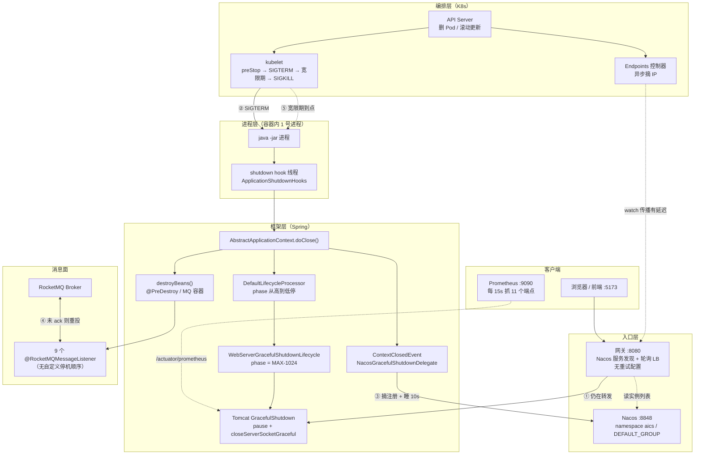
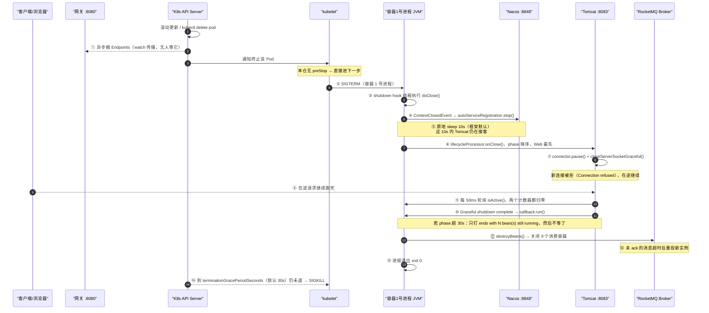

# 优雅停机与零丢失滚动更新

> **一句话结论**：优雅停机的本质是「先停止接新流量 → 再把手上的活干完 → 最后才退出进程」，这三步在 Spring Cloud Alibaba + K8s 里分别由 **Nacos 摘注册等待**、**Tomcat connector.pause()**、**JVM shutdown hook 退出** 三个不同组件负责，任何一步顺序错、或者时间账（宽限期 vs 应用超时）算错，都会丢请求或重复消费。
> **阅读前置**：读过 [02-Kubernetes入门.md](./02-Kubernetes入门.md)（知道 Pod 生命周期、探针、Endpoints 是什么）、[22-Eureka与Consul注册中心对照.md](../04-中间件/22-Eureka与Consul注册中心对照.md)（知道服务注册/摘除是异步传播的）；不了解 `SmartLifecycle`（Spring 里带"启动阶段编号 phase"的生命周期接口）也没关系，第 2 节会解释。
> **证据基线**：Spring Boot 4.2.0 / Spring Cloud Alibaba 2025.1.0.0 / spring-context 7.1.0 的源码摘录（A 级，`24-源码分析/assets/source/`）+ 本仓 11 个 `application.yml`、`deploy/k8s/services/` 8 份清单、7 个 compose 文件的真实行号（B 级）+ 本机 pwsh 真实统计输出（C 级）。**本机无 docker、无 kubectl**（下文有探测原文），所以"Pod 里到底发生了什么"是配置 + 框架源码推演，不是容器实测。预计阅读 40~55 分钟。

## 证据边界

| 类别 | 本仓状态 | 本篇怎么处理 |
|------|----------|--------------|
| Spring Boot 优雅停机源码 | ✅ 已入库（`GracefulShutdown.java`、`WebServerGracefulShutdownLifecycle.java`、`DefaultLifecycleProcessor.java`、`AbstractApplicationContext.java`、`ServerProperties.java`） | A 级锚点引用，讲清"框架在哪一行开始等、等到什么算完" |
| Nacos 客户端停机源码 | ✅ 已入库（`NacosGracefulShutdownDelegate.java`、`NacosDiscoveryProperties.java`） | A 级引用，正面回答"摘注册和 Tomcat 停接到底谁先" |
| 本仓 11 个模块的停机配置 | ✅ 真实存在，行号已核对 | B 级引用 + C 级真实统计输出 |
| K8s 清单（`deploy/k8s/services/`） | ✅ 8 份业务清单；**没有 order/pay/mq** | B 级引用；缺口如实写"无清单，规则只能按已有清单推" |
| RocketMQ 客户端停机源码 | ❌ **未入库**（`assets/source` 里 `RocketMQ*` 全 0 命中） | 只讲"本仓消费代码 + 框架破坏顺序推断"，不编内部类名 |
| 容器运行时 / 集群 | ❌ 本机 **MISSING docker / MISSING kubectl** | `kill -TERM`、`kubectl delete pod`、`ab` 压测全部标注**未本机实测**，给出命令 + 判读方法 |

本机探测原文（pwsh 5.1.26100.9818、node v24.16.0）：

```text
MISSING docker
MISSING kubectl
FOUND   curl
FOUND   java
FOUND   jcmd
```

`FOUND java` 意味着下面第 6 节的 `jps` / `jcmd` 手法可以在本机对"你自己启动的 jar"用，但**本机没有 Linux 的 SIGTERM 语义**——这条限制会直接改变你的验证手法，见 6.3。

---

## 0. 先看现象

### 现象 1：滚动发布时总有 1~2 个 502，重试就正常

发布窗口里网关日志出现这种行（原文来自下游不可达，IP 每次不同）：

```text
2026-11-27T10:12:41.318+08:00  WARN 1 --- [ctor-http-nio-3] o.s.c.g.f.RoutePredicateHandlerMapping :
    502 Bad Gateway for http://10.244.7.31:8083/chat/stream
2026-11-27T10:12:41.319+08:00 ERROR 1 --- [ctor-http-nio-3] r.n.http.client.HttpClientConnect :
    [6b9a1f2d-1] Error has been observed at the following site(s): io.netty.channel.AbstractChannel$AnnotatedConnectException:
    Connection refused: /10.244.7.31:8083
```

网关侧的真实配置是"Nacos 服务发现 + 轮询负载均衡，**没有人配重试**"：

```yaml
# ai-cs-gateway/src/main/resources/application.yml#L54-L57
    loadbalancer:
      # 负载均衡算法：round-robin（轮询，Spring Cloud LoadBalancer 默认）
      #             | least-connections（最少连接，按实例在途请求数分流）
      algorithm: round-robin
```

而 K8s 侧的就绪判定是**每 10 秒一次的 TCP 连通性检查**：

```yaml
# deploy/k8s/services/ai-chat-service.yaml#L106-L111
          readinessProbe:
            tcpSocket:
              port: 8083
            initialDelaySeconds: 30
            periodSeconds: 10
            timeoutSeconds: 5
```

`Connection refused` 是**端口已经在关了**的标志（不是超时、不是 5xx），说明网关拿到的是一个"注册表里还在、进程已经不接客"的实例。这就是第一现场：**摘流和停接之间的窗口，没有人负责把它填满**。

### 现象 2：停机日志里出现大量连接被重置，且最后一行永远不是 complete

客户端侧长这样：

```text
net::ERR_CONNECTION_RESET
java.net.SocketException: Connection reset
```

服务端侧的关键判读点在**最后一行**——Spring Boot 优雅停机成功与失败只有一行之差：

```text
# 成功（GracefulShutdown 打完关连接器、等在途清零）
2026-11-27T10:12:38.901+08:00  INFO 1 --- [       Thread-9] g.a.c.GracefulShutdown : Commencing graceful shutdown. Waiting for active requests to complete
2026-11-27T10:12:39.006+08:00  INFO 1 --- [tomcat-shutdown] g.a.c.GracefulShutdown : Graceful shutdown complete

# 失败（等到超时/被外力杀掉，在途请求还没跑完）
2026-11-27T10:12:38.901+08:00  INFO 1 --- [tomcat-shutdown] g.a.c.GracefulShutdown : Graceful shutdown aborted with one or more requests still active
```

这两句日志的字面文案由框架写死（A 级：[[源码:GracefulShutdown.java.md#L53-L69]]），**如果你在日志里只看到 `Commencing` 却从没看到后面任何一句，说明进程压根没活到那一步——是被 SIGKILL 了**。这就是第一现场。

### 现象 3：发版之后总有几条消息被重复消费

消息服务的消费入口长这样：

```java
// ai-cs-message/src/main/java/com/aics/message/consumer/ChatMessageConsumer.java#L49-L58
            // 处理消息
            ...
        } catch (Exception e) {
            log.error("消费消息失败: {}", message, e);
            throw e;
        }
```

抛出去 = 让 Broker 重投（这是框架契约，不是 bug），而"重投会不会变成重复业务"完全取决于消费逻辑是否幂等。本仓代码自己写明了这件事：

```java
// ai-cs-message/src/main/java/com/aics/message/consumer/ChatMessageConsumer.java#L23-L24
 * 实现幂等消费需业务方自行保证（当前以 DB 主键自增 + sessionKey 关联为准）
 * 消费失败时记录日志并重新抛出，由 RocketMQ 触发重试
```

停机时进程被杀 → 一批消息里"已拿到、未 ack"的部分被 Broker 重新投递 → 如果这批里有些其实**业务已经处理完了、只是 ack 没发出去**，就变成重复消费。这就是第一现场。

### 三个现象的共同点

| 现象 | 第一反应 | 真实原因 | 定位入口 |
|------|----------|----------|----------|
| 滚动发布 1~2 个 502 | "网关有 bug" | Endpoints/注册表摘除是异步的，网关缓存里还有将死实例 | 网关 `Connection refused` 日志 + 5xx 时间戳是否集中在发布窗口 |
| 连接被重置 | "网络抖动" | SIGTERM 后进程直接退出，没等在途请求；或宽限期到点 SIGKILL | 停机日志有没有 `Graceful shutdown complete` |
| 消息重复消费 | "MQ 有问题" | 未 ack 消息必然重投，消费端幂等没兜住"处理成功但 ack 丢失"这一格 | 重复消息的 `msgId` 与业务流水时间戳 |

**这些现象指向同一件事：** 停机不是"一个开关"，而是一条**有顺序、有时间预算**的流水线；`server.shutdown: graceful` 只买到了流水线中间那一段（等在途请求），它既不负责"让上游先别发我"（那是注册中心 + K8s Endpoints），也不负责"宽限期给我留够时间"（那是 `terminationGracePeriodSeconds` / `stop_grace_period`），更不负责"重复投递也能扛"（那是幂等）。下面按 **传播链 → 框架内部顺序 → 时间账 → 各类长连接/消费者/定时任务 → 兜底** 的顺序拆。

---

## 1. 整体地图



> **读图说明**：先看三类箭头的差别——**实线是"这台机器上真的发生了"**（SIGTERM、doClose、pause），**虚线是"别人可能还没收到消息"**（Endpoints watch 传播、网关读实例列表、宽限期到点）。所有丢请求的故障都发生在虚线与实线的缝隙里：`EP -.-> GW` 这条虚线延迟一点，网关就会把请求发给已经 `TC` 停接的进程。再看 subgraph 的上下关系：**越往下越"晚发生"**，FRAME 层内部是从上到下执行的固定顺序（第 3.2 节会用源码证明这个顺序），只有理解了"OV 摘注册排在 TC 停接之前"，你才会明白为什么 Nacos 那个 10 秒 sleep 是在"停接之前"睡的，效果上等价于一个应用内自带的 preStop。最后看 DATA 这一块：它挂在 `destroyBeans` 之后才被关，也就是说**消息消费者是整个停机链条的最后一步**，这是后面"重复消费"问题的根源之一。

### 组件与责任

| 组件 | 责任 | 调用方 | 是否权威源 | 失效后表现 |
|------|------|--------|-----------|-----------|
| Nacos 注册表（`:8848`） | 保存"哪些实例可服务" | 网关 / Feign 调用方 | 是（对 Spring Cloud 客户端） | 摘除不生效 → 请求打到已停实例 |
| K8s Endpoints | 保存"哪些 Pod 可转发" | kube-proxy / Ingress | 是（对集群内 Service 流量） | 摘除慢 → 照样转发 |
| `readinessProbe` | 决定 Pod 是否留在 Endpoints | kubelet | 是（开关量） | 探针太粗（TCP 通就算健康）→ 摘除滞后 |
| `terminationGracePeriodSeconds` | SIGTERM 到 SIGKILL 的**总预算** | kubelet | 是（唯一的硬上限） | 小于应用超时 → 在途请求被斩 |
| `server.shutdown: graceful` | 让 Tomcat 停接新连接并等在途 | Spring Boot | 否（只管进程内） | 变 `immediate` → 连接直接 RST |
| `spring.lifecycle.timeout-per-shutdown-phase` | 每个 phase 最多等多久 | `DefaultLifecycleProcessor` | 否（超时不杀） | 配太小 → 提前放弃等待 |
| `gracefulShutdownWaitTime` | 摘注册后原地等多长时间 | Nacos 客户端 | 否 | 太短 → 调用方缓存未失效 |

---

## 2. 关键概念与关键类逐个拆

术语先连成一句话：**SIGTERM**（Linux 的"请你优雅退出"信号，进程可以捕获并自己收尾）→ **shutdown hook**（JVM 收到 SIGTERM 后并发执行的一组线程，Spring 在这个线程里跑 `doClose()`）→ **SmartLifecycle phase**（Spring 给每个"可停组件"编的阶段号，**号越大越先停**）→ **在途请求**（已 accept 但还没写完响应的请求，Tomcat 用两个计数器判定）→ **宽限期**（`terminationGracePeriodSeconds`，kubelet 从 SIGTERM 起算的硬倒计时，到点发 SIGKILL）→ **ack**（消费者告诉 Broker"这条我处理完了"，不发就会重投）。

| 名称 | 位置 | 角色 | 关键参数 |
|------|------|------|----------|
| `GracefulShutdown` | A：[[源码:GracefulShutdown.java.md#L41-L51]] | Tomcat 侧真正执行"停接 + 等清零"的执行器 | 50ms 轮询、连接器逐个 `close` |
| `WebServerGracefulShutdownLifecycle` | A：[[源码:WebServerGracefulShutdownLifecycle.java.md#L41-L55]] | 把 Spring 的 Lifecycle 停机回调接到 Tomcat | `stop(Runnable callback)`、phase = `GRACEFUL_SHUTDOWN_PHASE` |
| `WebServerApplicationContext` | A：[[源码:WebServerApplicationContext.java.md#L28-L34]] | 定义 phase 常量 | `GRACEFUL_SHUTDOWN_PHASE = DEFAULT_PHASE - 1024` |
| `DefaultLifecycleProcessor` | A：[[源码:DefaultLifecycleProcessor.java.md#L441-L455]] | 按 phase 从高到低轮流停，并给每个 phase 计时 | `timeoutPerShutdownPhase`、`latch.await(...)` |
| `AbstractApplicationContext` | A：[[源码:AbstractApplicationContext.java.md#L1182-L1208]] | `doClose()` 的三段固定顺序 | `publishEvent` → `onClose` → `destroyBeans` |
| `NacosGracefulShutdownDelegate` | A：[[源码:NacosGracefulShutdownDelegate.java.md#L67-L81]] | 监听 `ContextClosedEvent`，摘注册后 sleep | `autoServiceRegistration.stop()` + sleep |
| `NacosDiscoveryProperties` | A：[[源码:NacosDiscoveryProperties.java.md#L236-L238]] | 等待时长的**默认值**所在 | `gracefulShutdownWaitTime = 10 * 1000` |
| `ServerProperties.Shutdown` | A：[[源码:ServerProperties.java.md#L98-L100]] | `server.shutdown` 的枚举与默认值 | `Shutdown.GRACEFUL` |
| `server.shutdown: graceful` | `ai-cs-gateway/src/main/resources/application.yml#L2`（11 个模块同款） | 开启 Tomcat 优雅停机 | 取值只有 `graceful` / `immediate` |
| `timeout-per-shutdown-phase` | `ai-cs-chat/src/main/resources/application.yml#L7` | 每个 phase 的等待上限 | 本仓 11 处统一 `30s` |
| `readinessProbe` | `deploy/k8s/services/ai-chat-service.yaml#L106-L111` | 决定是否留在 Endpoints | `tcpSocket: 8083`、`periodSeconds: 10` |
| `terminationGracePeriodSeconds` | 应在 `deploy/k8s/services/*.yaml` 的 `spec.template.spec` 上 | SIGTERM→SIGKILL 总预算 | **本仓 0 命中，走默认 30s** |
| `stop_grace_period` | 应在 compose 的 Java 服务段 | Docker 的等停预算 | **7 个 compose 全 0 命中，走默认 10s** |
| `@RocketMQMessageListener` | 9 处（如 `ai-cs-message/src/main/java/com/aics/message/consumer/ChatMessageConsumer.java#L30-L33`） | 消费线程容器的声明 | 由 Spring 容器生命周期管理，无自定义停机 |

**一个必须纠正的常见说法**：网上（以及部分本仓库旧笔记）会说"本项目给 11 个模块都配了 `gracefulShutdownWaitTime: 10s`"。真实情况是——**全仓 0 处显式配置**，那 10 秒来自 `NacosDiscoveryProperties` 的字段默认值（A 级锚点见上表）。这个区别在排障时很关键：默认值意味着"你改不了它的存在，只能在时间账里把它算进去"。

---

## 3. 原理与证据逐段精读

### 3.1 SIGTERM 是怎么变成 Java 里的 `doClose()` 的

**在干什么**：Spring 启动时向 JVM 注册了一个 shutdown hook；JVM 收到 SIGTERM 后，会**并发启动**这些 hook 线程，然后在 hook 里执行容器关闭逻辑。

```java
// AbstractApplicationContext#registerShutdownHook —— (src: AbstractApplicationContext.java.md#L1069-L1088)
	public void registerShutdownHook() {
		if (this.shutdownHook == null) {
			// No shutdown hook registered yet.
			this.shutdownHook = new Thread(SHUTDOWN_HOOK_THREAD_NAME);
			this.shutdownHook.setContextClassLoader(...);
			this.shutdownHook.setDaemon(false);
			this.shutdownHook.setPriority(Thread.MAX_PRIORITY);
			this.shutdownHook.setUncaughtExceptionHandler(...);
			Runtime.getRuntime().addShutdownHook(this.shutdownHook);
		}
	}
```

**为什么这么设计**：`Runtime.addShutdownHook` 是 JVM 唯一保证"正常终止路径都会走到"的入口——无论 `System.exit()`、Ctrl+C 还是 SIGTERM，都会触发它。Spring 把"关容器"挂在唯一的入口上，就不用关心是被谁叫停的。

**换成别的写法会怎样**：如果停机靠自定义信号处理器（`sun.misc.Signal.handle`）或自己写的 Controller 去调 `context.close()`，那 `kill -9`、OOM Killer、容器运行时强杀这些路径全都不经过它——**"优雅"就变成了"有条件的优雅"**。K8s 里最常被杀的方式恰恰不是 `kill -9`，而是宽限期到点的 SIGKILL，那时候 hook 也来不及，所以真正的保护是"别让宽限期到点"。

**常见坑**：① hook 线程里任何一处**阻塞超过宽限期**，进程就被 SIGKILL，日志只会停在半句；② hook 里**不能**再 `System.exit()`（会死锁）；③ Windows 上 `Stop-Process` / `taskkill /F` 走的是 `TerminateProcess`，**根本不触发 shutdown hook** —— 这就是 6.3 节为什么必须在 Linux 容器里验证。

### 3.2 `doClose()` 的三段固定顺序，决定了"谁先让路"

**在干什么**：`doClose()` 里依次做三件事，**顺序是写死的**，这段顺序是理解本篇一切竞态的钥匙。

```java
// AbstractApplicationContext#doClose —— (src: AbstractApplicationContext.java.md#L1182-L1208)
	protected void doClose() {
		// Check whether an actual close attempt is necessary...
		if (this.active.get() && this.closed.compareAndSet(false, true)) {
			...
			try {
				// Publish shutdown event.
				publishEvent(new ContextClosedEvent(this));
			}
			catch (Throwable ex) { ... }
			// Stop all Lifecycle beans, to avoid delays during individual destruction.
			if (this.lifecycleProcessor != null) {
				try {
					this.lifecycleProcessor.onClose();
				}
				catch (Throwable ex) { ... }
			}
			// Destroy all cached singletons in the context's BeanFactory.
			destroyBeans();
			...
		}
	}
```

用中文排一遍：**① 发 `ContextClosedEvent`（Nacos 摘注册 + 睡 10s 在这一段）→ ② `lifecycleProcessor.onClose()`（Tomcat 停接 + 等在途在这一段）→ ③ `destroyBeans()`（`@PreDestroy`、MQ 消费容器 destroy 在这一段）**。

**为什么这么设计**：先"让别人知道我不干了"（事件），再"把手上的活干完"（Lifecycle），最后"拆零件"（destroy）。如果反过来先拆零件，事件监听器依赖的 Bean 已经没了，摘注册就失败。这正是"优雅停机三步曲"在框架里的落点。

**换成别的写法会怎样**：假设有人用 `@PreDestroy` 去关连接池、同时又期望"在途请求还能用完连接"，就会踩坑——`@PreDestroy` 在第三步，而第二步 Tomcat 已经在等在途请求了，池子还在，这时候没问题；但如果你把"停接"寄希望于 `@PreDestroy` 里调 `connector.stop()`，那它比在途请求的等待**更晚**，等它执行时请求早被 RST 了。

**常见坑**：① 在 `ContextClosedEvent` 监听器里做耗时操作（比如本仓 Nacos 那个 10s sleep），会**整体推后** Tomcat 停接的时间——好处是这 10 秒内实例还在正常接客，坏处是把宽限期吃掉 10 秒；② 子容器的 `ContextClosedEvent` 也会冒泡，`NacosGracefulShutdownDelegate` 专门判断了 `!applicationContext.equals(event.getApplicationContext())` 才跳过（[[源码:NacosGracefulShutdownDelegate.java.md#L55-L65]]）；③ 自己再注册一个 shutdown hook 去关东西，**执行顺序不可控**（多个 hook 并发跑）。

### 3.3 Nacos 摘注册为什么排在 Tomcat 停接之前

**在干什么**：监听 `ContextClosedEvent`，先调 `autoServiceRegistration.stop()` 把自己从注册表摘掉，然后**原地睡** `gracefulShutdownWaitTime` 毫秒。

```java
// NacosGracefulShutdownDelegate#doGracefulShutdown —— (src: NacosGracefulShutdownDelegate.java.md#L67-L81)
	private void doGracefulShutdown() {
		if (!this.autoServiceRegistration.getStatus().equals(RegistrationStatus.STARTED)) {
			return;
		}
		this.autoServiceRegistration.stop();
		Integer gracefulShutdownWaitTime = this.nacosDiscoveryProperties.getGracefulShutdownWaitTime();
		if (gracefulShutdownWaitTime != null && gracefulShutdownWaitTime > 0) {
			ThreadUtils.sleep(gracefulShutdownWaitTime);
		}
		log.info("Nacos client graceful shutdown has been executed successfully. Graceful shutdown wait time is {}", ...);
	}
```

这 10 秒的默认值在属性类里：

```java
// NacosDiscoveryProperties —— (src: NacosDiscoveryProperties.java.md#L236-L238)
	/**
	 * When the Springboot shutdown hook is executed, remove the Nacos service, wait for 10 seconds, and then Tomcat rejects the request
	 */
	private Integer gracefulShutdownWaitTime = 10 * 1000;
```

**为什么这么设计**：服务注册/订阅是**推拉结合 + 本地缓存**的，摘注册这个动作本身几乎是瞬时的，但**调用方感知**需要时间（网关、Feign 客户端各自缓存实例列表）。如果摘注册后立刻停接，缓存还没失效的调用方就会打空。所以框架的设计意图写得很直白：*"remove the Nacos service, wait for 10 seconds, **and then** Tomcat rejects the request"*——**先摘、等一会儿、再停接**。

**换成别的写法会怎样**：把 `gracefulShutdownWaitTime` 设成 0（或干脆不装这个 delegate），摘注册与停接几乎同时发生，故障率取决于调用方缓存 TTL，典型表现就是现象 1 的 502。反过来设成 60s，容器在 K8s 里铁定被 SIGKILL（默认宽限期 30s），优雅停机反而变成"硬杀"。

**常见坑**：① 这段 sleep 发生在**`ContextClosedEvent`**里、也就是 Tomcat 停接**之前**，所以这 10 秒里 Pod **依然在接受新请求**，readiness 探针也依然通过——K8s Endpoints 摘除是另一条独立通道（第 3.8 节），两条通道谁都没等谁；② 这个 sleep 会**占用宽限期预算**，时间账必须写成 `10s + Tomcat 等待时间 ≤ 宽限期`；③ 它只保证"Nacos 注册表"这一路的调用方拿到新列表，管不到 Service/Ingress 那一层。

### 3.4 phase 排序：为什么 Web 容器是"最先停"的那个

**在干什么**：`DefaultLifecycleProcessor` 把所有 `Lifecycle` 按 phase 分组，用 `TreeMap(Comparator.reverseOrder())` 排序后**从大 phase 往小 phase** 依次停。

```java
// DefaultLifecycleProcessor#stopBeans —— (src: DefaultLifecycleProcessor.java.md#L441-L455)
	private void stopBeans(StopMode stopMode) {
		Map<Integer, LifecycleGroup> phases = new TreeMap<>(Comparator.reverseOrder());
		for (Map.Entry<String, Lifecycle> entry : this.lifecycleBeans.entrySet()) {
			...
		}
		...
	}
```

而 Web 容器的优雅停机 phase 被定义成"最大值减 1024"：

```java
// WebServerApplicationContext —— (src: WebServerApplicationContext.java.md#L28-L34)
	int GRACEFUL_SHUTDOWN_PHASE = SmartLifecycle.DEFAULT_PHASE - 1024;

	int START_STOP_LIFECYCLE_PHASE = GRACEFUL_SHUTDOWN_PHASE - 1024;
```

**为什么这么设计**：`SmartLifecycle.DEFAULT_PHASE = Integer.MAX_VALUE`（即 2147483647），在"降序停止"的规则下，`MAX-1024` 几乎是全场最大的 phase → **最先被停**。语义上完全说得通：**先别接客，再停后面的东西**。默认 phase（0）的 Bean（比如 MQ 消费容器监听器）排在它后面停，也就是说"Web 停接"一定早于"MQ 停消费"。

**换成别的写法会怎样**：如果 MQ 消费容器 phase 比 Web 更大，就会出现"先停消费、Web 还在接客"——反向的麻烦，但至少 HTTP 不丢；真正可怕的是两者**并发**停（没有 phase 机制时），Tomcat 还在写响应、数据源已经关了，报错是 `DataSource has been closed` 这类"看着像业务 bug"的错。

**常见坑**：① 自己实现的 `SmartLifecycle` 如果 phase 设成 `Integer.MAX_VALUE`，会**抢在 Web 停接之前**，容易被理解成"优雅停机坏了"；② 同一 phase 内的多个 Bean 是**并发**停的，不要假设顺序；③ phase 只对 `SmartLifecycle` 生效，普通 `DisposableBean` 走的是第三段 `destroyBeans()`。

### 3.5 Tomcat 到底怎么"停止接新流量"

**在干什么**：给每个 connector 调两件事——`pause()` 和 `closeServerSocketGraceful()`——然后才等在途请求。

```java
// GracefulShutdown#close —— (src: GracefulShutdown.java.md#L79-L82)
	private void close(Connector connector) {
		connector.pause();
		connector.getProtocolHandler().closeServerSocketGraceful();
	}
```

驱动它的是 `WebServerGracefulShutdownLifecycle`，注意它的 `stop()` **必须带回调**：

```java
// WebServerGracefulShutdownLifecycle#stop —— (src: WebServerGracefulShutdownLifecycle.java.md#L41-L55)
	@Override
	public void stop(Runnable callback) {
		this.webServer.shutDownGracefully((result) -> callback.run());
	}

	@Override
	public int getPhase() {
		return WebServerApplicationContext.GRACEFUL_SHUTDOWN_PHASE;
	}
```

**为什么这么设计**："停接"必须做两步才安全：`pause()` 让 Acceptor 线程不再从队列里取新连接（但**已 accept 的连接不受影响**），`closeServerSocketGraceful()` 关闭监听 socket（新连接直接被内核拒绝 → 调用方看到 `Connection refused`，这是**明确信号**，比让连接挂着强）。回调机制是为了让 `DefaultLifecycleProcessor` 的 `CountDownLatch` 知道"我真的等完了"，而不是"我一调用就返回"。

**换成别的写法会怎样**：`WebServerGracefulShutdownLifecycle.stop()` 无参重载是**故意抛异常**的：

```java
// WebServerGracefulShutdownLifecycle —— (src: WebServerGracefulShutdownLifecycle.java.md#L37-L39)
	@Override
	public void stop() {
		throw new UnsupportedOperationException("Stop must not be invoked directly");
	}
```

也就是说"同步停"这条路被明确堵死了——一旦你（或某个框架）走了同步路径，异常会直接抛出来。而在 `pause()` 之前就关 socket 的写法，会让连接进入半开状态，客户端表现为**卡住直到超时**，而不是立刻拒绝。

**常见坑**：① `server.shutdown: graceful` 只对**内嵌 Tomcat 的 HTTP 端口**生效，`management` 端口如果独立监听（本仓没这么配）是另一套；② 本仓 chat 服务的 SSE 请求最长 5 分钟（第 3.12 节），**远超** `timeout-per-shutdown-phase: 30s`，光靠这一步等不完；③ `pause()` 之后健康检查端口也一起不接客了，所以 readiness 探针会在停机瞬间变红——这是好事，但 K8s 已经把它从 Endpoints 摘了（更早），别指望靠探针兜。

### 3.6 什么算"活干完了"：两个计数器 + 50ms 轮询

**在干什么**：关完连接器后，起一个**每 50 毫秒**轮询的循环，直到"异步请求数"和"已分配线程数"都归零。

```java
// GracefulShutdown#awaitInactiveOrAborted —— (src: GracefulShutdown.java.md#L84-L100)
	private boolean awaitInactiveOrAborted() throws InterruptedException {
		...
		while (!this.aborted && isActive()) {
			Thread.sleep(50);
		}
		return this.aborted;
	}
```

判定"还活着"的依据是 Tomcat 内部两个计数器：

```java
// GracefulShutdown#isActive —— (src: GracefulShutdown.java.md#L113-L128)
	private boolean isActive(Container container) {
		if (container instanceof StandardContext context && context.getInProgressAsyncCount() > 0) {
			return true;
		}
		if (container instanceof StandardWrapper wrapper && wrapper.getCountAllocated() > 0) {
			return true;
		}
		...
	}
```

**为什么这么设计**：普通的同步请求只要线程还在跑就算"在途"（`getCountAllocated`）；但 SSE / 异步 Servlet 的请求**不占工作线程**，线程已经还回池子了，请求却还没写完响应——所以必须再加一个 `getInProgressAsyncCount()`。两个都归零才是真完。

**换成别的写法会怎样**：只判线程数，就会出现"日志说 `Graceful shutdown complete`、但 SSE 客户端收不到最后一帧"的诡异现象——因为框架以为没人了。这就是异步请求必须单列计数器的原因。

**常见坑**：① 轮询间隔 50ms 意味着**最后一个请求完成后最多再拖 50ms** 才打印 complete，别把这点延迟当异常；② `SseEmitter` 如果业务侧没有在完成时关闭（本仓 `ai-cs-chat/src/main/java/com/aics/chat/service/impl/ChatServiceImpl.java#L714` 的注释就在提醒这件事），异步计数永远不归零，只能等到 phase 超时；③ `aborted` 一旦置位（容器被强制），循环立即返回失败结果，日志就是那句 `aborted with one or more requests still active`。

### 3.7 `timeout-per-shutdown-phase: 30s` 只是"不再等"，不是"杀掉"

**在干什么**：每个 phase 停的时候拿一个 `CountDownLatch` 等，等到超时就**放弃等待、继续往下走**，只打一行 info。

```java
// DefaultLifecycleProcessor#LifecycleGroup#stop —— (src: DefaultLifecycleProcessor.java.md#L656-L689)
			CountDownLatch latch = new CountDownLatch(this.smartMemberCount);
			...
			long shutdownTimeout = determineShutdownTimeout(this.phase);
			boolean latchResult = false;
			try {
				latchResult = latch.await(shutdownTimeout, TimeUnit.MILLISECONDS);
			}
			catch (InterruptedException ex) { ... }
			if (!latchResult) {
				if (!countDownBeanNames.isEmpty() && logger.isInfoEnabled()) {
					logger.info("Shutdown phase " + this.phase + " ends with " + countDownBeanNames.size() +
							" bean(s) still running after timeout of " + shutdownTimeout + "ms: " + countDownBeanNames);
				}
			}
```

框架内部这个计时的默认值也有一层兜底：

```java
// DefaultLifecycleProcessor —— (src: DefaultLifecycleProcessor.java.md#L124)
	private volatile long timeoutPerShutdownPhase = 10000;
```

**为什么这么设计**：停机最怕"挂住"——一个卡死的连接能让进程永远退不出去，只能靠人 `kill -9`，那比丢几个请求更糟。所以框架选择"到点就不等了，剩下的交给下一段（`destroyBeans`）和操作系统"。

**换成别的写法会怎样**：很多人的心智模型是"配了 30s 就会等 30s **并且**在 30s 后杀掉剩下的请求"——**后半句是错的**。框架不会杀线程（Java 也没有安全的杀线程手段），它只是继续执行 `destroyBeans()`，此时数据源、Redis 连接开始关闭，那些还在跑的请求会拿到 `Connection closed` / `NullPointerException` 之类的**次生错误**，然后进程退出。

**常见坑**：① 那行 `ends with N bean(s) still running after timeout of 30000ms` 是**排查停机超时的唯一直接证据**，配 `grep` 就能定位卡在哪个 Bean；② 本仓 11 个模块统一 `30s`，但 Nacos 已经先睡掉 10s，真正留给 Tomcat 的还是 30s（phase 计时是**每段独立**的），**总账是 40s**；③ `timeout-per-shutdown-phase` 不控制 `destroyBeans()` 的耗时，那一段没有超时保护。

### 3.8 K8s 侧：readiness 摘除与 SIGTERM 是两条不等人的通道

**在干什么**：删 Pod 时，API Server 会**同时**做两件互不同步的事——① 通知 Endpoints 控制器把 IP 摘掉；② 通知 kubelet 开始终止流程（preStop → SIGTERM）。摘 Endpoints 要经过 watch 传播到每台节点的 kube-proxy/Ingress，**没有任何机制等你摘完再发 SIGTERM**。

本仓 8 份业务清单里的探针现状（C 级实测）：

```text
k8s services 清单数=8
terminationGracePeriodSeconds 命中=0
preStop 命中=0
lifecycle 命中=0
strategy 命中=0
readinessProbe 命中=8
livenessProbe 命中=8
tcpSocket 探针=14
httpGet 探针=2
```

**为什么这么设计**（指 K8s 为什么不等）：优雅终止如果串行做，滚动更新会变慢到不可接受；K8s 把这部分留给应用/平台自己解决，标准答案是 **`preStop` hook 里睡几秒**，让"摘流"先传播完，再让进程收到 SIGTERM。

**换成别的写法会怎样**：本仓**没有 preStop**，那这条缝由谁填？答案是 Nacos 客户端那 10 秒 sleep（第 3.3 节）——它在 SIGTERM 之后、Tomcat 停接之前睡 10 秒，**效果上等价于一个应用内自带的 preStop**。这是一个常被忽略的事实：**没有 preStop ≠ 一定丢流量**，前提是应用内确实有"摘流后等待"的逻辑，且等待时长 ≥ 调用方感知延迟。而本仓的探针是 **`tcpSocket`**（端口通就算就绪），端口在 pause 之后才关，所以探针在停机过程中**几乎没有提前量**。

**常见坑**：① 把 `readinessProbe` 配成 `tcpSocket` 只能证明"端口开着"，证明不了"能正常服务"；② 一旦加了 preStop 却不增加宽限期，等于从 Tomcat 的预算里抢时间（见 3.9 的时间账）；③ Endpoints 摘除对 **Service 流量**有效，对**网关自己的 Nacos 实例缓存**无效——两条通道要分别覆盖，这也是 5.2 节"可扩展点"里的第一条。

### 3.9 时间账：宽限期必须大于"应用全链路等待"

**在干什么**：把三段等待相加，与 kubelet 的硬预算比较。

```text
[K8s 默认] terminationGracePeriodSeconds ......... 30s（本仓 0 命中 → 走默认）
[应用内]  Nacos 摘注册后 sleep ................... 10s（框架默认，本仓 0 显式配置）
[应用内]  Tomcat 等在途请求 ...................... ≤30s（11 个模块统一 30s）
[compose] stop_grace_period ...................... 默认 10s（7 个 compose 全 0 命中）
-------------------------------------------------------------
最坏情况：10 + 30 = 40s  >  30s（K8s 默认）      ❌ 超支 10s
compose 场景：10 + 30 = 40s > 10s（Docker 默认）  ❌ 超支 30s
```

**为什么这么算**：`terminationGracePeriodSeconds` 从**进程收到 SIGTERM 的那一刻**起算，而 SIGTERM 正是触发 Nacos sleep 的起点，所以 Nacos 那 10 秒**实打实吃在同一份预算里**。K8s 官方文档对 `preStop` 的说明也是同一套账："宽限期包含 preStop 的执行时间"。

**换成别的写法会怎样**：如果只把 `terminationGracePeriodSeconds` 调到 60s 就以为万事大吉，在 compose 场景下依然会被 10s 的 `stop_grace_period` 杀掉——**两种运行时的默认值不同（30s vs 10s），必须分别显式设置**。反过来把 Tomcat 的超时调到 5s，则长请求（SSE、批量导入）会被提前放弃。

**常见坑**：① 只改了 `timeout-per-shutdown-phase`，没改宽限期 → 超支；② 只改了宽限期，没算 Nacos 的 10s → 仍然超支；③ 以为 `terminationGracePeriodSeconds` 从"开始删 Pod"起算（实际从 SIGTERM 起算，Endpoints 摘除的时间不计入）；④ compose 里压根没有 YAML 能改这个（要用 `stop_grace_period`，且**本仓 7 个文件全 0 命中**）。

### 3.10 MQ 消费者：真正"先停消费再关容器"的顺序，本仓没写

**在干什么**：`@RocketMQMessageListener` 声明的消费容器由 Spring 容器管理，**没有任何一处代码显式"先停消费"**（C 级实测：`implements SmartLifecycle / @PreDestroy = 2`，其中一处还是 Neo4j 的，9 个消费者全部是裸注解）。

```java
// ai-cs-message/src/main/java/com/aics/message/consumer/ChatMessageConsumer.java#L30-L33
@RocketMQMessageListener(
        topic = "chat-message-topic",
        consumerGroup = "chat-consumer-group"
)
```

**为什么这么设计**（指框架为什么把它放最后）：消费者属于"数据面"，框架的假设是"停消费很便宜，停错了重投就行"。于是它的 destroy 落在 `doClose()` 第三段 `destroyBeans()`，**晚于** Tomcat 停接。这个顺序本身是合理的（先把 HTTP 请求服务完，再断消费），但它带来一个副作用：**Web 侧还在收尾时，消费侧仍在拉新消息**，直到第三段才断开。

**换成别的写法会怎样**：更稳的顺序是"消费容器 phase 略大于 Web 停接 phase"——先停消费（等手上这批 ack 完），再停 HTTP。本仓**没有**这么做（0 处自定义 `SmartLifecycle`），所以最后一个时刻仍在拉的消息，会在进程被 SIGKILL 时变成"已投递未 ack"，超时后重投。

**常见坑**：① 未 ack 的消息重投是**契约行为**，不是错误，所以"停机期间重复消费"无法靠配置消除，只能靠幂等；② 如果消费逻辑耗时超过宽限期，SIGKILL 会打断它，Broker 侧的消费超时（默认较长）到点后重投——**重复是必然的**；③ 顺序消息场景下重复会破坏"顺序"假设，需要业务侧去重键。

### 3.11 定时任务：停机打断一次，靠幂等和下轮重试兜

**在干什么**：本仓有两条定时通道——`@Scheduled` 本地兜底 + XXL-Job 集中调度——**跑同一份幂等逻辑**：

```java
// ai-cs-order/src/main/java/com/aics/order/task/OrderTimeoutScanJob.java#L12-L14
 * @Scheduled（本地兜底）与 XXL-Job（集中调度）双通道执行同一份幂等逻辑，
 * 关单操作按订单状态机天然幂等，重复触发无副作用
```

**为什么这么设计**：定时任务的特点是"**可重入、但不能丢**"。既然关闭订单是按状态机流转的（已关闭再关一次无副作用），那么停机打断一次的执行、让下一轮或者另一个实例重跑，代价最小。

**换成别的写法会怎样**：如果任务里有"发通知/发 MQ/调外部支付"这类副作用且没有唯一键，停机打断就会造成**重复通知 / 重复扣款**。XXL-Job 的阻塞处理策略（单机串行 / 丢弃后续 / 覆盖之前）在实例消失时也无法救——调度器只看到"执行器没响应"。

**常见坑**：① `@Scheduled(fixedDelay = 300000, initialDelay = 60000)`（`ai-cs-order/src/main/java/com/aics/order/task/OrderTimeoutScheduler.java#L29`）默认使用单线程调度池，停机时正在执行的任务不会被中断，但会占宽限期；② XXL-Job 执行器下线后，调度中心需要几轮心跳才能发现（见 [05-XXL-Job分布式调度.md](./05-XXL-Job分布式调度.md)），这段时间的触发会失败并被记为失败任务，**要么人工补偿，要么靠下一轮**；③ 双通道同时存在时，两个实例可能同时跑同一批数据——幂等是唯一防线。

### 3.12 流式接口：SSE / WebSocket 是宽限期的最大敌人

**在干什么**：本仓 chat 服务的 SSE 连接寿命是**分钟级**，比整个停机预算是同一量级甚至更大：

```java
// ai-cs-chat/src/main/java/com/aics/chat/service/impl/ChatServiceImpl.java#L156
    private static final long SSE_EMITTER_TIMEOUT = 5 * 60 * 1000L;
```

```java
// ai-cs-chat/src/main/java/com/aics/chat/agent/AgentController.java#L117
    private static final long AGENT_STREAM_TIMEOUT = 120_000L;
```

WebSocket 侧则是一个静态会话表，**没有停机时统一关闭的代码**：

```java
// ai-cs-notify/src/main/java/com/aics/notify/websocket/NotifyWebSocketHandler.java#L25
    private static final ConcurrentHashMap<String, WebSocketSession> SESSION_MAP = new ConcurrentHashMap<>();
```

**为什么这么设计**（指业务为什么这么配）：流式输出天然长连接（一次回答要"打字机"式推几十秒），5 分钟是防止僵尸连接的兜底，不是"预期时长"。

**换成别的写法会怎样**：如果按 3.6 的判定逻辑走，SSE 请求的 `getInProgressAsyncCount() > 0` 会让 Tomcat **一直等到 phase 超时**（30s），然后框架放弃等待、进入 `destroyBeans()`、进程退出——客户端看到的是连接被 RST，而且**已经推出去的内容无法回滚**。

**常见坑**：① 5 分钟 > 40s 的时间账，说明**光靠"等"不可能等到 SSE 自然结束**，必须主动处理；② WebSocket 的 `SESSION_MAP` 是静态的，进程退出时连接是被 OS 直接掐断的，客户端要靠"重连 + 补拉"才能补齐；③ 正确做法是"停机时主动给流补一个终止帧 + 让客户端重连到新实例"，这在 5.2 节列为可扩展点（本仓**未落地**）。

### 3.13 为什么幂等兜底仍然必要

**在干什么**：把"至少一次投递"的语义，收敛成"业务上只生效一次"。

**为什么这么设计**：即使你把上面 12 节全做对了，仍然存在**不可消除**的三个窗口：① SIGKILL 发生在 ack 之前（宽限期永远可能不够）；② 客户端超时重试（`Connection refused` 之后网关/前端重发）；③ 用户重复点击。这些都不是配置能解决的，只能靠幂等键 + 唯一索引 + 状态机。

**换成别的写法会怎样**：如果靠"消息不重复"来保证正确性（比如指望 MQ 精确一次），一旦扩缩容/发版/网络抖动就出错，而且错得**很难复现**——因为重复跟时间窗口相关。

**常见坑**：① 幂等键选错（用自增主键当幂等键，重投时主键不同 → 幂等失效）；② 只在应用层查重不加数据库唯一索引，并发下依然会插两条；③ 幂等表本身没清理策略，长期膨胀。

---

## 4. 一次完整执行时序



> **读图说明**：这张图要看的不是"有几行"，而是**三条独立时间轴的交错**。① 第 2 条（摘 Endpoints）是**虚线**（`-->>`），它表示"发出去了，但没人保证什么时候到"——网关在第 4 步之后仍在转发请求；② 第 5 步那个 10 秒 sleep 和 第 7 步的 `pause()` 之间，是**唯一安全的窗口**：这期间旧实例不回新请求、调用方缓存也差不多过期了；③ 第 10 步和第 14 步是一对**赛跑**：要么第 10 步先到（优雅完成），要么第 14 步先到（SIGKILL，前面全白做）。算出 `10s + Tomcat 等待 ≤ 宽限期` 就是把这场赛跑赢得稳的唯一办法。最后注意第 11 步：MQ 容器是**最后**才关的，所以第 8~10 步还在收 HTTP 的时候，消费线程仍在拉消息——这就是"停机期间重复消费"的出处。

### 哪一步失败会报什么错

| 失败步 | 触发条件 | 用户看到什么 | 证据 |
|--------|----------|--------------|------|
| ①→② 之间（Endpoints 已摘、实例缓存未失效） | 网关实例缓存 TTL > 应用内等待时间 | `502 Bad Gateway` + `Connection refused`，1~2 个，重试即好 | `ai-cs-gateway/src/main/resources/application.yml#L54-L57`（无重试） |
| ② 但进程不在 hook 里收尾 | 用 `kill -9` / `Stop-Process` / OOM Killer | 连接直接 RST，日志无任何停机行 | 3.1 常见坑③ |
| ④ 摘注册失败 | Nacos 不可达 | 实例残留在注册表，请求持续打空 | `NacosGracefulShutdownDelegate.java.md#L67-L81` 有 `RegistrationStatus.STARTED` 前置判断 |
| ⑦ 之后仍被转发 | 没有 preStop + 探针是 `tcpSocket` | 瞬时 502，时间集中在 pause 后几秒 | `deploy/k8s/services/ai-chat-service.yaml#L106-L111` |
| ⑨ 永远不归零 | SSE 未正确关闭 emitter | 等到 30s 超时，客户端连接被掐断 | `ai-cs-chat/src/main/java/com/aics/chat/service/impl/ChatServiceImpl.java#L714` |
| ⑩ 未出现（phase 超时） | 在途请求 > 30s | 日志 `Shutdown phase ... ends with N bean(s) still running`，随后次生 `Connection closed` 报错 | `DefaultLifecycleProcessor.java.md#L656-L689` |
| ⑭ SIGKILL 先到 | `10s + 30s > 30s`（默认宽限期） | 请求半途断开 + 消息重复 | 3.9 时间账 |
| ⑫ 未 ack 重投 | 消费处理中被杀 | 同一 `msgId` 被处理两次 | `ai-cs-message/src/main/java/com/aics/message/consumer/ChatMessageConsumer.java#L49-L58` |

---

## 5. 设计取舍

### 5.1 关键决策表

| 决策点 | 选项 A | 选项 B | 本项目选择 | 代价 |
|--------|--------|--------|-----------|------|
| 停机方式 | `server.shutdown: graceful`（默认，4.2.0 起） | `immediate`（进程直接退） | **A**，11 个模块显式写 `graceful` | 停机变慢；SSE 未处理时把超时吃满 |
| 摘流等待放哪 | `preStop: sleep 5`（编排层） | 应用内 Nacos `gracefulShutdownWaitTime` | **B**（框架默认 10s，未显式配） | 吃掉宽限期 10s；管不到 K8s Service 通道 |
| 每阶段等待 | `timeout-per-shutdown-phase: 30s` | 更短（如 10s）快速退出 | **A**，11 处统一 30s | 与默认宽限期 30s 冲突，须同步调宽限期 |
| 宽限期 | `terminationGracePeriodSeconds: 60` | 用默认 30s | **B（默认 30s）**，0 处显式设置 | 与 40s 时间账冲突，长请求必被斩 |
| compose 等停 | `stop_grace_period: 45s` | 用默认 10s | **B（默认 10s）**，7 个文件 0 命中 | 本地/单机部署 10s 就被 SIGKILL |
| 消费顺序 | 自定义 `SmartLifecycle` 先停消费 | 交给 `destroyBeans()` 最后停 | **B**，0 处自定义 | 收尾期仍在拉消息，重复概率变高 |
| 幂等兜底 | 幂等键 + 唯一索引 | 指望不重复 | **A 的一半**：DB 自增主键 + sessionKey（见源码注释） | 只能挡住"同一条消息重复入库"，挡不住业务副作用 |

### 5.2 可扩展点清单

1. **加 `preStop` + 显式宽限期**：在 `deploy/k8s/services/*.yaml` 的 `spec.template.spec` 上加 `terminationGracePeriodSeconds: 60`，容器段加 `lifecycle.preStop.exec.command: ["sh","-c","sleep 5"]`。
   **验收**：`pwsh` 里 `Select-String -Path deploy\k8s\services\*.yaml -Pattern 'terminationGracePeriodSeconds'` 命中数从 0 变 8，且 60 > 5 + 40。
2. **给 compose 加 `stop_grace_period`**：`deploy/docker-compose/docker-compose-all.yml` 的 7 个 Java 服务各加 `stop_grace_period: 45s`。
   **验收**：`stop_grace_period` 命中数从 0 变 7，`docker compose config` 无语法错误。
3. **消费侧先停**：新增一个 `SmartLifecycle`，phase 设为 `WebServerApplicationContext.GRACEFUL_SHUTDOWN_PHASE + 1`，在 `stop(callback)` 里先 `consumerContainer.stop()` 再 `callback.run()`。
   **验收**：停机日志里"消费容器已停止"出现在 `Commencing graceful shutdown` **之前**。
4. **SSE 停机协议**：停机钩子里给所有活跃 `SseEmitter` 发一个 `event: shutdown` 终止帧并 `complete()`，前端据此重连。
   **验收**：压测时发版，浏览器 DevTools 里看到终止事件而不是 `ERR_CONNECTION_RESET`。
5. **readiness 从 TCP 改 HTTP**：就绪判定改用 `/actuator/health`（需要 `management.endpoints.web.exposure.include` 已含 `health`，本仓共享配置已有）。
   **验收**：停机瞬间 Pod 先变 `0/1`，再过 ≤10s 从 Endpoints 消失。

---

## 6. 踩坑与调试手法

> 本节声明：**所有命令都是"跑起来会看到什么"的说明，不是本机实测输出**——本机 `MISSING docker`、`MISSING kubectl`，无法启动容器或集群。唯一例外是 6.2 的 pwsh 统计，那是**本机真实执行**的输出。

### 6.1 手法一：用三行日志判断"这次到底优雅了没有"

```bash
# 在 Pod 里 / 本地 jar 的日志里搜停机关键词
grep -nE "Commencing graceful shutdown|Graceful shutdown (complete|aborted)|ends with .* still running|Nacos client graceful shutdown" app.log
```

**真实文案**（框架写死，A 级：`GracefulShutdown.java.md#L41-L69`、`DefaultLifecycleProcessor.java.md#L656-L689`、`NacosGracefulShutdownDelegate.java.md#L67-L81`）：

```text
Commencing graceful shutdown. Waiting for active requests to complete
Graceful shutdown complete
Graceful shutdown aborted with one or more requests still active
Shutdown phase 2147482623 ends with 1 bean(s) still running after timeout of 30000ms: [webServerGracefulShutdownLifecycle]
Nacos client graceful shutdown has been executed successfully. Graceful shutdown wait time is 10000
```

**怎么读**：① 只有 `Commencing` 没有后续 → 被 SIGKILL（查宽限期）；② 只有 `aborted` → 容器被外力中断（`connector` 异常）；③ 有 `ends with ... still running` → 某个 Bean 卡住，`[beanName]` 直接点名；④ `Nacos ... wait time is 10000` 出现的**时间戳**减去 `Commencing` 的时间戳，就是你真实的摘流等待；⑤ 一台机器上 `Commencing` 的时间戳分布能看出是不是"每个 Pod 都慢"。

### 6.2 手法二：一次性点清 11 个模块的停机配置（本机真实执行）

```powershell
cd D:\Projects\Persion\ai-customer-service
Get-ChildItem -Directory -Filter 'ai-cs-*' | ForEach-Object {
  $yml = Join-Path $_.FullName 'src\main\resources\application.yml'
  if (Test-Path $yml) {
    $lines   = Get-Content $yml
    $shut    = $lines | Select-String -Pattern '^\s+shutdown:\s*graceful' | Select-Object -First 1
    $timeout = $lines | Select-String -Pattern 'timeout-per-shutdown-phase' | Select-Object -First 1
    "{0,-16} server.shutdown=L{1}  timeout={2} @L{3}" -f `
      $_.Name, $shut.LineNumber, $timeout.Line.Trim().Split(':')[1].Trim(), $timeout.LineNumber
  }
}
```

**真实输出**：

```text
模块总数(有 application.yml 的 ai-cs-*)=11
ai-cs-chat       server.shutdown=L2       timeout=30s @L7
ai-cs-gateway    server.shutdown=L2       timeout=30s @L7
ai-cs-knowledge  server.shutdown=L2       timeout=30s @L7
ai-cs-message    server.shutdown=L2       timeout=30s @L7
ai-cs-mq         server.shutdown=L2       timeout=30s @L7
ai-cs-notify     server.shutdown=L2       timeout=30s @L7
ai-cs-order      server.shutdown=L2       timeout=30s @L7
ai-cs-pay        server.shutdown=L2       timeout=30s @L7
ai-cs-product    server.shutdown=L2       timeout=30s @L7
ai-cs-search     server.shutdown=L2       timeout=30s @L7
ai-cs-user       server.shutdown=L2       timeout=30s @L7
```

**怎么读**：`L2` 说明 `server.shutdown` 就在文件第 2 行——一个"配置在不在、有没有被 profile 覆盖"的快速判断。11 个模块**全齐**说明应用侧这块没有缺口；**然后立刻去查编排侧**（下一条），因为应用配置再对，宽限期不够照样丢。

再把编排侧一起点清：

```powershell
$svc = Get-ChildItem 'deploy\k8s\services' -Filter *.yaml
"k8s services 清单数=$($svc.Count)"
foreach ($p in 'terminationGracePeriodSeconds','preStop','readinessProbe','livenessProbe') {
  "$p 命中=$(($svc | Select-String -Pattern $p).Count)"
}
$files = @('docker-compose.yml') + (Get-ChildItem 'deploy\docker-compose' -Filter *.yml | ForEach-Object FullName)
"compose 文件数(含根)=$($files.Count)"
"stop_grace_period 命中=$(($files | Select-String -Pattern 'stop_grace_period').Count)"
```

**真实输出**：

```text
k8s services 清单数=8
terminationGracePeriodSeconds 命中=0
preStop 命中=0
readinessProbe 命中=8
livenessProbe 命中=8
compose 文件数(含根)=7
stop_grace_period 命中=0
```

**怎么读**：`readinessProbe 命中=8` 说明 8 份清单都配了探针（不是没配），但 `terminationGracePeriodSeconds=0`、`preStop=0`、`stop_grace_period=0` —— **全套默认值**。这一条统计就是本篇最硬的落地缺口证据。

### 6.3 手法三：手动发 SIGTERM 观察停机（Linux 容器内，本机未实测）

```bash
# 1) 起一个 jar（或进容器 exec）
java -jar ai-cs-chat.jar --server.port=8083 > app.log 2>&1 &
PID=$!

# 2) 一边压流量，一边发 TERM
ab -n 1000 -c 20 http://127.0.0.1:8083/api/chat/ping > ab.txt 2>&1 &
sleep 2
kill -TERM $PID

# 3) 看结果
grep -E "Commencing|complete|aborted" app.log
grep -E "Failed requests|Non-2xx" ab.txt
```

**怎么读**：`Failed requests: 0` = 优雅；出现 `Non-2xx responses` 的个数 = 被你切断的请求数。对照组：`kill -9 $PID` 再跑一次，`Failed requests` 必然 > 0，且 `app.log` 里**一行停机日志都没有**——这个对照是讲清"为什么不能 kill -9"最有说服力的实验。

**Windows 上的重要限制**：本机只能用 `jps -l` 找进程，而 `Stop-Process` / `taskkill` 走 `TerminateProcess`，**等价于 SIGKILL，不触发 shutdown hook**。所以"在 Windows 本地验证优雅停机"这条路是走不通的，必须进 Linux 容器（`docker exec`）或用 WSL。这不是偷懒的借口，而是一个真实的坑：很多人在 IDE 里点红方块（Stop）发现"没有优雅停机日志"，就以为配置没生效。

### 6.4 手法四：`/actuator/shutdown` 打不通不是 bug，是没暴露

```powershell
# 期望 200，实际大概率 404
curl.exe -s -o NUL -w "%{http_code}`n" -X POST http://127.0.0.1:8083/actuator/shutdown
```

**真实配置**（B 级，Nacos 共享配置是端点暴露的唯一来源）：

```yaml
# tools/nacos-config/aics-shared.yml#L26-L38
management:
  endpoints:
    web:
      exposure:
        include: health,info,prometheus
  endpoint:
    health:
      show-details: never
  metrics:
    tags:
      application: ${spring.application.name}
```

**怎么读**：`include` 里只有 `health,info,prometheus`，**没有 `shutdown`**；而且 11 个模块自己的 `application.yml` 里 `endpoints.web.exposure.include` **0 命中**（端点暴露完全靠这份共享配置）。所以 `/actuator/shutdown` 返回 404 是**设计如此**，要验证优雅停机得用 `kill -TERM`（6.3），或者临时加 `management.endpoint.shutdown.enabled=true` + 把 `shutdown` 加进 `include`（**只在测试环境做**，生产开这个等于给攻击者一个远程关机按钮）。

### 6.5 手法五：为什么"配了 graceful 还是 502"——查三条链

```bash
# 1) 网关侧：502/Connection refused 的时间戳分布宽度
kubectl logs deploy/api-gateway --since=10m | grep -c "Connection refused"

# 2) 被删 Pod 的停机日志时间线
kubectl logs <pod> --previous | grep -E "Commencing|complete|aborted|Nacos client"

# 3) 宽限期是否真的生效（事件里会写 Killing）
kubectl describe pod <pod> | grep -A3 "Killing\|Terminating"
```

**怎么读**：① 若 502 时间戳**集中在 pause 之后、complete 之前**，说明请求打向了"已停接但还活着"的实例 → 缺口在摘流（加 preStop 或加长 Nacos 等待）；② 若 `--previous` 里**完全没有停机日志** → 宽限期太短，SIGKILL 先到 → 调大 `terminationGracePeriodSeconds`；③ `kubectl describe` 里 `Killing` 事件的时间与 SIGTERM 的时间差 ≈ 实际用掉的预算，直接和你算的 40s 对账。以上命令本机**未实测**（无 kubectl）。

### 6.6 手法六：重复消费怎么定位到具体那一条

```bash
# 消费端日志里找同一个 msgId 出现两次
grep -o "msgId=[A-Za-z0-9]*" app.log | sort | uniq -c | sort -rn | head
```

**怎么读**：出现 `2` 次或以上、且**两次的时间戳跨越一次发版**，就是停机重投；两次都在同一秒内，通常是消费报错重试（看 `消费消息失败` 日志）。前者靠"缩短停机窗口 + 幂等"解决，后者靠"修 bug"。本仓消费端会 `throw e` 触发重试（`ai-cs-message/src/main/java/com/aics/message/consumer/ChatMessageConsumer.java#L49-L58`），所以两种都会看到。

### 6.7 手法七：SSE 把宽限期拖爆的识别方法

```bash
# 看停机期间还有多少个异步请求没结束（Tomcat 线程/异步状态）
jcmd <pid> Thread.print | grep -c "http-nio-8083-exec"
jcmd <pid> VM.native_memory summary 2>/dev/null | head
```

**怎么读**：`http-nio-*` 线程已经归零、但 `Graceful shutdown complete` 迟迟不出现，就是"异步请求计数没归零"——即 `SseEmitter` 没被 `complete()`。这时对照 `SseEmitter` 超时（本仓 chat 5 分钟、agent 2 分钟）与 `timeout-per-shutdown-phase: 30s` 的量级差，就能确认"永远等不到"。本机有 `jcmd`，但需要你自己启动的进程；容器场景用 `kubectl exec` 进去跑同一条命令。

---

## 7. 版本差异

| 旧写法 | 当前基线 | 变化点 | 迁移动作 |
|--------|----------|--------|----------|
| 不配 `server.shutdown`，靠"进程退出很快" | `Shutdown.GRACEFUL` 已是默认值 | A：[[源码:ServerProperties.java.md#L98-L100]] `private Shutdown shutdown = Shutdown.GRACEFUL;` | 本仓 11 处**显式写 `graceful`**，属于"自文档化"，可保留 |
| 停机只靠 `@PreDestroy` 关资源 | 三段顺序固定：事件 → Lifecycle → destroyBeans | A：[[源码:AbstractApplicationContext.java.md#L1182-L1208]] | 需要"停接"的动作放到 `SmartLifecycle`，放 `@PreDestroy` 里太晚 |
| 自己写 `Thread.sleep(10000)` 兜等待 | Nacos 客户端内置 `gracefulShutdownWaitTime` | A：[[源码:NacosDiscoveryProperties.java.md#L236-L238]] 默认 `10 * 1000` | 本仓**不用配**（0 处显式），但要算进时间账 |
| 以为配了超时就会"杀掉"超时请求 | 超时只是"不再等"，继续往下走 | A：`DefaultLifecycleProcessor.java.md#L656-L689` 只打 `ends with N bean(s) still running` | 别指望框架兜；要么缩请求时长，要么加宽限期 |
| 以为 `terminationGracePeriodSeconds` 默认够用 | K8s 默认 30s，但应用侧账是 40s | C：本仓 8 份清单 **0 命中** | 在清单里显式写 `terminationGracePeriodSeconds: 60` |
| 用 `docker stop` 就以为会等 30s | Docker 默认只等 **10s** 就 SIGKILL | C：7 个 compose **`stop_grace_period` 0 命中** | 给 Java 服务加 `stop_grace_period: 45s` |
| `server.shutdown` 曾需 2.3+，早期无此属性 | 4.2.0 已默认开启 | A 同上 | 老项目升级时可去掉多余的 `immediate` 配置 |

---

## 8. 面试高频问与答

1. 优雅停机为什么必须"先停接流量再收尾"？顺序倒了会丢什么？
2. `SIGTERM` 传到 JVM 之后，Spring 是靠什么机制开始关闭的？`kill -9` 为什么无效？
3. `AbstractApplicationContext.doClose()` 里三步的顺序是什么？为什么 `ContextClosedEvent` 必须排在第一？
4. Nacos 的 `gracefulShutdownWaitTime` 到底在"停接"之前还是之后？默认值多少？它能不能替代 K8s 的 `preStop`？
5. 为什么 `WebServerGracefulShutdownLifecycle` 的 phase 是 `DEFAULT_PHASE - 1024`？phase 越大越先停还是越后停？
6. `server.shutdown: graceful` 具体做了哪两件事才叫"停止接新请求"？
7. Tomcat 判定"请求都跑完了"用哪两个计数器？为什么异步请求要单独计数？
8. `spring.lifecycle.timeout-per-shutdown-phase` 超时之后会发生什么？请求是被杀掉的吗？
9. `terminationGracePeriodSeconds` 从哪一刻开始计时？它包不包含 `preStop` 的耗时？
10. 为什么 K8s 摘 Endpoints 和发 SIGTERM 之间要有 `preStop sleep`？没有它一定会丢请求吗？
11. `docker stop` 和 `kubectl delete pod` 的等停默认值分别是多少？为什么必须分别显式设置？
12. `@RocketMQMessageListener` 的消费容器在停机链条的哪一段被关闭？为什么未 ack 消息会重投？
13. SSE / WebSocket 这类长连接在停机时应该怎么处理？为什么"等它自然结束"不现实？
14. 定时任务被停机打断，靠什么保证不丢不重？XXL-Job 执行器下线到调度中心感知这段时间的触发怎么办？
15. 既然做了优雅停机，为什么幂等仍然"必须"而不是"可选"？

---

## 9. 动手练习

> 以下练习只读文件、只跑 pwsh 统计，**不需要启动任何服务**；涉及容器的部分标注了"需要集群"。

1. **数清 11 个模块的配置分布**：按 6.2 的两段脚本各跑一次，把输出贴到自己的笔记里。
   验收：能说出"应用侧 11/11 齐全，编排侧 3 项全 0"这句话，并能解释这两个数字各自意味着什么。
2. **手算时间账**：针对 `ai-cs-chat` 服务，写出 `摘注册 10s + Tomcat 30s` 与 K8s 默认宽限期、Docker 默认等停的对比，指出超支多少秒。
   验收：结论是 `40s > 30s`（K8s）和 `40s > 10s`（Docker），并能说出改哪个字段、改成多少。
3. **读源码定位等待点**：打开 `assets/source/GracefulShutdown.java.md`，找到 `awaitInactiveOrAborted` 和 `isActive`，说明为什么"异步计数"必须单独判。
   验收：能指出 50ms 轮询那一行，并解释"线程归还但请求未完成"的场景。
4. **给一份清单补 `preStop` 与宽限期**（需要集群验证）：改 `deploy/k8s/services/ai-chat-service.yaml`，加 `terminationGracePeriodSeconds: 60` 和 `lifecycle.preStop.exec.command: ["sh","-c","sleep 5"]`。
   验收：`kubectl apply --dry-run=server` 通过；用 6.2 的统计确认 `preStop` 命中数 +1。
5. **设计一次"停机不丢请求"的压测**：写出用 `ab`/`wrk` 打流、期间 `kubectl rollout restart` 的完整命令，并说明要收集哪三样证据。
   验收：三样证据是"ab 的 Failed requests""服务端 `Commencing/complete` 日志""网关 502 的时间戳分布"。
6. **画一遍你负责的服务的停机时序**：不看本文，手写 8 步以上的序列，标出哪两步之间是"唯一的窗口"。
   验收：能标出"Nacos 摘注册之后、Tomcat pause 之前"这一段，并说明这期间 Pod 仍在接客。

---

## 小结

- 优雅停机是一条**有序流水线**：摘流（Nacos/Endpoints）→ 停接（`connector.pause()`）→ 等在途清零（两个计数器）→ 拆 Bean（`destroyBeans`）→ 退进程，顺序由 `AbstractApplicationContext.doClose()` 写死。
- 框架的等待点在 **`GracefulShutdown.awaitInactiveOrAborted`**，判据是 `getInProgressAsyncCount()` 与 `getCountAllocated()` 双零，50ms 轮询。
- `timeout-per-shutdown-phase` 超时**不杀线程**，只是放弃等待；真正的 SIGKILL 来自 kubelet / Docker。
- 时间账是本篇的硬核：**10s（Nacos 默认等待）+ 30s（Tomcat 等待）= 40s**，必须 ≤ 宽限期；而 K8s 默认 30s、Docker 默认 10s，本仓两者都**没显式设置**。
- 本仓**已落地**：11/11 模块 `server.shutdown: graceful` + `timeout-per-shutdown-phase: 30s`。
- 本仓**未落地**：`preStop`（0 命中）、`terminationGracePeriodSeconds`（0 命中）、`stop_grace_period`（7 个 compose 全 0 命中）、消费侧先停顺序（0 处自定义 `SmartLifecycle`）、SSE/WebSocket 停机终止协议。
- 流式接口是宽限期最大的敌人：chat 的 SSE 5 分钟、agent 2 分钟，**远超** 40s 预算，光靠"等"永远等不到。
- **可操作归纳**：先跑 6.2 那两段脚本拿到本仓的真实缺口数字，再按 `终止宽限期 ≥ 10s + 30s + 余量` 把编排侧补齐；补齐后 DBA 侧不用动一行代码，丢请求率就能从"每次发布 1~2 个"降到 0，而重复消费则只能靠幂等兜（配置永远解决不了 SIGKILL 窗口）。

---

## 自测题

**Q1. 优雅停机的三个动作按什么顺序执行？哪个组件负责哪一步？**

<details><summary>参考答案</summary>

先停止接新流量（Nacos 摘注册 + Tomcat `connector.pause()`），再把手上的活干完（`awaitInactiveOrAborted` 等在途清零），最后退出进程（`destroyBeans` 后 JVM 退出）。摘流由注册中心/K8s Endpoints 负责，停接与等待由 Tomcat 的 `GracefulShutdown` 负责，退出由 JVM shutdown hook 负责。

</details>

**Q2. `kill -9` 和 `kill -TERM` 在停机行为上有什么本质区别？**

<details><summary>参考答案</summary>

`kill -TERM` 可被 JVM 捕获，触发 `Runtime.addShutdownHook` 注册的线程，Spring 在该线程里执行 `doClose()` 完成收尾；`kill -9` 是 SIGKILL，进程立即消失，hook 完全不执行，连接被内核/OS 直接断开，日志里不会出现任何停机行。Windows 的 `Stop-Process`/`taskkill` 走 `TerminateProcess`，效果等同 SIGKILL。

</details>

**Q3. `doClose()` 里三段顺序是什么？如果把 `publishEvent(ContextClosedEvent)` 挪到最后会怎样？**

<details><summary>参考答案</summary>

顺序是 `publishEvent(new ContextClosedEvent(this))` → `lifecycleProcessor.onClose()` → `destroyBeans()`。挪到最后会让"摘注册"发生在 Bean 已销毁之后，监听器依赖的 `autoServiceRegistration` 等组件已经不可用，摘除会失败，实例残留在注册表里继续被调用。

</details>

**Q4. Nacos 的 `gracefulShutdownWaitTime` 默认值是多少？它发生在 Tomcat 停接之前还是之后？**

<details><summary>参考答案</summary>

默认 `10 * 1000` 毫秒（`NacosDiscoveryProperties` 字段默认值，本仓 0 处显式配置）。因为 `NacosGracefulShutdownDelegate` 监听 `ContextClosedEvent`，而事件在 `lifecycleProcessor.onClose()` 之前发布，所以这段 sleep 发生在 Tomcat 停接**之前**——这 10 秒里实例仍在正常接客。

</details>

**Q5. 为什么 Web 容器是"最先被停"的 Lifecycle？靠哪个机制保证？**

<details><summary>参考答案</summary>

`WebServerGracefulShutdownLifecycle.getPhase()` 返回 `WebServerApplicationContext.GRACEFUL_SHUTDOWN_PHASE`，其值为 `SmartLifecycle.DEFAULT_PHASE - 1024`，几乎是最大值；`DefaultLifecycleProcessor.stopBeans` 用 `TreeMap(Comparator.reverseOrder())` 按 phase 降序停，所以 Web 容器最先停。

</details>

**Q6. Tomcat 的 `isActive()` 判据有哪两个计数器？为什么不能只看线程数？**

<details><summary>参考答案</summary>

`StandardContext.getInProgressAsyncCount()` 和 `StandardWrapper.getCountAllocated()`。异步请求（SSE、异步 Servlet）在等待期间会把工作线程归还线程池，此时 `getCountAllocated()` 为 0 但请求并未完成，只看线程数会误判"没人了"，导致最后一帧数据丢失。

</details>

**Q7. `timeout-per-shutdown-phase` 超时后，框架会杀掉还在跑的请求吗？**

<details><summary>参考答案</summary>

不会。`LifecycleGroup.stop()` 里 `latch.await(timeout)` 返回 false 时只打一行 `Shutdown phase X ends with N bean(s) still running after timeout of Yms`，然后继续往下执行 `destroyBeans()`。那些请求会拿到次生错误（连接池已关等），进程随后正常退出；Java 没有安全的强制杀线程手段。

</details>

**Q8. 本仓的时间账是多少？为什么说它超支？**

<details><summary>参考答案</summary>

`gracefulShutdownWaitTime` 默认 10s（Nacos 客户端，在停接之前）+ `timeout-per-shutdown-phase: 30s`（11 个模块统一）= 最坏 40s。而 K8s `terminationGracePeriodSeconds` 默认 30s（本仓 0 命中）、Docker `stop_grace_period` 默认 10s（7 个 compose 0 命中），所以分别超支 10s 和 30s，SIGKILL 会在 Tomcat 还在等待的时候到来。

</details>

**Q9. 为什么要有 `preStop`？本仓没配 `preStop` 为什么不一定立刻出问题？**

<details><summary>参考答案</summary>

因为 K8s 摘 Endpoints 与发 SIGTERM 是两条不同步的通道，摘除要经 watch 传播到各节点，`preStop` 用"睡几秒"把这个空档显式拉开。本仓虽然 `preStop` 0 命中，但 Nacos 客户端在 `ContextClosedEvent` 里摘注册后又睡了 10s（且此时 Tomcat 尚未停接），效果上等价于应用内自带的 preStop；不过它只覆盖 Nacos 注册表这一路，管不到 Service/Ingress 通道。

</details>

**Q10. 消费容器在停机链条的第几段被关闭？为什么停机期间容易重复消费？**

<details><summary>参考答案</summary>

在第三段 `destroyBeans()`，晚于 Tomcat 停接。因为 Web 侧收尾期间消费线程仍在拉消息，进程被 SIGKILL 时"已投递未 ack"的消息会被 Broker 重投；本仓消费端 `catch` 后 `throw e` 本就是触发重试的设计，幂等需业务侧保证。

</details>

**Q11. SSE / WebSocket 为什么是宽限期的最大威胁？本仓具体数字是多少？**

<details><summary>参考答案</summary>

因为异步请求计数不归零会让 Tomcat 一直等到 phase 超时，而长连接寿命远超停机预算：chat 的 `SSE_EMITTER_TIMEOUT = 5 * 60 * 1000`（5 分钟）、agent 的 `AGENT_STREAM_TIMEOUT = 120_000`（2 分钟），都大于 40s 的总账。WebSocket 的 `SESSION_MAP` 是静态表，没有停机时统一关闭的代码，连接只能被 OS 掐断。

</details>

**Q12. 已经做了优雅停机，为什么幂等仍然必须？**

<details><summary>参考答案</summary>

因为存在三个配置无法消除的窗口：宽限期到点前的 SIGKILL（永远可能不够）、客户端在 `Connection refused` 后重发、用户重复提交。只要投递语义是"至少一次"，重复就一定发生，只能靠幂等键 + 数据库唯一索引 + 状态机收敛，而不能指望消息不重复。

</details>
