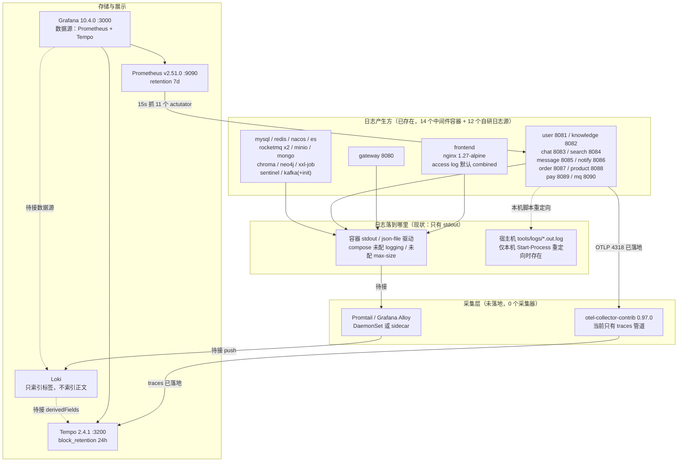
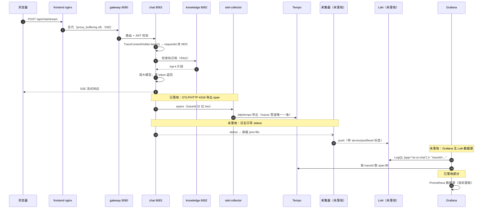

# 07 Loki 日志聚合：在 12 个日志源里捞回一条请求的完整轨迹

> **一句话结论**：日志聚合能不能用来排障，不取决于你有没有装 Loki，而取决于两件在写代码那一刻就定死的事——日志行里有没有"可检索的关联键"（traceId），以及标签是不是低基数且稳定；本仓库这两件都没做（`%X` 消费点 0 个、日志行的相关槽是 49 个空格），采集器也是 0 个，所以本篇按"规划级"写，每条结论都标清楚是"已落地"还是"方案/未实测"。
> **阅读前置**：先读 [04-Prometheus可观测性](04-Prometheus可观测性.md)（指标怎么被抓、actuator 怎么暴露）和 [01-Docker容器化](01-Docker容器化.md)（容器 stdout 到底是什么）；知道 MDC 是"线程绑定的键值袋"、traceId 是一条链路的身份证，就够了，不需要预先会 LogQL。
> **证据基线**：仓库快照 + 本机 pwsh/node 实测，依赖版本取自 `ai-cs-order/eff-order.xml` 的真实解析结果（Spring Boot 4.2.0 / micrometer-tracing 1.8.0 / opentelemetry 1.68.0）；A 级锚点 3 处、B 级引用 28 处、C 级实测 8 段；**本机无 Docker、无 kubectl、无 Jenkins**，凡涉及"跑容器""连集群"的结论一律标注"未本机实测"并给出命令与判读方法。预计阅读 45~60 分钟。

**证据边界**

| 本仓现实（已核实） | 本篇怎么处理 |
|---|---|
| `deploy/` 与全部工程代码里没有 Loki/Promtail/Alloy/Fluent Bit 的任何配置，全仓仅 1 处命中且是 `docs/00-项目总览与架构图.md` 的架构图占位 | §1、§3.5 讲"要加什么、加在哪、怎么验证"；一律标注**未落地** |
| 7 个 compose 文件里没有任何 `logging:`、没有日志驱动、没有轮转上限、没有日志卷 | §0、§3.5 用真实统计说明"日志此刻只活在容器 stdout 里" |
| 12 个业务模块没有任何 logback/log4j2 配置，`%X` 消费点 0 个 | §3.4 用实测证明"默认 pattern 的相关槽永远是空的" |
| 可观测性只落地了指标与链路：Prometheus 15s 抓 11 个 target、Tempo 保留 24h、OTel Collector 只有 traces 一条管道 | §3.8 说明"日志是第三支柱，但这一柱还是空的" |
| 本机没有 Docker/kubectl，也没有集群 | 容器/集群命令只给"命令 + 判读方法"，绝不写"已验证" |
| 真实日志样本来自 `tools/logs/*.out.log`（本机 2026-08-30/31 实跑留档） | §3.6 的体量账、§6 的判读手法都用它，并标注样本口径 |

---

## 0. 先看现象

### 现象 1：一条报错，十几个服务，没有一处能串起来

用户说"我刚才问的那句话，机器人回了两个字就没了"。你打开 `tools/logs/` 目录——本机跑过一次全栈启动，留下的是这样的现场：

| 文件 | 体量 | 内容是什么 |
|---|---|---|
| `ai-cs-order.out.log` | 297.7 KB | order 服务的 stdout 全量 |
| `ai-cs-product.out.log` | 177.5 KB | product 服务 |
| `ai-cs-user.out.log` | 86.4 KB | user 服务 |
| `ai-cs-chat.out.log` | 41.6 KB | chat 服务（真出问题的那台） |
| `ai-cs-gateway.out.log` | 31.2 KB | 网关 |
| 其余 8 个 `.out.log` | 0.3~37.9 KB | notify/pay/message/knowledge/search/mq/start-all/frontend（frontend 只有 0.3 KB） |
| 13 个 `.err.log` | **全部 0 字节** | stdout 已经把所有东西写了，stderr 一个字都没有 |

每个文件是**一台机器的时间线**，而你手上只有"某个用户、某个大概时间、某句用户台词"。要在 13 个文件里手工对齐时间戳做关联，等于用肉眼做 reduce。更糟的是这些文件是 `tools/lib/common.ps1` 用 `Start-Process -RedirectStandardOutput` 重定向出来的：

```powershell
# tools/lib/common.ps1:135-141（真实代码，节选）
function Start-Proc([string]$exe, [string[]]$argList, [string]$name, [string]$workdir) {
    $out = "$logDir\$name.out.log"      # $logDir = "$tools\logs"（common.ps1:13）
    $err = "$logDir\$name.err.log"
    $p = Start-Process -FilePath $exe -ArgumentList $argList -WorkingDirectory $workdir `
        -RedirectStandardOutput $out -RedirectStandardError $err `
        -WindowStyle Hidden -PassThru
```

也就是说：**宿主机上跑、日志落盘**。一旦换到 Docker/K8s，这套重定向就不存在了，日志下沉到容器 stdout（`docker logs` 后面那层 json-file），排障手法必须整条换掉——这正是"日志聚合"要解决的事。

现状的诊断口径在仓库里写得很直白，`deploy/scripts/check-local.ps1` 的失败提示里，凡是要看日志的地方给的都是逐台 `docker logs`：

```text
# deploy/scripts/check-local.ps1 中的真实 Hint（节选，行号为原文件）
L389: -Hint "docker logs --tail=100 $($c.Name)"
L402: -Hint "docker logs --tail=200 $($c.Name)"
L613: -Hint "服务可能仍在启动中（Java 应用冷启动需 30-60 秒），稍后重跑；仍失败则查启动日志"
L701: -Hint '网关是所有流量的唯一入口，必须先通；查看网关启动日志'
```

`07-运维部署/README.md` 第 220 行也把话说死了：**"0 个日志采集器：`loki` / `promtail` 在 `deploy/` 下 0 命中，collector 也没有 logs pipeline。日志仍要靠 `docker logs` / `kubectl logs` 逐台翻。"**

### 现象 2：日志行里本该放 traceId 的位置，是 49 个空格

这是最容易被漏掉的一条。取一行真实日志（本机 2026-08-30 实跑，`tools/logs/ai-cs-chat.out.log`）：

```text
2026-08-30T01:42:50.433+08:00  INFO 27744 --- [ai-cs-chat] [           main] [                                                 ] c.a.c.n.c.NacosConfigDataLoader          : [Nacos Config] Load config[dataId=ai-cs-chat.yml, group=DEFAULT_GROUP] success
```

肉眼扫过去觉得"格式挺正常"。我们把它按方括号切片量一遍宽度（C 级实测，命令见下）：

```powershell
cd D:\Projects\Persion\ai-customer-service
$line = (Get-Content tools\logs\ai-cs-chat.out.log -TotalCount 40 | Where-Object { $_ -match 'Nacos Config' } | Select-Object -First 1)
$m = [regex]::Matches($line, '\[([^\]]*)\]')
for($i=0;$i -lt $m.Count;$i++){ $v=$m[$i].Groups[1].Value; "{0} len={1} allSpace={2}" -f $i, $v.Length, ($v -match '^ *$') }
```

真实输出：

```text
bracket0 len=10 allSpace=False     # [ai-cs-chat]  → spring.application.name
bracket1 len=15 allSpace=False     # [           main] → %15.15t 右对齐的线程名
bracket2 len=49 allSpace=True      # [                 ...49 个空格...                 ]
bracket3 len=12 allSpace=False     # [Nacos Config] → 消息体里的方括号，不用管
bracket4 len=42 allSpace=False     # [dataId=ai-cs-chat.yml, group=DEFAULT_GROUP]
```

`bracket2` 是 49 个**纯空格**。49 = 32（traceId 宽度）+ 1（分隔位）+ 16（spanId 宽度）——这不是巧合，是 Spring Boot 4.2.0 的默认控制台 pattern 专门给 traceId/spanId 留的"相关槽"（correlation slot），值是空的时候整段用空格占位。判读结论只有一句：**这条日志的 traceId 是空的，你没法从日志反查到链路，也没法从链路反查到日志。**

### 现象 3：代码注释承诺了 `%X{requestId}`，配置里一处都没有

`ai-cs-chat` 是全仓唯一往 MDC 里塞东西的模块，代码注释写得很自信：

```java
// ai-cs-chat/src/main/java/com/aics/chat/observability/TraceContextHolder.java:57-59（真实代码）
// MDC 写入 requestId：SLF4J 的 MDC 会自动注入到 %X{requestId} 占位符，
// 让既有 log.info 日志零改造即可按请求关联——这是"最小侵入"的关键设计
MDC.put(MDC_REQUEST_ID, ctx.getRequestId());
```

"会自动注入到 `%X{requestId}` 占位符"——前提是**某个 pattern 里真的有 `%X{requestId}`**。实测（C 级，命令与输出见 §3.4）：全仓 `%X{` 只有 5 行命中，全在 `tools/seata` 这个第三方分发里；12 个业务模块一个都没有。于是 `requestId` 写进了 MDC，然后被整条日志管道无声丢弃。注意 `requestId` 还是个 36 位 UUID（`TraceContextHolder.java:54` 用 `UUID.randomUUID()`），跟 W3C 那种 32 位小写 hex 的 traceId 也不是一回事（见 §3.4 的 A 级锚点）。

> **这些现象指向同一件事**：日志能不能用来定位，取决于两件在写代码时就定死的事——**日志行里有没有可检索的关联键**、**标签是不是低基数且稳定**。采集器（Loki + Promtail/Alloy）只是最后一公里；前两件没做，装了聚合也只是把一堆没法关联的文本搬进另一个数据库。

---

## 1. 整体地图



> **读图说明**：图分四层，从左到右是"产生 → 落点 → 采集 → 存储展示"。**实线**是已落地路径：应用把 OTLP 打到 `otel-collector:4318`、collector 只有一个 traces 管道转给 Tempo、Prometheus 每 15s 抓 11 个 `/actuator/prometheus`、Grafana 挂了 Prometheus 与 Tempo 两个数据源。**虚线**是本篇要补的两段：容器 stdout → 采集器（现在没有任何采集器），以及 Loki 作为 Grafana 的第三个数据源、并用 derivedFields 与 Tempo 互相跳转。注意 `HOSTLOG` 那条虚线：`tools/logs` 只在宿主机脚本方式启动时存在，容器化之后它彻底消失，别把它当"已经有日志文件了"。最容易误读的一点是中间件那一格——14 个中间件容器的日志同样是排障证据（MySQL 的 `Too many connections`、Nacos 的配置加载失败），所以采集器的目标不该只盯自研服务。

### 组件与责任划分

| 组件 | 责任 | 参与方（谁会去用它） | 是否已落地 | 失效后表现 |
|---|---|---|---|---|
| 应用 stdout（logback 控制台 appender） | 生产日志事件的唯一出口 | 开发、运维 | ✅ 已落地（但无文件 appender） | 进程一挂，日志随容器一起没 |
| 容器运行时日志驱动（默认 json-file） | 把 stdout 落到宿主机文件 | Docker/containerd | ✅ 存在，但**未配轮转上限** | 磁盘被单个容器写满，节点 NotReady |
| 采集器（Promtail / Alloy） | tail 日志、打标签、推送 | 平台/SRE | ❌ **0 个** | 日志只能 `docker logs` 逐台翻 |
| Loki | 存日志正文 + 只索引标签 | 排障的人 | ❌ 未落地 | 无跨服务检索能力 |
| otel-collector（0.97.0） | 收 OTLP、转发 | 应用（自动） | ⚠️ 只有 traces 一条管道 | 加日志管道前它不会替你看日志 |
| Tempo（2.4.1） | 存 trace | 排障的人 | ✅ 已落地（保留 24h） | trace 查不到，日志失去"路径"参照 |
| Prometheus（v2.51.0） | 抓指标、判趋势 | 值班、告警 | ✅ 已落地（7d） | 无法先"定位到哪台哪天段" |
| Grafana（10.4.0） | 统一查询界面 | 所有人 | ⚠️ 数据源只有 Prometheus + Tempo | 日志没有入口，三支柱凑不齐 |
| derivedFields（Grafana 内配置） | 从 traceId 一键跳日志 / 反向跳 | 排障的人 | ❌ 未配置 | 两边靠人工复制粘贴 32 位字符串 |

---

## 2. 关键概念与关键配置

先把术语钉死，后面每个都只在首现处解释一次。

**日志聚合（log aggregation）**：把散落在 N 个容器 stdout 里的文本，集中收进一个可查询的存储，并允许按"服务、时间、级别、关键字"跨机检索。它解决的不是"存不下"，而是"捞不出来"。

**标签（label）**：附加在每条日志上的**元数据键值对**，Loki 会为它建索引。**基数（cardinality）** 是一个标签能取到的不同值的个数：`service` 只有 11 个值（低基数），`userId` 可能是几十万（高基数）。Loki 把"同一组标签值"的所有日志叫一个**流（stream）**，流是它存储和查询的最小单位——这就是为什么高基数标签会把 Loki 打崩（详见 §3.3）。

**结构化日志（structured logging）**：日志正文不是一句人话，而是一条 JSON（`{"ts":...,"level":"INFO","service":"ai-cs-chat","traceId":"...","msg":"..."}`）。人读、机器也读，成本是"写日志时要选字段"，收益是"字段可以被精确过滤、被聚合、被当成告警维度"。

**MDC（Mapped Diagnostic Context）**：SLF4J 提供的线程绑定键值袋，日志框架在渲染 pattern 时能读它。它天然适配"一个请求一个线程"的模型，跨线程池/异步回调会丢，必须显式捕获-恢复（本项目 `TraceContextHolder` 就是干这个的）。

**traceId / spanId**：一条分布式链路的全局 ID 与单跳 ID。格式是硬约束：traceId 是 32 位小写 hex，spanId 是 16 位小写 hex，非法值会归一成全 0。这两个宽度和 §0 里那 49 个空格正好对上（32 + 1 + 16）。

**LogQL**：Loki 的查询语言，语法像 PromQL 的亲儿子：左边是**流选择器**（`{app="ai-cs-chat"}`，只能用标签），右边是**管道过滤器**（`|= "traceId=abc"`，过滤正文）。理解这一点，就理解了"为什么正文没法建索引也能查得快"。

**retention（保留期）**：日志留多久。Loki 支持按流（也就是按标签组合）配置不同保留期，这是"重要服务留 30 天、噪音服务留 3 天"的实现方式。

**DaemonSet / sidecar**：K8s 里采集器的两种放法。DaemonSet 每个节点一个、负责该节点上所有 Pod 的日志文件（省资源、要读宿主机路径）；sidecar 每个 Pod 配一个（隔离干净、资源翻倍）。K8s 之外（compose）就直接跑一个容器挂 `/var/lib/docker/containers`。

**OTLP**：OpenTelemetry 的传输协议（gRPC 4317 / HTTP 4318）。本项目 10 个服务已经配好了 OTLP 导出（§3.8）。

### 关键配置项与它们的位置

| 名称 | 位置（真实文件） | 角色 | 关键参数 |
|---|---|---|---|
| 根 compose（14 服务 / 18 宿主端口 / 13 healthcheck） | `docker-compose.yml`（359 行） | 中间件编排，日志产生方 | **无 `logging:`、无 `max-size`、无 `mem_limit`** |
| 可观测性编排（4 服务） | `deploy/docker-compose/docker-compose-observability.yml#L20-L68` | Prometheus/Grafana/Tempo/Collector | 卷 `prometheus-data/grafana-data/tempo-data` |
| Prometheus 抓取配置 | `deploy/observability/prometheus.yml#L8-L22` | 指标入口 | `scrape_interval: 15s`、11 个 target `host.docker.internal:8080..8090` |
| OTel Collector 配置 | `deploy/observability/otel-collector.yaml#L14-L19` | 链路入口 | `service.pipelines` **只有 `traces`** |
| Tempo 配置 | `deploy/observability/tempo.yaml#L22-L26` | 链路存储 | `block_retention: 24h`、local 后端 |
| Grafana 数据源 | `deploy/observability/grafana/provisioning/datasources/datasources.yaml#L1-L16` | 查询入口 | 仅 Prometheus + Tempo，**无 Loki、无 derivedFields** |
| 应用日志开关 | `tools/nacos-config/aics-shared.yml#L26-L38` | 共享配置 | 只有 `management.endpoints...prometheus`，**无 `logging.*`** |
| Tracing 采样与导出 | `ai-cs-gateway/src/main/resources/application.yml#L59-L66` | 链路开关 | `management.tracing.sampling.probability`、`management.otlp.tracing.endpoint` |
| MDC 写入点 | `ai-cs-chat/src/main/java/com/aics/chat/observability/TraceContextHolder.java#L23-L59` | 关联键生产端 | `MDC_REQUEST_ID = "requestId"` |
| 前端访问日志 | `ai-cs-frontend/nginx.conf#L30-L37` | 入口层日志 | 只有 `access_log off;`（针对 `/assets/`），**无 `log_format`** |
| 本机日志落盘 | `tools/lib/common.ps1#L135-L141` | 宿主机日志文件 | `$logDir = "$tools\logs"`、重定向 stdout/stderr |
| k8s 单服务清单 | `deploy/k8s/services/ai-chat-service.yaml#L44-L110` | 部署形态 | 单容器、tcpSocket 探针，**无 sidecar** |

---

## 3. 原理与证据逐段精读

### 3.1 三件套分工：谁回答什么问题

**在干什么。** 可观测性三件套是三种不同的"问题-数据"配对：

| 支柱 | 回答的问题 | 数据形态 | 成本特征 | 本仓现状 |
|---|---|---|---|---|
| metrics 指标 | "整体有没有变坏？从什么时候开始？哪台机器？" | 时序数字 | 极低（聚合后存储） | ✅ 15s 抓 11 个 target，保留 7d |
| logs 日志 | "这一次具体发生了什么？参数是什么？异常栈第一行是什么？" | 文本/JSON | 高（与请求量线性相关） | ❌ 0 个采集器 |
| traces 链路 | "这次请求走了哪几个服务？慢在哪一跳？" | 采样后的 span 树 | 中（采样可降本） | ✅ OTLP → Collector → Tempo，保留 24h |

正确的下钻顺序是 **指标报警 → 链路定位到某一跳 → 日志看这一跳的细节**。反过来做（一上来就翻日志）就是 §0 那个现场。

**为什么这么设计。** 三者成本差两三个数量级：一条请求产生一个计数器的更新（几十字节/分钟聚合后），却可能产生 50 行日志（几 KB）。所以行业惯例是"指标全量、链路采样、日志按需（且必须能定向检索）"。本项目 `management.tracing.sampling.probability: ${TRACING_SAMPLING:1.0}` 默认全采样——这是**开发期**的合理默认值，生产要按 §5 的取舍调低。

**换写法会怎样。** 如果把日志当指标用（"用 grep 数一数错误条数来画曲线"），你会得到一条既不准（多行堆栈会重复计数）又贵（每次查询都要扫全文）的曲线；如果把指标当日志用（"把 userId 塞进 label 里天天看"），就是 §3.3 的标签爆炸。想把三者合一（用一份数据回答三种问题）的工具确实存在，但那意味着放弃各自的成本优势。

**常见坑。** ①以为"有 trace 就不需要日志"——trace 只告诉你"这一跳慢了 800ms"，不告诉你"慢是因为 SQL 拼错了字段"；②以为"有日志就不用 trace"——日志里没有 traceId 时（就是本项目现状），跨服务的 5 行日志永远串不成一条线；③三者的时间要对齐：Tempo 存的是 UTC 纳秒，日志里是 `+08:00` 本地时间，差 8 小时的对齐错误比没有日志更误导人（§6.8）。

### 3.2 索引模型：Loki 只索引标签，ELK 索引全文

**在干什么。** 日志系统要回答"包含某段字符串的行在哪"，只有两条技术路线：

| 维度 | Loki（只索引标签） | ELK / OpenSearch（全文倒排索引） |
|---|---|---|
| 索引对象 | 只有标签（`service`、`pod`、`level`…） | 每个被索引字段的每个词 |
| 正文检索 | 查询时**扫描**该流的时间块，硬扫 | 直接查倒排表，命中即返回 |
| 存储成本 | 低（正文压缩后存块，无倒排膨胀） | 高（原始文本 + 倒排，常见 1.5~2 倍膨胀） |
| 查询成本 | 取决于"命中流的范围"：范围窄就快，范围宽就慢 | 取决于词频，长尾词很快，高频词慢 |
| 最适合 | 你知道"哪台服务、哪个时间段"，需要看细节 | 你不知道在哪，需要"全库搜一个关键字" |
| 运维复杂度 | 低（无 schema、无 mapping、无分片规划） | 高（mapping 冲突、分片数、ILM、冷热分层） |

**为什么这么设计。** Loki 的赌注是"排障时你几乎总是先知道范围"：报警告诉你服务和时间段，trace 告诉你哪一跳，剩下就是"在这个范围内找细节"。既然范围已知，就没必要为全文建索引，把省下的成本换成分区扫描。这也是它跟 Prometheus/Grafana 生态贴得紧的原因——同一套标签语言，同一个 Grafana。

**换写法会怎样。** 反过来选 ELK 也完全正确，条件是你的排障模式是"关键词大海捞针"（比如安全审计、法务取证、用户报障只说了一句"我的订单编号是 xxx"）。但要付出三样代价：容量（倒排膨胀）、运维（分片与 mapping 会咬人）、以及"日志量涨 3 倍、集群也要涨 3 倍"的线性成本。

**本仓证据（这是选型讨论里最容易被忽略的一点）**：项目里**已经有 Elasticsearch 8.12**（`docker-compose.yml#L85-L107`，单节点 `ES_JAVA_OPTS=-Xms512m -Xmx512m`），但它是**业务检索**用的——`ai-cs-search`（8084，全文检索服务）与 `ai-cs-knowledge`（8082，RAG 检索）靠它工作，不是日志后端。所以"我们已经有 ES 了，日志直接塞进去"这个想法要额外回答三个问题：业务索引与日志索引抢同一份 JVM 堆（这里只有 512MB 上限）、日志写入会污染业务检索的 mapping、以及 ILM 策略要跟业务索引分开管。**结论：不要复用业务 ES 存日志**，要么单独起一套（成本更高），要么走 Loki（本篇的选择）。

**常见坑。** ①把 Loki 当全文检索引擎用（`{service=~".+"} |= "NullPointerException"` 这种全库扫，在大日志量下会把 querier 打爆）；②以为 Loki 的 `|= "xxx"` 是"索引查找"，其实是"块内逐行匹配"，所以**先收窄标签、再过滤正文**是必须养成的顺序；③忘了 Loki 不索引正文也意味着**字段名也想被精确过滤就得先结构化**（§3.4），否则你只能做 substring 匹配，`level=ERROR` 与 `"level":"ERROR"` 在正文里长得不一样。

### 3.3 标签设计：低基数是铁律

**在干什么。** Loki 的存储单元是"流"，流的身份 = **标签集合的值**。`{app="ai-cs-chat", pod="chat-7d9f-abc", level="ERROR"}` 是一个流；只要其中一个值变了，就是另一个流。所以标签设计等于"给数据分区"。

**为什么这么设计。** 每个流在内存里要维护索引条目、在磁盘上要维护独立的块目录与 chunk。流的数量（也就是标签值的**笛卡尔积**）直接决定索引大小和写入内存：

```text
流数量 = service 取值数 × pod 取值数 × level 取值数 × ...
```

11 个服务 × 每个 3 个 Pod × 4 个级别 = 132 条流，很健康。但如果把 `userId` 做成标签：11 × 3 × 4 × 10 万 = 1300 万条流——每条流都要单独建目录、单独维护 chunk、单独算索引项。这就是社区反复讲的 "cardinality explosion"，表现是 Loki 的 ingester 内存飙涨、`/metrics` 里 `loki_ingester_streams_created_total` 暴涨、写入返回 `429`，最后**整个租户被限流**。

判据很简单：**这个标签的值，你能在 Grafana 的下拉框里忍受它有多少个选项？** 能枚举、且数量级在百以内的，可以做标签；跟用户/请求绑定的，一律进正文。

| 候选标签 | 取值规模（本仓实况） | 能做标签吗 | 正确做法 |
|---|---|---|---|
| `service` / `app` | 11（gateway..mq）+ 前端 + 14 个中间件 | ✅ 应该做 | 取 `spring.application.name`（compose 服务名/容器名同源） |
| `pod` / `container` | 单机 1，K8s 副本数 | ✅ 做 | 用真实 Pod 名，接受"每次发布换一批值" |
| `namespace` | `ai-customer-service` 等 | ✅ 做 | 与 `deploy/k8s/namespace.yaml` 对齐 |
| `level` | 6（TRACE..FATAL，实际用 3） | ✅ 可以做 | 但注意它会把流数量 ×级别数；噪音大时可只在 ERROR 上做标签 |
| `traceId` | 每请求一个（万级/分钟） | ❌ **绝对不行** | 进正文/结构化字段，用 `\|= "traceId"` 过滤 |
| `userId` / `sessionId` | 十万级 | ❌ 不行 | 同上；需要"按用户查"时用正文过滤 + 时间收窄 |
| `host` / `node` | 节点数 | ✅ 可以做 | DaemonSet 采集时天然带 |
| `level=WARN` 之类的"值做键" | — | ❌ 反模式 | 别造 `is_error="true"` 这种冗余标签 |

**换写法会怎样。** 有人为了"查得快"把 `traceId` 做成标签，结果日志系统在高并发时直接雪崩；也有人为了省事只打一个 `{job="aics"}` 标签，把所有服务混成一条流——查询时任何一次全量扫描都会拖垮 querier，因为"流的范围"就是你唯一的过滤手段。**两种极端都在同一根轴上：标签太少 → 扫描范围失控；标签太多 → 流数量失控。** 经验值是单租户流数量控制在十万以内。

**常见坑。** ①把 `level` 拼进流标签后发现"WARN 突然暴涨"，其实是采集阶段解析错了大小写（`warn` vs `WARN` 变成两条流）；②用 `pod` 名做标签但没配 `max_streams`，滚动发布一轮就把流数量翻倍；③以为"标签能改"——标签是写入时定死的，改标签设计等于重写历史（旧数据的标签改不了，只能等 retention 滚掉）。

### 3.4 日志格式与结构化：JSON、MDC、traceId 注入

**在干什么。** 这一节决定"日志行里到底有哪些字段可以被检索"。最省事的做法是 Spring Boot 的默认控制台 pattern，最工程化的做法是 JSON 结构化 + traceId 字段。

**为什么这么设计（先看默认 pattern 长什么样）。** Spring Boot 4.2.0 的默认控制台 pattern 不是"随手拼的字符串"，它有明确的槽位顺序：

```text
# C 级实测：反查本机 m2 里的 spring-boot-4.2.0.jar（DefaultLogbackConfiguration.class 内嵌字符串）
${LOG_LEVEL_PATTERN:-%5p} ${PID:-} --- %esb(){APPLICATION_NAME}%esb{APPLICATION_GROUP}[%15.15t] ${LOG_CORRELATION_PATTERN:-}%-40.40logger{39} : %m%n
```

注意 `${LOG_CORRELATION_PATTERN:-}` 这一段——它就是 §0 里那 49 个空格的来源。同一个 jar 里还有：

```text
# 同一次反查（CorrelationIdFormatter.class）
traceId(32),spanId(16)                        ← 内建 spec：两段的宽度写死
[%s]                                          ← 渲染外层
Unable to parse correlation formatter spec '%s'   ← spec 写错时的报错原文
# CorrelationIdFormatter$Part.class
^(.+?)\((\d+)\)$                              ← 解析 name(width) 的正则
# AbstractLoggingSystem.class（LoggingSystemProperties.class 同）
logging.pattern.correlation / CORRELATION_PATTERN
getDefaultLogCorrelationPattern / logging.expect-correlation-id
```

也就是说：**相关槽的宽度 32+16 是 Boot 写死的，值的来源是 MDC 里的 `traceId` 与 `spanId` 两个键**。这两个键由 micrometer-tracing 的 `Slf4JEventListener` 写入（`micrometer-tracing-bridge-otel-1.8.0.jar` 里确有该类），**不是**由业务代码写。

那 traceId 长什么样？A 级证据（源码摘录库）：

- traceId 是 32 位小写 hex：`[[源码:SpanContext.java.md#L89-L95]]`——注释原文 "Returns the trace identifier ... as 32 character lowercase hex String"；
- spanId 是 16 位小写 hex：`[[源码:SpanContext.java.md#L106-L113]]`；
- 非法 ID 会被校验拦住，非法值归一为全 0：`[[源码:SpanContext.java.md#L56-L59]]`（原文："If the traceId or the spanId are invalid ... both will be replaced with the standard "invalid" versions (i.e. all '0's)"）。

> 摘录口径：这三处锚点来自 `24-源码分析/assets/source/` 入库的 `io.opentelemetry:opentelemetry-api:1.50.0` 摘录，而本项目运行时解析到的 opentelemetry 版本是 **1.68.0**（`ai-cs-order/eff-order.xml`）。`SpanContext` 是稳定 API，这两个宽度的事实不随小版本变化，但引用时要知道版本不同源。

**再看本项目的实际情况（真实的坑）。** 三个事实叠在一起，导致 traceId 进不了日志：

| 事实 | 证据 | 后果 |
|---|---|---|
| 12 个业务模块没有任何 logback/log4j2 配置，全靠 Boot 默认 pattern | 见 §3.4 末尾 C 级统计：logback/log4j2 配置文件全仓仅 1 个，还是第三方 seata 的 | 相关槽用的是内建 `traceId,spanId` spec，**不读 `requestId`** |
| 业务代码只往 MDC 写了 `requestId`（36 位 UUID），没写 `traceId`/`spanId` | `ai-cs-chat/src/main/java/com/aics/chat/observability/TraceContextHolder.java#L23`、`#L54-L59` | 即使相关槽被渲染，也读不到这个键 |
| 没有任何 pattern 消费 `%X{requestId}` | 全仓 `%X{` 命中 5 行，全在 `tools/seata` 第三方配置里 | `requestId` 写了等于没写 |

```powershell
# C 级实测 1：全仓 logback/log4j2 配置文件数量（排除依赖目录与文档）
Get-ChildItem -Recurse -File -Include 'logback*.xml','log4j2*.xml','log4j2*.properties' |
  Where-Object { $_.FullName -notmatch '\\(node_modules|target|\.git|learning-docs)\\' } |
  ForEach-Object { $_.FullName.Replace((Get-Location).Path + '\','') }
# C 级实测 2：pattern 里谁消费了 MDC（%X{）
Get-ChildItem -Recurse -File -Include '*.xml' |
  Where-Object { $_.FullName -notmatch '\\(node_modules|target|\.git|learning-docs)\\' } |
  Select-String -Pattern '%X\{' |
  ForEach-Object { $_.Path.Replace((Get-Location).Path + '\','') + ":" + $_.LineNumber }
```

真实输出：

```text
# 实测 1
tools\seata\seata\conf\logback-spring.xml          ← COUNT=1
# 实测 2（COUNT=5，全部在第三方 seata 目录里）
tools\seata\seata\conf\logback\console-appender.xml:21
tools\seata\seata\conf\logback\file-appender.xml:23
tools\seata\seata\conf\logback\kafka-appender.xml:27
tools\seata\seata\conf\logback\kafka-appender.xml:35
tools\seata\seata\conf\logback\kafka-appender.xml:36
```

**判读**：`COUNT=1` 里的那 1 个属于第三方 Seata 分发（`tools/` 下解压的工具目录），不是本项目产物；`COUNT=5` 全部落在这个第三方目录里。所以"本项目 12 个模块的日志 pattern 消费 MDC 的次数 = 0"。配合 §0 `bracket2` 的 49 个空格，可以下一句硬结论：**本项目 logback 未消费 MDC，MDC 里也没有 traceId，所以 traceId 不在日志里。**

**怎么改成"能查"（这是方案，未落地）。** 目标只有一个：每条日志带 `service`、`level`、`traceId`、`spanId`、`ts`、`msg` 六个字段，且正文里的堆栈能整段保留。最小改动是加一个 `logback-spring.xml`（每个模块放自己的 `src/main/resources/` 下，或打包进 common 由各模块 import）：

```xml
<!-- 方案示意，未落地：本项目 12 个模块目前没有这个文件 -->
<configuration>
  <appender name="JSON" class="ch.qos.logback.core.ConsoleAppender">
    <encoder class="net.logstash.logback.encoder.LogstashEncoder">
      <customFields>{"service":"${spring.application.name}"}</customFields>
      <!-- traceId/spanId 由 MDC 自动展开；requestId 也从 MDC 带出 -->
      <includeMdcKeyName>traceId</includeMdcKeyName>
      <includeMdcKeyName>spanId</includeMdcKeyName>
      <includeMdcKeyName>requestId</includeMdcKeyName>
      <timeZone>Asia/Shanghai</timeZone>
    </encoder>
  </appender>
  <root level="INFO"><appender-ref ref="JSON"/></root>
</configuration>
```

注意它把日志打到 **stdout**（`ConsoleAppender`），不是文件——这是容器世界的正确姿势（§3.5）。而 `traceId`/`spanId` 能不能真的出现在 JSON 里，取决于 MDC 里是否真有这两个键；如果 `Slf4JEventListener` 没生效，就要在 `TraceContextHolder` 的 `begin()` 里显式 `MDC.put("traceId", ...)`（**不要**再塞 `requestId` 那种自定义 UUID 冒充 traceId，两边 ID 体系必须先统一，否则 Grafana 的跳转永远是 404）。

**换写法会怎样。** ①继续用默认 pattern：字段没法精确过滤，`level=ERROR` 只能靠 `|= " ERROR "` 猜位置，堆栈多行被拆散；②用 `%X{traceId:-}` 手写 pattern：可行，但要自己维护一份 pattern，且 `%-5p`/`%15.15t` 这类宽度容易改坏对齐（改坏了不影响正确性，只是人眼读起来痛苦）；③落文件再采集：容器里落文件意味着要配卷、要配轮转、要处理"容器删了文件还在"，比 stdout 多三处失败点。

**常见坑。** ①以为"加了 tracing 依赖，日志里就会有 traceId"——依赖只负责生成 ID，注入 MDC 与渲染 pattern 是两件事，本项目两件都没做（§0）；②JSON 里塞了 `msg` 又把参数拼进字符串，导致字段可选的变成不可查（应该做 `{"msg":"order not found","orderId":123}` 而不是 `{"msg":"order not found: 123"}`）；③时间戳用 `TZ` 默认值，容器里 `TZ=Asia/Shanghai`（`docker-compose.yml#L19` 只给 mysql 设了），其他容器可能是 UTC，聚合后时间轴错位（§6.8）；④把密钥打出来——`tools/nacos-config/aics-shared.yml` 里有明文 redis/mysql 地址、jwt secret 和两个 api-key，一旦开了全量 JSON 日志，`@ConfigurationProperties` 的 toString 很容易把它们带出来。

### 3.5 采集链路：stdout → 采集器 → Loki

**在干什么。** 把容器 stdout 变成"带标签、可推送"的日志流。链路上有三个必须做对的决定：日志先落到哪、谁来 tail、用什么协议推。

**为什么这么设计（先认清容器世界的日志）。** 容器里的进程往 stdout/stderr 写，**容器运行时**接管它并落成本地文件——Docker 默认是 json-file 驱动，路径在 `/var/lib/docker/containers/<id>/<id>-json.log`，每行是 `{"log":"...","stream":"stdout","time":"..."}`。`docker logs` 只是读这个文件。所以"日志在不在"和"容器在不在"绑死：容器一删，默认配置下日志一起没。

**本仓的现状有两个硬事实**：

① **7 个 compose 文件里没有任何日志驱动/轮转配置**。C 级实测：

```powershell
cd D:\Projects\Persion\ai-customer-service
Get-ChildItem deploy -Recurse -File -Include *.yml |
  Select-String -Pattern 'logging:|driver:|max-size|/app/logs|logs:|log-driver|json-file' |
  ForEach-Object { $_.Path.Replace((Get-Location).Path + '\','') + ":" + $_.LineNumber + ": " + $_.Line.Trim() }
```

真实输出（6 行，注意它们全是**网络**驱动，不是日志驱动）：

```text
deploy\docker-compose\docker-compose-all.yml:303: driver: bridge
deploy\docker-compose\docker-compose-host1.yml:177: driver: bridge
deploy\docker-compose\docker-compose-host2.yml:106: driver: bridge
deploy\docker-compose\docker-compose-host3.yml:154: driver: bridge
deploy\docker-compose\docker-compose-master-slave.yml:294: driver: bridge
deploy\docker-compose\docker-compose-observability.yml:17: driver: bridge
```

**判读**：`logging:` 键 0 命中、`max-size` 0 命中、日志卷 0 命中。意思是每个容器都在用默认 json-file，**没有任何轮转上限**——单机跑久了，一个话痨服务就能把宿主磁盘写满（§6.4）。根 compose 的 359 行里也没有 `mem_limit`，同一个"没设上限"的问题在内存维度也存在。

② **采集器是 0 个**。全仓 grep（排除 `.venv`/`node_modules`/`target`/`.git`/`learning-docs`）：

```powershell
Get-ChildItem -Recurse -File |
  Where-Object { $_.FullName -notmatch '\\(\.venv|node_modules|target|\.git|learning-docs)\\' } |
  Select-String -Pattern 'loki|promtail|alloy|fluent-bit|fluentd|vector\.dev'
```

真实输出：

```text
docs\00-项目总览与架构图.md:290: OBS["Prometheus / Grafana / Tempo / Loki"]
HITS=1
```

**判读**：唯一命中是架构图里一个 Mermaid 节点标签（愿景），不是配置。**Loki 未落地、Promtail 未落地、没有 sidecar、没有 DaemonSet。**

**三种采集器怎么选（这是方案，未落地）：**

| 方案 | 怎么跑 | 优点 | 代价 | 适用 |
|---|---|---|---|---|
| Promtail | 每节点一个容器/DS，挂 `/var/lib/docker/containers`，`scrape_configs` 里用 `docker_sd_configs` 自动发现 | 配置短、与 Loki 同源、`labels` 里直接能拿容器名 | Grafana 官方已把它并入 Alloy 路线（新项目不再首选） | 快速验证、老集群 |
| Grafana Alloy | 同上，River 配置语法，一个二进制同时做 metrics/logs/traces | 未来方向、能力更全（能替代 collector 的部分职责） | 配置语法另一套，团队要重新学 | 新建、想统一 agent |
| Fluent Bit / Vector | 同上，输出到 Loki 或先转 OTLP | 资源占用小、生态广 | 多一层格式转换，标签语义要自己对齐 | 已有 agent 体系 |

K8s 侧还有"sidecar vs DaemonSet"的老问题：本项目 `deploy/k8s/services/ai-chat-service.yaml#L44-L110` 是**单容器**清单（只有 `ai-chat-service` 一个 container，只有 tcpSocket 探针），既没有 sidecar 也没有卷挂载，所以**只能走 DaemonSet**（或者接受"日志只在节点文件里、没有标签"）。如果哪天要加 sidecar，注意它会和主容器抢同一份资源配额，而且 Pod 里两个容器都要配 `resources.requests`，否则调度会挤。

**另一条更"顺"的路：让 collector 收 OTLP 日志。** 本项目已经有 `otel/opentelemetry-collector-contrib:0.97.0` 在跑，配置里只有一条 traces 管道：

```yaml
# deploy/observability/otel-collector.yaml#L14-L19（真实内容，节选）
service:
  pipelines:
    traces:
      receivers: [otlp]
      exporters: [otlp/tempo]
```

要加日志有两条支线：**(a)** 应用侧用 OTLP 日志导出（logback 的 OTLP appender），collector 加 `logs` 管道 + `loki` exporter；**(b)** 采集器 tail 文件后走 OTLP 给 collector。前者链路最短、字段最结构化（因为日志从应用侧就直接是 OTLP 的 `LogRecord`），代价是要改 12 个模块的日志配置；后者对应用零侵入（但要处理"文件行 → OTLP LogRecord"的字段映射）。**注意 (a) 会让"应用 → collector"这条通道同时承载 trace 与 log，collector 变成单点**（§6.5），生产上要至少两副本 + 前面的 LB。

**换写法会怎样。** ①直接 `docker exec` 里 `cat` 日志：容器重启就没了，等于没有；②把日志写到挂载卷上的文件再由外部采集：可行，但要多管一套"文件轮转 + 采集器 offset"，比 stdout 多两个失败点；③用 `docker logs -f` 常驻重定向到一个文件：这是把"宿主机重定向"那套（`tools/lib/common.ps1#L135-L141`）硬搬到容器里，最脆——日志进程一挂就断流，而且没人发现。

**常见坑。** ①采集器跑在容器里、却挂载宿主机 `/var/lib/docker/containers`，路径在不同发行版/containerd 下不一样（`/var/log/pods` 是 K8s 的路径）；②只采 `*.log` 文件而应用把日志打到 stdout（本项目就是 stdout），采集器抓不到——必须走 `docker_sd_configs` 这类"按容器发现"的服务发现；③忘了给采集器加 `label`，结果所有日志混成一条无敌大流，查询必然超时；④collector 只有一条 traces 管道却以为"日志也走了 collector"（§0 现象 1 的根源之一）。

### 3.6 保留与成本：按标签分流 retention

**在干什么。** 决定"每类日志留多久、花多少钱"。Loki 的 retention 是**按流**生效的（`retention_stream` / 全局 `retention_period` + compactor 定期删块），所以"重要服务留 30 天、噪音服务留 3 天"是可以配出来的。

**为什么这么设计。** 日志成本 ≈ 写入量 × 保留天数 ÷ 压缩比。这三个变量里只有"保留天数"能按服务差异化——写入量由业务决定，压缩比由编码决定。把 7×24 的噪音（健康检查、心跳、SQL 慢日志的重复行）与"真的会被人看"的错误日志分开保留，是唯一有效的降本手段。

**用本仓真实体量算一笔账（C 级，样本口径：本机一次全栈启动的 stdout 留档）。**

```text
# 来源：tools/logs/*.out.log（本机 2026-08-30/31 实跑留档，13 个文件）
ai-cs-order.out.log 297.7 KB        ai-cs-chat.out.log 41.6 KB
ai-cs-product.out.log 177.5 KB      ai-cs-gateway.out.log 31.2 KB
ai-cs-user.out.log 86.4 KB          其余 8 个 15.9~37.9 KB
TOTAL_OUT=0.8 MB  files=13          ERR_FILES=13 ERR_TOTAL_BYTES=0
```

```javascript
// node 折算（真实脚本，输入是上面实测的 0.80 MB/次）
const perStart = 0.80 * 1048576;
for (const d of [30, 1000]) {
  const daily = perStart / 1048576 * d;
  console.log(`每天重部署 ${d} 次 → ${daily.toFixed(1)} MiB/天，30 天 ${(daily * 30 / 1024).toFixed(2)} GiB（未压缩）`);
}
```

真实输出：

```text
样本文件数=13  合计=0.80 MB
折算：单次全量启动日志=815 KB ≈ 0.80 MiB
若每天重部署 30 次 → 23.9 MiB/天，30 天 0.70 GiB，未压缩原始文本
若每天重部署 1000 次 → 795.7 MiB/天，30 天 23.31 GiB，未压缩原始文本
```

**判读**：这个样本只含**启动日志**，不含请求日志——所以它只能用来定"下限"，不能用来定容量。真实业务日志量必须实测（下面给命令）。但它已经足够说明一件事：**成本的主项是请求日志，不是启动日志**，所以"要不要上 Loki"的答案取决于"你的请求日志每天多少行"，而这件事本项目还没有数据（因为没有采集器，也从没量过）。

**获取真实数据的命令（未本机实测，本机无 Docker）**：宿主机上看容器日志文件大小 `sudo du -sh /var/lib/docker/containers/<id>/*-json.log`、行数 `sudo bash -c "cat /var/lib/docker/containers/<id>/*-json.log | wc -l"`；上线后校准用 `sum(rate(loki_distributor_bytes_received_total[5m]))`。

**判读**：把 (1) 的字节数 × 副本数 × 保留天数 ÷ 压缩比（Loki 的 chunk 压缩后通常只剩原文本的一小部分；具体比例**必须自己在目标机器上量**，本篇不编造数值，量法就是"同一批日志的原始字节 vs 落盘 chunk 大小"）就是磁盘账；把 (3) 与 (1) 对比，可以校准"采样/过滤是否生效"。

**分层保留该长什么样（方案，未落地）：**

| 日志类别 | 判定方式 | 建议保留 | 理由 |
|---|---|---|---|
| 错误与异常栈 | `level=ERROR` 或 `=~ "(?i)exception"` | 30 天 | 复盘与 RCA 的原料（见 13-稳定性工程） |
| 业务关键事件（下单/支付/转人工） | 结构化字段 `event` 白名单 | 30~90 天 | 客诉取证 |
| 访问日志（网关/前端） | `service=~"gateway\|frontend"` | 7 天 | 量大、模型固定、主要是排流量问题 |
| 健康检查/探针噪音 | `\|= "actuator/health"` | 1~3 天或**直接丢弃** | 占八成以上体积，几乎没人看 |
| DEBUG/TRACE | `level=~"DEBUG\|TRACE"` | 不采集（默认 INFO） | 生产开 DEBUG 是事故 |
| 审计（登录、权限变更、资金） | 业务事件 | **不进 Loki** | 见 §3.9 |

**换写法会怎样。** 全局一个 `retention_period: 30d`：简单，但账单按最贵的服务算；改成"全部 3 天"：省钱，但出事故时日志已经滚掉（最坏的组合是"出了事故才发现日志只留 3 天"）。

**常见坑。** ①retention 配了但 compactor 没开（Loki 的删除是 compactor 干的），表现为"设了 3 天，磁盘三个月都不降"；②按 `pod` 分流 retention 会把配置数量乘上副本数；③只算了存储没算**查询**成本——留 30 天但每次查询扫全月数据，querier 的 CPU 账单更疼；④以为"日志压缩比很高所以随便留"，正文压缩确实好，但**索引与 chunk 目录**的开销随流数量增长，而流数量由标签决定（§3.3）。

### 3.7 LogQL：先按标签收窄，再按正文过滤

**在干什么。** LogQL 的语法结构强制你按"标签 → 正文"的顺序思考：

```text
{标签选择器}  |= "正文包含"  != "正文排除"  |~ "正则"  | json  | level="ERROR"
   ↑ 走索引（便宜）                    ↑ 逐行扫描（贵，范围越小越快）
```

**为什么这么设计。** §3.2 说过 Loki 不索引正文，所以"扫描范围"就是性能本身。LogQL 把标签选择器放在最左边、且不允许省略，是用语法强制你回答"你要扫多大范围"。

**常用写法（每条都给"为什么这么写"）：**

```logql
# 1. 已知 traceId，跨所有服务捞出这条请求的全部日志
{namespace="aics"} |= "4bf92f3577b34da6a3ce929d0e0e4736"

# 2. 收窄到服务再按 traceId 过滤（范围最小，生产首选）
{app="ai-cs-chat"} |= "traceId=4bf92f35"

# 3. 只看错误级别（结构化之后才有 level 标签/字段）
{app="ai-cs-gateway"} | json | level="ERROR"

# 4. 排除探针噪音，再看真正的日志
{app=~"ai-cs-.+"} != "actuator/health" != "actuator/prometheus" | json | level="ERROR"

# 5. 按服务统计每分钟错误条数（喂给告警）
sum by (app) (count_over_time({app=~"ai-cs-.+"} | json | level="ERROR" [1m]))

# 6. 找异常栈的首行（堆栈多行时，抓 Exception 关键字）
{app="ai-cs-order"} |~ "(?i)(exception|error)" | line_format "{{.app}} {{.msg}}"
```

**判读要点**：第 1 条最贵（没有服务维度，会跨全部流），第 2 条是日常用法；第 5 条是"基于日志的错误率告警"的原料（§3.9），但要小心它**数的是日志行数，不是请求数**——一个请求抛 3 次异常会算 3 条，所以阈值必须按量级设，不能按"1%"这种精确口径设。

**换写法会怎样。** 用 `{app=~".*"}` 起手：等价于全库扫，压测时能把 querier 打死；用 `|~ ".*traceId.*"` 但 traceId 里没写字段名：正则会在全文里撞上别的 32 位字符串（§6.3 的假阳性）。

**常见坑。** ①`|=` 是**大小写敏感**的子串包含，`|= "error"` 匹配不到 `ERROR`；②`| json` 之后字段名冲突（应用自己也有个 `level` 字段）会静默覆盖，要用 `| json label="level"` 显式命名；③`[1m]` 区间与 Grafana 面板的 step 不匹配时，曲线呈锯齿或台阶，看起来像"日志抖动"其实是查询分辨率。

### 3.8 与 trace 联动：Grafana derivedFields 与 ID 统一

**在干什么。** 让"从一条 trace 跳到它的所有日志"和"从一条日志跳到它所属的 trace"变成一次点击，而不是人工复制 32 位字符串。

**为什么这么设计。** 指标、链路、日志三者的唯一共同键就是 ID。Grafana 的机制很土但有效：在 Loki 数据源上配 `derivedFields`，用正则从日志行里抽出 traceId，拼成 Tempo 的跳转链接；反过来在 Tempo 面板上配 `tracesToLogs`，用 traceId 去 Loki 查。**前提是两边用的是同一个 ID**——这正是本项目目前最缺的一环：MDC 里那个 `requestId` 是 UUID（`TraceContextHolder.java:54`），跟 Tempo 里的 32 位 hex traceId 不是一套体系，跳过去必然查不到。

**本仓现状（已核实）**：`deploy/observability/grafana/provisioning/datasources/datasources.yaml#L1-L16` 里只有两个数据源（Prometheus 与 Tempo），**没有 Loki 数据源，也就没有任何 derivedFields**。Grafana 与 Tempo 本身都在跑（`grafana/grafana:10.4.0`、`grafana/tempo:2.4.1`），所以缺的不是组件，是"第三条数据源 + 一条 ID 统一规则"。

**落地时要做对的三件事（方案，未落地）：**

| 事项 | 做法 | 没做对的后果 |
|---|---|---|
| ID 统一 | 日志里的 traceId 必须是 OTel 的 traceId（32 位 hex），不能让业务自造 UUID 冒充 | 跳转永远空结果 |
| 数据源 uid 稳定 | 给 Loki 数据源写死 `uid: loki`，derivedFields 里引用固定 uid | 换环境后跳转链接指向不存在的数据源 |
| 双向配置 | Loki 侧 `derivedFields`（日志→Tempo）+ Tempo 侧 `tracesToLogsV2`（Tempo→日志） | 只有单向，另一半仍靠人工 |

**换写法会怎样。** 不用 derivedFields，靠人工从 trace 面板复制 traceId 再粘贴到 Explore——两个面板、两次复制、三次上下文切换，这就是"有工具但没人用"的典型。或者用 SkyWalking 那套（全链路自带日志关联），但本仓 SkyWalking 全仓 0 命中，可观测性已经押在 Micrometer Tracing + OTel + Tempo 上，为保证一致性应继续沿用 OTel 体系。

**常见坑。** ①derivedFields 的正则写太宽（`([0-9a-f]{32})` 会命中 UUID 的一部分），要点是"带字段名匹配"：`traceId=([0-9a-f]{32})`；②结构化之后 traceId 是 JSON 字段而正则还在按纯文本匹配，两种日志格式并存期要配两条规则；③spanId 也配了跳转但 Tempo 的 span 视图不支持按 spanId 直接查（多数版本只认 traceId），配了等于摆设。

### 3.9 基于日志的错误率告警，以及不要用日志做的事

**在干什么。** 用日志算一个"错误率"，超过阈值就告警。技术上就是 §3.7 第 5 条那种 `count_over_time`。

**为什么这么设计（以及为什么它只能当"补充告警"）。** 指标的错误率来自真实的请求计数器（`http_server_requests_seconds_count{status=500}` 之类），分母准确；日志的错误率来自"错误日志的行数"，分母是"日志行数"——两者都不等于请求数。所以日志告警的价值在于**抓指标抓不到的东西**：某条特定异常突然出现、某个业务分支开始打 warn、某个关键词（比如"余额不足"）突然暴涨。它不适合当 SLO 的主口径。

| 告警类型 | 数据源 | 本仓现状 | 适用 |
|---|---|---|---|
| 服务存活/健康 | `actuator/health` + k8s 探针 | ✅ 已落地（11 个服务 + `check-local.ps1` 第 4 层） | 可用性 |
| 错误率（精确） | Prometheus 指标（`/actuator/prometheus`，15s） | ✅ 指标已抓，**告警规则未落地**（无 Alertmanager/告警规则文件） | SLO |
| 特定异常/关键词突增 | 日志（LogQL `count_over_time`） | ❌ 无日志管道 | 补充排障 |
| 慢查询/慢调用 | 指标直方图 + Tempo span 时长 | ✅ 数据有，看板未落地 | 性能 |

**不要用日志做的事（这一段是"边界"，不是"最佳实践清单"）：**

| 场景 | 为什么不行 | 应该用什么 |
|---|---|---|
| **审计**（谁在什么时候改了权限/退了款） | 日志会被轮转、会被采样、会丢（本文 §3.5 的 json-file 无上限不代表不丢，节点重建就没了）；而且日志系统通常允许"删日志"，一删审计链就断了 | 独立审计表（追加写、不可改、独立保留期），本项目订单/支付动作应落 MySQL 业务表 + 独立审计流 |
| **指标**（画 QPS、P99 曲线） | 日志行数 ≠ 请求数（重试、多行堆栈、异步重复打点都会污染），且查询成本随范围线性上升 | 用 Micrometer 指标；本项目已有 11 个 `/actuator/prometheus` |
| **计费/用量结算** | 日志可能丢（采集器重启、缓冲溢出、429 限流），丢一条就是钱 | 结算走业务库事务 + 幂等键（本项目 `requestId` 就是为此设计的幂等键，见 `TraceContextHolder.java:52-54` 注释） |
| **安全事件溯源** | 日志里不该有敏感信息（密码/token），有了就是合规事故 | 专门的安全日志通道 + 脱敏；`tools/nacos-config/aics-shared.yml` 里已有明文密钥，日志不能成为它们的第二份拷贝 |

**常见坑。** ①拿日志当"计费依据"被审计质疑——日志缺一条就无法自证；②用日志告警的阈值去卡 SLO（口径不一致，永远吵架）；③把 `level=ERROR` 当成"有错误发生"，其实很多框架在正常路径上会打 ERROR（比如连接池重连一次就打一条），误报比漏报更消耗信任。

---

## 4. 一次完整执行时序

下面是"用户发一句话、请求穿过网关到 chat、链路与日志并行产生、运维人员事后查证"的完整时序。**注意：这是设计态时序，逐段看落地程度——13~14（采集器吃 stdout 推 Loki）和 16~17（Grafana 用 LogQL 查 Loki）在本仓完全没有；其余环节都有代码或配置支撑（应用侧 OTLP 导出、collector 只有 traces 管道、Grafana 只有 Prometheus/Tempo 两个数据源）。**



> **读图说明**：时序分成三条平行线，读图时盯住 `Note over` 两条分割线。**上半段（1~12）**是已经能跑的：nginx 反代（关键参数是 SSE 必须 `proxy_buffering off`，见 `ai-cs-frontend/nginx.conf#L49-L62`）、网关鉴权、chat 生成 `requestId` 并写 MDC、span 通过 OTLP 送到 collector 再进 Tempo。**下半段的虚线（13~16）**是日志该走而没走的路：应用把日志写到 stdout，本该有一个采集器把它 tail 走、打上标签推进 Loki。**最后两段（17~18）**是查证阶段：先 `{app="ai-cs-chat"} |= "traceId=..."` 收窄，再按同一个 traceId 去 Tempo 拿 span 树。注意 8 号箭头是 SSE 回包，它是**逆向且长时间挂起**的，这就是为什么采集到的日志里"请求开始"和"请求结束"两条相隔很久——用时间窗口聚合时别把长连接请求算成丢失。

### 哪一步失败，报什么错

| 步 | 失败点 | 典型报错/现象原文 | 怎么判读 |
|---|---|---|---|
| 2 | nginx 缓冲了 SSE | 前端"打字机"效果消失，token 攒成一坨才出现 | 查 `proxy_buffering off;` 是否被改掉（`ai-cs-frontend/nginx.conf#L58`） |
| 3 | 网关到 chat 不通 | 503 + `Unable to find instance for ai-cs-chat` | Nacos 注册是否在（`check-local.ps1` 第 5 层） |
| 5 | 知识库检索超时 | chat 日志里 `Read timed out` / 降级日志 | 说明 span 上会有 `knowledge` 这一跳长尾 |
| 13 | 采集器读不到容器日志 | 采集器日志 `no such file or directory`（路径错）/ 无任何流 | Docker 用 `/var/lib/docker/containers`，K8s 用 `/var/log/pods` |
| 14 | 推 Loki 被限流 | `429 Too Many Requests` + `Ingestion rate limit exceeded` | 标签基数爆炸或写入速率超限 → 看 `loki_ingester_streams_created_total` |
| 14 | 缺标签被拒 | `at least one label pair is required per stream` | 采集配置里没给 `labels:` |
| 14 | 时间戳太旧被丢 | `entry too far behind` / `entry too far ahead` | 采集端与 Loki 时钟/时区不一致（§6.8） |
| 15 | 查不到数据 | Grafana 面板 `No data`，Explore 里 `stream not found` | 先用 `/loki/api/v1/labels` 看有哪些标签真实存在 |
| 16 | 跳转 404 | Tempo 里 `trace not found` | 日志里的 ID 与 trace 的 ID 不是一套（UUID vs 32 hex，§3.8） |

---

## 5. 设计取舍

| 决策点 | 备选 | 本项目取法（含理由） | 代价与反例 |
|---|---|---|---|
| 日志后端 | Loki / ELK 自建 / 云厂商托管 | 选 **Loki**（与已落地的 Grafana 10.4.0 + Tempo 2.4.1 同生态，只索引标签，运维面小） | 没有全文检索，靠 `\|=` 扫块；"全库搜关键字"的诉求要靠收窄标签实现 |
| 与业务 ES 复用 | 复用 `elasticsearch:8.12` / 单独起 | 选**不复用**（业务检索与日志会抢同一份 512MB 堆、污染 mapping） | 要么多一套存储，要么接受 Loki 的检索局限 |
| 采集器形态 | DaemonSet / sidecar / 应用直推 OTLP | 选 **DaemonSet**（k8s 清单里没有 sidecar 先例；应用直推要改 12 个模块） | 节点级 agent 有单点风险，要配多副本或自愈 |
| 日志格式 | 默认 pattern / 手写 pattern / JSON | 选 **JSON（logstash encoder）** | 人眼可读性下降，本地开发要 `springProfile` 分开（§6.6） |
| 关联键 | 自定义 requestId / OTel traceId | 选 **OTel traceId**（与 Tempo 同源，derivedFields 才能用） | 要改 `TraceContextHolder`：UUID 只能当业务幂等键，不能当 trace 键 |
| 标签集合 | 只 service / service+pod+level / 再加业务维度 | 选 **service + pod + level（+namespace）** | 流数量 = 服务×副本×级别；`pod` 会随发布变化，要有 `max_streams` 兜底 |
| retention | 全局 30d / 按流分流 | 选 **按流分流**（错误 30d、访问 7d、探针 1~3d 或丢弃） | 配置复杂度上升，compactor 必须真的跑起来才会删 |
| 告警 | 指标为主 + 日志补充 / 纯日志 | 选 **指标为主（已落地 15s 抓取）、日志补充** | 日志告警口径不准，需要人工调阈值 |
| 日志文件落盘 | 只 stdout / 双写文件 | 选 **只 stdout**（容器内落文件要多管轮转与卷） | 容器删除即丢，取证诉求要靠 Loki retention 兜 |

**可扩展点清单（按"性价比"排序，前三条是骨架）：**

1. **给 12 个模块加统一日志配置**：`logback-spring.xml`（JSON + traceId/spanId MDC），并把 `TraceContextHolder` 的 ID 体系对齐 OTel——不做这一步，后面所有事都是把废文本搬来搬去。
2. **compose 补日志驱动上限**：每个 service 加 `logging: driver: json-file, options: max-size/max-file`，先止住"磁盘被日志写满"这个必然发生的故障。
3. **加一个采集器 + Loki + Grafana 数据源**：compose 里新增两个服务、Grafana provisioning 加一个 datasource（`uid` 写死），`otel-collector.yaml` 增加 logs 管道（或采集器直推 Loki）。
4. **按标签分流 retention + 丢弃探针噪音**：把占体积最大、价值最低的 `actuator/health` 类日志关掉（采集侧 `drop` 或应用侧 `logging.level` 调整）。
5. **错误率告警**：LogQL `count_over_time` + 阈值，与现有 Prometheus 指标告警并列，作为"指标抓不到的关键词突增"补充。
6. **审计与日志分家**：把"谁改了什么"落业务库/独立审计流，日志系统只负责排障——这条属于架构红线，不是优化项。

---

## 6. 踩坑与调试手法

### 6.1 用 traceId / userId 做标签，把 Loki 打成"流爆炸"

**症状**：写入端 `429`，`loki_ingester_streams_created_total` 直线上升，甚至 Loki 自己 OOM。
**根因**：每加一个高基数标签，流数量按该标签的取值数**乘**上去（§3.3）。
**真调试手法（Loki 已在跑时可用，本机未实测）**：先看标签清单、再看流数量，两个端点就能定位"哪个标签在偷偷制造流"。

```bash
curl -s http://localhost:3100/loki/api/v1/labels | jq .                      # 有没有 traceId/userId 这类名字
curl -s 'http://localhost:3100/loki/api/v1/label/app/values' | jq '.data|length'   # 某个标签的取值数
# Grafana 里直接画：topk(10, sum by (app) (loki_ingester_streams_created_total))
```

**判读**：`/labels` 里出现 `traceId`、`userId`、`sessionId` 这类名字，就直接判定设计错误（不用等它崩）；单个 `app` 的 `streams_created_total` 若随时间单调爬升而流量平稳，说明有"每次请求都换值"的标签在偷偷进入流标识。

### 6.2 以为"有 tracing 依赖就有 traceId 日志"——量一下相关槽宽度

**症状**：日志看起来格式正常，但 traceId 位置是空的（§0 现象 2）。
**根因**：依赖只负责生成 ID；写 MDC 与渲染 pattern 是另外两件事。
**真调试手法（本机可复现，C 级）**：不解压 jar、不猜文档，直接量日志行的方括号宽度，再反查 jar 里的 spec——两步合起来不用一分钟，比翻文档可靠。

```powershell
# 第一步：量日志行（判读：某方括号内全是空格且宽度=49 → 相关槽为空）
$line = Get-Content tools\logs\ai-cs-chat.out.log -TotalCount 40 | Where-Object { $_ -match 'Nacos Config' } | Select-Object -First 1
[regex]::Matches($line,'\[([^\]]*)\]') | ForEach-Object { $v=$_.Groups[1].Value; "len=$($v.Length) allSpace=$($v -match '^ *$')" }
# 第二步：从 jar 里确认该槽的 spec（判读：32+16 与上面的 49 对得上，说明它读 traceId/spanId）
Add-Type -AssemblyName System.IO.Compression.FileSystem
$z=[System.IO.Compression.ZipFile]::OpenRead('C:\Users\16680\.m2\repository\org\springframework\boot\spring-boot\4.2.0\spring-boot-4.2.0.jar')
$e=$z.Entries | Where-Object { $_.FullName -eq 'org/springframework/boot/logging/CorrelationIdFormatter.class' }
$ms=New-Object System.IO.MemoryStream; $e.Open().CopyTo($ms)
([regex]::Matches([Text.Encoding]::ASCII.GetString($ms.ToArray()),'[\x20-\x7E]{6,}') | ForEach-Object { $_.Value }) |
  Where-Object { $_ -match 'traceId|spanId|Unable|\[%s\]' }
$z.Dispose()
```

真实输出（节选关键行）：

```text
len=10  allSpace=False    # application name
len=15  allSpace=False    # %15.15t 线程名
len=49  allSpace=True     # ← 相关槽，全空格
traceId(32),spanId(16)    # ← jar 里的内建 spec
```

**判读**：49 = 32 + 1 + 16，宽度与 spec 完全吻合（分隔符位置在值为空时是否渲染未逐字节验证，属推断）；spec 里只有 `traceId`/`spanId` 两个键，**不含 `requestId`**——所以业务代码写 `requestId` 永远填不满这个槽。

### 6.3 `grep` 32 位 hex 的假阳性：你找到了 traceId，但它是 Nacos 的

**症状**：用 `grep -E '[0-9a-f]{32}'` 在日志里搜，命中一堆"32 位 hex"，误以为 traceId 一直在写。
**真调试手法（本机实测，C 级）**：按形态搜一次、按字段名搜一次，对比两个数就知道"看起来有"和"真的有"的差距。

```powershell
cd D:\Projects\Persion\ai-customer-service
"32位hex命中数: " + (Select-String -Path tools\logs\*.out.log -Pattern '\b[0-9a-f]{32}\b' -AllMatches).Matches.Count
"traceId/spanId/requestId 字面命中行数: " + (Select-String -Path tools\logs\*.out.log -Pattern 'traceId|spanId|requestId').Count
```

真实输出（数量级）：

```text
32位hex命中数: 57
traceId/spanId/requestId 字面命中行数: 201
（命中的行形如：[Nacos Config] ... requestId=1899234... / Nacos 的连接与 dataId 相关 UUID）
```

**判读**：57 个 32 位 hex 全部来自 Nacos 的 `requestId=`/UUID 之类，**没有一条是 MDC 注入的 traceId**；201 条字面命中里也没有一行是 `traceId=<值>`。结论：写检索式时必须带**字段名**（`|= "traceId="`），只按形态匹配一定误判。

### 6.4 没配轮转：日志把宿主磁盘写满

**症状**：磁盘水位缓慢爬升，`/var/lib/docker` 膨胀，最后节点上所有容器都写不进去。
**根因**：本仓 7 个 compose 文件里 `logging:`/`max-size` **0 命中**（§3.5 实测），默认 json-file 无上限。
**验证手法（有 Docker 的机器）**：`docker inspect --format '{{.HostConfig.LogConfig.Type}} {{.HostConfig.LogConfig.Config}}' <容器名>`（期望看到 `json-file map[]`，空 Config 就是"没有 max-size"），再 `du -sh /var/lib/docker/containers/*/*-json.log | sort -h | tail -5`。

**修法（方案，未落地）**：给每个 service 的 compose 加 `logging: {driver: json-file, options: {max-size: "50m", max-file: "3"}}`。**判读**：`map[]` 说明没有任何 options；`du` 排在前面的容器就是"话痨"，通常不是你以为的那个业务服务，而是中间件（ES/RocketMQ 的 GC 与访问日志）。

### 6.5 采集器只有一份，它挂了你以为"没日志"

**症状**：某段时间 Grafana 里所有服务都没日志，但服务本身活着。
**根因**：collector/agent 是单实例（`deploy/docker-compose/docker-compose-observability.yml#L58-L68` 里 `otel-collector` 就是一个容器、无副本），且它是**所有遥测的唯一入口**。
**验证手法**：`docker ps --filter name=otel-collector --format '{{.Names}} {{.Status}}'`，再 `docker logs --tail=50 <collector 容器名>` 看 exporter 是否报错（contrib 若启用了 health_check 扩展，`curl http://localhost:13133/` 可探活；未启用则无响应）。**判读**：容器 `Up` 但 `docker logs` 里刷 `exporter ... failed`/`context deadline exceeded`，说明它"活着但不干活"——这是最危险的形态（比挂掉更难发现）。加日志管道后，这个单点的爆炸半径从"链路丢失"扩大到"链路+日志全丢"。

### 6.6 本地开发要人眼可读、生产要 JSON，还要防多行栈被拆

**症状**：①为了 JSON 把本地日志也变成巨型单行，调试体验崩塌；②生产日志里混进 ANSI 彩色转义，污染结构化解析；③一条 `NullPointerException` 在 Loki 里变成十几条独立行，按 `level=ERROR` 统计时被算成十几条错误。
**做法**：①用 Spring 的 `springProfile` 分叉——本地/dev 用文本 pattern（`%d %-5level [%X{traceId:-}] %logger - %msg`）、生产用 `LogstashEncoder`，这是"同一份代码两种渲染"；②采集侧配多行合并（Promtail 的 `multiline` stage / Alloy 的 `loki.process`），更彻底的是应用侧 JSON 化（异常栈进独立的 `stack_trace` 字段，天然不拆）。
**判读**：生产日志里出现 `\u001b`（ESC）就是彩色没关；本地出现整行 JSON 就是 profile 没生效（`spring.profiles.active` 未传或被 Nacos 配置覆盖）；JSON 化之后异常仍被拆成多行，说明编码器没把异常单独成字段。

### 6.7 时间戳/时区错位：日志和 trace 差 8 小时

**症状**：按日志时间点去 Tempo 找 trace，"这个时间没有数据"，其实差了 8 小时。
**根因**：容器默认 UTC，日志里写 `+00:00`；而本机日志样本是 `+08:00`（`2026-08-30T01:42:50.433+08:00`）。根 compose 只给 mysql 设了 `TZ: Asia/Shanghai`（`docker-compose.yml#L19`），其他容器没有。
**验证手法**：`docker exec <container> date; date`（容器时间 vs 宿主机时间）、`docker exec <container> sh -c 'echo $TZ'`（空 = 用镜像默认，通常 UTC）。**判读**：两侧 `date` 差 8 小时就是它。修法要选一处统一：要么全容器 `TZ=Asia/Shanghai`，要么日志统一打 UTC（`<timeZone>UTC</timeZone>`）并在展示层转换——**两种都行，混着不行**。

---

## 7. 版本差异

日志这块的"旧写法"变化很快，下面只写**本仓能核实的**与**方向性变化**，没法核实的明确标出来。

| 项 | 旧写法（常见于老教程/旧稿） | 当前基线（本仓可核实） | 变化点 | 迁移动作 |
|---|---|---|---|---|
| 控制台 pattern | 手写 `%d %-5level [%X{traceId}] %logger - %msg` | Spring Boot 4.2.0 默认 pattern 里**内建相关槽** `${LOG_CORRELATION_PATTERN:-}`，spec 为 `traceId(32),spanId(16)`，键名 `logging.pattern.correlation` | 跟踪 ID 从"自己拼"变成"框架留槽"，且只认 `traceId`/`spanId` 两个 MDC 键 | 要么接受默认槽（把 traceId 塞进 MDC），要么显式覆盖 `logging.pattern.correlation`；**别再用自定义 `requestId` 冒充** |
| tracing 依赖版本 | 各模块 `pom.xml` 注释写"micrometer-tracing 1.2.x / opentelemetry 1.31.x"（如 `ai-cs-chat/pom.xml#L155-L170`） | 实解析：`micrometer-tracing` **1.8.0**、`micrometer-tracing-bridge-otel` **1.8.0**、`opentelemetry-api/sdk` **1.68.0**（`ai-cs-order/eff-order.xml`） | 注释与真实解析值不一致（文档漂移） | 修注释；引用版本时以 `eff-order.xml`/`dependency:tree` 为准 |
| 采集器 | Promtail 是首选 | Promtail 已并入 Grafana Alloy 路线（方向性变化，**本机无 Docker 未核验具体版本**） | 新项目通常直接用 Alloy | 选型时按"是否有存量 Promtail 配置"决定，别为了新而新 |
| Loki 配置语法 | `schema_config` 老 schema（v11 及以前）+ `retention_period` 全局 | 新版本主推 TSDB schema 与 structured metadata（**未本机核验版本号**） | 配置块名与字段会变，老 YAML 直接搬会启动失败 | 落地时按所用版本的官方示例写，别抄旧教程；用 `loki -config.file=... -verify-config` 校验 |
| 日志编码器 | 手动拼 JSON 字符串 | logstash-logback-encoder 类 encoder（本项目**尚未引入**，版本需自行锁定） | 手拼 JSON 会漏转义 | 引入后先跑一次"含引号/换行"的日志验证不破 JSON |
| APM 体系 | SkyWalking 全家桶 | 本仓 **SkyWalking 全仓 0 命中**；已落地 Micrometer Tracing + OTel + Tempo | 链路与日志关联要靠 OTel 的 traceId 统一 | 不要混搭两套 ID 体系（这就是 §3.8 的 404 来源） |
| 日志落点 | 应用写文件 + filebeat 采 | 容器 stdout 为唯一出口（本仓无文件 appender、无日志卷） | 采集从"采文件"变"按容器发现" | 采集配置用 `docker_sd_configs`/K8s pod 发现，而不是写死路径 |

---

## 8. 面试高频问与答

只列问题，答案自己先讲一遍再对照 §3 的段落。

2. Loki 和 ELK 的核心差异是什么？为什么 Loki 敢不建全文索引？
3. 什么标签可以做 Loki 的标签？为什么 `traceId`、`userId` 不能做？什么是"流"、流数量爆炸怎么提前发现？
4. 日志里没有 traceId 时，你怎么把一条请求在 12 个服务里的日志串起来？
5. MDC 是什么？为什么异步/线程池场景下 MDC 会丢？怎么修？
6. 容器里日志打到哪去了？json-file 驱动有什么坑？compose 里该怎么配轮转？
7. Promtail、Grafana Alloy、Fluent Bit 怎么选？DaemonSet 与 sidecar 各有什么代价？
8. 写一条 LogQL：给定 traceId，只在 chat 服务里查它的全部日志，并排除健康检查。为什么这个顺序是必须的？
9. Loki 的 retention 怎么按服务差异化？为什么"设了 3 天磁盘却不降"？
10. 怎么用日志做错误率告警？它和用指标做错误率告警的口径差在哪？
11. 哪些事**不能**用日志做？审计、计费、指标分别该用什么？
12. Grafana 里如何实现"trace 一键跳日志、日志一键跳 trace"？前提条件是什么？如果让你给这个项目加日志聚合，你会先做哪两步、为什么？

---

## 9. 动手练习

练习 1~3 本机就能做完（不需要 Docker），4~6 需要有 Docker/集群的环境。

**练习 1（本机，10 分钟）：证明"本项目日志里没有 traceId"**
用 §6.2 的两段命令，量一行真实日志的方括号宽度，再从 jar 里反查 spec。写一句话结论。
**验收标准**：能量出 `len=49 allSpace=True` 的方括号，并说出 49 = 32+16+1 的由来；能指出 spec 里只有 `traceId`/`spanId`，不含 `requestId`。

**练习 2（本机，10 分钟）：设计标签方案**
为 11 个服务 + 前端 + 14 个中间件设计 Loki 标签集合，写出流数量估算式，并说明"如果加上 `userId` 会变成多少"。
**验收标准**：标签集合不超过 4 个；估算式写成"服务数 × 副本数 × 级别数"；算出的 `userId` 版本流数量达到百万级并说明后果（`429`/OOM）；明确写出哪些字段进正文而不进标签。

**练习 3（需 Docker，30 分钟）：起一套 Loki + 采集器**
用 compose 起 Loki 与采集器，采集一个容器的日志，在 Grafana 里用 LogQL 查出来。
**验收标准**：`/loki/api/v1/labels` 能列出你设计的标签；能查出指定服务最近 5 分钟日志；`docker inspect` 显示该容器 json-file 已配 `max-size`；能贴出一条"标签收窄后查询秒回、去掉标签后变慢"的对比。

**练习 4（需 Docker，20 分钟）：造一次基数事故并观察**
故意把 `userId`（随机 UUID）做成标签，写入几千条，观察 Loki 的流数量与报错。
**验收标准**：贴出 `loki_ingester_streams_created_total` 的爬升曲线（或数值）；贴出 `429`/限流报错原文；说明你用什么查询在**没有崩之前**就能发现设计错误。

**练习 5（需 k8s/docker，30 分钟）：打通 trace ↔ 日志**
让一条日志带上真实 traceId，在 Grafana 里实现双向跳转。
**验收标准**：从 Tempo 的 trace 视图能一键跳到 Loki 的那几条日志；从日志行能一键跳回 Tempo；若不成功，能说清失败在"ID 体系不一致/derivedFields 正则/数据源 uid"哪一环（§3.8 的三件事）。

---

## 小结

- 日志聚合的价值不是"存下来"，而是**用低基数标签把范围收窄、用 traceId 把一条请求的 N 行串成一条时间线**；这两件事都在应用侧决定，装采集器只是最后一公里。
- 三件套各有分工：**指标看趋势与范围（本项目已落地：15s 抓 11 个 target）、链路看路径（已落地：OTLP → Collector → Tempo）、日志看细节（完全未落地：0 个采集器）**。下钻顺序是"指标 → 链路 → 日志"。
- 选型的核心是索引模型：**Loki 只索引标签**（便宜、运维轻、正文靠扫），ELK 索引全文（能大海捞针、贵且难运维）。本项目已经押在 Grafana 生态上，且业务 ES（8.12）不该被复用为日志后端。
- 标签铁律：**`service`/`pod`/`level`/`namespace` 可以做，`traceId`/`userId`/`sessionId` 一律不行**；判据是"这个值能出现在下拉框里吗"。
- 本项目最硬的一条事实：**12 个模块没有任何 logback 配置、`%X` 消费点 0 个、日志行相关槽是 49 个空格**——所以"日志里没有 traceId"不是配置疏漏，而是从代码到配置都没做。要修得先统一 ID 体系（业务 `requestId` ≠ OTel traceId）。
- 日志**不能**当审计、指标、计费依据：会丢、口径不准、无法自证。这三件事分别归审计表、Micrometer、业务事务。
- **下一步（可操作归纳）**：先做两件不依赖任何新组件的事——①给 compose 补 `logging` 轮转上限止住磁盘风险，②统一 traceId 进 MDC + JSON 日志；再做两件依赖新组件的事——③起采集器与 Loki、④在 Grafana 数据源里补 Loki 与 derivedFields。做完这四步，"在 12 个日志源里捞一条请求"才从祈祷变成点击。

## 自测题

<details>
<summary>参考答案</summary>

**Q1：日志聚合解决的核心问题是什么？**
不是存储，是**检索与关联**：把 N 个容器 stdout 里的文本集中起来，允许按"服务/时间/级别/关键字/traceId"跨机检索，并把一条请求在多台服务上的日志拼成一条时间线。只靠 `docker logs` 时，你必须在 13 个文件里用肉眼对齐时间戳（§0 现象 1 的现场）。

</details>

<details>
<summary>参考答案</summary>

**Q2：三件套分别回答什么问题？本项目哪些已落地？**
指标回答"整体有没有变坏、什么时候、哪台"；链路回答"这次请求走了哪几跳、慢在哪"；日志回答"这一跳具体发生了什么"。本项目指标已落地（Prometheus v2.51.0 每 15s 抓 11 个 `/actuator/prometheus`，保留 7d），链路已落地（10 个服务配了 `management.otlp.tracing.endpoint`，collector 只有 traces 管道转 Tempo，保留 24h），日志**完全未落地**（0 个采集器）。

</details>

<details>
<summary>参考答案</summary>

**Q3：Loki 与 ELK 的索引模型差异？Loki 为什么敢不建全文索引？**
Loki 只给标签建索引，正文压缩成块、查询时扫块；ELK 给被索引字段的每个词建倒排表。Loki 的赌注是"排障时你几乎总先知道范围"（报警给服务与时间段，trace 给哪一跳），范围已知就不需要全文索引，把成本换成分区扫描。代价：不知道在哪的"全库搜关键字"要靠收窄标签实现。

</details>

<details>
<summary>参考答案</summary>

**Q4：为什么 `traceId`/`userId` 不能做标签？**
流（stream）的身份是标签值的组合，流数量 = 各标签取值数的乘积。11 服务 × 3 副本 × 4 级别 = 132 条流很健康；加上 10 万级 `userId` 就变成千万级流，每条流要独立目录、chunk 与索引项，表现为 ingester 内存飙涨、`loki_ingester_streams_created_total` 暴涨、写入 `429`、甚至整租户被限流。这两个字段应进正文/JSON 字段，用 `|= "traceId=..."` 过滤。

</details>

<details>
<summary>参考答案</summary>

**Q5：怎么在本机证明"本项目日志里没有 traceId"？**
两步：①取一行真实日志按方括号切片，得到 `len=49 allSpace=True` 的槽（`tools/logs/ai-cs-chat.out.log`）；②从 `spring-boot-4.2.0.jar` 的 `CorrelationIdFormatter.class` 里反查出 spec 是 `traceId(32),spanId(16)`，49 = 32+1+16，说明这个槽正是给 traceId/spanId 预留的、值为空时用空格占位。再叠加"12 个模块无 logback 配置、`%X` 命中 0（业务模块）"，可下硬结论。

</details>

<details>
<summary>参考答案</summary>

**Q6：MDC 为什么会丢？本项目怎么处理的？**
MDC 是线程绑定（ThreadLocal）的，跨线程池、`CompletableFuture`、SSE 回调会丢。本项目 `ai-cs-chat` 用 `TraceContextHolder` 显式"捕获-恢复"：异步边界前 `capture()` 取上下文引用，异步线程内 `restore()` 重新 `MDC.put`，结束后 `clear()` 防线程复用读到脏值（`TraceContextHolder.java#L94`、`#L106`）。但它写的是自定义 `requestId`（36 位 UUID），不是 OTel 的 traceId。

</details>

<details>
<summary>参考答案</summary>

**Q7：容器日志落到哪里？本仓有什么风险？**
进程写 stdout/stderr，容器运行时接管，默认 json-file 驱动落到宿主机 `/var/lib/docker/containers/<id>/<id>-json.log`，`docker logs` 只是读它；容器一删（默认配置）日志随之丢失。本仓 7 个 compose 文件里 `logging:`/`max-size`/日志卷 **0 命中**（实测仅 6 行 `driver: bridge` 的网络驱动），意味着没有任何轮转上限，长期跑会写满宿主磁盘。

</details>

<details>
<summary>参考答案</summary>

**Q8：DaemonSet 与 sidecar 各有什么代价？本仓能用哪个？**
DaemonSet 每节点一个 agent，读宿主机日志路径，资源省但要处理路径差异（Docker `/var/lib/docker/containers` vs K8s `/var/log/pods`）；sidecar 每 Pod 一个，隔离干净但资源翻倍且要进每个 Pod 清单。本仓 `deploy/k8s/services/ai-chat-service.yaml` 是单容器清单、无 sidecar 先例，所以只能走 DaemonSet。

</details>

<details>
<summary>参考答案</summary>

**Q9：写一条"给定 traceId，只在 chat 服务查它，且排除健康检查"的 LogQL，并解释顺序。**
`{app="ai-cs-chat"} != "actuator/health" |= "traceId=4bf92f35"`。先写标签选择器是因为它决定扫描范围（走索引，便宜），`|=`/`!=` 是块内逐行匹配（贵）；范围没收窄就做正文过滤等于全库扫，大日志量下会把 querier 打爆。

</details>

<details>
<summary>参考答案</summary>

**Q10：Loki 怎么按服务差异化保留？为什么"设了 3 天磁盘不降"？**
用按流生效的 retention（全局 `retention_period` + 按流的 `retention_stream`），让 compactor 定期删除过期块。磁盘不降的典型原因是 compactor 没启用/没跑（Loki 的删除由 compactor 执行），或 retention 只写了配置但表/块未被扫到；另外注意分流的维度越多配置越碎。

</details>

<details>
<summary>参考答案</summary>

**Q11：日志错误率告警与指标错误率告警的口径差在哪？**
指标的分母是真实请求计数器（`http_server_requests_seconds_count`），口径准确；日志的"错误率"分子分母都是日志行数（一个请求抛 3 次算 3 条、多行堆栈会放大），口径不准。所以日志告警适合当补充：抓"某条特定异常突然出现""某个关键词突增"，不适合当 SLO 主口径。

</details>

<details>
<summary>参考答案</summary>

**Q12：哪些事不能用日志做？各自该用什么？**
审计（日志会轮转/被采样/可被删，断链就无法自证）→ 独立追加写审计表；指标（日志行数≠请求数，查询成本随范围线性涨）→ Micrometer 指标；计费/用量（丢一条就是钱）→ 业务库事务 + 幂等键；安全溯源（日志不该含明文凭证，而本仓 `tools/nacos-config/aics-shared.yml` 里已有明文密钥）→ 专门通道 + 脱敏。

</details>

<details>
<summary>参考答案</summary>

**Q13：Grafana 里 trace ↔ 日志双向跳转的前提是什么？**
①日志里带的必须是**同一个** traceId 体系（OTel 32 位小写 hex，与 Tempo 一致）——本项目的 `requestId` 是 UUID，属于错误来源；②Loki 数据源要有稳定 `uid`，derivedFields 用正则从日志抽出 traceId 并拼到 Tempo；③Tempo 侧配 `tracesToLogsV2` 做反向跳转；④当前 `deploy/observability/grafana/provisioning/datasources/datasources.yaml` 只有 Prometheus 与 Tempo，既无 Loki 也无 derivedFields，所以双向跳转**未落地**。

</details>
