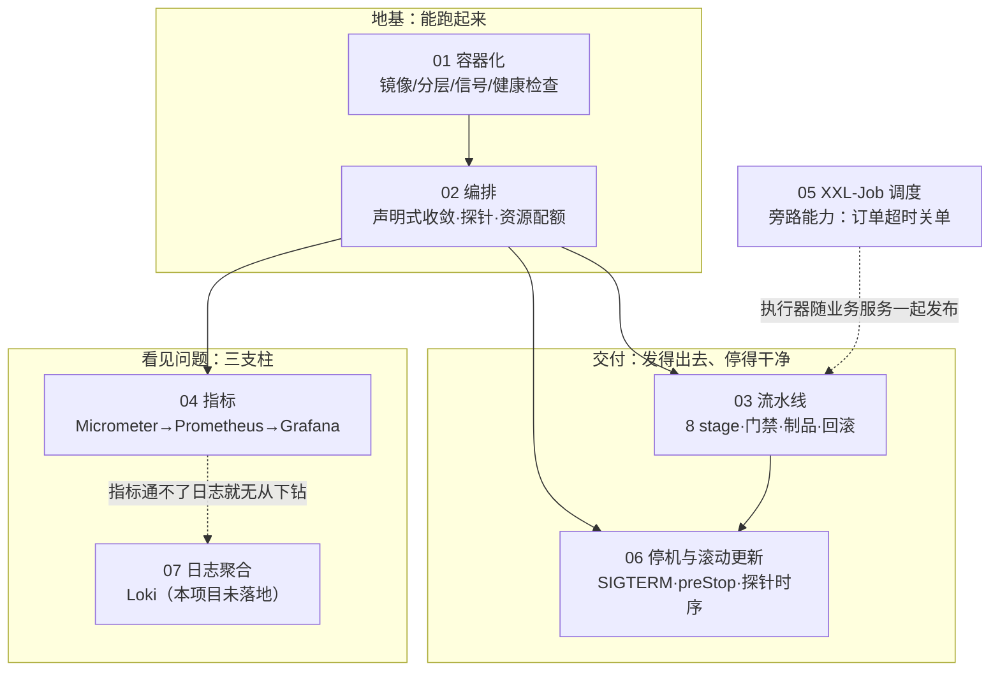

# 07-运维部署：这套系统怎么跑起来、怎么发出去、怎么看见问题

> **一句话结论**：这一层不教 Docker / K8s / Jenkins 的语法，它只回答三个**可以被验证**的问题——这套系统怎么在本机真跑起来（7 份 compose，63 个服务、88 条宿主端口映射）、改一行代码怎么安全发出去（`Jenkinsfile` 8 个 stage + 11 个模块的 `shutdown: graceful`）、用户报障时先看哪个面板（11 个 `/actuator/prometheus` target + Tempo 链路）。三件事各有各的失败面，而共同现状是：**配置全部在仓库里，运行态没有人在本机验证过**。
> **阅读前置**：能跑 `mvn spring-boot:run`、打开过 `docker-compose.yml`、知道 8080 是网关。中间件本身（Nacos / ES / RocketMQ / Redis）的配置语义先读 [04-中间件](../04-中间件/README.md)，进程、信号、端口、文件描述符这些底层概念先读 [15-计算机基础](../15-计算机基础/README.md)。不需要先会 Kubernetes。
> **证据基线**：Spring Boot 4.2.0 / Spring Cloud Alibaba 2025.1.0.0 / JDK 17 / Node 24；B 级证据取自本仓 `deploy/`、各服务 `application.yml`、根 `pom.xml`、`ai-cs-frontend/Dockerfile`、仓库根 `Jenkinsfile`；C 级证据是本机 pwsh + Python 的静态实测（下文每条都给了可复现命令）。预计阅读 25~35 分钟，动手 2~4 小时。

**证据边界（先读这段，能省掉一次误判）**：本机 `Get-Command` 实测 `docker` / `kubectl` / `jenkins` 全部 `MISSING`，`java` / `mvn` / `node`（v24.16.0）`FOUND`。所以本模块**没有一条"我把整套系统拉起来了"的证据**：文中所有服务数、端口数、内存数都是解析仓库里真实 YAML 得到的静态统计，凡是必须运行态才能得出的结论（启动耗时、内存峰值、healthcheck 是否真的变 healthy、滚动更新是否真的不丢请求）一律写"未本机实测"并给出判读方法。不要把这些静态数字当成"实测容量"。

---

## 1. 定位：这一层在生产链路里的位置

一个服务上线，要连续穿过三道关：**镜像能不能跑**（容器化）→ **一堆服务能不能按正确顺序收敛成可用整体**（编排）→ **出了事能不能定位**（可观测）。任意一道断了，前面所有代码质量都归零。本模块就是这三道关的落地层。

| 交付物 | 在本仓库里的物理形态 | 出问题时的典型症状 |
|---|---|---|
| 可复现的运行编排 | 7 份 compose（63 服务 / 88 端口）+ 20 个 k8s YAML | 服务起来了但连不上 Nacos、端口被占、容器 OOM 被 kill |
| 可回滚的发布路径 | `Jenkinsfile` / `Jenkinsfile-k8s`（8 stage）+ 18 个 `deploy/scripts` 脚本 | 镜像推上去了但没换、Secret 里凭据是空的、回滚靠手动 |
| 可观测的故障定位面 | Prometheus 11 target + Grafana + Tempo + OTLP collector | 指标有了但没告警；日志要 `docker logs` 一台台翻 |

**读者画像与学完的可验证行为**：

| 你是 | 现在卡在哪 | 学完要能做出哪个动作（可验收） |
|---|---|---|
| 刚接手的后端 | 只会 `mvn spring-boot:run` 单个服务，不知道中间件先起哪些 | 按根 compose + `deploy/scripts/check-local.ps1` 把 11 个服务全部拉成 `/actuator/health = UP` |
| 要交付的开发者 | 改完代码手动 `scp` jar，发布全凭记忆 | 说清 `Jenkinsfile` 的 8 个 stage 各自卡什么、`DEPLOY_MODE` 四个取值分别做什么 |
| 面试冲刺 | 背了 `kubectl` 命令，但说不清自己项目用了什么 | 不查资料报出本项目真实数字：14 服务 compose、11 个 metrics target、0 条告警规则、0 个 PDB |
| 值班/排障 | 出事先重启，重启不好就扩机器 | 用 `/actuator/prometheus` + Tempo traceID 把"慢在哪一跳"缩短到 3 分钟内定位 |

一个容易混淆的分工：**"中间件怎么配"属于 [04-中间件](../04-中间件/README.md)**（Nacos 命名空间、ES 分片、RocketMQ 重试），**"怎么把中间件和业务服务一起编排成能起能停的整体"才是本模块**。同样，"集群层面怎么用 GitOps 管"属于 [16-云原生与GitOps](../16-云原生与GitOps/README.md)，本篇只到"声明式清单 + 手工 apply 这一层"。

**术语先对齐**（后文反复用到，首现即定死含义）：

| 术语 | 一句话定义 | 在本项目里的具体所指 |
|---|---|---|
| compose | 一份 YAML 描述"多容器 + 网络 + 卷 + 依赖顺序"，`docker compose up` 一次收敛 | 7 份，分别对应全量 / 三台分机 / 主从 / 观测等拓扑 |
| healthcheck | 容器内周期性执行的探测命令，决定 `Status` 是否 `healthy` | 41 处，**全部落在中间件上**，业务服务一个没有 |
| 探针（readiness / liveness） | K8s 视角的就绪与存活判定：Ready 决定是否进 Endpoints，Liveness 失败触发重启 | 40 处；`tcpSocket: 8080` 只探端口，`httpGet` 才探业务 |
| preStop hook | Pod 终止前执行的钩子，用来"先摘流量、再关机" | **0 处**（这是 06 篇那个贴边风险的根源） |
| PDB（PodDisruptionBudget） | 自愿驱逐（drain / 升级）时保底可用副本数 | **0 处**，配合 `replicas: 1` 等于没有可用性承诺 |
| HPA（HorizontalPodAutoscaler） | 按 CPU/QPS 自动改副本数 | **0 处**，本项目无水平扩容能力 |
| OTLP | OpenTelemetry 的传输协议，collector 用它与后端（Tempo）对接 | collector 4317(gRPC) / 4318(HTTP) → Tempo |
| `-Xmx` / `mem_limit` | 前者是 JVM 堆上限，后者是容器整体内存上限 | `-Xmx` 有 29 处声明；`mem_limit` **0 处**，两者不是同一层保护 |


---

## 2. 模块地图：先看依赖顺序，再看内容



> **读图说明**：实线是**能力前置**（后一个话题的结论依赖前一个话题的概念）：不懂容器的信号与退出码，就理解不了 06 里"为什么旧实例还没关完流量就被切走"；不懂编排的探针语义，03 的"部署验证 stage"就无从设计。虚线是**关联但非前置**：05 XXL-Job 是旁路能力，它不上主链——你完全不读 05 也能读懂 01~04、06；07 Loki 挂在 04 后面，是因为日志查询要靠指标先告诉你"哪台、哪个时间段"，本项目这一篇是**规划级**内容（见 §3 落地程度）。最容易误读的一条边是 `02 → 06`：不要以为读完编排就自动会停机，06 讲的是**进程收到 SIGTERM 之后那 30 秒**，属于编排与容器运行时的交界处，坑也最多。

**推荐顺序与理由**：

| 顺序 | 篇目 | 为什么排在这 | 建议投入 |
|---|---|---|---|
| 1 | [01-Docker容器化](01-Docker容器化.md) | 12 个服务的启动依赖必须先变成一份可复现编排，后面所有讨论都建立在"镜像能跑"之上 | 2h |
| 2 | [02-Kubernetes入门](02-Kubernetes入门.md) | 声明式收敛、探针、resources 三个概念是本模块后续所有判断的公共语言 | 3h |
| 3 | [03-JenkinsCICD流水线](03-JenkinsCICD流水线.md) | 门禁决定一切，工具只是外壳；先想清楚"什么情况下不允许发布" | 2h |
| 4 | [04-Prometheus可观测性](04-Prometheus可观测性.md) | 指标的价值取决于你写了哪些告警——本项目恰好 0 条告警，这是最好的反面教材 | 2.5h |
| 5 | [07-Loki日志聚合](07-Loki日志聚合.md) | 指标下钻到单条日志的最后一公里（本篇为规划级） | 1h |
| 6 | [06-优雅停机与零丢失滚动更新](06-优雅停机与零丢失滚动更新.md) | 综合题：把容器信号、探针、编排策略三样东西同时用对 | 2h |
| 旁路 | [05-XXL-Job分布式调度](05-XXL-Job分布式调度.md) | 定时任务侧能力，与发布链路解耦，按需读 | 1h |

读完 01 和 02 之后，你应该能当场回答这三个问题（答不上来就回去补，别急着往下读）：

1. 为什么 `depends_on` 不能替代 healthcheck？（答：它只等容器**启动**，不等容器**可服务**；本项目 41 个 healthcheck 全在中间件上，业务服务的"就绪"没有任何地方校验）
2. `tcpSocket` 探针和 `httpGet` 探针在什么故障下结论相反？（答：数据库连接池耗尽、Nacos 注册失败时端口仍在监听，`tcpSocket` 判 Ready、`httpGet /actuator/health` 判 DOWN）
3. 为什么 `replicas: 1` 时谈"零丢失"要打折扣？（答：单副本滚动更新靠 `maxSurge` 先起新 Pod 还能不中断，但可用容量恒为 1，任何节点故障或 `drain` 都直接致断；再叠加本项目 0 个 PDB，连"排空时保住一个副本"的承诺都没有）


---

## 3. 七篇各解决什么：一句话摘要 + 本项目落地程度

先用一句话记住每篇的"唯一主张"，再决定读到什么深度：

| 篇目 | 解决什么问题（唯一主张） | 本项目落地程度 | 证据类型 |
|---|---|---|---|
| 01 容器化 | 12 个服务的启动依赖如何变成一份可复现编排：镜像分层、时区/编码、`SIGTERM` 传递、健康检查 | **已落地可复现**：7 份 compose 63 服务，镜像 tag 全部写死；但业务服务在 compose 里**没有一个 healthcheck** | B + C（解析真实 compose） |
| 02 编排 | 声明式收敛、探针与资源配额：把"能起来"提升到"能自愈、能被调度" | **部分落地**：20 个 k8s YAML、18 个 workload 全部声明 requests/limits、探针 40 处；但 `replicas: 1` 全部单副本，0 HPA | B + C（kind / 探针计数） |
| 03 流水线 | 门禁决定一切，工具只是外壳：什么条件下不允许发布、制品如何可追溯、回滚靠什么 | **有代码无运行体**：`Jenkinsfile`（169 行）/ `Jenkinsfile-k8s`（173 行）已入库且被 git 跟踪，但 runner、凭据、Jenkins 服务不在仓库里；GitHub Actions 只有一条 python 文档校验 | B |
| 04 指标 | 指标的价值取决于你写了哪些告警：从 `/actuator/prometheus` 到一次真正的告警 | **半落地**：采集链路完整（11 target / 15s / 7d），**告警规则 0 条、AlertManager 未部署** | B + C（解析 prometheus.yml） |
| 05 调度 | 订单超时关单需要哪三重保障：调度中心的"至少一次"+ 业务幂等 + 兜底扫描 | **配置就绪、默认关闭**：`xxl-job.enabled: ${XXL_JOB_ENABLED:false}`、执行器 9999 默认不起 | B |
| 06 停机与发布安全 | 滚动更新时旧实例经历什么：两行 `graceful` 配置 + K8s 终止时序 | **已落地但有贴边风险**：11/12 模块有 `shutdown: graceful` + 30s，但 k8s 清单 **0 个 preStop** | A + B |
| 07 日志聚合 | 补齐可观测性第三支柱：日志要能被检索、能和 traceID 关联 | **未落地（规划级）**：deploy 下无 Loki / promtail，otel-collector 只有 traces 一条 pipeline | B（反证：0 命中） |

> **读表说明**："落地程度"分三级，判断标准是**能不能拿出一条命令复现**：`已落地可复现` = 仓库里有配置且能用静态/本机命令验证；`部分落地 / 半落地 / 配置就绪默认关闭` = 配置文件在，但缺一个关键环节（告警、多副本、开关打开）；`未落地` = 只有文档描述，全仓关键词 0 命中。看到"半落地"别当成"已落地"——04 篇的告警就是典型：有采集没告警，指标等于只写不读。

---

## 4. 本仓库运维现状真实盘点（数值都是当次测出来的）

### 4.1 七份 compose：63 服务 / 88 端口 / 41 healthcheck / 0 资源限制

复现命令（在仓库根执行，实测输出即为下表）：

```python
# deploy-stats.py
import glob, yaml
files = ['docker-compose.yml'] + sorted(glob.glob('deploy/docker-compose/*.yml'))
print(f"{'file':46}{'svc':>4}{'ports':>6}{'hc':>4}{'memlim':>7}")
for f in files:
    d = yaml.safe_load(open(f, encoding='utf-8')) or {}
    svcs = d.get('services') or {}
    ports = sum(len([p for p in (s.get('ports') or []) if str(p).count(':') >= 1]) for s in svcs.values())
    hc = sum(1 for s in svcs.values() if 'healthcheck' in s)
    mem = sum(1 for s in svcs.values() if 'mem_limit' in s)
    print(f"{f:46}{len(svcs):>4}{ports:>6}{hc:>4}{mem:>7}")
```

| 文件 | 服务 | 宿主端口映射 | healthcheck | mem_limit | 堆上限声明合计 |
|---|---|---|---|---|---|
| `docker-compose.yml`（仓库根） | 14 | 18 | 13 | 0 | 1792 MiB |
| `deploy/docker-compose/docker-compose-all.yml` | 14 | 18 | 6 | 0 | 5376 MiB |
| `deploy/docker-compose/docker-compose-host1.yml` | 7 | 11 | 4 | 0 | 1024 MiB |
| `deploy/docker-compose/docker-compose-host2.yml` | 5 | 6 | 2 | 0 | 1536 MiB |
| `deploy/docker-compose/docker-compose-host3.yml` | 7 | 10 | 4 | 0 | 2304 MiB |
| `deploy/docker-compose/docker-compose-master-slave.yml` | 12 | 20 | 12 | 0 | 1792 MiB |
| `deploy/docker-compose/docker-compose-observability.yml` | 4 | 5 | 0 | 0 | 0 |
| **合计** | **63** | **88** | **41** | **0** | **13824 MiB** |

三个必须会读的地方：

- **13824 MiB 不是"总内存需求"**。7 份文件是 7 种互斥部署拓扑（全量 / 三台分机 / 主从 / 观测），同一个 nacos 的 512MiB 在全量、host1、host2、master-slave 里各被算了一次。它是"29 处 `-Xmx` / `JVM_XMX` 声明之和"，用来回答"这套编排一共声明了多少堆"，不能拿来申请机器。
- **`mem_limit` 全 7 份 0 命中**。JVM 堆写了上限（`-Xmx`），容器本身没写内存上限 → 物理内存打满时是宿主机先出事，而不是某个容器被 OOM kill 掉、也不会有 `ExitCode 137` 这么干净的死法。
- **healthcheck 的 41 个里没有一个属于业务服务**。根 compose 里 14 个服务、13 个有 healthcheck，唯一没有的是 `kafka-init`（一次性初始化容器）；`all.yml` 的 6 个也全是中间件（mysql / redis / nacos / es / namesrv / minio）。也就是说：**中间件是"等得起"的，业务服务是"起了就算成功"的**——`depends_on` 只能保证进程启动顺序，不能保证中间件真的可服务。

跨文件重复的宿主端口 **21 个**，同一个端口在不同拓扑里被重复占用（3306 与 6379 各出现 6 次；8848 / 9848 / 9200 / 9300 / 9876 / 10911 / 10909 / 9000 / 9001 / 16379 各 4 次；8080~8086、8091、7091 各 2 次）。**这意味着这些文件不能同时启动**——想在同一台机器上同时跑"全量"和"观测"，第一步就会 `port is already allocated`。

中间件镜像 tag 全部写死、可核对：`nacos/nacos-server:v2.3.2`、`bladex/sentinel-dashboard:1.8.6`、`chromadb/chroma:0.5.20`、`elasticsearch:8.12.0`、`mysql:8.0`、`redis:7`、`apache/rocketmq:5.1.4`、`apache/kafka:3.7.1`、`xuxueli/xxl-job-admin:2.4.1`、`neo4j:5-community`、`mongo:7.0`；业务镜像统一 `ai-cs-*:${VERSION:-latest}`。这里有一个**版本倒挂**值得记住：项目基线是 Nacos 3.3（客户端 `spring-cloud-alibaba 2025.1.0.0`），而 compose 里跑的是 **2.3.2**，两者跨了大版本。

根 `docker-compose.yml` 的 14 个服务逐一列出（`ports` 实测、`hc` = 是否声明 healthcheck）：

| 服务 | 宿主端口 | 镜像 | hc | 在系统里的角色 |
|---|---|---|---|---|
| mysql | 3306 | `mysql:8.0` | Y | 业务库；`deploy/mysql/` 20 个初始化 SQL 的落点 |
| redis | 6379 | `redis:7` | Y | 缓存 / 会话 / 锁；`maxmemory 256mb` + `allkeys-lru` + `appendonly yes` |
| nacos | 8848 / 9848 | `nacos/nacos-server:v2.3.2` | Y | 注册中心 + 配置中心（`aics` 命名空间） |
| elasticsearch | 9200 / 9300 | `elasticsearch:8.12.0` | Y | 全文检索 + 知识库向量检索 |
| rocketmq-namesrv | 9876 | `apache/rocketmq:5.1.4` | Y | 消息路由 |
| rocketmq-broker | 10911 / 10909 | `apache/rocketmq:5.1.4` | Y | 消息存储 |
| minio | 9000 / 9001 | `quay.io/minio/minio:latest` | Y | 对象存储（知识库原文） |
| mongodb | 27017 | `mongo:7.0` | Y | 非结构化会话 / 日志类数据 |
| chroma | 8000 | `chromadb/chroma:0.5.20` | Y | 向量库 |
| neo4j | 7474 / 7687 | `neo4j:5-community` | Y | 图谱（RAG 关系增强） |
| xxl-job-admin | 8099 → 容器 8080 | `xuxueli/xxl-job-admin:2.4.1` | Y | 调度中心（执行器默认关闭） |
| sentinel-dashboard | 8858 | `bladex/sentinel-dashboard:1.8.6` | Y | 流控面板 |
| kafka | 9092 | `apache/kafka:3.7.1` | Y | 可选 profile 才启动 |
| kafka-init | 无 | `apache/kafka:3.7.1` | — | 一次性建 topic，跑完即退（`ExitCode 0` 是正常） |

> **读表说明**：这张表就是"跑起来"路线里第 1 步需要全部变 `healthy` 的对象。注意 `minio:latest` 是唯一一个不带版本的镜像 tag——`latest` 在复现性上是负资产；`kafka-init` 没有 healthcheck 不是遗漏（一次性容器没有"服务状态"可探），而**业务服务没有 healthcheck 才是遗漏**，这两者别混为一谈。

### 4.2 k8s 清单完整性：能跑，但只有 8/11 个业务服务、没有一条发布保护

```powershell
# 实测：按 kind 计数
Get-ChildItem deploy\k8s -Recurse -Filter *.yaml |
  Select-String -Pattern '^kind:\s*(\w+)' |
  ForEach-Object { $_.Matches[0].Groups[1].Value } | Group-Object | Select-Object Count,Name
```

实测结果：`Service 21 / Deployment 13 / StatefulSet 7 / ConfigMap 3 / Secret 2 / Namespace 1`（共 20 个 YAML）。再数"发布保护"类关键字，五个全是 0：

| 检查项 | 实测 | 后果 |
|---|---|---|
| `preStop` | **0** | 滚动更新时 Pod 收到 SIGTERM 与被摘出 Endpoints **同时**发生，存在请求打到正在关闭实例的窗口（06 篇的"贴边风险"） |
| `PodDisruptionBudget` | **0** | 节点排空（`kubectl drain`）时可能把某服务的唯一副本一次赶走 |
| `HorizontalPodAutoscaler` | **0** | 所有 workload `replicas: 1`，没有水平扩容路径 |
| `Ingress` / `NetworkPolicy` | **0** / **0** | 对外只有 `api-gateway` 的 NodePort 30080；东西向流量无任何网络策略约束 |
| 显式 `strategy:` | **0** | 走默认 RollingUpdate `maxSurge/maxUnavailable = 25%`，配合 `replicas: 1` 等于"先起新的再停旧的"，但没写 `minReadySeconds`，新 Pod Ready 即视为成功 |

资源配额这次是**满了**的：13 个 Deployment + 7 个 StatefulSet 全部声明了 requests/limits（另外两个 YAML 是 `namespace.yaml` 与 `middleware-secrets.example.yaml`，不是 workload）。以 `deploy/k8s/services/api-gateway.yaml` 为例：Service `NodePort` 8080 → `nodePort: 30080`；image `192.168.56.12:5000/aics/api-gateway:latest` + `IfNotPresent`；`JAVA_OPTS="-Xms256m -Xmx256m"`，requests `cpu 100m / mem 256Mi`、limits `cpu 500m / mem 512Mi`；liveness / readiness **都是 `tcpSocket: 8080`**（初始延迟 60s / 30s）。

这里有两个真实的坑，读清单时务必自己核一遍：

1. **`NACOS_NAMESPACE=""` 是死配置**。清单里设了这个环境变量并注释"空 = public 公共空间"，但 `ai-cs-gateway/src/main/resources/application.yml#L18-L31` 里的 `namespace: aics` 是**字面量**，只有 `server-addr: ${NACOS_ADDR:127.0.0.1:8848}` 才是占位符。改环境变量不会改命名空间——这类"看起来可配、实际写死"的差异，是把 compose 迁到 k8s 时最常翻车的一类。
2. **探针只探端口，不探业务**。`tcpSocket: 8080` 只要端口在监听就判 Ready，此时 Nacos 注册、MySQL 连接池可能都还没就绪。40 处探针里 tcpSocket 用 19 处、httpGet 15 处，用 httpGet 的才真正走到了 `/actuator/health`。

服务覆盖也不全：`deploy/k8s/services/` 只有 8 份（gateway、user、knowledge、chat、search、message、notify、product），**缺 order / pay / mq**，也完全没有 frontend、py-chat / py-recommend、kafka、seata 的清单。

### 4.3 可观测性真实技术栈：链路完整、告警为零

| 组件 | 镜像 tag（真实） | 端口 | 关键配置 |
|---|---|---|---|
| Prometheus | `prom/prometheus:v2.51.0` | 9090 | `scrape_interval 15s`、`--storage.tsdb.retention.time=7d`、单 job `ai-cs-services`、`metrics_path /actuator/prometheus`、**11 个 target** |
| Grafana | `grafana/grafana:10.4.0` | 3000 | provisioning 两个数据源：Prometheus（默认）+ Tempo |
| Tempo | `grafana/tempo:2.4.1` | 3200(API)/4317 | `block_retention: 24h`、`backend: local`、`/var/tempo/blocks` |
| OTel Collector | `otel/opentelemetry-collector-contrib:0.97.0` | 4317(gRPC)/4318(HTTP) | 只有 **traces** 一条 pipeline：otlp → otlp/tempo:4317（insecure） |

11 个 target 正好覆盖 11 个 Java 服务（8080~8090：gateway / user / knowledge / chat / search / message / notify / order / product / pay / mq）。**采集这一半是完整且真实的**，链路由根 `pom.xml` 的四个依赖支撑：`spring-boot-starter-actuator`、`micrometer-registry-prometheus`、`micrometer-tracing-bridge-otel`、`io.opentelemetry:opentelemetry-exporter-otlp`（版本由 BOM 管，pom 里不写死）。

另一半是空的，而且空得很彻底：

- **0 条告警规则、0 个 AlertManager**：`alertmanager` / `alert:` / `groups:` 在 `deploy/` 下全 0 命中。也就是说面板只有人主动去看才有价值，凌晨三点的故障不会有任何通知。
- **0 个日志采集器**：`loki` / `promtail` 在 `deploy/` 下 0 命中，collector 也没有 logs pipeline。日志仍要靠 `docker logs` / `kubectl logs` 逐台翻。
- **SkyWalking 是传说**：全仓 805 个 `yml/yaml/xml/java` 文件 0 命中。谁再说"这个项目用 SkyWalking 做链路追踪"，用这一条就能否掉——实际方案是 Micrometer Tracing + OTLP 直发 Tempo，比 SkyWalking 的 Agent 方案侵入更小，但没有 SkyWalking UI 那套服务拓扑图。

### 4.4 交付流水线：流水线代码在、流水线服务不在、门禁默认关闭

| 事实 | 实测证据 | 影响 |
|---|---|---|
| 仓库根有 `Jenkinsfile`（169 行）与 `Jenkinsfile-k8s`（173 行），**已被 git 跟踪** | `git ls-files` 能列出、`git status` 干净 | 流水线**定义**是真实存在的，不是文档幻觉 |
| 两者结构同构，8 个 stage | 拉取代码 → 环境检查 → Maven 测试 → 写入 Kubernetes Secret → 部署基础设施 → 构建并推送镜像 → 部署业务服务 → 部署验证 | `DEPLOY_MODE` 四取值（full / build-only / deploy-only / infra-only）让同一份文件兼顾首次部署与日常发布 |
| `SKIP_TESTS=true` 是默认值 | parameters 块 | **默认跳过测试**——门禁形同虚设，TDD 在宪法里强制、在流水线里默认绕过 |
| `SERVICES` 只列 7 个模块 | 无 order / pay / mq / product | 发布覆盖面小于服务总数，这四个要手工发 |
| 私服 `REGISTRY=192.168.56.12:5000`、`NAMESPACE=ai-customer-service` | parameters 块 | 需要一个可访问的内网 registry 与 k8s 集群才对得上，纯本机环境跑不通 |
| GitHub Actions 只有 1 条 `python-learning-validate.yml` | `paths` 只含 `learning-docs/22-Python速成/**` 与 `ai-cs-py-recommend/**` | **后端代码改动不触发任何 CI**，改了 11 个 Java 服务等于没有自动校验 |
| `deploy/scripts/` 18 个脚本 | 含 `check-local.ps1`（36KB、7 层只读自检）、`check-deploy.sh`、`verify-deploy.sh`、`k8s-apply-infra.sh`、`k8s-build-push.sh`、`k8s-deploy-services.sh` | 验证能力其实写得比流水线更细：`check-local.ps1` 从 0 前置依赖一路查到 5 注册与路由，输出 Markdown 报告、退出码 0 = 无 FAIL |

`check-local.ps1` 的 7 层是本仓库最值得抄的一段运维工程实践：

| 层 | 检查内容 | 为什么单独成层 |
|---|---|---|
| 0 | 前置依赖 JDK / Maven / Node / Docker | 把"环境没装"和"服务挂了"分开，否则报错指向永远是错的 |
| 1 | 容器运行态 | 先看进程在不在，再看端口通不通，顺序反了会浪费 10 分钟 |
| 2 | 端口连通（TCP） | 区分"没监听"与"连不上"（防火墙 / bind 0.0.0.0） |
| 3 | 中间件协议探活 | MySQL 用握手、Redis 用 `PING`，比 TCP 通更能证明"能干活" |
| 4 | 11 个服务 `/actuator/health` | HTTP 层真实就绪度 |
| 5 | Nacos 注册与网关路由 | 服务自我感觉良好 ≠ 网关能路由到它 |
| 6 | 汇总 + Markdown 报告 | 让人拿到的是结论，不是 200 行滚动日志 |

### 4.5 停机与发布安全：配置对了 11/12，但少了最关键的一环

12 个 Java 模块里 **11 个**在 `application.yml` 前几行写了 `server.shutdown: graceful` + `spring.lifecycle.timeout-per-shutdown-phase: 30s`（`ai-cs-common` 没有 application.yml，不算服务）。以 `ai-cs-gateway/src/main/resources/application.yml` 为例，L2 是 `shutdown: graceful`、L3 是 `port: 8080`、L7 是 `timeout-per-shutdown-phase: 30s`。

这两行的语义在源码层可以坐实（A 级）：`WebServerGracefulShutdownLifecycle` 是 `SmartLifecycle`，`stop(Runnable callback)` 内部调用 `webServer.shutDownGracefully(result -> callback.run())`，把"等存量请求处理完"变成容器关闭流程的一个正式阶段（`[[源码:WebServerGracefulShutdownLifecycle.java.md#L16-L44]]`）。而注册中心侧的 `NacosGracefulShutdownDelegate` 监听 `ContextClosedEvent`，先 `autoServiceRegistration.stop()` 摘流量，再**只有** `gracefulShutdownWaitTime > 0` 才 `ThreadUtils.sleep(...)`（`[[源码:NacosGracefulShutdownDelegate.java.md#L67-L81]]`）。

**但 `gracefulShutdownWaitTime` 全仓 0 命中**——按上面的源码逻辑，这个值默认 0 时 Nacos 侧**不会等待**，摘流量与关服务几乎同时发生。加上 k8s 清单里 0 个 `preStop`，"先摘流量、再等 10 秒、然后关"这个理想时序在本项目里是不成立的。这就是 06 篇所说的"贴边风险"，也是面试里最容易问出深度的一个点：**`graceful` 只是让 Web 容器肯等，谁通知流量层"我要走了"是另一件事**。

### 4.6 盘点结论

一句话：**配置层相当完备（编排、清单、指标、脚本都有），保护层大面积缺失（无资源限制、无 PDB、无告警、无备份、无后端 CI），运行层完全未验证（本机无 docker / kubectl / jenkins）。** 把这三句话记住，你在面试里对"这个项目运维到什么程度"的回答就不会虚。

---

## 5. 两条路线：你要么把它跑起来，要么三小时速通

### 路线 A：把系统在本机跑起来（目标：11 个服务全 UP）

本机无 docker，以下步骤**未本机实测**，给的是命令与判读方法。有 Docker Desktop 的机器照此执行：

| 步 | 动作 | 判据（做到什么算过） |
|---|---|---|
| 1 | 只起中间件：`docker compose up -d`（根 `docker-compose.yml`，14 服务 / 18 端口 / 13 healthcheck） | `docker compose ps` 里 13 个带 healthcheck 的服务全 `healthy`；`kafka-init` 允许 `Exited(0)` |
| 2 | 核对端口没被抢：跑 `netstat -ano`，在输出里筛 3306 / 6379 / 8848 / 9200 / 9876 / 8099 / 8858 | 每个端口只出现一次、且 PID 属于 com.docker.backend。这一步不做，第 1 步会用 `port is already allocated` 教你 |
| 3 | 起一个服务验证链路：`mvn -pl ai-cs-gateway spring-boot:run` | 控制台出现 Nacos 注册成功日志；`curl http://localhost:8080/actuator/health` 返回 `{"status":"UP"}` |
| 4 | 起前端：`cd ai-cs-frontend; npm install; npm run dev` | 5173 能打开，且 `ai-cs-frontend/nginx.conf` 里 `upstream aics_gateway { server api-gateway:8080; }` 说明容器内是按服务名找网关的，本机开发期实际走 Vite 代理 |
| 5 | 全栈自检：`pwsh -File deploy/scripts/check-local.ps1` | 7 层跑完输出报告、退出码 0。**这是全仓唯一一条能一次告诉你"哪层断了"的命令** |

三个预期卡点（都在上面表格里埋着）：中间件端口被本机已有 MySQL/Redis 占用；`.yml` 里 `nacos namespace=aics` 与你在控制台看到的 public 不一致；业务服务没有 healthcheck，`docker compose ps` 显示 `Up` 但 `/actuator/health` 是 `DOWN`。

**省时版（只想验证一条链路，30 分钟内）**：只起 `mysql` + `redis` + `nacos` 三个（`docker compose up -d mysql redis nacos`），再单独 `mvn -pl ai-cs-user spring-boot:run`，用 `curl http://localhost:8081/actuator/health` 确认 `UP` 即可——这验证的是"镜像 → 配置 → 注册中心"整条最小组装链路，剩下的 10 个服务只是重复同一件事。**别一上来就 `up -d` 全量**：14 个容器同时起，其中 ES / MySQL / Nacos / Chroma 都是常驻内存大户，而又没有任何 `mem_limit` 兜底，本机很容易先被压垮，还分不清是被压垮还是配错。

### 路线 B：面试速通（时间盒 3 小时）

目标不是"会运维"，而是被问到时**数字和判断都站得住**。

| 时间 | 读什么 | 要背下来的东西 |
|---|---|---|
| 0:00~0:40 | 本篇 §4 全节 | 63 服务 / 88 端口 / 41 healthcheck / 0 mem_limit / 11 个 metrics target / 0 告警 / 0 preStop / 0 PDB；一句话结论"配置完备、保护缺失、运行未验证" |
| 0:40~1:30 | [06-优雅停机与零丢失滚动更新](06-优雅停机与零丢失滚动更新.md) | SIGTERM → preStop → Endpoints 摘除的时序；`graceful` 与 `gracefulShutdownWaitTime` 各自管什么；为什么本项目"贴边" |
| 1:30~2:10 | [02-Kubernetes入门](02-Kubernetes入门.md) | requests/limits 与 QoS、探针三兄弟的区别、tcpSocket 探针的盲区 |
| 2:10~2:50 | [03-JenkinsCICD流水线](03-JenkinsCICD流水线.md) | 8 个 stage、`DEPLOY_MODE` 四取值、为什么"门禁 > 工具"、`SKIP_TESTS=true` 是设计缺陷 |
| 2:50~3:00 | §8 诚实清单 | 主动说缺点：无资源限制、无 PDB、无备份、无后端 CI——**能自己指出缺口的人，比背答案的人可信** |

---

## 6. 依赖关系：读之前需要什么、读完该去哪

| 关系 | 模块 | 为什么 |
|---|---|---|
| 前置 | [15-计算机基础](../15-计算机基础/README.md) | 进程 / 信号 / 文件描述符 / 端口占用，06 篇的 SIGTERM 时序没有这些基础就是玄学 |
| 前置 | [04-中间件](../04-中间件/README.md) | 编排里 90% 的"起不来"其实是中间件没就绪；Nacos 命名空间、ES 分片、RocketMQ 主从先在那里讲清 |
| 相关 | [16-云原生与GitOps](../16-云原生与GitOps/README.md) | 本模块到"声明式清单 + 手工 apply"，再往上是 GitOps 与集群治理 |
| 相关 | [13-稳定性工程](../13-稳定性工程/README.md) | 无 PDB、无告警、无 preStop 的缺口，最终要靠稳定性工程的方法论（SLO、容量、演练）补 |
| 相关 | [12-性能工程](../12-性能工程/README.md) | `-Xmx`、requests/limits、堆外内存那一笔账，和性能压测结论必须对得上 |
| 具体展开 | [04-中间件/09-AI与治理中间件部署](../04-中间件/09-AI与治理中间件部署.md) · [04-中间件/23-Nginx应用实战与域名IP配置](../04-中间件/23-Nginx应用实战与域名IP配置.md) | 前者的中间件部署细节与本篇编排部分互补；后者是前端 `nginx.conf` 反代网关那一段的完整版 |
| 之后 | [17-研发效能与工程实践](../17-研发效能与工程实践/README.md) · [20-生产实践](../20-生产实践/README.md) | 把门禁、发布节奏、事故复盘做成组织习惯 |

---

## 7. 检查点清单：三个"能"各自怎么验

### 能跑起来

| # | 判据 | 命令 |
|---|---|---|
| 1 | 中间件全 healthy | `docker compose ps --format "table {{.Name}}\t{{.State}}\t{{.Status}}"` |
| 2 | 11 个服务健康端点全 UP | `pwsh -File deploy/scripts/check-local.ps1` 第 4 层 |
| 3 | 网关能路由到下游 | `curl http://localhost:8080/api/user/health` 返回非 502 |
| 4 | 前端能打开并调通网关 | 浏览器 5173 → F12 Network 里接口 200 |
| 5 | 无端口冲突 | `docker compose up` 期间不出现 `port is already allocated` |

### 能发布

| # | 判据 | 说明 |
|---|---|---|
| 1 | 能说清 8 个 stage 各自失败会怎样 | 尤其"部署验证"stage 失败 = 镜像已进集群但服务不健康，此时回滚动作是什么 |
| 2 | 镜像 tag 可追溯 | 生产应 `ai-cs-*:${VERSION}` 而非 `latest`（当前默认值是 `latest`，属缺口） |
| 3 | 发布后旧实例是"优雅退出" | `kubectl describe pod` 里无 `Error`/`137`，日志有 graceful shutdown 记录 |
| 4 | 有回滚路径 | `kubectl rollout undo` 或 compose 回退上一版 tag，二者至少要有一个写清楚 |
| 5 | 知道哪几个服务不在 `SERVICES` 里 | order / pay / mq / product 要手工发，漏发是最常见的线上不一致来源 |

### 能定位

| # | 判据 | 命令 / 面板 |
|---|---|---|
| 1 | 指标能查到某个服务的 QPS/延迟 | Prometheus 查询 `http_server_requests_seconds_count{application="ai-cs-gateway"}` |
| 2 | 能顺 traceID 找到整条链路 | Grafana → Tempo → 按 traceID 搜（需 collector 与 tempo 起） |
| 3 | 指标异常时能定位到具体实例 | `up{job="ai-cs-services"}` 里哪个 target 为 0 |
| 4 | 能用日志确认根因 | collector 无 logs pipeline，只能 `docker logs <container> --since 10m` 或 `kubectl logs` |
| 5 | 知道"没有告警"这件事本身 | 面板要人看才有用——这是团队级的缺口，不是工具问题 |

---

## 8. 诚实清单：只有配置、没有落地的部分

写文档最容易犯的错是把"应该怎么做"写成"本项目已落地"。下表逐条标注真实状态，面试时照实说反而加分。

| 缺口 | 真实现状（证据） | 造成的实际风险 | 补法（未做，不要写成已做） |
|---|---|---|---|
| **无容器资源限制** | 7 份 compose 里 `mem_limit` 0 命中；只有 JVM `-Xmx` 声明（合计 13824 MiB） | 内存打满时是宿主机抖动，容器不会被干净地 OOM kill，排障失去最直接的信号 | 给每个服务补 `mem_limit` 与 `deploy.resources.limits` |
| **无 PDB / 无 HPA** | `deploy/k8s` 下 `PodDisruptionBudget`、`HorizontalPodAutoscaler` 均 0 命中，全部 `replicas: 1` | 节点维护即可用性归零；流量突增无自动扩容 | 至少给 gateway / chat 加 PDB 与 HPA |
| **无 preStop、无 `gracefulShutdownWaitTime`** | k8s 0 个 `preStop`；`gracefulShutdownWaitTime` 全仓 0 命中（源码默认 0 → 不等待） | 滚动更新存在"请求打到正在关闭实例"的窗口 | k8s 清单加 `preStop: sleep 5`，或配置 `gracefulShutdownWaitTime: 10s` |
| **无告警** | `deploy/` 下 `alertmanager` / `alert:` / `groups:` 全 0 命中 | 采集链路完整但只能被动查看；故障发现依赖用户投诉 | 落 3 条最小告警：服务 down、5xx 率、P99 延迟 |
| **无日志聚合** | `deploy/` 下 `loki` / `promtail` 0 命中，otel-collector 只有 traces pipeline | 跨服务排障要逐台 `logs`，traceID 无法跳到日志 | 见 [07-Loki日志聚合](07-Loki日志聚合.md)（规划级） |
| **无备份** | `deploy/mysql/` 20 个文件全是建表/初始化 SQL（`init.sql`、`all-init.sql`、`xxl-job-init.sql`、主从 `master.cnf` / `slave.cnf`），**没有任何备份脚本或恢复流程** | MySQL / ES 数据丢失不可恢复；主从只解决可用性，不解决误删 | 加 `mysqldump` 定时任务 + 恢复演练脚本 |
| **后端无 CI** | `.github/workflows/` 只有 `python-learning-validate.yml`，`paths` 仅覆盖 python 文档与 `ai-cs-py-recommend` | 11 个 Java 模块的改动没有任何自动编译/测试门禁 | 把 `mvn -q verify` 加进 Actions，哪怕只跑编译 |
| **`SKIP_TESTS=true` 默认** | `Jenkinsfile` parameters 块默认值 | 门禁默认关闭，TDD 在本地强制、在流水线被绕过 | 改成默认 `false`，紧急发布再显式覆盖 |
| **k8s 服务清单缺 3 个** | `deploy/k8s/services/` 只有 8 份，缺 order / pay / mq，无 frontend / py 服务 | 集群里跑的是不完整的系统，order 链路必然断 | 补齐清单，或在文档里明确"k8s 只覆盖核心链路" |
| **前端无部署编排** | `ai-cs-frontend/Dockerfile`（`node:22-alpine` → `nginx:1.27-alpine`，含 `HEALTHCHECK`）与 `nginx.conf` 都在，但 7 份 compose 里 `frontend` / `nginx` **0 命中** | 镜像能构建、无处安放；生产环境前端靠什么发布未定义 | 补一个 frontend 服务与对外端口 |
| **文档漂移** | `deploy/nacos/` 目录、`publish-to-nacos.ps1` 脚本均不存在，但 `check-local.ps1` 与 04 模块文档都引用了它 | 按文档操作会直接报"路径不存在" | 要么补脚本，要么改文档——别让读者替你验证 |
| **运行态零验证** | 本机 `docker` / `kubectl` / `jenkins` 全 MISSING | 本模块所有数字是静态解析，**没有任何一条"跑通过"的证据** | 有 Docker 的机器上跑一遍路线 A，把真实输出补进各篇 |

---

**怎么复测本文所有数字**：§4.1 用上面那段 `deploy-stats.py`；§4.2 用 `Get-ChildItem deploy\k8s -Recurse -Filter *.yaml | Select-String -Pattern 'preStop|PodDisruptionBudget|HorizontalPodAutoscaler|Ingress|NetworkPolicy'`（预期 0 命中）；§4.5 用 `Select-String -Path ai-cs-*\src\main\resources\application.yml -Pattern 'shutdown: graceful'`（预期 11 个文件命中）。数字会随代码演进过期，**方法不会**——这大概是本篇最想留下的东西。
