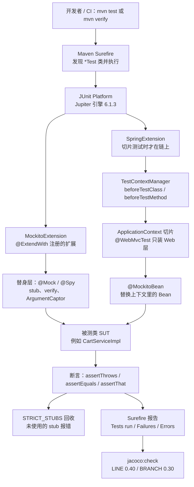
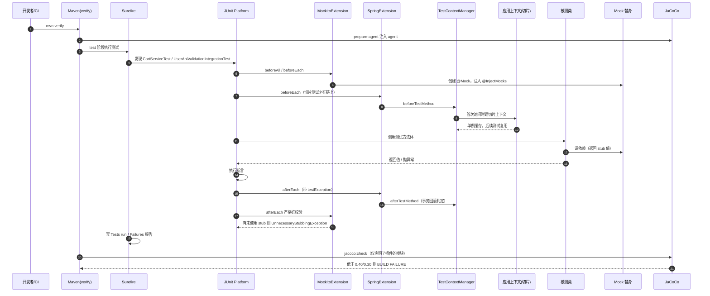

# JUnit 5 + Mockito 单元测试：它替你固定了哪些必须为真的性质

> **一句话结论**：单元测试真正的产出不是覆盖率百分比，而是"一组被断言钉死、以后改代码必须仍然成立的性质"；覆盖率只能证明某行代码被执行过，证明不了任何一条性质被验证过。
> **阅读前置**：知道 Maven 的 `test` 与 `verify` 阶段分别做什么、写过 `@RestController` + Service + Mapper 的分层代码、看得懂 lambda 与泛型通配符。
> **证据基线**：本机 `~/.m2` 与 `spring-boot-dependencies-4.2.0.pom` 实测到的 junit-jupiter 6.1.3 / mockito-core 5.24.0 / assertj 3.27.7 / spring-test 7.1.0 / JaCoCo 0.8.11，加上本仓库 143 个 `*Test.java` 的静态统计；预计阅读 35 分钟。

---

## 0. 先看现象

### 现象一：覆盖率门禁写在父 pom 里，但没人被它拦住

根 `pom.xml#L311-L392` 把 `jacoco-maven-plugin` 声明在 `<pluginManagement>` 中：它只提供配置，**不会激活插件**。要在某个模块真正跑起来，该模块必须自己在 `<build><plugins>` 里再声明一次——`ai-cs-order/pom.xml#L186-L198` 就是这种再声明：

```xml
<!-- ai-cs-order/pom.xml#L186-L198 -->
<build>
    <plugins>
        <plugin>
            <groupId>org.springframework.boot</groupId>
            <artifactId>spring-boot-maven-plugin</artifactId>
        </plugin>
        <!-- JaCoCo 覆盖率插件 -->
        <plugin>
            <groupId>org.jacoco</groupId>
            <artifactId>jacoco-maven-plugin</artifactId>
        </plugin>
    </plugins>
</build>
```

于是形成这样一种局面：12 个 Java 模块里只有 5 个（message / notify / order / pay / product）声明了 JaCoCo，本机目标目录里也只有这 5 个模块留下了 `jacoco.csv`：

```powershell
# C 级实测：哪些模块真的产出过覆盖率报表
$ Get-ChildItem -Recurse -Filter jacoco.csv | ForEach-Object { Split-Path $_.FullName -Parent | Split-Path -Parent | Split-Path -Parent }
D:\...\ai-cs-message\target\site\jacoco
D:\...\ai-cs-notify\target\site\jacoco
D:\...\ai-cs-order\target\site\jacoco
D:\...\ai-cs-pay\target\site\jacoco
D:\...\ai-cs-product\target\site\jacoco
```

其余 7 个模块（common / gateway / user / chat / knowledge / search / mq）跑 `mvn verify` 时，`jacoco:check` 这一步根本不存在，也就永远不会因为覆盖率低而失败。**"我们有覆盖率门禁"这句话在 7 个模块里是假的。**

### 现象二：测试全绿，但"库存不能超卖"这条性质没被任何人锁住

`ai-cs-product/src/test/java/com/aics/product/service/ProductServiceTest.java#L268-L279`：

```java
// ai-cs-product/src/test/java/com/aics/product/service/ProductServiceTest.java#L268-L279
@Test
@DisplayName("扣减库存 - 成功")
void deductStock_shouldSuccess() {
    when(productMapper.selectById(1L)).thenReturn(sampleProduct);
    when(productMapper.update(isNull(), any(LambdaUpdateWrapper.class))).thenReturn(1);
    when(stringRedisTemplate.opsForValue()).thenReturn(valueOperations);

    assertDoesNotThrow(() -> productService.deductStock(1L, 5));

    // 当前实现为 DB 原子条件更新（stock >= qty 才扣减，防超卖）
    verify(productMapper).update(isNull(), any(LambdaUpdateWrapper.class));
}
```

注释里写着"`stock >= qty` 才扣减，防超卖"，但断言侧只有两个信息：`update(isNull(), any(...))` 被调用过、参数类型是 `LambdaUpdateWrapper`。**`any(LambdaUpdateWrapper.class)` 把 wrapper 的全部内容——也就是那条 `stock >= qty` 条件——吞掉了。** 把条件删成 `stock >= 0`，这个测试依然全绿，因为它从来没读过 wrapper 里写了什么。

同一个文件往下 10 行还有一个更隐蔽的问题（`#L281-L290`）：库存不足分支断言 `verify(productMapper, never()).updateById(any(Product.class))`，可实现走的是 `update(isNull(), wrapper)`，不是 `updateById`。这条断言**永远为真**，等于什么都没测。

### 现象三：从旧教程抄来的写法，在当前基线直接编译不过

Boot 4 把测试相关模块按技术栈拆开，并把 `@MockBean` 整个删掉了。这不是"文档说改了"，而是能直接在 jar 里看见：

```powershell
# C 级实测：同一份代码在 3.2.5 与 4.2.0 里的差别
$ jar tf spring-boot-test-3.2.5.jar | Select-String 'mock/mockito/MockBean'
org/springframework/boot/test/mock/mockito/MockBean.class
org/springframework/boot/test/mock/mockito/MockBeans.class
$ jar tf spring-boot-test-4.2.0.jar | Select-String 'mock/mockito'
（无输出）
$ jar tf spring-boot-webmvc-test-4.2.0.jar | Select-String 'WebMvcTest.class'
org/springframework/boot/webmvc/test/autoconfigure/WebMvcTest.class
```

三段输出的含义分别是一件事：`@MockBean` 在 4.2.0 的 `spring-boot-test` 里已经不存在；`@WebMvcTest` 从 `org.springframework.boot.test.autoconfigure.web.servlet` 搬到了 `org.springframework.boot.webmvc.test.autoconfigure`。抄旧文章时最典型的编译期报错就是 `error: package org.springframework.boot.test.mock.mockito does not exist` 与 `error: cannot find symbol class MockBean`。本项目当前写法是正确的：`ai-cs-user/src/test/java/com/aics/user/security/UserApiValidationIntegrationTest.java#L12-L17` 用的就是新包名 + `MockitoBean`。

> **这些现象指向同一件事**：这套工程里"测试"这件事存在，但**它的作用没有被定义清楚**。门禁没被执行（现象一），断言没落在真正的性质上（现象二），写法没跟上基线（现象三）。三者共同解释了为什么测试数不算少、却依然不敢改代码——被测住的只是"代码被跑过"，不是"哪些事情必须一直为真"。

---

## 1. 整体地图

一张图看清"一次单元测试"到底牵动了谁。左边是纯单元测试（Mockito 路线），右边是容器切片测试（Spring Test 路线），下面是两道"事后检查"：Mockito 的严格桩校验、Maven 的覆盖率门禁。



> **读图说明**：
> - 两条竖线的区别是**谁在造对象**：左路所有依赖都是替身，被测类 `new` 出来就够了；右路先让 Spring 建一个"切片上下文"，再用 `@MockitoBean` 把上下文里的个别 Bean 换成替身。看错这条会导致把需要容器的测试写成纯 Mockito 测试，结果 `MockMvc`、`@PreAuthorize`、Bean Validation 这些"框架替你做的事"全部消失，测出来的结论也就不成立了。
> - `STRICT_STUBS` 与 `jacoco:check` 都是**事后回收**：前者在测试方法结束后检查有没有白写的 stub，后者在 `verify` 阶段才检查覆盖率。看错这条会以为"测试方法跑完没事就没事"，实际失败可能出现在方法结束之后，报错栈顶往往不在测试方法里。
> - 图上 `jacoco:check` 画成了必经环节，但**在本仓库只有 5 个模块真的走到这一步**（见现象一）。看错这条会误判"我们全仓有覆盖率门禁"。

各参与方的责任与"不负责什么"：

| 组件 | 责任 | 明确不负责 |
| --- | --- | --- |
| JUnit Platform / Jupiter 引擎 | 发现测试方法、编排生命周期、跑断言 | 不管 Spring 容器、不管覆盖率 |
| `MockitoExtension`（`org.mockito.junit.jupiter`） | 创建 `@Mock`、注入 `@InjectMocks`、按 `Strictness` 收尾校验 | 不管真实 Bean、不管数据库 |
| `SpringExtension`（`org.springframework.test.context.junit.jupiter`） | 把 Spring 的 `TestContextManager` 回调挂到 Jupiter 生命周期上 | 不管 Mockito 替身何时重置 |
| `TestContextManager` | 准备测试实例、执行 `@BeforeEach` 前后的 Spring 侧回调、决定事务回滚 | 不决定测试断言是否充分 |
| `@MockitoBean`（spring-test 7.1.0） | 在**已有的** `ApplicationContext` 里替换/新增一个替身 Bean | 不适用于纯单元测试（没有上下文时毫无作用） |
| Surefire | 执行测试并产出 `Tests run: ...` 报告 | 不判断测试是否有价值 |
| JaCoCo | 记录执行了哪些行/分支，按规则卡阈值 | 不知道断言写了什么 |

本项目当前分布（C 级统计，命令见 §6.4）：143 个测试类中只有 14 个用到容器级注解（`@SpringBootTest` / `@WebMvcTest` / `ApplicationContextRunner` 等），约 9.8%；其余 129 个是纯 Mockito 单元测试。也就是说**图里右路在本项目基本没有被走通**。

---

## 2. 关键概念与关键类

先统一术语，后面不再解释：

- **SUT（System Under Test）**：被测对象，本文里是 `CartServiceImpl`、`ProductServiceImpl` 这类 Service。
- **测试替身（test double）**：任何"假装是依赖"的对象。按用法分四类：**dummy**（只为填参数，永不被调用）、**stub**（返回预设值）、**spy**（真实对象外面包一层，可选择性拦截）、**mock**（记录交互，可 verify）。
- **stub 与 verify 是两个动作**：`when(...).thenReturn(...)` 是 stub（安排输入输出），`verify(...)` 是校验交互（事后确认"调过/没调过"）。同一次测试里可以只用其中一个。
- **严格桩（STRICT_STUBS）**：Mockito 的一种收尾模式，测试方法结束后若存在"写了但没被调用"的 stub，就直接判失败。目的是防止 stub 与实现脱节、测试悄悄变成空转。
- **切片测试（test slice）**：只装应用的一部分（例如只有 Controller + MVC 基础设施）的 Spring 上下文，`@WebMvcTest`、`@DataJpaTest` 都是切片。
- **flaky 测试**：同一份代码多次运行结果不一致的测试，常见根源是时间、随机数、UUID、执行顺序、共享可变状态。

关键类的位置与角色（位置一栏是本文实际核对过的来源）：

| 名称 | 位置 | 角色 | 关键方法 / 属性 |
| --- | --- | --- | --- |
| `@Test` / `@ParameterizedTest` | `org.junit.jupiter.api`（junit-jupiter 6.1.3） | 标记测试方法；后者把输入写成数据源 | 元注解 `@Testable` |
| `@ExtendWith` | `org.junit.jupiter.api.extension` | 把扩展接到 Jupiter 生命周期 | 参数是 `Extension` 实现类数组 |
| `MockitoExtension` | `org.mockito.junit.jupiter`（mockito-junit-jupiter 5.24.0） | 建替身、注入、收尾校验 | 无参构造默认 `Strictness.STRICT_STUBS`（§3.2 实测） |
| `@Mock` / `@Spy` / `@InjectMocks` | `org.mockito` | 声明替身 / 声明半真半假对象 / 声明 SUT 并自动注入 | 按类型或名称注入字段 |
| `@MockitoBean` | `org.springframework.test.context.bean.override.mockito`（spring-test 7.1.0） | 在上下文里替换或新增一个 mock Bean | `name()`、`reset()` 默认 `AFTER`、`enforceOverride()` 默认 `false` |
| `@MockitoSpyBean` | 同上包 | 上下文里的 Bean 换成 spy | 同一套 `MockReset` 语义 |
| `SpringExtension` | `org.springframework.test.context.junit.jupiter` | Spring 与 Jupiter 的桥 | `beforeEach` → `TestContextManager#beforeTestMethod` |
| `TestContextManager` | `org.springframework.test.context` | 测试上下文与监听器编排 | `prepareTestInstance`、`beforeTestMethod`、`afterTestMethod` |
| `@WebMvcTest` | `org.springframework.boot.webmvc.test.autoconfigure`（Boot 4.2.0） | MVC 切片 | `value()/controllers()`、`properties()`、`useDefaultFilters()` |
| `@SpringBootTest` | `org.springframework.boot.test.context` | 全量上下文 | `webEnvironment`、`properties()` |
| `MockMvc` / `ResultActions` | `org.springframework.test.web.servlet` | 发 HTTP 请求式调用、链式断言 | `perform`、`andExpect`、`jsonPath` |
| `ArgumentCaptor` | `org.mockito` | 捕获传给替身的实参，供事后逐字段断言 | `capture()`、`getValue()`、`getAllValues()` |
| `assertAll` / `assertThrows` | `org.junit.jupiter.api.Assertions` | 分组断言（全部执行后才汇总失败）/ 断言抛异常 | `assertAll(Executable...)`、`assertThrows(Class, Executable)` |

---

## 3. 原理与证据逐段精读

### 3.1 `@ExtendWith`：扩展模型只是"把回调接到生命周期上"

**在干什么**。JUnit 5 不再有 `@RunWith` 那种"替换整个运行器"的机制，改成"注册一组回调"。`SpringExtension` 的实现把这件事写得最直白：它是一个类，实现了 8 个回调接口。

```java
// (src: SpringExtension.java.md#L132-L134)
public class SpringExtension implements BeforeAllCallback, AfterAllCallback, TestInstancePostProcessor,
		BeforeEachCallback, AfterEachCallback, BeforeTestExecutionCallback, AfterTestExecutionCallback,
		ParameterResolver {
```

每个回调都是一次转调，真正的活交给 `TestContextManager`：

```java
// (src: SpringExtension.java.md#L332-L338)
	public void beforeEach(ExtensionContext context) throws Exception {
		Object testInstance = context.getRequiredTestInstance();
		Method testMethod = context.getRequiredTestMethod();
		TestContextManager testContextManager = getTestContextManager(context);
		registerMethodInvoker(testContextManager, context);
		testContextManager.beforeTestMethod(testInstance, testMethod);
	}
```

`afterEach` 多了一个关键动作——把测试方法抛出的异常转交给 Spring，让监听器知道"这次是失败的"：

```java
// (src: SpringExtension.java.md#L369-L376)
	public void afterEach(ExtensionContext context) throws Exception {
		Object testInstance = context.getRequiredTestInstance();
		Method testMethod = context.getRequiredTestMethod();
		Throwable testException = context.getExecutionException().orElse(null);
		TestContextManager testContextManager = getTestContextManager(context);
		registerMethodInvoker(testContextManager, context);
		testContextManager.afterTestMethod(testInstance, testMethod, testException);
	}
```

**为什么这么设计**。三个好处：扩展之间可组合（一个测试类可以挂多个扩展，各自只关心自己的回调）；框架不必知道测试框架的内部；`@WebMvcTest` 这类注解可以把 `@ExtendWith(SpringExtension.class)` 直接做成元注解，用户不必手写。证据就在切片注解本身（§3.8）。

**换写法会怎样**。如果按 JUnit 4 的思路自己写一个 `@RunWith`，你就得接管整个测试生命周期，任何两个"运行器"都不能共存——这正是 JUnit 5 要解决的问题。反过来说，如果在一个 `@WebMvcTest` 类上再手写一遍 `@ExtendWith(SpringExtension.class)`，不会报错（同一个扩展重复注册会被去重），但也没有任何收益，属于噪声。

**常见坑**。把扩展当"任意初始化钩子"用：扩展的 `beforeEach` 在 `@BeforeEach` **之前**执行，`afterEach` 在 `@AfterEach` **之后**执行；如果你的 `@BeforeEach` 里依赖了扩展建立的东西（比如 `@MockitoBean` 已经替换好的上下文），顺序是对的；但如果你在 `@BeforeAll` 里访问注入的 Bean，就会拿到 `null` —— 因为静态方法上不允许注入，`SpringExtension` 会在 `postProcessTestInstance` 阶段做实例注入而不是类注入。

### 3.2 `MockitoExtension` 的默认严格模式：为什么"多写一个 `when`"也会失败

**在干什么**。`@ExtendWith(MockitoExtension.class)` 做三件事：为每个 `@Mock` 字段建替身、为 `@InjectMocks` 字段创建 SUT 并注入、在每个测试方法结束后按 `Strictness` 做校验。默认严格度不是宽松模式，这从构造函数的字节码就能看到：

```powershell
# C 级实测：反编译 mockito-junit-jupiter-5.24.0.jar 的构造函数
$ javap -p -c -cp mockito-junit-jupiter-5.24.0.jar org.mockito.junit.jupiter.MockitoExtension
  private final org.mockito.quality.Strictness strictness;
  public org.mockito.junit.jupiter.MockitoExtension();
       1: getstatic     #1   // Field org/mockito/quality/Strictness.STRICT_STUBS
       4: invokespecial #7   // Method "<init>":(Lorg/mockito/quality/Strictness;)V
```

`getstatic Strictness.STRICT_STUBS` 就是答案：无参构造把严格度设成 `STRICT_STUBS`。它带来两个后果——**stub 了却没被调用** → 测试失败；**同一方法用不匹配的参数调用被 stub 的方法** → 立即失败（`PotentialStubbingProblem`）。失败信息里会出现 Mockito 的原始措辞（常量池实测字符串）：`unnecessary Mockito stubbings`。

**为什么这么设计**。单元测试最常见的腐坏方式不是"断言写错"，而是"stub 与实现脱节"：方法改了签名/参数顺序，旧的 `when` 依然能编译、依然返回默认值 `null`/`0`，测试于是变成空转。严格模式把这种腐蚀变成显式失败。

**换写法会怎样**。如果换成 `@ExtendWith(MockitoExtension.class)` + `@MockitoSettings(strictness = Strictness.LENIENT)`，或者干脆用 `MockitoAnnotations.openMocks(this)` 自己初始化（默认 `Strictness` 为 `STRICTNESS` 之外的行为，没有收尾校验），测试会"更容易绿"，但失去的正是这条自动体检。本项目 123 处 `@Mock`、37 处 `@InjectMocks` 全部挂在 `@ExtendWith(MockitoExtension.class)` 下，因此**每一条白写的 `when` 都会以 `UnnecessaryStubbingException` 的形式暴露出来**——这既是好事（防腐），也是新手最常撞的墙（§6.1）。

**常见坑**。为了让"严格模式别报错"，把整个类改成 `LENIENT`。这等于把体检关掉；正确做法是删掉那条没用的 stub，或把 stub 收窄到真正需要的分支。另一个坑是把 `@Mock` 字段写成 `final`（Mockito 无法替换），或者对 `String`、`Integer` 这类 final 类型写 `@Mock`。

### 3.3 测试替身四类，以及"什么时候干脆别 mock"

**在干什么**。同一个测试类里，四种替身的分工是明确的：

| 类型 | 一句话 | 典型写法 | 什么时候用 |
| --- | --- | --- | --- |
| dummy | 只为占位，永不被调用 | `service.doIt(null, 任意占位对象)` | 参数校验类测试，另一分支根本走不到 |
| stub | 只安排返回值 | `when(mapper.selectById(1L)).thenReturn(entity)` | 被测逻辑依赖"上游给什么"时 |
| spy | 真实对象 + 可拦截 | `@Spy` / `@MockitoSpyBean`，`doReturn(x).when(spy).m()` | 想在真实实现上只改一个方法 |
| mock | 记录交互 + 可 verify | `@Mock` + `verify(mapper).updateById(any())` | 依赖是外部边界（DB、Redis、HTTP），且你需要断言"副作用发生过" |

本项目实测分布（`@Spy` 0 处、`@MockitoSpyBean` 0 处、`@Mock` 123 处、`@MockitoBean` 4 处）说明：**工程只用了 stub/mock 两种，从不使用 spy**。这在一套以"MyBatis-Plus Mapper + Redis + Feign"为边界的代码里是合理的——边界都是接口，没有"只想改一个方法"的场景。

**为什么"过度 mock"会让测试变成测 mock**。看 `ai-cs-order/src/test/java/com/aics/order/service/CartServiceTest.java#L35-L48` 与 `#L89-L101`：为了测 `updateQuantity`，需要堆三层 stub——

```java
// ai-cs-order/src/test/java/com/aics/order/service/CartServiceTest.java#L89-L101
@Test
@DisplayName("修改数量 - 正常修改")
void updateQuantity_shouldUpdateSuccessfully() {
    when(cartItemMapper.selectById(1L)).thenReturn(sampleCartItem);
    when(stringRedisTemplate.opsForValue()).thenReturn(valueOperations);
    when(valueOperations.get("stock:1001")).thenReturn("10");
    when(cartItemMapper.updateById(any())).thenReturn(1);

    CartVO result = cartService.updateQuantity(100L, 1L, 3);

    assertNotNull(result);
    verify(cartItemMapper).updateById(argThat(item -> item.getQuantity() == 3));
}
```

其中 `when(stringRedisTemplate.opsForValue()).thenReturn(valueOperations)` 这一行是"替身的替身"：`StringRedisTemplate` 的 `opsForValue()` 返回 `ValueOperations`，必须再 mock 出来才能 stub `get`。它不是错，而是**信号**——被测逻辑穿透了两层封装直接读 Redis key，导致每加一个 Redis 读取，测试就多两行仪式代码。这类代码堆到十几个测试方法时，测试维护成本会超过它带来的保护。

**换写法会怎样**。三种替代，代价不同：把 Redis 读取包成一个 `StockQueryService`（一个接口一个方法），SUT 依赖它，测试只需一个 stub；或者接受"这一层用集成测试覆盖、单元测试只测纯计算"；或者干脆给 Redis 上一层 `CacheTemplate` 抽象。三种做法都在**减少测试里的仪式代码**，代价是多一个类/一层间接。

**常见坑**。把 `assertNotNull(result)` 当成断言的全部。上面这个测试里真正的检查点是 `verify(updateById(argThat(quantity == 3)))`——它断言了"写回去的数量是 3"这条性质，`assertNotNull` 只是顺手。若某天 SUT 把数量写成了 4，本测试会失败；若 SUT 把 `userId` 过滤条件丢了，本测试**依然通过**，因为 `selectById(1L)` 的 stub 里根本没有用户维度。

### 3.4 参数化与 `@DisplayName`：把输入边界写成数据

**在干什么**。`@ParameterizedTest` 让一个方法承担一组输入，`@ValueSource` / `@CsvSource` / `@MethodSource` 提供数据。本项目里唯一的两处用法就在安全相关的输入边界回归测试里，正好是参数化最典型的场景：同一断言、六种坏输入。

```java
// ai-cs-user/src/test/java/com/aics/user/security/UserApiValidationIntegrationTest.java#L50-L66
@ParameterizedTest
@ValueSource(strings = {
        "{\"username\":\"\",\"password\":\"secret\"}",
        "{\"username\":\"   \",\"password\":\"secret\"}",
        "{\"username\":\"alice\",\"password\":\"\"}",
        "{\"username\":\"alice\",\"password\":\"   \"}",
        "{\"username\":null,\"password\":\"secret\"}",
        "{\"username\":\"alice\"}"
})
@DisplayName("登录空值或空白输入统一返回 400，不进入业务层")
void loginBlankInputShouldReturn400(String body) throws Exception {
    postJson("/user/login", body)
            .andExpect(status().isBadRequest())
            .andExpect(jsonPath("$.code").value(400));

    verify(userService, never()).login(any());
}
```

这段是全仓库断言质量最好的模板之一，因为它同时钉住三条性质：HTTP 状态是 400、响应体 `code` 也是 400（不是裸 400 空体）、业务层**没有被调用**（`never()`）。第三条尤其关键：它把"校验发生在进入业务层之前"这件事变成可回归的结论，而这条结论光看返回码是推不出来的。

**为什么这么设计**。六条输入如果写成六个方法，改动一处断言就要改六处；写成参数化，断言与数据分离，新增一条边界只加一行字符串。`@DisplayName` 在报告里显示成人话（本项目共 480 处 `@DisplayName`，几乎每个测试方法都有），失败时 `Tests run: 3, Failures: 1` 的报告里能直接看到"注册必填、空白及密码最短长度约束生效"，而不是 `registerInvalidRequiredInputShouldReturn400(String)[4]`。

**换写法会怎样**。写成 `for (String body : bodies) { ... }` 循环：第一个失败点会用异常打断循环，后面五条输入根本没被执行，报告里也只有一个"方法失败"。参数化写法会让 6 条输入各自成为一次独立的测试执行（`Tests run` 计数增加 6），失败粒度完全不同。

**常见坑**。`@DisplayName` 写成"测试登录校验"这类无信息量的话；参数化用 `@MethodSource` 返回可变集合，导致测试数量随数据变化、报告不可对比；把需要不同断言的输入塞进同一个参数化方法，最后在方法里写 `if` 分支——那说明它其实是两个测试。

### 3.5 断言质量：断言结果，而不是断言"某方法被调过"

**在干什么**。断言分三个层级：**结果级**（返回值、持久化后的实体、响应体）> **边界交互级**（对 mock 的 `verify`，且参数用 `argThat`/`ArgumentCaptor` 精确到字段）> **实现细节级**（`verify` 某个内部方法被调用、调用次数、调用顺序）。层级越低，越容易在重构时误报，也越容易在真出 bug 时漏报。

下面这个断言是"好样本"，因为它把"不该发生的事"也钉住了：

```java
// ai-cs-product/src/test/java/com/aics/product/service/ProductServiceTest.java#L113-L128
@Test
@DisplayName("创建商品 - 名称重复应抛出异常")
void createProduct_duplicateName_shouldThrow() {
    /* 构造 dto 省略 */
    when(productMapper.selectCount(any())).thenReturn(1L);

    BusinessException ex = assertThrows(BusinessException.class,
            () -> productService.createProduct(dto));
    assertTrue(ex.getMessage().contains("已存在"));
    verify(productMapper, never()).insert(any(Product.class));
}
```

三条性质：异常类型是 `BusinessException`、文案含"已存在"（能区分是"名称重复"还是"分类不存在"）、**没有落库**（`never()`）。有第三条才能防"先插入再校验"这种顺序错误。

同一文件里"坏样本"长这样（§0 现象二已引），再看一个中间状态——`ai-cs-order/src/test/java/com/aics/order/service/CartServiceTest.java#L103-L114`：

```java
// ai-cs-order/src/test/java/com/aics/order/service/CartServiceTest.java#L103-L114
@Test
@DisplayName("修改数量 - 超出库存应抛出异常")
void updateQuantity_exceedStock_shouldThrowException() {
    when(cartItemMapper.selectById(1L)).thenReturn(sampleCartItem);
    when(stringRedisTemplate.opsForValue()).thenReturn(valueOperations);
    when(valueOperations.get("stock:1001")).thenReturn("5");

    BusinessException exception = assertThrows(BusinessException.class,
            () -> cartService.updateQuantity(100L, 1L, 10));

    assertTrue(exception.getMessage().contains("库存不足"));
}
```

它断言了异常语义，但完全没断言"库存不足时不能写库"。也就是说：如果有人把实现改成"先 `updateById` 再判断库存，然后抛异常"，这条测试仍然全绿，而线上会真的扣掉库存。修法是一行：补 `verify(cartItemMapper, never()).updateById(any())`。

**为什么这么设计**。断言越贴近"对外可观察的结果"，越能容忍内部重构；越贴着实现，越容易变成"给实现照镜子"。判断标准可以简化成一句话：**这条断言能不能用业务语言说给产品经理听**。能（"库存不足时不会扣减库存""登录失败不进业务层"），就是对的性质；不能（"调用了 `selectById` 且恰好一次"），就要怀疑。

**换写法会怎样**。把 `verify(mapper).updateById(argThat(...))` 换成 `verify(mapper, times(1)).updateById(any())`——前者断言写入内容，后者只断言"调过一次"。后者在 SUT 改成批量更新或用 `update(wrapper)` 时会失败（误报），而在 SUT 写错字段时不会失败（漏报）：**两个方向都更差**。

**常见坑**。`any()` 的滥用。`when(productMapper.selectPage(any(Page.class), any()))` 会把分页参数一起吞掉，导致"page=1、size=10 是否真的传到 SQL"永远无法回归；这类场景应改用 `argThat(p -> p.getCurrent() == 1 && p.getSize() == 10)` 或 `ArgumentCaptor`（本项目已有 66 处 `ArgumentCaptor` 用法，主要落在 trace/eval 相关测试里）。

### 3.6 异常与超时：`assertThrows` 的四个坑与"没有超时保护"的现实

**在干什么**。`assertThrows(类型, Executable)` 是唯一正确的异常断言方式，它同时要求"必须抛"和"类型正确"。要断言到更细的层面，就得读异常对象——`ai-cs-common/src/main/java/com/aics/common/exception/BusinessException.java#L14-L20` 里业务异常带 `int code` 字段（Lombok `@Getter` 生成访问器），所以最稳的断言是 `assertEquals(具体code, ex.getCode())` 而不是 `assertTrue(ex.getMessage().contains("中文文案"))`。

**为什么这么设计**。`assertThrows` 把"抛异常"变成"返回异常对象的表达式"，从而可以在同一条语句里既验证抛出、又验证内容。相比之下 `try { ... fail(); } catch (X e) { ... }` 的失败点模糊：没抛异常时 `fail()` 抛的 `AssertionFailedError` 可能被 `catch (Exception e)` 一起吞掉。

**换写法会怎样**。用 `@Test(expected = X.class)`（JUnit 4 风格）：既不支持非受检异常之外的判断，也无法断言消息/code，而且一旦方法前半段就抛异常也会被当成"通过"。

**常见坑**（本项目都能找到实例）：
1. **只断言类型**：`CartServiceTest#L137-L142` 的 `deleteCartItem_notOwner_shouldThrowException` 只写 `assertThrows(BusinessException.class, ...)`，没有文案或 code 断言。任何 `BusinessException`（包括别的原因触发的）都会让它通过。
2. **断言了错误的方法**：`ProductServiceTest#L289` 断言 `never()).updateById(...)`，而实现用的是 `update(isNull(), wrapper)`，这条断言恒真。
3. **两个断言塞进一个方法**：`CartServiceTest#L116-L123` 用两次 `assertThrows` 测 `0` 和 `-1` 两种非法输入，第一个失败会掩盖第二个；这种输入维度更该用 `@ParameterizedTest`。
4. **超时没兜底**：全仓 `@Timeout` 0 处、`assertTimeout*` 0 处。任何"等锁""等重试"的测试一旦实现里出现死循环，`mvn test` 会一直挂着，而这个失败既不会被报告成"某测试失败"，也很难定位。补法：在会阻塞的测试上加 `@Timeout(5)`（JUnit 5 原生支持，秒级），或在 surefire 配置里加 fork 超时。

### 3.7 测试隔离与可重复性：时间、UUID、随机数必须可控

**在干什么**。一条测试只有在"任何时间、任何机器、任何顺序跑都得到同样结果"时才是资产。本项目主体代码里不可控来源（`LocalDateTime.now()` / `Instant.now()` / `System.currentTimeMillis()` / `UUID.randomUUID()` / `new Random(`）共 **88 处**；其中 `ai-cs-chat/src/main/java/com/aics/chat/agent/workflow/AfterSaleAgentService.java` 一个类就占 16 处（`UUID.randomUUID()` 造 runId 在 L162，7 处 `System.currentTimeMillis()` 用于计算耗时，L740 用 `LocalDateTime.now()` 判断确认单是否过期）。

这带来一个具体后果：凡是断言"耗时""创建时间""runId"的测试都不可复现。所以要在**生产代码设计**上留出可控点，而不是在测试里"凑"。两种常见做法：

```java
// 方案 A：注入 Clock（推荐，JDK 17 原生）
public class ConfirmationService {
    private final Clock clock;                       // 构造器注入
    public boolean isExpired(Confirm ctx) {
        return clock.instant().isAfter(ctx.getExpireAt());   // 测试传 Clock.fixed(...)
    }
}
```

```java
// 方案 B：把"取值"抽成受保护方法，测试用 spy 覆盖
protected LocalDateTime now() { return LocalDateTime.now(); }
```

方案 A 的好处是测试不需要 Mockito（`Clock.fixed(Instant.parse("2026-01-01T00:00:00Z"), ZoneOffset.UTC)` 就是 dummy 的完美例子）；方案 B 更省改动但引入 spy，且容易被误用成"到处 spy"。

**为什么这么设计**。三条不可控来源对应三类 flaky：时间 → 跨零点/跨月边界失败；UUID/随机数 → 断言字符串相等就必然失败；执行顺序 → 共享静态状态（缓存单例、`ThreadLocal`）。第三条在本项目尤其要注意：`TraceContextHolder` 这类 `ThreadLocal` 工具，如果测试不清理，跨方法污染会随执行顺序变化。

**换写法会怎样**。写 `assertEquals(now(), result.getCreateTime())` 这种断言，在 CI 上会有极小概率跨越毫秒边界失败——这就是典型的"偶发失败"，最消耗团队信任。替代做法：断言区间（`assertTrue(createTime.isAfter(before) && createTime.isBefore(after))`），或者用可控 Clock 断言精确值。

**常见坑**（真实存在）：`ai-cs-product/src/test/java/com/aics/product/service/ProductServiceTest.java#L76-L77` 在 `@BeforeEach` 里用 `LocalDateTime.now()` 构造样本数据。目前没有任何断言读这两个时间字段，所以不会 flaky；但它是一颗延时地雷——将来谁加一条"列表按创建时间排序"的断言，就会得到偶发失败。同一个包的测试配置倒是把外部依赖隔离得不错：`ai-cs-order/src/test/resources/application.yml#L1-L18` 显式关掉 Nacos、排除 `MybatisPlusAutoConfiguration`、`RedisAutoConfiguration`、`RocketMQAutoConfiguration`，这类"测试环境不连中间件"的配置是隔离的第一道防线。

### 3.8 切片测试与 `@MockitoBean`：Boot 4 里"只装 Web 层"是怎么实现的

**在干什么**。`@WebMvcTest` 本身没有任何逻辑，它是一串元注解的组合，其中三个决定了"切片"这件事：

```java
// (src: WebMvcTest.java.md#L104-L111)
@BootstrapWith(WebMvcTestContextBootstrapper.class)
@ExtendWith(SpringExtension.class)
@OverrideAutoConfiguration(enabled = false)
@TypeExcludeFilters(WebMvcTypeExcludeFilter.class)
@AutoConfigureWebMvc
@AutoConfigureMockMvc
@ImportAutoConfiguration
public @interface WebMvcTest {
```

- `@BootstrapWith` 指定"用哪个引导器建上下文"，切片与全量的差别首先在这里；
- `@TypeExcludeFilters(WebMvcTypeExcludeFilter.class)` 是切片的核心：把 `@Component`/`@Service`/`@Repository` 一律过滤掉，只留 Controller、`@ControllerAdvice`、`WebMvcConfigurer`；
- `@AutoConfigureMockMvc` 让 `MockMvc` 这个 Bean 可以被 `@Autowired` 进来。

`@SpringBootTest` 的对比很直观——同样有 `@BootstrapWith` + `@ExtendWith`，但没有类型过滤器（全量装配）：

```java
// (src: SpringBootTest.java.md#L73-L79)
@Target(ElementType.TYPE)
@Retention(RetentionPolicy.RUNTIME)
@Documented
@Inherited
@BootstrapWith(SpringBootTestContextBootstrapper.class)
@ExtendWith(SpringExtension.class)
public @interface SpringBootTest {
```

而 `@DataJpaTest` 是"JPA 切片"，除了过滤器还默认带上事务回滚：

```java
// (src: DataJpaTest.java.md#L81-L94)
@Target(ElementType.TYPE)
@Retention(RetentionPolicy.RUNTIME)
@Documented
@Inherited
@BootstrapWith(DataJpaTestContextBootstrapper.class)
@ExtendWith(SpringExtension.class)
@OverrideAutoConfiguration(enabled = false)
@TypeExcludeFilters(DataJpaTypeExcludeFilter.class)
@Transactional
@AutoConfigureDataJpa
@AutoConfigureJdbc
@AutoConfigureTestDatabase
@AutoConfigureTestEntityManager
@ImportAutoConfiguration
```

**为什么这么设计**。切片把"启动成本"和"真实度"做成可调的旋钮：`@WebMvcTest` 不建数据源、不连 Redis，几百毫秒能起来，但 HTTP 序列化、参数校验、过滤器链、`@PreAuthorize` 都是真的。这正好覆盖了"输入边界"这一类性质，而这类性质恰恰是纯单元测试测不到的（`@Valid` 由框架执行，不是你的代码）。

`@MockitoBean` 是切片里"把被切掉的那层接回来"的官方手段。它的实现要点能直接从注解定义读出来：

```java
// (src: MockitoBean.java.md#L136-L141)
@Target({ElementType.FIELD, ElementType.PARAMETER, ElementType.TYPE})
@Retention(RetentionPolicy.RUNTIME)
@Documented
@Repeatable(MockitoBeans.class)
@BeanOverride(MockitoBeanOverrideProcessor.class)
public @interface MockitoBean {
```

`@BeanOverride` 这个元注解把它接进了 Spring 的 Bean 覆盖机制；`reset()` 默认 `MockReset.AFTER`，即**每个测试方法后自动重置**（`MockitoBean.java.md#L218`）；`enforceOverride()` 默认 `false`，含义是"上下文里没有这个 Bean 就新建一个 mock"，设成 `true` 则"没有就抛异常"（`MockitoBean.java.md#L229`，javadoc L220-L228 明确写了这两种语义）。

本项目两个使用点都在 `ai-cs-user`，其中 `UserApiValidationIntegrationTest.java#L44-L48` 是这样：

```java
// ai-cs-user/src/test/java/com/aics/user/security/UserApiValidationIntegrationTest.java#L41-L48
    @Autowired
    private MockMvc mockMvc;

    @MockitoBean
    private UserService userService;

    @MockitoBean
    private UserMapper userMapper;
```

`UserSecurityIntegrationTest.java#L39-L41` 还留了一行注释解释为什么必须 mock 掉 `UserMapper`："`UserApplication` 的 `@MapperScan` 在 MVC 切片里仍会注册 Mapper，mock 掉以隔离持久层"。这类注释比断言更值钱——它记录了"为什么这个替身必须存在"。

**换写法会怎样**。用 `@MockBean`：Boot 4 编译失败（§7）。用 `@Mock` + 手动 `ReflectionTestUtils.setField` 注入 Controller：绕过了 `@MockitoBean` 的上下文替换语义，Controller 是被手动 `new` 的，`MockMvc` 就用不上，等于把集成测试退化回单元测试。用 `@MockitoBean(types = ...)`/`name = ...` 按名称覆盖：适合同一类型有多个 Bean 的场景，但一旦名称写错且 `enforceOverride=false`，会静默新建一个 mock 而不是替换——测试可能"绿着但测的是空气"，这正是把它设成 `true` 的理由。

**常见坑**。切片测试里忘记 `properties` 关掉 Nacos：本项目两个切片类都写了 `spring.cloud.nacos.config.enabled=false`、`spring.config.import=`（`UserApiValidationIntegrationTest.java#L32-L36`），不写就会在无网络环境下失败。另一坑是切片里访问数据库——切片根本不建数据源，想测 SQL 只能上 `@DataJpaTest`/`@MybatisTest` 或 `@SpringBootTest`，本项目 0 处 `@DataJpaTest`（用 MyBatis-Plus，没有 JPA），`@SpringBootTest` 只出现在极少数跨层验证类里。

### 3.9 命名与结构：一个 Service 单测该长什么样

**在干什么**。命名解决"失败时能不能一眼看懂哪条性质破了"。本项目统一采用 `方法名_条件_期望`，例如 `updateQuantity_exceedStock_shouldThrowException`、`addToCart_existingItem_shouldIncrement`、`loginBlankInputShouldReturn400`，并配中文 `@DisplayName`。这个命名法同时编码了三要素：**行为**（`updateQuantity`）、**条件**（`exceedStock`）、**期望**（`shouldThrowException`）。

一个结构完整的 Service 单测骨架长这样（注解/分层是本项目通行写法）：

```java
@ExtendWith(MockitoExtension.class)          // 1. 扩展：建替身 + 严格模式收尾
class XxxServiceTest {

    @Mock private XxxMapper mapper;          // 2. 边界替身：只 mock 外部边界
    @Mock private StockQuery stockQuery;
    @InjectMocks private XxxServiceImpl sut; // 3. SUT：真对象

    private Xxx sample;                      // 4. 固定样本：不用 now()/randomUUID()

    @BeforeEach
    void setUp() { sample = fixture(); }     // 5. 只做数据构造，不做 stub

    @Test
    @DisplayName("扣减库存 - 库存不足时不写库")
    void deductStock_insufficient_shouldNotUpdate() {
        when(mapper.selectById(1L)).thenReturn(sample);

        BusinessException ex = assertThrows(BusinessException.class,
                () -> sut.deductStock(1L, 999));

        assertEquals(ResultCode.STOCK_NOT_ENOUGH.getCode(), ex.getCode());
        verify(mapper, never()).update(any(), any());   // 6. 副作用未发生
    }
}
```

结构上的六条规则，逐条对应本项目的实际写法：**stub 放在测试方法里而不是 `@BeforeEach`**（`@BeforeEach` 里的 stub 会被所有方法共用，严格模式下极易触发 `UnnecessaryStubbingException`）；**样本数据在 `@BeforeEach` 里造**（77 个测试类这么做）；**SUT 永远是真对象**（`@InjectMocks`，从不对 SUT 本身 mock）；**异常同时断言类型 + code**；**副作用用 `never()` 反向钉住**；**不写 `@AfterEach` 清理替身**（`MockitoExtension` 已经做了，本项目 8 处 `@AfterEach` 都是清理 `ThreadLocal` 之类的真实资源）。

**为什么这么设计**。这六条的共同点是把"易腐坏的东西"（stub、时间、共享状态）挤到局部，把"稳定的东西"（样本、断言结构）提到类级。

**换写法会怎样**。把 `when(...)` 全塞进 `@BeforeEach`：一旦某个测试方法不需要它，严格模式失败；把 SUT 也 `@Mock`：所有断言都在验证 mock 的返回值，等于零覆盖；不用 `@Nested` 分组却写 40 个测试方法：本仓库 `@Nested` 0 处、`assertAll` 0 处，代价是长测试类只能靠 `@DisplayName` 和注释分节（`ProductServiceTest` 用 `// ===== 创建商品 =====` 这种注释分节），没有折叠和分组执行能力。

**常见坑**。`@DisplayName` 与断言不一致（描述"应抛出异常"却只断言 `assertNotNull`）；同一个测试方法里断言两条互不相关的性质（失败时不知道哪条破了，用 `assertAll` 或拆方法）；`@InjectMocks` 字段名与被注入字段名不匹配导致静默注入失败（构造器注入的类会直接 `null`，随后 NPE——这算幸运，字段注入时会静默失败）。

---

## 4. 一次完整执行时序

以本项目最常见的两条路为例：`mvn verify` 触发一次纯单元测试（CartServiceTest）与一次切片测试（UserApiValidationIntegrationTest），并在末尾被两道检查回收。



> **读图说明**：
> - 第 7 步与第 9 步是两条独立的钩子链：Mockito 的 `beforeEach` 和 Spring 的 `beforeEach` 谁先执行取决于扩展注册顺序，而 `@ExtendWith(MockitoExtension.class)` 与 `@WebMvcTest` 里的 `SpringExtension` 同时存在时**不要依赖顺序**——需要"先有上下文再有 mock"的场景请一律用 `@MockitoBean`（由上下文机制负责），而不是 `@Mock` 加手动注入。看错这条会得到偶发 NPE。
> - 第 18 步发生在测试方法**结束之后**：这就是为什么 `UnnecessaryStubbingException` 的栈顶看起来"不是我的断言"。看错这条会以为是断言写错。
> - 最后一步 `jacoco:check` 只对**自己声明了插件**的模块存在（现象一）。看错这条会误以为"全仓都有门禁"，实际上 7 个模块跑完 `verify` 直接 BUILD SUCCESS，覆盖率是 0% 也不会响。

各步骤失败的典型表现（便于对着报错定位）：

| 失败步骤 | 典型错误 | 说明 |
| --- | --- | --- |
| 编译测试源码 | `package org.springframework.boot.test.mock.mockito does not exist` | 用了 Boot 3 的 `@MockBean`（§7） |
| 建替身（第 6 步） | `MockitoException: Cannot mock/spy class ... final class` | 对 final 类/记录类 mock；改依赖抽象或换真实对象 |
| 调依赖（第 12 步） | `PotentialStubbingProblem`（参数不匹配） | stub 用 `1L`，实际调用传了 `null`/别的值；严格模式默认拦截 |
| 断言（第 13 步） | `AssertionFailedError: expected: <398.00> but was: <199.00>` | 断言口径错或 SUT 行为真变了，先查前者 |
| 严格桩回收（第 18 步） | `UnnecessaryStubbingException: ... unnecessary Mockito stubbings` | 白写的 `when`；删掉或收窄 |
| Spring 上下文装配（第 10 步） | `NoSuchBeanDefinitionException` / `Failed to load ApplicationContext` | 切片里访问了被过滤掉的 Bean，或 Nacos 配置没关 |
| 事务相关 | 测试通过但库里数据被改 | 用了 `@SpringBootTest` + 未加 `@Transactional`，没有自动回滚 |
| 覆盖率门禁 | `Rule violated for bundle ...: lines covered ratio is 0.xx` | 低于 `LINE 0.40` / `BRANCH 0.30`（`pom.xml#L364-L387`） |

---

## 5. 设计取舍

| 决策点 | 当前选择 | 代价 | 替代方案与它的代价 |
| --- | --- | --- | --- |
| 测试粒度 | Service 层纯 Mockito 单测为主（129/143 类） | 无法覆盖校验、序列化、过滤器链等"框架行为" | 全量 `@SpringBootTest`：启动慢、需要真实中间件，本项目无 docker/redis/mysql |
| 依赖处理 | Mapper/Redis/Feign 全部 mock（`@Mock` 123 处） | 双层 mock（`opsForValue()`）带来的仪式代码 | 引入 `StockQuery` 之类窄接口：多一层间接，但测试代码大幅缩短 |
| 严格度 | `MockitoExtension` 默认 `STRICT_STUBS` | 重构时误报多，新手第一天就撞墙 | `LENIENT`：绿得快，但失去"stub 与实现脱节"的自动体检 |
| 上下文替换 | `@MockitoBean`（2 个类，4 处） | 需要 Boot 4 + spring-test 6.2+；旧项目迁移要改 import | `@MockBean`：Boot 4 已删除；手写 `@TestConfiguration`：样板代码多、易漏 |
| 覆盖率门禁 | 声明在 `pluginManagement`，5/12 模块激活；阈 LINE 0.40 / BRANCH 0.30 | 7 个模块实际无门禁；口径三处冲突（pom / CLAUDE.md / implementer.md 100%） | 统一 100% 门禁：会让存量模块无法构建，需先补测试再抬阈值 |
| 用例组织 | 扁平类 + 中文 `@DisplayName`（480 处） | 长类无折叠、无分组执行（`@Nested` 0 处） | `@Nested` 分组：报告更清晰，但要重排现有 40+ 方法的测试类 |
| BDD | 仅 chat/gateway 各一份 `.feature` + Steps，未接 cucumber-spring | 场景与代码存在两套表达式，容易漂移 | 全量 BDD：需要 cucumber 依赖与 runner，当前 CI 还没跑 Java 测试 |

可扩展点清单（都不需要动生产代码结构，可增量落地）：

- 给 `ai-cs-pay`、`ai-cs-notify` 的库存/金额计算类补 `@ParameterizedTest` 边界数据（临界值、0、负数、超大值）。
- 在 7 个未激活 JaCoCo 的模块 `pom.xml` 的 `<build><plugins>` 里补 `jacoco-maven-plugin`，让门禁真正生效。
- 把 3 处覆盖率口径对齐成同一个数字（`pom.xml#L364-L387`、`CLAUDE.md`、`.claude/agents/implementer.md` 的 100% 承诺）。
- 为 `AfterSaleAgentService` 注入 `Clock`，让 16 处不可控时间来源收敛到一个可替换点。
- 给会阻塞的测试加 `@Timeout(5)`，把"挂死"变成"失败"。
- 引入 `archunit`/`checkstyle` 守"测试类必须断言结果"这类规则（当前全仓 0 命中，属空白）。

---

## 6. 踩坑与调试手法

### 6.1 `UnnecessaryStubbingException`：写完 stub 就从没被调用

**现象**。`mvn test` 报 `org.mockito.exceptions.misusing.UnnecessaryStubbingException: ... unnecessary Mockito stubbings`，栈顶却指向框架层。
**原因**。`MockitoExtension` 默认 `STRICT_STUBS`（§3.2 已用 `javap` 证实），方法结束时清点未被使用的 stub。
**本项目实况**。大量测试为了"看起来完整"预先 stub 了后续分支（例如为成功路径 stub 了 `update`，但测试实际走的是异常分支）。
**修法**。删掉没用到的 `when`；若确实需要多分支，把 stub 移进各自的方法；**不要**给类加 `@MockitoSettings(strictness = LENIENT)`。

### 6.2 【真调试手法】用 `javap` 确认"注解到底还在不在"，不要靠猜

**现象**。升级后编译报"找不到符号"，或者怀疑某个默认行为变了（比如"严格模式到底是不是默认？"）。
**手法**。直接反编译本地 jar 看字节码，比翻博客可靠：

```powershell
# 1) 看注解类是否存在
$ jar tf "$env:USERPROFILE\.m2\repository\org\springframework\boot\spring-boot-test\4.2.0\spring-boot-test-4.2.0.jar" | Select-String 'mock/mockito'
# 2) 看默认值来自哪个常量
$ javap -p -c -cp mockito-junit-jupiter-5.24.0.jar org.mockito.junit.jupiter.MockitoExtension | Select-String 'Strictness'
# 3) 看类被拆到哪个模块
$ jar tf spring-boot-webmvc-test-4.2.0.jar | Select-String 'WebMvcTest.class'
```
**怎么读**。第 1 条无输出 = 该类不在这个 jar 里（Boot 4 拆模块/删类）；第 2 条出现 `getstatic Strictness.STRICT_STUBS` = 无参构造就是严格模式；第 3 条给出的包路径就是你应该 `import` 的全限定名。三步都不需要跑测试、不需要联网。

### 6.3 【真调试手法】覆盖率门禁"没生效"的定位法

**现象**。`mvn verify` 明明覆盖率很低却 BUILD SUCCESS。
**手法**。三处一起看：模块 pom 有没有声明插件、目标目录有没有产物、阈值配在哪。

```powershell
# C 级实测：12 个模块中只有 5 个声明了 JaCoCo
$ Get-ChildItem -Directory -Filter 'ai-cs-*' | ForEach-Object {
    $p = Join-Path $_.FullName 'pom.xml'
    if (Select-String -Path $p -Pattern 'jacoco-maven-plugin' -Quiet) { $_.Name }
}
ai-cs-message
ai-cs-notify
ai-cs-order
ai-cs-pay
ai-cs-product
```
**怎么读**。这份输出与 `jacoco.csv` 的分布完全一致（同一批 5 个模块），说明"没声明就不用查"；根 `pom.xml#L311` 是 `<build><pluginManagement>`，`#L364-L387` 才是阈值 —— **写在 pluginManagement 里的 `check` 规则只对激活了插件的模块有效**。

### 6.4 【统计口径】这个仓库的测试到底长什么样

命令与真实输出（C 级，单条 30 秒内）：

```powershell
$files = Get-ChildItem -Recurse -Include *Test.java | Where-Object { $_.FullName -notmatch '\\target\\' }
"files=$($files.Count)"; '@Test=' + ($files|Select-String '@Test\b').Count
'@ParameterizedTest=' + ($files|Select-String '@ParameterizedTest').Count
'@Mock=' + ($files|Select-String '@Mock\b').Count; '@InjectMocks=' + ($files|Select-String '@InjectMocks').Count
'@MockitoBean=' + ($files|Select-String '@MockitoBean').Count; '@MockBean=' + ($files|Select-String '@MockBean').Count
'@Spy=' + ($files|Select-String '@Spy\b').Count; '@Nested=' + ($files|Select-String '@Nested').Count
'assertAll=' + ($files|Select-String 'assertAll').Count; '@Timeout=' + ($files|Select-String '@Timeout').Count
```
```text
files=143
@Test=652
@ParameterizedTest=2
@Mock=123
@InjectMocks=37
@MockitoBean=4
@MockBean=0
@Spy=0
@Nested=0
assertAll=0
@Timeout=0
```

**怎么读**。143 个类 + 652 `@Test` + 2 `@ParameterizedTest` = 654 个测试方法；断言调用 1445 次（`assertEquals` 类 746 次、AssertJ `assertThat` 194 次、`assertThrows` 73 次），`verify` 239 次，合计约 1684 个检查点，平均每个测试方法 2.6 次。分布说明三件事：**测试集中在 Service 层纯单测**（`@Mock` : `@MockitoBean` = 123 : 4）；**JUnit 5 的进阶能力几乎没用**（`@Nested`/`assertAll`/`@Timeout` 全 0，参数化只有 2 处）；**`@MockBean` 已清零**，说明迁移到 `@MockitoBean` 是做过的，不是遗留债。再看执行侧：`target` 下留存的 145 份 surefire 报告合计执行 704 次测试、`Failures: 0, Errors: 0`——测试是真的跑过并绿着；但这些是本地产物，`.github/workflows/` 只有 `python-learning-validate.yml`，**CI 里一条 Java 测试都没跑**。

### 6.5 「测试在测 mock」的识别与修法

**现象**。测试覆盖率很高，但改实现后测试全绿；或者反过来，改一个无害重构就红一片。
**识别**。三种特征任一命中就要怀疑：断言只有 `assertNotNull`/`assertDoesNotThrow`；`verify` 的参数全是 `any()`；stub 与 verify 是同一行参数（`when(mapper.update(isNull(), any())).thenReturn(1)` 后紧跟 `verify(mapper).update(isNull(), any())`）。
**修法**（以 `ProductServiceTest#L268-L279` 为例）。用 `ArgumentCaptor` 读出 wrapper 再断言其 SQL 片段，把"防超卖"这条性质真的钉住：

```java
ArgumentCaptor<LambdaUpdateWrapper<Product>> captor = ArgumentCaptor.forClass(LambdaUpdateWrapper.class);
verify(productMapper).update(isNull(), captor.capture());
String setSql = captor.getValue().getSqlSet();          // 形如 "stock = stock - {0}, sales = sales + {0}"
assertTrue(setSql.contains("stock"));
assertTrue(captor.getValue().getParamNameValuePairs().size() >= 1);
```
**怎么读**。`getSqlSet()` 返回的是 `SET` 片段，`getParamNameValuePairs()` 是占位符参数表。断言点应落在"条件里带了 `stock >= ?`"这类性质上（条件片段可用 `getSqlSegment()` 或 `getExpression()` 观察，具体 API 名随 MyBatis-Plus 小版本变化——本机未实测具体输出，落地前请先 `print` 一次 wrapper 的 `toString()` 确认）。

### 6.6 对 final 方法/记录类 stub 不掉

**现象**。`when(mock.someFinalMethod()).thenReturn(x)` 之后调用仍返回 `null`/`0`，或抛 `MockitoException`。
**原因**。Mockito 5 用 inline mock maker，能处理多数 final 类，但 **final 方法、private 方法、`equals()`/`hashCode()` 明确不支持**。这条限制的原文就在 Mockito 的常量池里（`javap -v` 实测字符串）：`Following methods *cannot* be stubbed/verified: final/private/equals()/hashCode().`
**修法**。改依赖抽象（面向接口）、或换真实对象。别试图给 `String`/`Integer` 写 `@Mock`。

### 6.7 双层 Redis mock 的传来传去

**现象**。每个涉及缓存的测试都要写 `when(redisTemplate.opsForValue()).thenReturn(valueOperations)`，且必须额外声明 `@Mock ValueOperations<...>` 字段。
**原因**。`StringRedisTemplate.opsForValue()` 返回的是另一个对象，替身必须层层递进。
**本项目实况**。`CartServiceTest#L38-L42` 与 `ProductServiceTest#L49-L53` 都是这个套路；旧版本教程把它当成"标准写法"教，其实它是一个可消除的信号。
**修法**。把"读缓存/写缓存"收成一个方法少的窄接口（`StockQuery#get(String key)`），测试只 mock 这一个接口；或者在缓存之上加一层 `CacheTemplate` 包装，只暴露 `getOrLoad(key, loader)`。改造完成后同一测试的 stub 从 4 行降到 1 行。

---

## 7. ⚠️ 版本差异

下表每一行都在本机核对过（jar 内容、`spring-boot-dependencies-4.2.0.pom` 属性、`javap` 输出），不是凭印象写成：

| 旧写法（Boot 3.x 时代） | 当前基线（Boot 4.2.0 / spring-test 7.1.0） | 变化点 | 迁移动作 |
| --- | --- | --- | --- |
| `org.springframework.boot.test.mock.mockito.MockBean` | **已删除**；用 `org.springframework.test.context.bean.override.mockito.MockitoBean` | 实测：`spring-boot-test-4.2.0.jar` 无 `mock/mockito` 任何类，3.2.5 有 `MockBean.class` | 换 import + 换注解名；`@MockBean` → `@MockitoBean`，`@SpyBean` → `@MockitoSpyBean` |
| `org.springframework.boot.test.autoconfigure.web.servlet.WebMvcTest` | `org.springframework.boot.webmvc.test.autoconfigure.WebMvcTest` | 实测：4.2.0 的 `spring-boot-webmvc-test` 模块里才是这个类 | 改 import；依赖由 `spring-boot-starter-webmvc-test` 提供 |
| 一个 `spring-boot-starter-test` 打天下 | 按技术栈拆模块：`spring-boot-starter-webmvc-test`、`spring-boot-starter-security-test`、`spring-boot-starter-jackson-test`、`spring-boot-resttestclient` | 实测 m2 中这些 4.2.0 构件独立存在；`ai-cs-user/pom.xml#L107`、`#L112` 已按需引入 | 只加用到的测试 starter，避免把全部测试自动配置拖进上下文 |
| JUnit Jupiter 5.x（`org.junit.jupiter` 5.10/5.11） | **JUnit Jupiter 6.1.3**（`org.junit.jupiter` 包名不变） | 实测 `spring-boot-dependencies-4.2.0.pom` 中 `<junit-jupiter.version>6.1.3</junit-jupiter.version>`；`SpringExtension` javadoc 明确写 "requires JUnit Jupiter 6.0 or higher"（`SpringExtension.java.md#L119`） | 包名不用改，但自定义扩展要按 6.x 校验（`@Testable` 元注解、`ExtensionContext` API） |
| Mockito 4/5，严格模式靠 `@Rule` 或配置 | **mockito-core 5.24.0**，`MockitoExtension` 无参构造即 `STRICT_STUBS` | 实测 `javap` 字节码 `getstatic Strictness.STRICT_STUBS` | 迁移后会多出 `UnnecessaryStubbingException`，逐条删白写的 stub，别整体 LENIENT |
| `@MockBean` 自动重置（`MockReset.AFTER`）语义 | `@MockitoBean` 同样是 `reset() default MockReset.AFTER`，另有 `enforceOverride()` | 实测源码 `MockitoBean.java.md#L218`、`#L229` | 想让"Bean 不存在就报错"时显式写 `enforceOverride = true` |
| `@WebMvcTest` + `spring.config.import` 无校验 | 启动时会校验 `spring.config.import`，测试里要显式清空 | 本项目两个切片类都写 `"spring.config.import="`（`UserApiValidationIntegrationTest.java#L35`） | 切片测试统一带上这三行 properties |
| JaCoCo 版本随项目自选 | `0.8.11`（`pom.xml#L73` 的 `jacoco.version`） | 实测 m2 中为 `org.jacoco.*:0.8.11` | 升级前先确认与 JDK 17 的字节码兼容 |

> 上表前 6 行的"变化点"来自本机 `jar tf` / `javap` / `pom` 实读；第 7 行来自本项目测试源码实读。**没有实测的部分**：`mvn verify` 的真实构建输出（本环境不允许跑 Maven），因此"`jacoco:check` 失败时的完整报错文本"未在本机复现，只给出了规则位置与典型文案形状。

---

## 8. 面试高频问与答

1. JUnit 5 的扩展模型和 JUnit 4 的 `@RunWith` 有什么本质区别？为什么多个扩展可以共存？
2. `@ExtendWith(MockitoExtension.class)` 到底做了什么？没有它会怎样？
3. Mockito 的 `STRICT_STUBS` 比 `LENIENT` 多拦住了哪两类问题？为什么默认是它？
4. stub 和 verify 各自在验证什么？什么情况下两者必须同时出现？
5. 测试替身的 dummy / stub / spy / mock 四类，各自举一个你项目里的例子。
6. 什么情况下不该 mock？过度 mock 会让测试退化成什么？
7. `@MockitoBean` 与 `@Mock` 的区别是什么？为什么切片测试里必须用前者？
8. `@MockBean` 在 Boot 4 为什么不能用？如果老项目要迁移，需要改哪些地方？
9. `@WebMvcTest` 为什么只装 Controller？`@TypeExcludeFilters` 在做什么？它和 `@SpringBootTest` 差在哪？
10. `@ParameterizedTest` 相比 `for` 循环有什么实质收益？失败报告有什么区别？
11. 为什么"断言异常消息文案"不够稳？你会断言什么替代？
12. 三层断言（结果 / 边界交互 / 实现细节）如何区分？各举一个你写过的例子。
13. 你的测试里有时间、UUID、随机数吗？怎么保证可重复？
14. 行覆盖率 80% 但没人敢改代码，可能是什么问题？你会怎么查？
15. `@Transactional` 加在测试类上会发生什么？为什么 `@DataJpaTest` 自带它？

---

## 9. 动手练习

1. **补一条"副作用未发生"的断言**：在 `ai-cs-order/src/test/java/com/aics/order/service/CartServiceTest.java` 的 `updateQuantity_exceedStock_shouldThrowException`（`#L103-L114`）里补 `verify(cartItemMapper, never()).updateById(any())`。
   **验收标准**：先故意把实现改成"先 `updateById` 再判库存"，运行 `mvn -pl ai-cs-order test -Dtest=CartServiceTest` 应当由绿变红；改回后变绿。
2. **把 wrapper 内容断言出来**：在 `ProductServiceTest#deductStock_shouldSuccess` 里用 `ArgumentCaptor` 捕获 `LambdaUpdateWrapper`，断言 `getSqlSet()` 含 `stock` 且参数表非空。
   **验收标准**：把实现里的条件从 `stock >= qty` 改成 `stock >= 0`，该测试必须失败。
3. **列出 Three properties 清单**：任选一个 Service，用表格写出"这个类必须一直为真的 3~5 条性质"，并标注每条当前有没有测试覆盖。
   **验收标准**：清单里至少有一条是当前完全没有覆盖的，并给出可落地的测试方法名（`方法_条件_期望` 格式）。
4. **把一个 `for` 循环改成参数化**：在任一测试类里找出遍历输入的 `for` 循环，改写成 `@ParameterizedTest` + `@ValueSource`/`@MethodSource`。
   **验收标准**：`Tests run` 计数按输入条数增加；故意让其中一条失败时，报告能精确指出是第几组参数。
5. **消除双层 mock**：把某处 `redisTemplate.opsForValue()` 双层 stub 抽成窄接口（例如 `StockQuery`），只 mock 该接口。
   **验收标准**：该测试类里不再出现 `ValueOperations` 类型的 `@Mock` 字段，且原断言全部保留。
6. **让覆盖率门禁真的生效**：给一个未激活 JaCoCo 的模块（如 `ai-cs-chat`）在 `pom.xml` 的 `<build><plugins>` 里补 `jacoco-maven-plugin`。
   **验收标准**：`target/site/jacoco/jacoco.csv` 出现；把阈值临时改成 `0.99` 时 `mvn -pl ai-cs-chat verify` 因规则不满足而失败，改回后成功。
7. **给会阻塞的测试加超时**：找到任意"等待/重试"相关测试，加 `@Timeout(5)`。
   **验收标准**：在被测方法里插入 `Thread.sleep(6000)` 后，测试以"超时"失败而不是整体挂死；移除后恢复。
8. **写一条切片测试**：为 `ai-cs-product` 的某个 Controller 写 `@WebMvcTest`，用 `@MockitoBean` 替换 Service，断言 400/200 与响应体 `code`。
   **验收标准**：不启动 Nacos（properties 三行齐全）、测试在 5 秒内完成、`verify(service, never())` 能证明非法入参没进业务层。

---

## 小结

- 单元测试的产出是**性质清单**，不是覆盖率；判断一条测试好坏的标准是"它锁住了哪条业务语言能描述的性质"。
- `@ExtendWith` 只是把扩展回调挂到生命周期；`SpringExtension` 的每个回调都是一次对 `TestContextManager` 的转调，`afterEach` 会把测试异常转交给 Spring。
- `MockitoExtension` 默认 `STRICT_STUBS`（`javap` 实测字节码 `getstatic Strictness.STRICT_STUBS`），它替你抓"白写的 stub"和"参数不匹配的调用"，不要用 `LENIENT` 关掉它。
- 替身四类里本项目只用了 stub/mock（`@Spy` 0 处）；出现"双层 Redis mock"说明缺一层窄接口，不是测试技巧问题。
- 断言分三层：结果级最耐用，边界交互级次之（要用 `argThat`/`ArgumentCaptor` 精确到字段），实现细节级最容易误报与漏报。
- 全仓实测：143 个测试类 / 654 个测试方法 / 约 1684 个检查点，但 `@Nested`、`assertAll`、`@Timeout` 都是 0；进阶能力没用起来，主要靠 `@DisplayName`（480 处）维持可读性。
- 门禁与 CI 是两块空白：JaCoCo 只在 5/12 模块激活（根 `pom.xml#L311` 是 `pluginManagement`），`.github/workflows/` 只有 Python 校验，**CI 里一条 Java 测试都没跑**。
- 下次要改一个 Service 之前，先做三步：**列出它必须为真的 3 条性质 → 检查这 3 条里有没有 `assertThrows` + `never()` 这类反向断言 → 再看 `verify` 的参数里是不是全 `any()`**。三步都过不了，就先补测试再动代码。

---

## 自测题

<details>
<summary>参考答案</summary>

**1. `@ExtendWith(MockitoExtension.class)` 做了哪三件事？**
建 `@Mock` 替身、为 `@InjectMocks` 创建 SUT 并注入、在方法结束后按 `Strictness` 收尾校验（默认 `STRICT_STUBS`）。三者缺一，替身行为或防腐检查就会缺失。
</details>

<details>
<summary>参考答案</summary>

**2. 为什么 `UnnecessaryStubbingException` 的栈顶不指向你的断言？**
因为它发生在测试方法**结束之后**的 `afterEach` 回收阶段，由 `MockitoExtension` 主动抛出。看到这个异常应当去删没用到的 `when`，而不是怀疑断言。
</details>

<details>
<summary>参考答案</summary>

**3. `@MockBean` 在 Boot 4 为什么编译不过？**
Boot 4 删除了 `org.springframework.boot.test.mock.mockito.MockBean`（实测 `spring-boot-test-4.2.0.jar` 中无 `mock/mockito` 类，3.2.5 有）。替代品是 spring-test 的 `@MockitoBean`（`org.springframework.test.context.bean.override.mockito`，`@since 6.2`）。
</details>

<details>
<summary>参考答案</summary>

**4. `@MockitoBean` 的 `enforceOverride` 默认值是什么？影响是什么？**
默认 `false`：上下文里没有对应 Bean 时会**新建**一个 mock，而不是替换。若 Bean 名/类型写错，测试可能"绿着但测的是空气"，所以关键场景建议设 `true`，让缺失直接抛异常。
</details>

<details>
<summary>参考答案</summary>

**5. `@WebMvcTest` 靠哪个元注解实现"只装 Web 层"？**
`@TypeExcludeFilters(WebMvcTypeExcludeFilter.class)`，配合 `@BootstrapWith(WebMvcTestContextBootstrapper.class)` 指定切片引导器，`@AutoConfigureMockMvc` 提供 `MockMvc` Bean。
</details>

<details>
<summary>参考答案</summary>

**6. 断言 `assertTrue(ex.getMessage().contains("库存不足"))` 有什么风险？**
断言耦合了中文文案，改文案就误报；同时无法区分不同原因抛出的同类异常。项目里 `BusinessException` 带 `int code`（`ai-cs-common/src/main/java/com/aics/common/exception/BusinessException.java#L14-L15`），应优先断言 `getCode()`。
</details>

<details>
<summary>参考答案</summary>

**7. "断言了错误的方法"是什么意思？举本项目的例子。**
`ProductServiceTest#L289` 断言 `verify(productMapper, never()).updateById(...)`，但库存扣减实现调用的是 `update(isNull(), wrapper)`。这条断言恒真，等于没有断言；应改为断言 `update(...)` 的 `never()`。
</details>

<details>
<summary>参考答案</summary>

**8. 为什么 `any()` 会让测试失去保护力？**
它吞掉实参内容。"分页参数是否传递""写入的字段值对不对"这类性质全被抹平，SUT 写错也照样绿。替身参数应尽量用 `argThat`/`ArgumentCaptor` 精确到字段。
</details>

<details>
<summary>参考答案</summary>

**9. 双层 Redis mock 说明什么设计问题？**
`StringRedisTemplate.opsForValue()` 返回另一个对象，替身要层层递进（`@Mock StringRedisTemplate` + `@Mock ValueOperations`），说明业务直接穿透两层封装读缓存。抽出窄接口（`StockQuery`）后测试只需一个 stub。
</details>

<details>
<summary>参考答案</summary>

**10. 本项目覆盖率门禁为什么在多数模块不生效？**
`pom.xml#L311-L392` 把 `jacoco-maven-plugin` 放在 `<pluginManagement>`，只提供配置不激活插件；12 个模块中只有 5 个在 `<build><plugins>` 里重新声明（如 `ai-cs-order/pom.xml#L186-L198`），其余 7 个模块 `verify` 里根本没有 `jacoco:check`。
</details>

<details>
<summary>参考答案</summary>

**11. 时间/随机数为什么会造成 flaky？怎么根治？**
断言依赖真实时钟或随机值时，跨毫秒/跨天边界或值不等就失败。根治方式是在生产代码里留可控点：注入 `Clock`（测试传 `Clock.fixed(...)`），或用受保护方法包装 `now()` 后用 spy 覆盖。本项目主体代码有 88 处不可控来源。
</details>

<details>
<summary>参考答案</summary>

**12. `@ParameterizedTest` 相比 `for` 循环的收益在哪？**
每条输入成为独立测试执行，失败粒度精确（能指出第几组参数），且断言与数据分离；`for` 循环在第一个失败处中断，后续输入不再执行。
</details>

<details>
<summary>参考答案</summary>

**13. 全仓 `@Nested`、`assertAll`、`@Timeout` 都是 0，各带来什么代价？**
`@Nested` 缺失 → 长测试类无法分组执行与折叠展示；`assertAll` 缺失 → 一个方法里多条断言在第一条失败处中断，看不到全部差异；`@Timeout` 缺失 → 阻塞型测试挂死整轮构建，且不产生"某测试失败"这类可定位信号。
</details>

---

> **最后一道自测**：如果让你给这个仓库补最有价值的三条测试，你补什么？参考答案——优先补"反向断言"缺失处：库存扣减失败时不写库、鉴权失败时不进业务层、幂等重复请求时只落一条记录。这三类性质对应线上最贵的故障（超卖、越权、重复扣款），而当前断言只覆盖了"没抛异常"。

## 交叉阅读

- 测试支持与 Mockito 的源码级细节：[测试支持-spring-test与mock](../24-源码分析/01-Spring框架/05-数据访问与测试/03-测试支持-spring-test与mock.md)
- 测试切片与 `@SpringBootTest` 的装配差异：[测试切片与springboottest](../24-源码分析/02-SpringBoot/05-Actuator运维与测试/02-测试切片与springboottest.md)
- 同目录下一篇（容器化集成测试与安全框架选型）：[Testcontainers与安全框架技术选型](02-Testcontainers与安全框架技术选型.md)
- BDD 场景与代码的对应关系：[Cucumber-BDD行为驱动实战](04-Cucumber-BDD行为驱动实战.md)
- 本主题在验证清单里的位置：[一等公民验证清单（一二梯队落地）](03-一等公民验证清单（一二梯队落地）.md)
- 事务边界与"测试里的 `@Transactional`"：[SpringAOP与声明式事务原理](../02-Spring微服务/15-SpringAOP与声明式事务原理.md)
