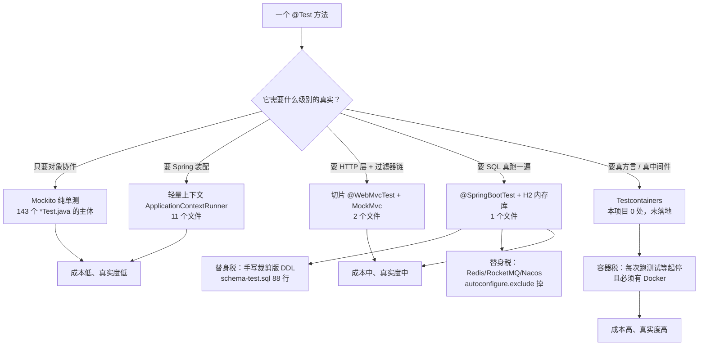
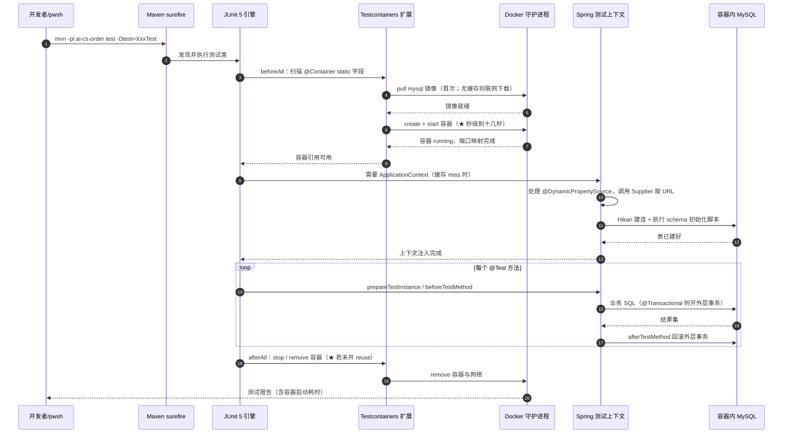

# 从 H2 替身到 Testcontainers：本地没有真实依赖时，测试代码该怎么选型

> **一句话结论**：Testcontainers 不是"更高级的测试框架"，而是一份用「每次跑测试都要等容器起停」换「数据库方言为真」的租约；本项目当前 0 处依赖命中、0 行容器代码、本机没有 Docker，所以它的正确形态是**带触发条件的待办**而不是待引入的依赖——真正需要真方言的三条链路（分片路由落表、LLM 生成的 SQL、缓存/锁行为）现在分别被 H2、Mockito、`@WebMvcTest` 切片顶着，这个边界必须逐条写清楚。
> **阅读前置**：JUnit 5 生命周期（`@BeforeAll` 为什么必须是静态方法）、`@SpringBootTest` 与切片测试（slice，只装配一层 bean 的最小上下文）的区别、Spring 测试上下文缓存的存在、MyBatis-Plus / `JdbcTemplate` 的基本用法。同目录建议先读 [01-JUnit5与Mockito单元测试](01-JUnit5与Mockito单元测试.md) 与 [04-Cucumber-BDD行为驱动实战](04-Cucumber-BDD行为驱动实战.md)；讲述结构参照 [15-SpringAOP与声明式事务原理](../02-Spring微服务/15-SpringAOP与声明式事务原理.md) 与 [06-Sentinel限流与熔断降级](../04-中间件/06-Sentinel限流与熔断降级.md)。
> **证据基线**：Spring Boot 4.2.0 / Spring Framework 7.1.0 / Spring Security 7.2.0 / JDK 17（本机 JDK 17，**无 Docker**）；A 级 8 个类摘录 + 2 处 `javap` 签名核对；B 级 15 个本项目文件（行号均为本次核对）；C 级 7 条命令（全部 ≤30 秒、不启动服务、不联网）；预计阅读 65 分钟。

---

## 0. 先看现象

### 症状一：任何"拉起真容器"的想法，在本机第一步就断

```text
PS D:\Projects\Persion\ai-customer-service> docker --version
docker : 无法将"docker"项识别为 cmdlet、函数、脚本文件或可运行程序的名称。
请检查名称的拼写，如果包括路径，请确保路径正确，然后再试一次。
所在位置 行:1 字符: 1
+ docker --version
+ ~~~~~~
    + CategoryInfo          : ObjectNotFound: (docker:String) [], CommandNotFoundException
    + FullyQualifiedErrorId : CommandNotFoundException
```

`docker-compose --version` 同样是 `CommandNotFoundException`。也就是说：本机不存在 `docker` 与 `docker-compose` 可执行文件。

而 CI 侧并不兜底——`.github/workflows/` 目录下只有 `python-learning-validate.yml` 一个工作流，8 个 Java 服务没有一个进 CI。所以"本地跑不了就去 CI 跑"这条路在本仓库当前也不成立。

### 症状二：H2 上全绿而 MySQL 上翻车的地方，本项目已经自己在注释里承认了

`ai-cs-order/src/test/resources/schema-test.sql:71` 这行注释是团队亲手写下的"替身坦白书"：

```sql
-- 售后申请表（结构对齐 deploy/mysql/after-sales-agent-init.sql，去除 MySQL 专有语法）
```

"去除 MySQL 专有语法"具体去掉了什么？把两份 DDL 的方言特征数一遍就清楚了（命令见 §3.6，输出为真实结果）：

| 文件 | `ENGINE=InnoDB` | `COMMENT=` | `utf8mb4` | `ON UPDATE CURRENT_TIMESTAMP` | `UNIQUE KEY` | `KEY idx_` |
|---|---|---|---|---|---|---|
| `ai-cs-order/src/test/resources/schema-test.sql`（88 行） | 0 | 0 | 0 | 0 | 0 | 0 |
| `deploy/mysql/all-init.sql`（830 行） | 48 | 48 | 114 | 27 | 30 | 72 |
| `deploy/mysql/order-init.sql`（111 行） | 6 | 6 | 13 | 3 | 4 | 0 |

也就是说：生产 DDL 里的**全部二级索引、全部列注释、全部自动更新时间戳语义**，在测试建表脚本里一个都没有。H2 上"通过"的用例，验的是"去掉索引、去掉 `ON UPDATE`、去掉字符集之后仍然正确的逻辑"。

同一类事故最典型的报错形态是 MySQL 的 `ONLY_FULL_GROUP_BY`（MySQL 5.7 起默认开启）：

```text
ERROR 1055 (42000): Expression #1 of SELECT list is not in GROUP BY clause and
contains nonaggregated column 'order_db.t.status' which is not functionally
dependent on columns in GROUP BY clause; this is incompatible with
sql_mode=only_full_group_by
```

> 本条**未本机实测**（本机无 MySQL、也不允许联网连库），判读方法见 §6.6：在真实 MySQL 上执行 `SELECT @@sql_mode`，看是否含 `ONLY_FULL_GROUP_BY`，再把同一句 SQL 拿到 H2 上跑——H2 默认不拒绝这种写法，于是"本地绿、线上红"。

### 症状三：想在本地验 Redis，却发现只有一行"将来时"注释

`ai-cs-order/src/test/resources/application-test.yml:20` 写着：

```yaml
    redis:
      host: 127.0.0.1
      port: 6370  # embedded-redis 使用非标准端口避免冲突
```

配套依赖也在：`ai-cs-order/pom.xml:126` 声明了 `it.ozimov:embedded-redis`（版本由父 POM `pom.xml:74` 的 `0.7.3` 决定），`scope=test`。但把全部 `*.java` 扫一遍，`RedisServer` / `redis.embedded` / `RedisServerBuilder` **0 命中**——没有任何测试真的启动过嵌入式 Redis；同时 `ai-cs-order/src/test/resources/application.yml:18` 把 `RedisAutoConfiguration` 直接排除了，测试上下文里连 `RedisTemplate` 这个 bean 都不存在。

### 这些现象指向同一件事

**"本地没有真实依赖"不是一个可以用一条依赖解决的配置问题，而是三层成本的分摊问题**：外层是 Docker 有没有（症状一），中层是替身替掉了哪些语义（症状二），内层是替身之后还有哪些链路压根没有测试在跑（症状三）。Testcontainers 只能解决外层，把中层的债一次性还清；而本项目当前连外层的门票都没有——所以真正的技术活是**判定哪几条链路必须还这笔债，其余地方心安理得地用替身**。

---

## 1. 整体地图



> **读图说明**
> - 关键箭头是 `Q -->|"要 SQL 真跑一遍"| D` 这一条：它决定了整篇的成本模型。`D` 往下的两条"替身税"箭头（D1、D2）才是 H2 方案真正的价格——你省掉了容器启动，但换来了"手写一份裁剪版 schema"和"把三个自动配置排除掉"。看漏这两条箭头，就会得出"H2 是免费的"这个错误结论。
> - 第二个关键箭头是 `Q -->|"要真方言 / 真中间件"| E`：它在本项目里**没有任何测试落点**（E 节点没有子节点、没有连线到具体文件）。把这条箭头误当成"已经有了"，就会在评审时以为方言问题被覆盖了；事实上它是空白格。
> - 还要注意 `C`（切片）与 `D`（全上下文）之间没有箭头：它们不是升级关系，而是**互斥选择**——切片测试里没有真 DataSource，全上下文测试里没有 Web 容器（本项目唯一的全上下文测试用 `@AutoConfigureMockMvc` 而不是 `webEnvironment=RANDOM_PORT`）。

| 组件 | 责任 | 谁调用它 / 谁依赖它 | 本项目状态 |
|---|---|---|---|
| H2 数据库（2.5.252） | 提供 `MODE=MySQL` 的内存库，充当 MySQL 替身 | `ai-cs-order/pom.xml:120`、`ai-cs-product/pom.xml:121`、`ai-cs-user/pom.xml:118`、`ai-cs-pay/pom.xml:85` 均为 test scope | 已生效（唯一的"真库"） |
| `schema-test.sql` | 手写的裁剪版 DDL，测试启动时建表 | `application-test.yml:16` 的 `schema-locations` | 已生效（88 行、6 张表） |
| `application-test.yml` | 规定测试用 H2 URL、随机端口、假 Redis 端口 | Spring 测试上下文按 profile 加载 | 已生效（52 行） |
| `application.yml`（test resources） | 关闭 Nacos / 排除 MyBatis-Plus、Redis、RocketMQ 自动配置 | 同上，无 profile 时默认加载 | 已生效（19 行） |
| `embedded-redis` 0.7.3 | 本该提供一个进程内 Redis | `ai-cs-order/pom.xml:126` | **依赖在、代码 0 处**（僵尸依赖） |
| Testcontainers（BOM 2.0.5） | 用 Docker 拉起一次性真容器 | 无人 import；m2 里只有 BOM 的 pom，无任何模块 jar | **未落地**（0 命中） |
| `.github/workflows/` | CI 里跑测试 | GitHub Actions | 只有 `python-learning-validate.yml`，Java 测试不在 CI |
| 网关 `AuthFilter` / 服务端 `HeaderAuthenticationFilter` | 造/验身份（供安全相关测试使用） | `@WebMvcTest` 切片直接导入这两个类 | 已生效 |

---

## 2. 关键概念与关键类

先把术语钉死，后面不再解释：

- **Testcontainers**：一个 JUnit 扩展 + 一堆容器封装类，测试期间用 Docker 拉起真实中间件，测试结束销毁。它自己不实现数据库语义，只是"容器编排的测试胶水"。
- **替身（Test Double）**：泛称 mock/stub/fake。H2 属于 **fake**（有真实实现的简化版），Mockito 属于 **mock**（无实现，只有预设反应）。二者的"骗人方式"完全不同：fake 会真的执行 SQL，只是方言不同；mock 根本不会执行。
- **方言（dialect）**：同一句 SQL 在不同数据库上的语法接受度、错误码、排序规则、锁行为差异。H2 的 `MODE=MySQL` 只是"更宽容一点"，不是"等价于 MySQL"（§3.6 有硬证据）。
- **切片测试（slice）**：`@WebMvcTest` / `@DataJpaTest` 这类只装配一层的最小上下文，速度快，但拿不到别的层。
- **上下文缓存（ContextCache）**：Spring TestContext 框架按 `MergedContextConfiguration` 做 key 缓存 `ApplicationContext`，缓存命中就跳过启动。**这是"跑测试慢"的第二大来源，且与容器无关。**
- **容器复用（reuse）**：Testcontainers 的开关，开启后容器在测试结束后不销毁、下次运行直接复用（宿主机上留一个带标签的容器）。它是"省启动时间"的唯一官方手段，但要求显式开启并在宿主机保留状态。
- **surefire / failsafe**：Maven 的两个测试插件，前者跑 `*Test.java`（默认），后者跑 `*IT.java`（集成测试惯例）。本项目**没有声明 failsafe**（§7）。

| 名称 | 位置 | 角色 | 关键方法 / 字段 |
|---|---|---|---|
| `SpringBootTest` | `org.springframework.boot.test.context`（A 级 [[源码:SpringBootTest.java.md#L74-L79]]） | 注解，声明"起全量上下文"，是"重上下文"的开关 | `String[] properties() default {}`：把 `key=value` 写进 `Environment` |
| `SpringBootTestContextBootstrapper` | 同上（A 级 [[源码:SpringBootTestContextBootstrapper.java.md#L130-L131]]） | 把注解上的 `properties` 拧进 `MergedContextConfiguration` | `getAndProcessPropertySourceProperties` → `createModifiedConfig` |
| `SpringBootTestAnnotation` | 同上（A 级 [[源码:SpringBootTestAnnotation.java.md#L54-L76]]） | `@SpringBootTest` 的上下文定制器，参与缓存 key 的相等性判断 | `equals` / `hashCode`（只比 `args`、`useMainMethod`、`webEnvironment`） |
| `TestContextManager` | `org.springframework.test.context`（A 级 [[源码:TestContextManager.java.md#L251-L260]]） | 测试生命周期总线：把 `beforeTestClass` / `prepareTestInstance` / `beforeTestMethod` 依次转给监听器 | `prepareTestInstance(Object)`、`beforeTestMethod(Object, Method)` |
| `ContextCache` | `org.springframework.test.context.cache`（A 级 [[源码:ContextCache.java.md#L77-L90]]） | 上下文缓存 SPI，定义容量与命中统计契约 | `DEFAULT_MAX_CONTEXT_CACHE_SIZE = 32`、`spring.test.context.cache.maxSize` |
| `DefaultContextCache` | 同上（A 级 [[源码:DefaultContextCache.java.md#L168-L181]]） | 默认实现：LRU 淘汰 + hit/miss 计数 | `get(MergedContextConfiguration)`、`evictLruContextIfNecessary()` |
| `TransactionalTestExecutionListener` | `org.springframework.test.context.transaction`（A 级 [[源码:TransactionalTestExecutionListener.java.md#L425-L441]]） | 让 `@Transactional` 测试方法在末尾**默认回滚** | `isDefaultRollback(TestContext)` → 无 `@Rollback` 时 `return true` |
| `DataSourceProperties` | `org.springframework.boot.autoconfigure.jdbc`（A 级 [[源码:DataSourceProperties.java.md#L102-L107]]） | 数据源配置的规范位置；**自动探测 classpath 上的嵌入式库** | `afterPropertiesSet()` 里 `EmbeddedDatabaseConnection.get(classLoader)` |
| `PropertiesJdbcConnectionDetails` | `org.springframework.boot.autoconfigure.jdbc`（A 级 [[源码:PropertiesJdbcConnectionDetails.java.md#L22-L40]]） | Boot 4 的连接信息抽象：URL/用户/驱动从 properties 推导 | `getJdbcUrl()` → `properties.determineUrl()` |
| `SQLErrorCodeSQLExceptionTranslator` | `org.springframework.jdbc.support`（A 级 [[源码:SQLErrorCodeSQLExceptionTranslator.java.md#L84-L88]]） | 把 JDBC 错误码翻译成 `DataAccessException`，**翻译表按数据库分家** | `sql-error-codes.xml`（可被用户覆盖） |
| `DynamicPropertyRegistry` | `org.springframework.test.context`（C 级 javap，§6.2） | 容器 URL 等"运行时才知道的值"注入 `Environment` 的唯一入口 | `void add(String, Supplier<Object>)` |
| `HeaderAuthenticationFilter` | `ai-cs-user/src/main/java/com/aics/user/security/HeaderAuthenticationFilter.java:34` | 从 `X-User-Id` / `X-User-Roles` 头构造 `Authentication`（本项目鉴权落地方式） | `doFilterInternal` 里组装 `UsernamePasswordAuthenticationToken` |
| `AuthFilter` | `ai-cs-gateway/src/main/java/com/aics/gateway/filter/AuthFilter.java:113` | 网关侧**剥离**客户端伪造的身份头，再注入可信身份 | `request.mutate().headers(h -> h.remove(...))` |

---

## 3. 原理与证据逐段精读

### 3.1 "等它起来"有两种：容器和 Spring 上下文，别只算一种

**先看证据。** Spring 测试框架本身就有"启动成本 vs 复用"的账本，而且写得很直白：

```java
// (src: ContextCache.java.md#L74-L90)
	/**
	 * @since 4.3
	 * @see #MAX_CONTEXT_CACHE_SIZE_PROPERTY_NAME
	 */
	int DEFAULT_MAX_CONTEXT_CACHE_SIZE = 32;

	/**
	 * System property used to configure the maximum size of the {@link ContextCache}
	 * as a positive integer: {@value}.
	 */
	String MAX_CONTEXT_CACHE_SIZE_PROPERTY_NAME = "spring.test.context.cache.maxSize";
```

```java
// (src: DefaultContextCache.java.md#L168-L181)
	@Override
	public @Nullable ApplicationContext get(MergedContextConfiguration key) {
		Assert.notNull(key, "Key must not be null");
		ApplicationContext context = this.contextMap.get(key);
		if (context == null) {
			this.missCount.incrementAndGet();
		}
		else {
			this.hitCount.incrementAndGet();
			pauseOnContextSwitchIfNecessary(key);
			restartContextIfNecessary(context);
		}
		return context;
	}
```

**在干什么**：Spring 用一个 `Map<MergedContextConfiguration, ApplicationContext>` 缓存已经启动好的上下文，命中就复用，未命中才真正 `refresh()` 一个新上下文；`evictLruContextIfNecessary()`（A 级 [[源码:DefaultContextCache.java.md#L224-L232]]）在写满 32 个之后按 LRU 踢掉最久未用的。

**为什么这么设计**：因为 `ApplicationContext.refresh()` 是整条测试链路里最贵的动作（扫 classpath、实例化 bean、连数据源）。上容器之后这个成本**叠加**而不是被替换：容器启动 3~20 秒 + 上下文 refresh 若干秒，两者都要付。

**换写法会怎样**：把 `spring.test.context.cache.maxSize` 调小（比如 4），你会看到测试总时长暴涨且**瓶颈与容器无关**；反过来若测试类之间 `@SpringBootTest(properties=...)` 各不相同，缓存永远不命中，每类都要起一遍上下文——这时即使开了容器复用（容器不重启），schema 初始化仍会按新上下文重跑。

**常见坑**：把"慢"一口咬定是容器慢。实际上先要区分：容器启动次数、上下文 refresh 次数、以及每个测试类里的 SQL 初始化次数。三者对应三个不同的指标（容器 start 日志、`ContextCache` 的 hit/miss、`spring.sql.init` 的执行日志）。本项目当前连"上下文 refresh 次数"都没记录，`logging.level.com.aics.order: debug`（`ai-cs-order/src/test/resources/application-test.yml:52`）是唯一接近调试开关的配置。

---

### 3.2 `@Container` 字段为什么必须是 `static`

**先看证据。** JUnit 5 的实例生命周期与 Spring 的测试生命周期是两套并行的回调，Spring 侧长这样：

```java
// (src: TestContextManager.java.md#L251-L260)
	public void prepareTestInstance(Object testInstance) throws Exception {
		if (logger.isTraceEnabled()) {
			logger.trace("prepareTestInstance(): instance [" + testInstance + "]");
		}
		for (TestExecutionListener testExecutionListener : getTestExecutionListeners()) {
			try {
				testExecutionListener.prepareTestInstance(getTestContext());
			}
```

**在干什么**：`prepareTestInstance` 是对**每一个测试实例**调用的（JUnit 默认每个 `@Test` 方法一个新实例），而类级容器必须在所有实例之间共享一份，所以容器的创建只能挂在"类级回调"上。

**为什么这么设计**：Testcontainers 的 JUnit 5 扩展在 `beforeAll` 阶段启动被 `@Container` 标注的字段——`@BeforeAll` 方法必须是静态的，因为它在任何实例存在之前执行。同理，容器字段必须是静态的：非静态字段属于实例，而扩展在实例还没造出来时就要拿到容器引用。

**换写法会怎样**：把字段改成非静态（或把 `@TestInstance(PER_CLASS)` 之外的方式"偷懒"），即使某天引擎允许了，语义也变成"每个测试方法一个容器"——一次 `mvn test` 里若该类有 20 个方法，就是 20 次 `docker run`，CI 时间从分钟级变小时级。

**常见坑**：把 `@Container` 标在 `@Autowired` 字段上、或者标在 `static final` 的 `Optional`/包装类型上；以及一个类里既有 `static` 容器又有 `@DynamicPropertySource` 的**实例方法**（后者必须是 `static`，见 §3.3）——编译器只会报一个莫名其妙的 `IllegalStateException`，而不是"你写错了"。

---

### 3.3 `@DynamicPropertySource` 为什么参数是 `Supplier` 而不是值

**先看证据**（本机用 `javap` 直接读 spring-test 7.1.0 的类签名，命令与输出见 §6.2）：

```text
public interface org.springframework.test.context.DynamicPropertyRegistry {
  public abstract void add(java.lang.String, java.util.function.Supplier<java.lang.Object>);
}
```

**在干什么**：`add(key, Supplier)` 注册的不是值，而是"取值的动作"。Spring 在上下文 refresh **之前**才调用 `get()` 把真实值塞进 `Environment`。

**为什么这么设计**：容器的端口/URL 只有在容器 `start()` 之后才确定，而 `Environment` 必须在 `refresh()` 之前就绪。用 `Supplier` 把"读值的时机"推迟到"容器已就绪、上下文未 refresh"的窗口里——这是这类注入唯一的正确时序。

**换写法会怎样**：本项目因为不用容器，等价信息是静态可写的，于是 `ai-cs-user/src/test/java/com/aics/user/security/UserApiEndToEndTest.java:27` 用了另一个手法，把配置直接写进注解散列：

```java
@SpringBootTest(properties = {
        "spring.cloud.nacos.config.enabled=false",
        "spring.cloud.nacos.discovery.enabled=false",
        "spring.config.import=",
        "spring.datasource.driver-class-name=org.h2.Driver",
        "spring.datasource.url=jdbc:h2:mem:user_api_e2e;MODE=MySQL;DB_CLOSE_DELAY=-1",
        "spring.sql.init.mode=always",
        "spring.sql.init.schema-locations=classpath:user-api-e2e-schema.sql"
})
```

这就是"不需要容器的静态 URL"与"必须容器的动态 URL"的分水岭：`properties()` 只接受编译期字面量，容器端口做不到。

**常见坑**：`@DynamicPropertySource` 标注的方法写成非 `static`、或参数类型写成 `DynamicPropertyRegistry` 之外的 `ConfigurableEnvironment`（编译过、运行不生效）；`Supplier` 内部抛异常会被包装成上下文加载失败，报错栈里看不到你的原始异常。

---

### 3.4 接上容器之后，上下文缓存会不会跟你作对

**先看证据。** 注解上的 `properties` 会被写进 `MergedContextConfiguration`，而后者正是缓存表的 key：

```java
// (src: SpringBootTestContextBootstrapper.java.md#L130-L131)
		List<String> propertySourceProperties = getAndProcessPropertySourceProperties(mergedConfig);
		mergedConfig = createModifiedConfig(mergedConfig, classes, StringUtils.toStringArray(propertySourceProperties));
```

而 `@SpringBootTest` 的上下文定制器自己参与 key 相等性的部分**只包含三项**：

```java
// (src: SpringBootTestAnnotation.java.md#L63-L66)
		boolean result = Arrays.equals(this.args, other.args);
		result = result && this.useMainMethod == other.useMainMethod;
		result = result && this.webEnvironment == other.webEnvironment;
```

**在干什么**：`SpringBootTestAnnotation`（一个 `ContextCustomizer`）用 `args` / `useMainMethod` / `webEnvironment` 参与相等性比较；而 `properties` 走的是 bootstrapper 那条路，落在 `MergedContextConfiguration.propertySourceProperties` 上，同样进入 key。

**为什么这么设计**：上下文能否复用，取决于"启动它所需的全部输入是否一致"。少算一项就会把两个本该不同的上下文错误地合并（症状：后跑的测试拿到前一个库名的连接）。

**换写法会怎样**：如果你的 Testcontainers 基类写的是 `@SpringBootTest` + `@DynamicPropertySource`，而子类各自又加了 `properties=...`（本项目正在这么干），那么每个子类都会建一个新上下文 → **每个子类都要重跑一遍 `spring.sql.init`**，容器虽然只起一次，SQL 初始化却跑 N 次。要走"容器化"路线，正确做法是：容器 + 数据源配置全部收敛到抽象基类，子类一个 `properties` 都别加。

**常见坑**：`@MockitoBean` / `@TestConfiguration` / `@ActiveProfiles` 的差异同样会分裂缓存 key（前者是 `BeanOverrideContextCustomizer`、后者体现在 `MergedContextConfiguration` 的 profile 上）；再叠加 `@DirtiesContext` 就是"每类都重建上下文"。这三样东西都会被误算成"容器慢"。

---

### 3.5 测试事务默认回滚：替身最容易骗人的地方

**先看证据。**

```java
// (src: TransactionalTestExecutionListener.java.md#L425-L441)
	protected final boolean isDefaultRollback(TestContext testContext) throws Exception {
		Class<?> testClass = testContext.getTestClass();
		Rollback rollback = TestContextAnnotationUtils.findMergedAnnotation(testClass, Rollback.class);
		boolean rollbackPresent = (rollback != null);

		if (rollbackPresent) {
			boolean defaultRollback = rollback.value();
			...
			return defaultRollback;
		}

		// else
		return true;
	}
```

**在干什么**：只要测试类/方法上有 `@Transactional`、没写 `@Rollback(false)`，测试方法体就被包在一个外层事务里，方法结束时**回滚**。

**为什么这么设计**：让测试之间互不污染，不必手写清库脚本——这对 H2 内存库尤其方便（每次 JVM 退出库就没了）。

**换写法会怎样**：写 `@Rollback(false)` 或 `@Commit` 之后，数据会留在库里，但**你依然看不到"提交后另一个连接/线程能否读到"的真实行为**：H2 内存库的隔离级别、锁等待、`ON UPDATE CURRENT_TIMESTAMP` 都不参与；换到真 MySQL 上，唯一键冲突、乐观锁重试、死锁这些行为才第一次出现。本项目 `after_sale_application` 的 `uk_idempotency_key`（`deploy/mysql/after-sales-agent-init.sql:111`）就是典型的"冲突路径只能真库验"的字段，而在 `schema-test.sql` 里它是内联 `UNIQUE`（第 76 行），二级索引却全没了。

**常见坑**：在测试里断言"数据已落库"却在断言前没有 `flush()`（MyBatis 的 SQL 是延迟发的），于是测试通过得莫名其妙；或者依赖自增 ID 从 1 开始，回滚后序列跳号让第二次断言失败。

---

### 3.6 方言差异的四处真实落点

**先看证据。** H2 的 `MODE=MySQL` 到底值多少？把 jar 打开数一数（C 级，§6.1）：

```text
=== 含 mysql 的类（大小写不敏感）===
org/h2/mode/FunctionsMySQL.class
（jar 条目总数 1073，字节数 2693360）
```

整个 H2 2.5.252 里**只有 1 个类**名字里带 mysql——它是一组函数兼容实现，不是 MySQL 引擎。这就定了性：`MODE=MySQL` 是"语法宽容模式"，不是"语义等价模式"。

四处落点，逐条对照本项目：

| 差异面 | MySQL 侧事实 | H2 侧事实 | 本项目证据 |
|---|---|---|---|
| DDL 能力 | `ENGINE=InnoDB`、`COMMENT`、`utf8mb4`、`ON UPDATE CURRENT_TIMESTAMP`、二级索引 | 一句都不认（或忽略） | `schema-test.sql` 里六项特征全 0，而 `deploy/mysql/all-init.sql` 分别是 48/48/114/27/30/72 |
| 错误码翻译 | 错误码 1062 = 唯一键冲突，被 `SQLErrorCodeSQLExceptionTranslator` 按 `sql-error-codes.xml` 翻成 `DuplicateKeyException` | H2 的错误码体系不同，同一场景翻出的异常类型/消息不同 | A 级 [[源码:SQLErrorCodeSQLExceptionTranslator.java.md#L84-L86]] 显示翻译表来自 `SQLErrorCodesFactory` 的资源文件 |
| 函数与关键字 | `IFNULL`、`DATE_FORMAT`、`GROUP_CONCAT`、`VALUES()`、`ON DUPLICATE KEY UPDATE` | 多数不支持；`MODE=MySQL` 只补了 `FunctionsMySQL` 那一小撮 | `deploy/mysql/after-sales-agent-init.sql:137` 用了 `ON DUPLICATE KEY UPDATE content = VALUES(content)`，这类种子脚本永远进不了测试 |
| 排序与大小写 | 依 `collation`（`utf8mb4_unicode_ci` 大小写不敏感、排序规则与 locale 相关） | 默认大小写敏感、排序按码点 | `ai-cs-user/src/test/resources/sharding-route-h2.yaml:19` 显式加了 `CASE_INSENSITIVE_IDENTIFIERS=TRUE`——团队已经踩过一次表名大小写的坑 |

**在干什么**：这四条差异决定了"哪些断言在 H2 上成立、在 MySQL 上可能不成立"。

**为什么这么设计**（为什么 H2 只做语法宽容）：H2 的定位是嵌入式、可移植的内存库，它的 MySQL 模式目标是"让 MySQL 的建表/查询脚本能跑起来"，不是"复刻 InnoDB 的锁与排序"。要复刻那些语义，代价等于重写一个存储引擎。

**换写法会怎样**：如果坚持 H2，就必须把结论**限制在"逻辑正确性"**上：金额计算、状态机流转、幂等键判重（用内联 `UNIQUE` 也能验）、SQL 拼接是否正确。反过来，凡是涉及"索引是否命中/排序是否稳定/并发下锁行为/MySQL 特有函数"的断言，在 H2 上写不出来——这就是 Testcontainers 唯一不可替代的价值区间。

**常见坑**：
1. 以为 H2 的 `MODE=MySQL` 能跑 `ON DUPLICATE KEY UPDATE`——跑不了，于是生产的种子脚本与测试 schema 长期分叉（本项目正是如此）。
2. 用 `ORDER BY` 断言列表顺序却依赖 H2 的稳定返回顺序；MySQL 上同样的 SQL 可能给出不同顺序。
3. 断言异常类型时只判 `RuntimeException`，掩盖了"错误码翻译不同"的事实（H2 翻成 A、MySQL 翻成 B）。

---

### 3.7 本项目 H2 三件套是怎么接起来的（逐行）

**先看证据。** 三份文件分工明确。

`ai-cs-order/src/test/resources/application.yml`（19 行）负责"断掉外部依赖"：

```yaml
# 测试全局配置 - 禁用 Nacos 和外部依赖
spring:
  cloud:
    nacos:
      discovery:
        enabled: false
      config:
        enabled: false
        import-check:
          enabled: false
    discovery:
      enabled: false
  config:
    import: "optional:nacos:"
  autoconfigure:
    exclude:
      - com.baomidou.mybatisplus.autoconfigure.MybatisPlusAutoConfiguration
      - org.springframework.boot.autoconfigure.data.redis.RedisAutoConfiguration
      - org.apache.rocketmq.spring.autoconfigure.RocketMQAutoConfiguration
```

`ai-cs-order/src/test/resources/application-test.yml`（52 行）负责"造出替代品"：

```yaml
spring:
  datasource:
    driver-class-name: org.h2.Driver
    url: jdbc:h2:mem:order_test;DB_CLOSE_DELAY=-1;DB_CLOSE_ON_EXIT=false;MODE=MySQL
    username: sa
    password:
  sql:
    init:
      mode: always
      schema-locations: classpath:schema-test.sql
```

`ai-cs-order/src/test/resources/schema-test.sql`（88 行）负责"给出建表脚本"，六张表：`cart_item`、`orders`、`order_item`、`coupon`、`full_reduction_rule`、`after_sale_application`。

**在干什么**：`autoconfigure.exclude` 把三个自动配置从上下文里摘掉（不是"设为不启用"，是**根本没有这个 bean**）；`spring.sql.init` 在上下文 refresh 完后执行建表；H2 URL 上的 `DB_CLOSE_DELAY=-1` 让内存库在整个 JVM 生命周期内不消失（否则最后一个连接关闭时库就被删了，第二个测试类会看到空库）。

**为什么这么设计**：这是"零外部依赖"策略的标准配方——把外部依赖从**自动配置层**摘干净，剩下的业务代码照常装配。代价写在 §0 症状二：`schema-test.sql` 必须手写，且会与生产 DDL 持续分叉。

**换写法会怎样**：把 `exclude` 换成"只设 `enabled: false`"（例如 `spring.data.redis.repositories.enabled: false`），`RedisAutoConfiguration` 仍会被装配，只是不报错——于是测试里可能悄悄建出一个指向 `127.0.0.1:6370`（不存在的端口）的连接工厂，**首次调用时才炸**，报错点是业务代码，不是配置。这正是本项目把 `RedisAutoConfiguration` 直接 exclude 的原因，也是那条 `port: 6370` 注释"将来时"的来源。

**常见坑**：
1. `autoconfigure.exclude` 写了类名但类名拼错——Spring 会直接启动失败（这是好事）；但若排除了 `MybatisPlusAutoConfiguration` 却忘了 `@MapperScan` 仍会注册 Mapper，就会得到"Mapper 存在、SqlSessionFactory 不存在"的怪错（`UserSecurityIntegrationTest` 里就为此 `@MockitoBean` 掉 `UserMapper`）。
2. H2 URL 少了 `DB_CLOSE_DELAY=-1`，表现为"第一个测试类全绿、第二个测试类 Table not found"。
3. 每个模块各写一份 `application.yml`（`ai-cs-order`、`ai-cs-product` 都有），配置漂移后彼此行为不一致——`ai-cs-product/src/test/resources/application.yml` 就比 order 少排除一个 RocketMQ。

---

### 3.8 「安全框架选型」在测试代码里的落点

这一节回答任务里的第二个主题：**测试代码本身也是一次技术选型**——身份从哪来、真实度要多高，直接决定你要不要容器。

**先看证据。** 本项目服务侧的身份是过滤器从请求头"拼"出来的：

```java
// ai-cs-user/src/main/java/com/aics/user/security/HeaderAuthenticationFilter.java:34
        String userId = request.getHeader(USER_ID);
        if (userId != null && !userId.isBlank()) {
            String roles = request.getHeader(USER_ROLES);
            List<SimpleGrantedAuthority> authorities = roles == null ? List.of() :
                    Arrays.stream(roles.split(","))
                            .map(String::trim)
                            .filter(s -> !s.isBlank())
                            .map(role -> role.startsWith("ROLE_") ? role : "ROLE_" + role.toUpperCase())
                            .map(SimpleGrantedAuthority::new)
                            .toList();
            // principal=userId：@PreAuthorize 可用 authentication.name 与路径 id 对比（本人访问）
            UsernamePasswordAuthenticationToken authentication =
                    new UsernamePasswordAuthenticationToken(userId, null, authorities);
```

于是测试里造身份只需要三个头，`ai-cs-user/src/test/java/com/aics/user/security/UserSecurityIntegrationTest.java:55` 就是这么干的：

```java
        mockMvc.perform(get("/user/42")
                        .header("X-User-Id", "7")
                        .header("X-User-Name", "alice")
                        .header("X-User-Roles", "ROLE_USER"))
                .andExpect(status().isForbidden())
                .andExpect(jsonPath("$.code").value(403));
```

而这条"塞头"的信任边界由网关把守——`ai-cs-gateway/src/main/java/com/aics/gateway/filter/AuthFilter.java:113` 在放行前先把客户端伪造的头摘掉：

```java
            ServerHttpRequest stripped = request.mutate()
                    .headers(headers -> {
                        headers.remove(USER_ID_HEADER);
                        headers.remove(USER_NAME_HEADER);
                        headers.remove(USER_ROLES_HEADER);
```

**在干什么**：安全相关的测试用 `@WebMvcTest` 切片 + `@Import({UserSecurityConfig.class, HeaderAuthenticationFilter.class, ...})`（`UserSecurityIntegrationTest.java:30`）拉起**真实的 `SecurityFilterChain`**，只把 `UserService` / `UserMapper` mock 掉。

**为什么这么设计**：这条链路的真实性由"过滤器链 + `@PreAuthorize` 求值"决定，**与数据库无关**。全仓 `@PreAuthorize` 只有 2 处（`ai-cs-user/src/main/java/com/aics/user/controller/UserController.java:43` 与 `:50`），都是"本人或 ADMIN"的表达式，判定输入是 `authentication.name` 与路径参数——不查库。

**换写法会怎样**：给这段测试接上 Testcontainers（真 MySQL）不会提高任何一个断言的效力，只会把 0.5 秒的切片测试变成 15 秒的集成测试。**这是"选型要按收益算"的典型反例**：真实度要加在"能改变结论的地方"。

**常见坑**：
1. 用 `@WithMockUser` 之类"框架给的假身份"去测**本项目自己的** `HeaderAuthenticationFilter`——过滤器链没跑，测的是框架默认行为，结论无效。本项目改用真实头 + 真过滤器，是正确的方向。
2. 把"塞 `X-User-Id` 就能冒充用户"当成系统能力：网关会剥头（`AuthFilter.java:113`），所以这个能力**只在服务内部可信**；任何端到端测试都必须经过网关，否则会得出"越权可行"的错误结论。
3. 忘了 `SecurityContextHolder.clearContext()`（`HeaderAuthenticationFilter.java:54` 的 `finally` 块）：`OncePerRequestFilter` 跨线程复用线程池，不清就会把身份串到下一个请求——测试里表现为"无关用例随机 403/200"。

---

## 4. 一次完整执行时序

下面这张图演示"**如果**把 `ai-cs-order` 的集成测试换成 Testcontainers 基类"，一次 `mvn -pl ai-cs-order test -Dtest=OrderRepositoryContainerTest` 会发生什么。注意图中标 ★ 的两步是 H2 方案里不存在的额外成本。



> **读图说明**
> - 关键箭头是第 8→11 步这一段：`@DynamicPropertySource` 的 `Supplier` 必须在"容器已 start、上下文未 refresh"的窗口里被调用。看错顺序（以为容器在上下文之后起）就会写出"URL 为 null"的初始化脚本，表现为 `Cannot load driver class` 或连到 3306 默认端口。
> - 第二个关键箭头是第 19→20 步的 `stop/remove`：它才是"每次跑测试都要等"的根源。开启 reuse 后这两步被跳过，代价是宿主机上留下带标签的容器，且**状态不干净**（上一个跑的库还在）。
> - 还要注意 `loop` 框里没有任何容器操作：一个类里 20 个方法只起 1 次容器。如果哪天你把容器字段改成非静态，这个 loop 会变成"每方法一次 create+start"——图上几乎每一行都要乘以 20。

| 失败步骤 | 典型报错 | 怎么读这个错 |
|---|---|---|
| 3（pull 镜像） | `Could not find a valid Docker environment` / `IllegalStateException: Is the Docker daemon running?` | 先验 Docker：本机 `docker --version` 直接 `CommandNotFoundException`（§0 症状一），不是 Testcontainers 的错 |
| 4（start 容器） | `ContainerLaunchException: Timed out waiting for container port to open` | 镜像能起但端口没通：多半是机器内存不足或镜像里服务启动慢，需要调 `waitingFor` |
| 6（缓存 key / properties） | `Failed to load ApplicationContext`，栈里 `BeanCreationException` | 通常不是容器问题，是 §3.4 的缓存分裂或某个 `properties` 写错 |
| 7（`Supplier` 取 URL） | `NullPointerException` 落在 `getJdbcUrl()` 所在行 | 字段不是 static，或容器还没起就取了值 |
| 8（schema 初始化） | `ScriptStatementFailedException` + `Syntax error in SQL statement` | 生产 DDL 里的 MySQL 专有语法在真 MySQL 上没问题，在脚本预处理阶段才炸——脚本路径/编码问题 |
| 10（业务 SQL） | `BadSqlGrammarException` / `DataIntegrityViolationException` | 这一层才是容器真正的收益：以前 H2 上永远绿的地方，现在红了 |
| 19（remove） | 无报错但残留容器：`docker ps -a` 有 `testcontainers/ryuk` | Ryuk（Testcontainers 的清理边车）被宿主策略挡住了 |

---

## 5. 设计取舍

| 方案 | 优点 | 代价 | 本项目怎么选 |
|---|---|---|---|
| Mockito 纯单测 | 毫秒级、零环境 | 不执行 SQL，验不出拼接错误与方言 | **主力**（143 个测试文件的主体） |
| H2 内存库 + 手写 schema | 零外部依赖、CI 友好、启动快 | 需要维护 `schema-test.sql`；方言/索引/排序全丢；与生产 DDL 长期分叉 | **已选**（4 个模块带 `h2` test 依赖） |
| embedded-redis 0.7.3 | 概念上能进程内起 Redis | 版本老、行为不全；本项目**代码 0 处使用** | **僵尸依赖**，建议删除或补一个真用它的测试 |
| Testcontainers（BOM 由 Boot 管到 2.0.5） | 真方言、真中间件行为，隔离性好 | 必须 Docker；每次跑要等；CI 要特权；镜像缓存要治理 | **未落地**（0 命中），列为带触发条件的待办 |
| 共享远端测试库（固定 MySQL） | 无 Docker 也能跑真 SQL | 数据脏、并发冲突、测试互相污染、无法在 CI 并行 | 不选（只有当"真库"诉求极强且无法容器化时才考虑） |
| 生产影子库只读 | 能验证真实数据形态 | 安全风险、合规问题 | 不选 |

**可扩展点清单（按实用度排序）**

1. **先补 failsafe，再谈容器**：Testcontainers 惯例把集成测试命名成 `*IT.java` 由 failsafe 在 `verify` 阶段跑；本仓库**没有声明 failsafe**，而 `ai-cs-chat/pom.xml:250` 与 `ai-cs-gateway/pom.xml:125` 把 surefire 的 `includes` 显式覆写成 `*Test.java`/`*Suite.java` 等——不补 failsafe，将来写的 `*IT` 测试会被静默跳过。
2. **把 §3.6 的四类断言写进代码评审清单**：涉及排序稳定性、唯一键冲突异常类型、MySQL 专有函数、字符集大小写的用例，必须在注释里标注"仅 H2 有效"。
3. **僵尸依赖清理**：`embedded-redis` 要么删、要么补两个真正启动它的测试（否则 `application-test.yml:20` 那句注释永远在骗下一个人）。
4. **给"必须真库"的三条链路建 issue**：分片路由落表（`ai-cs-user/src/test/resources/sharding-route-h2.yaml` 的 H2 版只验规则不验 MySQL 行为）、NL2SQL 生成的 SQL（`ai-cs-chat/src/main/java/com/aics/chat/nl2sql/Nl2SqlQueryService.java:198` 直接打到 5 个业务库，**该类零测试**）、缓存/锁行为（Redis 被 exclude，无从验证）。
5. **补一条 `spring.test.context.cache.maxSize` 的观测**：先用 `ContextCache` 的 hit/miss 把"慢"归因，再决定是否上容器——否则上了容器也未必变快。

---

## 6. 踩坑与调试手法

| 现象 | 根因 | 验证手段 | 解法 |
|---|---|---|---|
| 第二个测试类报 `Table "ORDERS" not found` | H2 内存库随最后一个连接关闭而销毁 | 看 URL 是否含 `DB_CLOSE_DELAY=-1`（`application-test.yml:10` 有） | 补 `DB_CLOSE_DELAY=-1`，或在同一上下文内合并测试类 |
| 测试里 `RedisTemplate` 注入失败 / 报找不到 bean | `RedisAutoConfiguration` 被 exclude（`application.yml:18`） | `grep -r "RedisAutoConfiguration"` 看 exclude 列表 | 要测缓存逻辑就 mock `StringRedisTemplate`，别指望自动配置 |
| 明明没连 Redis，启动却卡十几秒 | 有 bean 在建连接池（exclude 漏了对应自动配置） | 开 `logging.level.org.springframework.boot.autoconfigure=DEBUG`，看 `CONDITIONS EVALUATION REPORT` | 补齐 `autoconfigure.exclude` |
| `@Transactional` 测试里断言的"已落库"数据在别的连接读不到 | 外层事务未提交（§3.5 默认回滚） | 加 `@Rollback(false)` 再跑一次对比 | 需要跨连接可见性的用例不能靠 `@Transactional` 测试 |
| 生产 DDL 拷进 `schema-test.sql` 直接语法错误 | MySQL 专有语法（`ENGINE`/`COMMENT`/`ON UPDATE`/`VALUES()`） | 用 §3.6 的特征统计对比两份 DDL | 手写裁剪版，并在注释里写明"去掉什么"（本项目第 71 行已这么做） |
| 测试类之间"随机" 403/200 | `SecurityContextHolder` 未清理，线程池复用串身份 | 在断言失败处打印 `SecurityContextHolder.getContext().getAuthentication()` | `finally` 里 `clearContext()`（`HeaderAuthenticationFilter.java:54` 已做） |

### 6.1 真调试手法：`jar tf` 证伪"MODE=MySQL 等于 MySQL"

想知道 H2 到底"模拟"了多少 MySQL，不用查文档，直接开 jar 数类：

```powershell
$jar='C:\Users\16680\.m2\repository\com\h2database\h2\2.5.252\h2-2.5.252.jar'
& jar tf $jar | Measure-Object -Line
& jar tf $jar | Select-String -Pattern 'mysql' -CaseSensitive:$false
```

真实输出（本机）：

```text
Lines Words Characters Property
----- ----- ---------- --------
 1073

org/h2/mode/FunctionsMySQL.class
```

**怎么读**：1073 个条目里只有 1 个类与 mysql 相关，即 `org/h2/mode/FunctionsMySQL`。这是"函数兼容层"，不是引擎兼容层——所以你写的 `ON DUPLICATE KEY UPDATE`、`utf8mb4_unicode_ci` 排序、`ON UPDATE CURRENT_TIMESTAMP` 都不可能在里面。**看到这个结果的正确结论是**：任何"仅 H2 验证过"的 SQL 都需要在真 MySQL 上复跑一遍才算数。

### 6.2 真调试手法：用 `javap` 判断一个 API 是不是延迟求值

```powershell
$j='C:\Users\16680\.m2\repository\org\springframework\spring-test\7.1.0\spring-test-7.1.0.jar'
& javap -cp $j org.springframework.test.context.DynamicPropertyRegistry
```

真实输出：

```text
public interface org.springframework.test.context.DynamicPropertyRegistry {
  public abstract void add(java.lang.String, java.util.function.Supplier<java.lang.Object>);
}
```

**怎么读**：第二个参数是 `Supplier<Object>` 而不是 `Object`——说明框架要的是"取值动作"，会在自己的时机（上下文 refresh 前）调用它。这就是 §3.3 的全部答案：容器 URL 能进 `Environment` 的唯一原因是它是**惰性**的。顺带一提，`jar tf` 还能确认 `DynamicPropertySource` / `DynamicPropertyRegistrar` 都真实存在（本机实测存在），所以"用注解 + 静态方法 + 注册器"这条三元组不是道听途说。

### 6.3 真调试手法：用一个一定解析不了的域名证明"启动没联网"

想验证"启动路径到底连不连远端依赖"，别读代码猜，给它一个**必然失败**的坐标：

```java
// ai-cs-chat/src/test/java/com/aics/chat/config/VectorStoreConfigTest.java:24
            .withPropertyValues(
                    "spring.ai.vectorstore.chroma.client.host=http://chroma.invalid",
                    "spring.ai.vectorstore.chroma.port=8000",
                    "spring.ai.vectorstore.chroma.collection-name=offline-startup-test",
                    "spring.ai.vectorstore.chroma.initialize-schema=false");
```

再用 `ApplicationContextRunner` 断言上下文没失败、且注入点拿到的是接口代理而不是 `ChromaVectorStore` 本体。

**怎么读**：`.invalid` 是 RFC 保留的顶级域，永远解析不到。如果启动仍然成功，就能确定"启动路径没有触碰网络"；如果失败，报错里的主机名会直接指向嫌疑点。这比 mock 掉 HTTP 客户端更可信——**它证明的是"没发生调用"，而不是"调用被拦住了"**。同样的手法可以用来验证"数据库连接是不是惰性的"：把 URL 指到一个不存在的端口，看上下文能否启动。

### 6.4 真调试手法：把"慢"归因到上下文还是容器

Spring 的上下文缓存自带计数器（A 级 [[源码:DefaultContextCache.java.md#L168-L181]] 的 `hitCount` / `missCount`），DEBUG 日志会打印命中统计。

```powershell
mvn -pl ai-cs-order test "-Dlogging.level.org.springframework.test.context.cache=DEBUG"
```

**怎么读**：日志里 `hitCount` 高、miss 少 → 慢在别处（容器、SQL 初始化、单测本身）；miss 接近"测试类数" → 每个类都在重建上下文，先解决 §3.4 的 key 分裂再谈容器。定下这个基线，才有可能判断"上容器后到底多花多少秒"——否则你会把上下文重建的锅算到容器头上。

### 6.5 统计口径：`@Test` 的数字为什么会有三个版本

```powershell
cd D:\Projects\Persion\ai-customer-service
$tests = Get-ChildItem -Recurse -Include *Test.java | Where-Object { $_.FullName -notmatch '\\target' }
$txt = ($tests | Get-Content -Raw) -join "`n"
"测试文件: {0}" -f $tests.Count
"@Test 出现次数: {0}" -f ([regex]::Matches($txt,'@Test(?![A-Za-z])')).Count
```

真实输出：

```text
测试文件: 143
@Test 出现次数: 652
```

**怎么读**：`@Test(?![A-Za-z])` 用负向前瞻排掉了 `@TestConfiguration`、`@TestBean` 之类的**前缀兄弟注解**；如果偷懒用 `@Test` 直接数，会多出几处；如果按"包含 @Test 的行数"数，同一行多个注解还会再少几处。同一批文件用更宽的正则数断言调用（`assertThat(`/`assertEquals(`/`assertThrows(`/`verify(` 等 9 个模式）得到 1645 处，除以 652 约 2.5 条/方法；把 AssertJ 链式方法也算进去会到 3.26 量级。**结论层面不影响判断**：本项目的测试密度处于"每方法 2~3 条断言"的水平，离"用测试描述行为"还有距离。任何引用这组数字的地方都必须带上正则，否则三个版本会互相打架。

---

## 7. ⚠️ 版本差异

| 旧写法 | 当前基线 | 变化点 | 迁移动作 |
|---|---|---|---|
| `org.testcontainers:testcontainers-bom:1.19.7`（旧稿写的待接入版本） | Boot 4.2.0 已把 `<testcontainers.version>` 管到 `2.0.5` | 版本被 BOM 托管，**不需要自己写版本号** | 只 import `org.testcontainers:testcontainers-bom`（`pom.xml` 的 `dependencyManagement`），模块依赖不写 `<version>` |
| 模块 artifactId `mysql` / `chromadb`（1.19.7 BOM 里的写法，本机 pom 实测） | `testcontainers-mysql` / `testcontainers-chromadb`（2.0.5 BOM，本机 pom 实测） | 2.x 给所有模块统一加了 `testcontainers-` 前缀 | 抄旧文章里的 `org.testcontainers:mysql` 在 2.x 下解析不到，要改成新 artifactId |
| JUnit 4 的 `@ClassRule` + `static MySQLContainer` | JUnit 5 的 `@Testcontainers` + `@Container` | 扩展模型变了：类级 `beforeAll`/`afterAll` 由扩展驱动 | 用 `testcontainers-junit-jupiter` 模块，字段保持 `static` |
| 手写 `@DynamicPropertySource` 注入 URL | Boot 3.1+ 的 `@ServiceConnection` 可按容器类型自动配连接 | Boot 4.2.0 管理着 `spring-boot-testcontainers`（BOM 里有，本机 pom 实测） | 能写 `@ServiceConnection` 就不写 `Supplier`；但**本项目当前两者皆无** |
| Boot 3 之前测试只依赖 `spring-boot-starter-test` | Boot 4 把 Web 测试拆成独立 starter | `ai-cs-user/pom.xml:104` 起声明了 `spring-boot-starter-webmvc-test` 与 `spring-boot-starter-security-test`（注释写明"Boot 4 将 MockMvc/WebMvcTest 拆分到独立 starter"） | 写切片测试先确认 starter 是否齐，缺了会报找不到 `@WebMvcTest` |
| H2 1.4.x（`MODE=MySQL` 较宽松） | H2 2.5.252（本机 m2 唯一版本） | 2.x 关键字更严格、隐式排序更不可依赖、`IDENTITY` 语法变化 | 老文章的 H2 建表语句在 2.x 上可能直接报错；本项目 `schema-test.sql` 用的是 2.x 能跑的 `AUTO_INCREMENT` 写法 |
| 直接用 `DataSourceProperties` 取 URL | Boot 4 引入 `JdbcConnectionDetails` 抽象 | A 级 [[源码:PropertiesJdbcConnectionDetails.java.md#L22-L40]]：`getJdbcUrl()` 就是 `properties.determineUrl()` 的转发 | 自定义连接信息要做成 `JdbcConnectionDetails` bean，而不是覆写 `DataSourceProperties` |
| surefire 只管 `*Test`，`*IT` 归 failsafe | 本项目**没有 failsafe**，且 chat/gateway 覆写了 surefire `includes` | `*IT.java` 在当前配置下永远不会被跑（用 `-Include *IT.java` 扫全仓只得 2 个文件，且都是类名后缀撞上的误匹配，真实集成测试为 0） | 接 Testcontainers 前先补 failsafe 的 `integration-test`/`verify` 绑定 |

> 说明：本表中"BOM 里管到 2.0.5 / 模块前缀改名 / 1.19.7 的旧命名"三行来自本机 m2 里的 `testcontainers-bom-2.0.5.pom`、`testcontainers-bom-1.19.7.pom` 与 `spring-boot-dependencies-4.2.0.pom`（C 级，实测可复现）；`@ServiceConnection`、包名迁移等 Java API 细节**未在本机核对 jar 签名**（m2 里没有任何 testcontainers 模块 jar），以官方文档为准。

---

## 8. 面试高频问与答

1. Testcontainers 解决的核心问题是什么？它的成本体现在哪三个地方？
2. 为什么 `@Container` 字段必须是 `static`？如果写成实例字段会发生什么？
3. `@DynamicPropertySource` 的参数为什么是 `Supplier` 而不是具体值？
4. H2 + `MODE=MySQL` 与真 MySQL 的差异，你至少能说出四个方面？
5. `ONLY_FULL_GROUP_BY` 打开后，哪些常见 SQL 会立刻报 1055？
6. 测试里 `@Transactional` 默认回滚，这掩盖了什么真实行为？
7. Spring 测试上下文缓存是什么？什么操作会让缓存 key 分裂？
8. Testcontainers 的 `reuse` 是什么机制？开启后有什么副作用？
9. MySQL、Redis、RocketMQ、Elasticsearch、Chroma 这几类中间件，各自上容器难在哪里？
10. 为什么"业务失败恒返回 HTTP 200"这种问题，用容器测不出来？
11. 一个团队没有 Docker，你会怎么设计测试分层？边界写在哪里？
12. 什么条件下你会主张引入 Testcontainers？给出可判定的触发条件。

---

## 9. 动手练习

1. **给现有 schema 做一次"方言体检"**
   把 `ai-cs-order/src/test/resources/schema-test.sql` 与 `deploy/mysql/order-init.sql` 逐列对比，列出"测试库缺的索引 / 缺的 `ON UPDATE` / 缺的字符集声明"。
   *验收标准*：产出一张三列表（列名 / 生产定义 / 测试定义），至少找出 3 处语义缺失，并说明各自会让哪类测试失真。

2. **证明一次"回滚掩盖"**
   在 `ai-cs-order` 写一个 `@SpringBootTest` 测试，方法里插一条 `after_sale_application`，用 `@Transactional` 默认回滚；再开第二个连接（或第二个测试类、`@Rollback(false)`）尝试读这条记录。
   *验收标准*：两次运行给出相反结果，并能用 A 级锚点 [[源码:TransactionalTestExecutionListener.java.md#L425-L441]] 解释原因。

3. **复现上下文缓存分裂**
   同一模块写两个 `@SpringBootTest`，一个带自定义 `properties`、一个不带，各自打印 `@Autowired Environment` 里的 `spring.datasource.url`。
   *验收标准*：能证明两者"要么共用上下文、要么各起一个"（用 §6.4 的 DEBUG 日志佐证），并写出在 `properties` 不同时缓存必然 miss 的原因。

4. **给"僵尸依赖"做判决**
   `embedded-redis` 已在 `ai-cs-order/pom.xml:126` 声明但 0 处使用。写一个最小测试启动它并跑一次 `SET/GET`，或给出删除它的理由与迁移替代方案（mock / 容器 / 内存 map）。
   *验收标准*：二选一的决定 + 可运行的证据（测试通过或删除后 `mvn -pl ai-cs-order test` 仍全绿）。

5. **补一条 failsafe 通道**
   在 `ai-cs-order` 引入 `maven-failsafe-plugin`，写一个 `XxxIT.java`（哪怕只 `assertThat(true).isTrue()`），确保 `mvn -pl ai-cs-order verify` 会执行它而 `mvn test` 不执行。
   *验收标准*：`mvn test -Dtest=XxxIT` 报"没找到测试"，`mvn verify` 的日志里能看到该类被执行；`target/failsafe-reports/` 有报告。

6. **写一份"上容器的决策单"**
   针对本项目三条链路（分片路由、NL2SQL、缓存/锁）各写一段：现状用什么验、缺什么、上容器后多花多少秒、能多验出什么。
   *验收标准*：每条链路都要有"可判定的触发条件"（例如"当 `@PreAuthorize` 从 2 处扩到 20 处且涉及数据级权限时"），而不是"以后再说"。

---

## 小结

- Testcontainers 买的不是"更好的测试"，而是**方言真实性**；计价单位是"每次跑测试都要等容器起停 + 必须有一台能跑 Docker 的机器"。
- 本项目在这笔交易上**一分钱都没花**：`pom.xml` 与 `*.java` 里 `testcontainers` 命中 0，m2 里只有 BOM 的 pom、没有任何模块 jar，本机 `docker` 命令不存在。
- 现有方案的形态是"H2（4 个模块 test 作用域）+ 手写裁剪版 DDL + 三条 `autoconfigure.exclude` + 11 个 `ApplicationContextRunner` 轻量上下文"，143 个测试文件里只有 14 个真正起过 Spring 上下文。
- 替身的价格是明确的、可量化的：`schema-test.sql` 相比生产 DDL 少了 **全部二级索引、全部列注释、全部 `ON UPDATE CURRENT_TIMESTAMP`**（六项方言特征 0 vs 48/48/114/27/30/72）。
- 慢的**最大嫌疑不是容器**：Spring 上下文缓存（默认容量 32、`properties` 不同即分裂 key）才是第一嫌疑，`ContextCache` 的 hit/miss 是唯一可靠的归因工具。
- 安全框架选型在测试侧的落点是"过滤器链 + 请求头"，与数据库无关；所以为安全测试上容器是把钱花错地方，真该加真实度的地方是**分片路由落表、NL2SQL 生成的 SQL、缓存/锁行为**这三条目前**零覆盖**的链路。
- 可操作归纳：**先补 failsafe 通道（否则将来写的 `*IT` 会被静默跳过），再给 `schema-test.sql` 加一张"缺失语义清单"注释，最后才谈引入 `testcontainers-bom` 2.0.5 + `testcontainers-mysql`——顺序颠倒等于白花钱。**

---

## 自测题

**1. Testcontainers 到底替你做了什么、又没替你做什么？**

<details><summary>参考答案</summary>
它替你做的是"容器的拉取、启动、健康等待、销毁"，通过 JUnit 扩展把这几步挂到类级生命周期上。它没做的是任何应用侧接线：URL 怎么进 `Environment`（`@DynamicPropertySource` 或 `@ServiceConnection`）、schema 怎么初始化、上下文怎么复用，全要你自己写。所以它不是测试框架，而是容器编排胶水。
</details>

**2. 为什么 `@Container` 字段必须 `static`？**

<details><summary>参考答案</summary>
容器在 `beforeAll` 阶段启动，而 `@BeforeAll` 在 JUnit 的"实例尚未创建"阶段执行，拿不到实例字段。写成非静态时语义会退化为"每个测试方法一个容器"，一次 `mvn test` 就可能起几十次容器。
</details>

**3. `@DynamicPropertySource` 为什么用 `Supplier`？**

<details><summary>参考答案</summary>
因为容器端口只有在 `start()` 之后才确定，而 `Environment` 必须在上下文 `refresh()` 之前就绪。<a href="#L3-3">`add(String, Supplier<Object>)`</a> 的签名（本机 `javap` 实测）把取值推迟到"容器已起、上下文未 refresh"的窗口里，这是唯一正确的时序。
</details>

**4. H2 的 `MODE=MySQL` 到底等价于什么？**

<details><summary>参考答案</summary>
等价于"一组名为 `org.h2.mode.FunctionsMySQL` 的函数兼容实现"（本机 `jar tf` 实测：1073 个条目里只有 1 个类名含 mysql）。它放宽了部分语法，但引擎、锁、排序规则、字符集、错误码体系都不是 MySQL 的。
</details>

**5. 举出四种"仅 H2 有效"的 SQL 断言，并说明各自为何失真。**

<details><summary>参考答案</summary>
① 依赖 `ORDER BY` 稳定顺序的断言（H2 按码点、MySQL 依 collation）；② 唯一键冲突的异常类型断言（错误码翻译表按库分家，`SQLErrorCodeSQLExceptionTranslator` 从 `sql-error-codes.xml` 读表）；③ MySQL 专有函数/语句（`ON DUPLICATE KEY UPDATE`、`VALUES()`、`DATE_FORMAT`）根本跑不起来；④ 索引相关行为（`schema-test.sql` 里二级索引为 0）。
</details>

**6. 测试方法上的 `@Transactional` 默认行为是什么？被它掩盖了什么？**

<details><summary>参考答案</summary>
默认回滚（A 级锚点：`isDefaultRollback` 在没有 `@Rollback` 时 `return true`）。被掩盖的是"提交之后的可见性、跨连接读、锁等待、死锁重试"等真实行为——这些恰恰是唯一非容器不可验的部分。
</details>

**7. 什么操作会让 Spring 上下文缓存 key 分裂？**

<details><summary>参考答案</summary>
凡是进入 `MergedContextConfiguration` 的输入变化都会：`@SpringBootTest(properties=...)` 不同（bootstrapper 把 properties 写进 merged config）、`args`/`useMainMethod`/`webEnvironment` 不同（`SpringBootTestAnnotation` 的 `equals` 只比这三项）、`@ActiveProfiles` 不同、`@MockitoBean`/`@TestConfiguration` 不同。key 分裂的直接后果是每个类重跑一次上下文与 SQL 初始化。
</details>

**8. 项目里 `embedded-redis` 依赖为什么是"僵尸依赖"？**

<details><summary>参考答案</summary>
`ai-cs-order/pom.xml:126` 声明了它，但全部 `*.java` 里 `RedisServer`/`RedisServerBuilder` 0 命中，且 `RedisAutoConfiguration` 在测试配置里被 exclude。结果是 `application-test.yml:20` 那句"embedded-redis 使用非标准端口"的注释永远没有代码兑现。
</details>

**9. 为什么这个项目的安全测试不需要真数据库？**

<details><summary>参考答案</summary>
因为鉴权的真实性由过滤器链与 `@PreAuthorize` 表达式求值决定：全仓 `@PreAuthorize` 仅 2 处，判定输入是 `authentication.name` 与路径参数，不查库。`@WebMvcTest` 切片 + `@Import` 真实过滤器已能覆盖，上容器只增加耗时、不改变任何断言。
</details>

**10. 塞 `X-User-Id` 头能冒充用户吗？在哪一层失效？**

<details><summary>参考答案</summary>
在服务进程内能被 `HeaderAuthenticationFilter` 采信（测试就是这么造身份的），但网关 `AuthFilter` 会在转发前剥掉客户端伪造的 `X-User-Id`/`X-User-Name`/`X-User-Roles` 再注入可信身份。所以"塞头冒充"只在绕过网关时成立，端到端测试必须过网关。
</details>

**11. 想引入 Testcontainers，第一步该改的不是 pom，是哪一步？**

<details><summary>参考答案</summary>
先补 `maven-failsafe-plugin` 通道。当前仓库没有 failsafe，且 chat/gateway 覆写了 surefire 的 `includes`（只含 `*Test`/`*Suite` 等），因此按惯例命名的 `*IT.java` 会被静默跳过——不修这一步，接入的容器测试会"写了但没跑"。
</details>

**12. 用一句话向评审解释"为什么我们不引入 Testcontainers，但这不是技术债"。**

<details><summary>参考答案</summary>
因为它买到的东西（真方言）当前只对三条链路有价值，而那三条链路里两条还没有任何测试、一条在 H2 上验不了；在补齐 failsafe 与覆盖之前引入容器，只会把"没测的代码"变成"没测但更贵的代码"。它的正确形态是带可判定触发条件的待办。
</details>

---

## 交叉阅读

- 测试分层与 Mockito 手法：[01-JUnit5与Mockito单元测试](01-JUnit5与Mockito单元测试.md)
- 行为驱动与 cucumber 的对象级用法：[04-Cucumber-BDD行为驱动实战](04-Cucumber-BDD行为驱动实战.md)
- 事务边界为什么在测试里格外容易骗人：[15-SpringAOP与声明式事务原理](../02-Spring微服务/15-SpringAOP与声明式事务原理.md)
- "配置写了但代码没落地"这类坑的系统讲法：[06-Sentinel限流与熔断降级](../04-中间件/06-Sentinel限流与熔断降级.md)
