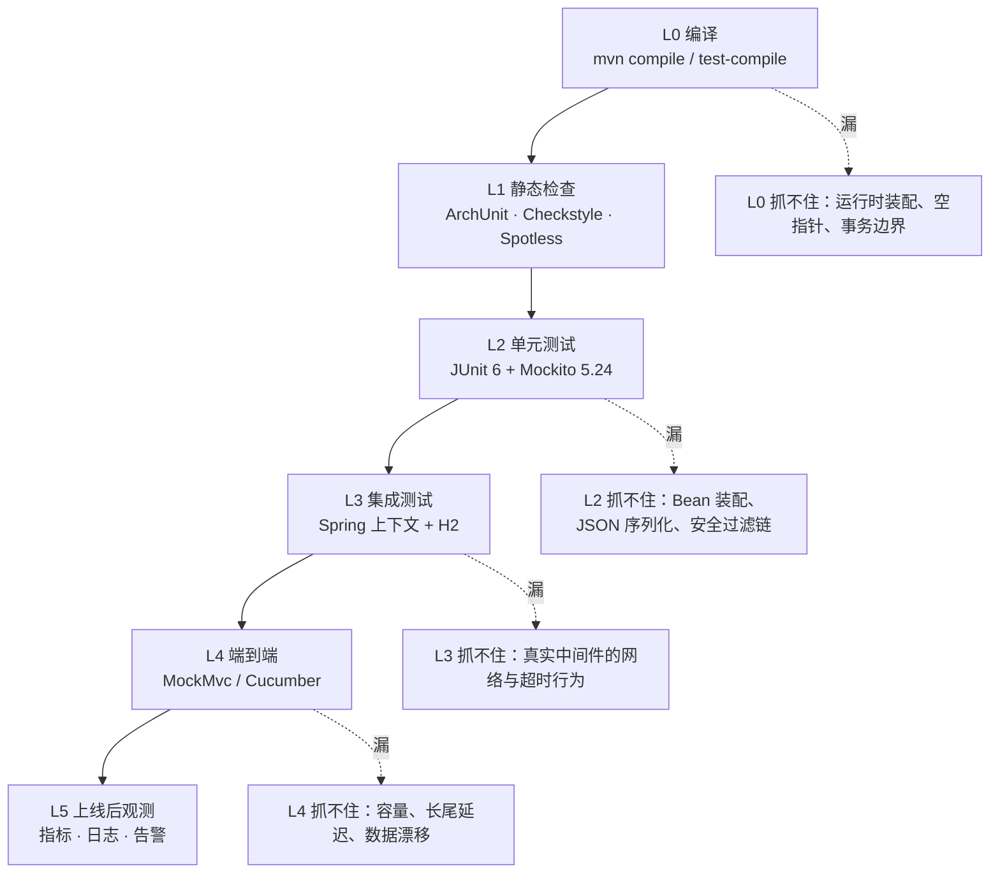
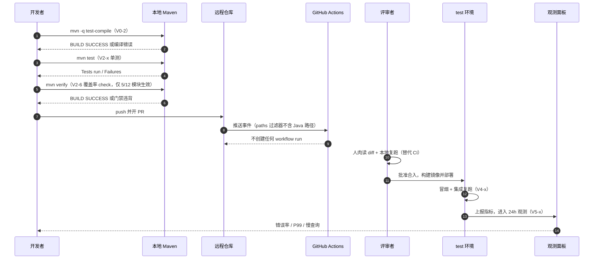

# 03 · 一等公民验证清单（一二梯队落地）

> **一句话结论**：本仓库不缺测试数量（143 个测试类、653 个 `@Test`、1817 处断言点），缺的是一张能逐条勾选的验证清单——「谁、在哪一层、用什么命令、看到什么输出算通过」；没有这张清单，CI 未触发、门禁未生效、断言没断到点，三件事都会被当成「验过了」。
> **阅读前置**：会写 JUnit + Mockito 单测；读过 [01-JUnit5与Mockito单元测试.md](01-JUnit5与Mockito单元测试.md)；分得清 `mvn test` 与 `mvn verify`、`-DskipTests` 与 `-Dmaven.test.skip`；知道 `@SpringBootTest` / `@WebMvcTest` 是"装容器"的、`MockMvcBuilders.standaloneSetup` 是"不装容器"的。
> **证据基线**：Spring Boot 4.2.0 / Spring Framework 7.1.0 / spring-test 7.1.0 / JUnit Jupiter 6.1.3 / Mockito 5.24.0 / AssertJ 3.27.7 / JDK 17；A 级引 `24-源码分析/assets/source/` 已入库摘录，B 级引本仓库文件行号，C 级为本机 pwsh 实跑输出（2026-11-27 快照，命令可复现）。预计阅读 40 分钟。

---

## 0. 先看现象

三个现场，都是"交付时以为验过了"。

### 现象 1：PR 界面上"所有检查通过"，可这次提交的 Java 代码一行都没被跑过

```powershell
PS> Get-ChildItem .github\workflows -File | Select-Object -ExpandProperty Name
python-learning-validate.yml
```

这个仓库的 CI 只有一条 workflow，而它的触发条件是路径白名单（`.github/workflows/python-learning-validate.yml#L8-L14`）：

```yaml
    paths:
      - "learning-docs/22-Python速成/**"
      - "ai-cs-py-recommend/**"
```

也就是说：改 `ai-cs-chat` 的 Controller、改 `ai-cs-order` 的支付回调、改 `ai-cs-common` 的异常处理器，**都不会创建任何 workflow run**。GitHub 上"没有红叉"被读成"通过"，这是本仓库最容易发生的误判——12 个 Maven 模块（common/gateway/user/knowledge/chat/search/message/notify/order/pay/product/mq）与 8 个 Java 服务，一个都没进 CI。

### 现象 2：照着旧教程抄注解，编译期就找不到类

把 Spring Boot 3 时代的测试切片注解原样搬进这个 Boot 4.2.0 工程，`test-compile` 直接报（真实输出，命令见下）：

```text
javap : Error: class not found: org.springframework.boot.test.autoconfigure.web.servlet.AutoConfigureMockMvc
所在位置 行:1 字符: 283
+ ... 4.2.0.jar"; javap "-J-Duser.language=en" "-J-Duser.country=US" -cp $j ...
+                 ~~~~~~~~~~~~~~~~~~~~~~~~~~~~~~~~~~~~~~~~~~~~~~~~~~~~~~~~~~~
    + CategoryInfo          : NotSpecified: (Error: class no...onfigureMockMvc:String) [], RemoteException
```

复现命令（只读 m2 里的本地 jar，不联网、不跑 mvn）：

```powershell
javap "-J-Duser.language=en" "-J-Duser.country=US" -cp "$env:USERPROFILE\.m2\repository\org\springframework\boot\spring-boot-test-autoconfigure\4.2.0\spring-boot-test-autoconfigure-4.2.0.jar" org.springframework.boot.test.autoconfigure.web.servlet.AutoConfigureMockMvc
```

这个错误不是"我拼错了类名"，而是 Boot 4 把 Web 切片搬进了按技术拆分的 starter：类现在在 `spring-boot-webmvc-test-4.2.0.jar` 的 `org.springframework.boot.webmvc.test.autoconfigure` 包里。所以**编译通过与否，本身是一条独立的验证结论**，且它随版本而变——不写进清单，就会在别人机器上炸。

### 现象 3：用例数很好看，但"门禁"只覆盖了不到一半，而"业务失败"的语义被测试写成了 200

```powershell
PS> (Get-ChildItem -Recurse -File -Filter *Test.java | Where-Object { $_.FullName -match '\\src\\test\\' }).Count
143
PS> # 断言点（assert* / verify* / andExpect）合计
PS> 1817
```

看着挺体面。但同一个仓库里，根 `pom.xml#L373-L382` 写着 `LINE 0.40 / BRANCH 0.30` 的 JaCoCo 门禁，整块插件却待在 `<pluginManagement>`（`pom.xml#L311-L312`）里——只有 5 个模块自己再声明了一次，另外 7 个模块（含 `ai-cs-chat` 的 252 个用例）在 `mvn verify` 时**根本不执行覆盖率检查**。

更麻烦的是断言断在了错误的点上。业务异常处理器没有声明 HTTP 状态码（`ai-cs-common/src/main/java/com/aics/common/exception/GlobalExceptionHandler.java#L35-L39`）：

```java
    @ExceptionHandler(BusinessException.class)
    public Result<Void> handleBusinessException(BusinessException e, HttpServletRequest request) {
        log.warn("业务异常 [{}] {}: code={}, msg={}", request.getMethod(), request.getRequestURI(), e.getCode(), e.getMessage());
        return Result.fail(e.getCode(), e.getMessage());
    }
```

对照下一个方法就有 `@ResponseStatus(HttpStatus.BAD_REQUEST)`（同文件 `#L44-L45`），说明"注解是记得写的"，只是业务异常这条漏了。后果：任何业务失败都返回 HTTP 200。而端到端测试把这件事固化成了预期（`ai-cs-user/src/test/java/com/aics/user/security/UserApiEndToEndTest.java#L58-L60`）：

```java
        mockMvc.perform(post("/user/register").contentType(MediaType.APPLICATION_JSON).content(body))
                .andExpect(jsonPath("$.code").value(1002))
                .andExpect(jsonPath("$.message").value("用户已存在"))
```

只断 `$.code`，不断 `status()`；成功分支则老老实实断了 `status().isOk()`（`#L54-L56`）。于是"业务失败 = 200"从 bug 变成了回归保护——**测试全绿，语义错的**。

> **这些现象指向同一件事**：本项目的验证缺失不在"写得少"，而在"没有人定义过每一层该由谁验、用什么证据验、判定通过的标准是什么"。验证被默认为测试团队的产出物，而不是写代码的人在按下 push 之前必须自己走完的一串动作。

---

## 1. 整体地图：验证是一个六层的漏斗，不是一件事



> **读图说明**：竖着看是"越往下越贵、越往下越接近真实"。实线箭头是**通过条件**——上层没过，下层再绿也不算数（例如 `test-compile` 失败时 `mvn test` 根本启动不了，界面上"上次通过"只是缓存）。虚线箭头标的是**每层的固有盲区**，这是这张图最容易被看错的地方：很多人把"L2 单测全绿"读成"这个功能验过了"，但箭头 `L2 -.漏.-> G2` 就是在说——单测用 mock 替掉了所有 Bean，装配失败、序列化失败、安全过滤链顺序错，它一个都抓不到。反过来也别把虚线读成"上层没用"：L3/L4 抓不住容量问题，不代表可以让 L3 替 L2。

### 1.1 每一层抓住什么、抓不住什么

| 层 | 典型手段 | 能抓住 | 抓不住 | 本仓库现状（✅已落地 / ⚠️部分 / ❌缺） |
| --- | --- | --- | --- | --- |
| L0 编译 | `javac`、`mvn compile`、`mvn test-compile` | 类型错误、包名漂移、API 签名变化 | 任何运行时行为 | ✅ 12 个模块都能编译；但无 CI 强制，靠人跑 |
| L1 静态检查 | ArchUnit、Checkstyle、Spotless、密钥扫描 | 依赖方向违规、风格漂移、明文密钥 | 逻辑错误、并发问题 | ❌ archunit/checkstyle/spotless 全仓 0 命中（C 级实测） |
| L2 单元测试 | JUnit 6 + Mockito | 分支逻辑、边界值、异常路径 | Bean 装配、SQL、序列化、拦截器 | ✅ 653 个 `@Test`；⚠️ 无门禁模块占 57.9% |
| L3 集成测试 | `@SpringBootTest` / `@WebMvcTest` + H2 | 上下文装载、SQL、MVC 映射、安全链 | 真实中间件（Redis/MQ/ES）的网络行为 | ⚠️ 真正装容器的只有 3 个类；Testcontainers 0 命中 |
| L4 端到端 | MockMvc 全链路、Cucumber BDD | 需求语义、状态码、鉴权越权 | 容量、长尾、数据漂移 | ⚠️ 9 个 feature、38 个 Scenario，但 cucumber-spring 0 命中（对象级） |
| L5 上线后观测 | Micrometer 指标、结构化日志、告警、trace | 真实错误率、P99、容量拐点 | 已经写错的业务语义（它只会忠实记录） | ⚠️ 有 OpenMetrics 端点，但业务失败恒 200 → 错误率恒 0 |

### 1.2 参与方与责任

| 参与方 | 在这张清单里负责什么 | 交付物 | 本仓库对应约束 |
| --- | --- | --- | --- |
| 写代码的人 | L0/L1/L2 必须自己跑过；改动触及装配或 SQL 时补 L3 | 提交里带命令与输出 | `CLAUDE.md#L147-L148`「测试代码必须先于（或同次于）实现代码提交，禁止后补测试冒充 TDD」 |
| 评审者 | 复核"证据是不是真的"：贴的测试是否覆盖本次改动、门禁是否真的执行 | PR 评论 + 勾选清单 | `.claude/agents/challenger.md#L74` 检查表要求覆盖率门槛 |
| CI | 替代人肉执行 L0/L2，产出不可篡改的结果 | 红色/绿色的 run | ⚠️ 现状：12 个 Maven 模块无任何 workflow |
| 交付/运维 | L4 在 test 环境复跑、L5 观测项与回滚 | 冒烟报告、观测面板 | `.claude/agents/deliverer.md#L101-L111`、`#L124` |
| 门禁裁决者 | 决定"通过 / 驳回" | 《质量门禁通过证书》或《驳回通知书》 | `.specify/memory/constitution.md#L130-L137` |

> **读图说明（表格版）**：注意"写代码的人"那一行只列到 L3，L4/L5 归交付与运维——但责任分界不等于可以把 L4 留白。`constitution.md#L105-L129` 的四级门禁里，L3（E2E）是合入前的必要条件，只是执行者从作者换成了交付线。

---

## 2. 清单本体（按层编号，可直接勾）

编号规则：`V<层号>-<序号>`。判据必须是"能被机器判定"或"能被第二个人复现"的，不能是"我看了觉得没问题"。

### 2.1 L0 编译层

| 编号 | 条目 | 判据（命令或标准） | 状态 |
| --- | --- | --- | --- |
| V0-1 | 主干代码能编译 | `mvn -q -DskipTests compile` 退出码 0 | ✅ |
| V0-2 | 测试代码能编译 | `mvn -q test-compile` 退出码 0（注意：`-DskipTests` **仍然编译测试**，只有 `-Dmaven.test.skip=true` 才连编译一起跳过） | ⚠️ 无 CI 兜底 |
| V0-3 | 版本漂移不靠记忆 | 引用的 Boot/Spring 注解包名与本机 `m2` 里的 jar 一致（`javap` 或 `jar tf` 校验） | ❌ 无自动化 |

### 2.2 L1 静态检查层

| 编号 | 条目 | 判据 | 状态 |
| --- | --- | --- | --- |
| V1-1 | 依赖方向被机器守住 | ArchUnit 测试存在且 `mvn test` 会跑它（本项目规则只写在 `CLAUDE.md` 的依赖方向表里，无对应测试） | ❌ 0 命中 |
| V1-2 | 风格不靠 review | Checkstyle 或 Spotless 在 `verify` 阶段执行 | ❌ 0 命中 |
| V1-3 | 明文密钥不入库 | 对 `application*.yml` 做 `password|secret|token` 扫描并人工裁决命中 | ❌ 无脚本 |
| V1-4 | 接口契约与实现一致 | springdoc 生成的 `/v3/api-docs` 快照 diff | ❌ 无 |

### 2.3 L2 单元测试层

| 编号 | 条目 | 判据 | 状态 |
| --- | --- | --- | --- |
| V2-1 | 每个新增/修改的 public 行为至少 1 个用例 | diff 里新增的方法名能在测试中找到对应断言 | ✅ 约定在 `constitution.md#L35-L47` |
| V2-2 | 不存在"零断言测试" | 每个含 `@Test` 的类至少有 1 处 `assert*` / `verify*` / `andExpect` | ✅ 实测 0 个（口径见 2.7） |
| V2-3 | 异常路径被断到 | 至少 1 处 `assertThrows` 或对业务错误码的断言 | ✅ 85 处 `assertThrows` |
| V2-4 | 边界值参数化 | 多分支输入的类用 `@ParameterizedTest` | ❌ 全仓仅 2 处 |
| V2-5 | 没有长期挂着不跑的用例 | `@Disabled` / `@Ignore` 命中数为 0 | ✅ 实测 0 |
| V2-6 | 覆盖率门禁在本模块真的执行 | 本模块 `pom.xml` 的 `<plugins>`（不是父 pom 的 `<pluginManagement>`）里有 `jacoco-maven-plugin` 的 `check` 目标 | ⚠️ 仅 5/12 模块 |

### 2.4 L3 集成测试层

| 编号 | 条目 | 判据 | 状态 |
| --- | --- | --- | --- |
| V3-1 | 至少一个真正装载 Spring 上下文的测试 | 存在 `@SpringBootTest` 或 `@WebMvcTest`；`MockMvcBuilders.standaloneSetup` 不算 | ⚠️ 3 个类 |
| V3-2 | 数据访问走真 SQL | 集成测试用 H2 + `schema-locations`，不 mock Mapper | ✅ 仅 user 模块 |
| V3-3 | 测试间数据隔离 | 事务回滚或内存库每次重建 | ✅ H2 内存库 |
| V3-4 | 替身用当前 API | 用 `@MockitoBean`（Boot 4 口径），不用已废弃的 `@MockBean` | ✅ 4 处 `@MockitoBean`，0 处 `@MockBean` |

### 2.5 L4 端到端层

| 编号 | 条目 | 判据 | 状态 |
| --- | --- | --- | --- |
| V4-1 | 成功与失败都断 HTTP 状态码 | `.andExpect(status().isXxx())` 出现在失败分支 | ❌ 失败分支普遍只断 `$.code` |
| V4-2 | 鉴权/越权有反例 | 未授权请求必须断 401/403，而不是断 200 + 业务码 | ⚠️ 仅 2 处 `@PreAuthorize` |
| V4-3 | 步骤类能拿到 Spring 容器 | 步骤类上有 `@SpringBootTest` 且依赖 `cucumber-spring` | ❌ cucumber-spring 0 命中 |
| V4-4 | 需求场景有对应 feature | `specs/*/spec.md` 的场景能在 `.feature` 里找到同名场景 | ❌ 44 处场景提及，转成 feature 的 0 |

### 2.6 L5 上线后观测层

| 编号 | 条目 | 判据 | 状态 |
| --- | --- | --- | --- |
| V5-1 | 错误能被指标抓到 | 业务失败映射为非 2xx，或有独立的业务错误计数器 | ❌ 恒 200 |
| V5-2 | 关键路径有指标 | `/actuator/prometheus` 有目标接口的计数与耗时 | ⚠️ 端点存在，无业务语义指标 |
| V5-3 | 上线 24h 观察项写进 PR | 错误率、P99、慢查询各给一个基线值 | ❌ 无模板 |

### 2.7 这张表怎么用：一条命令把现状打出来

把下面这段存成 `tools/verify-audit.ps1`（本仓库还没有这个文件，属"待落地"），在仓库根执行；**紧跟着的输出是 2026-11-27 在本机真实跑出来的**，不是示例：

```powershell
$t    = Get-ChildItem -Recurse -File -Filter *Test.java | Where-Object { $_.FullName -match '\\src\\test\\' }
$main = Get-ChildItem -Recurse -File -Filter *.java      | Where-Object { $_.FullName -match '\\src\\main\\' }
$m = ($main | Get-Content | Measure-Object -Line).Lines
$s = ($t    | Get-Content | Measure-Object -Line).Lines
"== 1 规模 =="
"*Test.java   : {0}" -f $t.Count
"@Test        : {0}" -f ($t | Select-String -Pattern '@Test' -AllMatches).Count
"test/main    : {0}" -f ([math]::Round($s/$m,2))
"== 2 断言口径 =="
"口径A assert*/verify( : {0}" -f ($t | Select-String -Pattern '\bassert\w*\s*\(|\bverify\s*\(' -AllMatches).Count
"口径B +andExpect      : {0}" -f ($t | Select-String -Pattern '\bassert\w*\s*\(|\bverify\s*\(|\.andExpect\(' -AllMatches).Count
"口径C +verify\w*(     : {0}" -f ($t | Select-String -Pattern '\bassert\w*\s*\(|\bverify\w*\s*\(|\.andExpect\(' -AllMatches).Count
"== 3 容器级 =="
"@SpringBootTest  : {0}" -f ($t | Select-String -Pattern '@SpringBootTest' -AllMatches).Count
"@WebMvcTest      : {0}" -f ($t | Select-String -Pattern '@WebMvcTest' -AllMatches).Count
"standaloneSetup  : {0}" -f ($t | Select-String -Pattern 'standaloneSetup' -AllMatches).Count
"@MockitoBean     : {0}" -f ($t | Select-String -Pattern '@MockitoBean' -AllMatches).Count
"@MockBean        : {0}" -f ($t | Select-String -Pattern '@MockBean' -AllMatches).Count
"@Disabled|@Ignore: {0}" -f ($t | Select-String -Pattern '@Disabled|@Ignore' -AllMatches).Count
"== 4 门禁 =="
$j = Get-ChildItem -Recurse -File -Filter pom.xml | Where-Object { $_.FullName -notmatch 'node_modules' } |
     Select-String -Pattern 'jacoco-maven-plugin' | ForEach-Object { Split-Path $_.Path -Parent }
"声明 jacoco 插件的 pom : {0}" -f (($j | ForEach-Object { Split-Path $_ -Leaf }) -join ',')
"== 5 静态检查 =="
$h = Get-ChildItem -Recurse -File -Include pom.xml,*.java,*.yml | Where-Object { $_.FullName -notmatch 'node_modules|\\target\\' }
"archunit/checkstyle/spotless/pitest : {0}/{1}/{2}/{3}" -f `
  ($h|Select-String -Pattern 'archunit' -AllMatches).Count, ($h|Select-String -Pattern 'checkstyle' -AllMatches).Count, `
  ($h|Select-String -Pattern 'spotless' -AllMatches).Count, ($h|Select-String -Pattern 'pitest|pit-mutation' -AllMatches).Count
"== 6 CI =="
"workflows : {0}" -f ((Get-ChildItem .github\workflows -File).Name -join ',')
"== 7 BDD =="
$f = Get-ChildItem -Recurse -File -Filter *.feature | Where-Object { $_.FullName -match '\\src\\test\\' }
"feature 文件 : {0}  Scenario : {1}  步骤行 : {2}" -f $f.Count, ($f|Select-String -Pattern '^\s*Scenario' -AllMatches).Count, ($f|Select-String -Pattern '^\s*(Given|When|Then|And|But)\s' -AllMatches).Count
"cucumber-spring 命中 : {0}" -f (($h|Select-String -Pattern 'cucumber-spring' -AllMatches).Count)
```

真实输出（原样贴）：

```text
== 1 规模 ==
*Test.java   : 143
@Test        : 653
main java 行 : 31280
test java 行 : 13353
test/main    : 0.43
== 2 断言口径 ==
口径A assert*/verify( : 1716
口径B +andExpect      : 1804
口径C +verify\w*(     : 1817
== 3 容器级 ==
@SpringBootTest  : 1
@WebMvcTest      : 2
standaloneSetup  : 6
@MockitoBean     : 4
@MockBean        : 0
@Disabled|@Ignore: 0
== 4 门禁 ==
声明 jacoco 插件的 pom : ai-customer-service,ai-cs-message,ai-cs-notify,ai-cs-order,ai-cs-pay,ai-cs-product
== 5 静态检查 ==
archunit/checkstyle/spotless/pitest : 0/0/0/0
== 6 CI ==
workflows : python-learning-validate.yml
== 7 BDD ==
feature 文件 : 9  Scenario : 38  步骤行 : 167
cucumber-spring 命中 : 0
```

**怎么读这段输出**，逐条对应上表：

- `@Test 653` 是好数字，但它和 `V2-6` 无关——`== 4` 那行里根 pom（`ai-customer-service`）出现在列表里，并不代表门禁生效，因为它在 `<pluginManagement>` 里；真正执行的只有自己 `<plugins>` 里声明过的 5 个模块（order / pay / message / notify / product）。
- `口径A/B/C` 三个数说明"断言密度"是**口径的函数**：只认 `assert*/verify(` 是 1716，把 MockMvc 的 `.andExpect(` 加进来是 1804，再把 `verifyNoInteractions(` 算上是 1817。分母 653 时分别是 2.63 / 2.76 / 2.78。若继续把 `jsonPath(...).value(...)` 一类链式 matcher 也算上，还会更大——所以这个指标只能用来**横向对比同一口径下的模块**，绝不能当质量结论。
- `standaloneSetup : 6` 与 `@SpringBootTest : 1`、`@WebMvcTest : 2` 并列时，真实含义是：143 个测试类里**只有 3 个**真正启动过 Spring 上下文，另有 6 个用了 MockMvc 但没装容器（见 3.4、6.4）。
- `cucumber-spring 命中 : 0` 是整张表里最贵的一条：BDD 有一整套资产（9 feature / 38 Scenario / 167 步 / 680 行步骤类），但没有任何一层 Spring 容器参与。

> **落地面标注**：V0-1/V0-2/V2-2/V2-3/V2-5/V3-3/V3-4 在本仓库**已确认落地**；V1-1～V1-4、V2-4、V4-1、V4-3、V4-4、V5-1、V5-3 **明确未落地**；V2-6、V3-1、V4-2、V5-2 为**部分落地**。这张"状态列"就是本文的落地面。

---

## 3. 原理与证据逐段精读

每一小节按四层讲：**在干什么 → 为什么这么设计 → 换写法会怎样 → 常见坑**。

### 3.1 L0 编译层：为什么"能启动服务"不等于"编译过了"

**在干什么。** Maven 的生命周期把主源码与测试源码拆在两个 phase：`compile` 编 `src/main/java`，`test-compile` 编 `src/test/java`。`mvn test` 会先把两个 phase 都走完。

**为什么这么设计。** 生产代码和测试代码的依赖面完全不同：测试代码额外依赖 `spring-boot-starter-test`、`spring-boot-starter-webmvc-test`、`spring-boot-starter-security-test`、h2（`ai-cs-user/pom.xml#L101`、`#L107`、`#L112`、`#L119`，都是 `scope=test`）。所以测试代码会独立地因为"这个 starter 没引"而编译失败，而主代码毫无察觉。

**换写法会怎样。** 两个常见替代都不等价：

- `-DskipTests`：跳过执行，**仍然编译测试**；
- `-Dmaven.test.skip=true`：连测试源码都不编译。

所以"为了快"而用后者，等于把 V0-2 这条检查静默关掉；本仓库全靠人跑，一旦有人为了省 40 秒这么做，`test-compile` 层的信号就彻底消失了。

**常见坑。** 只跑 `mvn -pl ai-cs-user spring-boot:run` 起服务验证接口——这条路只需要主代码编译通过，测试源码烂着也没人知道。V0-1 与 V0-2 必须分两条打勾。

### 3.2 L1 静态检查层：0 命中意味着"约束只活在文档里"

**在干什么。** ArchUnit 是把架构规则写成 JUnit 测试的库：一条 `noClasses().that().resideInAPackage("..gateway..").should().dependOnClassesThat().resideInAPackage("..user..")` 就是可执行的依赖方向检查。Checkstyle/Spotless 管风格，密钥扫描管"明文密码不进 git"。

**为什么这么设计。** 因为文档里的规则没有强制力。本仓库的依赖方向规则写得很清楚（`CLAUDE.md` 的"依赖方向规则"一节：gateway → 各业务服务，业务服务 → common，禁止微服务互依赖、禁止 common 依赖业务模块），但它只是一张表；而 ArchUnit 命中数为 0（C 级实测 `== 5` 行 `0/0/0/0`）。

**换写法会怎样。** 没有 ArchUnit，就用"review 时记得住"替代。问题不是人会忘，而是**违规的成本被推迟**：等 common 里出现一个 `import com.aics.chat.*` 时，编译照样通过、测试照样通过，直到某个模块的依赖图出现环才爆——那时改动面已经几十个文件。

**常见坑。** 把"没报警"读成"没违规"。0 命中恰恰说明**没有任何东西在检查**，违规与否是未知，不是没有。

### 3.3 L2 单元测试层：653 个 `@Test` 到底证明了什么

**在干什么。** 用 Mockito 把协作者替掉，用 JUnit 断言被测量的那一小块逻辑。它回答的问题是"这段分支逻辑对不对"，不是"这个功能能不能用"。

**为什么这么设计。** 单位成本最低：本仓库 143 个测试类跑在纯 JVM 里，不连 Nacos、不连 Redis、不连 MySQL（`ai-cs-order/src/test/resources/application.yml` 就是干这个的：禁用 nacos discovery/config，用 `spring.config.import: "optional:nacos:"` 兜底，并排除 MybatisPlus / Redis / RocketMQ 的自动配置）。这是唯一能在每次保存文件后都跑的一层。

**换写法会怎样。** 如果砍掉单测只留端到端，反馈周期从秒级变成"起容器 + 起中间件"的分钟级，人就会开始攒改动、减少提交次数——那才是 bug 变多的真正原因。反过来，如果只有单测没有 L3/L4，就会出现本仓库的实际状况：`@Mock` 用了 123 次（C 级实测），装配问题无人验证。

**常见坑：把用例数当质量。** 三个口径给出三个结论（1716 / 1804 / 1817），说明"密度"这个数字本身不可信；`constitution.md#L37` 已经把第三种用法列为绝对禁止——"凑覆盖率写无意义断言"。判断单测是否够用，要看**本次改动的分支有没有被断言到**，而不是总数涨没涨。

顺便把分模块的账摊开（C 级实测，`@Test` 合计 653）：

| 模块 | 测试类 | `@Test` | 本模块有 JaCoCo 门禁 | main 行 | test 行 | test/main |
| --- | --- | --- | --- | --- | --- | --- |
| ai-cs-chat | 58 | 252 | ❌ | 15096 | 6032 | 0.40 |
| ai-cs-order | 17 | 85 | ✅ | 2519 | 1853 | 0.74 |
| ai-cs-message | 12 | 62 | ✅ | 3718 | 1521 | 0.41 |
| ai-cs-product | 7 | 54 | ✅ | 1342 | 1003 | 0.75 |
| ai-cs-pay | 11 | 49 | ✅ | 1971 | 680 | 0.35 |
| ai-cs-common | 7 | 38 | ❌ | 1372 | 531 | 0.39 |
| ai-cs-user | 8 | 33 | ❌ | 554 | 792 | 1.43 |
| ai-cs-gateway | 7 | 26 | ❌ | 994 | 588 | 0.59 |
| ai-cs-notify | 8 | 25 | ✅ | 452 | 419 | 0.93 |
| ai-cs-search | 3 | 14 | ❌ | 876 | 333 | 0.38 |
| ai-cs-knowledge | 3 | 8 | ❌ | 1323 | 202 | 0.15 |
| ai-cs-mq | 2 | 7 | ❌ | 1063 | 120 | 0.11 |

一眼就能看出错配：**用例最多的 `ai-cs-chat`（252 个）恰好是没有覆盖率门禁的模块**；而无门禁的 7 个模块合计 378 个用例，占全部 653 的 57.9%。所以"我们覆盖率有门禁"这句话在本仓库只对 42.1% 的用例成立。

### 3.4 L3 集成测试层：Spring 到底是怎么被"装"起来的

**在干什么。** `@SpringBootTest` 会启动一个真实的 `ApplicationContext`；`@WebMvcTest` 只装 Web 切片（Controller + MVC 基础设施 + 安全过滤链），不装 Service/Repository。两者都靠 JUnit 5/6 的扩展机制把 Spring 接进测试生命周期。

**为什么这么设计。** 因为 JUnit 本身不知道 Spring 存在。桥就是 `SpringExtension`，它把 JUnit 的回调点逐个翻译成 TestContext 框架的动作：

```java
 * <p>As of Spring Framework 7.0, the {@code SpringExtension} is
 * {@linkplain #getTestInstantiationExtensionContextScope(ExtensionContext)
 * configured} to use a test-method scoped {@link ExtensionContext}, which
 * enables consistent dependency injection into fields and constructors from the
 * {@link ApplicationContext} for the current test method in a
 * {@link org.junit.jupiter.api.Nested @Nested} test class hierarchy. However,
```

(src: SpringExtension.java.md#L84-L89)

`SpringExtension` 实现的回调清单（[[源码:SpringExtension.java.md#L117-L118]]）是 `BeforeAllCallback, AfterAllCallback, TestInstancePostProcessor, ...`——`postProcessTestInstance`（[[源码:SpringExtension.java.md#L238]]）负责往测试实例的字段里注入 Bean，`beforeEach`（[[源码:SpringExtension.java.md#L317]]）负责把 `TestContext` 绑定到当前测试方法。这里有一个必须记住的版本前提（[[源码:SpringExtension.java.md#L104]]）：

> `This class requires JUnit Jupiter 6.0 or higher.`

也就是说：**Boot 4.2.0 → JUnit Jupiter 6.1.3 → SpringExtension 需要 6.0+ 的这三者是绑死的**（第 7 节给完整版本链）。`@SpringBootTest` 自己则通过 `@BootstrapWith` 指定上下文引导器（[[源码:SpringBootTest.java.md#L62]]），并把 `properties()` 交给它（[[源码:SpringBootTest.java.md#L79]]）——本仓库唯一那个真正装容器的测试就是靠这两点把 Nacos 关掉、把 H2 塞进去的（`ai-cs-user/src/test/java/com/aics/user/security/UserApiEndToEndTest.java#L27`，`@ActiveProfiles("api-e2e")` 在 `#L40`）。

替换 Bean 的 API 也换代了。`@MockitoBean` 的声明部分是这样的：

```java
@Repeatable(MockitoBeans.class)
@BeanOverride(MockitoBeanOverrideProcessor.class)
public @interface MockitoBean {
```

(src: MockitoBean.java.md#L124-L126)

`@BeanOverride(...)` 说明它不再是"Mockito 自己扫注解"，而是接入了 TestContext 的 Bean 覆盖机制（`@since 6.2`，[[源码:MockitoBean.java.md#L116]]）；老写法 `@MockBean` 在新版里已被替换。本仓库的落地面很清楚：`@MockitoBean` 4 处（`ai-cs-user/src/test/java/com/aics/user/security/UserApiValidationIntegrationTest.java#L44`、`#L47`，`UserSecurityIntegrationTest.java#L36`、`#L40`），`@MockBean` 0 处——**已迁移**，这条可以放心勾。

**换写法会怎样。** 如果把这 3 个装容器的测试也改成 `MockMvcBuilders.standaloneSetup(...)`，测试照样绿，但会同时失去：Bean 装配校验、`@RestControllerAdvice` 是否被扫到、Jackson 序列化配置（项目自定义了 `ObjectMapper`）、Security 过滤链顺序、H2 方言与 MySQL 模式的差异。本仓库有 6 个类正是这么写的（`ai-cs-chat/src/test/java/com/aics/chat/controller/ChartControllerTest.java#L35`、`ChatControllerRegressionTest.java#L40`、`ChatControllerVisionTest.java#L34`、`RetrieveControllerTest.java#L35`、`ai-cs-knowledge/src/test/java/com/aics/knowledge/controller/KnowledgeOpsControllerTest.java#L36`、`ai-cs-notify/src/test/java/com/aics/notify/controller/NotifyHandoffControllerTest.java#L40`）——它们验证了 Controller 的委托逻辑，但一点装配风险都没覆盖。

**常见坑。** 以为"用了 MockMvc 就是集成测试"。判定标准只有一条：**上下文有没有真的被创建**（`@SpringBootTest`/`@WebMvcTest` 有，`standaloneSetup` 无）。

### 3.5 L4 端到端层：9 个 feature、38 个 Scenario，和 0 个 `cucumber-spring`

**在干什么。** Cucumber 读 `.feature` 里的 Given/When/Then，按 glue 包名找到对应的 `@Given/@When/@Then` 方法执行，再用 `Scenario` 的通过/失败回写需求覆盖。JUnit Platform 侧靠 `cucumber-junit-platform-engine` 把 feature 变成可被 surefire 发现的测试。

**为什么这么设计。** 好处是"需求文本即测试"：产品改一句话，冲突会立刻出现在某个步骤定义上。代价是两层间接——feature → 步骤类 → 被测对象，任何一层的装配方式都和真实运行不一样。

本仓库的资产是齐的：`ai-cs-chat/src/test/java/com/aics/chat/security/guardrail/SecurityGuardSuite.java` 只有 20 行，做三件事——声明 `@Suite`、挂 `@IncludeEngines("cucumber")`、指定 feature 目录与 glue 包（`@SelectClasspathResource("features/security")` + `@ConfigurationParameter(Constants.GLUE_PROPERTY_NAME, "com.aics.chat.security.guardrail")`）；配套 `SecurityGuardrailSteps.java` 680 行、`ai-cs-gateway/src/test/java/com/aics/gateway/guardrail/GatewayGuardrailSteps.java` 146 行；surefire 通过 `**/*Suite.java` 把它们纳入执行（`ai-cs-chat/pom.xml#L250-L262`），`eval` profile 则只保留 RAG 评估用例（`ai-cs-chat/pom.xml#L229-L244`）。

**关键缺口。** 全仓 `cucumber-spring` 命中数为 0（C 级实测 `== 7`）。没有它，步骤类就是普通 Java 对象——由 Cucumber 自己 `new` 出来，**Spring 不会注入任何东西**。所以这 9 个 feature 是"对象级 BDD"：验证的是 `SecurityGuardService` 这类纯逻辑，而不是"HTTP 进来、穿过网关、落到服务"的链路。

**换写法会怎样。** 加上 `cucumber-spring` 并在步骤类上标 `@CucumberContextConfiguration` + `@SpringBootTest`，同样的 38 个 Scenario 就能打到真实容器与真实 MVC 链。代价是每个场景一次上下文（慢），所以正确做法是分两套：对象级保留高速回归，链路级只挑关键场景上容器。

**常见坑。** 一是把"feature 通过"当成"端到端通过"；二是把需求文档当覆盖证明——`specs/` 下 5 个特性目录（`001-cart-checkout`、`002-rag-quality-upgrade`、`003-rag-advanced-features`、`004-vlm-multimodal`、`005-after-sales-agent`）的 `spec.md` 里"场景/Scenario"共出现 45 处（C 级实测：6/9/8/7/15，`-AllMatches` 口径；若按"行"计数则为 44），转成 `.feature` 的是 0 条。需求在纸上，场景在代码里，两者没有对账机制。

**"没有对账机制"怎么证。** 一条命令把两边的场景名取出来做集合比对：

```powershell
$feat = Get-ChildItem -Recurse -File -Filter *.feature |
        Where-Object { $_.FullName -match '\\src\\test\\' } |
        Select-String -Pattern '^\s*Scenario(?: Outline)?:\s*(.+)$' |
        ForEach-Object { $_.Matches[0].Groups[1].Value.Trim() }
"feature 场景名总数 : {0}" -f $feat.Count
$specText = (Get-ChildItem specs -Recurse -Filter spec.md | Get-Content -Raw) -join "`n"
"能在 specs/ 里找到同名场景的 : {0}" -f ($feat | Where-Object { $specText.Contains($_) }).Count
```

真实输出：

```text
feature 场景名总数 : 38
能在 specs/ 里找到同名场景的 : 0
```

38 个场景名没有一个出现在任何 `spec.md` 里（前几个是"忽略系统指令攻击被拦截""索要知识库原文被拦截"，都属安全护栏用例，与 5 个特性规格无关）。这就是 V4-4 判 ❌ 的直接证据：feature 不是从 spec 派生的，spec 也不由 feature 回归保护，两套资产各写各的。

### 3.6 L2/L3 之间的门禁：JaCoCo 为什么"写了却没跑"

**在干什么。** `jacoco-maven-plugin` 有三个目标：`prepare-agent`（挂 JVM agent 采数据）、`report`（生成 HTML/XML 报告）、`check`（按阈值判定，不达标让构建失败）。前两个绑在 `test`，第三个绑在 `verify`。

**为什么这么设计。** 覆盖率数据必须"执行时采集、事后判定"，所以 `check` 只能放在测试之后的 phase。这也是为什么 `mvn test` 永远看不到门禁效果——**必须 `mvn verify`**。

**本仓库的坑在这里。** 阈值确实写了（`pom.xml#L373-L382`，`LINE 0.40 / BRANCH 0.30`），但整块插件在根 pom 的 `<pluginManagement>` 里（`pom.xml#L311-L312` 开始，`#L391` 结束）。`<pluginManagement>` 的语义是"给子模块提供默认版本与配置"，**它本身不绑定任何执行**；只有子模块在自己的 `<plugins>` 里再声明一次，那些 `execution` 才会真的挂上去。实测结果是 5 个模块声明了（`ai-cs-order/pom.xml#L192-L196`、`ai-cs-pay/pom.xml#L124`、`ai-cs-message/pom.xml#L125-L128`、`ai-cs-notify/pom.xml#L106-L109`、`ai-cs-product/pom.xml#L164-L167`），另外 7 个模块连报告都不会生成。

**换写法会怎样。** 把 `<pluginManagement>` 改成 `<plugins>`（或让子模块在 `<plugins>` 里显式声明 `check`），7 个模块立刻进入门禁。代价是真实的：`ai-cs-chat` 15096 行主代码只有 0.40 的 test/main 比，门禁一开大概率不达标——**这正是"写了但没跑"的动机来源**，也是为什么必须先把门禁口径统一（下一段）。

**常见坑：至少四处口径互相打脸。** 同一个仓库里：

| 出处 | 行覆盖率 | 分支覆盖率 |
| --- | --- | --- |
| `pom.xml#L373-L382`（机器执行的真值） | 0.40 | 0.30 |
| `CLAUDE.md#L131-L135` | ≥40% | ≥30% |
| `.specify/memory/constitution.md#L45` | ≥40%（目标 80%） | ≥30%（目标 70%） |
| `.claude/agents/implementer.md#L36`、`#L109`、`#L136` 与 `challenger.md#L88`、`#L126`、`#L227` | 100% | — |
| `.claude/agents/challenger.md#L74`（检查表） | ≥80% | — |
| `.claude/agents/deliverer.md#L206` | 100% | — |

改代码的人按 100% 准备，机器按 40% 判定，评审按 80% 提问——**门禁的权威性只来自"机器执行的那一个数"，其余都必须收敛到它。**

### 3.7 L5 观测层：业务失败恒 200，让观测从根上失效

**在干什么。** 上线后的验证靠三样东西：指标（错误率、P99）、结构化日志、告警阈值。它们全都依赖"失败能被分类"。

**为什么这么设计。** 因为这是唯一能看到**真实流量**的一层。压测和 E2E 都是构造流量，只有 L5 面对长尾、脏数据、突发并发。

**本仓库的断点。** `GlobalExceptionHandler#L35-L39` 的 `handleBusinessException` 没有 `@ResponseStatus`（同文件 `#L44-L45` 的参数校验异常有），于是所有业务失败都返回 HTTP 200。这直接导致三件事同时失效：

1. 网关/Nginx/APM 的 5xx 错误率指标永远是 0；
2. 基于状态码的告警永远不会触发（因为从未出现过非 2xx）；
3. 前端只能在响应体里判断 `$.code`，而这个判断逻辑无法被任何标准工具统计。

**换写法会怎样。** 给业务异常加 `@ResponseStatus`（或改成返回 `ResponseEntity`），错误率立刻可观测，但会改变前端契约（前端很可能正在按 200 + code 判断）——所以这是一次**需要清单约束的迁移**，不是随手改一行。

**常见坑。** 用日志条数代替错误率。日志里确实有 `业务异常 [POST] /user/register: code=1002` 这样的 warn（`#L37`），数量能数出来，但它既没有分母也没有时间窗，做不了告警；而且它证明不了"用户看到的失败率"，只证明"我们打了日志"。

---

## 4. 一次改动从提交到上线的完整验证时序



> **读图说明**：这张图最关键的一段是第 7～9 步——`Git ->> CI` 这条消息**没有对应的返回值箭头指向下游**，因为在当前仓库里它被 `paths` 过滤器挡掉了（`.github/workflows/python-learning-validate.yml#L8-L14`），CI 不会创建 run。看漏这一段，就会把第 10 步的"人肉 review"误读成"CI 把过了"。换句话说：review 不是"补充审查"，而是本仓库**唯一**的自动化之外防线。另外注意第 5 步括号：`mvn verify` 只在 5 个模块上真有门禁，另外 7 个模块的 `verify` 与 `test` 等价。

### 4.1 哪一步失败，报什么错

| 步 | 失败时你会看到 | 怎么判读 | 证据级别 |
| --- | --- | --- | --- |
| 1 `test-compile` | `cannot find symbol` / `程序包 xxx 不存在` | 主代码没坏、测试代码坏了；Boot 3→4 的包名漂移常在此暴露 | C（§0 现象 2 的 `javap` 报错可复现） |
| 2 `mvn test` | `Tests run: N, Failures: M, Errors: K` | 先看 Errors（多是 NPE/装配失败）再看 Failures（断言不符） | 通用 Maven 行为，未本机复跑 |
| 3 `mvn verify` | `Rule violated for bundle ...: lines covered ratio is X, but expected minimum is 0.40` + `BUILD FAILURE` | 只有 5 个模块会走到这一步；其余模块没有这条输出**不代表覆盖率达标** | 未本机实测（本文限定不跑 mvn），以 `jacoco:check` 规则违背 + BUILD FAILURE 为准 |
| 4 push → CI | **什么都没有** | 没有 run 不等于通过；判定方法：`Get-ChildItem .github\workflows` 看触发路径是否包含你改的目录 | C（实测只有 1 个 workflow） |
| 5 review | 评审问"这条改动的测试在哪" | 拿不出"命令 + 输出"就是没验过 | B（`CLAUDE.md#L147-L148`） |
| 6 部署后冒烟 | 接口 5xx / 超时 | 此时才发现缺 L3 的装配校验，回滚成本最高 | B（`deliverer.md#L101-L111`） |
| 7 观测 | 面板一片绿 | **可能是 V5-1 未落地**：业务失败恒 200，错误率天然为 0 | B（`GlobalExceptionHandler#L35-L39`） |

---

## 5. 设计取舍：一二梯队怎么分

分档标准只有一条：**缺了它，"这次改动验过了"这句话是不是就不成立。** 是 → 一梯队；只是让人更舒服 → 二梯队。

| 条目 | 梯队 | 落地成本 | 本仓库状态 | 结论 |
| --- | --- | --- | --- | --- |
| V0-1 / V0-2 编译双闸 | 一梯队 | 极低（两条命令） | ✅ 习惯已存，无自动化 | 必须写进 PR 模板 |
| V2-2 零断言测试为 0 | 一梯队 | 极低（脚本） | ✅ 实测 0 | 保持 |
| V2-6 模块级覆盖率门禁 | 一梯队 | 中（7 个模块要补） | ⚠️ 5/12 | **最高优先级缺口** |
| V3-1 至少 1 个上下文测试 | 一梯队 | 中（要备 H2/关 nacos） | ⚠️ 仅 user 模块 | 每个服务至少 1 个 |
| V4-1 失败分支断状态码 | 一梯队 | 低（改断言） | ❌ 普遍缺失 | 先修 V5-1 再改断言 |
| V5-1 业务失败非 2xx | 一梯队 | 中（动契约） | ❌ 恒 200 | 需单独排期 |
| CI 跑 Java 模块 | 一梯队 | 中（写 workflow） | ❌ 8 服务全不在 CI | 没有它，以上全靠自觉 |
| V1-1 ArchUnit | 二梯队 | 低（几条规则） | ❌ | 性价比很高，可提前 |
| V1-2 Checkstyle/Spotless | 二梯队 | 低 | ❌ | 会引出大量格式化 diff，先单独一波 |
| V2-4 参数化边界值 | 二梯队 | 低 | ❌ 仅 2 处 | 渐进补 |
| V4-3 cucumber-spring | 二梯队 | 中高（慢） | ❌ | 只给关键链路 |
| V4-4 spec → feature 对账 | 二梯队 | 中（44 处场景） | ❌ | 先挑 1 个特性试点 |
| V1-4 契约快照 | 二梯队 | 中 | ❌ | 等接口稳定 |
| 变异测试（pitest） | 二梯队 | 高（慢） | ❌ | 只对核心模块开 |

### 5.1 可扩展点清单

- **把审计脚本固化**：`tools/verify-audit.ps1`（本文 2.7 的脚本可直接落地），输出贴进 PR 评论。
- **ArchUnit 规则集**：先落三条——依赖方向、`common` 不得依赖业务包、Controller 不得直接依赖 Mapper。
- **覆盖率口径收敛**：把 `pom.xml#L373-L382` 作为唯一真值，其余文档改成"引用 pom"。`constitution.md#L45` 已把 40/30 定义为"初始阈值"，往上调时只改一处。
- **CI 补齐 Java 模块**：最小可用版只需 `mvn -B -q test` + 缓存 `~/.m2`；先跑 3 个模块（chat/order/user）也远好于 0。
- **E2E 断言模板**：失败分支统一 `status().is4xxClientError()` + `$.code`，把"业务失败=200"从回归保护里踢出去。
- **可观测性前提**：业务异常加 `@ResponseStatus`（或统一错误码计数器），否则 V5 全部无从谈起。
- **测试数据隔离**：现在只有 user 模块有 `api-e2e` profile + H2 schema，其余集成测试要么无、要么依赖真实中间件（本机不可得）。

---

## 6. 踩坑与调试手法：假验证的六种形态

"假验证"的共同特征是：**它产生了一个绿色信号，但那个信号与"这次改动是对的"无关。** 下面六种按被误信的频率排序，每种都给"怎么查"。

### 形态 1：假绿 CI —— 流水线根本没触发

- **症状**：PR 页面"全部检查通过"，但没有任何一条检查跑过你的代码。
- **查法**（真调试手法）：先看有哪些 workflow，再看触发条件，最后与本次改动路径对照。

```powershell
PS> Get-ChildItem .github\workflows -File | Select-Object -ExpandProperty Name
python-learning-validate.yml
PS> Select-String -Path .github\workflows\python-learning-validate.yml -Pattern 'paths:|- "'
9:      - "learning-docs/22-Python速成/**"
10:      - "ai-cs-py-recommend/**"
13:      - "learning-docs/22-Python速成/**"
14:      - "ai-cs-py-recommend/**"
```

- **判读**：改动路径不在白名单里 → 不会有 run → 界面上的绿是"没有检查"的默认色。
- **同一份 workflow 里还有第二种假绿**：`ruff check app/ tests/`（`#L61`）会拦，但 `black --check app/ tests/ || true`（`#L66`）、`mypy app/ --ignore-missing-imports || true`（`#L71`）与 `fail_ci_if_error: false`（`#L83`）都被 `|| true` / `false` 放行。**"有 CI"与"CI 会拦"是两件事。**

### 形态 2：假门禁 —— 阈值写了，execution 没挂

- **症状**：`pom.xml` 里明明有 `LINE 0.40`，`mvn verify` 却从不失败。
- **查法**（真调试手法）：逐模块判断插件是否落在 `<plugins>` 而不是父 pom 的 `<pluginManagement>`；不要只看"全仓有没有 jacoco 字符串"。

```powershell
PS> Get-ChildItem -Recurse -File -Filter pom.xml | Select-String -Pattern 'jacoco-maven-plugin' |
      ForEach-Object { "$($_.Path.Replace($PWD.Path+'\','')):$($_.LineNumber)" }
ai-customer-service\pom.xml:349
ai-cs-order\pom.xml:192
ai-cs-pay\pom.xml:124
ai-cs-message\pom.xml:125
ai-cs-notify\pom.xml:106
ai-cs-product\pom.xml:164
```

- **判读**：根 pom 出现一次是"声明了配置"，模块 pom 出现一次才是"挂上了执行"。命令必须打出**文件清单**而不是只数个数——因为计数 6 会让人以为 6 个模块都有门禁，实际是 1 个父 pom + 5 个模块。

### 形态 3：假断言 —— 指标是正则的函数

- **症状**：报表说"两千多处断言 / 每条用例三点几处"，换个口径就缩水。
- **查法**（真调试手法）：换三种模式扫同一批文件，看结论会不会翻转；再逐文件打印"零命中"名单。

```powershell
PS> # 同一批 143 个 *Test.java，三种口径
PS> 1716   # \bassert\w*\s*\(|\bverify\s*\(
PS> 1804   # 上面 + \.andExpect\(
PS> 1817   # 上面 + \bverify\w*\s*\(（含 verifyNoInteractions）
```

- **判读**：先用口径 A 找"零断言文件"，得到 6 个；加上 `.andExpect(` 掉到 1 个（`ai-cs-search/src/test/java/com/aics/search/cdc/ProductCdcConsumerTest.java`）；再加 `verify\w*(`（它其实用的是 `verifyNoInteractions(client)`，见该文件 `#L30`、`#L39`）变成 0 个。**结论从"6 个文件没有断言"变成"0 个"，中间只换了正则。** 任何断言密度结论必须附口径，否则不可比。

### 形态 4：假集成 —— 用了 MockMvc 但没装容器

- **症状**：Controller 测试写了一堆，装配问题一个没抓。
- **查法**：数 `@SpringBootTest` / `@WebMvcTest` 与 `standaloneSetup` 的出现次数与所属文件。

```powershell
PS> @SpringBootTest  : 1
PS> @WebMvcTest      : 2
PS> standaloneSetup  : 6
```

- **判读**：143 个测试类里，真正启动过 Spring 上下文的只有 3 个（`UserApiEndToEndTest`、`UserApiValidationIntegrationTest`、`UserSecurityIntegrationTest`），另外 6 个是 `standaloneSetup`。`standaloneSetup` 的好处是快——它绕开一切自动配置；坏处正是它绕开的一切。

### 形态 5：假 BDD —— feature 绿了，Spring 一次没进来

- **症状**：38 个 Scenario 全绿，但没人验证过"HTTP → 网关 → 服务"的链路。
- **查法**：查依赖里有没有 `cucumber-spring`，以及步骤类上有没有 Spring 上下文注解。

```powershell
PS> cucumber-spring 命中 : 0
```

- **判读**：0 命中 → 步骤类由 Cucumber 直接实例化，`@Autowired` 不生效（真加了会拿到 null 或直接 NPE）。这类 BDD 只能证明"对象内部逻辑正确"，不能证明链路。

### 形态 6：假观测 —— 面板全绿，因为错误从不计为错误

- **症状**：上线后错误率恒 0。
- **查法**：读异常处理器的状态码映射，检查业务异常有没有 `@ResponseStatus`。

```powershell
PS> Select-String -Path ai-cs-common\src\main\java\com\aics\common\exception\GlobalExceptionHandler.java -Pattern '@ExceptionHandler|@ResponseStatus' | ForEach-Object { "$($_.LineNumber): $($_.Line.Trim())" }
35:    @ExceptionHandler(BusinessException.class)
44:    @ExceptionHandler(MethodArgumentNotValidException.class)
45:    @ResponseStatus(HttpStatus.BAD_REQUEST)
```

- **判读**：第 35 行有处理器，第 36 行没有状态码注解 → 走到这个 handler 的响应是 200。判据不是"看代码觉得应该没事"，而是"数 `@ExceptionHandler` 与 `@ResponseStatus` 是否成对"。服务未启动时可用 `curl -o /dev/null -w '%{http_code}'` 复核（**本文未本机实测，服务未启动**，给出命令与判读方法）。

### 6.1 三条真正好用的调试手法

上面每种形态都对应一条"机械可判"的手法，但最通用的其实是下面三条，值得单独记住。

**手法一：`javap` 定位类到底在哪个 jar/包。** 实测输出：

```text
PS> javap "-J-Duser.language=en" "-J-Duser.country=US" -cp <spring-boot-test-autoconfigure-4.2.0.jar> org.springframework.boot.test.autoconfigure.web.servlet.AutoConfigureMockMvc
javap : Error: class not found: org.springframework.boot.test.autoconfigure.web.servlet.AutoConfigureMockMvc
```

换成新 jar、新包名再问一次，就能拿到方法签名清单：

```text
Compiled from "AutoConfigureMockMvc.java"
public interface org.springframework.boot.webmvc.test.autoconfigure.AutoConfigureMockMvc extends java.lang.annotation.Annotation {
  public abstract boolean addFilters();
  public abstract org.springframework.boot.webmvc.test.autoconfigure.MockMvcPrint print();
  ...
```

**手法二：`jar tf` 对比两个版本的同一个 jar**（回答"这个类是被删了还是被搬走了"）：

```powershell
PS> jar tf spring-boot-test-autoconfigure-3.2.5.jar | Select-String 'AutoConfigureMockMvc.class'
org/springframework/boot/test/autoconfigure/web/servlet/AutoConfigureMockMvc.class
PS> jar tf spring-boot-webmvc-test-4.2.0.jar | Select-String 'AutoConfigureMockMvc.class'
org/springframework/boot/webmvc/test/autoconfigure/AutoConfigureMockMvc.class
```

两条输出放在一起，结论无可争辩：**搬走了，不是删了**。这个手法适用于任何"升级后 import 报错"的场景。

**手法三：`Select-String` 打印命中文件清单，而不是打印计数。** 计数会骗人（形态 2 的 6 vs 5、形态 3 的 6 vs 0），清单不会。本文所有"0 命中"结论都可以用同一条命令复核：

```powershell
PS> Get-ChildItem -Recurse -File -Include pom.xml,*.java,*.yml |
      Where-Object { $_.FullName -notmatch 'node_modules|\\target\\' } |
      Select-String -Pattern 'archunit' | Select-Object -First 5
PS> # 无输出 = 0 命中
```

---

## 7. ⚠️ 版本差异：Boot 4 / JUnit 6 把测试 API 换了一遍

这一节最容易过期，也是"照抄旧教程"最容易翻车的地方。判断标准：**以本机 `m2` 里实际解析到的版本为准，不以文档为准。**

| 旧写法（Boot 3 / JUnit 5） | 当前基线（本仓库实测） | 变化点 | 迁移动作 |
| --- | --- | --- | --- |
| `import org.springframework.boot.test.autoconfigure.web.servlet.AutoConfigureMockMvc` | `org.springframework.boot.webmvc.test.autoconfigure.AutoConfigureMockMvc` | 类搬进 `spring-boot-webmvc-test` 模块（`@since 4.0.0`，[[源码:AutoConfigureMockMvc.java.md#L30]]） | 改 import；并在 pom 里加 `spring-boot-starter-webmvc-test` |
| 只引 `spring-boot-starter-test` 就能用 `@WebMvcTest` / `@AutoConfigureMockMvc` | 需额外引 `spring-boot-starter-webmvc-test`（`ai-cs-user/pom.xml#L107`） | Boot 4 把测试切片按技术拆成独立 starter | 用到 Web 切片的模块补依赖（本仓库目前只有 user 模块补了） |
| `@MockBean` / `@SpyBean` | `@MockitoBean`（`@since 6.2`，[[源码:MockitoBean.java.md#L116]]） | 走 TestContext 的 `@BeanOverride` 机制（[[源码:MockitoBean.java.md#L125]]），可重复注解 | 全仓替换（本仓库已完成：`@MockitoBean` 4 处，`@MockBean` 0 处） |
| JUnit Jupiter 5.x（如 5.10.2） | **JUnit Jupiter 6.1.3** | Boot 4.2.0 的 BOM 管理；`spring-test` 的 `SpringExtension` 明确要求 Jupiter 6.0+（[[源码:SpringExtension.java.md#L104]]） | 不要手写 `<version>` 覆盖 BOM |
| JUnit 5 的 `ExtensionContext` 语义 | Spring Framework 7 起默认 test-method 作用域（[[源码:SpringExtension.java.md#L84-L89]]） | `@Nested` 里的注入语义变化；可用 `@SpringExtensionConfig(useTestClassScopedExtensionContext = true)` 回退 | 有自定义 `TestExecutionListener` 的团队需评估兼容性 |
| Mockito 5.7.0 一类旧版本 | Mockito **5.24.0** | 由 BOM 管理 | 同上，不要自己钉版本 |
| AssertJ 3.24.x | AssertJ **3.27.7** | 由 BOM 管理 | 同上 |
| `junit:junit:4.x` 仍可能被引入 | BOM 里仍管理 `junit.version 4.13.2` | 老 JUnit4 测试需要 vintage 引擎才会被执行，否则静默不执行 | 全仓搜 `org.junit.Test` 并清理 |

**版本差异是怎么咬人的。** 两条可复现的取证命令：

```powershell
PS> Select-String -Path "$env:USERPROFILE\.m2\repository\org\springframework\boot\spring-boot-dependencies\4.2.0\spring-boot-dependencies-4.2.0.pom" -Pattern 'junit-jupiter.version|mockito.version|assertj.version'
120: <junit-jupiter.version>6.1.3</junit-jupiter.version>
151: <mockito.version>5.24.0</mockito.version>
34:  <assertj.version>3.27.7</assertj.version>
PS> Get-ChildItem "$env:USERPROFILE\.m2\repository\org\junit\jupiter\junit-jupiter-api" -Directory | Select-Object -ExpandProperty Name
5.10.2
6.1.3
```

第二条输出值得停下来看一眼：同一个 `m2` 里**同时存在 JUnit 5.10.2 与 6.1.3、Mockito 5.7.0 与 5.24.0、cucumber-java 7.15.0 与 8.1.0、spring-boot 3.2.5 与 4.2.0**。这不是洁癖问题——它是"为什么我本机能跑、换台机器跑不了 / 为什么老模块行为不一样"的常见根因。排查顺序：先用 `mvn dependency:tree`（**本文限定不跑 mvn，未本机实测**，给出命令）看解析结果，再用上面的 `javap` / `jar tf` 定位类到底来自哪个 jar。

---

## 8. 面试高频问与答（只列问题，答案在自己嘴里）

1. 你说"测试覆盖率 40%"，这个数是哪一层、哪个模块、用什么命令测出来的？没有门禁的模块你怎么知道它达标？
2. `mvn test` 和 `mvn verify` 差在哪一步？为什么覆盖率门禁必须绑在 `verify`？
3. `-DskipTests` 和 `-Dmaven.test.skip=true` 的区别是什么？哪个连测试代码都不编译？
4. 根 pom 里写了 `<pluginManagement>`，为什么子模块的 `jacoco:check` 却不执行？`<plugins>` 与 `<pluginManagement>` 的语义差异？
5. `@SpringBootTest`、`@WebMvcTest`、`MockMvcBuilders.standaloneSetup` 三者分别装了哪些东西？各自能抓到什么、抓不到什么？
6. `@MockBean` 和 `@MockitoBean` 差在哪？为什么 Boot 4 之后必须换？
7. Spring 是怎么接进 JUnit 的？`SpringExtension` 实现了哪些回调，`postProcessTestInstance` 做了什么？
8. Boot 4 里 `@AutoConfigureMockMvc` 的包名变了，你如何在不启动项目的情况下确认一个新注解到底在哪个 jar 里？
9. 你的集成测试里 Bean 装配、JSON 序列化、Security 过滤链各自被哪个用例覆盖了？把这几个用例删掉，哪个测试会红？
10. BDD 场景通过，能证明端到端链路是通的吗？缺少 `cucumber-spring` 会发生什么？
11. 业务异常返回 HTTP 200 会给可观测性带来什么后果？你怎么在不改契约的前提下让错误率可统计？
12. 给你一个 12 模块、8 服务的仓库，怎么用一周让"验证"从人肉变成有门禁的流水线？先说你要删掉哪些假信号。
13. 同一个仓库里断言总数被测出 1716、1804、1817 三个值，可能的原因有哪些？这对"用什么指标衡量测试质量"意味着什么？
14. 如果 CI 完全不可用，你怎么保证合入质量？这套办法的失效点在哪？

---

## 9. 动手练习（附验收标准）

**练习 1：跑一遍审计脚本**（30 秒内，无网络）。
命令：把 2.7 的脚本存成 `tools/verify-audit.ps1` 后执行 `pwsh -File tools\verify-audit.ps1`。
验收标准：`@Test` 数与你手数某个模块（如 `ai-cs-notify` 应为 25）一致；`== 4` 行的 pom 清单里你能指出哪一个是父 pom、哪 5 个是模块。

**练习 2：找出"零断言测试"**（对应形态 3）。
命令：用口径 A 扫出零命中文件，再用口径 C 复核。
验收标准：能说清为什么 6 → 1 → 0，并指名 `ProductCdcConsumerTest` 用的是 `verifyNoInteractions`。

**练习 3：证明一个注解在哪个 jar**（对应 6.1 手法一、二）。
命令：`javap` 分别针对 `spring-boot-test-autoconfigure-4.2.0.jar` 与 `spring-boot-webmvc-test-4.2.0.jar` 查 `AutoConfigureMockMvc`。
验收标准：能复现 `Error: class not found` 与成功签名输出各一次，并解释 `@since 4.0.0` 的含义。

**练习 4：给一个模块补门禁**。
命令：对比 `ai-cs-notify/pom.xml`（已有门禁）与 `ai-cs-search/pom.xml`（无门禁）的 `<plugins>` 段。
验收标准：写出把 `ai-cs-search` 纳入门禁所需的最小 diff（只声明插件、不写阈值，阈值继承父 pom）；并说明为什么不能只改父 pom 的 `<pluginManagement>`。

**练习 5：把一条失败分支的断言改对**。
命令：读 `ai-cs-user/src/test/java/com/aics/user/security/UserApiEndToEndTest.java#L58-L60`，写出加上 `status()` 断言后的版本。
验收标准：能论证"这条断言现在会红"——因为当前行为是 200，而正确行为应是 4xx；据此说明是先修 `GlobalExceptionHandler` 还是先改断言，并给出顺序理由。

**练习 6：给一条需求补 BDD**。
命令：从 `specs/005-after-sales-agent/spec.md` 里挑 1 个场景，写成 `.feature`。
验收标准：feature 能被现有 `*Suite.java` 机制发现（放在 `src/test/resources/features/` 下）；明确说明这个场景属于对象级还是链路级；若属链路级，写出要加的 `cucumber-spring` 依赖与 `@CucumberContextConfiguration` 类的位置。

### 9.1 可直接贴进 PR 模板的勾选清单

```markdown
## 验证自检（提交前逐条勾，未勾项需在下方说明）

### L0 编译
- [ ] `mvn -q -DskipTests compile` 通过
- [ ] `mvn -q test-compile` 通过（不是用 `-Dmaven.test.skip=true` 绕过的）

### L1 静态
- [ ] 本次改动未新增跨层依赖（gateway → 业务服务；业务服务 → common）
- [ ] 未在 `application*.yml` 中新增明文密钥

### L2 单测
- [ ] 新增/修改的行为都有对应用例，且用例先于实现提交
- [ ] 无零断言用例（有 assert / verify / andExpect）
- [ ] 异常分支有 `assertThrows` 或错误码断言
- [ ] 本模块 `mvn verify` 的 JaCoCo 门禁通过（若本模块无门禁，在此注明）

### L3 集成
- [ ] 改动触及装配 / SQL / MVC 映射时，有 `@SpringBootTest` 或 `@WebMvcTest` 覆盖
- [ ] 替换 Bean 使用 `@MockitoBean`（不是 `@MockBean`）

### L4 端到端
- [ ] 成功分支断 `status().is2xxSuccessful()` + 业务码
- [ ] 失败分支断 `status()` **且**断业务码
- [ ] 若改了鉴权，含未授权 / 越权反例

### L5 观测
- [ ] 业务失败映射为非 2xx（或已挂待办并说明当前错误率不可观测）
- [ ] 给出上线后 24h 观察项：错误率基线 / P99 基线 / 需盯的日志关键字

### 证据
- [ ] 贴出实际执行的命令与输出（不是"我跑过了"）
- [ ] 说明本次改动未覆盖的分支及原因
```

---

## 小结

- 验证是**六层漏斗**（编译 → 静态 → 单测 → 集成 → 端到端 → 观测），每层都有抓不住的盲区；"某一层绿了"永远不等于"验过了"。
- 本仓库真实底数：143 个测试类、653 个 `@Test`、1817 处断言点（口径 C）、test/main = 0.43；这些数字本身不构成质量结论。
- 最贵的三个坑都是"绿色信号与结论无关"：CI 不触发（只有 1 个 workflow，且只覆盖 python 目录）、门禁不执行（JaCoCo 在 `<pluginManagement>`，仅 5/12 模块生效）、断言不到点（失败分支只断 `$.code`，不断状态码）。
- 版本差异必须靠机器取证：Boot 4.2.0 → JUnit Jupiter 6.1.3 / Mockito 5.24.0 / AssertJ 3.27.7；`AutoConfigureMockMvc` 从 `org.springframework.boot.test.autoconfigure.web.servlet` 搬到 `org.springframework.boot.webmvc.test.autoconfigure`；`@MockBean` → `@MockitoBean`。
- 调试三件套比任何"经验"可靠：`javap` 定位类、`jar tf` 对比版本、`Select-String` 打命中清单而不是打计数。
- 覆盖率口径必须收敛到**机器执行的那一个数**（`pom.xml#L373-L382` 的 40%/30%）；文档里的 80%、100% 只会制造"按 100% 准备、按 40% 判定"的撕裂。
- 下一步最该做的三件事，按性价比排序：**① 给 7 个无门禁模块挂上 JaCoCo check；② 补一条 `mvn -B test` 的 Java CI workflow；③ 修 `GlobalExceptionHandler#L35-L39` 的状态码，并把失败分支断言补成"状态码 + 业务码"**——三件都不需要新功能，只需要的是一张勾选表。

---

## 自测题

<details>
<summary>Q1 参考答案 —— `mvn test` 与 `mvn verify` 的关键差别</summary>

`test` 阶段结束于测试执行；`verify` 在其后。`jacoco:check` 绑在 `verify` 上，才能拿到完整的 exec 数据并做阈值判定，所以 `mvn test` 永远看不到门禁失败。本仓库 `pom.xml` 的 `check` 目标也确实是 `verify` 阶段。推论：那 7 个没声明插件的模块，`verify` 与 `test` 效果等价。

</details>

<details>
<summary>Q2 参考答案 —— `-DskipTests` 与 `-Dmaven.test.skip=true`</summary>

`-DskipTests` 跳过测试**执行**但仍编译测试代码（所以 `test-compile` 阶段仍会报错）；`-Dmaven.test.skip=true` 连编译一起跳过。清单把 V0-2 单列一条，就是为了防后者被当成"快速构建"的默认姿势。

</details>

<details>
<summary>Q3 参考答案 —— 根 pom 写了阈值为什么不生效</summary>

因为它在 `<pluginManagement>` 里（`pom.xml#L311-L312` 开始）。`<pluginManagement>` 只提供版本与默认配置，不绑定 execution；子模块必须自己在 `<plugins>` 里声明一次，`prepare-agent`/`report`/`check` 才会挂上。本仓库只有 order / pay / message / notify / product 5 个模块这么做了。

</details>

<details>
<summary>Q4 参考答案 —— 30 秒内证明"业务失败恒 200"</summary>

数 `@ExceptionHandler` 与 `@ResponseStatus` 是否成对：`GlobalExceptionHandler#L35-L39` 的业务异常处理器没有状态码注解，而 `#L44-L45` 的参数校验异常有 `@ResponseStatus(HttpStatus.BAD_REQUEST)`。两者对比即可证明。服务启动后可用 `curl -o /dev/null -w '%{http_code}'` 复核（本文未本机实测）。

</details>

<details>
<summary>Q5 参考答案 —— 三种测试方式各装了什么</summary>

`@SpringBootTest` 装完整 `ApplicationContext`（可用 `properties` 关掉外部依赖，本仓库用 H2 + 关 nacos）；`@WebMvcTest` 只装 Web 切片（Controller + MVC + 安全链，不含 Service/Repository）；`standaloneSetup` **不装上下文**，只手工注册一个 Controller。本仓库三者分别为 1 / 2 / 6 个类。

</details>

<details>
<summary>Q6 参考答案 —— 为什么必须换成 `@MockitoBean`</summary>

`@MockitoBean` 走 TestContext 的 `@BeanOverride(MockitoBeanOverrideProcessor.class)` 机制（`@since 6.2`，[[源码:MockitoBean.java.md#L124-L126]]），支持 `@Repeatable`，语义从"注册一个 Mockito Bean"变成"覆盖容器中已有的 Bean"。本仓库已完成迁移：`@MockitoBean` 4 处、`@MockBean` 0 处。

</details>

<details>
<summary>Q7 参考答案 —— `SpringExtension` 的作用与版本绑定</summary>

它把 JUnit 的回调（`BeforeAllCallback`、`AfterAllCallback`、`BeforeEachCallback`、`TestInstancePostProcessor`、`ParameterResolver` 等，见 [[源码:SpringExtension.java.md#L117-L118]]）翻译成 Spring TestContext 的动作，例如 `postProcessTestInstance`（[[源码:SpringExtension.java.md#L238]]）负责字段注入。类注释明确写着需要 JUnit Jupiter 6.0+（[[源码:SpringExtension.java.md#L104]]），所以 Boot 4.2.0 → JUnit 6.1.3 → SpringExtension 是绑死的链条。

</details>

<details>
<summary>Q8 参考答案 —— `AutoConfigureMockMvc` 去哪了，怎么取证</summary>

从 `org.springframework.boot.test.autoconfigure.web.servlet` 搬到 `org.springframework.boot.webmvc.test.autoconfigure`，所在模块从 `spring-boot-test-autoconfigure` 变为 `spring-boot-webmvc-test`（`@since 4.0.0`，[[源码:AutoConfigureMockMvc.java.md#L30]]）。取证用 `javap`（旧 jar 报 `Error: class not found`，新 jar 打出签名）或 `jar tf`（两个 jar 各 grep 一次 `AutoConfigureMockMvc.class`）。

</details>

<details>
<summary>Q9 参考答案 —— 为什么说本仓库的 BDD 是"对象级"的</summary>

因为全仓 `cucumber-spring` 命中为 0。缺它时 Cucumber 自己 `new` 步骤类，Spring 不参与注入，`SecurityGuardrailSteps`（680 行）里拿到的是普通对象而非容器 Bean。于是 9 个 feature / 38 个 Scenario 验证的是服务对象内部逻辑，不是 HTTP 链路。

</details>

<details>
<summary>Q10 参考答案 —— 断言总数为什么有三个答案</summary>

因为"断言"没有唯一定义：只算 `assert*` 与 `verify(` 是 1716；MockMvc 的 `.andExpect(` 是另一种断言形式（→1804）；`verifyNoInteractions(` 这类否定式校验也要算（→1817）。若把 `jsonPath(...).value(...)` 也算，数字继续变大。所以任何密度指标必须声明口径与分母，否则不可比——这也正是宪法 `#L37` 禁止"凑断言"的原因。

</details>

<details>
<summary>Q11 参考答案 —— CI 全绿能证明什么</summary>

在本仓库几乎什么都证明不了：`.github/workflows` 只有一个 python 学习文档验证，触发路径限定在 `learning-docs/22-Python速成/**` 与 `ai-cs-py-recommend/**`，12 个 Maven 模块都不在其内；而且该 workflow 里 `black`、`mypy`、上传覆盖率三步分别被 `|| true` 与 `fail_ci_if_error: false` 放行（`#L66`、`#L71`、`#L83`）。所以"绿"= 没跑。

</details>

<details>
<summary>Q12 参考答案 —— 12 模块仓库的验证改造顺序</summary>

先删假信号、再补真门禁：① 给 7 个无门禁模块声明 JaCoCo（阈值继承父 pom 的 40/30）；② 加一条 `mvn -B test` 的 Java workflow（哪怕只跑 3 个模块）；③ 收敛覆盖率口径到机器真值；④ 修业务异常状态码并把失败分支断言改成"状态码 + 业务码"；⑤ 每个服务补 1 个上下文装载测试；⑥ 之后才谈 ArchUnit、cucumber-spring、变异测试。

</details>
