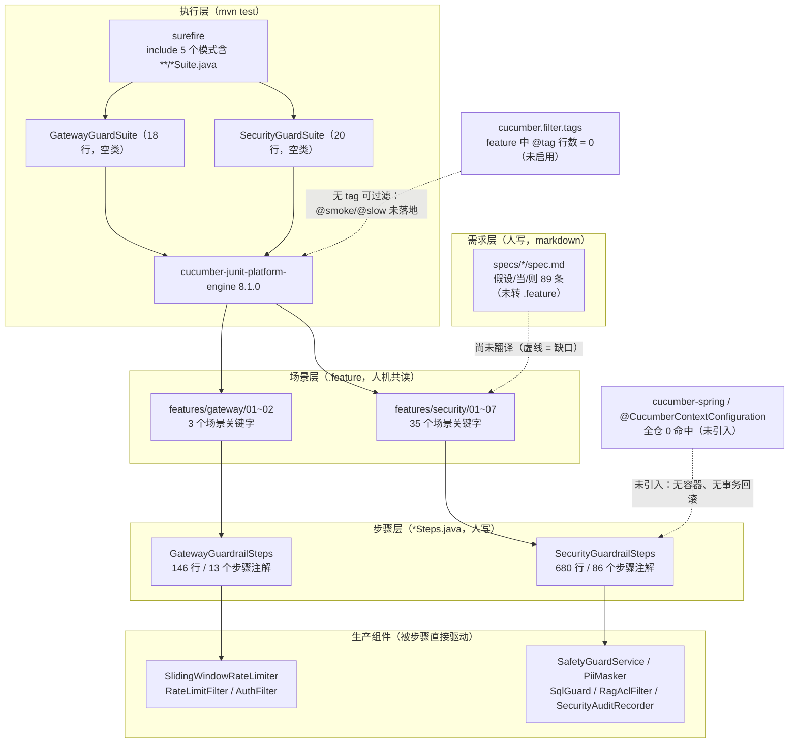
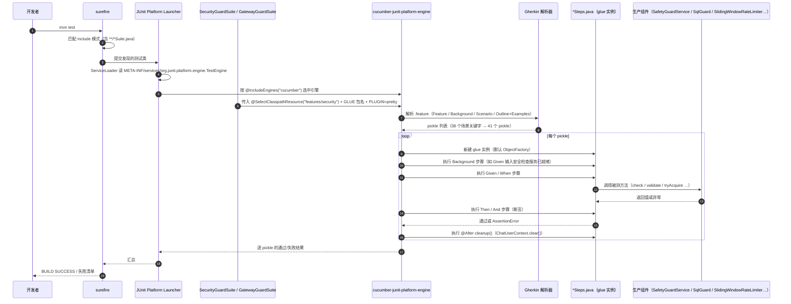

# Cucumber BDD 实战：步骤定义只表达业务意图，Gherkin 才不会退化成接口测试

> **一句话结论**：BDD 的价值全部压在「步骤定义」这一层——`.feature` 只写业务意图，`*Steps.java` 把意图翻译成对生产组件的可观测断言；一旦 Gherkin 里出现 `429`、`LIMIT 100`、`138****5678` 这类实现细节，或 glue 里用 `if (某字段非空)` 猜当前跑的是哪个场景，BDD 就退化成一套「用中文写用例名的接口测试」，此时绿灯只证明代码没崩，不证明业务对。
> **阅读前置**：会写 JUnit 5 测试、知道 `mvn test` 里 surefire 干什么；读过 [01-JUnit5与Mockito单元测试.md](01-JUnit5与Mockito单元测试.md)；对 Gherkin 无要求（本篇从 `Feature:`/`Given` 讲起）。
> **证据基线**：版本基线 JDK 17、Spring Boot 4.2.0、Cucumber 8.1.0（`io.cucumber:cucumber-java` / `cucumber-junit-platform-engine`，见 `ai-cs-chat/pom.xml#L188-L196`）。A 级 5 个类 / 12 处锚点（Spring TestContext 框架摘录，用于解释 `cucumber-spring` 复用的机制）；B 级 15 个真实文件路径 / 27 处引用（9 个 `.feature`、2 个 `*Steps.java`（680 + 146 行）、2 个 `*Suite.java`、2 个 `pom.xml`，另有 `specs/*/spec.md` 抽样）；C 级 5 组可复现命令（feature/glue 静态统计、jar 内服务发现文件、Cucumber 常量与 DataTable API 探测，不启动服务、不构建）。预计阅读 55 分钟。

**证据边界（先说清楚哪些查得到、哪些查不到）**

| 级别 | 来源 | 覆盖什么 | 本篇的处理 |
|---|---|---|---|
| A | `learning-docs/24-源码分析/assets/source/`（905 份摘录，Spring / Spring Security / Spring AI 为主） | Spring TestContext 框架：`TestContextManager`、`DefaultCacheAwareContextLoaderDelegate`、`MergedContextConfiguration`、`SpringExtension` | Cucumber 引擎源码**未入库**，一律写「未入库，不编行号」；只把 Spring 侧的机制逐行引用，用于说明 `cucumber-spring` 到底复用了什么 |
| B | 本仓库真实文件 | 9 个 `.feature`、2 个 `*Steps.java`（680 + 146 行）、2 个 `*Suite.java`、2 个 `pom.xml`、5 个 `spec.md` | 逐条给路径 + 行号，行号均用 `read` 工具核对 |
| C | 可复现静态探测 | feature/scenario/pickle/步骤行计数、glue 使用率与死步骤、依赖版本、jar 内服务发现文件、Cucumber 常量真实取值 | 给完整命令 + 真实输出 + 「怎么读」 |

本机探测边界：`mvn` 未执行（任务禁止构建），因此**本篇没有任何「跑了几个场景、耗时多少、几条失败」的运行时数字**；凡涉及「某个场景会红/会绿」的判断，一律标注依据或明确写「未本机实测」。所有中文 `.feature` / `.java` 原文都用 `read` 工具取得（pwsh 控制台按 GBK 输出会乱码，见 §6.2）。

---

## 0. 先看现象

三段都是真实文件原文与本机真实命令输出——不是运行日志，也不是我编的异常栈。

### 现象一：场景名承诺了三件事，断言只证了一件

`ai-cs-gateway/src/test/resources/features/gateway/01_rate_limit.feature` L6-L11：

```gherkin
Scenario: 窗口内超限返回限流
  Given 限流窗口为 60 秒内最多 60 次
  When 同一用户已发起 60 次请求
  And 该用户再次发起第 61 次请求
  Then 第 61 次请求被限流
  And 返回 429 提示且不转发下游
```

对应的步骤定义在 `ai-cs-gateway/src/test/java/com/aics/gateway/guardrail/GatewayGuardrailSteps.java` L67-L71：

```java
@And("返回 429 提示且不转发下游")
public void assert429NotForwarded() {
    // 限流器拒绝即过滤器返回 429 且不调用下游（映射逻辑由 RateLimitFilterTest 覆盖）
    assertEquals(true, limited);
}
```

`limited` 是上一句 `limited = !limiter.tryAcquire(...)` 的结果（同文件 L57-L60）。也就是说：Gherkin 承诺「返回 429」「有提示体」「不转发下游」三件事，glue 只证了「限流器说不让过」。真正的 429 响应体在 `ai-cs-gateway/src/main/java/com/aics/gateway/filter/RateLimitFilter.java` L94-L100，而这段代码 BDD 一次都没执行到。

### 现象二：89 条业务验收场景，一条都没变成 `.feature`

本机真实命令与输出（C 级，口径见 §6.5）：

```powershell
cd D:\Projects\Persion\ai-customer-service
$files = Get-ChildItem -Recurse -Path specs -Include *.md
$rows  = $files | Select-String -Pattern '^\s*\d+\.\s*\*\*假设\*\*'
"specs md 文件数: {0}" -f $files.Count
"『**假设**…**当**…**则**』验收场景条数: {0}" -f $rows.Count
$rows | Group-Object Path | Sort-Object Count -Descending | Select-Object -First 12 |
  ForEach-Object { "{0,-60} {1}" -f ($_.Name -replace 'D:\\Projects\\Persion\\ai-customer-service\\',''), $_.Count }
($rows | Select-String -Pattern '(?i)feature|gherkin' | Measure-Object).Count
```

```text
specs md 文件数: 41
『**假设**…**当**…**则**』验收场景条数: 89
涉及文件数: 5
specs\005-after-sales-agent\spec.md                          29
specs\003-rag-advanced-features\spec.md                      21
specs\002-rag-quality-upgrade\spec.md                        17
specs\001-cart-checkout\spec.md                              14
specs\004-vlm-multimodal\spec.md                             8
0
```

**怎么读**：89 条验收场景全是中文「**假设**…**当**…**则**」，语义上已经是 Given-When-Then，但最后一行 `0` 表示这些行里出现 `feature` / `gherkin` 关键词的次数为 0——**没有一条被翻译成可执行场景**。例如 `specs/005-after-sales-agent/spec.md#L54-L56`：「1. **假设** 用户提供了订单号且属于当前用户，**当** 调用订单工具，**则** 返回该订单详情，状态机进入规则校验」。

### 现象三：7 个 Feature 共用一套可变字段，`Then` 靠「哪个字段非空」猜场景

`ai-cs-chat/src/test/java/com/aics/chat/security/guardrail/SecurityGuardrailSteps.java` L154-L163：

```java
@Then("返回拦截结果")
public void assertBlocked() {
    if (safetyResult != null) {
        assertFalse(safetyResult.passed(), "应拦截: " + inputText);
    } else if (contentResult != null) {
        assertFalse(contentResult.passed(), "应拦截: " + inputText);
    } else {
        fail("应先执行检查");
    }
}
```

同一个类 L104-L116 声明了 11 个场景状态字段（`inputText`、`safetyResult`、`contentResult`、`sqlText`、`validateResult`、`aclResult` …），7 个 Feature 的 35 个场景关键字全在这套字段上滚动赋值。同类里 hook 只有 L118-L121 一个 `@After`：

```java
@After
public void cleanup() {
    ChatUserContext.clear();
}
```

全仓 **0 个 `@Before`**（C 级，见 §3.6）。这意味着场景之间的隔离实际靠「每个 `@Given` 自己 `new` 出组件」+「`@After` 清一个 ThreadLocal」两件事维持，任何一个新场景少写一句初始化，就会读到上一个场景留下的 `safetyResult`，而 `if (safetyResult != null)` 这个分支**恰好会把它当成当前场景的结果**——断言通过，语义错位。

> 这些现象指向同一件事：**这批 Gherkin 只写到了「单词级业务意图」，而步骤定义里塞满了组件装配、mock 编排和猜测式分支，两者之间缺了「业务可观测结果」这一层**。缺了这一层，`.feature` 就从需求契约退化成测试代码的中文注释：改一句话术要动三处（feature 文本、注解字符串、方法体），于是没人再改；断言写得比场景名窄，于是绿灯不代表业务对。

---

## 1. 整体地图



> **读图说明**：盯三处。① 实线 `F1 --> G1`：`.feature` 的步骤文本会被**逐字**拿去和 `@Given("…")` 的字符串比对，对不上就是 undefined 步骤——本篇一半的坑都出在这条边上。② 虚线 `SPEC -.-> F1`：虚线表示「当前不存在」，89 条验收场景与 41 个可执行用例零交集，这是本项目 BDD 最大的落地缺口。③ `SF --> S1 --> ENG`：如果你把它误读成「把 `.feature` 放进 `resources` 就会自动执行」，会得出完全错误的结论——真正让场景跑起来的是一条 `*Suite.java` 空类（`@Suite` + `@IncludeEngines("cucumber")` + glue 包名），少了它，41 个用例一个都不执行，而 `mvn test` 依然是 BUILD SUCCESS。

### 组件、责任与参与方

| 组件 | 责任 | 本项目落地（B 级证据） | 状态 |
|---|---|---|---|
| 需求验收场景 | 说清「什么算做完了」 | `specs/005-after-sales-agent/spec.md` 等 5 个文件共 89 条 | **未落地**为 `.feature` |
| Feature 文件 | 用 Gherkin 写业务意图 | `ai-cs-chat/src/test/resources/features/security/*.feature`（7 个）、`ai-cs-gateway/src/test/resources/features/gateway/*.feature`（2 个） | 已落地 |
| 步骤定义 glue | 把意图翻译成对生产组件的断言 | `SecurityGuardrailSteps.java`（680 行）、`GatewayGuardrailSteps.java`（146 行），共 99 个步骤注解 | 已落地，但断言强度不均（§3.7） |
| Suite 入口 | 让 JUnit Platform 发现 Cucumber 引擎 | `SecurityGuardSuite.java`、`GatewayGuardSuite.java` | 已落地 |
| 引擎 | 解析 Gherkin → pickle → 调 glue | cucumber 8.1.0（`ai-cs-chat/pom.xml#L188-L196`、`ai-cs-gateway/pom.xml#L74-L81`） | 已落地 |
| 被驱动的组件 | 提供真实业务行为 | `SafetyGuardService`、`SqlGuard`、`PiiMasker`、`RagAclFilter`、`SecurityAuditRecorder`、`OrderLocatorTool`、`AgentToolRegistry`、`SlidingWindowRateLimiter`、`AuthFilter` | 已落地（对象级，无容器） |
| Spring 容器接入 | 场景间共享 `ApplicationContext` | `cucumber-spring` / `@CucumberContextConfiguration` 全仓 0 命中 | **未落地**（§3.8 给替代方案） |
| 标签分层 | 按 `@smoke` / `@slow` 选择性执行 | feature 中 `@` 开头的 tag 行数 = 0 | **未落地**（§3.10） |
| CI 执行 | 每次提交跑一遍场景 | `.github/workflows/` 仅 `python-learning-validate.yml`，8 个 Java 服务均不在 CI | **未落地** |

---

## 2. 关键概念与关键类

先把术语一次性解释清楚，后文不再重复：

- **Gherkin**：`.feature` 文件用的业务语言，关键字有 `Feature` / `Background` / `Scenario` / `Scenario Outline` + `Examples` / `Given` `When` `Then` `And` `But` / `|表格|` / `"""文档字符串"""` / `@tag`。
- **pickle**：Gherkin 解析后的**可执行用例**。一个 `Scenario` 产出 1 个 pickle；一个 `Scenario Outline` 的每一行 `Examples` 各产出 1 个 pickle。本项目 38 个场景关键字 → 41 个 pickle（37 个 Scenario + Outline 的 4 行数据）。
- **glue（胶水层）**：装了 `@Given/@When/@Then/@And` 注解的 Java 类所在包。Cucumber 只用 `cucumber.glue` 指定的包去匹配步骤文本。
- **Cucumber Expression**：步骤里的 `{string}` `{int}` `{long}` `{word}` 占位符，运行时按类型转换并注入方法参数；自定义类型用 `@ParameterType` 声明正则。
- **Hook**：`@Before` / `@After` 标注的方法，在每个 pickle 前后执行，`order` 属性控制顺序。
- **ObjectFactory**：决定「glue 类实例怎么创建」的策略；默认每个场景新建实例（`cucumber.object-factory`），换成 `cucumber-spring` 就改由 Spring 容器创建。
- **对象级 BDD**：步骤直接 `new` 出被测类、用 Mockito 假掉外部依赖，只验对象行为，不起容器。
- **容器级 BDD**：步骤走真实 HTTP / WebFlux 管道、真实 Bean 装配，验跨组件契约。

| 名称 | 位置 | 角色 | 关键方法 / 关键行 |
|---|---|---|---|
| `SecurityGuardSuite` | `ai-cs-chat/src/test/java/com/aics/chat/security/guardrail/SecurityGuardSuite.java` | Cucumber 入口（JUnit Platform Suite） | `@Suite`、`@IncludeEngines("cucumber")`、`@SelectClasspathResource("features/security")`、`GLUE_PROPERTY_NAME = com.aics.chat.security.guardrail`（L14-L18） |
| `GatewayGuardSuite` | `ai-cs-gateway/src/test/java/com/aics/gateway/guardrail/GatewayGuardSuite.java` | 同上（gateway 侧） | 同上，资源 `features/gateway`、glue 包 `com.aics.gateway.guardrail` |
| `SecurityGuardrailSteps` | `ai-cs-chat/src/test/java/com/aics/chat/security/guardrail/SecurityGuardrailSteps.java` | 35 个场景的步骤定义 | `@ParameterType list()`（L76-L89）、`@After cleanup()`（L118-L121）、`@Then("返回拦截结果")`（L154-L163） |
| `GatewayGuardrailSteps` | `ai-cs-gateway/src/test/java/com/aics/gateway/guardrail/GatewayGuardrailSteps.java` | 3 个场景的步骤定义 | `@Given("限流窗口为 {int} 秒内最多 {int} 次")`（L43-L48）、`@And("返回 429 提示且不转发下游")`（L67-L71） |
| `SafetyGuardService` | `ai-cs-chat/src/main/java/com/aics/chat/agent/safety/SafetyGuardService.java`（125 行） | 输入 Guardrail 判定 | `check(String input)`（L93）；内置规则 `BUILTIN_RULES`（L30）、`COMPACT_PHRASES`（L45） |
| `SqlGuard` | `ai-cs-chat/src/main/java/com/aics/chat/security/SqlGuard.java`（326 行） | NL2SQL 多道防线 | `validate(String database, String sql)`（L83，**通过返回 null**）、`enforceLimit(String sql, int maxRows)`（L203） |
| `PiiMasker` | `ai-cs-chat/src/main/java/com/aics/chat/util/PiiMasker.java`（137 行） | PII 脱敏 | `mask(String text)`（L78）；`PHONE`（L33）、`ID_CARD`（L45）、`BANK_CARD`（L56） |
| `RagAclFilter` | `ai-cs-chat/src/main/java/com/aics/chat/security/RagAclFilter.java`（90 行） | 检索期 ACL 过滤 | `filter(...)` |
| `SecurityAuditRecorder` | `ai-cs-chat/src/main/java/com/aics/chat/security/SecurityAuditRecorder.java`（118 行） | 安全事件留痕 | `record(...)` / `recentEvents()` |
| `SlidingWindowRateLimiter` | `ai-cs-gateway/src/main/java/com/aics/gateway/filter/SlidingWindowRateLimiter.java`（55 行） | 滑动窗口判定 | `tryAcquire(String key, int maxRequests, int windowSeconds)`（L27） |
| `RateLimitFilter` | `ai-cs-gateway/src/main/java/com/aics/gateway/filter/RateLimitFilter.java`（109 行） | 429 响应与不转发 | `filter(...)`（L51）、`tooManyRequests(...)`（L94-L100）、`getOrder()` = `HIGHEST_PRECEDENCE + 150`（L107） |
| `TestContextManager` | `[[源码:TestContextManager.java.md#L140-L145]]`（A 级） | `cucumber-spring` 复用的上下文入口 | 构造时 `buildTestContext()` + 注册 `TestExecutionListener` |
| `DefaultCacheAwareContextLoaderDelegate` | `[[源码:DefaultCacheAwareContextLoaderDelegate.java.md#L154-L175]]`（A 级） | 容器缓存：同一个 key 只建一次上下文 | `loadContext(MergedContextConfiguration)` |

---

## 3. 原理与证据逐段精读

### 3.1 Gherkin 五要素：先把「写在哪一层」定下来

```gherkin
Feature: 06 SQL 安全（NL2SQL）
  作为系统
  我想要在 NL2SQL 执行前做多道防线校验
  以便模型生成的 SQL 无法读写、拖库或拖慢数据库

  Background:
    Given SQL 安全守卫已就绪

  Scenario Outline: 危险载荷被拒绝
    Given 模型生成的 SQL 为 "<sql>"
    When 执行 SQL 安全校验
    Then 返回校验不通过

    Examples:
      | sql                                          |
      | SELECT * FROM orders -- 注释绕过             |
      | SELECT SLEEP(10) FROM orders                 |
      | SELECT * INTO OUTFILE '/tmp/x' FROM orders   |
      | SELECT * FROM orders; DROP TABLE orders      |
```

（`ai-cs-chat/src/test/resources/features/security/06_sql_safety.feature` L1-L49）

**在干什么**：`Feature` + 三行「作为/我想要/以便」写清**为什么需要这个能力**；`Background` 写所有场景共用的前置；`Scenario` 写一条独立可判定的行为；`Scenario Outline` + `Examples` 用一张表把一个行为展开成多组数据。

**为什么这么设计**：Gherkin 的每个关键字都对应一个**责任边界**。`Background` 存在的意义是消除「每个场景都重复 3 行前置」的噪音；`Examples` 存在的意义是「同一逻辑换数据」而不是「复制 4 个 Scenario」。这两者的共同前提是：**放进去的东西必须是业务语言**。本项目 `Background` 用的是 `Given SQL 安全守卫已就绪`、`Given 输入安全检查服务已就绪`——这是业务里的「服务可用」状态，不是 `new SqlGuard()`，写对了。

**换写法会怎样**：如果把 `Background` 写成 `Given 初始化 SqlGuard 且 sqlDatabase=order`，那么 7 个 Feature 的 `Background` 就会各自绑定一个类名，重构 `SqlGuard` 时全部 41 个 pickle 一起变红；反过来，如果把 `Examples` 拆成 4 个 `Scenario`，步骤行会从 167 涨到 180 左右，而维护点从 1 处变 4 处。

**常见坑**：本项目 9 个 `.feature` 里 `Scenario Outline` 只有 1 个、表格行只有 5 行（表头 + 4 行数据）、`@tag` 行 **0** 个、`"""文档字符串"""` **0** 个（C 级实测，见 §6.5）。也就是说 Gherkin 的五要素里，`Examples`、`Tag`、`DocString` 基本没用起来——不是语法不允许，而是没形成习惯，于是每个新场景都靠复制粘贴长大（步骤文本重复率 25.1%，§3.10）。

### 3.2 Given-When-Then 的语义约束

**在干什么**：`Given` 描述**已经成立的事实**（世界状态），`When` 描述**被测的那一次动作**（只允许一次），`Then` 描述**可观测的结果**（用户/系统能看到的东西）。`And` / `But` 只是续写上一个关键字，不引入新语义。

**为什么这么设计**：三段的划分不是为了好看，而是为了让**失败定位**变成机械动作：`Given` 红了是夹具问题，`When` 红了是被测代码抛异常，`Then` 红了才是业务行为不符。一旦 `When` 里塞两个动作，`Then` 红了你就不知道是哪个动作干的。

**换写法会怎样**：把 `Given` 写成动作句（「Given 用户点击提交」），`When` 写成状态句（「When 订单已存在」），场景就变成了时序脚本，读的人无法区分「准备」与「被验」。本项目里有一处真实的反例：`05_rag_acl.feature` L12 的 `And 检索结果包含文档 "doc-secret" 和 "doc-public"` 挂在 `Given` 段里——它其实是**往夹具里塞检索结果**，属于「准备数据」，位置没错；但它的写法把 `List<Document>` 的形状搬进了业务语言（要写文档 id、还要写两个 id 用「和」连接），这就是 Gherkin 退化成接口测试的第一种形态。

**常见坑**：三个具体错法在本仓库都能找到实例。
① **Then 里写协议细节**：`01_rate_limit.feature` L11 `And 返回 429 提示且不转发下游`——`429` 是 HTTP 状态码，属于传输层；业务意图应是「被限流且请求没有打到下游服务」。
② **Given 是空壳**：`SecurityGuardrailSteps.java` L199-L202 的 `@Given("订单 {word} 归属于 userId={long}")` 方法体是空的（只有一行注释「仅记录归属（测试数据用）」），而 `02_tool_authorization.feature` L11 正是靠它声明「订单 ORD10002 归属于 userId=2」。这条 Given 写了等于没写（§6.4）。
③ **When 重复**：`Background` 已经给了前置，`Scenario` 里又写一遍 `Given 当前用户 userId=1`，两份事实不一致时以谁为准没有任何机制保证。

### 3.3 步骤定义的分层：业务步骤 vs 技术步骤

**在干什么**：同一个 glue 类里其实混着两种步骤——**业务步骤**（`When 用户要求查询订单 ORD10002`、`Then 订单定位工具拒绝该请求`）和**技术步骤**（`Given 库 "order" 的表白名单为 ["orders"]`、`When 执行强制行数上限`）。前者描述业务，后者描述实现。

**为什么这么设计**：分层的判据只有一条——**这句话能不能被产品/测试同学在不懂代码的情况下判真假**。能，就是业务步骤，它必须留在 `.feature` 里并且断言要硬；不能，就是技术步骤，它应该被业务步骤**吸收**（在 glue 里做掉），而不是出现在 Gherkin 里。

**换写法会怎样**：`06_sql_safety.feature` L20-L23 的场景是业务语言（「无 LIMIT 时强制追加且限行数」→「自动追加 "LIMIT 100"」），而后半句 `LIMIT 100` 是**实现常量**。如果哪天行数上限从 100 改成 200，业务意图（「必须限行」）没变，场景却要改，且 4 个 Outline 数据行里没有一行覆盖「上限值本身」这个语义。反过来，把这条写成 `Then 查询结果行数不超过系统上限` 并把 100 留在 glue 的常量里，业务意图就与实现解耦了。

**常见坑**：本仓库 99 个步骤注解里（C 级实测：`SecurityGuardrailSteps` 86 个 + `GatewayGuardrailSteps` 13 个），技术步骤的典型后果是**被复用后语义漂移**。例如 `@Then("返回校验不通过")`（L572-L575）只做 `assertNotNull(validateResult)`，被 6 个场景复用；其中 `06_sql_safety.feature` L9-L13、L25-L30、L32-L37 三处显式补了 `And 拒绝原因为"…"` 才验证文案，而 L15-L18「系统库探测被拒绝」和 Outline 的 4 行数据**只验了「不为 null」**——一条 UPDATE 语句和一条 `SELECT SLEEP(10)` 被拒的原因完全不同，现在只要「有任何字符串返回」就算通过。

### 3.4 参数化：Cucumber Expression 与 `@ParameterType`

**在干什么**：把步骤里的变量抽出来。`{string}` 走引号字符串，`{int}`/`{long}`/`{word}` 走类型转换，自定义类型用 `@ParameterType` 声明正则，然后在表达式里用 `{list}`。

**为什么这么设计**：Cucumber Expression 的目标是「让业务同学读得懂参数」，所以它刻意只支持有限几种占位符；需要更强表达力时用「正则步骤定义」（`@Given("^…$")`）或自定义参数类型。本项目选了后者：

```java
@ParameterType("\\[[^\\]]*\\]|\\S+")
public List<String> list(String value) {
    String v = value == null ? "" : value.trim();
    if (v.startsWith("[") && v.endsWith("]")) {
        v = v.substring(1, v.length() - 1).trim();
    }
    if (v.isEmpty()) {
        return List.of();
    }
    return java.util.Arrays.stream(v.split(","))
            .map(String::trim)
            .map(e -> e.replaceAll("^\"|\"$", ""))
            .toList();
}
```

（`SecurityGuardrailSteps.java` L76-L89）

这段让 `Given 库 "order" 的表白名单为 ["orders"]` 能直接注入 `List<String>`，两个正则分支分别吃掉 `["a", "b"]` 与 `a,b` 两种写法。

**换写法会怎样**：若不用 `@ParameterType` 而用 `@Given("^库 \"(.+)\" 的表白名单为 (.+)$")`，表达式里的中英文混排与 `"` 转义会变得极难维护（本项目就踩过：`@And("返回\"不存在或不属于当前用户\"而不是订单数据")`，L220，字符串里带转义引号，静态扫描时若不先反转义会把这条判成死步骤，§6.1）；若把白名单硬编码进 glue，`06_sql_safety` 的 5 个场景就失去了「换一套白名单再跑一遍」的能力。

**常见坑**：参数化最容易被忽视的是**占位符被用成装饰**。`@Then("第 {int} 次请求被限流")`（`GatewayGuardrailSteps.java` L62-L65）里的 `count` 只出现在失败消息里（`"第 " + count + " 次请求应被限流"`），断言本身与它无关；`@And("该用户再次发起第 {int} 次请求")`（L57-L60）同理。这类 `{int}` 让人以为「第 N 次」是被验证的，实际上 N 从未参与任何计算或比较。

### 3.5 表格：`Examples` 与 `DataTable` 的分工

**在干什么**：`Examples` 是**场景级**表格——每个数据行各产出一个 pickle、独立报红独立报绿；`DataTable` 是**步骤级**表格——一次执行里把多行数据喂给一个步骤。

**为什么这么设计**：两者解决的问题不同。`Examples` 回答「同一行为在多组数据下都成立吗」；`DataTable` 回答「这一次动作需要一批结构化输入吗」。代价也不同：`Examples` 让用例数膨胀（4 行数据 = 4 个 pickle，全项目 41 = 37 + 4）；`DataTable` 不增加用例数，但**只有一组断言覆盖全部行**，失败时定位更粗。

`DataTable` 的 API 可以从 jar 里直接看到（C 级，`javap` 输出节选）：

```powershell
$dt = (Get-ChildItem "$env:USERPROFILE\.m2\repository\io\cucumber\datatable" -Recurse -Filter 'datatable-*.jar' | Select-Object -Last 1).FullName
javap -classpath $dt io.cucumber.datatable.DataTable | Select-Object -First 14
```

```text
Compiled from "DataTable.java"
public final class io.cucumber.datatable.DataTable {
  public static io.cucumber.datatable.DataTable create(java.util.List<java.util.List<java.lang.String>>);
  public static io.cucumber.datatable.DataTable create(java.util.List<java.util.List<java.lang.String>>, io.cucumber.datatable.DataTable$TableConverter);
  public static io.cucumber.datatable.DataTable emptyDataTable();
  public io.cucumber.datatable.DataTable$TableConverter getTableConverter();
  public void diff(io.cucumber.datatable.DataTable) throws io.cucumber.datatable.TableDiffException;
  public void unorderedDiff(io.cucumber.datatable.DataTable) throws io.cucumber.datatable.TableDiffException;
  public java.util.List<java.lang.String> values();
  public java.util.List<java.lang.String> asList();
  public <T> java.util.List<T> asList(java.lang.Class<T>);
  public <T> java.util.List<T> asList(java.lang.reflect.Type);
  public java.util.List<java.util.List<java.lang.String>> asLists();
```

**怎么读**：`asLists()` 给出「按行分组的字符串表」，`asList(Class)` 直接转成对象列表，`diff` / `unorderedDiff` 是「整表比对」——这三个方法覆盖了大多数 DataTable 用法。注意它是 `final class` 且没有公开构造器，只能 `create(...)` 造，说明设计意图是「由引擎解析 Gherkin 生成，不由用户自己拼」。

**常见坑**：本项目**零 DataTable 使用**（表格行只有 `Examples` 那 5 行）。后果是「一组相关数据」只能写成多个步骤：`06_sql_safety.feature` L52-L54 的白名单要写两行（表白名单一行、列白名单一行），若库多起来会线性膨胀。什么时候该换成 DataTable？当数据是**一次动作的入参**（如「批量导入 3 条规则」）而不是**同一行为的多个用例**时。

### 3.6 hooks 与状态清理：`@Before` / `@After` 到底该干什么

**在干什么**：hook 在每个 pickle 前后跑。默认 object factory 下，**每个场景都 new 一个新的 glue 实例**，所以实例字段天然是「场景隔离」的——这是 Cucumber 与 JUnit 类级生命周期最大的区别，也是 hooks 存在的理由：清理**实例之外**的东西（ThreadLocal、临时文件、数据库行、mock server）。

**为什么这么设计**：把「逐场景的脏东西」集中到一处，避免每个 `Then` 结束后各自清。`@Before` / `@After` 都有 `value`（标签表达式，可只对 `@smoke` 生效）、`name`（报告里显示的名字）、`order`（顺序）三个属性（C 级，`javap io.cucumber.java.Before` 输出：`String value(); String name(); int order();`）。

**换写法会怎样**：本项目全仓只有 1 个 hook：

```java
@After
public void cleanup() {
    ChatUserContext.clear();
}
```

（`SecurityGuardrailSteps.java` L118-L121）

它清的 `ChatUserContext` 是**静态 ThreadLocal**（用户身份），确实必须每场景清；但因为**没有任何 `@Before`**，每个场景的组件装配都写在 `@Given` 里各自 `new`（对照 L134-L137 `safetyService = new SafetyGuardService();`、L188-L192 `recorder = newRecorder(); toolAuthorizationService = new ToolAuthorizationService(...)`）。这在「实例字段」维度是安全的（新实例 = 空字段），代价是**同一个对象被三个场景复用时会互相污染**：`recorder = newRecorder()` 在 L190 和 L206 各出现一次，谁先谁后由步骤顺序决定。

**常见坑**：把 hook 当成「初始化数据库」的垃圾桶。一旦引入 `@Before` 去 `new` 全部组件，就会与 `@Given("…已就绪")` 的语义重复，出现「到底谁负责装配」的二义性；正确做法是二选一——要么全部交给 `@Before`（业务步骤只表达状态），要么全部交给 `@Given`（hook 只清 ThreadLocal，就像本项目现在这样），但必须**写进文档约定**，否则下一个人会两种都加。

### 3.7 断言强度：`Then` 必须断言业务可观测结果

**在干什么**：`Then` 的职责是把业务结果变成一个可失败的布尔判断。强度从弱到强大致是：`assertNotNull`（有东西返回）< `assertTrue(contains(...))`（部分匹配）< `assertEquals`（精确相等）< 结构化比对（对象/整表 diff）。

**为什么这么设计**：BDD 的「行为契约」只有在能失败时才有约束力。一条永远为真的断言不是契约，是注释。

**换写法会怎样**：本仓库能读到三档强度的真实样本。
① 最弱：`@Then("返回校验不通过")` → `assertNotNull(validateResult, ...)`（L572-L575）；
② 中等：`@Then("结果为 {string}")` → `assertTrue(maskedText.contains(expected))`（L333-L336），用 `contains` 而不是 `equals`，所以 `138****5678` 命中「…138****56789…」也照样绿；
③ 最强：`@And("返回\"不存在或不属于当前用户\"而不是订单数据")` → 同时断言 `message().contains(...)` 且 `data() == null`（L220-L224）。

同一个类里三档并存，说明断言的强弱是**按作者当时心情**决定的，而不是按业务重要性。`03_pii_masking.feature` 的 6 个场景全是「精确期望值」（`138****5678`、`110101********771X`、`411111********1111`），本该配 `assertEquals`，却走了 `contains`。

**常见坑**：`Then` 里写 `if`/`else`。`@Then("返回拦截结果")`（L154-L163）和 `@Then("返回放行结果")`（L170-L179）都用「哪个结果字段非空就断言哪个」的分支猜测当前场景。这让**判定权从 Gherkin 搬进了 Java**：场景名说「违规输出被拦截」，代码实际做的是「随便哪个检查结果不为空、且它自己说不通过，就算过」。更隐蔽的是 `@And("输入进入意图识别流程")`（L181-L184）——方法体只有 `assertTrue(safetyResult.passed())`，与上一句 `Then 返回放行结果` 断言的是同一个布尔值，属于纯冗余步骤；它给人的印象是「意图识别被验证了」，而实际上 chat 侧的意图识别没有被任何 BDD 场景触及。

### 3.8 Cucumber + Spring：`cucumber-spring` 到底做了什么，本项目为什么没用

**在干什么**：`cucumber-spring` 提供的是一个 **ObjectFactory 实现**：glue 类不再由 Cucumber 的默认工厂 `new` 出来，而是由 Spring 容器创建并注入依赖——顺带把「同一个 `ApplicationContext` 在多个场景间复用」这件事交给 Spring TestContext 框架。

**为什么这么设计**：BDD 场景天然是「一个场景一次执行」的粒度，如果每场景都起一次 Spring 容器，几十个场景就是几十次上下文刷新（真实项目里单次刷新数百毫秒到数秒），跑一轮就失去意义。Spring TestContext 框架早就解决过这个问题——它就是 `@SpringBootTest` 能在一轮测试里只刷一次容器的原因：

- 入口是 `TestContextManager`，构造时先 `buildTestContext()` 再注册一批 `TestExecutionListener`：`[[源码:TestContextManager.java.md#L140-L145]]`，取当前上下文时走的是 `testContextHolder.get()`（ThreadLocal 副本）：`[[源码:TestContextManager.java.md#L156-L160]]`。
- 上下文的**建与缓存**在 `DefaultCacheAwareContextLoaderDelegate#loadContext`：先 `contextCache.get(mergedConfig)`，命中就直接返回，未命中才 `contextCache.put(...)` 真正建容器，并对加载失败累计计数：`[[源码:DefaultCacheAwareContextLoaderDelegate.java.md#L154-L175]]`。
- 缓存键是 `MergedContextConfiguration`，它的 `equals`（`[[源码:MergedContextConfiguration.java.md#L501]]`）与 `hashCode`（`[[源码:MergedContextConfiguration.java.md#L554]]`）决定了「两批测试能不能共用同一个容器」。`TestContext` 也是拿着这份 merged 配置去 build 的：`[[源码:AbstractTestContextBootstrapper.java.md#L122-L125]]`。
- JUnit 5 侧把生命周期事件转给这个 manager 的是 `SpringExtension`：`beforeAll` → `testContextManager.beforeTestClass()`（`[[源码:SpringExtension.java.md#L226-L230]]`），`postProcessTestInstance` → `testContextManager.prepareTestInstance(testInstance)`（`[[源码:SpringExtension.java.md#L252-L261]]`），后者才是「把依赖注入进测试实例」的那一步。

`cucumber-spring` 复用的正是上面这套机制（它的 `SpringFactory` 也是持有一个 `TestContextManager` 并在场景前后调对应方法）。**注意证据边界**：`cucumber-spring` 的源码不在本仓库 `assets/source/` 里（Cucumber 引擎未入库），所以上面四段引用的是 Spring 侧的机制，不是 Cucumber 侧的行号；「`cucumber-spring` 内部如何调用」这一句属于依据 Spring TestContext 机制的推断，**未本机逐行核对**。

**换写法会怎样**：本项目 **`cucumber-spring` / `@CucumberContextConfiguration` 全仓 0 命中**（C 级，§6.5），走的是「手装配」路线：每个 `@Given` 里 `new` 生产组件、用 `mock(...)` 假掉外部 Feign：

```java
@When("用户要求查询订单 {word}")
public void queryOrder(String orderNo) {
    recorder = newRecorder();
    OrderFeignClient feign = mock(OrderFeignClient.class);
    // 本人（userId=1）订单列表：只有自己的订单，不包含他人订单
    when(feign.listOrders(1L)).thenReturn(Result.success(List.of(ownPaidOrder())));
    orderLocatorTool = new OrderLocatorTool(feign, recorder);
    locateResult = orderLocatorTool.locate(orderNo);
}
```

（`SecurityGuardrailSteps.java` L204-L212）

手装配的**收益**是零容器成本、步骤可读（能看见依赖是谁）、不依赖 `@SpringBootTest` 的配置加载；**代价**是：没有容器就没有 `TestExecutionListener` 提供的**事务回滚**，脏数据必须自己清；`@ConfigurationProperties` 的真实绑定不会被验证（本项目 `SecurityProperties props = new SecurityProperties()` 是字段直 new，L93，白名单靠 L592-L600 手动 `put`）；一旦被测类将来需要真实 Bean 协作，手装配会瞬间膨胀成「在 glue 里写一个迷你 Spring」。

**常见坑**：如果将来引入 `cucumber-spring`，三件事必须同时改，否则会出现「注解生效但注入为空」的假象：① `@CucumberContextConfiguration` 必须落在一个**被 glue 扫描到**的配置类上；② 该配置类上的 `@SpringBootTest` 会决定 `MergedContextConfiguration` 的 key，改 profile 就等于换容器；③ 场景级 `@Transactional` 的默认回滚前提是走 Spring 的 listener——手装配路线下写了也不回滚。

### 3.9 对象级 BDD 与容器级 BDD

**在干什么**：对象级 BDD 只驱动「一个类/一组类」，外部依赖用 mock；容器级 BDD 驱动「一条真实请求链路」，包括过滤器链、序列化、路由。

**为什么这么设计**：两者的失败信息完全不同。对象级红了，你立刻知道是哪个方法；容器级红了，你只知道「这个 URL 的行为不对」，但能发现对象级永远发现不了的问题——过滤器顺序、`MockServerWebExchange` 里的 header 变形、`GlobalFilter` 的短路。

**换写法会怎样**：本项目 9 个 feature 里，8 个是纯对象级（`new SafetyGuardService()` 直接调 `check`），只有 gateway 的 `02_trusted_identity.feature` 沾了容器级的边——它用 `MockServerWebExchange` + `mock(GatewayFilterChain)` 捕获下游拿到的 exchange：

| 维度 | 对象级（本项目主体） | 容器级（`02_trusted_identity` 半步） |
|---|---|---|
| 步骤驱动什么 | `SafetyGuardService#check`、`SqlGuard#validate`、`PiiMasker#mask` | `AuthFilter` 走 `MockServerWebExchange`，捕获下游 `exchange` |
| 能发现什么 | 判定逻辑、正则、边界值 | 过滤链顺序、header 是否被剥离、是否短路 |
| 发现不了什么 | 过滤器 order、真实序列化、网关路由 | 具体规则的边界值（要额外造请求） |
| 起容器成本 | 0 | 每个 pickle 起一次 mock 环境（若用 `@SpringBootTest` 则是真实容器） |
| 失败信息 | 精确到方法 | 精确到链路阶段 |

**常见坑**：把「能跑容器」当成「应该跑容器」。`02_trusted_identity` 的 glue 里有一条注释值得抄进团队规范：`MockServerHttpRequest` 的 `mutate()` 返回的是 `MutativeDecorator`，**不能强转**回 `MockServerHttpRequest`（`GatewayGuardrailSteps.java` L113-L133 附近的注释）。这类「容器 API 的实现细节」一旦进到 glue，就说明这一层已经开始承担技术债；正确处理是把它收进注释/工具方法，而不是让 Gherkin 去描述它。

### 3.10 标签分层与死步骤治理：两件必须靠工具维持的事

**在干什么**：标签分层＝给场景打 `@smoke` / `@slow`，用 `cucumber.filter.tags` 选择性执行；死步骤治理＝定期统计「定义了但没有任何 feature 用到的步骤」，把 glue 当代码一样做「无用代码检测」。

**为什么这么设计**：`@smoke` 的用途是「提交前 30 秒内跑完最关键的 10 个场景」，`@slow` 是「合并前才跑的慢场景」。这要求标签是**被人维护的**，所以成本在于「谁来定哪些是 smoke」——不是技术问题，是治理问题。死步骤的成本更直接：99 个步骤定义意味着 99 个必须与 feature 文本逐字对齐的字符串，任何一处改名都会静默变成 undefined。

**换写法会怎样**：本项目 feature 里 `@` 开头的 tag 行数 = **0**（C 级实测），意味着标签分层**完全未落地**——`mvn test` 只有「全跑」一个选项，41 个 pickle 全量执行。而 `cucumber.filter.tags` 这个开关本身是可用的，它的键名可以直接从 jar 里读出（C 级）：

```powershell
$eng = "$env:USERPROFILE\.m2\repository\io\cucumber\cucumber-junit-platform-engine\8.1.0\cucumber-junit-platform-engine-8.1.0.jar"
javap -constants -classpath $eng io.cucumber.junit.platform.engine.Constants |
  Select-String 'GLUE_PROPERTY_NAME|FILTER_TAGS_PROPERTY_NAME|PLUGIN_PROPERTY_NAME|FEATURES_PROPERTY_NAME|OBJECT_FACTORY_PROPERTY_NAME|EXECUTION_DRY_RUN_PROPERTY_NAME'
```

```text
  public static final java.lang.String EXECUTION_DRY_RUN_PROPERTY_NAME = "cucumber.execution.dry-run";
  public static final java.lang.String FEATURES_PROPERTY_NAME = "cucumber.features";
  public static final java.lang.String FILTER_TAGS_PROPERTY_NAME = "cucumber.filter.tags";
  public static final java.lang.String GLUE_PROPERTY_NAME = "cucumber.glue";
  public static final java.lang.String PLUGIN_PROPERTY_NAME = "cucumber.plugin";
  public static final java.lang.String OBJECT_FACTORY_PROPERTY_NAME = "cucumber.object-factory";
```

**怎么读**：`cucumber.glue` / `cucumber.plugin` 正是两个 `*Suite.java` 里用 `Constants.GLUE_PROPERTY_NAME` / `Constants.PLUGIN_PROPERTY_NAME` 写死的那两个键；`cucumber.filter.tags` 就是分层跑要用的键（当前没有任何地方设置它）；`cucumber.object-factory` 是将来接 `cucumber-spring` 时要指过去的键；`cucumber.execution.dry-run` 是「只校验步骤是否有定义、不执行」的开关，**治理死步骤/undefined 最好用的一次性体检手段**。

死步骤的实测数据（C 级，脚本见 §6.1）：glue 定义 **99** 个，被 feature 使用 **99** 个，死步骤 **0**，undefined **0**；步骤文本 167 行，不同文本 **125** 个，**重复率 25.1%**。**怎么读**：99/99/0 说明当前「文本与注解」是对齐的（这是个好结果，且是**手工维持**出来的）；重复率 25.1% 说明四分之一的步骤行是同文本复制——`Given 当前用户 userId=1` 这类前置在多场景重复出现，正是 `Background` 或参数化该吸收的地方。

**常见坑**：把「0 死步骤」当成「BDD 很健康」。死步骤为 0 只证明字符串对齐，不证明断言有内容（§3.7）；而重复率 25.1% 才是维护成本的真实来源——同一句话术改一次，要跟着改 4 处注解字符串所处上下文的语义。

### 3.11 把 BDD 当 AI 的验收契约

**在干什么**：把「需求 → 可执行判定」这件事交给 Gherkin，让人和 AI 读同一份断言。AI 写实现，`mvn test` 判真假，人不介入逐行 review。

**为什么这么设计**：AI 生成代码的质量上限取决于**判定能否自动化**。`specs/` 里 89 条「假设/当/则」是给人读的契约，AI 无法执行；`.feature` 里的 41 个 pickle 是给机器执行的契约，但只有 3 条来自「安全/网关」主题，与 specs 的 5 个业务主题（购物车结算、RAG 质量、RAG 高级特性、多模态、售后 Agent）**主题都不重合**。于是出现一个尴尬局面：AI 最容易出错的地方（跨服务业务闭环，如售后 Agent 的状态机）恰好是契约最弱的地方。

**换写法会怎样**：把 `specs/005-after-sales-agent/spec.md#L54-L56` 那条验收场景直接翻成 `.feature`，语义几乎一一对应：

```gherkin
Scenario: 用户提供的订单号属于当前用户
  Given 当前用户 userId=1
  And 订单 ORD10002 归属于 userId=1
  When 用户要求查询订单 ORD10002
  Then 返回该订单详情
  And 状态机进入规则校验
```

它和现存的 `02_tool_authorization.feature` L9-L15（越权分支）构造成一对正反例。**代价**是：这条场景一旦落地，`@Given("订单 {word} 归属于 userId={long}")` 那个空方法体必须真的生效（现在空着，L199-L202），否则「属于当前用户」和「不属于当前用户」会得到同一个结果——**契约一旦可执行，它立刻暴露 glue 的假实现**，这正是它的价值。

**常见坑**：把「AI 能生成 `.feature`」当成「AI 能定义契约」。场景的业务边界（什么算「归属」、越权后状态机停在哪）是**人的判断**，AI 起草只能给候选；把 AI 起草的场景直接当验收标准，等于把「需求的解释权」交给了模型。可操作的折中：spec 的「假设/当/则」由人定稿，`.feature` 由 AI 起草、人只审「Then 是否可观测」，然后靠 §3.10 的死步骤/undefined 体检保证 glue 与文本不漂移。

---

## 4. 一次完整执行时序



> **读图说明**：看三处关键箭头。① 第 6~9 步 `JP -> ENG` 是靠 `META-INF/services/org.junit.platform.engine.TestEngine` 这个文件完成的服务发现（本机 jar 内容实测见下表），不是任何显式注册；② 第 11 步 `SUI -> ENG` 传入的三个参数缺一不可——少了 `@SelectClasspathResource` 就找不到 feature，少了 glue 包名则所有步骤都是 undefined，少了 `PLUGIN=pretty` 只是没有可读输出（最阴的坑：这一项缺失时**测试依然全绿**）；③ 第 14 步「Background 先于 Given」是顺序保证，如果 `Background` 里写的是 `new` 组件而 `@Given` 又 `new` 一次，第 15 步会把 14 步的成果覆盖掉——顺序对，语义错。

### 哪一步失败会怎样

| 失败步骤 | 现象 | 说明 | 证据级别 |
|---|---|---|---|
| 第 2 步：`include` 模式没含 `**/*Suite.java` | `mvn test` 显示 BUILD SUCCESS，但输出里没有任何 feature 名 | 场景根本没被发现，最常见的「静默不执行」 | B（`ai-cs-chat/pom.xml#L249-L261` 显式列了 5 个模式，含 `**/*Suite.java`） |
| 第 6 步：`META-INF/services/org.junit.platform.engine.TestEngine` 不存在 | 引擎不会被 JUnit Platform 选中 | 该文件在 `cucumber-junit-platform-engine-8.1.0.jar` 内（下表实测） | C |
| 第 9 步：`@SelectClasspathResource("features/gateway")` 路径写错 | 0 个场景执行，无报错 | 资源路径相对 classpath 根，不是相对 glue 包 | B（两个 Suite 的注解行） |
| 第 11 步：glue 包名与 `*Steps.java` 的 package 不一致 | 所有步骤 undefined | glue 是按**包**扫描的，不是按类 | B（`SecurityGuardSuite.java` L16-L18） |
| 第 15~17 步：步骤文本与注解字符串不逐字一致 | 该步骤 undefined | 中文全/半角括号、空格、`"` 转义都算不一致 | B（`01_prompt_injection.feature` L41 与 glue L165 的 `拦截原因为{string}`） |
| 第 18 步：`Then` 断言不成立 | `AssertionError` + 失败消息 | 这是唯一「应该红」的步骤 | B（L157 的 `"应拦截: " + inputText`） |

jar 内服务发现文件的实测（C 级）：

```powershell
jar tf "$env:USERPROFILE\.m2\repository\io\cucumber\cucumber-junit-platform-engine\8.1.0\cucumber-junit-platform-engine-8.1.0.jar" |
  Select-String 'META-INF/services'
```

```text
META-INF/services/
META-INF/services/org.junit.platform.engine.TestEngine
```

**怎么读**：`META-INF/services/` 下这个文件名就是 SPI 契约——JUnit Platform 的 Launcher 通过 `ServiceLoader` 扫描它来发现「有一个叫 cucumber 的 TestEngine」。这也解释了为什么两个 `*Suite.java` 是**空类**：它们只承担「声明资源 + 引擎 + glue」三件事，一行可执行代码都不需要。

---

## 5. 设计取舍

| 决策点 | 本项目当前选择 | 代价 | 替代方案与它的代价 |
|---|---|---|---|
| 对象级 vs 容器级 | 8/9 个 feature 对象级，gateway 身份透传半步容器级（`MockServerWebExchange`） | 过滤器 order、真实序列化、路由规则没被 BDD 覆盖 | 全容器级：每场景起 `@SpringBootTest`，慢一个数量级，且失败信息从「方法级」退到「链路级」 |
| 是否引入 `cucumber-spring` | 不引入（0 命中），手装配 + `mock(...)` | 无事务回滚、`@ConfigurationProperties` 绑定未验证、依赖装配散落在 `@Given` | 引入：容器复用要靠 `MergedContextConfiguration` 缓存，配置一改就多刷一次容器；且 `@CucumberContextConfiguration` 放错包就静默不注入 |
| Gherkin 语言 | 全中文关键字（`Given 用户输入 "…"`，关键字保留英文） | 中英混排，`拦截原因为{string}` 这类拼接处易错 | 全英文关键字 + 中文描述：可读性略差，但 IDE 插件、snippet 生成更稳 |
| 场景数量 vs 深度 | 38 个场景关键字 / 41 pickle，覆盖 7 个安全主题 | 主题偏「安全护栏」，业务闭环（售后/结算）零覆盖 | 削减安全场景、补 89 条 spec 里的业务场景：短期覆盖率数字会降，契约价值升 |
| 共享状态 vs 每场景新实例 | 依赖默认 ObjectFactory 的「每场景新实例」+ 字段滚动赋值 | 断言要靠「哪个字段非空」猜（L154-L163） | 每步显式传参（步骤返回对象或 `ScenarioContext`）：样板代码变多，但断言与场景一一对应 |
| `Examples` vs 多个 `Scenario` | 1 个 Outline / 4 行数据 | 覆盖面小（只覆盖 SQL 危险载荷） | 多写 Outline：pickle 数上升，报错定位更细 |
| Feature 放哪 | `src/test/resources/features/**` | 与 `specs/` 的 markdown 完全脱节 | 放 `specs/` 并由构建拷贝：需要额外构建步骤，但能让「需求与场景同目录」 |
| 标签分层 | 未落地（0 个 tag） | 只能全量跑，41 个 pickle 无一可裁剪 | 加 `@smoke` 到 ~10 个关键场景，用 `cucumber.filter.tags` 过滤：需要人持续维护标签 |

### 可扩展点清单

1. **把 `specs/` 的 89 条验收场景逐条翻译成 `.feature`**：从 `specs/005-after-sales-agent/spec.md#L54-L56` 这类带明确 Given/When/Then 语义的条目开始，优先补「售后 Agent 状态机」这条零覆盖的业务主线。
2. **引入标签分层**：先在 `01_prompt_injection.feature` 与 `01_rate_limit.feature` 打 `@smoke`，把「30 秒能跑完的关键场景」固化下来，再补 `@slow`。
3. **把断言强度分级写进规范**：`Then` 一律禁止 `assertNotNull`；`{string}` 期望值一律 `assertEquals`（当前 `contains` 的两个点：L333-L336、L338-L341）。
4. **消除空壳步骤与猜测分支**：`@Given("订单 {word} 归属于 userId={long}")`（L199-L202）要么让它真的设置归属，要么从 feature 里删掉；`@Then("返回拦截结果")` 的双分支改成显式场景上下文。
5. **接一次 `dry-run` 体检**：用 `cucumber.execution.dry-run` 做「只校验步骤定义存在性」的快速门禁，可在 CI 里 1 秒内发现改名导致的 undefined。
6. **把 BDD 接进 CI**：当前 `.github/workflows/` 只有 `python-learning-validate.yml`，8 个 Java 服务（含 chat / gateway）都不在 CI，41 个 pickle 实际只在本机跑。

---

## 6. 踩坑与调试手法

### 6.1 真调试手法①：静态统计前必须先反转义 Java 字符串

想数「有没有死步骤」，最直接的办法是把 `@Given("…")` 的字符串和 `.feature` 的步骤行做正则比对。第一次跑就翻车：

```text
glue 定义数: 99 | 被 feature 使用: 98 | 死步骤: 1 | undefined: 1
  DEAD: SecurityGuardrailSteps.java:220  返回\"不存在或不属于当前用户\"而不是订单数据
```

**根因**：Java 源码里写的是 `@And("返回\"不存在或不属于当前用户\"而不是订单数据")`，我从源码文本里取到的字符串带着两个 `\"`，直接拼进正则后变成了「字面量反斜杠 + 引号」，而 feature 里是纯 `"`，于是永远匹配不上。修法是先做一次反转义（`expr.replace(/\\(.)/g, '$1')`）再编译正则，输出立刻变成：

```text
glue 定义数: 99 | 被 feature 使用: 99 | 死步骤: 0 | undefined: 0
步骤行: 167 | 不同文本: 125 | 重复率: 25.1%
```

**教训**：这类静态统计的**误报方向是「多报死步骤」**，看上去像「发现了一个真问题」，实际上是工具错。凡是拿 Java 源码文本做字符串比对，先过一遍转义，再下结论。

### 6.2 真调试手法②：中文源码不能用 pwsh 控制台读

`Get-Content` 打印 `.feature` / `.java` 的中文会变成 `鎶涘嚭寮傚父` 这样的乱码（控制台编码与文件编码不一致），据此写进文档就会把「抛出异常」写成乱码。可靠做法是**用 `read` 工具**读文件（它按 UTF-8 解码并给行号），pwsh 只用来数数。

同一个坑还有一个变体：`Get-Content $f | Measure-Object -Line` 会**少计空行**——同一个 `SecurityGuardrailSteps.java` 这样数出 567 行，而 `read` 工具报告 680 行。行数一律用 `(Get-Content $f).Count` 或 `read` 的 total。

### 6.3 坑：Suite 或 include 缺一项，场景静默不执行

现象是 `mvn test` 全绿、输出里一个 feature 名都没有。验证手法（30 秒）：先确认 surefire 的 include 模式包含 `**/*Suite.java`（`ai-cs-chat/pom.xml#L249-L261`、`ai-cs-gateway/pom.xml` 同构注释块），再确认 Suite 上的三个注解，最后确认 glue 包名与 `*Steps.java` 的 `package` 声明逐字一致。三者任一不符，`BUILD SUCCESS` 与「场景真的跑了」之间没有任何关系。

### 6.4 坑：`@Given` 是空方法体，场景语义整体失效

`@Given("订单 {word} 归属于 userId={long}")`（L199-L202）方法体只有注释；真正决定「谁的订单」的是 `queryOrder` 里的 `when(feign.listOrders(1L))`（L209）——写死了 userId=1。于是 `02_tool_authorization.feature` L10-L11 的 `Given 当前用户 userId=1` + `And 订单 ORD10002 归属于 userId=2` 这组「越权」前提，**只靠 mock 返回值形状巧合成立**。验证手法：把空方法体补成 `ChatUserContext.setUserId(2L)` 之类会改变结果的行为，看场景是否变红——如果变红，说明原来就是巧合。

### 6.5 坑：三种数量口径，写文档时必须挑一个并说清

同一个仓库能数出三个「场景数」，都不是错的，但混用就会自相矛盾：

| 口径 | 实测值 | 命令要点 |
|---|---|---|
| 场景关键字（`Scenario` + `Scenario Outline` 行数） | **38**（chat 35 + gateway 3） | `Select-String '^\s*Scenario'` 计数 |
| pickle（可执行用例） | **41**（37 个 Scenario + Outline 的 4 行数据） | `Scenario:` 37 + `Examples` 数据行 4 |
| 步骤行 | **167** | 正则 `^\s*(Given|When|Then|And|But)\s+` |
| glue 步骤注解 | **99**（86 + 13） | 正则 `^\s*@(Given|When|Then|And|But)\("` |
| tag 行 / DocString / DataTable | **0 / 0 / 0**（表格行仅 `Examples` 的 5 行） | `^\s*@`、`"""`、`^\s*\|` |

本篇凡说「场景数」一律指**场景关键字（38）**或**pickle（41）**，并写明是哪个。

### 6.6 坑：Gherkin 里写实现常量，重构即崩

`06_sql_safety.feature` L23 `Then 自动追加 "LIMIT 100"`、`03_pii_masking.feature` L12 `Then 结果为 "138****5678"`、`01_rate_limit.feature` L11 `And 返回 429 提示且不转发下游`——这三条分别是「分页上限」「脱敏格式」「HTTP 状态码」，都是实现细节。它们不是错，而是**把重构成本转嫁给了业务文档**：上限从 100 改 200、脱敏从 `138****5678` 改成保留后四位之外再打码、限流从 429 改成 503，业务意图都没变，这三行却必须改，且改的人往往是没参与过需求讨论的人。判据仍是 §3.3 那条：**产品能不能在不懂代码的情况下判真假**。

### 6.7 坑汇总

| 现象 | 根因 | 验证手段 | 解法 |
|---|---|---|---|
| 全绿但关键行为没验 | `Then` 只断言了弱条件（`assertNotNull` / `contains` / 只判 `limited`） | 读 glue 方法体，数「断言里出现了几个业务名词」 | 断言升级到 `assertEquals` / 结构比对；场景名承诺几件事就断言几件事 |
| 场景之间互相污染 | 无 `@Before`、组件在 `@Given` 里各自 `new`、字段滚动赋值 | 单独跑某一个场景 vs 全量跑，结果是否不同（未本机实测，给出方法） | 每个场景显式初始化；或引入统一 `@Before` 并写进约定 |
| `mvn test` 找不到场景 | include 模式 / `@SelectClasspathResource` / glue 包名任一不符 | 看 surefire 输出里有没有 feature 名 | 三处逐字核对 |
| 步骤 undefined | 文本与注解字符串不逐字一致（全半角、空格、引号） | `cucumber.execution.dry-run` 一次性体检 | 改文本时用 IDE 跳转，或先跑 dry-run |
| 断言正常但报告难读 | 未配 `cucumber.plugin` | 看输出是否只有 `Tests run: N` | `PLUGIN_PROPERTY_NAME=pretty`（两个 Suite 已配） |
| 统计数字每次不一样 | 口径不同（场景关键字 / pickle / 步骤行） | 见 §6.5 表 | 引用数字时写明口径 |

### 6.8 30 秒自查三条命令

```powershell
cd D:\Projects\Persion\ai-customer-service
# ① 场景关键字与 pickle 口径
Get-ChildItem -Recurse -Include *.feature -Path . | Where-Object { $_.FullName -notmatch '\\target\\' } |
  Select-String -Pattern '^\s*Scenario(:| Outline:)' | Group-Object Path | ForEach-Object { "{0,-45} {1}" -f (Split-Path $_.Name -Leaf), $_.Count }
# ② 有没有 tag（分层跑是否可用）
(Get-ChildItem -Recurse -Include *.feature -Path . | Where-Object { $_.FullName -notmatch '\\target\\' } | Select-String -Pattern '^\s*@' | Measure-Object).Count
# ③ 有没有接 Spring 容器
(Get-ChildItem -Recurse -Include *.java,*.xml -Path . | Where-Object { $_.FullName -notmatch '\\target\\' } | Select-String -Pattern 'cucumber-spring|CucumberContextConfiguration' | Measure-Object).Count
```

**怎么读**：① 的输出应与 §6.5 表一致（chat 侧 34 行 `Scenario:` + 1 行 Outline，gateway 侧 2 + 1）；② 输出 `0` 说明分层跑确实没落地；③ 输出 `0` 说明没有容器级注入，glue 里出现的每个依赖都是手 `new` 或 `mock` 出来的。

---

## 7. ⚠️ 版本差异

| 旧写法（本文件旧稿 / 常见教程） | 当前基线（本仓库实测） | 变化点 | 迁移动作 |
|---|---|---|---|
| Cucumber 7.15.0 | **8.1.0**（`ai-cs-chat/pom.xml#L190`、`#L196`；`ai-cs-gateway/pom.xml#L74-L81`） | 大版本跨 7 → 8；本机 `~/.m2` 里 7.15.0 与 8.1.0 的 jar 并存（历史残留） | 以 pom 为准写版本；升级时先跑 `dry-run`，再全量跑 |
| `junit-platform-suite` 写死 `1.10.2` | **不写版本**（由 Spring Boot 4.2.0 BOM 管理，`ai-cs-chat/pom.xml#L199-L203`） | 版本交给 BOM，避免与 JUnit Platform 版本错配 | 删掉 `<version>`；要覆盖时在 `<dependencyManagement>` 统一改 |
| 「34 个场景」 | 场景关键字 **38**（chat 35 + gateway 3）、pickle **41** | 旧数字既不是关键字数也不是 pickle 数 | 引用时写明口径（§6.5） |
| 「CI 的 Jenkinsfile 测试阶段会跑 BDD」 | `.github/workflows/` 仅 `python-learning-validate.yml`，8 个 Java 服务均不在 CI | 项目从未有 Java 侧 CI | 改成「本机 `mvn test` 触发」，并把「接 CI」列进可扩展点 |
| surefire 只配 `**/*Suite.java` | 配 5 个模式：`**/*Test.java`、`**/*Tests.java`、`**/*TestCase.java`、`**/Test*.java`、`**/*Suite.java`（`ai-cs-chat/pom.xml#L249-L261`） | 显式 includes 覆盖 JUnit 5 测试与 Suite 两类 | 新增测试命名时确认落在模式内，否则静默不跑 |
| 中文 Gherkin 关键字 | 关键字仍是英文（`Given` / `Then`），描述是中文；Cucumber 8 支持 `# language: zh-CN` 全中文关键字 | 项目没开 `language` 指令 | 若启用需在所有 feature 首行声明，且 `@ParameterType` 与 snippet 生成会随之变化（未本机实测） |
| 「BDD 即验收标准」 | 89 条 spec 验收场景 0 条进入 `.feature`；41 个 pickle 与 5 个业务主题零重合 | 需求侧与执行侧是两套话术 | 见 §9 练习 1：逐条翻译并建立正反例成对 |
| 「引入 cucumber-spring 即可共享容器」 | 全仓 0 命中；当前是手装配 | 无容器 = 无事务回滚、无属性绑定验证 | 若引入，先确认 `@CucumberContextConfiguration` 落在 glue 扫描包内 |

---

## 8. 面试高频问与答

1. BDD 与「写测试用例」的本质区别是什么？为什么 Gherkin 不能写 HTTP 细节？
2. Given / When / Then 各自的语义约束是什么？写错 `When` 会带来什么定位困难？
3. `Scenario` 与 `Scenario Outline` 的取舍标准是什么？pickle 数会怎么变？
4. `Background` 里适合放什么、不适合放什么？放错会有什么后果？
5. Cucumber Expression 的 `{string}` / `{int}` / `{word}` 分别怎么解析？`@ParameterType` 解决什么问题？
6. `DataTable` 与 `Examples` 都能写表，什么时候用哪个？失败粒度有什么差别？
7. `@Before` / `@After` 该干什么、不该干什么？默认 ObjectFactory 下为什么还要 hook？
8. `cucumber-spring` 到底做了什么？它为什么能让多个场景共享同一个 `ApplicationContext`？（提示：`TestContextManager` + 上下文缓存 + `MergedContextConfiguration` 作为缓存键）
9. 手装配 glue 与容器级 glue 各自会发现什么、发现不了什么？
10. 场景数量爆炸时怎么治理？`@smoke` / `@slow` 标签体系怎么落到 CI？
11. 怎么发现「定义了但没人用的步骤」和「改了名导致 undefined 的步骤」？`dry-run` 在治理里起什么作用？
12. 为什么说「BDD 可以当 AI 的验收契约」？给出一条从 spec 的自然语言验收场景到 `.feature` 再到 glue 的完整迁移路径。
13. 一条 `Then` 断言只写了 `assertNotNull`，会带来什么风险？怎么在 code review 里拦下来？

---

## 9. 动手练习

1. **把一条 spec 验收场景翻成 `.feature`**：取 `specs/005-after-sales-agent/spec.md#L54-L56`，在 `ai-cs-chat/src/test/resources/features/` 下新建 `agent/01_order_locate.feature`，写「属于当前用户」与「不属于当前用户」两个成对场景。
   验收标准：`dry-run` 下无 undefined 步骤；两个场景在「归属」这条 Given 生效后一绿一红（红的那条是因为 glue 未实现，而不是断言写错）。
2. **消灭空壳步骤**：让 `@Given("订单 {word} 归属于 userId={long}")`（`SecurityGuardrailSteps.java` L199-L202）真的记录归属并在 `queryOrder` 里生效。
   验收标准：把 `02_tool_authorization.feature` L11 的 `userId=2` 改成 `userId=1`，观察结果是否反转（未本机实测，给出判读法：若结果不变，说明这条 Given 仍然是空壳）；改回后恢复原结果。
3. **断言升级**：把 `@Then("结果为 {string}")`（L333-L336）从 `contains` 改成 `assertEquals`，把 `@Then("返回校验不通过")`（L572-L575）从 `assertNotNull` 改成断言具体拒绝原因。
   验收标准：改完后重跑 SQL 主题，若有场景变红，说明原来的弱断言确实放过了一处不一致——把变红场景的期望值补进 `.feature`（未本机实测，判读法：只改断言不改 `.feature`，红的那条就是被弱断言掩盖的分支）。
4. **补一条真正验证「不转发下游」的步骤**：把 `@And("返回 429 提示且不转发下游")`（`GatewayGuardrailSteps.java` L67-L71）改成调用 `RateLimitFilter#filter`（`RateLimitFilter.java` L51-L63），断言状态码 429、响应体含 `"code":429`、`GatewayFilterChain` 未被调用。
   验收标准：`MockServerWebExchange` 拿到的响应状态为 429、体里含 `"code":429`、`GatewayFilterChain` 的 mock 未被调用；再把 `properties.isEnabled()` 置 false 时该场景应当变红（对 `RateLimitFilter.java` L55 短路分支的判读，未本机实测）。
5. **打标签做分层**：给 `01_prompt_injection.feature` 与 `01_rate_limit.feature` 各打 `@smoke`，其余主题打 `@slow`，用 `cucumber.filter.tags` 只跑 smoke。
   验收标准：`@Suite` 上加 `@ConfigurationParameter(key = Constants.FILTER_TAGS_PROPERTY_NAME, value = "@smoke")` 后，执行数应只包含被标记的 pickle（先用 `dry-run` 看清单，再真跑）。
6. **写一个死步骤检测脚本**：参考 §6.1，把 `@Given/@When/@Then/@And` 的字符串反转义后与 `.feature` 步骤行做匹配，输出「死步骤清单」与「重复率」。
   验收标准：脚本输出与 §3.10 的实测值一致（99/99/0，167 行、125 个不同文本、重复率 25.1%）；故意把某条注解改一个字后，脚本能报出 1 个死步骤 + 1 个 undefined。
7. **给一条 Gherkin 去技术细节**：把 `06_sql_safety.feature` L23 的 `Then 自动追加 "LIMIT 100"` 改成业务语言，把 100 挪进 glue 常量。
   验收标准：场景文本不再出现具体数字；把 `enforceLimit(sqlText, 100)`（L584）改成 `enforceLimit(sqlText, 200)` 后场景仍通过。

---

## 小结

- BDD 的三层职责必须分清：`.feature` 表达业务意图，glue 负责翻译，生产组件提供行为；任何一层越界（Gherkin 写 `429`/`LIMIT 100`，或 glue 里 `if (字段非空)` 猜场景）都会让契约失效。
- Gherkin 五要素里本项目只用了三样（Feature / Background / Scenario），`Examples` 只有 1 处、`Tag` 与 `DocString` 为 0、`DataTable` 为 0——语法能力闲置就是维护成本的来源。
- 数量口径必须先定：场景关键字 38、pickle 41、步骤行 167、glue 注解 99，四个数字都对，混用就会写出自相矛盾的文档。
- 断言强度决定 BDD 的价值：同一个 glue 类里同时存在 `assertNotNull`、`contains`、结构化比对三档，说明断言强弱是随手决定的；`@And("返回 429 提示且不转发下游")` 只断言 `limited` 是其中最典型的「绿灯下的真空」。
- 没有容器就没有事务回滚：`cucumber-spring` / `@CucumberContextConfiguration` 全仓 0 命中，所以状态清理只能靠唯一一个 `@After`（清 ThreadLocal）和每个 `@Given` 自己 `new`；0 个 `@Before` 是当前最大的隐性债。
- 需求侧与执行侧仍是两套话术：89 条「假设/当/则」验收场景没有一条进入 `.feature`，41 个 pickle 与 5 个业务主题零重合，BDD 目前只覆盖了「安全护栏 + 网关」这一片。
- 下一步最划算的一步：先把 `specs/005-after-sales-agent/spec.md#L54-L56` 那条翻成一个正反成对的 `.feature`，跑一次 `cucumber.execution.dry-run` 拿到 undefined 清单——你会立刻看到 `@Given("订单 {word} 归属于 userId={long}")` 是空壳这个真相，而这条链路同时补上了「业务契约」和「glue 真实性」两个缺口。

---

## 自测题

**1. pickle 是什么？本项目有多少个？**
<details>
<summary>参考答案</summary>

Gherkin 解析后的可执行用例：一个 `Scenario` 产 1 个，`Scenario Outline` 每行 `Examples` 产 1 个。本项目 38 个场景关键字（37 个 `Scenario` + 1 个 Outline）加 4 行数据 = **41 个 pickle**。

</details>

**2. `.feature` 里写 `And 返回 429 提示且不转发下游` 为什么算「退化成接口测试」？**
<details>
<summary>参考答案</summary>

`429` 是传输层状态码，业务意图只应是「被限流且请求没打到下游」。写进 Gherkin 后业务同学无法判定真假，状态码一旦改成 503 场景就要跟着改；而真正的 429 响应由 `RateLimitFilter#tooManyRequests`（`RateLimitFilter.java` L94-L100）产生，BDD 反而一次都没验过它。

</details>

**3. `@Given("订单 {word} 归属于 userId={long}")` 的问题在哪？**
<details>
<summary>参考答案</summary>

方法体为空（`SecurityGuardrailSteps.java` L199-L202），归属信息从未生效；`queryOrder` 里 `when(feign.listOrders(1L))`（L209）把本人订单写死，于是「越权」前提只是 mock 返回值形状的巧合。

</details>

**4. 为什么默认 ObjectFactory 下还需要 `@After`？**
<details>
<summary>参考答案</summary>

默认工厂每个场景新建 glue 实例，实例字段天然隔离；但 `ChatUserContext` 是静态 ThreadLocal，跨场景存活，必须由 `@After cleanup()`（L118-L121）清理。全仓没有 `@Before`，组件装配散落在各 `@Given` 里。

</details>

**5. `cucumber-spring` 让多个场景共享容器的机制是什么？**
<details>
<summary>参考答案</summary>

复用 Spring TestContext 框架：`TestContextManager` 构造时 `buildTestContext()` 并注册 `TestExecutionListener`（`[[源码:TestContextManager.java.md#L140-L145]]`）；`DefaultCacheAwareContextLoaderDelegate#loadContext` 先查 `contextCache` 再建容器（`[[源码:DefaultCacheAwareContextLoaderDelegate.java.md#L154-L175]]`）；缓存键是 `MergedContextConfiguration` 的 `equals`/`hashCode`（`#L501` / `#L554`）。Cucumber 侧源码未入库，这部分属推断。

</details>

**6. 不引入 `cucumber-spring` 的代价是什么？**
<details>
<summary>参考答案</summary>

没有 `TestExecutionListener` 就没有事务回滚，脏数据要自己清；`@ConfigurationProperties` 的真实绑定不被验证（本项目 `SecurityProperties` 是字段直 `new`，L93，白名单靠 L592-L600 手工 `put`）；依赖装配散在 `@Given` 里，重复且顺序敏感。

</details>

**7. `Examples` 与 `DataTable` 的分工？**
<details>
<summary>参考答案</summary>

`Examples` 是场景级：每行一个 pickle、独立报红；`DataTable` 是步骤级：一次执行喂多行、只有一组断言覆盖全表（`asList` / `asLists` / `diff`）。数据是「同一行为的多个用例」用 `Examples`，是「一次动作的一批入参」用 `DataTable`。本项目 `DataTable` 用量为 0。

</details>

**8. 怎么判断一条 `Then` 断言够不够强？**
<details>
<summary>参考答案</summary>

数断言里出现了几个业务名词。`assertNotNull(validateResult)`（L572-L575）一个都没有；`contains("138****5678")`（L333-L336）有但允许包含关系；只有 `contains(message) && data()==null`（L220-L224）同时锁住「文案」与「不得返回他人数据」两件事，是三档里唯一够用的写法。

</details>

**9. `mvn test` 全绿但场景没跑，最可能的三处配置问题？**
<details>
<summary>参考答案</summary>

① surefire includes 没含 `**/*Suite.java`（`ai-cs-chat/pom.xml#L249-L261`）；② Suite 上 `@SelectClasspathResource` 的路径写错；③ `GLUE_PROPERTY_NAME` 的包名与 `*Steps.java` 的 `package` 声明不一致。

</details>

**10. `cucumber.filter.tags` 与 `@smoke` 的关系？**
<details>
<summary>参考答案</summary>

标签写在 `.feature` 的场景或 Feature 上，`cucumber.filter.tags` 是引擎读的过滤键（实测常量值 `cucumber.filter.tags`），在 Suite 上用 `@ConfigurationParameter` 设置。本项目 tag 行数为 0，所以键可用、分层未落地。

</details>

**11. 治理死步骤用什么开关？**
<details>
<summary>参考答案</summary>

`cucumber.execution.dry-run`（实测常量值 `cucumber.execution.dry-run`）：只校验步骤定义是否存在、不执行业务代码，适合做快速门禁。配套手段是把 `@Given("…")` 的字符串反转义后与 `.feature` 的步骤行做静态比对（本项目实测 99/99、死步骤 0）。

</details>

**12. 静态统计为什么会误报死步骤？**
<details>
<summary>参考答案</summary>

Java 源码里的 `\"` 取出来仍是两个字符，不反转义就拼进正则，会与 feature 里的纯 `"` 不匹配，把 `@And("返回\"不存在或不属于当前用户\"而不是订单数据")`（L220）误判为死步骤——第一次实测输出 1 死步骤 + 1 undefined，反转义后均为 0。

</details>

**13. 89 条 spec 验收场景与 41 个 pickle 的关系？**
<details>
<summary>参考答案</summary>

零交集。89 条是中文「假设/当/则」的 markdown，分布在 5 个 spec 文件（29/21/17/14/8）；41 个 pickle 来自 9 个 `.feature`，主题集中在 `security` 与 `gateway`。需求侧与执行侧是两套话术，这是当前最大的落地缺口。

</details>

**14. 给一条 Gherkin 去技术细节，判据是什么？**
<details>
<summary>参考答案</summary>

一句话：**产品/测试同学不懂代码能不能判真假**。不能就是技术细节（`LIMIT 100`、`429`、`138****5678`、`["orders"]`），要么挪进 glue 常量，要么抽象成业务名词（「系统上限」「被限流且不转发」「保留后四位的脱敏格式」）。

</details>

## 交叉阅读

- 写作规范与证据分级：[写作规范.md](../_templates/写作规范.md)
- 同构样板（12 节 + 逐段四层）：[15-SpringAOP与声明式事务原理.md](../02-Spring微服务/15-SpringAOP与声明式事务原理.md)、[06-Sentinel限流与熔断降级.md](../04-中间件/06-Sentinel限流与熔断降级.md)
- 同章前置：[01-JUnit5与Mockito单元测试.md](01-JUnit5与Mockito单元测试.md)、[03-一等公民验证清单（一二梯队落地）.md](03-一等公民验证清单（一二梯队落地）.md)
- Spring 侧机制（本篇 A 级证据出处）：[03-测试支持-spring-test与mock.md](../24-源码分析/01-Spring框架/05-数据访问与测试/03-测试支持-spring-test与mock.md)
- 同一主题的另一视角（需求与 AI 契约角度）：[04-BDD行为驱动开发.md](../05-AI集成/03-AI编码方法论/04-BDD行为驱动开发.md)
- 被本 BDD 场景覆盖的安全实现：[06-AI安全网关与Guardrails实现文档.md](../05-AI集成/01-SpringAI框架集成/06-AI安全网关与Guardrails实现文档.md)
- 需求侧验收场景来源：[specs/README.md](../../specs/README.md)
