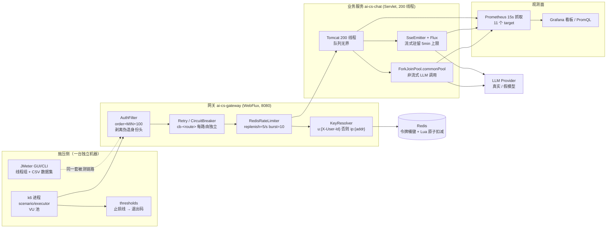
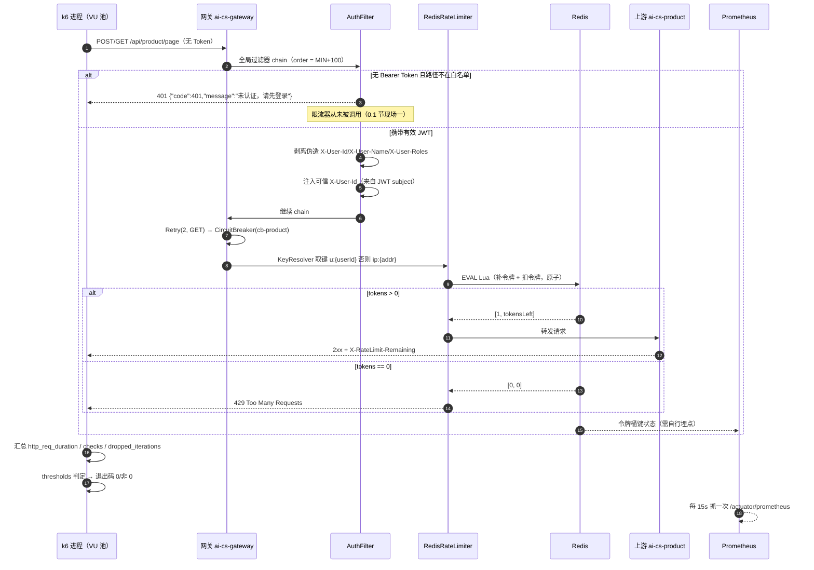

# 性能压测实战：k6 与 JMeter —— 找不到"第一个倒下的组件"，压测就等于没做

> **一句话结论**：压测的产出不是「QPS 5000」，而是三件套——**第一个倒下的组件、它的临界点（写成一条带参数的不等式）、以及从哪条指标最先看到它**。本项目目前的真实状态是：脚本有了（`scripts/loadtest/k6/` 两个文件），但一个按注释打会先被鉴权挡掉、另一个默认在压一个没有调用方的 Python 孤儿服务，所以「基线报告」至今是空的。
> **阅读前置**：看得懂 `application.yml` 里的 `resilience4j` / `aics.gateway.rate-limit` 段；知道网关是 WebFlux（响应式）、知道 `Flux` 是"未来会陆续到达的一串值"。k6 与 JMeter 不需要任何经验，第 2 节从 VU 讲起。
> **证据基线**：A 级 4 份 `24-源码分析/assets/source/` 摘录（spring-cloud-gateway 5.1.0 的限流两跳、Spring AI 2.1.0 的流式接口，共 7 处锚点）、B 级 16 个本仓库真实文件的行号、C 级 7 条本机实测（JDK 17.0.19 / 16 核 / k6 与 jmeter 均未安装 / javap 读到的 Tomcat 默认值）；预计阅读 45 分钟。

---

## 0. 先看现象

压测这件事在本项目里踩过的坑，不是"压不上去"，而是"压了但什么也没证明"。三个现场，全部可核对。

### 0.1 现场一：限流压测脚本 100% 打不到限流器，却以退出码 0 通过

`scripts/loadtest/k6/gateway-rate-limit.js` 的请求函数只有一行 `http.get()`，**没有携带任何 `Authorization` 头**：

```javascript
// scripts/loadtest/k6/gateway-rate-limit.js:28-33
export default function () {
  const res = http.get(`${BASE}${PATH}`);
  check(res, {
    '2xx 放行': (r) => r.status >= 200 && r.status < 300,
    '429 限流拒绝': (r) => r.status === 429,
  });
}
```

而它默认打的 `/api/product/page` 不在网关白名单里（白名单只有登录/注册/验证码/健康检查/Swagger 那几条，见 `ai-cs-gateway/src/main/java/com/aics/gateway/filter/AuthFilter.java#L83-L96`）。`AuthFilter` 的顺序是 `Ordered.HIGHEST_PRECEDENCE + 100`（`AuthFilter.java#L171-L174`），**排在所有路由过滤器（含 `requestRateLimiter`）之前**，于是每个请求拿到的是这一段：

```text
// AuthFilter.java#L131-L132 的日志与响应
log.warn("请求未携带Token: {}", path);
return unauthorized(exchange.getResponse(), "未认证，请先登录");
// 响应体（AuthFilter.java#L186-L190 拼装）
{"code":401,"message":"未认证，请先登录","data":null,"timestamp":1764...}
```

于是：`check` 两条断言全挂（既不是 2xx 也不是 429），而 `thresholds` 里只写了 `http_req_duration: ['p(95)<500']`（同文件 `#L22-L25`）——401 是秒回，时延漂亮得很。**k6 的退出码由 thresholds 决定，不由 check 决定**，所以这次压测"全绿"，实际一个请求都没走到限流器。

### 0.2 现场二：SSE 压测脚本对着空气施压

`scripts/loadtest/k6/sse-chat.js` 的默认目标不是 Java 服务：

```javascript
// scripts/loadtest/k6/sse-chat.js:10-11
const BASE = __ENV.BASE || 'http://localhost:8000';
const PATH = __ENV.PATH || '/api/chat/stream';
```

8000 端口是 `ai-cs-py-chat`（FastAPI）——一个**全仓仅 2 处引用且在自身目录内**的孤儿模块（B 级事实）。更要命的是同文件 `#L4` 的注释教你怎么"走网关打 Java 链路"：

```text
//   走网关打 Java 链路：k6 run -e BASE=http://localhost:8080 -e PATH=/api/chat/stream sse-chat.js
```

`/api/chat/stream` 在 Java 侧是**占位接口**：`ChatController.java#L137-L148` 的注释写明"真正的流式响应走 SSE 端点，本接口仅返回提示信息"。真正的端点是 `POST /chat/stream/sse`（`ChatController.java#L167`，网关 `stripPrefix(1)` 后由 `/api/chat/**` 转发，见 `ai-cs-gateway/src/main/java/com/aics/gateway/config/RouteConfig.java#L81-L84`）。而且脚本的 check 期望 `[DONE]` 哨兵（`sse-chat.js#L39`），那是 Python 侧的分帧格式（`ai-cs-py-chat/app/api/chat.py#L46` 的 `yield "data: [DONE]\n\n"`）；Java SSE 流正常结束时推的是 `{"done":true,"citations":[...]}`（`ChatServiceImpl.java#L796`）。**照注释打，压到的是"秒回 JSON 的占位接口"，check 必挂，时延指标却好得像教科书。**

### 0.3 现场三：压测不报错，只是变慢——因为 Tomcat 在排队，不是在拒绝

本机用 `javap` 直接读 m2 里 Spring Boot 4.2.0 的默认值（详见 3.5 节，命令与输出都是真的）：

```text
// 反编译 TomcatServerProperties 构造器（spring-boot-tomcat-4.2.0.jar）
  58: sipush        8192   // maxConnections = 8192
  65: bipush        100    // acceptCount   = 100
// 反编译 TomcatServerProperties$Threads 构造器
   5: sipush        200    // max           = 200
  12: bipush        10     // minSpare      = 10
  18: ldc  int 2147483647  // maxQueueCapacity = Integer.MAX_VALUE
```

本项目**全仓没有覆盖** `server.tomcat.*`（`maximum-pool-size` / `tomcat.max-threads` 均 0 命中），所以这就是运行时真值：**200 个工作线程 + 一个大到等于无界的任务队列**。后果是：当到达率超过 `200 ÷ 平均驻留时间`，请求不会立刻 500，而是静静排队，`http_req_failed` 依然是 0，只有 `http_req_duration` 的 P95/P99 一路爆。压测报告上写着"零错误"，其实是"错误被推迟成了超时"。

> **这些现象指向同一件事**：压测真正要解的是一个约束方程——
>
> **吞吐天花板 = 并发上限 ÷ 平均驻留时间(W)**
>
> 而"第一个倒下的组件"就是那个**把分子压小**（commonPool 只有 15 个线程、Tomcat 200 个线程）或**把分母撑大**（LLM 长尾、限流重试、无界队列排队）的东西。QPS 只是这条方程在当前配置下的解，换一份配置这答案就废了——这也是"别把压测数字当 SLA"的根本原因。

---

## 1. 整体地图

一次性能压测从"施压机"到"被观测的最后一个进程"，中间要穿过五道会独立失效的关卡。下面这张图把**参与方**和**各自会怎么先倒下**画在一起：



> **读图说明**：
> 1. 关键箭头是 `AF --> RT --> RL --> RK` 这条**进入业务之前的四连跳**。看错它的人会以为"压测打到 8080 就在测业务"，实际本项目里任何不带 Token 的请求在 `AF` 就变成 401 掉头了（0.1 节现场），限流器根本没被惊动——**把这条链看成"一条直路"会得出"限流参数无效"的错误结论**。
> 2. 第二条要看的是 `TC --> CP` 与 `TC --> SSE` 两条**分叉**。非流式走 `commonPool`（本机 15 线程，后端是真实 LLM 的 8 秒级阻塞），流式走 `SseEmitter`（线程被 Servlet 异步释放，但连接与上游 LLM 并发一直占着）。两者容量单位不同：前者是"线程"，后者是"连接 + 上游并发"。**把它们当成同一个池子，会算错一个数量级的容量。**
> 3. 虚线 `JF -.同一套被测链路.-> AF` 提示 JMeter 与 k6 是被替换的驱动，被压对象不变——所以选型只影响"能不能进 CI / 好不好造压"，不影响结论。

| 组件 | 责任 | 参与方 | 本项目证据 |
| --- | --- | --- | --- |
| k6 进程 | 生成负载、聚合指标、判定 thresholds | 测试/开发 | `scripts/loadtest/k6/gateway-rate-limit.js`、`scripts/loadtest/k6/sse-chat.js` |
| JMeter | GUI 编排场景、可视化报告、分布式压 | 测试（本项目未提交 .jmx） | `scripts/loadtest/README.md` 明确"JMeter 走 GUI 不提交 .jmx" |
| AuthFilter | 身份可信透传；剥离伪造 `X-User-Id` | 网关 | `ai-cs-gateway/src/main/java/com/aics/gateway/filter/AuthFilter.java#L152-L163` |
| 断路器/重试 | 单路由韧性；GET 重试 2 次 + 降级 URI | 网关 | `RouteConfig.java#L174-L187` |
| 限流器 | Redis 令牌桶，`replenishRate`/`burstCapacity` | 网关 + Redis | `ai-cs-gateway/src/main/resources/application.yml#L45-L46` |
| KeyResolver | 决定"桶"的粒度 | 网关 | `RouteConfig.java#L155-L167` |
| Tomcat | 请求处理的并发上限（200 线程） | chat/order/product… | C 级 `javap` 实测，全仓无覆盖配置 |
| commonPool | 非流式 LLM 调用的实际执行者 | chat | `ai-cs-chat/src/main/java/com/aics/chat/service/impl/ResilientAiService.java#L382` |
| Prometheus | 观测面唯一数据源 | 运维 | `deploy/observability/prometheus.yml#L3-L22` |
| thresholds | 止损线，唯一能让压测"失败"的机制 | 测试 | 两个 k6 脚本的 `options.thresholds` |

> **落地面**：驱动侧（k6 脚本 + README）**已落地**；"脚本能打对目标"与"thresholds 能当门禁"**未落地**（见 6.1、6.2、6.3）；JMeter 资产**未落地且是刻意不落地**（README 说明走 GUI，避免 .jmx 二进制污染仓库）。

---

## 2. 关键概念与关键类

先约定词。压测的术语通胀得厉害，这里只留 9 个会被后面反复用的：

| 术语 | 一句话解释 | 为什么压测必须懂 |
| --- | --- | --- |
| VU（Virtual User） | k6 里的一个虚拟用户，本质是**一条执行脚本的协程**，不是线程也不是进程 | 决定施压机的资源占用；VU 数 ≠ 并发请求数 |
| iteration | 一个 VU 跑完一次 `default function` 叫一个迭代 | 吞吐 = 迭代数 / 时间，不是"VU 数" |
| scenario | 一组"用什么节奏发请求"的配置（executor + 时长） | 限流要用恒定到达率，长连接要用 VU 保持 |
| executor | scenario 的调度算法：`constant-arrival-rate`（恒定到达）/ `ramping-vus`（阶梯 VU）/ `constant-vus` / `per-vu-iterations` | 选错 executor，压出来的图形没有意义 |
| threshold | 对指标设的**通过线**，不达标 k6 退出码非 0 | 唯一能让压测进 CI 当门禁的机制 |
| check | 对单次响应做的断言（如 `status===429`），**只统计不失败** | 与 threshold 混淆就会"全绿但全错" |
| W（驻留时间） | 一个请求从进系统到出系统的平均耗时，含排队 | 容量方程的分母 |
| Little 定律 | 并发 = 到达率 × 驻留时间（L = λW） | 唯一能在压测前算出 VU 数/线程数的工具 |
| 令牌桶 | 桶容量 `burstCapacity`，每秒补 `replenishRate` 个令牌，取不到就拒绝 | 决定 429 出现在第几个请求、比例是多少 |

再把"关键类"对上——压测时你调的每一个参数，最后都落在这些方法上：

| 名称 | 位置 | 角色 | 关键方法/字段 |
| --- | --- | --- | --- |
| `RedisRateLimiter` | spring-cloud-gateway 5.1.0（A 级摘录） | 分布式令牌桶实现 | `isAllowed(routeId, id)`；Lua 原子扣减；`Response(allowed, tokensLeft)` |
| `RequestRateLimiterGatewayFilterFactory` | 同上 | 把限流接进过滤器链 | `apply(config)`：取键→`isAllowed`→放行/回 429/空键回 403 |
| `RateLimitProperties` | `ai-cs-gateway/src/main/java/com/aics/gateway/config/RateLimitProperties.java` | 把 yml 绑定成对象 | `replenishRate=5`、`burstCapacity=10`（`#L43-L46`） |
| `RouteConfig` | `.../gateway/config/RouteConfig.java` | 装配限流器与限流键 | `userKeyResolver()`（`#L156`）、`addResilience()`（`#L174`） |
| `AuthFilter` | `.../gateway/filter/AuthFilter.java` | 鉴权 + 身份头净化 | `filter()`（`#L106`）、`getOrder()=MIN+100`（`#L172`） |
| `StreamingChatModel` | Spring AI 2.1.0（A 级摘录） | LLM 流式能力接口 | `stream(Prompt)` 返回 `Flux<ChatResponse>` |
| `ChatClient.StreamResponseSpec` | Spring AI 2.1.0（A 级摘录） | 流式调用的门面 | `content()` 返回 `Flux<String>` |
| `ChatServiceImpl` | `ai-cs-chat/src/main/java/com/aics/chat/service/impl/ChatServiceImpl.java` | 把 `Flux` 桥到 `SseEmitter` | `chatStreamSse(...)`（`#L520`）、`flux.subscribe(...)`（`#L646`） |
| `ResilientAiService` | `.../chat/service/impl/ResilientAiService.java` | LLM 统一入口 + 超时/熔断 | `timedCall(...)`（`#L378`）、`future.get(timeoutMs)`（`#L390`） |
| `TomcatServerProperties$Threads` | spring-boot-tomcat-4.2.0.jar | Tomcat 并发默认值 | C 级 `javap`：`max=200`、`maxQueueCapacity=Integer.MAX_VALUE` |

> **落地面**：前两行（A 级源码）是框架事实，与项目无关；`RateLimitProperties`/`RouteConfig`/`AuthFilter` 三行**已落地且在生效路径上**（`enabled: false` 的是旧的内存限流 `RateLimitFilter`，Redis 令牌桶是现役，见 `application.yml#L33-L46` 的注释）；`SseEmitter` 链路**已落地**；"能给出 Tomcat 线程数的看板"**未落地**（见 3.8）。

---

## 3. 原理与证据逐段精读

### 3.1 压测四要素：缺一条，报告就不可信

**在干什么**：一次合格的压测必须在开跑前写死四件事——①目标指标（压什么、卡在什么数字上算"不行"）；②负载模型（怎么发：恒定、阶梯、尖峰、浸泡）；③观测面（看哪些指标，从哪抓）；④止损线（什么时候停、什么算失败）。

**为什么这么设计**：因为压测最容易的不是"发请求"，而是"解释结果"。没有①，你会拿到一堆数字不知道好坏；没有②，你不知道这条曲线是稳态还是过渡态；没有③，你只能看见客户端视角的时延，看不见"服务端已经在排队"；没有④，压崩了也停不下来——尤其在本项目这种"每次迭代都可能真的调一次 LLM"的场景里，没有止损线等于开着水龙头测水表。

**换写法会怎样**：只写①（"我要 500 QPS"），结果就是先 429 后超时，最后报告一句"没达到目标"，既不知道是限流拦的还是服务端撑不住；只写②③不写④，跑 SSE 浸泡测试能把上游 LLM 的配额烧光——本项目 `ai-cs-py-chat/app/config.py#L18` 的 `llm_timeout: 60.0` 和真实 provider 的计费，都不认识"我还在压测"。

**常见坑**：把"目标指标"写成 QPS。QPS 是**结果**，不是目标。目标应该写成约束式，比如"在 P95 ≤ 800ms 且错误率 ≤ 1% 的前提下，网关单实例能承载的恒定到达率"，这样即使数字变了，结论（哪个组件先到极限）依然成立。

四要素在本文里的映射：

| 要素 | 本项目当前取值 | 证据 |
| --- | --- | --- |
| 目标指标 | 网关：P95 < 500ms；SSE：首 token P95 < 2s、整流 P95 < 15s、失败率 < 5% | 两脚本 `options.thresholds` |
| 负载模型 | 限流：`constant-arrival-rate` 30/s × 30s；SSE：`ramping-vus` 1→20→0 | `gateway-rate-limit.js#L14-L20`、`sse-chat.js#L17-L24` |
| 观测面 | Prometheus（15s，11 target）+ JVM/HTTP/连接池指标族 | `deploy/observability/prometheus.yml#L3-L22` |
| 止损线 | 仅 thresholds（且限流脚本的阈值抓不到 401） | 见 6.1 |

### 3.2 VU / iteration / scenario：k6 的执行模型决定了你能压出什么形状

**在干什么**：k6 有两种截然不同的施压模型。**VU 模型**（`constant-vus`/`ramping-vus`）是"开 N 个虚拟用户，每个用户跑完一次就立刻跑下一次"，所以**实际到达率是被响应时间决定的**：服务端变慢 → 每个 VU 的循环变慢 → 到达率自动下降。**到达率模型**（`constant-arrival-rate`）是"不管响应多慢，每秒必须发出 N 个请求"，靠 `preAllocatedVUs` + `maxVUs` 补足被拖住的 VU。

**为什么这么设计**：因为这两件事在真实世界里都存在，但不能混着测。测**限流器**必须用到达率模型——限流器的语义是"每秒来多少"，用 VU 模型会形成一个负反馈：被 429 的请求很快返回，VU 循环更快，到达率反而上升，读数完全失真。测**长连接/会话保持**必须用 VU 模型，因为"同时挂着的会话数"才是容量单位。

**换写法会怎样**：把 `gateway-rate-limit.js` 的 executor 换成 `ramping-vus`，你会看到 429 比例随 VU 数非线性变化——因为 VU 是被 429 的快速返回"喂"出来的，30 VU 可能对应 300 req/s。这就是旧稿里"用 429 比例反推放行水位"这种说法站不住的原因：不写清到达率，比例没有分母。

**常见坑**：`preAllocatedVUs` 给太小。到达率模型下如果响应变慢，k6 需要更多 VU 才能维持到达率；`maxVUs` 封顶后到达率会悄悄掉下去，而报告上"目标 30/s"不会报错——你会看到 `dropped_iterations` 指标上涨，那才是"施压机自己撑不住"的信号。本项目 `gateway-rate-limit.js#L18-L19` 是 `20/50`，够用，但没有任何 threshold 盯 `dropped_iterations`。

### 3.3 四种负载模型，各自能捅出不同的问题

**在干什么**：恒定、阶梯、尖峰、浸泡——不是四种审美，而是四种"故障解剖刀"，每种只对特定失效模式敏感。

| 负载模型 | k6 executor | 专门暴露的问题 | 本项目该压的对象 |
| --- | --- | --- | --- |
| 恒定（常量到达率） | `constant-arrival-rate` | 稳态吞吐上限、限流放行水位、错误率拐点 | 网关限流（`gateway-rate-limit.js`，已落地） |
| 阶梯（逐步加 VU/到达率） | `ramping-arrival-rate` / `ramping-vus` | **第一个倒下的组件在哪一级**——找临界点唯一手段 | SSE 并发会话数（`sse-chat.js`，已落地但打错目标） |
| 尖峰（瞬时脉冲） | `ramping-*` 短时陡升，或 `constant-arrival-rate` + 高 rate 短 duration | 队列/线程池的"缓冲深度"、限流 burst 是否够、冷启动与连接池预热 | 网关 burst=10 是否够扛住一次促销开场 |
| 浸泡（长时间低压） | `constant-vus` 跑 1~4 小时 | 内存泄漏、连接不释放、`SseEmitter` 未关闭累积、Redis 键膨胀、GC 老年代爬升 | chat 的 SSE 泄漏（`ChatServiceImpl.java#L713-L714` 的注释就是在防这个） |

**为什么这么设计**：每种模型的"时间尺度"不同。阶梯找**临界点**（横轴是负载），尖峰找**缓冲**（横轴是时间），浸泡找**泄漏**（横轴是时长）。用恒定压测永远找不到临界点，因为恒定只会停在一个点上说"行"或"不行"。

**换写法会怎样**：只用恒定模型，你会得到"30/s 下 P95=480ms，通过"——但完全不知道 31/s 时会怎样、是缓慢劣化还是断崖式崩。而"断崖"还是"缓坡"恰恰决定了你是加机器就行，还是必须改代码。

**常见坑**：浸泡测试忘记把 LLM 换掉。本项目 SSE 链路每 5 分钟要重连一次（`SSE_EMITTER_TIMEOUT = 5min`，注释在 `ChatServiceImpl.java#L699`），浸泡 2 小时就是几百次真实 LLM 调用，账单先于 bug 出现。

### 3.4 限流器怎么算账：两跳源码 + 一条不等式

**在干什么**：`RequestRateLimiter` 是"取键 → 问限流器 → 按结果分流"；`RedisRateLimiter` 是"用一段 Lua 在 Redis 里原子地 '补令牌 + 扣令牌 + 返回剩余'"。

先看第二跳（缺令牌时扣不成，返回剩余量）：

```java
// (src: RedisRateLimiter.java.md#L245-L282)
public Mono<Response> isAllowed(String routeId, String id) {
    if (!this.initialized.get()) {
        throw new IllegalStateException("RedisRateLimiter is not initialized");
    }
    Config routeConfig = loadConfiguration(routeId);
    int replenishRate = routeConfig.getReplenishRate();
    long burstCapacity = routeConfig.getBurstCapacity();
    int requestedTokens = routeConfig.getRequestedTokens();
    try {
        List<String> keys = getKeys(id, routeId);
        List<String> scriptArgs = Arrays.asList(replenishRate + "", burstCapacity + "", "", requestedTokens + "");
        Flux<List<Long>> flux = this.redisTemplate.execute(this.script, keys, scriptArgs);
        return flux.onErrorResume(throwable -> {
            log.error("Error calling rate limiter lua", throwable);
            return Flux.just(Arrays.asList(1L, -1L));
        }).reduce(new ArrayList<Long>(), (longs, l) -> {
            longs.addAll(l);
            return longs;
        }).map(results -> {
            boolean allowed = results.get(0) == 1L;
            Long tokensLeft = results.get(1);
            Response response = new Response(allowed, getHeaders(routeConfig, tokensLeft));
```

再看第一跳（放行 / 429 / 空键 403 三个出口）：

```java
// (src: RequestRateLimiterGatewayFilterFactory.java.md#L119-L145)
return (exchange, chain) -> resolver.resolve(exchange).defaultIfEmpty(EMPTY_KEY).flatMap(key -> {
    if (EMPTY_KEY.equals(key)) {
        if (denyEmpty) {
            setResponseStatus(exchange, emptyKeyStatus);
            return exchange.getResponse().setComplete();
        }
        return chain.filter(exchange);
    }
    String routeId = config.getRouteId();
    if (routeId == null) {
        Route route = exchange.getAttribute(ServerWebExchangeUtils.GATEWAY_ROUTE_ATTR);
        routeId = Objects.requireNonNull(route, "Route not found").getId();
    }
    return limiter.isAllowed(routeId, key).flatMap(response -> {
        for (Map.Entry<String, String> header : response.getHeaders().entrySet()) {
            exchange.getResponse().getHeaders().add(header.getKey(), header.getValue());
        }
        if (response.isAllowed()) {
            return chain.filter(exchange);
        }
        if (throwLimit) {
            return Mono.error(HttpClientErrorException.create(config.getStatusCode(), "Too Many Requests",
                    exchange.getResponse().getHeaders(), null, null));
        }
```

**在干什么（合起来）**：键由 `KeyResolver` 决定，本项目是 `u:{X-User-Id}`，没有身份头就退化成 `ip:{客户端IP}`（`RouteConfig.java#L155-L167`）。桶的容量与补充速率来自 `RateLimitProperties`：`replenishRate=5`、`burstCapacity=10`（`ai-cs-gateway/src/main/resources/application.yml#L45-L46`）。超限的默认状态码是 `HttpStatus.TOO_MANY_REQUESTS`（`RequestRateLimiterGatewayFilterFactory.java#L163` 的字段默认值），**而空键默认回 403 FORBIDDEN**（同文件 `#L63`）。

**为什么这么设计**：把"桶"放进 Redis + Lua，是为了多实例共享同一个计数器（`application.yml#L33-L46` 的注释写明旧的内存限流"配额不跨实例共享"，因此被替换）。把键解析抽成 `KeyResolver`，是为了让"限用户"和"限 IP"只差一行代码而不改限流算法。

**换写法会怎样**：读 `RedisRateLimiter` 的 `onErrorResume`——Redis 出错时它返回 `[1L, -1L]`，即 **allowed=true、剩余 -1，直接放行**。这是有意的取舍（限流器挂了不应该让全站 503），但对压测者是陷阱：**如果你在压测中把 Redis 压挂了，从网关侧看到的现象是"限流失效、全部放行"，你会误判"桶容量很大"**。

**常见坑 + 一条必须自己算的不等式**：恒定到达 A=30/s、`replenishRate=5`、`burstCapacity=10`、持续 30s，单键的理论放行上限是 `5×30 + 10 = 160`，总请求 `30×30 = 900`，因此 429 比例应当 ≈ **82.2%**（C 级 node 计算，输出见 6.3）。不写这个算式，看到 78% 还是 85% 都无法判断对错——而 5% 的偏差往往就来自 `burstCapacity` 在窗口开始时的初始填充。

### 3.5 排队而不是拒绝：200 线程 + 无界队列如何伪装成"零错误"

**在干什么**：Servlet 容器的并发模型是"固定线程池 + 接受队列"。线程全忙时，新请求进队列等，而不是被拒绝。本项目的真实默认值由 `javap` 从 jar 里读出来（C 级，见 6.4）：`max=200`、`minSpare=10`、`maxQueueCapacity=Integer.MAX_VALUE`、`maxConnections=8192`、`acceptCount=100`。

**为什么这么设计**：无界队列是"尽量不拒绝"的默认哲学——Web 应用普遍如此，因为拒绝一个请求比让它慢一点更"难看"。`maxConnections=8192` 则是 NIO 连接上限，SSE 这类长连接真正吃的是这个数字，而不是 200 个线程。

**换写法会怎样**：如果把 `server.tomcat.threads.max-queue-capacity` 设成 0，超载时会直接快速失败（fast fail），错误率立刻上蹿——**压测读数会好看得多也诚实得多**，代价是用户看到错误而不是转圈。反过来说，现在这个配置下，压测里"零错误但 P99 30 秒"不是 bug，是配置的直接后果。

**常见坑**：把"服务端线程数"和"数据库连接池大小"当成两个独立旋钮。它们是串联的：200 个线程抢 10 个（默认）连接，则 `maxConnections` 再大也没用，瓶颈在连接池。本项目 grep 全仓无 `hikari` / `maximum-pool-size` 配置，**连接池就是 Hikari 默认 10**，但这台 chat 服务本身排除了 `DataSourceAutoConfiguration`（`ai-cs-chat/src/main/resources/application.yml#L15`），所以真正的"10"在 order/product/user 那些有主库的服务里——压测时若压登录→下单链路，第一个倒下的很可能是连接池而不是 CPU。

**容量算式（C 级，公式实测，W 为假设值）**：`λ_max = 线程数 ÷ W`。

```text
W=0.2s  → λ_max = 1000/s      W=4s   → λ_max = 50/s
W=1s    → λ_max = 200/s       W=8s   → λ_max = 25/s
W=12s   → λ_max = 16.7/s      W=30s  → λ_max = 6.7/s
```

读法：**SSE 整流耗时 W=12s 时，单实例 200 线程的理论上限只有 16.7 条流/秒**；本项目 `sse-chat.js` 的阶梯压到 20 VU 恰好停在这条线附近——如果响应真的按 12s 算，20 VU 会稳定骑在临界点上，稍加压力就该看到排队。注意：SSE 走 Servlet 异步，`SseEmitter` 挂起期间线程会被释放，所以这里的 200 更像"上界"，真实瓶颈是 `maxConnections=8192`、上游 LLM 并发与每条流的内存占用。**要确认到底卡在哪个，必须看 3.8 的观测面，不能靠猜。**

### 3.6 非流式 LLM 的线程账：commonPool 才是第一个倒下的组件

**在干什么**：本项目"非流式 LLM 调用"的超时是用 `CompletableFuture.get(timeout)` 做的，而那个 future 是 `CompletableFuture.supplyAsync(...)` **不带 executor 重载**创建的：

```java
// ai-cs-chat/src/main/java/com/aics/chat/service/impl/ResilientAiService.java#L381-L392
return breaker.executeCallable(() -> {
    CompletableFuture<ChatResponse> future = CompletableFuture.supplyAsync(() -> {
        try {
            return call.call(holder);            // 真正发起 LLM HTTP 调用（阻塞）
        } catch (Exception e) {
            throw new CompletionException(e);
        }
    });
    try {
        return future.get(holder.getDefinition().getTimeoutMs(), TimeUnit.MILLISECONDS);
    } catch (TimeoutException e) {
        future.cancel(true);
        throw e;
    }
```

`supplyAsync` 不带 executor ⇒ 跑在 **`ForkJoinPool.commonPool()`** 上。

**为什么这么设计**：这是"用一个 future 换一个可控超时"的写法（类注释 `#L374` 也这么写：用 `get(timeout)` 而非 HTTP 层超时，好处是超时后 `cancel(true)` 能释放挂起调用）。从功能上讲它是对的：超时确实能触发，也能中断。

**换写法会怎样**：如果换成 `@TimeLimiter` + `CompletableFuture` 的 resilience4j 写法（配置里其实已经有 `resilience4j.timelimiter.instances.chatService.timeout-duration: 30s`，见 `ai-cs-chat/src/main/resources/application.yml#L77-L79`），执行仍然会落在某个线程池上，问题不会消失——**只要"LLM 调用是阻塞的"，线程数就是硬上限**。真要解决，要么改成非阻塞的 `WebClient`/响应式调用，要么给一个独立的、有界且有监控的线程池。

**常见坑（本篇最重要的一条）**：commonPool 的并行度默认是"可用核数 − 1"。本机实测：

```text
$ java Probe.java
availableProcessors = 16
commonPool.parallelism = 15
maxMemoryMB = 8120
java.version = 17.0.19
```

于是算一笔：假设 LLM 平均 W = 8s，`15 ÷ 8 = 1.88 req/s` —— **目标 50 QPS 需要 400 个并发，实际只有 15 个位置，差 26.7 倍**。这就是 0.3 节那种"CPU 只有 6%、QPS 上不去、错误率还是 0"的真相：请求全卡在 commonPool 的队列里等。更糟的是 `ai-cs-chat` 在 k8s 里的 `cpu: "1000m"`（`deploy/k8s/services/ai-chat-service.yaml#L98`）意味着容器内 `availableProcessors` 按 1 计，commonPool 会更小（按 JDK 规则，核数−1 ≤ 0 时取 1）——**未在本机容器内实测，判断方法是部署后在 Pod 内跑同一段 `Probe.java`**，看 `commonPool.parallelism` 输出几。

### 3.7 流式 LLM 的驻留时间账：SSE 的容量单位是"连接"不是"RPS"

**在干什么**：Spring AI 的流式接口返回 `Flux`：

```java
// (src: StreamingChatModel.java.md#L48-L49)
@Override
Flux<ChatResponse> stream(Prompt prompt);
```

```java
// (src: ChatClient.java.md#L420-L424)
        Flux<ChatClientResponse> chatClientResponse();

        Flux<ChatResponse> chatResponse();

        Flux<String> content();
```

Servlet 栈无法直接把 `Flux` 渲染成 SSE，所以项目里做了一次"手动桥接"：`flux.subscribe(onNext, onError, onComplete)`，在每个 chunk 里 `emitter.send(...)`（`ai-cs-chat/src/main/java/com/aics/chat/service/impl/ChatServiceImpl.java#L646`，桥接图注释在 `#L614-L641`）。

**为什么这么设计**：桥接让"响应式上游"和"Servlet 下游"能对接，且 `subscribe` 是异步的，请求线程在方法返回后就被释放。代价是**生命周期不再由框架托管**：必须自己保证 `onError` / `onComplete` / `emitter` 超时三条路径都关掉连接（`ChatServiceImpl.java#L713-L714` 的注释原话是"必须在这里关闭 SseEmitter，否则连接会泄漏"）。

**换写法会怎样**：若改用 WebFlux 全栈，`Flux` 直接作为返回值，连接生命周期由框架管理，泄漏面小得多；但那是整服务改造，代价远超一次压测。

**常见坑**：用 RPS 描述 SSE 容量。SSE 是"每 VU 挂一条长连接，整流期间一直占着"，所以压测工具层面 VU 数 ≈ 并发会话数，`http_req_duration` 是**整流时长**而不是单次响应时间，`http_req_waiting` 才近似首 token 时延（TTFB）。旧稿把这两条写对了，可以沿用。真正的坑在于：**k6 的 `http.*` 会把整条流读完才返回**，所以拿不到"逐帧间隔"；要看 token 级抖动必须换 `xk6-sse` 扩展（`sse-chat.js#L6` 的注释也承认这一点）。

### 3.8 观测面：压测时唯一可信的不是 k6 的数字，而是 Prometheus

**在干什么**：Prometheus 每 15 秒抓一次 11 个 target 的 `/actuator/prometheus`：

```yaml
# deploy/observability/prometheus.yml#L3-L22（节选：间隔与抓取路径）
scrape_interval: 15s
metrics_path: '/actuator/prometheus'
# targets 覆盖 gateway/user/knowledge/chat/search/message/notify/order/product/pay/mq 共 11 个
```

暴露端点由共享配置统一打开（`management.endpoints.web.exposure.include: health,info,prometheus`，见 `tools/nacos-config/aics-shared.yml#L32`），各服务 pom 都带 `micrometer-registry-prometheus`（如 `ai-cs-chat/pom.xml#L209-L222`）。

**为什么这么设计**：客户端指标（k6 视角）只能回答"用户等了多久"，回答不了"服务端在等谁"。必须同时看四类服务端信号：**线程池/队列**、**GC 与堆**、**DB 连接池**、**下游限流/熔断命中**。前三个能告诉你"瓶颈在自己身上"，第四个能告诉你"你在被人保护"。

压测时必须同时看这七条（缺一条就会误判）：

| 指标 | 抓什么 | 误判风险 |
| --- | --- | --- |
| P95 / P99 时延 | `http_server_requests_seconds{quantile}` | 只看平均会漏掉长尾（LLM 场景必然长尾） |
| 错误率 | `http_server_requests_seconds_count{status="5xx"}` 比例 | 只看到 0 就以为健康（见 3.5 无界队列） |
| 吞吐 | `sum(rate(http_server_requests_seconds_count[1m]))` | 与到达率对比，差多少就是被拦掉/丢弃多少 |
| GC | `jvm_gc_pause_seconds_*`、`jvm_memory_used_bytes{area="heap"}` | 堆 512m（`deploy/docker-compose/docker-compose-all.yml#L175`）下 Full GC 会伪装成"网络抖动" |
| 线程池队列 | `executor_*` / `tomcat_threads_*`（需自行确认是否已注册） | 线程数满 + 队列涨 = 排队型劣化，错误率仍是 0 |
| DB 连接数 | `hikaricp_connections_pending`、`hikaricp_connections_active` | `pending` 涨 = 连接池是瓶颈，不是数据库慢 |
| 下游限流命中 | 429 计数、`X-RateLimit-Remaining`（[[源码:RedisRateLimiter.java.md#L72]] 定义了该响应头） | 把"被限流"当成"服务端扛不住" |

PromQL 示例（`learning-docs/07-运维部署/04-Prometheus可观测性.md#L125-L134` 里有同款）：

```promql
sum(rate(http_server_requests_seconds_count{application="ai-cs-gateway"}[1m]))
histogram_quantile(0.99, sum(rate(http_server_requests_seconds_bucket[5m])) by (le, application))
topk(3, jvm_memory_used_bytes{area="heap"})
```

**换写法会怎样**：只用 k6 的汇总报告。你会拿到"P95=12s，错误率 0"，然后去查代码——查一天也查不出问题，因为代码没错，是队列在排队。

**常见坑**：15 秒的抓取间隔对 30 秒的压测来说只有 2 个采样点，**曲线基本没法看**。短压测要么临时把 `scrape_interval` 调到 5s，要么直接对单个服务 `curl /actuator/prometheus` 手动抓（未本机实测，本机无 docker/中间件，命令给在这里：`curl -s http://localhost:8081/actuator/prometheus | Select-String 'http_server_requests|hikaricp|jvm_gc'`）。

### 3.9 止损线：thresholds 是唯一能让压测"失败"的东西

**在干什么**：k6 的 `thresholds` 在跑完后判定，**不达标退出码非 0**，这就是 CI 性能门禁的全部实现机制。`check` 只是"记录断言通过率"，从不影响退出码。

**为什么这么设计**：因为性能问题的粒度不是"通过/失败"，而是"趋势"。thresholds 让"P95 从 200ms 退化到 480ms"这种**渐进退化**能够在合并前被拦住，而不是等到用户投诉。

**换写法会怎样**：不写 thresholds，压测就是一个需要人盯屏幕的仪表盘，永远进不了流水线。本项目已经写了 thresholds（`sse-chat.js#L26-L30` 三条、`gateway-rate-limit.js#L22-L25` 一条），但限流脚本那条只卡时延——**它是唯一一次"能进 CI 也拦不住任何问题"的配置**。

**常见坑——"别把压测数字当 SLA"**：压测是在**特定环境、特定数据、特定配置**下跑出来的一次采样。本项目至少有四处会让数字失真：①本机 16 核 vs 容器 `cpu: 1000m` 限 1 核（差 16 倍）；②JVM 堆 512m（`docker-compose-all.yml#L175`）vs 本机 `maxMemoryMB = 8120`（实测）；③真实 LLM 的延迟分布由 provider 决定，与你的代码无关；④11 个服务跑在同一台机器上会互相抢 CPU。所以正确的话术是"在 X 配置下，Y 组件在 Z 负载先到极限"，而不是"系统支持 500 QPS"。

---

## 4. 一次完整执行时序

以"网关限流压测"为例（这是唯一一个能被精确算账的场景）。注意每一步失败时报什么错——这张表比图更有用。



> **读图说明**：
> 1. 最重要的一条箭头是 `AF-->>K6: 401` 这条**短路回边**。它出现在 `RL` 之前，意味着"压测没压到限流器"这件事在时序上是**第一步就发生的**，而不是压到一半才失效。看错这条顺序，你会去调 `replenishRate`——调一整天也不会让 401 变成 429。
> 2. 第二条要看 `RL->>RD: EVAL Lua` 这步的**原子性**：补令牌与扣令牌在同一个 Lua 里完成，所以多实例并发下不会超发。若把它理解成"两个 Redis 命令"，就会得出"并发下桶会漏"的错误结论，进而把限流不准归因于并发竞争（真实原因往往是键基数，见 6.6）。

各步骤失败时的表现：

| 步骤 | 失败现象 | 典型错误/日志 | 说明 |
| --- | --- | --- | --- |
| ① 无 Token | 100% 401，k6 `checks` 全挂但 thresholds 通过 | `log.warn("请求未携带Token: {}", path)`（`AuthFilter.java#L131`） | 本项目限流脚本的现状 |
| ② 伪造身份头 | 下游读不到你的 `X-User-Id`，限流键退化为 IP | `AuthFilter.java#L153-L159` 把它 remove 掉 | 想造多用户基数必须真登录拿 JWT |
| ③ Redis 不可用 | 限流"失效全部放行"，429 归零 | `log.error("Error calling rate limiter lua", throwable)`（[[源码:RedisRateLimiter.java.md#L272]]） | 故意的降级取舍，但会误导判读 |
| ④ 断路器打开 | 请求直接走降级 URI，不落到上游 | `cb-product` 共享实例会污染统计（`RouteConfig.java#L172` 注释） | 压测前先确认熔断器状态 |
| ⑤ 线程/队列满 | 无错误、只有 P99 爆炸 | 无异常日志，`dropped_iterations` 与排队时延才看得出 | 0.3 节现场三 |
| ⑥ LLM 超时 | 非流式 3 次重试后失败；流式收到 `{"error":...}` | `resilience4j.retry.instances.chatService.max-attempts: 3`（`ai-cs-chat/src/main/resources/application.yml#L91-L99`） | 重试会把下游压力放大 3 倍，压测时尤甚 |
| ⑦ thresholds 不达标 | k6 退出码非 0，CI 红 | `ERRO[0031] thresholds on metrics ... have been crossed` | 目前只有 SSE 脚本会真的触发 |

---

## 5. 设计取舍

第一个取舍是工具选型——这不是"哪个更强"，而是"你要把它放进什么流程里"：

| 维度 | k6 | JMeter | 本项目的选择与理由 |
| --- | --- | --- | --- |
| 脚本形态 | JavaScript 文件，纯文本，可 review、可 diff | GUI 编辑 `.jmx`（本质是 XML，但几乎只能靠 GUI 维护） | 选 k6：`.jmx` 不可 review，`scripts/loadtest/README.md` 明确"JMeter 走 GUI 不提交 .jmx" |
| 资源占用 | Go 实现，单进程几千 VU 常见；无 GUI | JVM + GUI，单机线程数受堆和 GC 限制，通常数百线程 | 选 k6：本机同时跑被测服务和 JMeter 会互相污染 |
| CI 友好度 | 原生 `thresholds` → 退出码；单二进制，`winget install k6` 即装 | 需 `jmeter -n -t x.jmx -l out.jtl` 再解析 JTL/生成 HTML，门禁要自己写 | 选 k6：门禁语义内建 |
| 分布式压测 | `k6 cloud` 或 `k6 run --out` + 自建；开源版本需自己编排 | 内置 master/slave（`-R` 远程启动） | JMeter 略胜，但本项目规模用不上 |
| 协议覆盖 | HTTP/WS/gRPC（gRPC 需扩展）；**SSE 只能"读完算一次请求"** | HTTP/WS/JDBC/JMS 等插件生态厚 | SSE 逐帧要 `xk6-sse`，两家都要折腾 |
| 学习曲线 | 会 JS 就能上手；`scenario/executor` 概念需半天 | GUI 门槛低，但"线程组/定时器/断言"的心理模型更容易误解 | 团队已有 JS 基础 |

其余三个关键决策点：

| 决策点 | 当前选择 | 代价 | 替代方案与它的代价 |
| --- | --- | --- | --- |
| 限流算法放哪 | Redis 令牌桶（每路由 `RequestRateLimiter`） | 每个请求多一次 Redis 往返；Redis 挂了限流失效（放行） | 本地 `RateLimitFilter`（已 `enabled: false`）：零网络开销，但配额不跨实例、总配额 = N×单机配额 |
| 限流键粒度 | `u:{userId}`，无身份退化 `ip:{addr}` | 压测时若不带身份，所有请求挤进一个桶 | 按路由全局桶：能压出总容量，但一个用户能打垮所有人 |
| 超时怎么实现 | `CompletableFuture.get(timeout)`（占一个 commonPool 线程等） | 阻塞式等待吃掉线程（3.6 节的 15 线程天花板） | `@TimeLimiter`（已配 30s/60s，但仍是阻塞底）；或换 `WebClient` 非阻塞——改造面大 |
| 压测数据隔离 | 复用 `deploy/mysql/drop-all.sql`（12 行，删 6 个库）重建 | 有误删风险，只能开发环境用 | 独立压测库/影子库：更安全，但要多维护一套 schema |

**可扩展点清单**（按实用度排序）：

1. 给 `gateway-rate-limit.js` 加 `http_req_failed: ['rate<0.02']` 与 `checks: ['rate>0.95']` threshold——让"全 401"当场变红（改 1 个文件 5 行）。
2. 在 k6 里用 `SharedArray` 加载 CSV 账号，`Authorization: Bearer ${token}` 真正打到限流器，并按 VU 轮换 `X-User-Id` 造键基数（对应 6.6）。
3. 把 `sse-chat.js` 的默认 BASE 改成 Java 网关 + `PATH=/api/chat/stream/sse`，check 改成匹配 `"done":true`。
4. 补 `ramping-arrival-rate` 的阶梯脚本，找出 §3.5 那条 `200 ÷ W` 的真实拐点。
5. 把 threshold 接进 CI（当前 `.github/workflows/` 只有 `python-learning-validate.yml`，8 个 Java 服务全不进 CI）。
6. LLM 压测前置一个"假模型"（返回固定 token 流、可注入延迟），把成本与外部抖动从变量里删掉。

---

## 6. 踩坑与调试手法

### 6.1 脚本全绿但什么都没证明：thresholds 与 check 不是一回事

**现象**：`k6 run gateway-rate-limit.js` 退出码 0，报告里 `checks` 通过率 0%。
**原因**：`thresholds` 只写了 `http_req_duration`，而 401 是秒回。
**本项目实况**：`scripts/loadtest/k6/gateway-rate-limit.js#L22-L25`。
**修法**：

| 加什么 | 值 | 效果 |
| --- | --- | --- |
| `http_req_failed: ['rate<0.02']` | 失败率门禁 | 401 立刻把它顶穿 |
| `checks: ['rate>0.95']` | 断言门禁 | 把 check 拉进退出码（k6 支持 `checks` 作为 threshold 指标） |
| `dropped_iterations: ['count<10']` | 施压机自检 | 区分"服务端慢"与"k6 发不出去" |

**正确姿势**：每次压测至少三条 threshold：一条时延、一条错误率、一条施压机自检。

### 6.2 压测打错被测对象：默认值与注释都指向了错误的端点

**现象**：SSE 脚本跑完 `http_req_waiting p95 = 3ms`，好得反常。
**原因**：默认 `BASE=8000` 是 Python 孤儿服务；按注释改成 8080 + `/api/chat/stream` 则命中占位接口（返回 JSON 提示，不是流）。
**本项目实况**：`scripts/loadtest/k6/sse-chat.js#L10-L11`、`#L4`；占位接口 `ai-cs-chat/src/main/java/com/aics/chat/controller/ChatController.java#L137-L148`；真实端点 `#L167`。
**修法**：`BASE=http://localhost:8080 PATH=/api/chat/stream/sse`，并且**先用一条 `curl` 确认返回的是 `text/event-stream`**：

```pwsh
# 未本机实测（需先起服务）；判读方法：Content-Type 必须是 text/event-stream，且响应体逐行 data: 开头
curl -s -N -D - -H "Authorization: Bearer $tok" -X POST `
  "http://localhost:8080/api/chat/stream/sse?sessionId=lt-1&message=ping"
```
**正确姿势**：压测前先做"单请求冒烟"，把 status、Content-Type、首帧、末帧四样对一遍，再谈容量。

### 6.3 429 比例靠感觉：burst 忘了算，算出来的水位全是错的

**现象**：30/s 压 30 秒，数出 429 比例 82%，有人说"限流没生效"，有人说"应该 83%"。没有算式时两种说法都成立。
**本项目实况**：`replenishRate=5`、`burstCapacity=10`（`ai-cs-gateway/src/main/resources/application.yml#L45-L46`）；脚本 30/s × 30s（`gateway-rate-limit.js#L14-L17`）。
**C 级实测输出**：

```text
$ node cap-est.mjs
== 网关限流读数: replenishRate=5/s burst=10 恒定到达=30/s 持续=30s ==
理论放行上限 = replenish*duration + burst = 160  (≈17.8%)
理论 429 数量 = 740  429 比例 = 82.2%
稳态可放行速率 ≈ min(到达率, replenishRate) = 5/s
```
**怎么读**：82.2% 是**单键**的水位。若压测里造了 N 个用户键，每键各自有 10 的 burst，总放行量 ≈ `N×160`，比例会随 N 变化——所以报告里必须写清"几个键"。
**修法/正确姿势**：把这条算式写进脚本头部注释，每次改 `rate`/`replenishRate` 都重算，读数偏差 >2% 再去查键基数。

### 6.4 【真调试手法】用 javap 读 jar，判断"是拒绝还是排队"

**现象**：压测时错误率 0%、P99 涨到十几秒，怀疑是代码慢。
**原因**：容器在排队。但 `application.yml` 里查不到任何 `server.tomcat.*`，需要确认"默认值到底是多少"。
**C 级手法**（30 秒内，不启动服务）：

```pwsh
$jar = "$env:USERPROFILE\.m2\repository\org\springframework\boot\spring-boot-tomcat\4.2.0\spring-boot-tomcat-4.2.0.jar"
javap -p -c -cp $jar 'org.springframework.boot.tomcat.autoconfigure.TomcatServerProperties$Threads' |
  Select-String 'sipush|bipush|ldc|putfield'
```

```text
public org.springframework.boot.tomcat.autoconfigure.TomcatServerProperties$Threads();
   5: sipush        200          // max = 200
   8: putfield      #7           // Field max:I
  12: bipush        10           // minSpare = 10
  14: putfield      #13          // Field minSpare:I
  18: ldc           #16          // int 2147483647
  20: putfield      #17          // Field maxQueueCapacity:I
```
**怎么读**：构造器里的 `sipush 200` 就是 `max-threads` 默认值；`ldc int 2147483647` 是 `Integer.MAX_VALUE`，即**队列无界**。同法反编译外层类还能读到 `maxConnections = 8192`、`acceptCount = 100`。
**结论模板**：`200 线程 + 无界队列 ⇒ 超载表现为排队（时延爆炸、错误率 0），不是拒绝。`
**正确姿势**：凡是要判断"默认值/隐式配置"，先 `javap` 读常量池，别猜、别查博客。

### 6.5 【真调试手法】用单文件 java 探针量 commonPool 与核数

**现象**：非流式 LLM 接口 QPS 卡在 2 左右，CPU 空闲，找不到理由。
**原因**：`supplyAsync` 落在 commonPool，并行度 = 核数 − 1。
**C 级手法**（JDK 17 支持单文件直接运行，无需 mvn）：

```pwsh
# 把下面代码存成 Probe.java（UTF8 无 BOM，PowerShell 5.1 要用 [IO.File]::WriteAllText）
java Probe.java
```

```java
import java.util.concurrent.ForkJoinPool;
public class Probe {
    public static void main(String[] a) {
        System.out.println("availableProcessors = " + Runtime.getRuntime().availableProcessors());
        System.out.println("commonPool.parallelism = " + ForkJoinPool.commonPool().getParallelism());
        System.out.println("maxMemoryMB = " + (Runtime.getRuntime().maxMemory() / 1024 / 1024));
    }
}
```
**本机真实输出**：`availableProcessors = 16`、`commonPool.parallelism = 15`、`maxMemoryMB = 8120`、`java.version = 17.0.19`。
**怎么读**：把 `15` 代进 `λ = 15 ÷ W`：W=8s 时 1.88 req/s。这个数字与"CPU 空闲"是自洽的——线程都在等 IO，不在烧 CPU。
**正确姿势**：任何"用 `supplyAsync` 做超时"的代码，都应该先量一遍 commonPool 并行度，并把它写进容量估算。

### 6.6 限流压测只造了一个键：30 个 VU 共用同一个桶

**现象**：以为在压"系统容量"，测出来的其实是"单用户的 5 req/s"。
**原因**：限流键是 `u:{X-User-Id}`，k6 不带身份时退化成 `ip:{客户端IP}`——**压测机和网关同机时就是同一个 IP**，所有请求挤进一个桶。
**本项目实况**：`RouteConfig.java#L155-L167`；且 `AuthFilter.java#L152-L159` 会把客户端伪造的 `X-User-Id` **删掉**再注入可信值，所以"自己塞假头"这条捷径是走不通的。
**修法**：用 `SharedArray` 预置 N 个真账号 JWT，每个 VU 取不同 `Authorization`；Redis 侧用 `KEYS request_rate_limiter.*`（开发环境）确认键的数量等于 N，而不是 1。
**正确姿势**：限流压测的报告必须写两个数字：**键数** 与 **每键到达率**。

### 6.7 施压机和被测服务抢同一台机器

**现象**：8 个 Java 服务 + 1 个 k6 挤在一台 16 核机器上，压到 20 VU 就开始"服务端变慢"，其实慢的是施压机。
**本项目实况**：`scripts/loadtest/README.md` 把这条写成了"注意"第一条。
**修法**：能两台机器就两台；只有一台时，看 `dropped_iterations` 与 k6 自身 CPU，并在报告里显式声明"施压机与被测服务同机，结论偏悲观"。
**正确姿势**：把施压机资源写进报告抬头，和"JVM 堆 512m"一样当成前提条件。

### 6.8 压测把业务库写脏、把 LLM 配额烧光

**现象**：压完登录→下单，商品库存变成负数；或者跑 SSE 浸泡 2 小时，provider 账单跳出来。
**本项目实况**：`deploy/mysql/drop-all.sql`（12 行，`DROP DATABASE` 6 个业务库）是现有的"重置开关"；LLM 侧没有任何假模型入口。
**修法**：压测前 `mysql -uroot -p < deploy/mysql/drop-all.sql` + `all-init.sql` 重建；LLM 侧用一个"假模型"（固定延迟 + 固定 token 流）替换 provider，把成本与外部抖动移出变量。
**正确姿势**：把"压测数据可丢弃"和"LLM 可替换"当成压测环境的准入条件，而不是事后补救。

### 6.9 SSE 连接不释放：压测"跑完了"但连接数没降下来

**现象**：阶梯压测结束后，`netstat` 里 ESTABLISHED 还在；第二次压测起点比第一次高。
**原因**：`SseEmitter` 的三条关闭路径（`onError` / `onComplete` / `emitter` 超时）任何一条漏掉都会泄漏。
**本项目实况**：`ChatServiceImpl.java#L713-L714` 的注释明确"必须在这里关闭 SseEmitter，否则连接会泄漏"；`SSE_EMITTER_TIMEOUT = 5min`（同文件 `#L699`）。
**修法**：压测前后各抓一次连接数（`Get-NetTCPConnection -State Established`），差值应回到 0；沙箱里用 `curl -N` 单发一条然后掐断，看服务端是否在 5 分钟内自己回收。
**正确姿势**：把"连接数回落到基线"列进 SSE 压测的验收标准。

---

## 7. ⚠️ 版本差异

| 旧写法 / 旧口径 | 当前基线 | 变化点 | 迁移动作 |
| --- | --- | --- | --- |
| 旧文档：`gateway-rate-limit.js` 只卡 `http_req_duration` 即可"验证限流" | k6 的 `check` 不影响退出码，只有 `thresholds` 影响 | 把 check 当门禁是常见误解 | 加 `http_req_failed` / `checks` 两条 threshold |
| 旧文档："429 比例反推放行水位" | 必须写成 `replenish × duration + burst` 的不等式，且注明键数 | 没有分母的比例不可判读 | 算式写进脚本头部注释 |
| 旧文档：`sse-chat.js` 走网关用 `PATH=/api/chat/stream` | Java 侧 `/chat/stream` 是占位接口，真实端点是 `/chat/stream/sse` | 端点语义变更（占位接口保留） | 改默认 `PATH`，check 改匹配 `"done":true` |
| 旧文档：限流参数 `replenish-rate=5 / burst=10` | 仍是 `5 / 10`，但来自 `RateLimitProperties` 的字段默认值 + yml 覆盖 | 旧的内存 `RateLimitFilter` 已 `enabled: false`，Redis 令牌桶才是现役 | 压测对象从 `RateLimitFilter` 换成 `RequestRateLimiter` 路由过滤器 |
| 旧文档：SSE `TimeLimiter 30s/60s` | `chatService=30s`、`sseChatService=60s`、`visionService=5s`，且非流式实际超时是 `future.get(timeoutMs)` | 配置在、但控制点分散在两处 | 压测报告要写清"超时由谁触发" |
| 旧口径：本机 JDK 21 | 版本基线是 **JDK 17**（实测 `17.0.19`），`CLAUDE.md` 里"本地 JAVA_HOME 指向 JDK 21"是环境描述而非编译目标 | 编译/运行都是 17 | `java Probe.java` 这类单文件探针可直接跑，不必装 21 |
| 旧口径：JMeter 也做一套 | `scripts/loadtest/README.md` 明确"JMeter 走 GUI 不提交 .jmx" | 从"两套资产"收敛成"一套脚本 + 手工 GUI" | 只在需要 GUI 造场景时用它，产物不入库 |

---

## 8. 面试高频问与答

只列问题，答案在自测题里自己找。

1. 压测为什么不能只报一个 QPS 数字？你会用什么三件套替代它？
2. `constant-arrival-rate` 和 `ramping-vus` 分别适合压什么？混用会读出什么假象？
3. k6 的 `check` 和 `threshold` 有什么区别？为什么"全绿"的压测可能毫无意义？
4. 限流器的 `replenishRate` 与 `burstCapacity` 各控制什么？给定到达率，怎么算出 429 比例？
5. 为什么限流压测必须造多个用户键？本项目里伪造 `X-User-Id` 为什么无效？
6. Redis 挂掉时 `RedisRateLimiter` 的行为是什么？这个设计在压测判读上会带来什么误导？
7. `CompletableFuture.supplyAsync` 不传 executor 会跑在哪个池？并行度怎么算？为什么它会让 QPS 卡在个位数？
8. Tomcat 200 线程 + 无界队列，超载时的现象是什么？为什么此时错误率还是 0？
9. SSE 接口的容量单位为什么是"并发连接"而不是 RPS？`http_req_waiting` 与 `http_req_duration` 分别代表什么？
10. LLM 接口压测相比普通 HTTP 压测，多了哪两类必须处理的变量？
11. 压测结果能不能直接当 SLA？本项目里至少有哪些环境差异会让数字失真？
12. 一次压测至少要看哪几类服务端指标？只看客户端时延会漏掉什么？
13. 阶梯压测的目的是什么？它比恒定压测多回答了一个什么问题？
14. 怎么用 `javap` 判断一个"没有显式配置"的默认值，而不是去查博客？

---

## 9. 动手练习

每题都给了验收标准——"跑通了"不算完成，"能读出结论"才算。

1. **让限流脚本真正打到限流器。**
   给 `gateway-rate-limit.js` 加 `Authorization` 头（先手工登录拿一次 JWT 写进 `__ENV`），跑 30 秒。
   *验收标准*：报告里 `http_req_failed` 接近 0、429 出现且比例落在 82.2% ± 2%（单键）；没有一条 401。

2. **把 check 接进退出码。**
   加 `checks: ['rate>0.95']` 与 `http_req_failed: ['rate<0.02']` 两条 threshold，故意不带 Token 再跑一次。
   *验收标准*：退出码非 0，错误信息明确指出 `checks` 与 `http_req_failed` 越线；把 Token 加回去退出码恢复 0。

3. **用算式预判再实测。**
   把到达率改成 15/s、把 `replenishRate` 视作 5/s（不动配置），先算 429 比例，再跑。
   *验收标准*：实测比例与预判差距 ≤ 2%；报告里写出算式 `5×duration + burst`。

4. **量出 commonPool 天花板。**
   在 chat 服务所在机器跑 `Probe.java`，把 `commonPool.parallelism` 记下来；再用非流式接口做恒定到达率压测，从 1/s 逐级加到突破点。
   *验收标准*：实测吞吐上限与 `parallelism ÷ 实测 W` 的偏差 ≤ 20%，并说出"第一个倒下的组件"名字。

5. **找出 Tomcat 排队拐点。**
   用 `ramping-arrival-rate`（或 `ramping-vus`）把 SSE 并发从 5 拉到 40，同时抓 `netstat` 与 Prometheus。
   *验收标准*：能指出"错误率开始上升"与"P99 开始线性上涨"分别发生在第几级，并说明该级对应的 `200 ÷ W` 是否吻合。

6. **改对 SSE 脚本并验证。**
   把默认端点和 check 改对，跑 20 VU × 1 分钟。
   *验收标准*：`checks` 里 `"done":true` 命中率 > 95%；压测结束后 ESTABLISHED 连接数回落到基线。

7. **做一次 30 分钟浸泡。**
   5 VU 恒定，用假模型替换真实 LLM。
   *验收标准*：堆 `jvm_memory_used_bytes{area="heap"}` 无单调上升趋势；连接数不回涨；给出"是否泄漏"的明确结论。

8. **写一页基线报告。**
   用旧稿的三行模板填真实数字。
   *验收标准*：每行都包含"配置前提 + 负载模型 + P95 + 错误率 + 第一个瓶颈组件"，且每个数字都能指到对应的 threshold 或 PromQL。

---

## 小结

- 压测的产出是**三件套**：第一个倒下的组件、它的临界点不等式、最先暴露它的那条指标；QPS 只是这条不等式的解。
- 容量永远算这一条：**吞吐天花板 = 并发上限 ÷ 平均驻留时间**，分子是本项目里 `200`（Tomcat 线程）和 `15`（commonPool），分母是排队与 LLM 长尾。
- k6 的 `check` 只统计，`thresholds` 才决定成败；本项目限流脚本"全绿"的真相是**它一个请求都没打到限流器**（先被 `AuthFilter` 401 掉头）。
- 限流压测必须三件套齐全：恒定到达率 + 多用户键 + `replenish×duration + burst` 的算式；单键 30/s 打 30s 的理论水位是 82.2%。
- SSE 的容量单位是**连接**不是 RPS，`http_req_waiting ≈ 首 token`、`http_req_duration =` 整流时长；漏洞在 `onError/onComplete/超时` 三条关闭路径。
- 压测环境的四个失真源（核数 16 vs 1、堆 8120MB vs 512MB、真实 LLM 抖动、11 服务同机）决定了**压测数字不能当 SLA**，只能当"当前配置下的解"。
- 落地顺序建议照这个来：先让脚本打对目标（改 2 行）→ 再补两条 threshold（5 行）→ 再补多账号基数 → 最后才谈阶梯找拐点；**前两步没做完，后面的数字都是噪声。**

## 自测题

<details>
<summary>参考答案</summary>

**1. 压测为什么不能只报一个 QPS 数字？三件套是什么？**
因为 QPS 是"当前配置 + 当前环境 + 当前延迟分布"下的一个解，配置一改就失效，也无法指导优化。三件套是：①第一个倒下的组件（是 Tomcat 线程？commonPool？连接池？Redis？上游 LLM？）；②它的临界点，写成带参数的不等式（如 `200 ÷ W`、`replenish×duration + burst`）；③最先暴露它的指标（P95 还是错误率还是 `dropped_iterations`）。

</details>

<details>
<summary>参考答案</summary>

**2. `constant-arrival-rate` 与 `ramping-vus` 各适合压什么？**
`constant-arrival-rate` 适合压**限流器/稳态吞吐**：不管响应多慢都按固定速率发，到达率是真值。`ramping-vus` 适合压**长连接/会话保持/阶梯找拐点**：VU 数 ≈ 并发会话数。混用会形成负反馈——被 429 快速返回的请求让 VU 循环变快，实际到达率被放大，读数完全失真。

</details>

<details>
<summary>参考答案</summary>

**3. `check` 与 `threshold` 的区别？**
`check` 是对单次响应的断言，只累加通过率，**从不改变退出码**；`threshold` 是对聚合指标设的通过线，不达标退出码非 0。所以 `check` 全挂 + `threshold` 只卡时延 = 报告"全绿"。本项目限流脚本就是这个状态（`gateway-rate-limit.js#L22-L33`）。

</details>

<details>
<summary>参考答案</summary>

**4. `replenishRate` 与 `burstCapacity` 各控制什么？怎么算 429 比例？**
`replenishRate` 是每秒补充的令牌数（稳态速率），`burstCapacity` 是桶容量（允许的突发深度）。恒定到达 A、持续 T、单键：放行上限 ≈ `replenishRate×T + burstCapacity`，429 比例 = `1 - (放行/T×A)`。A=30、T=30、5/10 时 = `1 - 160/900 = 82.2%`。

</details>

<details>
<summary>参考答案</summary>

**5. 为什么必须造多用户键？伪造 `X-User-Id` 为什么无效？**
限流键是 `u:{X-User-Id}`，没有身份就退化成 `ip:{客户端IP}`；施压机与网关同机时所有请求共用一个 IP 桶，测出来的是"单用户 5 req/s"而不是系统容量。伪造无效是因为 `AuthFilter` 在校验 JWT 后会先 `headers.remove("X-User-Id")` 再注入可信值（`AuthFilter.java#L152-L163`），所以你塞的假头到不了 `KeyResolver`。

</details>

<details>
<summary>参考答案</summary>

**6. Redis 挂掉时 `RedisRateLimiter` 怎么做？压测判读上有什么误导？**
`isAllowed` 里 `flux.onErrorResume(...)` 返回 `Arrays.asList(1L, -1L)`，即 `allowed=true`、`tokensLeft=-1`，**直接放行**（[[源码:RedisRateLimiter.java.md#L271-L273]]）。设计意图是"限流器故障不应导致全站 503"。误导在于：压测中把 Redis 压挂，网关侧看到的是"限流不生效、429 归零"，很容易误判成"桶容量足够大"。

</details>

<details>
<summary>参考答案</summary>

**7. `supplyAsync` 不传 executor 跑在哪？为什么 QPS 卡个位数？**
跑在 `ForkJoinPool.commonPool()`，并行度默认是"可用核数 − 1"（本机 16 核 → 15，实测）。若 LLM 平均耗时 W=8s，吞吐上限 = `15 ÷ 8 ≈ 1.88 req/s`。CPU 空闲是自洽的：线程在等网络 IO，不在计算。要突破只能换非阻塞客户端，或换成有界且可监控的独立线程池。

</details>

<details>
<summary>参考答案</summary>

**8. Tomcat 200 线程 + 无界队列，超载时现象是什么？**
请求不会被拒绝，而是排队等待；错误率保持 0，只有 P95/P99 随排队时长线性上涨。实测默认值：`max=200`、`maxQueueCapacity=Integer.MAX_VALUE`（`javap` 读到 `ldc int 2147483647`）。所以"零错误 + 时延爆炸"不是玄学，是配置的直接后果。

</details>

<details>
<summary>参考答案</summary>

**9. SSE 的容量单位为什么是"连接"？两个时延指标各是什么？**
因为每条流在整流期间一直占着一条长连接（`SseEmitter`，本项目上限 5 分钟），VU 数 ≈ 同时挂着的会话数，用 RPS 描述会把"并发"错当"速率"。`http_req_waiting` ≈ 首 token 时延（因为 k6 读到第一段响应头/数据的等待时间），`http_req_duration` = 整条流读完的总时长。

</details>

<details>
<summary>参考答案</summary>

**10. LLM 压测多了哪两类必须处理的变量？**
①**延迟分布不可控**：上游 provider 的 P99 与你的代码无关，会把"服务端慢"和"外部慢"混在一起；②**成本随并发线性增长**：每个迭代都可能是一次真实计费调用，浸泡压测会烧配额。处理方式：假模型（固定延迟 + 固定 token 流）或严格配额上限。

</details>

<details>
<summary>参考答案</summary>

**11. 压测数字能不能当 SLA？本项目有哪些失真源？**
不能。失真源至少四个：本机 16 核 vs 容器 `cpu: 1000m`（`deploy/k8s/services/ai-chat-service.yaml#L98`）、堆 8120MB（实测）vs 512m（`docker-compose-all.yml#L175`）、真实 LLM 抖动、11 个服务同机互抢资源。正确话术是"在 X 配置下，Y 组件在 Z 负载先到极限"。

</details>

<details>
<summary>参考答案</summary>

**12. 一次压测至少看哪几类服务端指标？**
四类：线程池/队列（是否在排队）、GC 与堆（是否在换页/Full GC）、DB 连接池（`hikaricp_connections_pending`）、下游限流与熔断命中（429 计数、`X-RateLimit-Remaining`、断路器状态）。只看客户端时延会把"排队型劣化"误判成"代码慢"。

</details>

<details>
<summary>参考答案</summary>

**13. 阶梯压测比恒定压测多回答什么？**
恒定压测只回答"这个点上行不行"；阶梯压测回答"从哪一级开始不行、劣化是缓坡还是断崖"——即**临界点**与**劣化形状**。缓坡意味着加机器/调参可能够用，断崖意味着必须改代码（比如某处队列/线程池被填满、连接池耗尽）。

</details>

<details>
<summary>参考答案</summary>

**14. 怎么用 `javap` 判断默认值？**
`javap -p -c -cp <jar> <类全名>` 反编译构造器，默认值会以 `sipush/bipush/ldc + putfield` 的形式出现：`sipush 200` 就是 `max-threads=200`，`ldc int 2147483647` 就是无界队列，外层类还能读到 `maxConnections=8192`、`acceptCount=100`。这比查博客可靠，且不启动服务、30 秒内可复现。

</details>
