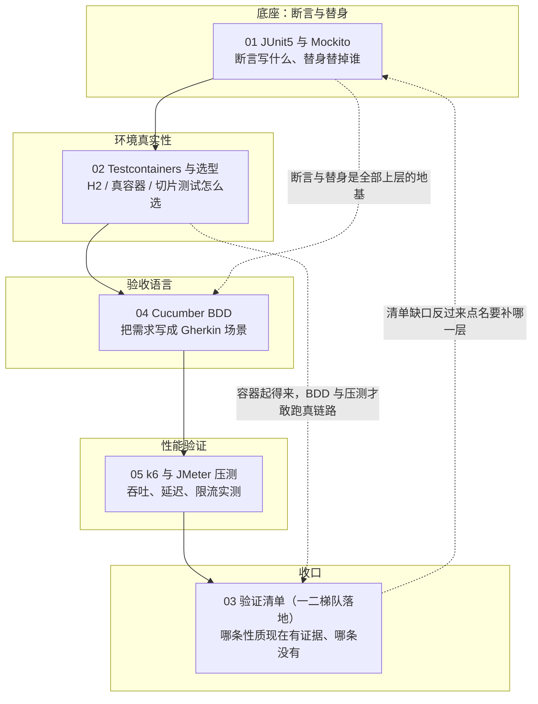

# 08 测试：把"测过了"翻译成"验证过了"

> **一句话结论**：绿色的测试只证明"你亲手写下的那几条性质此刻仍然成立"，不证明系统能被交付——本仓库 143 个测试类、654 个测试方法可以全绿，同时 Java 服务在 CI 里一次都没跑过、容器级测试只占 7.7%、89 条验收场景一条都没变成可执行用例。
> **阅读前置**：会写 JUnit 5 的 `@Test` / `@BeforeEach`；看得懂 Maven 多模块的 `<pluginManagement>`（[02-Maven多模块管理](../01-Java基础/02-Maven多模块管理.md)）；知道 Spring 应用启动时会装配出一张 Bean 对象图（[15-SpringAOP与声明式事务原理](../02-Spring微服务/15-SpringAOP与声明式事务原理.md)）。
> **证据基线**：JDK 17.0.19 / Spring Boot 4.2.0 / JUnit Jupiter 6.1.3 / Mockito 5.24.0 / AssertJ 3.27.7 / JaCoCo 0.8.11；本模块所有数字均为 2026-11-27 在本仓库现测，命令随行给出｜预计阅读 20 分钟

---

## 1. 定位：这个模块补的是"证据缺口"

先分清两个词，它们差得很远：

- **测过了**：命令退出码是 0，报告里没有红色。
- **验证过了**：对你关心的那条性质，存在一条**别人能重跑、失败就报警**的证据。

本仓库有相当规模的"测过了"，缺的正是"验证过了"。这个缺口不是靠再写几百个断言能补上的，因为它在四个不同的位置同时漏气：

| 漏气位置 | 具体表现 | 在哪一节展开 |
|---|---|---|
| 断言只对着测试替身说话 | Mock 的返回值是你自己 `when(...).thenReturn(...)` 写进去的，实现改错它照样绿 | [01 单测](./01-JUnit5与Mockito单元测试.md) |
| 容器没真正起来 | 7.7% 的测试类碰过容器，其中只有 3 个真的启动 Spring 上下文；配置错误、序列化、事务边界、Bean 装配失败根本不在覆盖范围内 | [02 环境真实性](./02-Testcontainers与安全框架技术选型.md) |
| 没人自动跑 | `.github/workflows/` 下只有 `python-learning-validate.yml`，8 个 Java 服务没有一个 job | 本篇第 4 节 |
| 门禁口径互打 | 根 `pom.xml#L373-L382` 写 LINE 0.40 / BRANCH 0.30，`CLAUDE.md#L131-L134` 同口径，而 `.claude/agents/implementer.md#L235` 要求单元测试覆盖率 = 100% | 本篇第 4 节、第 8 节 |

还有一类更隐蔽的假绿：**HTTP 状态码层面的假绿**。

```java
// ai-cs-common/src/main/java/com/aics/common/exception/GlobalExceptionHandler.java#L35-L39
@ExceptionHandler(BusinessException.class)
public Result<Void> handleBusinessException(BusinessException e) {
    log.warn("业务异常: {}", e.getMessage());
    return Result.fail(e.getCode(), e.getMessage());   // 没有 @ResponseStatus → 恒 200
}
```

同文件其它 handler（L45 / L58 / L71 / L85 / L98 / L110 / L120 / L130）都标了 `@ResponseStatus`，唯独业务异常这条没有。后果是很实际的：任何用 `status().isOk()` 断言"业务失败"的接口测试，永远绿。这正是本模块要训练的第一件事——**先问"这条测试失败时会是什么样"，再写断言**。

**三类读者，三条读法**：

- **要在交付前判断"能不能上线"的人**：读第 4 节的盘点表 + 第 8 节诚实清单，这两节能直接写进上线评审材料。
- **面试要讲清"你做过什么测试体系"的人**：读第 5 节的速通路线，配 03 篇清单话术。
- **要给存量代码补测试的人**：读 01 篇的替身与断言手法 + 本篇第 5 节的一周计划。

> 测试金字塔（单元 : 集成分层 : 端到端 ≈ 70:20:10）这个比例是对的，但它描述的是**代价**分布，不是**价值**分布。本仓库的实际形状是 92% 单元 / 8% 碰容器 / 0 端到端自动化，代价很低、价值上限也很低，因为最贵的缺陷（装配、SQL、序列化、限流顺序）全都落在那一层。

---

## 2. 模块地图：五篇各自守住一段证据链



**读图说明**：

1. **实线是推荐阅读顺序**，也是证据依赖方向：01 教的"断言写什么"被 04 的场景步骤直接继承（Steps 类里写的还是 `assertThat`）；02 教的"环境要真到什么程度"决定了 05 能不能压出可信数字（压一份 H2 + Mock 的服务没有意义）。
2. **虚线是回环**：03 是收口篇，但它不是终点——清单上打不了勾的项，会反向点名"回 01 补断言 / 回 02 补容器"，这是本模块唯一值得反复走的一圈。
3. **五篇都指向同一张表**：第 4 节。任何一篇里读到的结论，都应该能在第 4 节找到它对应的实测数或明确标注"未落地"。找不到的，按未验证处理。

**推荐顺序**：`01 → 02 → 04 → 05 → 03`。急着面试就按第 5 节 B 路线（90 分钟），但要清楚那条路线牺牲了动手部分。

### 2.1 五篇共享的三个前提

读之前先接受这三条，否则会觉得某些篇"怎么总在讲不落地的东西"：

1. **测试是证据，不是工作量。** 证据的价值由"它能让什么决定变得可靠"决定，不由行数决定。所以 02 篇把 Testcontainers 讲透却拿不出本仓库示例（依赖 0 命中），这不是偷懒，是没有 Docker 时唯一诚实的写法。
2. **越便宜的证据越该覆盖高频性质。** 单个类的分支逻辑用单测钉死（毫秒级），跨层装配用容器测试（秒级），业务语义的正确性用 BDD 场景表达（分钟级）。层级错配是本仓库最常见的问题：用 Mock 去验证"事务回滚了没有"。
3. **任何结论都要能落到一条命令上。** 本模块所有数字背后都有可重跑的命令（第 4.2 节），没有命令支撑的结论一律视为观点。这也是写给未来的自己看的纪律——半年后你只会相信能重跑的东西。

---

## 3. 每篇一句话摘要

| 篇 | 解决什么问题 | 本项目落地程度 | 证据类型 |
|---|---|---|---|
| [01 JUnit5 与 Mockito](./01-JUnit5与Mockito单元测试.md)（720 行） | 断言到底该钉什么性质；`@Mock` / `@InjectMocks` / `verify` 的边界在哪；为什么覆盖率不是产出 | **高**：143 个测试类、654 个方法、约 2000 条断言语句，是全仓最扎实的一层 | A + B + C |
| [02 Testcontainers 与安全框架技术选型](./02-Testcontainers与安全框架技术选型.md)（630 行） | 环境"真到什么程度"够用；Testcontainers 的租约成本；切片测试（`@WebMvcTest` / `@DataJpaTest`）与全量 `@SpringBootTest` 的取舍 | **低**：全仓 `testcontainers` 0 处依赖命中，本机无 Docker；三条真实依赖缺口（分片路由落表 / LLM 生成 SQL / 缓存锁行为）目前由 H2、Mockito、`@WebMvcTest` 顶替 | A + B + C |
| [03 一等公民验证清单（一二梯队落地）](./03-一等公民验证清单（一二梯队落地）.md)（688 行） | 把"测试"升级成"验证"：每条关键性质配一条可重跑证据，分梯队排优先级 | **中**：清单本身落地，但清单上仍有整块未打勾项（CI、容器级、验收场景转 feature） | B + C |
| [04 Cucumber-BDD 行为驱动实战](./04-Cucumber-BDD行为驱动实战.md)（631 行） | 让业务方看得懂的验收语言；Gherkin 场景怎么写才不变成"用英文写 Java" | **局部高**：9 个 `.feature` / 38 个场景 / 167 条步骤行，但只覆盖 chat 安全 7 个主题与 gateway 2 个主题；`cucumber-spring` 全仓 0 命中（对象级 BDD，不装 Spring 容器） | B + C |
| [05 性能压测实战-k6与JMeter](./05-性能压测实战-k6与JMeter.md)（675 行） | 吞吐/延迟/限流行为怎么量；为什么"没压过就不许说支持高并发" | **低**：2026-09 才补了 `scripts/loadtest/k6/` 两个脚本，基线报告待执行（需完整服务链路，本机不具备） | B |

> 五篇的讲法一致、落地程度差异极大：01 与 03 是"已经在用的东西"，02 与 05 是"知道怎么用但用不上"，04 是"用上了但只用在一条支线"。读的时候不要把这三种状态混为一谈——尤其别把 02、05 里的示例误当成仓库现状。

### 3.1 篇与篇之间的三个交接点

真正需要跨篇理解的地方只有三处，抓住它们，五篇就串成一条线：

| 交接点 | 01 的说法 | 下一层的说法 | 本仓库的实际情况 |
|---|---|---|---|
| "测到哪一层" | 单测里 `@Mock` 掉 DAO 就够了 | 02：Mock 掉的 DAO 让 SQL、方言、事务边界全部失守 | `ai-cs-user/src/test/java/com/aics/user/sharding/UserShardingRouteTest.java` 是唯一试图用真 H2 验证"分片路由落表"的测试，代价是 160 行手工装配 |
| "谁定义正确" | 断言由写测试的人定义 | 04：断言由业务方看得懂的场景定义，开发者负责实现 | 9 个 feature 全部来自安全主题，说明"业务方参与定义"这件事在业务链路上还没发生 |
| "多快算够" | 单测毫秒级、集成秒级是 FIRST 里的 Fast | 05：吞吐与延迟只能压出来，不能从测试耗时推 | 两个 k6 脚本存在但无基线，任何"支持高并发"的说法目前都无证据 |

---

## 4. 本仓库测试现状：现测，不引用旧数字

### 4.1 盘点表

| 维度 | 实测值（2026-11-27） | 判读 |
|---|---|---|
| 测试类 | **143**；chat 58 / order 17 / message 12 / pay 11 / notify 8 / user 8 / product 7 / gateway 7 / common 7 / search 3 / knowledge 3 / mq 2 | 分布与业务复杂度基本同向，但 knowledge、search 各 3 个与其代码量不匹配 |
| 测试方法 | **654**（`@Test` 652 + `@ParameterizedTest` 2），平均 4.6 方法/类 | 参数化测试只用过 2 次，说明"同一逻辑多组输入"的场景靠复制粘贴解决 |
| 断言语句 | **约 1975**（直呼 `assertXxx`/`assertThat`/`verify`/`fail` 共 1718 处 + AssertJ 链式终结 `.isEqualTo()` 等 257 处），平均 **3.0 条/方法** | 断言数为 0 的测试类 **0 个**，"覆盖率刷出来但没断言"这个常见坑本仓库没有；但断言总数对统计口径极其敏感，见 4.2 第四组 |
| 容器级测试 | **11 / 143 = 7.7%**。其中真启 Spring 上下文 **3** 个（`@SpringBootTest` 1 + `@WebMvcTest` 2，全在 ai-cs-user）；6 个是 `MockMvcBuilders.standaloneSetup`（不装容器，只测路由与序列化）；2 个是手工搭的最小上下文 / H2（无容器） | 装配错误、条件化 Bean、`@Transactional` 真实边界、Nacos/MQ 配置绑定，几乎全在证据之外 |
| BDD | **9** 个 `.feature` / **38** 个 Scenario / **167** 条步骤行；2 个 `*Steps.java`（681 + 147 行）+ 2 个 `*Suite.java`（21 + 19 行）；`cucumber-spring` 0 命中 | 场景语言是真落地的，但只用于安全护栏（提示注入、越权、审计），业务主链路没有一条 Scenario |
| specs 验收场景 → `.feature` | specs 001~005 的 `spec.md` 里「假设/当/则」式验收场景 **89 条**，转成 `.feature` 的 **0 条** | SDD 写了验收标准，BDD 却没接上——两套体系各写各的，这是最贵的一处断裂 |
| CI | `.github/workflows/` 只有 `python-learning-validate.yml`；**8 个 Java 服务 0 个 job** | "测试跑过没有"这件事目前依赖人记得跑 |
| 覆盖率门禁 | 声明在根 `pom.xml#L349-L392` 的 `<pluginManagement>`，阈值 L373-L382：LINE 0.40 / BRANCH 0.30，`<element>BUNDLE</element>`，check 绑 `verify`（L365-L367） | 父 pom 只是"提供了配置"，子模块不声明就不会执行 |
| 门禁实际覆盖面 | 只有 5 个模块二次声明：`ai-cs-message/pom.xml#L125-L128`、`ai-cs-notify/pom.xml#L106-L109`、`ai-cs-order/pom.xml#L192-L195`、`ai-cs-pay/pom.xml#L124-L125`、`ai-cs-product/pom.xml#L164-L167` → **5 / 13 模块** | chat（58 个测试类、全仓最多）反而没有门禁 |
| 实测覆盖率 | order 行 62.3%（78/207 未覆盖）· product 62.2%（56/148）· message 62.1%（53/140）· notify 64.0%（18/50）· pay **34.7%（156/239，低于 40% 门禁）**；chat 无 JaCoCo 报告 | pay 的数字说明门禁即便声明了也没人看报告；chat 的数字压根不存在 |
| 门禁口径 | 三处冲突：`pom.xml#L373-L382` = 40%/30%；`CLAUDE.md#L131-L134` = 40%/30%；`.claude/agents/implementer.md#L36`、`#L109`、`#L223`、`#L235` = **100%** | 对同一个指标，构建脚本、项目宪法、Agent 纪律三个来源给了两个答案 |
| 静态检查门禁 | `archunit` / `checkstyle` / `spotless` / `spotbugs` / `sonar` 在全部 `pom.xml` 里 **0 命中** | 架构分层（gateway → 业务 → common）目前没有任何自动约束，只靠 Code Review |
| 手工联调报告 | `docs/21-补充功能接口测试报告.md`：2026-08-07，网关 8080 / chat 8083 / user 8081 真实服务，**17/17 通过**；`docs/29-用户接口输入校验与E2E测试.md` 同类 | 有价值，但它是"某天某人跑过一次"的证据，不可重跑，不能算验证 |

### 4.2 四组可直接重跑的命令（C 级证据）

第一组：测试类与测试方法（在仓库根执行）。

```powershell
$t = Get-ChildItem -Recurse -Filter *Test.java -File | Where-Object { $_.FullName -notmatch '\\target\\' }
$t.Count
(($t | ForEach-Object { (Select-String -LiteralPath $_.FullName -Pattern '@Test\b|@ParameterizedTest').Count } |
  Measure-Object -Sum).Sum
```

真实输出（`654` 是方法注解计数）：

```text
143
654
```

**怎么读**：`143 / 654` 说明平均每个类 4.6 个方法，属于"正常写"而不是"每类一个 smoke test"。两个坑：① 一定要排除 `\target\`，否则 Maven 复制到 `target/test-classes` 的副本会让数字翻倍；② `Get-ChildItem -Path ai-cs-* -Recurse -Filter *Test.java` 这种"通配路径 + Filter"写法本机返回 **0**，必须在仓库根全量递归再筛。

第二组：容器级测试到底有几个。

```powershell
$f = (Get-ChildItem -Recurse -Filter *Test.java -File | Where-Object { $_.FullName -notmatch '\\target\\' }).FullName
Select-String -Path $f -Pattern '@SpringBootTest|@WebMvcTest|MockMvcBuilders\.standaloneSetup' -List |
  ForEach-Object { $_.Path -replace '.*ai-customer-service\\','' }
```

真实输出（9 个文件）：

```text
ai-cs-chat\src\test\java\com\aics\chat\controller\ChartControllerTest.java
ai-cs-chat\src\test\java\com\aics\chat\controller\ChatControllerRegressionTest.java
ai-cs-chat\src\test\java\com\aics\chat\controller\ChatControllerVisionTest.java
ai-cs-chat\src\test\java\com\aics\chat\controller\RetrieveControllerTest.java
ai-cs-knowledge\src\test\java\com\aics\knowledge\controller\KnowledgeOpsControllerTest.java
ai-cs-notify\src\test\java\com\aics\notify\controller\NotifyHandoffControllerTest.java
ai-cs-user\src\test\java\com\aics\user\security\UserApiEndToEndTest.java
ai-cs-user\src\test\java\com\aics\user\security\UserApiValidationIntegrationTest.java
ai-cs-user\src\test\java\com\aics\user\security\UserSecurityIntegrationTest.java
```

**怎么读**：9 个命中里，6 个是 `MockMvcBuilders.standaloneSetup(...)`——它只把 Controller 和几个手传进去的替身拼成一条 MVC 管线，**不启动 Spring 上下文**，所以 `@Transactional`、Bean 校验器、拦截器、`@ControllerAdvice` 大多不在场；只有 `UserApiEndToEndTest`（`@SpringBootTest` + `jdbc:h2:mem:user_api_e2e`）与两个 `@WebMvcTest` 是真的容器。`@WebMvcTest` 之所以叫"切片（slice）"，是因为它自己带着 `@TypeExcludeFilters(WebMvcTypeExcludeFilter.class)`，把 Service / Repository 一并排出组件扫描范围 [[源码:WebMvcTest.java.md#L92-L96]]，再由 `TestSliceTestContextBootstrapper` 这套引导器决定装配哪一层 [[源码:TestSliceTestContextBootstrapper.java.md#L27-L38]]——换句话说，**切片测试的盲区是框架设计出来的，不是你没写**。再加上不匹配这条正则、但手工搭了环境的 `ai-cs-order/src/test/java/com/aics/order/service/impl/OrderCreateTxWiringTest.java`（注释自述"最小 Spring 上下文（`@EnableTransactionManagement` + H2）"）与 `ai-cs-user/src/test/java/com/aics/user/sharding/UserShardingRouteTest.java`（`YamlShardingSphereDataSourceFactory` + 3 个 H2 内存库，无容器），得到 **11 / 143 = 7.7%**。

第三组：门禁与产物是否真的存在。

```powershell
$p = (Get-ChildItem -Recurse -Filter pom.xml -File | Where-Object { $_.FullName -notmatch '\\target\\' }).FullName
"jacoco 声明处数=" + (Select-String -Path $p -Pattern '<artifactId>jacoco-maven-plugin</artifactId>' -List).Count
"testcontainers=" + (Select-String -Path $p -Pattern 'testcontainers' | Measure-Object).Count
"cucumber-spring=" + (Select-String -Path $p -Pattern 'cucumber-spring' | Measure-Object).Count
Get-ChildItem -Recurse -Filter jacoco.exec -File | ForEach-Object { $_.FullName -replace '.*ai-customer-service\\','' }
```

真实输出：

```text
jacoco 声明处数=6
testcontainers=0
cucumber-spring=0
ai-cs-message\target\jacoco.exec
ai-cs-notify\target\jacoco.exec
ai-cs-order\target\jacoco.exec
ai-cs-pay\target\jacoco.exec
ai-cs-product\target\jacoco.exec
```

**怎么读**：`jacoco 声明处数 = 6` 恰好等于"根 pom 的 `pluginManagement` 1 处 + 5 个模块各 1 处"，这行数字本身就是门禁覆盖面只有 5/13 的证据——如果 13 个模块都生效，它应该是 14。`jacoco.exec` 只在同样这 5 个模块里存在，说明 chat / gateway / user / knowledge / search / common / mq 从来没产出过覆盖率数据。`testcontainers = 0` 则解释了 02 篇为什么通篇是"选型与缺口"而不是"用法"。

第四组：断言语句计数（这一组请连"怎么读"一起看，它演示了口径陷阱）。

```powershell
$f = (Get-ChildItem -Recurse -Filter *Test.java -File | Where-Object { $_.FullName -notmatch '\\target\\' }).FullName
$direct = (Select-String -Path $f -Pattern '\b(assert[A-Za-z]+|fail)\s*\(|\bverify\s*\(' | Measure-Object).Count
$chain  = (Select-String -Path $f -Pattern '\.(isEqualTo|isTrue|isFalse|isNull|isNotNull|hasSize|contains|containsExactly|startsWith|endsWith|isInstanceOf|isPresent|isEmpty|isNotEmpty|isGreaterThan|isLessThan)\s*\(' | Measure-Object).Count
"直呼=$direct"; "链式=$chain"; "合计=" + ($direct + $chain)
```

真实输出：

```text
直呼=1718
链式=257
合计=1975
```

**怎么读**：这行的意义不是"1975"这个数，而是**它有多容易被改掉**。把 `$chain` 的方法清单加长（补 `.extracting` / `.satisfies` 等），同一份代码能得到 **2134**；只数直呼则是 **1718**。三个数字都"对"，差别全在定义。所以：

- 引用任何断言/覆盖率数字时必须同时给出命令，否则无法复核——这也是本模块反复强调"结论要落到命令上"的原因。
- 判断测试集质量别只看总数，看 **断言数 ÷ 测试方法数**（本次 3.0）和 **断言数为 0 的测试类个数**（本次 0）。前者太低说明测试只做 smoke，后者大于 0 说明有纯执行型测试。
- 想比较不同时期，永远固定同一份正则，把命令和数字一起记进提交说明。

### 4.3 断言最密的三个测试类

数量之外还要看分布，否则"约 2000 条断言"很容易被少数几个巨型测试类撑起来。

| 测试类 | 断言数 | 说明 |
|---|---|---|
| `ai-cs-chat/src/test/java/com/aics/chat/agent/workflow/AfterSaleAgentServiceTest.java` | 89 | Agent 编排分支多，断言密合理；也是 chat 模块 58 个测试类的重心 |
| `ai-cs-order/src/test/java/com/aics/order/service/AfterSaleServiceTest.java` | 72 | 售后状态机，典型的多分支业务 |
| `ai-cs-message/src/test/java/com/aics/message/service/AgentTraceServiceTest.java` | 69 | 埋点/轨迹字段多，属"字段逐个断言"型 |

**怎么读**：三个都是 Service 层，都不需要容器——这从侧面印证了 7.7% 这个比例不是"偶然没写集成测试"，而是整个工程的测试重心就压在 Service 单测上。它买到的是**分支逻辑的正确性**，买不到**装配与链路的正确性**。判断自己项目缺哪一半，最快的办法就是翻 `@SpringBootTest` 的出现次数。

### 4.4 数字之间怎么互相解释

单独看每个数字都还好，放在一起才看出结构性：

- **143 个测试类 vs 5 份覆盖率报告**：58 个测试类的 chat 模块没有报告，说明"写得最多的模块"和"能看见质量的模块"不是同一个。写得多 ≠ 看得见。
- **约 2000 条断言 vs 89 条未转 feature 的验收场景**：断言全在代码内部视角（方法返回了什么），验收场景是外部视角（用户看到了什么）。两套语言没有互相翻译，于是"测试全绿"和"需求满足"之间没有桥。
- **11/143 容器级 vs 3 个真容器**：那 6 个 `standaloneSetup` 给了"我在做集成测试"的错觉，实际只验证了 MVC 的一小段。
- **门禁 5/13 覆盖 vs pay 34.7%**：门禁覆盖到的地方都还有不达标的模块，说明 check 即便执行了，失败信息也没人接手——门禁的价值不在配置，在"红了必须有人处理"。

### 4.5 旧版本 README 里的四处事实漂移

本模块入口文档的前一版（330 行）是通用教程体，其中四处说法与仓库实际不符。列在这里不是为了挑错，而是因为**读二手文档时最难发现的恰恰是"配置抄错了但看起来很像真的"**：

| 旧稿说法 | 当前实际 | 危害 |
|---|---|---|
| JaCoCo 门禁写 `LINE 0.60`、`<element>PACKAGE</element>` | 根 `pom.xml#L371-L382` 是 `<element>BUNDLE</element>` + LINE 0.40 / BRANCH 0.30 | 照旧稿调门禁，会把 5 个模块的构建立刻打红；也会误以为按包统计 |
| 检查清单"覆盖率 ≥ 60%（JaCoCo 门禁）" | 40% / 30% | 与前一条同源，且与 `.claude/agents/implementer.md` 的 100% 形成第三种说法 |
| "集成测试：MockMvc / TestContainers / H2" 属于本模块已具备能力 | `testcontainers` 依赖 0 命中；真启容器的测试 3 个 | 面试时若说"我们用 Testcontainers"，一查 pom 就穿 |
| 测试金字塔只给"比例建议 70:20:10"，不给本仓库实测分布 | 实测约 92% 单元 / 7.7% 碰容器 / 0 端到端 | 建议被读者当成现状引用，于是没人意识到自己离目标有多远 |

**通用的自查动作**：任何写在文档里的版本号、行号、阈值，落笔前回到文件里 `read` 一次并在文中标注行号（本篇 `pom.xml#L349-L392` 之类的写法就是这个习惯的产物）。行号会漂移——[08-质量门禁与自动化](../17-研发效能与工程实践/08-质量门禁与自动化.md) 里写的 `pom.xml:328-367` 已经漂到 L349-L392 了。

---

## 5. 两条路线

### 5.1 A 路线：一周把验证能力补齐（动手向）

按 Day 排序，每天一项，每项都给验收标准。所有命令都要求"失败过一次"才算做完——没红过的门禁等于没有门禁。

| Day | 做什么 | 改哪里 | 验收标准 |
|---|---|---|---|
| D1 | 让 JaCoCo 门禁真正覆盖 13 个模块 | 根 `pom.xml` 的 `<build><plugins>` 补一次声明（而不是只在 `pluginManagement` 里挂配置） | `mvn -pl ai-cs-chat verify` 结束时出现 JaCoCo 的 check 执行；故意注释掉一个测试，构建变红 |
| D2 | 把 Java 服务接进 CI | 新增 `.github/workflows/java-ci.yml`（参考同目录 `python-learning-validate.yml` 的 job 写法） | PR 页面上出现一个新的 check；它执行 `mvn -B verify` |
| D3 | 修 pay 的覆盖率红线 | `ai-cs-pay` 里行覆盖缺失的 156/239 | `ai-cs-pay/target/site/jacoco/index.html` 的 Lines 覆盖率从 34.7% 上到 ≥40%，`verify` 由红转绿 |
| D4 | 容器级测试从 7.7% 提到 20% | 优先 order（交易链路 + 事务边界），仿 `OrderCreateTxWiringTest` 的 H2 最小上下文扩到 Controller 层 | 至少 3 个新测试类用 `@SpringBootTest` + H2，且其中至少 1 个**故意改错配置时能红** |
| D5 | 把验收场景接上 BDD | 从 specs 里挑 `specs/005-after-sales-agent/spec.md`（29 条验收场景中最大的一块）选 3 条写成 `.feature` | 新增 feature 能被 `*Suite.java` 跑到；删掉对应实现后场景变红 |
| D6 | 压测脚本跑出第一份基线 | `scripts/loadtest/k6/sse-chat.js`、`gateway-rate-limit.js` | 产出一份含 p95 / 错误率 / 限流触发点的报告；**本机无 docker 起不了完整链路，此项需在有环境的机器上做** |
| D7 | 统一门禁口径 | `.claude/agents/implementer.md` 与 `CLAUDE.md` 对齐到 `pom.xml` 的 40/30 | 三处文字只剩一种说法；评审时不再出现"到底按 40 还是 100"的争论 |

### 5.2 B 路线：面试速通（90 分钟）

1. **0-25 分**：读 01 篇的"换写法会怎样"小节，记住一句能讲的话——*覆盖率是执行过的行数，测试是钉住的性质，两者可以零相关*。
2. **25-45 分**：读 03 篇的梯队表，把"一等公民验证"翻译成你自己的项目语言（哪条性质、什么证据、谁跑、失败什么样）。
3. **45-65 分**：读 04 篇，准备一个"把验收标准写成 Gherkin 会暴露什么"的真实例子（本项目最好的例子是：89 条验收场景一条都没转，说明 SDD 与 BDD 没接上）。
4. **65-80 分**：读 02 篇的选型对比，能说出 H2 / 切片测试 / Testcontainers 三者的**租约成本**差异。
5. **80-90 分**：读 05 篇，记住"没压过就不许说支持高并发"，并知道本项目两个 k6 脚本在哪。

### 5.3 两条路线怎么选

| 你的处境 | 选哪条 | 别做什么 |
|---|---|---|
| 接手这个仓库，三周内要能对外承诺质量 | A 路线，且从 D1 + D3 开始 | 别先补测试量——门禁与口径没定，补了也没人看 |
| 正在准备面试，需要讲清"我如何设计测试体系" | B 路线 | 别只背 FIRST / 金字塔，面试官更想听你区分"证据"与"工作量" |
| 只想给某个模块补测试 | A 路线的 D4/D5，单点做 | 别在 chat 模块上继续堆 Service 单测，它已经有 58 个测试类了 |
| 想验证 BDD 是否值得引入 | 只做 D5 | 别一次转 89 条，先转 3 条，看它是否真的抓到实现缺陷 |

---

## 6. 依赖关系

| 关系 | 目标 | 为什么 |
|---|---|---|
| 前置 | [02-Maven多模块管理](../01-Java基础/02-Maven多模块管理.md) | 门禁、surefire 配置、profile（`ai-cs-chat/pom.xml#L226-L245` 的 `eval` profile）全在 `pom.xml` 里，不读构建就解释不了"为什么测试没跑" |
| 前置 | [17-SpringMVC请求全链路与参数校验](../02-Spring微服务/17-SpringMVC请求全链路与参数校验.md) | `MockMvc` 断言的就是这条链路；不知道过滤器/拦截器顺序，就不知道切片测试漏了什么 |
| 前置 | [15-SpringAOP与声明式事务原理](../02-Spring微服务/15-SpringAOP与声明式事务原理.md) | `@Transactional` 只在真容器里生效，是 7.7% 这个数字最贵的代价 |
| 相关 | [08-质量门禁与自动化](../17-研发效能与工程实践/08-质量门禁与自动化.md) | 同一套 JaCoCo 门禁的另一视角（该篇写的 `pom.xml:328-367` 已漂移，当前是 L349-L392） |
| 相关 | [04-CodeReview实战](../17-研发效能与工程实践/04-CodeReview实战.md) | 静态检查 0 命中时，架构分层靠的就是人 |
| 相关 | [04-BDD行为驱动开发](../05-AI集成/03-AI编码方法论/04-BDD行为驱动开发.md) | 方法论层；本模块 04 篇是它在 Java 侧的落地 |
| 被引用 | [04-SpringCloudGateway网关](../02-Spring微服务/04-SpringCloudGateway网关.md) | 网关篇的限流/身份头结论，证据来源是本模块的 gateway BDD 场景 |
| 事故复盘 | [28-故障案例库](../../docs/28-故障案例库.md) | 读测试时最好的素材：每个故障都对应"当时哪条测试本该存在" |

### 6.1 一条可重复的"读-跑-改"循环

本模块不指望一次读完就记住，按这个循环走三圈，比通读一遍有用得多：

1. **读一段，找一条命令。** 每读完一个小节，问一句"这一节的结论我怎么用一条命令验一次"。找不到命令的段落，划掉不记。
2. **跑一次，看数字是否与文里一致。** 不一致时先怀疑自己的命令（是否排除 `\target\`、是否被 `pom.xml` 的 profile 改变范围），再怀疑文档。
3. **改一处，让某条测试变红。** 改的是实现还是配置都行，目的是确认"这条测试真的会报警"。不会报警的测试，删掉比留着更安全——它占着绿色的位置。
4. **记一行。** 把命令 + 数字 + 日期写进提交说明或 Issue，下一轮比较时用同一份命令。

这个循环的产物不是知识，是**可移交的证据**。本仓库目前最缺的正是这个：`docs/21-补充功能接口测试报告.md` 记录了 17/17 通过，但没记命令，所以别人无法复现，只能选择相信或不相信。

---

## 7. 检查点清单

### 能说出（合上书自测）

- [ ] 说出"测过了"和"验证过了"的区别，并各举一个本仓库的真实例子。
- [ ] 说出本仓库容器级测试的比例，以及 `MockMvcBuilders.standaloneSetup` 与 `@SpringBootTest` 的差别。
- [ ] 说出 JaCoCo 门禁为什么只覆盖 5 个模块，以及为什么 chat 没有覆盖率报告。
- [ ] 说出 `@ExceptionHandler` 缺 `@ResponseStatus` 会造成什么假绿，怎么用一条测试抓出来。
- [ ] 说出 BDD 场景"对象级"与"容器级"的区别（本仓库 `cucumber-spring` 0 命中意味着什么）。

### 能跑出（30 秒内，不需要服务、不需要网络）

- [ ] 第 4.2 节四组命令全部重跑一遍，数字与表格一致（断言那组请特别体会口径差异）。
- [ ] `Get-ChildItem -Recurse -Filter *.feature` **不排除 `\target\`** 时得到 18 个文件 / 76 条 Scenario 行，排除后是 9 / 38——亲手体验一次"统计口径 ×2"陷阱。
- [ ] 打开 `ai-cs-order/target/site/jacoco/index.html`，从 footer 读出 Lines 覆盖率并复算 62.3%。
- [ ] `jar tf ai-cs-order/target/ai-cs-order-1.0.0-SNAPSHOT.jar`，确认产物里没有任何 `*Test.class`（测试不会被打进镜像，这是好事，也意味着"线上跑测试"这种兜底不存在）。

### 能改造（真动手）

- [ ] 给 `GlobalExceptionHandler` 的业务异常分支补一个状态码测试，**先让它红**（断言 `status().is4xxClientError()`），再决定是改实现还是改预期。
- [ ] 挑一个只用 `standaloneSetup` 的 Controller 测试，改成 `@WebMvcTest`，记录它新抓到的问题（通常是参数校验或 `@ControllerAdvice` 缺席）。
- [ ] 把一条 specs 验收场景改写成 `.feature`，并让它在删掉实现后变红。

> 上面第一条值得单独说清，因为它是最典型的"假绿改真红"。下面两段是**示意代码**（不是仓库现有测试），针对的就是 `GlobalExceptionHandler` L35-L39 那个缺 `@ResponseStatus` 的分支：

```java
// ❌ 假绿：无论业务成功还是失败，这条断言都通过 —— 因为失败也是 HTTP 200
mockMvc.perform(post("/api/orders").contentType(APPLICATION_JSON).content(body))
       .andExpect(status().isOk());

// ✅ 真红：先写下你真正希望的行为，它会立刻失败（暴露实现缺陷），而不是继续送绿灯
mockMvc.perform(post("/api/orders").contentType(APPLICATION_JSON).content(invalidBody))
       .andExpect(status().is4xxClientError())
       .andExpect(jsonPath("$.code").exists());   // Result 的失败分支带 code
```

练这个动作的顺序很重要：**先让新断言红，再决定是改实现还是改预期**。反过来做（先看实现是什么再写断言）等于把测试降级成"记录当前行为"，这类测试在重构时只会阻碍你。

---

## 8. 诚实清单：本仓库目前没有的能力

写这一节的目的是让"没做到"和"做到了"一样清楚。以下每条都对应第 4 节的实测。

| 缺失能力 | 现状 | 补它要动哪里 | 为什么难 |
|---|---|---|---|
| Java 服务进 CI | `.github/workflows/` 只有 `python-learning-validate.yml` | 新增 `java-ci.yml`，矩阵跑 13 个模块 | 全量 `mvn verify` 成本高；且 pay 现在 34.7% 会立刻把流水线打红——这恰恰是该先修门禁口径（D1/D3）的原因 |
| 容器级测试成规模 | 11/143 = 7.7%，真容器仅 3 个 | order / chat 各补 2~3 个 `@SpringBootTest` + H2 | H2 与 MySQL 方言差异、RocketMQ/Redis 都要替身；本机无 Docker，Testcontainers 路线不可行 |
| Testcontainers | 依赖 0 命中 | 若要上，需先在开发者机器与 CI 都具备 Docker | 本机 `docker` / `redis` / `mysql` / `chroma` / `es` 均不存在——02 篇的定位必须保持"选型与缺口"，不能写成"用法教程" |
| 验收场景可执行化 | specs 89 条 → `.feature` 0 条 | 从 `specs/005-after-sales-agent/spec.md` 起挑 3 条 | 需要业务方参与定义"可观测的行为"；现有 9 个 feature 全在安全主题，业务链路没有先例可抄 |
| 覆盖率数据完整 | chat / gateway / user / knowledge / search / common / mq 无 JaCoCo 报告 | 在根 pom `<build><plugins>` 声明一次 | 现在只有 5 个模块各自抄了一遍配置，剩下 8 个模块默不作声 |
| 门禁口径唯一 | pom 40/30、CLAUDE.md 40/30、implementer.md 100%，三处冲突 | 三处对齐，或明确"Agent 纪律高于构建门禁"并写清理由 | 100% 在新代码上可行、在存量上不可能，不做区分就会变成一句空话 |
| 静态质量门禁 | archunit / checkstyle / spotless / spotbugs / sonar 全 0 命中 | 至少加 archunit 守住"gateway → 业务 → common"的依赖方向 | 存量代码大概率已有违反项，需要先定基线再增量收紧 |
| 性能基线 | 两个 k6 脚本存在，无基线报告 | `scripts/loadtest/k6/sse-chat.js` 跑出 p95 与错误率 | 需要完整服务链路（网关 + chat + 真实模型），本机不具备；05 篇因此只写方法与命令 |
| 端到端自动化 | 0（手工联调见 `docs/21-补充功能接口测试报告.md`，17/17 通过但是不可重跑的证据） | 用 Playwright / 接口脚本把 17 条手工用例变成可重跑用例 | 前端 + 8 个后端服务同时起，资源与稳定性成本高 |

> 这一节和 [03 验证清单](./03-一等公民验证清单（一二梯队落地）.md) 是同一件事的两面：03 写"该有什么证据"，这里写"哪些证据现在没有"。任何时候两张表不一致，以第 4.2 节能重跑出来的命令为准。

### 8.1 如果只有一天，做这三件

1. **让一个门禁真的红一次。** 从 `ai-cs-pay` 开始（行覆盖 34.7%，离 40% 最近也最该挡），看它把构建打红，再决定是补测试还是降阈值——无论哪种，你都第一次有了"门禁在管事"的证据。
2. **把 Java 服务接进 CI 的最小一版。** 单个 job、单模块（先只有 `ai-cs-pay` 或 `ai-cs-order`），跑通 `mvn -B verify` 即可。覆盖面以后再扩，先让"没人跑"这个最大的洞闭上。
3. **写一条会红的测试。** 挑 `GlobalExceptionHandler` 的业务异常分支，断言 `status().is4xxClientError()`，看它现在失败——这条测试同时证明了业务失败恒 200 的缺陷存在，也是本模块从"测过了"走到"验证过了"的第一个样本。
